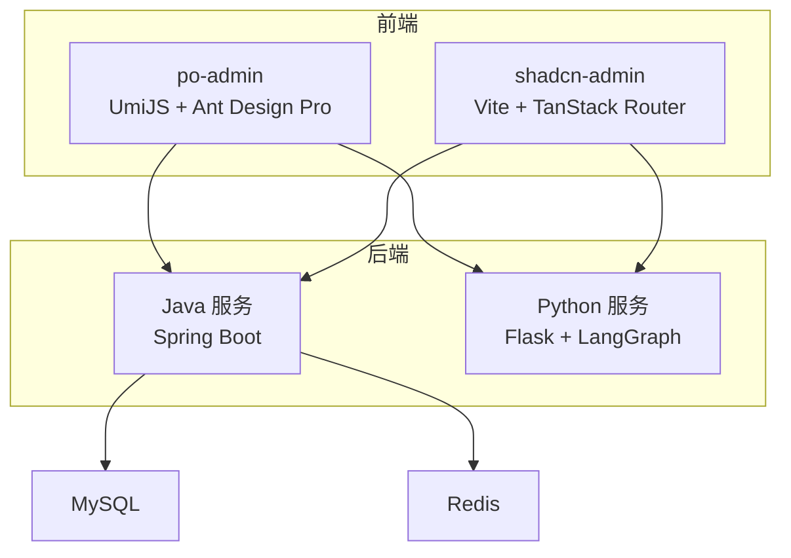
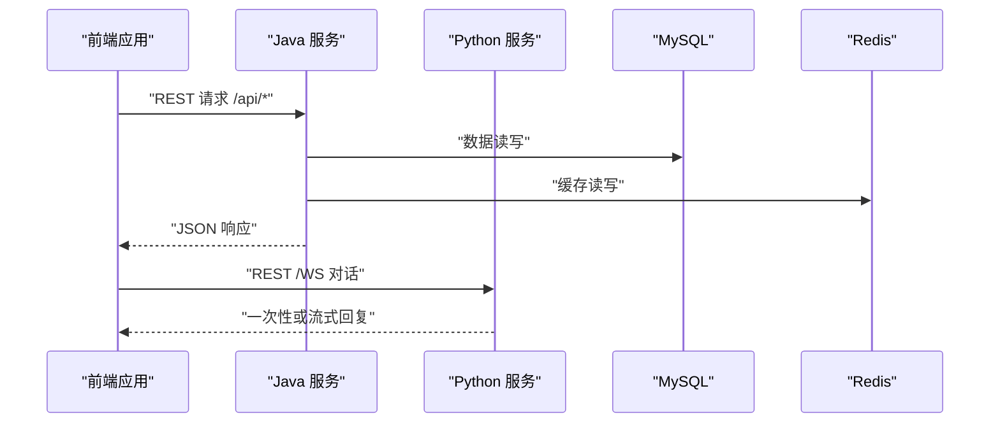
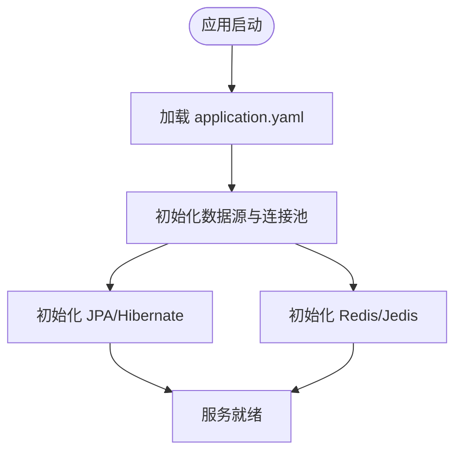
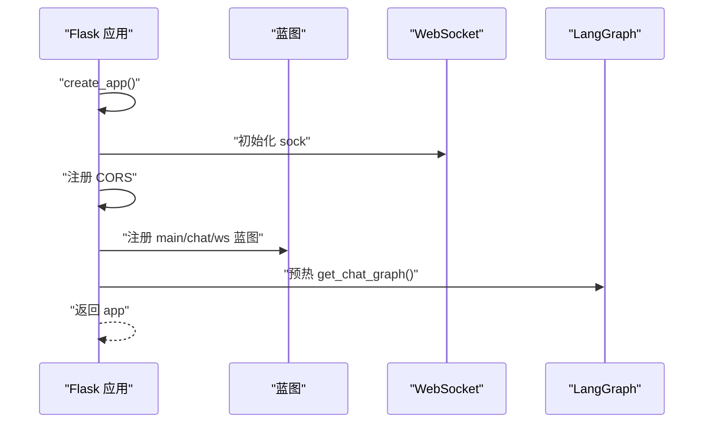
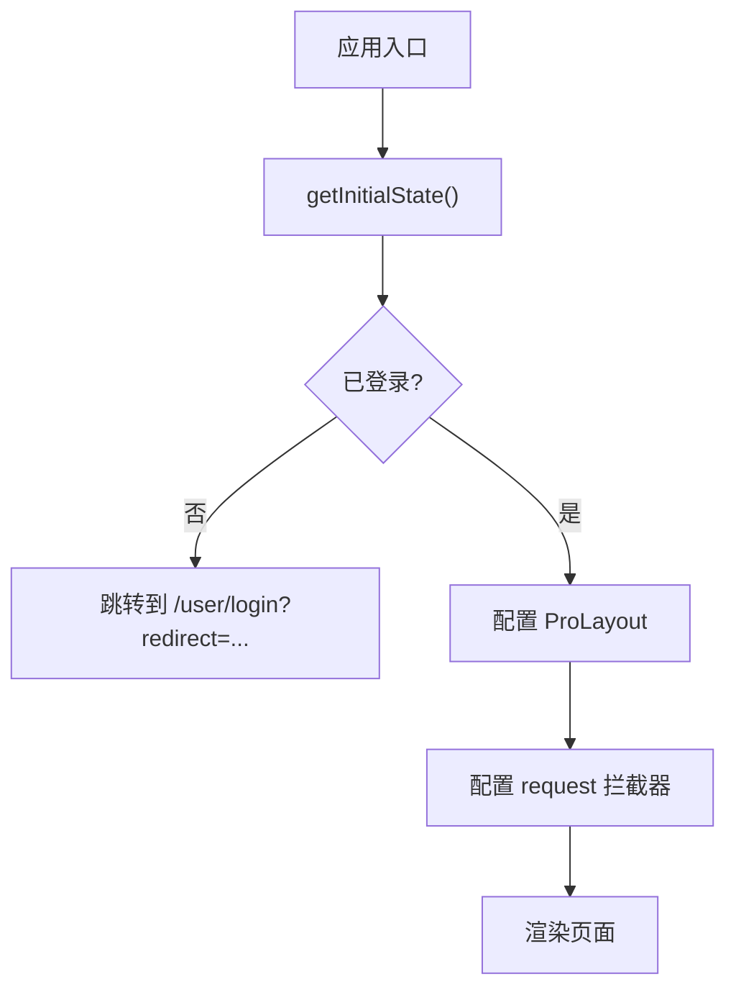
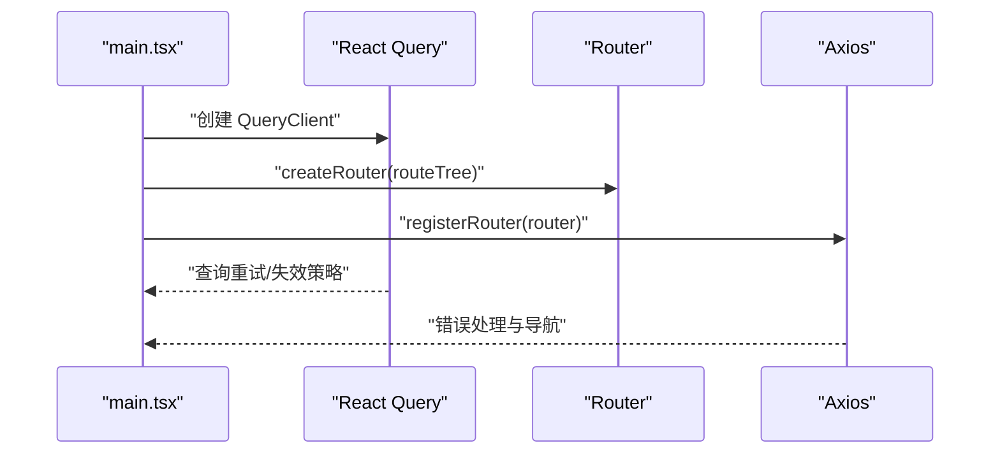
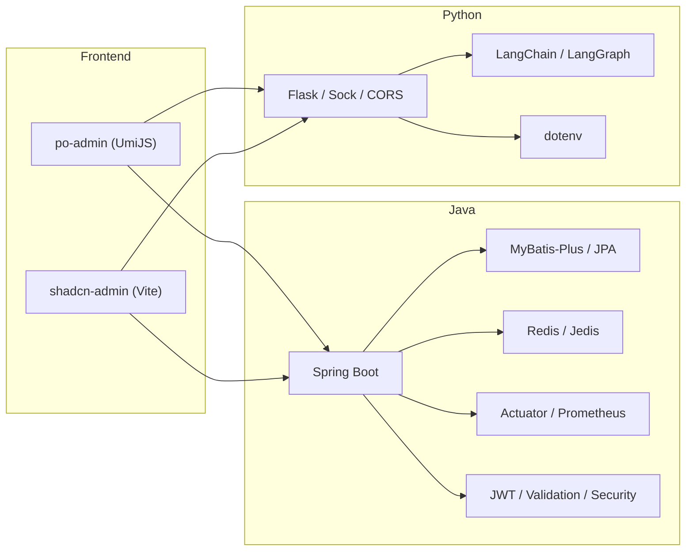

# 开发指南

<cite>
**本文引用的文件**
- [pom.xml](file://java_server/po/pom.xml)
- [application.yaml](file://java_server/po/src/main/resources/application.yaml)
- [PoApplication.java](file://java_server/po/src/main/java/com/goodzheng/po/PoApplication.java)
- [requirements.txt](file://py_server/requirements.txt)
- [config.py](file://py_server/config.py)
- [app.py](file://py_server/app.py)
- [package.json (po-admin)](file://web_client/po-admin/package.json)
- [config.ts (po-admin)](file://web_client/po-admin/config/config.ts)
- [app.tsx (po-admin)](file://web_client/po-admin/src/app.tsx)
- [biome.json (po-admin)](file://web_client/po-admin/biome.json)
- [.lintstagedrc (po-admin)](file://web_client/po-admin/.lintstagedrc)
- [.commitlintrc.js (po-admin)](file://web_client/po-admin/.commitlintrc.js)
- [vite.config.ts (shadcn-admin)](file://web_client/shadcn-admin/vite.config.ts)
- [main.tsx (shadcn-admin)](file://web_client/shadcn-admin/src/main.tsx)
- [eslint.config.js (shadcn-admin)](file://web_client/shadcn-admin/eslint.config.js)
- [.prettierrc (shadcn-admin)](file://web_client/shadcn-admin/.prettierrc)
</cite>

## 目录
1. [简介](#简介)
2. [项目结构](#项目结构)
3. [核心组件](#核心组件)
4. [架构总览](#架构总览)
5. [详细组件分析](#详细组件分析)
6. [依赖分析](#依赖分析)
7. [性能考虑](#性能考虑)
8. [故障排查指南](#故障排查指南)
9. [结论](#结论)
10. [附录](#附录)

## 简介
本指南面向团队成员，提供标准化的开发流程与最佳实践。内容涵盖代码规范、提交规范、分支管理策略、开发工具链配置（IDE、格式化、静态检查）、项目结构与命名约定、调试技巧与常见问题解决方案、性能优化建议与重构指导，以及新增功能、修改现有功能与维护代码质量的方法。

## 项目结构
仓库采用前后端分离的多模块结构：
- java_server/po：Spring Boot 后端服务，提供 REST API、数据库访问、缓存与监控能力。
- py_server：Flask + LangGraph 聊天服务，提供 REST 与 WebSocket 对话接口。
- web_client/po-admin：基于 UmiJS/Ant Design Pro 的管理后台前端。
- web_client/shadcn-admin：基于 Vite + TanStack Router 的另一个前端应用。

**图表来源**
- [PoApplication.java:6-11](file://java_server/po/src/main/java/com/goodzheng/po/PoApplication.java#L6-L11)
- [app.py:24-44](file://py_server/app.py#L24-L44)
- [application.yaml:23-53](file://java_server/po/src/main/resources/application.yaml#L23-L53)

**章节来源**
- [PoApplication.java:6-11](file://java_server/po/src/main/java/com/goodzheng/po/PoApplication.java#L6-L11)
- [app.py:24-44](file://py_server/app.py#L24-L44)
- [application.yaml:23-53](file://java_server/po/src/main/resources/application.yaml#L23-L53)

## 核心组件
- Java 后端
  - 启动入口：Spring Boot 应用类负责初始化容器。
  - 配置中心：application.yaml 统一配置服务器端口、上下文路径、数据源、JPA、Redis、日志、Actuator 监控等。
  - 依赖：MyBatis-Plus、Spring Data JPA、WebMVC、Redis(Jedis)、Actuator、Prometheus、JWT、Validation、Security Crypto。
- Python 聊天服务
  - 应用工厂：create_app 装配 Flask、CORS、WebSocket、蓝图，并预热 LangGraph 图。
  - 配置：从 .env 与环境变量加载密钥、服务地址、LLM 相关参数。
  - 依赖：Flask、flask-sock、flask-cors、LangChain/LangGraph、python-dotenv。
- po-admin 前端
  - 构建与脚本：dev/build/test/lint 等命令；集成 Biome、TypeScript、OpenAPI 插件、React Query、国际化等。
  - 运行时：getInitialState 获取用户信息并处理未登录跳转；layout 配置全局布局与权限；request 配置错误处理。
  - 代码质量：Biome 校验与格式化、lint-staged 钩子、CommitLint 提交规范。
- shadcn-admin 前端
  - 构建与脚本：dev/build/lint/format/test；集成 Vite、TanStack Router、Tailwind、ESLint、Prettier、Vitest。
  - 运行时：main.tsx 初始化 React Query、路由、主题/语言/字体等 Provider，集中处理服务端错误与导航。
  - 代码质量：ESLint 推荐规则、React Hooks 规则、Prettier 导入排序与 Tailwind 插件。

**章节来源**
- [pom.xml:32-115](file://java_server/po/pom.xml#L32-L115)
- [application.yaml:4-109](file://java_server/po/src/main/resources/application.yaml#L4-L109)
- [requirements.txt:1-13](file://py_server/requirements.txt#L1-L13)
- [config.py:10-25](file://py_server/config.py#L10-L25)
- [app.py:24-44](file://py_server/app.py#L24-L44)
- [package.json (po-admin):7-33](file://web_client/po-admin/package.json#L7-L33)
- [config.ts (po-admin):36-237](file://web_client/po-admin/config/config.ts#L36-L237)
- [app.tsx (po-admin):32-195](file://web_client/po-admin/src/app.tsx#L32-L195)
- [biome.json (po-admin):1-58](file://web_client/po-admin/biome.json#L1-L58)
- [.lintstagedrc (po-admin):1-8](file://web_client/po-admin/.lintstagedrc#L1-L8)
- [.commitlintrc.js (po-admin):1-1](file://web_client/po-admin/.commitlintrc.js#L1-L1)
- [vite.config.ts (shadcn-admin):10-52](file://web_client/shadcn-admin/vite.config.ts#L10-L52)
- [main.tsx (shadcn-admin):24-111](file://web_client/shadcn-admin/src/main.tsx#L24-L111)
- [eslint.config.js (shadcn-admin):9-59](file://web_client/shadcn-admin/eslint.config.js#L9-L59)
- [.prettierrc (shadcn-admin):1-52](file://web_client/shadcn-admin/.prettierrc#L1-L52)

## 架构总览
系统由两个后端服务与两个前端应用组成：
- po-admin 与 shadcn-admin 通过 HTTP/WebSocket 调用 Java 与 Python 服务。
- Java 服务连接 MySQL 与 Redis，暴露业务 API 并提供 Actuator 监控指标。
- Python 服务提供 LLM 编排的对话能力，支持一次性回复与流式推送。

**图表来源**
- [application.yaml:4-109](file://java_server/po/src/main/resources/application.yaml#L4-L109)
- [app.py:24-44](file://py_server/app.py#L24-L44)
- [vite.config.ts (shadcn-admin):24-31](file://web_client/shadcn-admin/vite.config.ts#L24-L31)

## 详细组件分析

### Java 后端组件
- 启动与配置
  - 应用入口：Spring Boot 启动类初始化应用上下文。
  - 配置项：服务器端口与上下文路径、HikariCP 连接池、JPA/Hibernate、Redis/Jedis、文件上传限制、静态资源缓存、日志级别与输出、Actuator 监控端点、JWT 密钥与过期时间。
- 依赖与扩展
  - MyBatis-Plus、Spring Data JPA 用于数据访问。
  - Spring WebMVC 提供 REST 能力。
  - Actuator + Prometheus 暴露健康、信息与指标。
  - JWT、Validation、Security Crypto 支撑认证与安全。

**图表来源**
- [application.yaml:23-53](file://java_server/po/src/main/resources/application.yaml#L23-L53)
- [application.yaml:68-109](file://java_server/po/src/main/resources/application.yaml#L68-L109)

**章节来源**
- [PoApplication.java:6-11](file://java_server/po/src/main/java/com/goodzheng/po/PoApplication.java#L6-L11)
- [application.yaml:4-109](file://java_server/po/src/main/resources/application.yaml#L4-L109)
- [pom.xml:32-115](file://java_server/po/pom.xml#L32-L115)

### Python 聊天服务组件
- 应用工厂与扩展
  - create_app 创建 Flask 实例，注册 CORS、WebSocket、蓝图，并在启动时编译 LangGraph 图以尽早暴露配置问题。
- 配置与环境
  - 使用 python-dotenv 加载 .env，支持通过环境变量覆盖 SECRET_KEY、HOST、PORT、DEBUG 及 LLM 相关参数。
- 依赖
  - Flask、flask-sock、flask-cors、LangChain/LangGraph、python-dotenv。

**图表来源**
- [app.py:24-44](file://py_server/app.py#L24-L44)
- [config.py:10-25](file://py_server/config.py#L10-L25)

**章节来源**
- [app.py:1-51](file://py_server/app.py#L1-L51)
- [config.py:1-25](file://py_server/config.py#L1-L25)
- [requirements.txt:1-13](file://py_server/requirements.txt#L1-L13)

### po-admin 前端组件
- 构建与脚本
  - dev/build/test/lint 等脚本；集成 Biome、TypeScript、OpenAPI 插件、React Query、国际化、Mock。
- 运行时
  - getInitialState 拉取当前用户，未登录重定向至登录页。
  - layout 配置菜单渲染、动作区、头像、底部、页面切换守卫、离线横幅、错误边界、设置抽屉。
  - request 配置 baseURL 与错误处理。
- 代码质量
  - Biome 校验与格式化；lint-staged 在提交前自动修复；CommitLint 遵循 conventional commits。

**图表来源**
- [app.tsx (po-admin):32-195](file://web_client/po-admin/src/app.tsx#L32-L195)
- [config.ts (po-admin):36-237](file://web_client/po-admin/config/config.ts#L36-L237)

**章节来源**
- [package.json (po-admin):7-33](file://web_client/po-admin/package.json#L7-L33)
- [config.ts (po-admin):36-237](file://web_client/po-admin/config/config.ts#L36-L237)
- [app.tsx (po-admin):32-195](file://web_client/po-admin/src/app.tsx#L32-L195)
- [biome.json (po-admin):1-58](file://web_client/po-admin/biome.json#L1-L58)
- [.lintstagedrc (po-admin):1-8](file://web_client/po-admin/.lintstagedrc#L1-L8)
- [.commitlintrc.js (po-admin):1-1](file://web_client/po-admin/.commitlintrc.js#L1-L1)

### shadcn-admin 前端组件
- 构建与脚本
  - dev/build/lint/format/test；集成 Vite、TanStack Router、Tailwind、ESLint、Prettier、Vitest。
- 运行时
  - main.tsx 初始化 React Query（重试策略、refetchOnWindowFocus、staleTime），挂载路由与 Providers，集中处理服务端错误与导航。
- 代码质量
  - ESLint 推荐规则、React Hooks 规则、Prettier 导入排序与 Tailwind 插件。

**图表来源**
- [main.tsx (shadcn-admin):24-111](file://web_client/shadcn-admin/src/main.tsx#L24-L111)
- [vite.config.ts (shadcn-admin):10-52](file://web_client/shadcn-admin/vite.config.ts#L10-L52)

**章节来源**
- [vite.config.ts (shadcn-admin):10-52](file://web_client/shadcn-admin/vite.config.ts#L10-L52)
- [main.tsx (shadcn-admin):24-111](file://web_client/shadcn-admin/src/main.tsx#L24-L111)
- [eslint.config.js (shadcn-admin):9-59](file://web_client/shadcn-admin/eslint.config.js#L9-L59)
- [.prettierrc (shadcn-admin):1-52](file://web_client/shadcn-admin/.prettierrc#L1-L52)

## 依赖分析
- Java 后端
  - 框架与数据：Spring Boot、MyBatis-Plus、Spring Data JPA、MySQL Connector。
  - 缓存与监控：Redis(Jedis)、Actuator、Prometheus。
  - 安全与验证：JWT、Validation、Security Crypto。
- Python 聊天服务
  - Web：Flask、flask-sock、flask-cors。
  - LLM：LangChain、LangGraph、OpenAI 兼容客户端。
  - 环境：python-dotenv。
- po-admin 前端
  - 构建：UmiJS Max、TypeScript、Biome、Vitest、OpenAPI 插件。
  - 运行时：Ant Design Pro、React Query、国际化、Tailwind。
- shadcn-admin 前端
  - 构建：Vite、TanStack Router、Tailwind、ESLint、Prettier、Vitest。
  - 运行时：React、Zustand、Axios、Sonner、i18next。

**图表来源**
- [pom.xml:32-115](file://java_server/po/pom.xml#L32-L115)
- [requirements.txt:1-13](file://py_server/requirements.txt#L1-L13)
- [package.json (po-admin):37-93](file://web_client/po-admin/package.json#L37-L93)
- [package.json (shadcn-admin):21-96](file://web_client/shadcn-admin/package.json#L21-L96)

**章节来源**
- [pom.xml:32-115](file://java_server/po/pom.xml#L32-L115)
- [requirements.txt:1-13](file://py_server/requirements.txt#L1-L13)
- [package.json (po-admin):37-93](file://web_client/po-admin/package.json#L37-L93)
- [package.json (shadcn-admin):21-96](file://web_client/shadcn-admin/package.json#L21-L96)

## 性能考虑
- Java 后端
  - 连接池：合理设置 HikariCP 最大连接数与空闲线程，避免连接耗尽。
  - 缓存：利用 Redis 缓存热点数据，降低数据库压力。
  - 监控：启用 Actuator 与 Prometheus 指标，持续观察健康与性能。
  - 静态资源：开启缓存周期，减少重复请求。
- Python 聊天服务
  - 预热：启动时编译 LangGraph 图，首次请求更快且可提前发现配置问题。
  - 并发：根据部署环境调整 Flask 工作进程与线程数。
- 前端
  - 路由预取：po-admin 启用 routePrefetch 提升页面切换速度。
  - 状态缓存：shadcn-admin 配置 React Query staleTime 与 refetchOnWindowFocus，平衡实时性与性能。
  - 构建产物：启用 hash 模式与按需打包，减少首屏体积。

[本节为通用性能建议，不直接分析具体文件]

## 故障排查指南
- Java 后端
  - 数据库连接失败：检查 application.yaml 中 datasource URL、用户名、密码、驱动类名与连接池配置。
  - Redis 连接异常：核对 host、port、password、超时与连接池大小。
  - 监控不可用：确认 management endpoints 暴露了 health/info/metrics/prometheus。
  - 日志定位：查看 logging.level 与 file.name 配置，定位错误堆栈。
- Python 聊天服务
  - 环境变量缺失：确保 .env 中存在 SECRET_KEY、OPENAI_API_KEY 等必要变量。
  - 服务端口冲突：检查 Config.HOST/PORT 是否与系统占用冲突。
  - LLM 降级：未配置 OPENAI_API_KEY 时自动进入离线演示模式，便于联调。
- po-admin 前端
  - 未登录跳转：getInitialState 会重定向到 /user/login?redirect=...，检查后端鉴权接口。
  - 网络错误：request 错误处理与拦截器，结合测试用例定位错误类型与提示。
  - 代码质量：运行 biome lint 与 tsc 检查语法与类型错误。
- shadcn-admin 前端
  - 服务端错误：handleServerError 统一处理 AxiosError，生产环境 500 跳转错误页。
  - 重试策略：React Query 默认重试逻辑与 401/403 特殊处理，避免无限重试。
  - 构建与代理：vite.config.ts 中 /api 代理到本地 8080，确保后端服务已启动。

**章节来源**
- [application.yaml:23-109](file://java_server/po/src/main/resources/application.yaml#L23-L109)
- [config.py:10-25](file://py_server/config.py#L10-L25)
- [app.tsx (po-admin):32-195](file://web_client/po-admin/src/app.tsx#L32-L195)
- [main.tsx (shadcn-admin):24-111](file://web_client/shadcn-admin/src/main.tsx#L24-L111)
- [vite.config.ts (shadcn-admin):24-31](file://web_client/shadcn-admin/vite.config.ts#L24-L31)

## 结论
本项目采用多语言、多前端、多后端的现代化架构。通过统一的配置管理、严格的代码质量工具链与完善的监控与错误处理机制，团队可以高效协作、快速迭代并保持代码质量。建议在新增功能时遵循既有结构与规范，充分利用前端的状态管理与后端的缓存与监控能力，持续提升用户体验与系统稳定性。

[本节为总结性内容，不直接分析具体文件]

## 附录

### 代码规范与工具链
- Java
  - 使用 Lombok 简化样板代码；启用 Spring Boot DevTools 提升开发体验。
  - 通过 Maven 插件配置注解处理器，保证编译期生成正确。
- Python
  - 使用 python-dotenv 管理环境变量；按模块拆分蓝图，保持职责清晰。
- po-admin
  - 使用 Biome 进行格式化和静态检查；lint-staged 在提交前自动修复；CommitLint 强制提交消息规范。
- shadcn-admin
  - 使用 ESLint 推荐规则与 React Hooks 规则；Prettier 统一风格与导入排序；Tailwind 插件支持样式类合并。

**章节来源**
- [pom.xml:117-159](file://java_server/po/pom.xml#L117-L159)
- [requirements.txt:1-13](file://py_server/requirements.txt#L1-L13)
- [biome.json (po-admin):1-58](file://web_client/po-admin/biome.json#L1-L58)
- [.lintstagedrc (po-admin):1-8](file://web_client/po-admin/.lintstagedrc#L1-L8)
- [.commitlintrc.js (po-admin):1-1](file://web_client/po-admin/.commitlintrc.js#L1-L1)
- [eslint.config.js (shadcn-admin):9-59](file://web_client/shadcn-admin/eslint.config.js#L9-L59)
- [.prettierrc (shadcn-admin):1-52](file://web_client/shadcn-admin/.prettierrc#L1-L52)

### 提交规范与分支管理
- 提交规范
  - 遵循 Conventional Commits，使用 @commitlint/config-conventional 约束提交消息。
- 分支策略（建议）
  - main：稳定版本分支，仅接受经过测试的变更。
  - develop：日常开发分支，聚合功能分支。
  - feature/*：新功能分支，完成后合并至 develop。
  - hotfix/*：紧急修复分支，直接从 main 切出，修复后合并回 main 与 develop。
- 钩子与检查
  - 使用 lint-staged 在提交前执行 Biome 检查与格式化。
  - 前端构建与测试脚本可在 CI 中集成，确保质量门禁。

**章节来源**
- [.commitlintrc.js (po-admin):1-1](file://web_client/po-admin/.commitlintrc.js#L1-L1)
- [.lintstagedrc (po-admin):1-8](file://web_client/po-admin/.lintstagedrc#L1-L8)
- [package.json (po-admin):7-33](file://web_client/po-admin/package.json#L7-L33)

### 添加新功能与重构指导
- 新增功能
  - 后端：在 controller/service/repository 分层下新增接口与实现，遵循 DTO/Entity 命名与校验。
  - 前端：在对应模块下新增页面与 API 调用，复用状态管理与错误处理。
  - 配置：将新特性开关或参数加入 application.yaml 或 .env，避免硬编码。
- 重构指导
  - 小步重构：每次变更聚焦单一职责，配合单元测试验证行为不变。
  - 抽取公共逻辑：将重复代码提取为工具函数或服务方法，提高内聚性。
  - 性能优先：对热点路径引入缓存、分页、懒加载与异步处理。
  - 文档同步：更新接口文档与 README，确保团队协作一致。

[本节为通用指导，不直接分析具体文件]