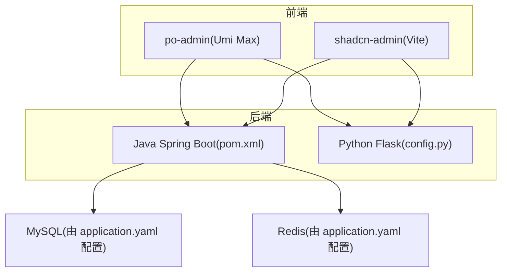
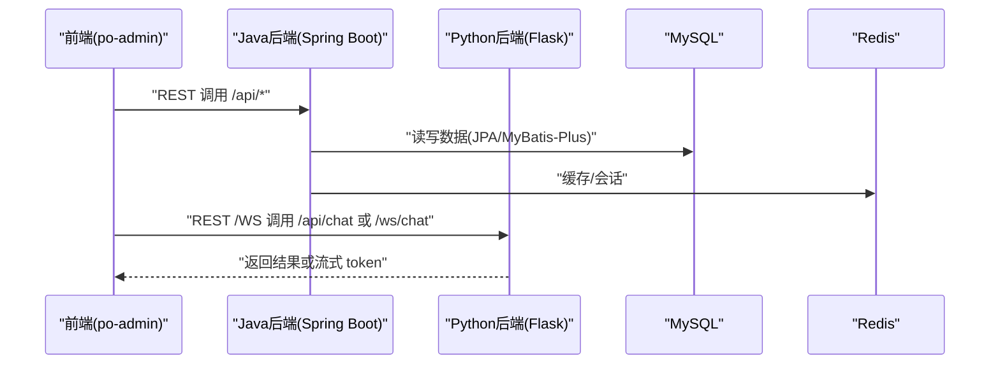
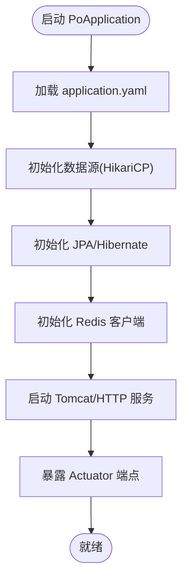
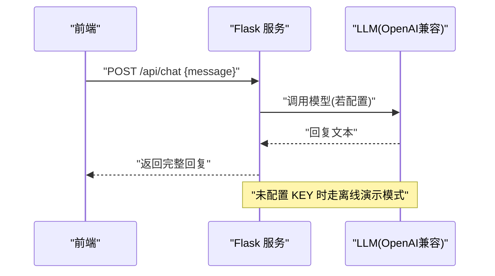
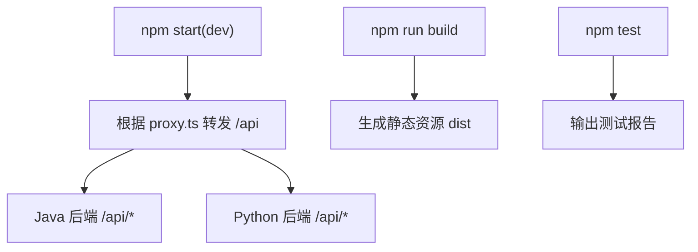
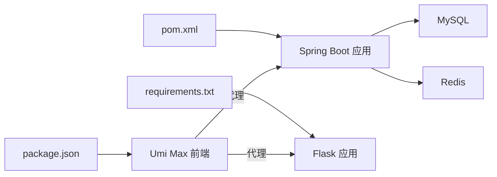

# 开发流程

<cite>
**本文引用的文件**
- [pom.xml](file://java_server/po/pom.xml)
- [application.yaml](file://java_server/po/src/main/resources/application.yaml)
- [PoApplication.java](file://java_server/po/src/main/java/com/goodzheng/po/PoApplication.java)
- [requirements.txt](file://py_server/requirements.txt)
- [config.py](file://py_server/config.py)
- [README.md](file://py_server/README.md)
- [package.json](file://web_client/po-admin/package.json)
- [.commitlintrc.js](file://web_client/po-admin/.commitlintrc.js)
- [.lintstagedrc](file://web_client/po-admin/.lintstagedrc)
- [proxy.ts](file://web_client/po-admin/config/proxy.ts)
- [cz.yaml](file://web_client/shadcn-admin/cz.yaml)
</cite>

## 目录
1. [简介](#简介)
2. [项目结构](#项目结构)
3. [核心组件](#核心组件)
4. [架构总览](#架构总览)
5. [详细组件分析](#详细组件分析)
6. [依赖关系分析](#依赖关系分析)
7. [性能与构建优化](#性能与构建优化)
8. [故障排查指南](#故障排查指南)
9. [结论](#结论)
10. [附录：标准化工作流程](#附录标准化工作流程)

## 简介
本文件为 goodzheng-pro 项目的标准化开发工作流程文档，覆盖项目初始化、依赖管理、构建流程、版本控制策略（Git Flow/GitHub Flow）、提交信息规范、代码审查流程、前后端并行协作、API 契约管理与接口版本控制、本地环境搭建、数据库迁移管理、配置文件管理策略，以及新功能添加、Bug 修复与发布版本的完整流程。

## 项目结构
仓库采用多模块组织：
- java_server/po：Spring Boot 后端服务，提供 REST API、JPA/MyBatis-Plus、Redis、Actuator 监控等能力。
- py_server：Flask + LangChain/LangGraph 的 AI 后端服务，提供 REST 与 WebSocket 流式对话接口。
- web_client/po-admin：基于 Umi Max/Ant Design Pro 的管理前端，含代理配置、脚本命令、测试与构建。
- web_client/shadcn-admin：另一个 React 前端工程（Vite），具备独立的脚本与工具链。

**图示来源**
- [pom.xml:1-163](file://java_server/po/pom.xml#L1-L163)
- [application.yaml:1-109](file://java_server/po/src/main/resources/application.yaml#L1-L109)
- [config.py:1-25](file://py_server/config.py#L1-L25)
- [package.json:1-132](file://web_client/po-admin/package.json#L1-L132)

**章节来源**
- [pom.xml:1-163](file://java_server/po/pom.xml#L1-L163)
- [application.yaml:1-109](file://java_server/po/src/main/resources/application.yaml#L1-L109)
- [requirements.txt:1-13](file://py_server/requirements.txt#L1-L13)
- [package.json:1-132](file://web_client/po-admin/package.json#L1-L132)

## 核心组件
- Java 后端（Spring Boot）
  - 入口：PoApplication.java
  - 依赖：WebMVC、JPA、MyBatis-Plus、Redis、JWT、Validation、Actuator、Prometheus
  - 配置：application.yaml（服务器端口、上下文路径、数据源、JPA、Redis、日志、Actuator、JWT）
- Python 后端（Flask）
  - 入口：app.py（启动脚本）
  - 配置：config.py（从 .env 读取密钥、模型、服务地址与端口）
  - 依赖：Flask、flask-sock、flask-cors、LangChain/LangGraph、python-dotenv
- 前端（po-admin）
  - 脚本：dev/build/test/lint/openapi 等
  - 代理：config/proxy.ts（按环境转发 /api 到后端）
  - 质量：Biome、Commitlint、Husky、Lint-staged

**章节来源**
- [PoApplication.java:1-14](file://java_server/po/src/main/java/com/goodzheng/po/PoApplication.java#L1-L14)
- [pom.xml:1-163](file://java_server/po/pom.xml#L1-L163)
- [application.yaml:1-109](file://java_server/po/src/main/resources/application.yaml#L1-L109)
- [requirements.txt:1-13](file://py_server/requirements.txt#L1-L13)
- [config.py:1-25](file://py_server/config.py#L1-L25)
- [package.json:1-132](file://web_client/po-admin/package.json#L1-L132)
- [proxy.ts:1-42](file://web_client/po-admin/config/proxy.ts#L1-L42)

## 架构总览
前后端通过 REST 与 WebSocket 通信；Java 后端负责业务与数据访问，Python 后端提供 AI 能力；前端通过代理在开发期将 /api 请求转发至对应后端。

**图示来源**
- [application.yaml:1-109](file://java_server/po/src/main/resources/application.yaml#L1-L109)
- [config.py:1-25](file://py_server/config.py#L1-L25)
- [README.md:53-125](file://py_server/README.md#L53-L125)
- [package.json:7-32](file://web_client/po-admin/package.json#L7-L32)
- [proxy.ts:12-41](file://web_client/po-admin/config/proxy.ts#L12-L41)

## 详细组件分析

### Java 后端（Spring Boot）
- 应用启动：PoApplication.java 作为入口，加载 Spring 容器。
- 依赖管理：pom.xml 声明 WebMVC、JPA、MyBatis-Plus、Redis、JWT、Validation、Actuator、Prometheus 等。
- 配置中心：application.yaml 定义服务端口、上下文路径、数据源、连接池、JPA 行为、Redis、日志、Actuator 暴露端点、JWT 密钥与过期时间。
- 构建插件：spring-boot-maven-plugin、maven-compiler-plugin（集成 Lombok）。

**图示来源**
- [PoApplication.java:1-14](file://java_server/po/src/main/java/com/goodzheng/po/PoApplication.java#L1-L14)
- [application.yaml:1-109](file://java_server/po/src/main/resources/application.yaml#L1-L109)
- [pom.xml:117-159](file://java_server/po/pom.xml#L117-L159)

**章节来源**
- [PoApplication.java:1-14](file://java_server/po/src/main/java/com/goodzheng/po/PoApplication.java#L1-L14)
- [pom.xml:1-163](file://java_server/po/pom.xml#L1-L163)
- [application.yaml:1-109](file://java_server/po/src/main/resources/application.yaml#L1-L109)

### Python 后端（Flask + LangChain/LangGraph）
- 配置：config.py 从 .env 读取密钥、模型、服务地址与端口；未配置时降级离线演示模式。
- 依赖：requirements.txt 包含 Flask、WebSocket、CORS、LangChain/LangGraph、dotenv。
- 接口：REST（/api/chat）与 WebSocket（/ws/chat）；详见 README 说明。

**图示来源**
- [config.py:1-25](file://py_server/config.py#L1-L25)
- [requirements.txt:1-13](file://py_server/requirements.txt#L1-L13)
- [README.md:53-125](file://py_server/README.md#L53-L125)

**章节来源**
- [config.py:1-25](file://py_server/config.py#L1-L25)
- [requirements.txt:1-13](file://py_server/requirements.txt#L1-L13)
- [README.md:1-125](file://py_server/README.md#L1-L125)

### 前端（po-admin）
- 开发脚本：npm start/dev、build、test、openapi、lint 等。
- 代理：config/proxy.ts 将 /api 转发到测试/预发后端。
- 质量门禁：Biome、Commitlint、Husky、Lint-staged。

**图示来源**
- [package.json:7-32](file://web_client/po-admin/package.json#L7-L32)
- [proxy.ts:12-41](file://web_client/po-admin/config/proxy.ts#L12-L41)

**章节来源**
- [package.json:1-132](file://web_client/po-admin/package.json#L1-L132)
- [proxy.ts:1-42](file://web_client/po-admin/config/proxy.ts#L1-L42)

## 依赖关系分析
- Java 后端依赖 MySQL、Redis、JWT、Spring 生态；通过 pom.xml 管理。
- Python 后端依赖 Flask 生态与 LangChain/LangGraph；通过 requirements.txt 管理。
- 前端依赖 React/Umi/AntD 生态；通过 package.json 管理。
- 配置与环境变量：Java 使用 application.yaml；Python 使用 .env（由 config.py 加载）。

**图示来源**
- [pom.xml:1-163](file://java_server/po/pom.xml#L1-L163)
- [requirements.txt:1-13](file://py_server/requirements.txt#L1-L13)
- [package.json:1-132](file://web_client/po-admin/package.json#L1-L132)
- [application.yaml:1-109](file://java_server/po/src/main/resources/application.yaml#L1-L109)

**章节来源**
- [pom.xml:1-163](file://java_server/po/pom.xml#L1-L163)
- [requirements.txt:1-13](file://py_server/requirements.txt#L1-L13)
- [package.json:1-132](file://web_client/po-admin/package.json#L1-L132)
- [application.yaml:1-109](file://java_server/po/src/main/resources/application.yaml#L1-L109)

## 性能与构建优化
- Java 后端
  - 连接池：HikariCP 最大连接数、空闲连接、超时等已在 application.yaml 中配置。
  - 线程与连接：Tomcat max-threads、max-connections、accept-count 已设置。
  - 监控：Actuator 暴露 health/info/metrics/prometheus，便于接入监控系统。
  - 构建：启用 spring-boot-maven-plugin 打包；Lombok 注解处理器已配置。
- Python 后端
  - 生产部署建议使用 gunicorn + gevent worker 以支撑大量 WebSocket 长连接。
- 前端
  - 使用 Vite/Umi 快速构建；可通过 npm run analyze 进行体积分析；测试使用 Vitest。

[本节为通用建议，不直接分析具体文件]

## 故障排查指南
- Java 后端
  - 检查 application.yaml 中的数据库、Redis、JWT 配置是否正确。
  - 通过 Actuator 健康端点确认服务状态与依赖连通性。
  - 查看 logs/application.log 定位异常堆栈。
- Python 后端
  - 检查 .env 是否包含必要的环境变量；未配置时服务会降级为离线演示模式。
  - 使用 README 提供的 curl 或 ws 联调脚本验证接口可用性。
- 前端
  - 确认 proxy.ts 的目标地址与当前环境匹配。
  - 使用 npm run lint 与 npm test 快速发现代码问题与回归。

**章节来源**
- [application.yaml:1-109](file://java_server/po/src/main/resources/application.yaml#L1-L109)
- [README.md:53-125](file://py_server/README.md#L53-L125)
- [package.json:7-32](file://web_client/po-admin/package.json#L7-L32)
- [proxy.ts:12-41](file://web_client/po-admin/config/proxy.ts#L12-L41)

## 结论
本项目采用清晰的多模块架构，前后端职责明确，配置集中且可环境化，具备完善的构建、测试与监控能力。遵循本文档的工作流程与规范，可有效提升团队协作效率与交付质量。

## 附录：标准化工作流程

### 一、项目初始化与依赖管理
- Java 后端
  - 使用 Maven 管理依赖与构建；确保 JDK 17 可用。
  - 首次运行前准备 MySQL 与 Redis 实例，并校验 application.yaml 的连接信息。
- Python 后端
  - 创建虚拟环境并安装 requirements.txt 中的依赖。
  - 复制 .env.example 为 .env，按需填写 OPENAI_API_KEY 等环境变量。
- 前端（po-admin）
  - 安装 Node.js 并确保版本满足要求。
  - 执行包管理器安装依赖后，通过 npm start 启动开发服务器。
  - 如需对接真实后端，调整 config/proxy.ts 的 target。

**章节来源**
- [pom.xml:1-163](file://java_server/po/pom.xml#L1-L163)
- [application.yaml:1-109](file://java_server/po/src/main/resources/application.yaml#L1-L109)
- [requirements.txt:1-13](file://py_server/requirements.txt#L1-L13)
- [config.py:1-25](file://py_server/config.py#L1-L25)
- [package.json:1-132](file://web_client/po-admin/package.json#L1-L132)
- [proxy.ts:12-41](file://web_client/po-admin/config/proxy.ts#L12-L41)

### 二、构建流程
- Java：mvn clean package（或 IDE 内构建）；使用 spring-boot-maven-plugin 生成可执行包。
- Python：无需构建，直接 python app.py 启动；生产建议使用 gunicorn。
- 前端：npm run build 生成静态资源；npm run test 执行单元测试；npm run openapi 可从 OpenAPI 生成类型与请求方法（如启用）。

**章节来源**
- [pom.xml:117-159](file://java_server/po/pom.xml#L117-L159)
- [README.md:115-125](file://py_server/README.md#L115-L125)
- [package.json:7-32](file://web_client/po-admin/package.json#L7-L32)

### 三、版本控制策略（Git Flow 推荐）
- 分支模型
  - main：稳定发布分支，仅接受合并与打标签。
  - develop：集成开发分支。
  - feature/*：功能分支，从 develop 切出，完成后合并回 develop。
  - release/*：发布候选分支，用于冻结与回归测试。
  - hotfix/*：紧急修复分支，从 main 切出，修复后同时合并回 main 与 develop。
- 提交信息规范
  - 使用 Conventional Commits（feat/fix/docs/chore 等），前端已配置 @commitlint/config-conventional。
  - 建议在提交前通过 Husky + lint-staged 自动格式化与检查。
- 代码审查
  - 所有变更需通过 Pull Request 审查，至少一名 reviewer 批准后方可合并。
  - CI 应包含构建、测试与代码质量检查。

**章节来源**
- [.commitlintrc.js:1-2](file://web_client/po-admin/.commitlintrc.js#L1-L2)
- [.lintstagedrc:1-8](file://web_client/po-admin/.lintstagedrc#L1-L8)
- [cz.yaml:1-8](file://web_client/shadcn-admin/cz.yaml#L1-L8)

### 四、前后端并行开发与 API 契约管理
- 并行开发
  - 前端通过 proxy.ts 将 /api 转发到后端；开发阶段可先使用 Mock 或 stub。
  - 后端优先实现接口契约（URL、方法、参数、响应结构），并通过 Swagger/OpenAPI 描述。
- 接口版本控制
  - URL 版本化：/api/v1/... 便于向后兼容演进。
  - 字段级兼容：新增字段保持可选，删除字段保留旧字段一段时间并给出弃用提示。
- 契约驱动
  - 前端通过 openapi 生成类型与请求函数，减少联调成本。
  - 后端维护单一事实来源的接口文档，并在 PR 中更新。

**章节来源**
- [proxy.ts:12-41](file://web_client/po-admin/config/proxy.ts#L12-L41)
- [package.json:17-17](file://web_client/po-admin/package.json#L17-L17)

### 五、本地开发环境搭建步骤
- Java 后端
  - 准备 MySQL、Redis，并校验 application.yaml 的连接信息。
  - 启动 PoApplication.java 或 mvn spring-boot:run。
- Python 后端
  - 创建并激活虚拟环境，pip install -r requirements.txt。
  - 配置 .env（可选），python app.py 启动。
- 前端
  - 安装依赖后 npm start；如需对接后端，修改 proxy.ts 的 target。
  - 使用 npm run test 与 npm run lint 保证代码质量。

**章节来源**
- [application.yaml:1-109](file://java_server/po/src/main/resources/application.yaml#L1-L109)
- [PoApplication.java:1-14](file://java_server/po/src/main/java/com/goodzheng/po/PoApplication.java#L1-L14)
- [requirements.txt:1-13](file://py_server/requirements.txt#L1-L13)
- [config.py:1-25](file://py_server/config.py#L1-L25)
- [package.json:7-32](file://web_client/po-admin/package.json#L7-L32)
- [proxy.ts:12-41](file://web_client/po-admin/config/proxy.ts#L12-L41)

### 六、数据库迁移管理
- 当前 JPA 配置为 ddl-auto: update，适合开发环境快速迭代。
- 生产环境建议：
  - 关闭自动建表，改用迁移脚本（如 Flyway/Liquibase）统一管理变更。
  - 每次变更通过迁移脚本记录版本，确保可回溯与一致性。

**章节来源**
- [application.yaml:35-41](file://java_server/po/src/main/resources/application.yaml#L35-L41)

### 七、配置文件管理策略
- Java：application.yaml 存放通用配置；可按环境拆分（dev/test/prod）并通过 profiles.active 切换。
- Python：使用 .env 管理敏感信息与模型配置，避免入库；config.py 统一读取。
- 前端：proxy.ts 区分不同环境的后端地址；敏感信息不入仓，使用环境变量注入。

**章节来源**
- [application.yaml:16-22](file://java_server/po/src/main/resources/application.yaml#L16-L22)
- [config.py:1-25](file://py_server/config.py#L1-L25)
- [proxy.ts:28-41](file://web_client/po-admin/config/proxy.ts#L28-L41)

### 八、新功能添加流程
- 从 develop 切出 feature/* 分支。
- 后端实现接口与单元测试；前端编写页面与联调逻辑。
- 提交前执行 lint/test/build，确保无错误。
- 发起 PR，完成代码审查与 CI 通过后合并至 develop。
- 迭代完成后进入 release/* 分支进行回归测试与发布准备。

**章节来源**
- [.commitlintrc.js:1-2](file://web_client/po-admin/.commitlintrc.js#L1-L2)
- [.lintstagedrc:1-8](file://web_client/po-admin/.lintstagedrc#L1-L8)
- [package.json:7-32](file://web_client/po-admin/package.json#L7-L32)

### 九、Bug 修复流程
- 从 main 或 develop 切出 hotfix/* 分支。
- 修复后补充最小化测试用例。
- 提交并发起 PR，合并回 main（及 develop），必要时打标签发布补丁版本。

**章节来源**
- [cz.yaml:1-8](file://web_client/shadcn-admin/cz.yaml#L1-L8)

### 十、发布版本流程
- 从 develop 切出 release/* 分支，冻结变更。
- 执行全量测试、构建与安全检查。
- 合并至 main 并打标签（semver），生成发布说明。
- 部署流水线触发构建与发布（CI/CD）。

**章节来源**
- [pom.xml:11-13](file://java_server/po/pom.xml#L11-L13)
- [package.json:1-32](file://web_client/po-admin/package.json#L1-L32)
- [cz.yaml:1-8](file://web_client/shadcn-admin/cz.yaml#L1-L8)