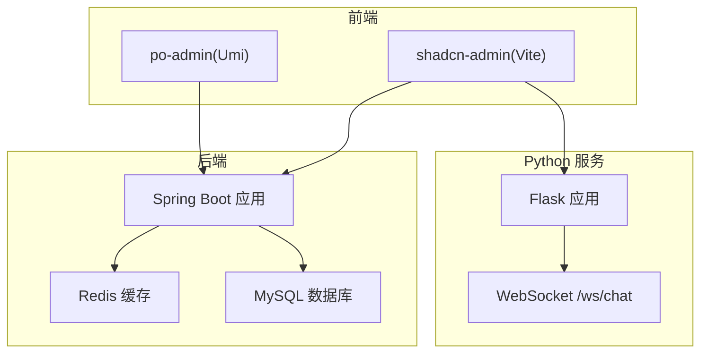
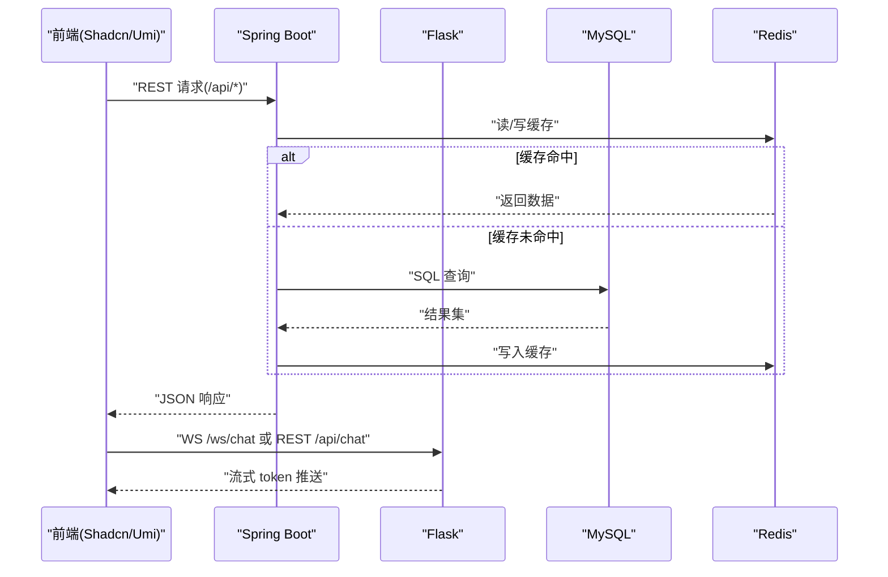
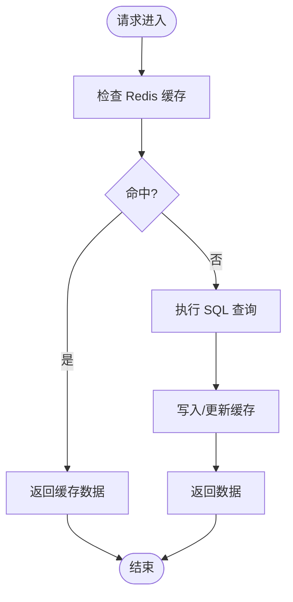
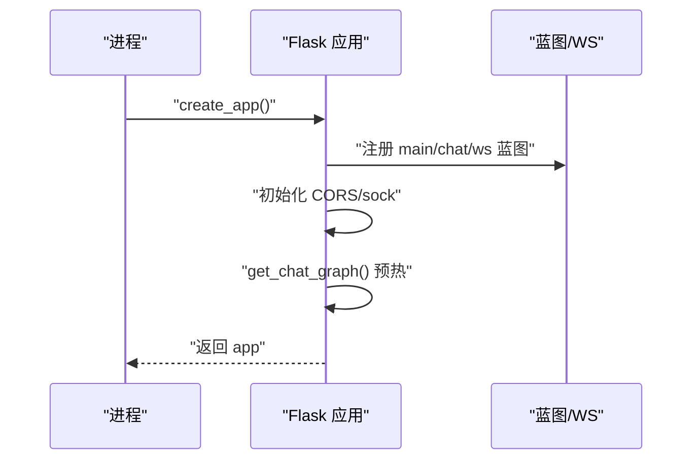
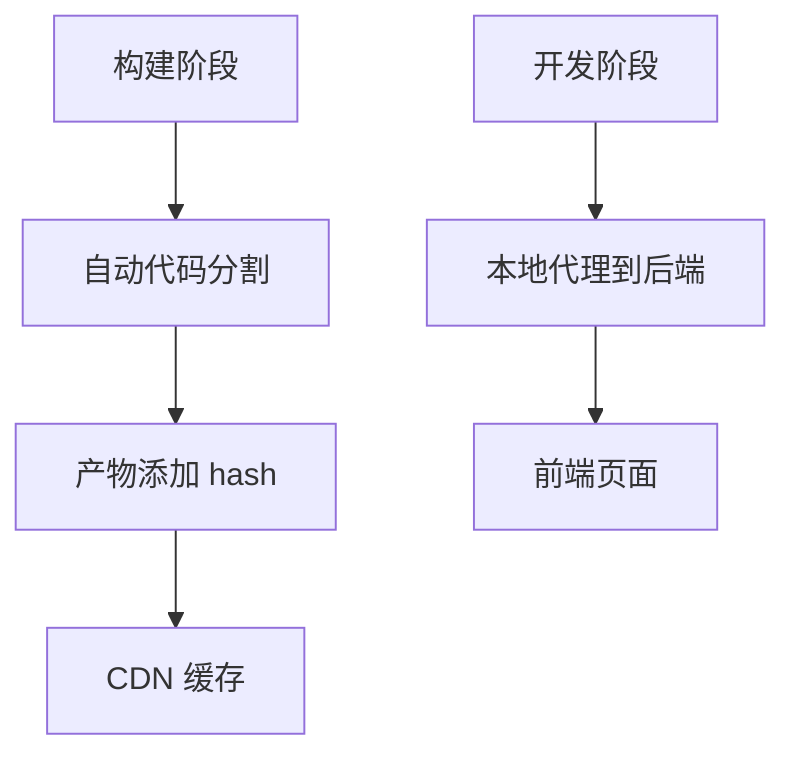
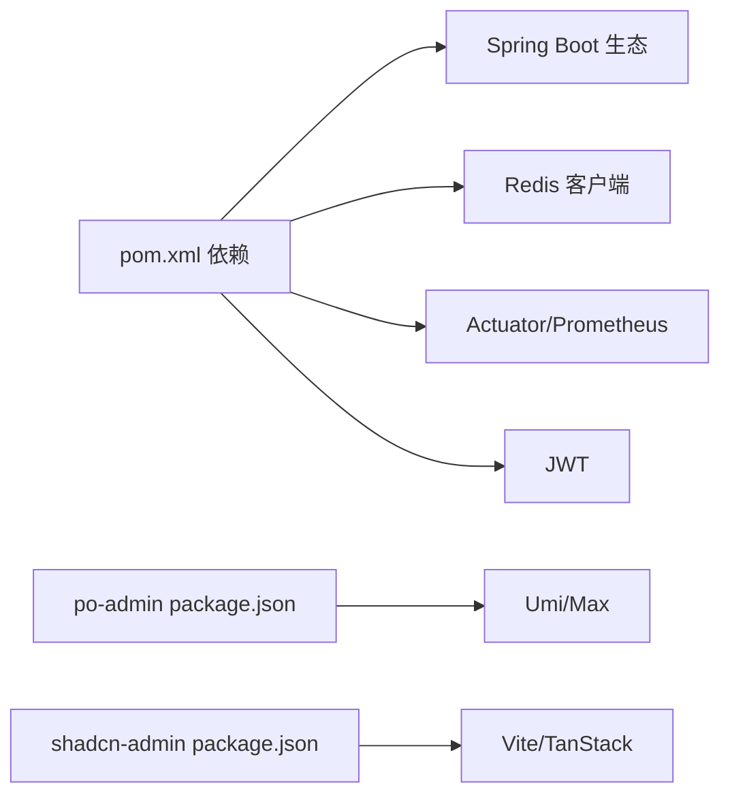

# 性能优化

<cite>
**本文引用的文件**
- [application.yaml](file://java_server/po/src/main/resources/application.yaml)
- [pom.xml](file://java_server/po/pom.xml)
- [config.py](file://py_server/config.py)
- [app.py](file://py_server/app.py)
- [vite.config.ts](file://web_client/shadcn-admin/vite.config.ts)
- [axios.ts](file://web_client/shadcn-admin/src/lib/axios.ts)
- [config.ts](file://web_client/po-admin/config/config.ts)
- [proxy.ts](file://web_client/po-admin/config/proxy.ts)
</cite>

## 目录
1. [简介](#简介)
2. [项目结构](#项目结构)
3. [核心组件](#核心组件)
4. [架构总览](#架构总览)
5. [详细组件分析](#详细组件分析)
6. [依赖关系分析](#依赖关系分析)
7. [性能考虑](#性能考虑)
8. [故障排查指南](#故障排查指南)
9. [结论](#结论)
10. [附录](#附录)

## 简介
本方案面向当前多端工程（Spring Boot 后端、Python Flask 服务、两个前端工程）制定端到端的性能优化指导，覆盖：
- 后端 API 响应优化：连接池、缓存、异步处理、监控暴露
- 数据库查询优化：JPA/Hibernate 与 SQL 层面调优建议
- 前端渲染性能提升：代码分割、懒加载、图片优化、构建产物优化
- 网络请求优化：请求合并、缓存策略、拦截器与错误处理
- 性能监控：APM、日志分析、浏览器开发者工具使用指南
- 常见问题与解决方案

## 项目结构
本项目包含三个主要子系统：
- Java 后端（Spring Boot + JPA + Redis + Actuator/Prometheus）
- Python 服务（Flask + WebSocket + LangGraph）
- 前端（Ant Design Pro Umi 工程 + Shadcn Admin Vite 工程）

图表来源
- [application.yaml:1-109](file://java_server/po/src/main/resources/application.yaml#L1-L109)
- [vite.config.ts:10-31](file://web_client/shadcn-admin/vite.config.ts#L10-L31)
- [config.ts:36-100](file://web_client/po-admin/config/config.ts#L36-L100)

章节来源
- [application.yaml:1-109](file://java_server/po/src/main/resources/application.yaml#L1-L109)
- [vite.config.ts:10-31](file://web_client/shadcn-admin/vite.config.ts#L10-L31)
- [config.ts:36-100](file://web_client/po-admin/config/config.ts#L36-L100)

## 核心组件
- Spring Boot 应用
  - 服务器线程与连接池：Tomcat 线程数、最大连接数、HikariCP 连接池大小等
  - 缓存：Redis 客户端与连接池配置
  - 监控：Actuator 暴露健康、指标、Prometheus
  - 静态资源缓存：浏览器缓存周期
- Python Flask 应用
  - 启动入口、蓝图注册、CORS、WebSocket 扩展初始化
  - 配置读取与环境变量覆盖
- 前端工程
  - Umi 工程：路由预取、构建哈希、代理、OpenAPI 生成、国际化与时间库替换
  - Vite 工程：自动代码分割、开发代理、测试覆盖率配置
  - Axios 封装：统一 baseURL、超时、请求头注入、401 处理

章节来源
- [application.yaml:23-67](file://java_server/po/src/main/resources/application.yaml#L23-L67)
- [application.yaml:82-95](file://java_server/po/src/main/resources/application.yaml#L82-L95)
- [pom.xml:32-68](file://java_server/po/pom.xml#L32-L68)
- [config.py:10-25](file://py_server/config.py#L10-L25)
- [app.py:24-44](file://py_server/app.py#L24-L44)
- [config.ts:36-100](file://web_client/po-admin/config/config.ts#L36-L100)
- [vite.config.ts:10-31](file://web_client/shadcn-admin/vite.config.ts#L10-L31)
- [axios.ts:34-84](file://web_client/shadcn-admin/src/lib/axios.ts#L34-L84)

## 架构总览
前后端通过 REST/WS 交互，Java 后端负责业务与数据访问，Python 服务提供对话能力。前端通过构建期优化与运行时缓存降低首屏与交互延迟。

图表来源
- [application.yaml:23-67](file://java_server/po/src/main/resources/application.yaml#L23-L67)
- [app.py:24-44](file://py_server/app.py#L24-L44)

## 详细组件分析

### Spring Boot 后端性能调优
- 连接池与线程模型
  - Tomcat 线程与连接上限：max-threads、max-connections、accept-count
  - HikariCP 连接池：maximum-pool-size、minimum-idle、connection-timeout
  - 建议：根据 CPU 核数与并发压测调整线程池；按 QPS 与慢查询比例调节连接池；设置合理的超时避免雪崩
- 缓存策略
  - Redis 客户端与连接池：host/port/password/timeout/jedis pool max-active/max-idle
  - 建议：热点数据加缓存；读写分离场景下注意一致性；合理设置过期时间与更新策略
- 监控与可观测性
  - Actuator 暴露 health/info/metrics/prometheus
  - 建议：接入 Prometheus+Grafana 或 APM；对关键接口打点；开启慢查询日志
- 静态资源与文件上传
  - 静态资源缓存 period；multipart 限制
  - 建议：CDN 缓存静态资源；限制大文件上传并做分片/压缩

图表来源
- [application.yaml:23-67](file://java_server/po/src/main/resources/application.yaml#L23-L67)
- [application.yaml:82-95](file://java_server/po/src/main/resources/application.yaml#L82-L95)

章节来源
- [application.yaml:4-12](file://java_server/po/src/main/resources/application.yaml#L4-L12)
- [application.yaml:23-67](file://java_server/po/src/main/resources/application.yaml#L23-L67)
- [application.yaml:82-95](file://java_server/po/src/main/resources/application.yaml#L82-L95)
- [pom.xml:32-68](file://java_server/po/pom.xml#L32-L68)

### Python 服务性能监控与优化
- 启动与扩展
  - 工厂模式创建应用，注册蓝图，初始化 CORS 与 WebSocket 扩展
  - 启动时预热图（LangGraph），减少首次请求冷启动开销
- 配置与环境
  - 通过环境变量覆盖 HOST/PORT/DEBUG 与 LLM 相关配置
- 建议
  - 生产环境关闭 DEBUG；使用 gunicorn/uwsgi 等 WSGI 服务器；为 WS 连接数与速率做限流；对 LLM 调用增加重试与超时控制；记录请求耗时与错误率

图表来源
- [app.py:24-44](file://py_server/app.py#L24-L44)
- [config.py:10-25](file://py_server/config.py#L10-L25)

章节来源
- [app.py:24-44](file://py_server/app.py#L24-L44)
- [config.py:10-25](file://py_server/config.py#L10-L25)

### 前端渲染性能优化
- 代码分割与路由优化
  - Vite：启用 TanStack Router 的自动代码分割
  - Umi：开启路由预取、构建产物 hash、忽略不必要的 locale
- 构建与缓存
  - 构建产物带 hash 便于 CDN 缓存；按需引入国际化与时间库
- 网络请求优化
  - Axios 统一 baseURL、超时、请求头注入、401 处理；结合 React Query 进行服务端状态缓存与去抖
- 图片与资源
  - 使用现代格式（WebP/AVIF）、懒加载、按需加载组件与图标

图表来源
- [vite.config.ts:10-31](file://web_client/shadcn-admin/vite.config.ts#L10-L31)
- [config.ts:36-100](file://web_client/po-admin/config/config.ts#L36-L100)
- [proxy.ts:28-40](file://web_client/po-admin/config/proxy.ts#L28-L40)

章节来源
- [vite.config.ts:10-31](file://web_client/shadcn-admin/vite.config.ts#L10-L31)
- [config.ts:36-100](file://web_client/po-admin/config/config.ts#L36-L100)
- [proxy.ts:28-40](file://web_client/po-admin/config/proxy.ts#L28-L40)
- [axios.ts:34-84](file://web_client/shadcn-admin/src/lib/axios.ts#L34-L84)

### 数据库查询优化
- JPA/Hibernate
  - 关闭 show-sql 在生产环境；谨慎使用 open-in-view；合理设计实体关系避免 N+1
- SQL 层
  - 为高频查询建立索引；避免 SELECT *；分页与只取必要字段；批量操作替代循环单条
- 缓存
  - 热点查询结果入 Redis；注意缓存穿透/击穿/雪崩防护（空值缓存、互斥锁、随机过期）

章节来源
- [application.yaml:35-41](file://java_server/po/src/main/resources/application.yaml#L35-L41)

### 网络请求优化（前端）
- 请求合并与去重
  - 使用 React Query 的相同 key 去重与并发合并；对列表页滚动加载做节流/防抖
- 缓存策略
  - 合理设置 staleTime 与 gcTime；离线优先与后台同步
- 错误与鉴权
  - Axios 拦截器统一处理 401 跳转登录；全局错误提示与降级展示

章节来源
- [axios.ts:34-84](file://web_client/shadcn-admin/src/lib/axios.ts#L34-L84)

## 依赖关系分析
- 后端依赖
  - Spring Boot Web、JPA、Redis、Actuator、Prometheus、JWT、Validation、Security Crypto
- 前端依赖
  - Umi Max、React Query、Ant Design、Tailwind、i18n、OpenAPI 插件
  - Vite、TanStack Router/Table、Axios、Zustand、Recharts

图表来源
- [pom.xml:32-68](file://java_server/po/pom.xml#L32-L68)
- [package.json:37-92](file://web_client/po-admin/package.json#L37-L92)
- [package.json:21-66](file://web_client/shadcn-admin/package.json#L21-L66)

章节来源
- [pom.xml:32-68](file://java_server/po/pom.xml#L32-L68)
- [package.json:37-92](file://web_client/po-admin/package.json#L37-L92)
- [package.json:21-66](file://web_client/shadcn-admin/package.json#L21-L66)

## 性能考虑
- 后端
  - 线程与连接池：依据压测结果调优 Tomcat 线程与 HikariCP 连接池；设置合理的超时与队列长度
  - 缓存：热点数据缓存；读写分离；缓存一致性策略（失效/更新）
  - 异步：长耗时任务异步化（消息队列/线程池）；接口快速返回
  - 监控：接入 APM；采集 JVM、GC、HTTP、DB、Redis 指标；告警阈值
- 数据库
  - 索引与查询计划；慢查询分析与优化；连接池与事务边界
- 前端
  - 构建：代码分割、Tree-shaking、资源压缩、CDN 缓存
  - 运行：路由懒加载、组件级懒加载、图片懒加载与格式优化
  - 网络：请求合并、去重、缓存、重试与退避
- Python 服务
  - 进程与线程：使用 WSGI 服务器；WS 连接数限制；LLM 调用超时与重试
  - 监控：请求耗时、错误率、外部依赖延迟

[本节为通用指导，不直接分析具体文件]

## 故障排查指南
- 后端
  - 使用 Actuator 健康检查与指标端点定位瓶颈；查看 GC、线程池、连接池占用
  - 日志分级与采样；集中收集与分析（ELK/Loki）
- Python 服务
  - 启动失败：检查环境变量与依赖；确认 CORS/WS 扩展初始化
  - 高延迟：记录 LLM 调用耗时；增加超时与熔断
- 前端
  - 白屏/首屏慢：检查构建产物大小、路由懒加载、首屏资源
  - 请求失败：检查 Axios 拦截器、401 处理、代理配置
  - 调试：浏览器开发者工具 Network/Performance/内存面板；React Query DevTools

章节来源
- [application.yaml:82-95](file://java_server/po/src/main/resources/application.yaml#L82-L95)
- [app.py:24-44](file://py_server/app.py#L24-L44)
- [axios.ts:52-84](file://web_client/shadcn-admin/src/lib/axios.ts#L52-L84)
- [config.ts:188-191](file://web_client/po-admin/config/config.ts#L188-L191)

## 结论
通过对后端连接池与缓存、数据库查询、前端构建与运行时、Python 服务启动与监控的系统性优化，可显著提升端到端性能与稳定性。建议以压测驱动调优，配合 APM 与日志持续观测，形成闭环优化机制。

[本节为总结，不直接分析具体文件]

## 附录
- 常用命令与脚本
  - 前端构建与分析：npm run build、npm run analyze
  - 后端指标：访问 /actuator/prometheus
- 参考配置位置
  - 后端：application.yaml（服务器、数据源、Redis、Actuator）
  - 前端：vite.config.ts、config.ts、proxy.ts、axios.ts
  - Python：config.py、app.py

章节来源
- [application.yaml:4-12](file://java_server/po/src/main/resources/application.yaml#L4-L12)
- [application.yaml:23-67](file://java_server/po/src/main/resources/application.yaml#L23-L67)
- [application.yaml:82-95](file://java_server/po/src/main/resources/application.yaml#L82-L95)
- [vite.config.ts:10-31](file://web_client/shadcn-admin/vite.config.ts#L10-L31)
- [config.ts:36-100](file://web_client/po-admin/config/config.ts#L36-L100)
- [proxy.ts:28-40](file://web_client/po-admin/config/proxy.ts#L28-L40)
- [axios.ts:34-84](file://web_client/shadcn-admin/src/lib/axios.ts#L34-L84)
- [config.py:10-25](file://py_server/config.py#L10-L25)
- [app.py:24-44](file://py_server/app.py#L24-L44)