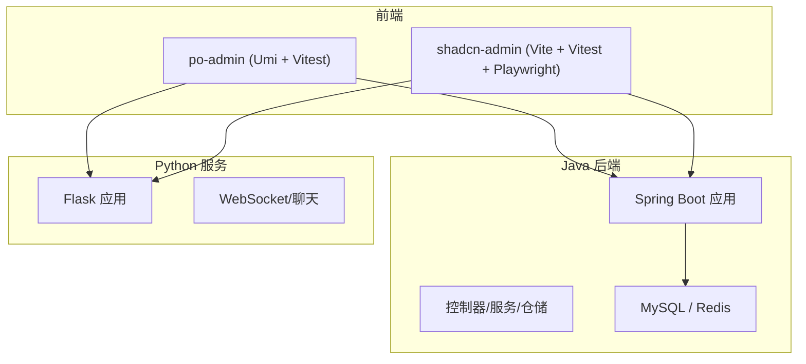
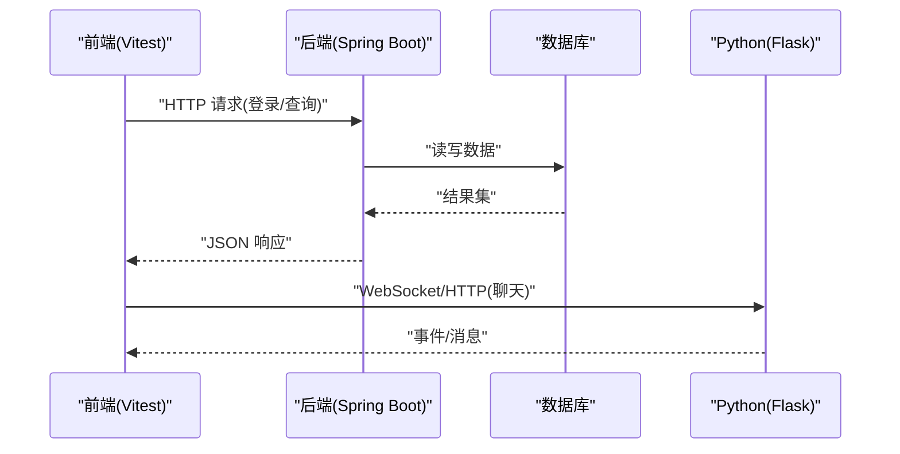
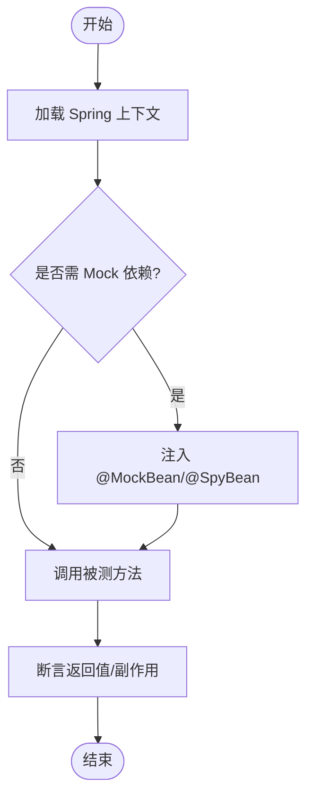
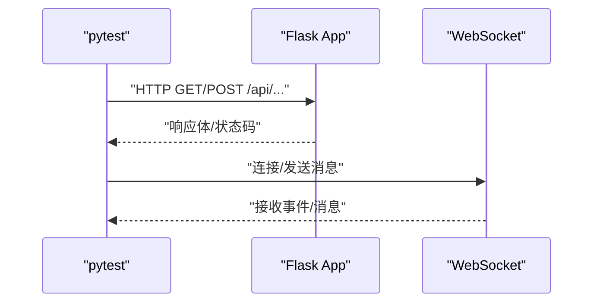
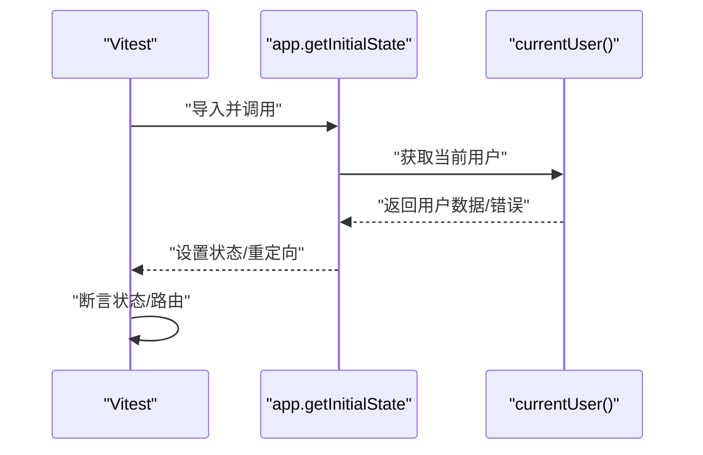
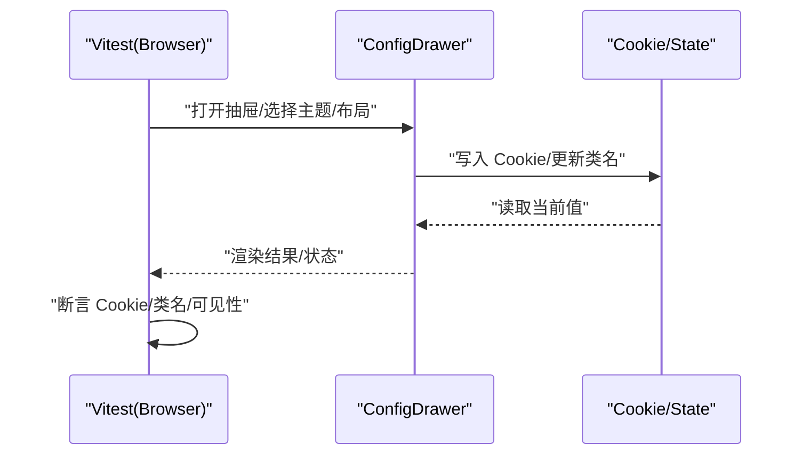
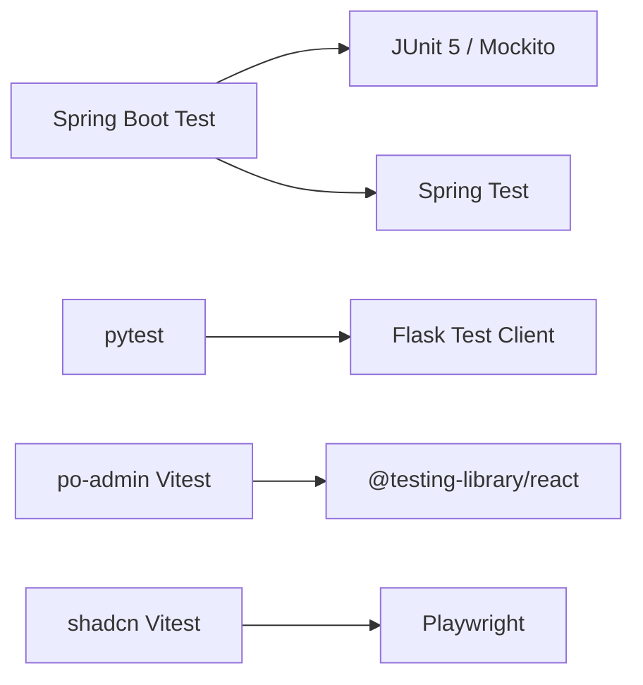

# 测试策略

<cite>
**本文引用的文件**
- [java_server/po/pom.xml](file://java_server/po/pom.xml)
- [java_server/po/src/test/java/com/goodzheng/po/PoApplicationTests.java](file://java_server/po/src/test/java/com/goodzheng/po/PoApplicationTests.java)
- [py_server/requirements.txt](file://py_server/requirements.txt)
- [web_client/po-admin/package.json](file://web_client/po-admin/package.json)
- [web_client/po-admin/vitest.config.ts](file://web_client/po-admin/vitest.config.ts)
- [web_client/po-admin/tests/setupTests.ts](file://web_client/po-admin/tests/setupTests.ts)
- [web_client/po-admin/src/app.test.tsx](file://web_client/po-admin/src/app.test.tsx)
- [web_client/shadcn-admin/package.json](file://web_client/shadcn-admin/package.json)
- [web_client/shadcn-admin/vite.config.ts](file://web_client/shadcn-admin/vite.config.ts)
- [web_client/shadcn-admin/src/components/config-drawer.test.tsx](file://web_client/shadcn-admin/src/components/config-drawer.test.tsx)
- [web_client/shadcn-admin/src/test-utils/cookies.ts](file://web_client/shadcn-admin/src/test-utils/cookies.ts)
</cite>

## 目录
1. [简介](#简介)
2. [项目结构](#项目结构)
3. [核心组件](#核心组件)
4. [架构总览](#架构总览)
5. [详细组件分析](#详细组件分析)
6. [依赖分析](#依赖分析)
7. [性能考虑](#性能考虑)
8. [故障排查指南](#故障排查指南)
9. [结论](#结论)
10. [附录](#附录)

## 简介
本测试策略面向多语言、前后端分离的项目，覆盖单元测试、集成测试与端到端（E2E）测试的编写与执行。重点包括：
- Java 后端：基于 Spring Boot + JUnit 5 的单元与集成测试，结合 Mock 与内存数据库进行服务层与接口层验证。
- Python 服务：基于 Flask 的 API 与 WebSocket 测试，使用 pytest 组织用例并隔离外部依赖。
- 前端组件：基于 Vitest + React Testing Library 的组件与交互测试；shadcn-admin 使用浏览器模式（Playwright）做更贴近真实环境的 E2E 级 UI 测试。
- 统一关注点：API 接口测试、数据库测试、UI 交互测试、覆盖率要求、持续集成中的测试执行、测试数据管理策略与用例规范。

## 项目结构
仓库包含三个主要子工程：
- java_server：Spring Boot 后端，提供 REST 接口与业务逻辑。
- py_server：Python 服务，提供聊天与 WebSocket 能力。
- web_client：两个前端应用（po-admin 与 shadcn-admin），分别基于 Umi/Vitest 和 Vite/Vitest+Playwright。

[此图为概念性结构图，不直接映射具体源码文件]

## 核心组件
- Java 测试基座
  - 通过 Maven 引入 spring-boot-starter-test，启用 JUnit 5 与 Spring Test 上下文加载能力。
  - 已有最小化集成测试入口，用于验证应用上下文启动。
- Python 服务
  - 依赖 Flask、flask-sock、flask-cors 等，便于后续用 pytest 对路由与 WebSocket 进行请求级测试。
- 前端 po-admin
  - 使用 Vitest 运行器，happy-dom 环境，全局配置了 setupFiles 与覆盖率收集。
  - 提供 app 初始化流程的测试示例，展示如何 mock 路由与服务调用。
- 前端 shadcn-admin
  - 使用 Vitest 浏览器模式（Playwright）进行更接近真实浏览器的 UI/E2E 测试。
  - 提供抽屉组件的完整交互测试，覆盖主题、布局、方向与重置行为。

章节来源
- [java_server/po/pom.xml:32-115](file://java_server/po/pom.xml#L32-L115)
- [java_server/po/src/test/java/com/goodzheng/po/PoApplicationTests.java:1-14](file://java_server/po/src/test/java/com/goodzheng/po/PoApplicationTests.java#L1-L14)
- [py_server/requirements.txt:1-13](file://py_server/requirements.txt#L1-L13)
- [web_client/po-admin/package.json:7-32](file://web_client/po-admin/package.json#L7-L32)
- [web_client/po-admin/vitest.config.ts:1-40](file://web_client/po-admin/vitest.config.ts#L1-L40)
- [web_client/po-admin/tests/setupTests.ts:1-106](file://web_client/po-admin/tests/setupTests.ts#L1-L106)
- [web_client/po-admin/src/app.test.tsx:1-147](file://web_client/po-admin/src/app.test.tsx#L1-L147)
- [web_client/shadcn-admin/package.json:6-20](file://web_client/shadcn-admin/package.json#L6-L20)
- [web_client/shadcn-admin/vite.config.ts:1-53](file://web_client/shadcn-admin/vite.config.ts#L1-L53)
- [web_client/shadcn-admin/src/components/config-drawer.test.tsx:1-320](file://web_client/shadcn-admin/src/components/config-drawer.test.tsx#L1-L320)

## 架构总览
测试分层与职责：
- 单元测试：聚焦函数/类方法，快速反馈，尽量无 IO。
- 集成测试：验证模块间协作，如 Controller → Service → Repository，必要时使用内存数据库或容器化 DB。
- E2E/UI 测试：模拟用户操作，验证页面交互与状态持久化（Cookie/LocalStorage）。

[此图为概念性流程图，不直接映射具体源码文件]

## 详细组件分析

### Java 后端测试（JUnit 5 + Spring Boot）
- 目标
  - 验证应用上下文启动、控制器路由、服务逻辑与数据访问。
- 现状
  - 已引入 spring-boot-starter-test，具备 JUnit 5 与 Spring Test 能力。
  - 存在最小化的集成测试用例，用于上下文加载验证。
- 建议实践
  - 控制器层：使用 @WebMvcTest 或 @SpringBootTest + TestRestTemplate/MockMvc 进行接口断言。
  - 服务层：使用 @MockBean 注入依赖，验证业务分支与异常路径。
  - 数据访问层：使用 H2 内存库或 Testcontainers 启动真实 MySQL，确保 SQL/ORM 正确性。
  - 安全与鉴权：在测试中构造 Token/Session，覆盖 401/403 场景。
  - 异步与事务：使用 @Transactional 回滚测试数据，避免污染。

[此图为概念性流程图，不直接映射具体源码文件]

章节来源
- [java_server/po/pom.xml:86-89](file://java_server/po/pom.xml#L86-L89)
- [java_server/po/src/test/java/com/goodzheng/po/PoApplicationTests.java:6-11](file://java_server/po/src/test/java/com/goodzheng/po/PoApplicationTests.java#L6-L11)

### Python 服务测试（pytest + Flask）
- 目标
  - 验证 Flask 路由、参数校验、错误处理与 WebSocket 通信。
- 现状
  - 依赖 Flask、flask-sock、flask-cors，便于构建测试客户端与 WS 会话。
- 建议实践
  - 使用 Flask test client 发起 HTTP 请求，断言状态码与 JSON 结构。
  - 使用 flask-sock 提供的测试工具或 httpx/aiohttp 进行 WS 连接与消息断言。
  - 将外部 LLM/第三方服务替换为本地 stub/mock，保证测试稳定。
  - 使用 pytest fixtures 管理测试数据与临时配置。

[此图为概念性流程图，不直接映射具体源码文件]

章节来源
- [py_server/requirements.txt:1-13](file://py_server/requirements.txt#L1-L13)

### 前端 po-admin 测试（Vitest + RTL）
- 目标
  - 验证应用初始化流程、路由跳转、用户信息获取与错误处理。
- 现状
  - 使用 Vitest，happy-dom 环境，setupFiles 提供全局 polyfill 与 mock。
  - 提供 app.getInitialState 的测试，演示如何 mock 历史路由与服务调用。
- 建议实践
  - 组件测试：使用 render + fireEvent/userEvent，断言 DOM 变化与状态更新。
  - 网络请求：mock fetch/axios 或拦截 Umi request，返回固定数据。
  - 覆盖率：按 vitest.config 配置 v8 收集器，排除生成代码与样式文件。
  - 隔离：每个用例前清理 localStorage/Cookie，避免状态泄漏。

章节来源
- [web_client/po-admin/vitest.config.ts:12-38](file://web_client/po-admin/vitest.config.ts#L12-L38)
- [web_client/po-admin/tests/setupTests.ts:1-106](file://web_client/po-admin/tests/setupTests.ts#L1-L106)
- [web_client/po-admin/src/app.test.tsx:51-147](file://web_client/po-admin/src/app.test.tsx#L51-L147)

### 前端 shadcn-admin 测试（Vitest 浏览器模式 + Playwright）
- 目标
  - 以真实浏览器环境验证 UI 交互、主题/布局切换、Cookie 持久化与重置。
- 现状
  - 使用 Vitest browser provider = playwright，实例 chromium。
  - 提供 ConfigDrawer 的完整交互测试，覆盖主题、侧边栏、方向与重置。
- 建议实践
  - 使用 userEvent 模拟点击/输入，等待 DOM/Cookie 变更后再断言。
  - 使用 clearCookies 工具在 beforeEach 清理 Cookie，保证用例隔离。
  - 对耗时操作使用 vi.waitFor，避免不稳定断言。
  - 覆盖率：按 vite.config 配置 exclude 列表，聚焦业务代码。

章节来源
- [web_client/shadcn-admin/vite.config.ts:32-50](file://web_client/shadcn-admin/vite.config.ts#L32-L50)
- [web_client/shadcn-admin/src/components/config-drawer.test.tsx:39-318](file://web_client/shadcn-admin/src/components/config-drawer.test.tsx#L39-L318)
- [web_client/shadcn-admin/src/test-utils/cookies.ts:1-29](file://web_client/shadcn-admin/src/test-utils/cookies.ts#L1-L29)

## 依赖分析
- Java
  - 测试依赖：spring-boot-starter-test（含 JUnit 5、Mockito、AssertJ 等）。
  - 运行时依赖：MyBatis Plus、Spring Data JPA、Redis、MySQL、JWT、Validation、Security Crypto。
- Python
  - 运行时依赖：Flask、flask-sock、flask-cors、LangChain/LangGraph、dotenv。
- 前端
  - po-admin：Vitest、@testing-library/react、happy-dom、v8 覆盖率。
  - shadcn-admin：Vitest 浏览器模式（Playwright）、v8 覆盖率、React 生态。

[此图为概念性依赖图，不直接映射具体源码文件]

章节来源
- [java_server/po/pom.xml:32-115](file://java_server/po/pom.xml#L32-L115)
- [py_server/requirements.txt:1-13](file://py_server/requirements.txt#L1-L13)
- [web_client/po-admin/package.json:56-93](file://web_client/po-admin/package.json#L56-L93)
- [web_client/shadcn-admin/package.json:68-96](file://web_client/shadcn-admin/package.json#L68-L96)

## 性能考虑
- 测试分层优先：单元测试最快，集成测试次之，E2E/浏览器测试最慢。
- 并行执行：Vitest 默认支持并发；Java 可使用 Surefire/Failsafe 并行；pytest 可用 -n 选项。
- 资源隔离：数据库与缓存使用独立实例或内存库；浏览器测试限制并发实例数。
- 覆盖率阈值：建议在 CI 中设置最低覆盖率门限，避免退化。
- 快照与回放：谨慎使用快照，避免维护成本过高；优先断言关键状态。

[本节为通用指导，不直接分析具体文件]

## 故障排查指南
- 前端测试无法找到元素
  - 检查是否在 setupFiles 中正确 polyfill 了必要 API（如 matchMedia、ResizeObserver）。
  - 确认渲染时使用了正确的 Provider（主题、布局、方向）。
- 浏览器模式不稳定
  - 使用 vi.waitFor 等待异步状态（Cookie、DOM 类名）后再断言。
  - 在 beforeEach 清理 Cookie，避免跨用例污染。
- Java 集成测试失败
  - 确认数据库/Redis 地址与凭据；优先使用内存库或 Testcontainers。
  - 对事务性测试使用 @Transactional 回滚，避免数据残留。
- Python 测试超时
  - 将外部 LLM/网络调用替换为本地 stub；缩短超时时间。

章节来源
- [web_client/po-admin/tests/setupTests.ts:84-106](file://web_client/po-admin/tests/setupTests.ts#L84-L106)
- [web_client/shadcn-admin/src/components/config-drawer.test.tsx:40-47](file://web_client/shadcn-admin/src/components/config-drawer.test.tsx#L40-L47)
- [web_client/shadcn-admin/src/test-utils/cookies.ts:10-28](file://web_client/shadcn-admin/src/test-utils/cookies.ts#L10-L28)

## 结论
本项目已具备完善的测试基础设施：
- Java 后端可通过 JUnit 5 + Spring Test 快速扩展单元与集成测试。
- Python 服务可基于 pytest 对 HTTP/WS 进行稳定测试。
- 前端采用 Vitest 双模式：po-admin 使用 happy-dom 快速组件测试；shadcn-admin 使用 Playwright 进行高保真 UI/E2E 测试。
建议在各子工程中逐步补齐用例，建立统一的覆盖率门槛与 CI 流水线，确保质量持续提升。

[本节为总结性内容，不直接分析具体文件]

## 附录

### 测试覆盖率要求
- 前端
  - po-admin：使用 v8 提供者，统计 src 下 ts/tsx，排除 .umi、样式与类型声明。
  - shadcn-admin：使用 v8 提供者，排除 UI 基础组件、静态资源与生成文件。
- Java
  - 建议使用 JaCoCo 插件统计行/分支覆盖率，设定最低阈值（例如 80%）。
- Python
  - 使用 pytest-cov 收集覆盖率，排除第三方库与无关目录。

章节来源
- [web_client/po-admin/vitest.config.ts:25-35](file://web_client/po-admin/vitest.config.ts#L25-L35)
- [web_client/shadcn-admin/vite.config.ts:40-50](file://web_client/shadcn-admin/vite.config.ts#L40-L50)

### 持续集成中的测试执行
- 触发时机：提交 PR、合并到主分支、定时任务。
- 执行顺序：先运行前端与 Python 的快速测试，再运行 Java 集成测试与浏览器 E2E。
- 产物：覆盖率报告、测试报告、截图/视频（可选）。
- 门禁：覆盖率未达标或测试失败则阻断合并。

[本节为通用指导，不直接分析具体文件]

### 测试数据管理策略
- 数据库：优先使用内存库或容器化数据库；每次测试前准备最小数据集，测试后自动回滚或销毁。
- Cookie/Storage：在每个用例前清理，避免状态泄漏。
- 外部服务：使用本地 stub 或 mock 服务器，固定响应数据。
- 种子数据：SQL 脚本或工厂函数集中管理，便于复用与维护。

章节来源
- [web_client/shadcn-admin/src/test-utils/cookies.ts:10-28](file://web_client/shadcn-admin/src/test-utils/cookies.ts#L10-L28)

### 用例编写规范与常见场景
- 命名与结构
  - 文件名以 .test.ts/.test.tsx 结尾；描述块与被测功能对应。
  - 用例命名清晰表达“当…时，应…”。
- 断言原则
  - 断言可见行为（DOM、状态、网络请求），而非实现细节。
  - 对异步操作使用 waitFor 或合理 sleep。
- 常见场景
  - 登录/鉴权：成功、401、403、网络异常。
  - 表单：必填校验、格式校验、提交成功/失败。
  - 列表：分页、排序、筛选、空态。
  - 弹窗/抽屉：打开/关闭、重置、键盘交互。
  - WebSocket：连接、消息收发、断开重连。

[本节为通用指导，不直接分析具体文件]