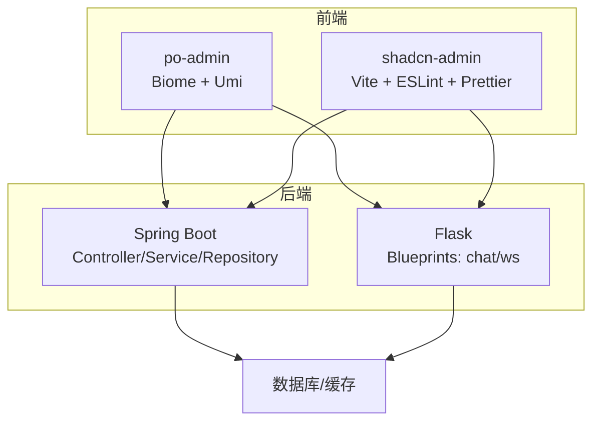
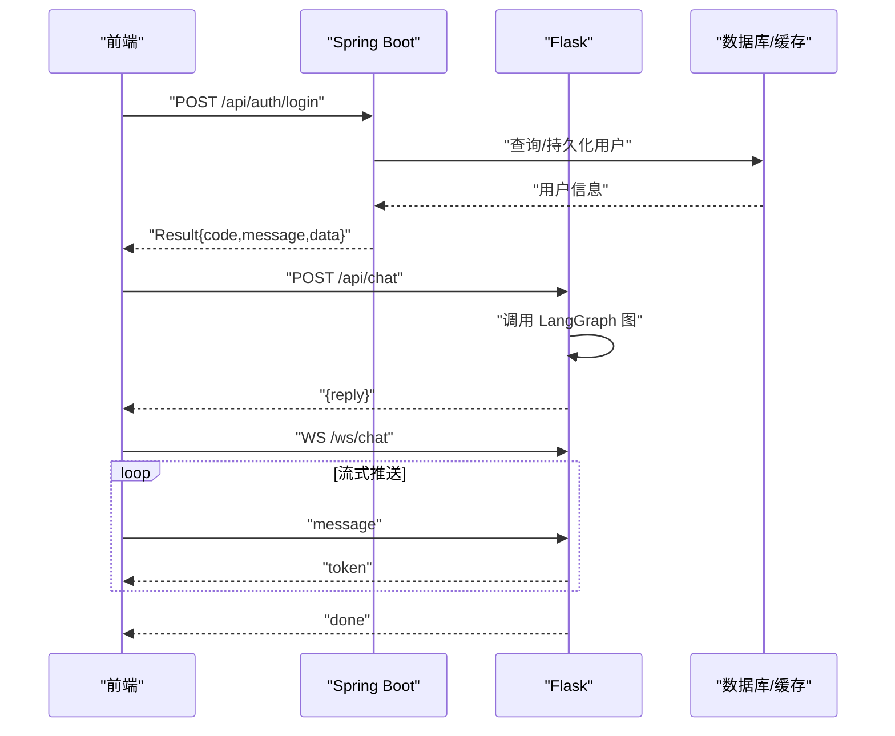
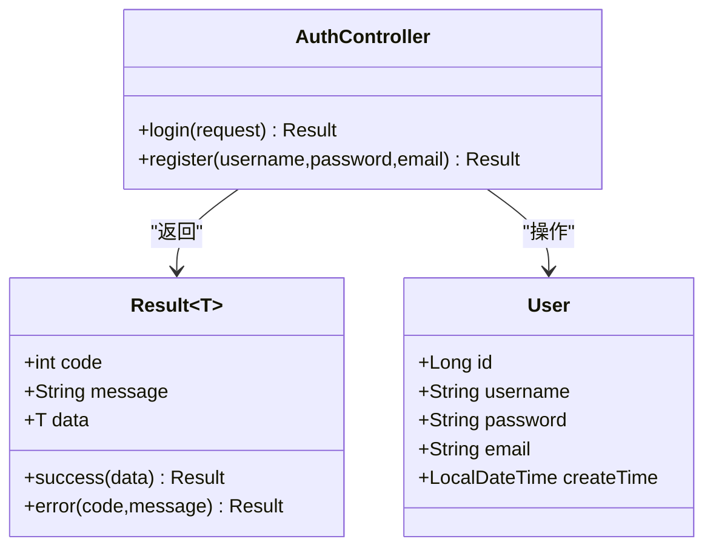
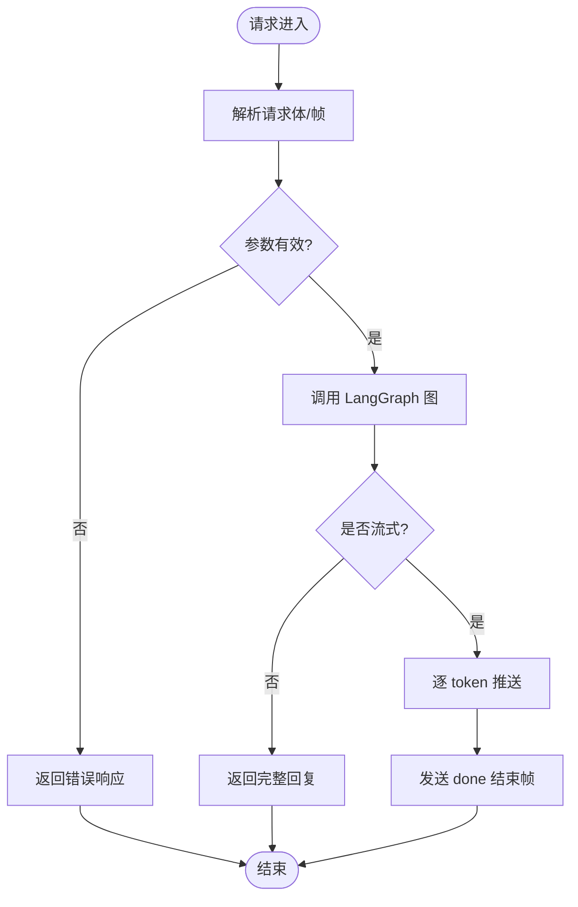
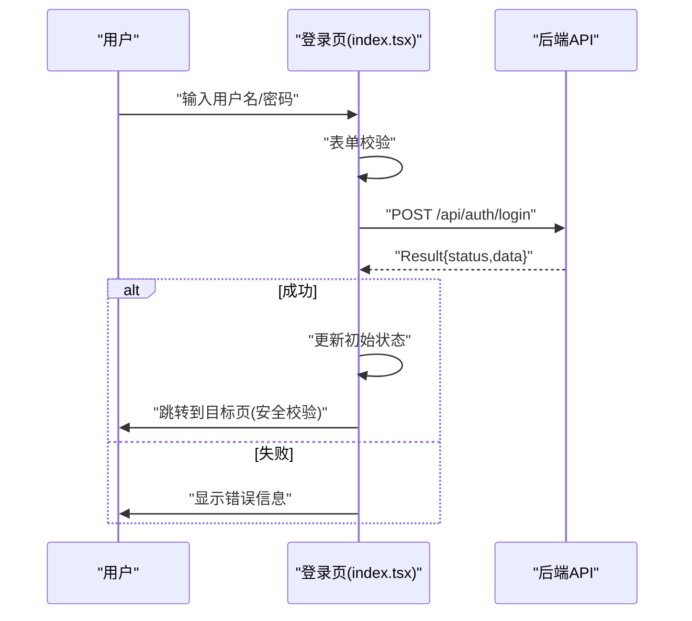
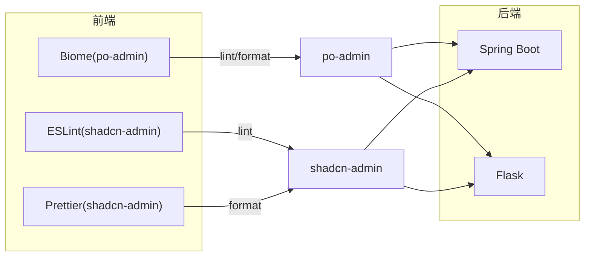

# 编码规范

<cite>
**本文引用的文件**
- [PoApplication.java](file://java_server/po/src/main/java/com/goodzheng/po/PoApplication.java)
- [application.yaml](file://java_server/po/src/main/resources/application.yaml)
- [AuthController.java](file://java_server/po/src/main/java/com/goodzheng/po/controller/AuthController.java)
- [Result.java](file://java_server/po/src/main/java/com/goodzheng/po/dto/Result.java)
- [User.java](file://java_server/po/src/main/java/com/goodzheng/po/entity/User.java)
- [app.py](file://py_server/app.py)
- [config.py](file://py_server/config.py)
- [chat.py](file://py_server/blueprints/chat.py)
- [ws.py](file://py_server/blueprints/ws.py)
- [package.json（po-admin）](file://web_client/po-admin/package.json)
- [biome.json](file://web_client/po-admin/biome.json)
- [index.tsx（登录页）](file://web_client/po-admin/src/pages/user/login/index.tsx)
- [eslint.config.js](file://web_client/shadcn-admin/eslint.config.js)
- [.prettierrc](file://web_client/shadcn-admin/.prettierrc)
- [button.tsx](file://web_client/shadcn-admin/src/components/ui/button.tsx)
</cite>

## 目录
1. [简介](#简介)
2. [项目结构](#项目结构)
3. [核心组件](#核心组件)
4. [架构总览](#架构总览)
5. [详细组件分析](#详细组件分析)
6. [依赖关系分析](#依赖关系分析)
7. [性能考虑](#性能考虑)
8. [故障排查指南](#故障排查指南)
9. [结论](#结论)
10. [附录](#附录)

## 简介
本规范面向多语言工程：Java Spring Boot 后端、Python Flask 服务与前端 TypeScript/React。目标是在命名、格式、文件组织、接口契约、错误处理、静态检查与自动化流程等方面建立统一约定，提升可维护性与协作效率。

## 项目结构
- Java 后端（Spring Boot）
  - 包结构遵循分层：controller、service、repository、entity、dto、util；入口类使用 @SpringBootApplication。
  - 配置集中管理于 application.yaml，包含服务器、数据源、JPA、Redis、日志、Actuator 等。
- Python 服务（Flask）
  - 应用工厂 create_app 初始化扩展并注册蓝图；blueprints 按功能拆分路由；config 通过环境变量加载配置。
  - REST 与 WebSocket 分别提供一次性回复与流式对话能力。
- 前端（TypeScript/React）
  - po-admin：基于 Ant Design Pro/Umi，使用 Biome 进行格式化与校验，脚本集成 lint-staged/Husky。
  - shadcn-admin：基于 Vite + React，ESLint + Prettier 统一风格，组件采用 Radix UI 组合模式。

**图示来源**
- [PoApplication.java:6-11](file://java_server/po/src/main/java/com/goodzheng/po/PoApplication.java#L6-L11)
- [application.yaml:4-109](file://java_server/po/src/main/resources/application.yaml#L4-L109)
- [app.py:24-47](file://py_server/app.py#L24-L47)
- [chat.py:7-23](file://py_server/blueprints/chat.py#L7-L23)
- [ws.py:23-90](file://py_server/blueprints/ws.py#L23-L90)
- [package.json（po-admin）:7-32](file://web_client/po-admin/package.json#L7-L32)
- [eslint.config.js:9-59](file://web_client/shadcn-admin/eslint.config.js#L9-L59)
- [.prettierrc:1-52](file://web_client/shadcn-admin/.prettierrc#L1-L52)

**章节来源**
- [PoApplication.java:6-11](file://java_server/po/src/main/java/com/goodzheng/po/PoApplication.java#L6-L11)
- [application.yaml:4-109](file://java_server/po/src/main/resources/application.yaml#L4-L109)
- [app.py:24-47](file://py_server/app.py#L24-L47)
- [package.json（po-admin）:7-32](file://web_client/po-admin/package.json#L7-L32)
- [eslint.config.js:9-59](file://web_client/shadcn-admin/eslint.config.js#L9-L59)
- [.prettierrc:1-52](file://web_client/shadcn-admin/.prettierrc#L1-L52)

## 核心组件
- Spring Boot
  - 控制器：RESTful 接口，统一返回 Result<T>，参数校验使用 @Valid。
  - 实体：JPA 注解定义表结构与约束，时间字段自动更新。
  - 配置：application.yaml 统一管理端口、上下文路径、连接池、JPA、Redis、日志、监控等。
- Flask
  - 应用工厂：集中创建与装配扩展、蓝图，启动前预热图。
  - 蓝图：REST 聊天接口与 WebSocket 流式接口分离，异常统一记录并返回友好提示。
  - 配置：Config 从 .env 与环境变量加载，支持 LLM 兼容端点与模型切换。
- 前端
  - po-admin：登录页示例展示表单校验、国际化、状态管理与跳转安全校验。
  - shadcn-admin：Button 组件以 cva 变体管理样式，类型安全的 props 组合。

**章节来源**
- [AuthController.java:11-39](file://java_server/po/src/main/java/com/goodzheng/po/controller/AuthController.java#L11-L39)
- [Result.java:7-30](file://java_server/po/src/main/java/com/goodzheng/po/dto/Result.java#L7-L30)
- [User.java:8-57](file://java_server/po/src/main/java/com/goodzheng/po/entity/User.java#L8-L57)
- [application.yaml:4-109](file://java_server/po/src/main/resources/application.yaml#L4-L109)
- [app.py:24-47](file://py_server/app.py#L24-L47)
- [chat.py:7-23](file://py_server/blueprints/chat.py#L7-L23)
- [ws.py:23-90](file://py_server/blueprints/ws.py#L23-L90)
- [config.py:10-25](file://py_server/config.py#L10-L25)
- [index.tsx（登录页）:34-46,150-175:34-46](file://web_client/po-admin/src/pages/user/login/index.tsx#L34-L46)
- [button.tsx:6-58](file://web_client/shadcn-admin/src/components/ui/button.tsx#L6-L58)

## 架构总览
前后端通过 HTTP/WebSocket 交互，后端内部按分层解耦，配置与扩展集中管理。

**图示来源**
- [AuthController.java:19-27](file://java_server/po/src/main/java/com/goodzheng/po/controller/AuthController.java#L19-L27)
- [Result.java:16-30](file://java_server/po/src/main/java/com/goodzheng/po/dto/Result.java#L16-L30)
- [chat.py:10-23](file://py_server/blueprints/chat.py#L10-L23)
- [ws.py:30-90](file://py_server/blueprints/ws.py#L30-L90)

## 详细组件分析

### Spring Boot 组件与约定
- 命名与包结构
  - 包名小写、层级清晰：controller/service/repository/entity/dto/util。
  - 类名大驼峰，方法名小驼峰，常量全大写加下划线。
- 代码格式与注释
  - 统一缩进与行宽；类/方法必要注释；对外 API 建议补充 Javadoc。
- 导入顺序
  - 先标准库，再第三方，最后本项目内包；避免重复导入。
- 文件组织
  - 每个领域一个 Controller，Service 实现业务逻辑，Repository 负责数据访问，DTO 用于入参出参。
- Spring Boot 最佳实践
  - 使用 @RestController + @RequestMapping 声明接口；@Valid 校验入参；统一 Result 封装；异常捕获后返回明确码与消息。
  - 配置外置：application.yaml 管理环境相关项；敏感信息走环境变量或密钥管理。
  - 开启 Actuator 暴露健康与指标；合理设置连接池与超时。

**图示来源**
- [AuthController.java:11-39](file://java_server/po/src/main/java/com/goodzheng/po/controller/AuthController.java#L11-L39)
- [Result.java:7-30](file://java_server/po/src/main/java/com/goodzheng/po/dto/Result.java#L7-L30)
- [User.java:8-57](file://java_server/po/src/main/java/com/goodzheng/po/entity/User.java#L8-L57)

**章节来源**
- [AuthController.java:11-39](file://java_server/po/src/main/java/com/goodzheng/po/controller/AuthController.java#L11-L39)
- [Result.java:7-30](file://java_server/po/src/main/java/com/goodzheng/po/dto/Result.java#L7-L30)
- [User.java:8-57](file://java_server/po/src/main/java/com/goodzheng/po/entity/User.java#L8-L57)
- [application.yaml:4-109](file://java_server/po/src/main/resources/application.yaml#L4-L109)

### Flask 组件与约定
- 命名与模块划分
  - 蓝图按功能拆分：main/chat/ws；函数名小写+下划线；模块级 docstring 说明用途。
- 代码格式与注释
  - 统一缩进与行宽；关键逻辑添加注释；异常堆栈记录到日志。
- 导入顺序
  - 标准库、第三方、本地模块；避免循环导入。
- 文件组织
  - app.py 作为入口与工厂；blueprints 承载路由；extensions 管理扩展；config 管理配置。
- Flask 最佳实践
  - 使用工厂模式 create_app；蓝图 url_prefix 隔离路径；统一错误响应；敏感配置通过环境变量。

**图示来源**
- [chat.py:10-23](file://py_server/blueprints/chat.py#L10-L23)
- [ws.py:30-90](file://py_server/blueprints/ws.py#L30-L90)

**章节来源**
- [app.py:24-47](file://py_server/app.py#L24-L47)
- [chat.py:1-24](file://py_server/blueprints/chat.py#L1-L24)
- [ws.py:1-90](file://py_server/blueprints/ws.py#L1-L90)
- [config.py:10-25](file://py_server/config.py#L10-L25)

### 前端 TypeScript/React 组件与约定
- 命名与文件组织
  - 组件文件 PascalCase；页面按功能分目录；样式与组件同目录或独立 style 文件。
- 代码格式与注释
  - 单引号、无分号、尾随逗号；行宽限制；复杂逻辑添加注释。
- 导入顺序
  - 使用 Prettier importOrder 规则统一排序；类型导入使用 type-only。
- React 设计模式
  - 组合优于继承；CVA 管理变体；受控与非受控组件分离；状态就近管理。
- 安全与健壮性
  - 重定向 URL 校验防止开放重定向；表单校验与错误提示；网络异常统一处理。

**图示来源**
- [index.tsx（登录页）:34-46,150-175:34-46](file://web_client/po-admin/src/pages/user/login/index.tsx#L34-L46)
- [AuthController.java:19-27](file://java_server/po/src/main/java/com/goodzheng/po/controller/AuthController.java#L19-L27)

**章节来源**
- [index.tsx（登录页）:34-46,150-175:34-46](file://web_client/po-admin/src/pages/user/login/index.tsx#L34-L46)
- [button.tsx:6-58](file://web_client/shadcn-admin/src/components/ui/button.tsx#L6-L58)
- [.prettierrc:1-52](file://web_client/shadcn-admin/.prettierrc#L1-L52)
- [eslint.config.js:9-59](file://web_client/shadcn-admin/eslint.config.js#L9-L59)

## 依赖关系分析
- 前端构建与质量工具
  - po-admin：Biome 负责格式化与校验；scripts 集成 lint-staged/Husky 在提交时执行。
  - shadcn-admin：ESLint 规则严格，Prettier 统一格式，importOrder 控制导入顺序。
- 后端依赖
  - Spring Boot：JPA、HikariCP、Redis、Actuator；配置集中在 application.yaml。
  - Flask：LangChain/LangGraph、WebSocket、CORS；配置通过 config.py 与环境变量。

**图示来源**
- [package.json（po-admin）:7-32](file://web_client/po-admin/package.json#L7-L32)
- [biome.json:29-57](file://web_client/po-admin/biome.json#L29-L57)
- [eslint.config.js:9-59](file://web_client/shadcn-admin/eslint.config.js#L9-L59)
- [.prettierrc:1-52](file://web_client/shadcn-admin/.prettierrc#L1-L52)
- [application.yaml:4-109](file://java_server/po/src/main/resources/application.yaml#L4-L109)
- [app.py:24-47](file://py_server/app.py#L24-L47)

**章节来源**
- [package.json（po-admin）:7-32](file://web_client/po-admin/package.json#L7-L32)
- [biome.json:29-57](file://web_client/po-admin/biome.json#L29-L57)
- [eslint.config.js:9-59](file://web_client/shadcn-admin/eslint.config.js#L9-L59)
- [.prettierrc:1-52](file://web_client/shadcn-admin/.prettierrc#L1-L52)
- [application.yaml:4-109](file://java_server/po/src/main/resources/application.yaml#L4-L109)
- [app.py:24-47](file://py_server/app.py#L24-L47)

## 性能考虑
- Spring Boot
  - 合理设置 HikariCP 连接池大小与超时；JPA show-sql 仅开发环境开启；静态资源缓存策略。
- Flask
  - 流式输出减少首屏延迟；WebSocket 心跳保活；异常快速失败与日志采样。
- 前端
  - 组件懒加载与按需引入；样式合并与去重；网络请求重试与取消。

[本节为通用指导，不直接分析具体文件]

## 故障排查指南
- Spring Boot
  - 接口返回非预期：检查 @Valid 校验与 Result 封装；查看日志级别与输出格式。
  - 数据库连接问题：核对 application.yaml 中 datasource 与 hikari 配置。
- Flask
  - 聊天接口报错：确认 payload 字段与 LangGraph 图可用；查看日志中的异常堆栈。
  - WebSocket 断连：检查心跳帧与 ConnectionClosed 处理。
- 前端
  - 登录失败：检查表单校验与网络响应；重定向 URL 安全校验逻辑。
  - 组件样式异常：确认 CVA 变体与 Tailwind 类名是否正确拼接。

**章节来源**
- [AuthController.java:19-39](file://java_server/po/src/main/java/com/goodzheng/po/controller/AuthController.java#L19-L39)
- [application.yaml:24-41](file://java_server/po/src/main/resources/application.yaml#L24-L41)
- [chat.py:10-23](file://py_server/blueprints/chat.py#L10-L23)
- [ws.py:30-90](file://py_server/blueprints/ws.py#L30-L90)
- [index.tsx（登录页）:150-175](file://web_client/po-admin/src/pages/user/login/index.tsx#L150-L175)
- [button.tsx:6-58](file://web_client/shadcn-admin/src/components/ui/button.tsx#L6-L58)

## 结论
本规范通过统一的命名、格式、文件组织与工具链，确保多语言工程的一致性与可维护性。建议在团队内推广并纳入 CI 流程，持续改进与演进。

## 附录

### 命名规范速查
- Java
  - 包：全小写，多级域名倒序；类：大驼峰；方法/变量：小驼峰；常量：全大写加下划线。
- Python
  - 模块/函数：小写+下划线；类：大驼峰；常量：全大写；私有成员以下划线开头。
- TypeScript/React
  - 组件：PascalCase；Hook：useXxx；常量：全大写；样式类：语义化命名。

### 代码格式标准
- Java
  - 缩进 4 空格；行宽 120；import 分组；注释覆盖公共 API。
- Python
  - 缩进 4 空格；行宽 88；docstring 描述模块/函数；异常记录日志。
- TypeScript/React
  - 单引号、无分号、尾随逗号；行宽 80；importOrder 统一排序；类型导入使用 type-only。

### 文件组织结构
- Java
  - controller/service/repository/entity/dto/util；resources 下 application.yaml。
- Python
  - app.py、blueprints/*、extensions.py、config.py。
- 前端
  - po-admin：src/pages、src/components、src/services；shadcn-admin：src/features、src/components/ui、src/lib。

### Spring Boot 最佳实践
- 使用 @RestController + @RequestMapping；@Valid 校验；统一 Result 封装；异常捕获返回明确码与消息。
- 配置外置：application.yaml；敏感信息环境变量；Actuator 暴露健康与指标。

### React 组件设计模式
- 组合优于继承；CVA 管理变体；受控与非受控组件分离；状态就近管理；类型安全 props。

### Python Flask 代码风格
- 工厂模式 create_app；蓝图 url_prefix 隔离路径；统一错误响应；配置通过环境变量。

### 静态检查工具配置
- Java
  - Checkstyle：建议启用，规则集与 Maven 插件集成，CI 中强制。
- Python
  - Flake8/Black：建议启用，统一风格与复杂度限制。
- TypeScript/React
  - po-admin：Biome（lint/format），scripts 集成 Husky/lint-staged。
  - shadcn-admin：ESLint + Prettier，importOrder 与 React Hooks 规则。

### 自动化代码质量检查流程
- 提交阶段
  - Husky pre-commit：运行 Biome/ESLint/Prettier 检查与格式化。
- 构建阶段
  - CI 流水线：编译、测试、静态检查、覆盖率报告；失败阻断合并。
- 发布阶段
  - 制品归档与版本标签；文档与变更日志同步生成。

**章节来源**
- [package.json（po-admin）:7-32](file://web_client/po-admin/package.json#L7-L32)
- [biome.json:29-57](file://web_client/po-admin/biome.json#L29-L57)
- [eslint.config.js:9-59](file://web_client/shadcn-admin/eslint.config.js#L9-L59)
- [.prettierrc:1-52](file://web_client/shadcn-admin/.prettierrc#L1-L52)