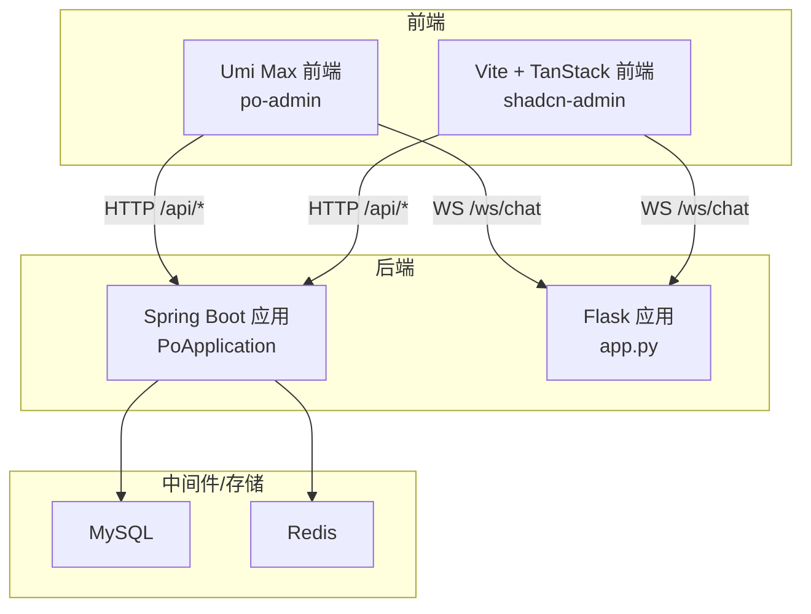
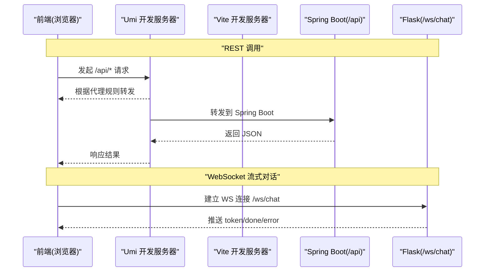
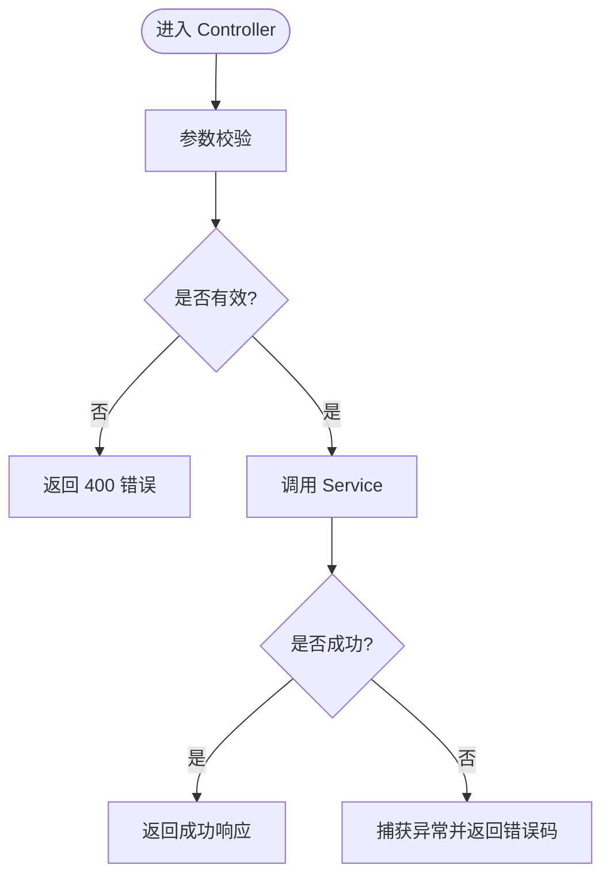
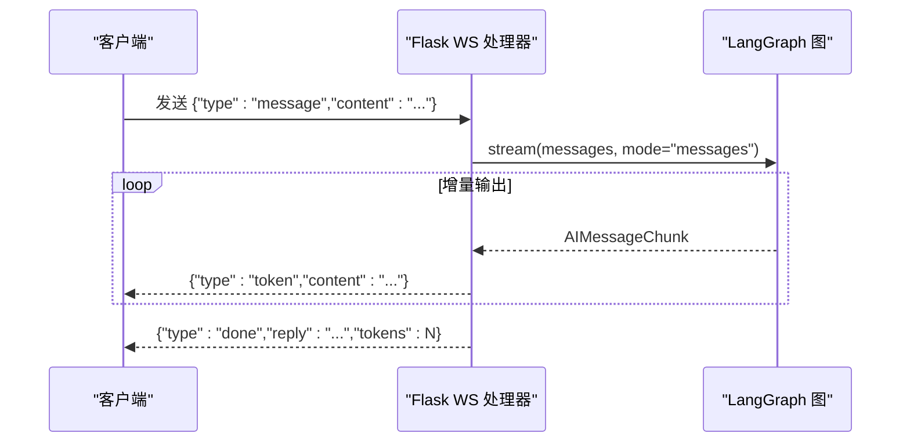
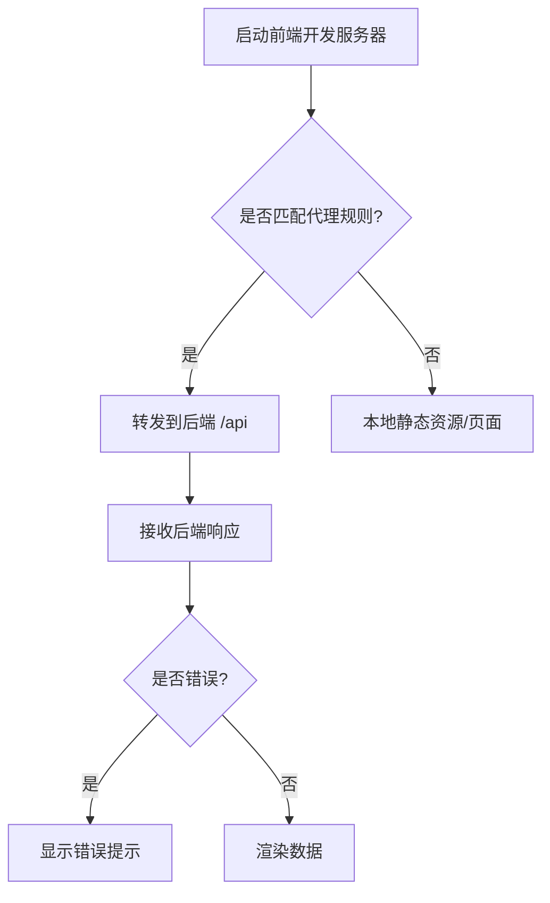
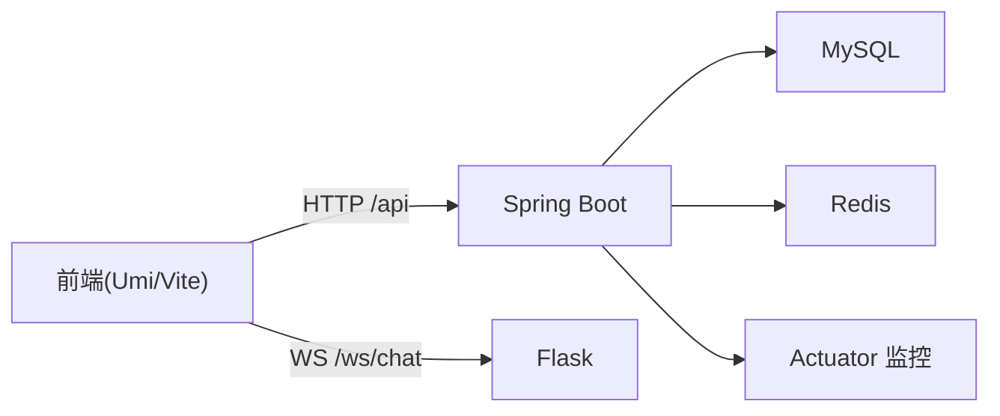

# 调试技巧

<cite>
**本文引用的文件**
- [PoApplication.java](file://java_server/po/src/main/java/com/goodzheng/po/PoApplication.java)
- [application.yaml](file://java_server/po/src/main/resources/application.yaml)
- [AuthController.java](file://java_server/po/src/main/java/com/goodzheng/po/controller/AuthController.java)
- [app.py](file://py_server/app.py)
- [config.py](file://py_server/config.py)
- [ws.py](file://py_server/blueprints/ws.py)
- [proxy.ts](file://web_client/po-admin/config/proxy.ts)
- [vite.config.ts](file://web_client/shadcn-admin/vite.config.ts)
- [vitest.config.ts](file://web_client/po-admin/vitest.config.ts)
- [handle-server-error.ts](file://web_client/shadcn-admin/src/lib/handle-server-error.ts)
- [requestErrorConfig.test.ts](file://web_client/po-admin/src/requestErrorConfig.test.ts)
</cite>

## 目录
1. [简介](#简介)
2. [项目结构](#项目结构)
3. [核心组件](#核心组件)
4. [架构总览](#架构总览)
5. [详细组件分析](#详细组件分析)
6. [依赖关系分析](#依赖关系分析)
7. [性能考虑](#性能考虑)
8. [故障排查指南](#故障排查指南)
9. [结论](#结论)
10. [附录](#附录)

## 简介
本指南面向 Java Spring Boot、Python Flask、React 前端三类服务，提供端到端调试方法：IDE 调试配置（IntelliJ IDEA、VS Code）、断点与日志策略、API 与 WebSocket 联调、数据库查询优化、常见问题诊断（性能瓶颈、内存泄漏、并发问题），以及单元测试与集成测试的编写与调试。内容基于仓库实际代码与配置进行说明，确保可操作、可落地。

## 项目结构
本项目包含三个主要子系统：
- Java Spring Boot 后端：提供 REST API、数据访问、缓存等能力
- Python Flask 服务：提供聊天对话 REST 接口与流式 WebSocket 接口
- React 前端：两个管理后台工程，分别使用 Umi Max 与 Vite + TanStack Router

图表来源
- [PoApplication.java:6-11](file://java_server/po/src/main/java/com/goodzheng/po/PoApplication.java#L6-L11)
- [app.py:24-50](file://py_server/app.py#L24-L50)
- [application.yaml:23-53](file://java_server/po/src/main/resources/application.yaml#L23-L53)

章节来源
- [PoApplication.java:6-11](file://java_server/po/src/main/java/com/goodzheng/po/PoApplication.java#L6-L11)
- [application.yaml:1-109](file://java_server/po/src/main/resources/application.yaml#L1-L109)
- [app.py:24-50](file://py_server/app.py#L24-L50)
- [config.py:10-25](file://py_server/config.py#L10-L25)

## 核心组件
- Spring Boot 入口与配置
  - 启动类：定义应用入口与自动装配
  - 应用配置：端口、上下文路径、数据源、JPA、Redis、日志、Actuator、JWT 等
- Flask 应用工厂与蓝图
  - 应用创建、CORS、WebSocket 扩展初始化、蓝图注册、LangGraph 图预热
  - 配置加载与环境变量覆盖
- 前端代理与错误处理
  - Umi 代理配置用于开发期转发到后端
  - Vite 代理配置将 /api 请求转发至本地 Spring Boot
  - 统一服务端错误处理与用户提示

章节来源
- [PoApplication.java:6-11](file://java_server/po/src/main/java/com/goodzheng/po/PoApplication.java#L6-L11)
- [application.yaml:1-109](file://java_server/po/src/main/resources/application.yaml#L1-L109)
- [app.py:24-50](file://py_server/app.py#L24-L50)
- [config.py:10-25](file://py_server/config.py#L10-L25)
- [proxy.ts:12-41](file://web_client/po-admin/config/proxy.ts#L12-L41)
- [vite.config.ts:24-31](file://web_client/shadcn-admin/vite.config.ts#L24-L31)
- [handle-server-error.ts:4-29](file://web_client/shadcn-admin/src/lib/handle-server-error.ts#L4-L29)

## 架构总览
前后端通过 HTTP 与 WebSocket 通信；Spring Boot 负责业务与数据访问，Flask 负责 AI 对话流式输出；前端在开发环境通过代理将请求转发到对应后端。

图表来源
- [proxy.ts:28-41](file://web_client/po-admin/config/proxy.ts#L28-L41)
- [vite.config.ts:24-31](file://web_client/shadcn-admin/vite.config.ts#L24-L31)
- [app.py:24-50](file://py_server/app.py#L24-L50)
- [ws.py:30-90](file://py_server/blueprints/ws.py#L30-L90)

## 详细组件分析

### Spring Boot 调试要点
- 启动与端口
  - 默认监听 8080，上下文路径为 /api
  - 线程池与连接数可调，便于高并发压测定位瓶颈
- 数据访问与 SQL 可见性
  - JPA/Hibernate 开启 show-sql，便于观察生成的 SQL
  - HikariCP 连接池参数可调整以缓解连接耗尽
- 日志与监控
  - 日志级别与格式可配置，建议开发阶段对业务包设为 DEBUG
  - Actuator 暴露 health/info/metrics/prometheus，便于健康检查与指标采集
- 控制器断点
  - 在控制器方法处设置断点，结合请求体校验与异常捕获，快速定位输入与业务异常

图表来源
- [AuthController.java:19-39](file://java_server/po/src/main/java/com/goodzheng/po/controller/AuthController.java#L19-L39)

章节来源
- [application.yaml:4-11](file://java_server/po/src/main/resources/application.yaml#L4-L11)
- [application.yaml:23-53](file://java_server/po/src/main/resources/application.yaml#L23-L53)
- [application.yaml:69-95](file://java_server/po/src/main/resources/application.yaml#L69-L95)
- [AuthController.java:19-39](file://java_server/po/src/main/java/com/goodzheng/po/controller/AuthController.java#L19-L39)

### Flask 调试要点
- 应用工厂与扩展
  - 通过 create_app 创建应用，初始化 CORS 与 WebSocket 扩展，注册蓝图
  - 启动时预热 LangGraph 图，便于尽早暴露配置问题
- 配置与环境变量
  - 从 .env 加载配置，支持 HOST、PORT、DEBUG、LLM 相关环境变量覆盖
- WebSocket 流式对话
  - 协议：客户端发送 message/ping，服务端返回 token/done/pong/error
  - 异常与关闭连接均有日志记录，便于定位网络或逻辑问题

图表来源
- [ws.py:30-90](file://py_server/blueprints/ws.py#L30-L90)
- [app.py:24-50](file://py_server/app.py#L24-L50)
- [config.py:10-25](file://py_server/config.py#L10-L25)

章节来源
- [app.py:24-50](file://py_server/app.py#L24-L50)
- [config.py:10-25](file://py_server/config.py#L10-L25)
- [ws.py:30-90](file://py_server/blueprints/ws.py#L30-L90)

### React 前端调试要点
- 代理与跨域
  - Umi 开发服务器可通过 proxy.ts 将 /api 转发到后端，解决跨域与鉴权问题
  - Vite 开发服务器同样支持代理，将 /api 转发到本地 Spring Boot
- 错误处理与提示
  - 统一错误处理函数在开发环境打印错误，生产环境仅展示友好提示
  - 针对 Axios 错误提取 title 等信息，提升用户体验
- 测试与覆盖率
  - Vitest 配置了 happy-dom 环境与全局变量，支持 UI 测试与覆盖率报告
  - 针对请求拦截器与错误处理编写用例，保障行为稳定

图表来源
- [proxy.ts:28-41](file://web_client/po-admin/config/proxy.ts#L28-L41)
- [vite.config.ts:24-31](file://web_client/shadcn-admin/vite.config.ts#L24-L31)
- [handle-server-error.ts:4-29](file://web_client/shadcn-admin/src/lib/handle-server-error.ts#L4-L29)

章节来源
- [proxy.ts:12-41](file://web_client/po-admin/config/proxy.ts#L12-L41)
- [vite.config.ts:24-31](file://web_client/shadcn-admin/vite.config.ts#L24-L31)
- [vitest.config.ts:12-38](file://web_client/po-admin/vitest.config.ts#L12-L38)
- [handle-server-error.ts:4-29](file://web_client/shadcn-admin/src/lib/handle-server-error.ts#L4-L29)
- [requestErrorConfig.test.ts:21-268](file://web_client/po-admin/src/requestErrorConfig.test.ts#L21-L268)

## 依赖关系分析
- 前端到后端
  - Umi/Vite 开发服务器作为反向代理，将 /api 请求转发到 Spring Boot
  - WebSocket 直接连接到 Flask 服务
- 后端到基础设施
  - Spring Boot 通过 JPA/Hibernate 访问 MySQL，使用 HikariCP 连接池
  - Redis 用于缓存，连接池参数可调整
  - Actuator 暴露监控端点

图表来源
- [proxy.ts:28-41](file://web_client/po-admin/config/proxy.ts#L28-L41)
- [vite.config.ts:24-31](file://web_client/shadcn-admin/vite.config.ts#L24-L31)
- [application.yaml:23-53](file://java_server/po/src/main/resources/application.yaml#L23-L53)
- [application.yaml:82-95](file://java_server/po/src/main/resources/application.yaml#L82-L95)

章节来源
- [application.yaml:23-53](file://java_server/po/src/main/resources/application.yaml#L23-L53)
- [application.yaml:82-95](file://java_server/po/src/main/resources/application.yaml#L82-L95)
- [proxy.ts:28-41](file://web_client/po-admin/config/proxy.ts#L28-L41)
- [vite.config.ts:24-31](file://web_client/shadcn-admin/vite.config.ts#L24-L31)

## 性能考虑
- Spring Boot
  - 合理设置 Tomcat 线程与连接数，避免在高并发下队列堆积
  - 调整 HikariCP 最大连接数与超时，防止连接耗尽导致请求阻塞
  - 开启 SQL 输出并结合慢查询日志定位热点 SQL
  - 使用 Actuator metrics 与 Prometheus 采集关键指标
- Flask
  - 使用 gunicorn/uwsgi 替代开发服务器以提升并发能力
  - 对 LangGraph 流式输出进行背压控制，避免消息积压
- 前端
  - 合理使用代理与缓存策略，减少重复请求
  - 对长列表与大数据量渲染进行虚拟滚动与分页
  - 使用浏览器性能面板与 Network 面板分析首屏与交互耗时

[本节为通用指导，不直接分析具体文件]

## 故障排查指南
- 常见 API 问题
  - 401/403/404/500：通过前端错误处理与后端日志定位
  - 跨域：检查 CORS 配置与代理目标地址
  - 表单校验失败：查看控制器入参校验与错误返回
- WebSocket 问题
  - 连接失败：检查 ws 路由与 CORS 配置
  - 消息格式错误：核对 JSON 帧结构与字段类型
  - 心跳异常：确认 ping/pong 配对与超时处理
- 数据库问题
  - 连接池耗尽：调整 HikariCP 参数，检查未释放连接
  - SQL 慢查询：开启 show-sql，结合 EXPLAIN 分析执行计划
- 内存与并发
  - 内存泄漏：关注大对象引用、事件监听未移除、缓存无过期
  - 并发问题：检查锁粒度、线程池大小、异步任务队列长度
- 测试调试
  - 使用 Vitest UI 与覆盖率报告定位未覆盖分支
  - 针对请求拦截器与错误处理编写用例，模拟不同状态码与网络异常

章节来源
- [AuthController.java:19-39](file://java_server/po/src/main/java/com/goodzheng/po/controller/AuthController.java#L19-L39)
- [ws.py:30-90](file://py_server/blueprints/ws.py#L30-L90)
- [application.yaml:23-53](file://java_server/po/src/main/resources/application.yaml#L23-L53)
- [application.yaml:69-95](file://java_server/po/src/main/resources/application.yaml#L69-L95)
- [vitest.config.ts:12-38](file://web_client/po-admin/vitest.config.ts#L12-L38)
- [requestErrorConfig.test.ts:21-268](file://web_client/po-admin/src/requestErrorConfig.test.ts#L21-L268)

## 结论
本指南基于仓库实际代码与配置，提供了从 IDE 调试、断点与日志、API 与 WebSocket 联调到性能与稳定性问题的系统化方法。建议在开发阶段充分利用 Actuator、SQL 输出、代理与错误处理机制，配合测试用例与覆盖率报告，形成闭环的调试与质量保障流程。

## 附录
- IDE 调试建议
  - IntelliJ IDEA：为 Spring Boot 应用添加运行配置，启用热部署与远程调试；在控制器与服务层设置断点
  - VS Code：为 Flask 应用添加 Python 调试配置，启用断点与日志；为前端添加 Chrome 调试器链接
- API 调试技巧
  - Postman：保存环境变量与集合，批量验证接口；录制与回放请求
  - curl：构造最小化请求，快速验证后端行为
- 数据库查询优化
  - 使用 show-sql 与慢查询日志定位热点 SQL
  - 为高频查询添加索引，避免 N+1 查询
- 单元测试与集成测试
  - 前端：使用 Vitest 与 happy-dom 编写组件与工具函数测试，结合 UI 测试与覆盖率
  - 后端：使用 Spring Test 与 Mock 框架进行服务层与控制器测试，验证边界条件与异常路径

[本节为通用指导，不直接分析具体文件]