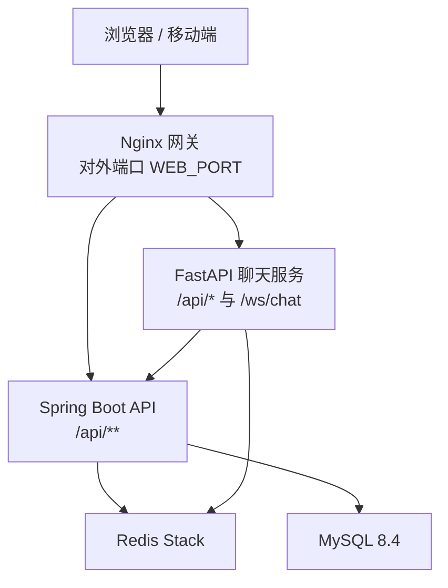
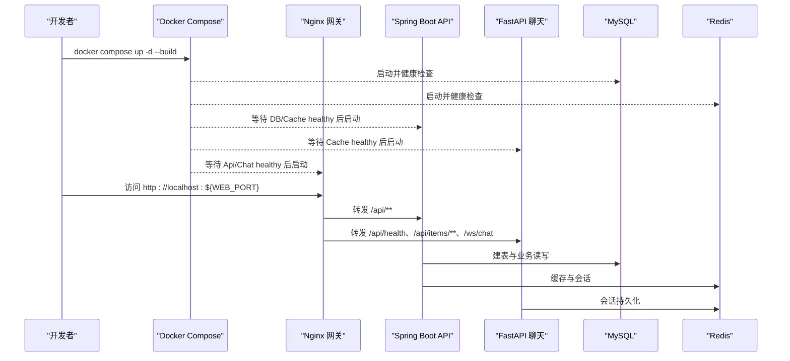
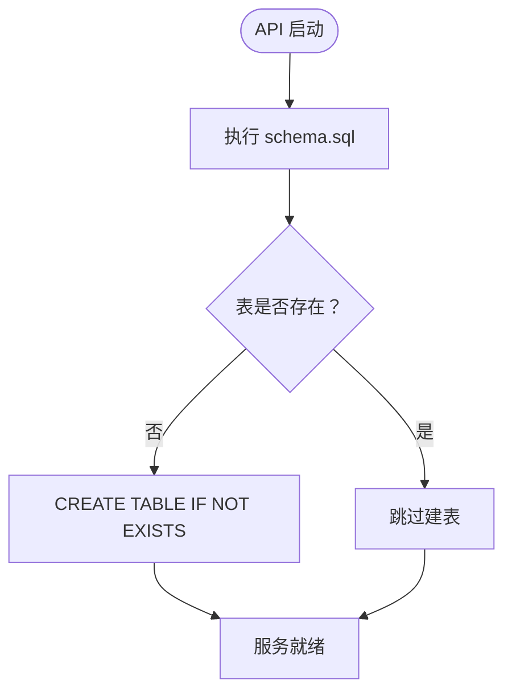

# 快速开始

<cite>
**本文引用的文件**   
- [README.md](file://README.md)
- [docker-compose.yml](file://docker-compose.yml)
- [.env.example](file://.env.example)
- [package.json](file://package.json)
- [schema.sql](file://services/api/api-bootstrap/src/main/resources/schema.sql)
</cite>

## 目录
1. [简介](#简介)
2. [项目结构](#项目结构)
3. [核心组件](#核心组件)
4. [架构总览](#架构总览)
5. [详细启动指南](#详细启动指南)
6. [依赖与配置分析](#依赖与配置分析)
7. [性能与部署建议](#性能与部署建议)
8. [故障排查](#故障排查)
9. [结论](#结论)

## 简介
本指南面向首次接触项目的开发者，目标是在最短时间内完成环境准备、环境变量配置、一键启动和冒烟验证。仓库是一个全栈 Monorepo：前端管理端使用 Umi Max + React，移动端使用 Expo，后端 Spring Boot 提供业务 API，Python FastAPI 提供流式聊天，MySQL 与 Redis 作为持久化与缓存，Nginx 作为统一网关。

## 项目结构
仓库采用分层与多应用组织方式：
- `apps/admin-web`：管理端前端（Umi Max + React）。
- `apps/cooking-app`：移动端（Expo + React Native）。
- `packages/types`：前后端共享 TypeScript 类型包。
- `services/api`：Spring Boot 单体（Maven reactor），包含用户认证、菜谱等业务模块。
- `services/chat`：FastAPI 聊天服务，装配 agent-core 与烹饪助手。
- `infra/nginx`：Nginx 网关配置。
- `docker-compose.yml`：编排 MySQL、Redis、API、Chat、Web 五个服务。



**图表来源**
- [docker-compose.yml:44-128](file://docker-compose.yml#L44-L128)
- [README.md:16-43](file://README.md#L16-L43)

**章节来源**
- [README.md:5-14](file://README.md#L5-L14)
- [README.md:16-43](file://README.md#L16-L43)

## 核心组件
- **管理前端**：通过 Nginx 托管静态资源，开发时由 Umi dev server 代理 `/api` 到 Spring Boot，代理 `/ws` 到聊天服务。
- **移动应用**：Expo 开发服务器直连后端；浏览器模式走同源 `/api`，iOS/Android 模拟器需处理本机地址映射。
- **业务 API**：Spring Boot 单体，context-path 为 `/api`，使用 MyBatis-Plus、JWT、MySQL、Redis。
- **聊天服务**：FastAPI + WebSocket，支持 LLM 调用与离线降级，会话状态可持久化到 Redis。
- **基础设施**：MySQL 存储业务数据，Redis Stack 提供 JSON/搜索能力与 LangGraph checkpointer。

**章节来源**
- [README.md:5-14](file://README.md#L5-L14)
- [README.md:45-86](file://README.md#L45-L86)

## 架构总览
生产环境通过 Docker Compose 编排，只有 `web` 暴露宿主机端口，其余服务在 compose 网络内互通。请求从网关进入后按路径分流：
- `/ws/chat` → chat:5090
- `/api/health`、`/api/items/**` → chat:5090
- `/api/**`（其余）→ api:8080
- `/` → Nginx 静态页面



**图表来源**
- [docker-compose.yml:8-128](file://docker-compose.yml#L8-L128)
- [README.md:45-57](file://README.md#L45-L57)

## 详细启动指南

### 前置依赖
- Node.js ≥ 22
- pnpm ≥ 10
- JDK 17
- Python 3.11
- MySQL 8.4（本地或容器）
- Redis（本地或容器；容器推荐 Redis Stack）

若使用 Docker Compose 一键部署，MySQL 与 Redis 由 compose 拉起，无需本地安装数据库；但本地开发仍建议安装以便独立调试。

**章节来源**
- [README.md:126-137](file://README.md#L126-L137)

### 环境变量配置
在项目根目录创建 `.env`：
```bash
cp .env.example .env
```
至少修改以下变量：
- `MYSQL_DATABASE`、`MYSQL_USER`、`MYSQL_PASSWORD`、`MYSQL_ROOT_PASSWORD`
- `JWT_SECRET`（Base64 编码，解码后至少 32 字节）
- `WEB_PORT`（默认 8000）
- 可选：讯飞 TTS、腾讯云 COS、LLM 与 embedding 相关变量

生成强 JWT 密钥可使用 OpenSSL 或 base64 命令。

**章节来源**
- [README.md:59-86](file://README.md#L59-L86)
- [.env.example:7-47](file://.env.example#L7-L47)

### 一键启动（生产风格）
在项目根目录执行：
```bash
cd 
cp .env.example .env
docker compose up -d --build
docker compose ps
```
入口地址为 `http://localhost:${WEB_PORT}`，默认 `http://localhost:8000`。

冒烟验证：
```bash
curl -fsS http://localhost:8000/api/actuator/health
curl -fsS http://localhost:8000/api/health
curl -X POST 'http://localhost:8000/api/auth/register?username=demo&password=Passw0rd123&email=demo@example.com'
```

**章节来源**
- [README.md:88-109](file://README.md#L88-L109)
- [docker-compose.yml:1-134](file://docker-compose.yml#L1-L134)

### 本地开发启动

#### 1. Spring Boot API
在仓库根目录执行：
```bash
pnpm api:start
```
该脚本会构建 Maven reactor 并启动 `api-bootstrap`，默认监听 `http://127.0.0.1:8080/api`。若 8080 被占用，可通过环境变量临时换端口：
```bash
SERVER_PORT=8085 pnpm api:start
```

Windows 注意事项：
- 推荐使用 Git Bash 或 PowerShell。
- 脚本会自动定位 JDK 17；若绕过脚本直接执行 `./mvnw`，需要终端设置 `JAVA_HOME`。
- 若本机 JDK 安装在 `~/.jdks/`，可在 PowerShell 中设置用户级环境变量并重开终端。

**章节来源**
- [README.md:139-151](file://README.md#L139-L151)
- [package.json:17-19](file://package.json#L17-L19)

#### 2. FastAPI 聊天服务
先在 `services/chat` 创建虚拟环境并安装本地包：
```bash
python -m venv .venv
pnpm chat:install
pnpm chat:start
```
聊天服务默认监听 `http://127.0.0.1:5090`，提供 `/api/health`、`/api/items` 与 `/ws/chat`。

**章节来源**
- [README.md:153-162](file://README.md#L153-L162)
- [package.json:22-24](file://package.json#L22-L24)

#### 3. 管理端前端
```bash
pnpm install
pnpm admin:dev
```
管理端开发服务器默认监听 `http://127.0.0.1:8000`，并将 `/api` 代理到 Spring Boot，将 `/ws` 代理到聊天服务。

注意：若 Docker Compose 的 web 服务已占用 8000 端口，Umi 会自动退到 8001/8002 等端口；也可在 `apps/admin-web/.env` 中设置 `PORT=8001`。

**章节来源**
- [README.md:164-169](file://README.md#L164-L169)
- [README.md:137](file://README.md#L137)

#### 4. 移动端
先确保 Spring Boot API 与聊天服务已启动，然后创建移动端本地配置：
```bash
cp apps/cooking-app/.env.example apps/cooking-app/.env
pnpm mobile:start
```
浏览器版固定走同源 `/api`；iOS 模拟器保留 `EXPO_PUBLIC_API_URL=http://localhost:8080/api`；Android 模拟器应改为 `http://10.0.2.2:8080/api`，或使用 `adb reverse tcp:8080 tcp:8080`。真机 Expo Go 需使用局域网可达地址。

常用命令：
```bash
pnpm mobile:android
pnpm mobile:ios
pnpm mobile:web
```

**章节来源**
- [README.md:171-190](file://README.md#L171-L190)

### 日常运维
```bash
docker compose ps
docker compose logs -f api
docker compose restart api
docker compose up -d --build
docker compose down
docker compose down -v
```

数据库与上传文件位于命名卷，`down` 不丢数据；Nginx 配置只读挂载，修改后可 reload。

**章节来源**
- [README.md:111-122](file://README.md#L111-L122)
- [docker-compose.yml:130-134](file://docker-compose.yml#L130-L134)

## 依赖与配置分析

### 环境变量与注入
- `.env` 由 Docker Compose 自动读取，用于注入 MySQL、Redis、JWT、TTS、COS、LLM 等配置。
- Spring Boot 通过环境变量覆盖 `application-local.yaml`，容器内不含本地配置文件，符合 12 因子原则。
- 聊天服务通过环境变量控制 CORS、LLM provider/model/key、embedding、checkpointer 与 Redis URL。

**章节来源**
- [README.md:59-86](file://README.md#L59-L86)
- [docker-compose.yml:44-113](file://docker-compose.yml#L44-L113)
- [.env.example:49-83](file://.env.example#L49-L83)

### 数据库初始化
API 启动时会执行 `schema.sql`，使用 `CREATE TABLE IF NOT EXISTS` 幂等建表，包括用户、菜谱、食材、步骤、分类、收藏、点赞、历史等表。



**图表来源**
- [schema.sql:1-125](file://services/api/api-bootstrap/src/main/resources/schema.sql#L1-L125)

**章节来源**
- [README.md:109](file://README.md#L109)
- [schema.sql:1-125](file://services/api/api-bootstrap/src/main/resources/schema.sql#L1-L125)

### 端口与路由
- 网关对外端口：`WEB_PORT`（默认 8000）。
- Spring Boot：内部 8080，context-path `/api`。
- 聊天服务：内部 5090，提供 `/api/health`、`/api/items/**`、`/ws/chat`。
- 前端开发服务器：默认 8000，可能与网关冲突。

**章节来源**
- [README.md:36-43](file://README.md#L36-L43)
- [README.md:126-137](file://README.md#L126-L137)
- [docker-compose.yml:115-128](file://docker-compose.yml#L115-L128)

## 性能与部署建议
- 生产环境仅暴露 `web` 端口，其他服务仅在 compose 网络内通信，减少攻击面。
- 使用 Redis Stack 以启用 JSON/RediSearch 能力，避免聊天服务静默降级。
- 上传文件与数据库数据持久化到命名卷，便于升级与迁移。
- 前端静态资源带 hash 长缓存，提升加载性能。

[本节为通用建议，不直接分析具体文件]

## 故障排查

### 端口冲突
- 前端 dev server 与网关都默认使用 8000 端口。若 compose 栈在运行，Umi 会自动退到 8001/8002；想继续使用 8000，先停止 web 服务或在 `apps/admin-web/.env` 设置 `PORT=8001`。
- Spring Boot 默认 8080，可用 `SERVER_PORT=8085 pnpm api:start` 临时更换。

**章节来源**
- [README.md:137](file://README.md#L137)
- [README.md:149](file://README.md#L149)

### JDK 配置
- 推荐使用 `pnpm api:start`，脚本会自动定位 JDK 17。
- 若绕过脚本直接执行 `./mvnw`，需设置 `JAVA_HOME`。Windows 下建议在用户环境变量中设置，并重开终端生效。

**章节来源**
- [README.md:128-137](file://README.md#L128-L137)

### 数据库连接问题
- 确认 `.env` 中 `MYSQL_*` 变量正确。
- 容器内 API 通过环境变量注入 JDBC URL、用户名与密码。
- 若本地 MySQL 未启动，API 可能无法连接；建议使用 compose 拉起 MySQL 或确保本地 MySQL 8.4 运行。

**章节来源**
- [docker-compose.yml:8-22](file://docker-compose.yml#L8-L22)
- [docker-compose.yml:44-55](file://docker-compose.yml#L44-L55)

### Redis 连接问题
- 容器内使用 Redis Stack，默认密码来自 `REDIS_PASSWORD`。
- 聊天服务的 checkpointer 与语义路由依赖 Redis；若未配置或不可用，聊天服务会降级但仍可启动。

**章节来源**
- [docker-compose.yml:24-42](file://docker-compose.yml#L24-L42)
- [docker-compose.yml:84-113](file://docker-compose.yml#L84-L113)
- [README.md:76-78](file://README.md#L76-L78)

### 聊天服务与 LLM 配置
- 未配置 LLM provider/model/key 时，聊天服务降级为离线模式，接口仍可用。
- 意图路由 embedding 未配置时降级为本地关键词匹配，垂直 Agent 仍可命中。

**章节来源**
- [README.md:76-78](file://README.md#L76-L78)
- [docker-compose.yml:94-100](file://docker-compose.yml#L94-L100)

### 移动端连接问题
- Android 模拟器需使用 `10.0.2.2` 或通过 `adb reverse` 映射。
- iOS 模拟器保留 `localhost`；真机需局域网可达地址。
- 浏览器版走同源 `/api`，不会跨域。

**章节来源**
- [README.md:171-182](file://README.md#L171-L182)

## 结论
通过本指南，你可以在最短时间内完成环境准备、环境变量配置、一键启动与冒烟验证。生产环境推荐使用 Docker Compose 编排，本地开发则分别启动 Spring Boot、FastAPI 与管理端前端。遇到端口冲突、JDK 配置、数据库与 Redis 连接问题时，可参考故障排查部分逐步定位。移动端需注意模拟器与真机的网络地址差异。