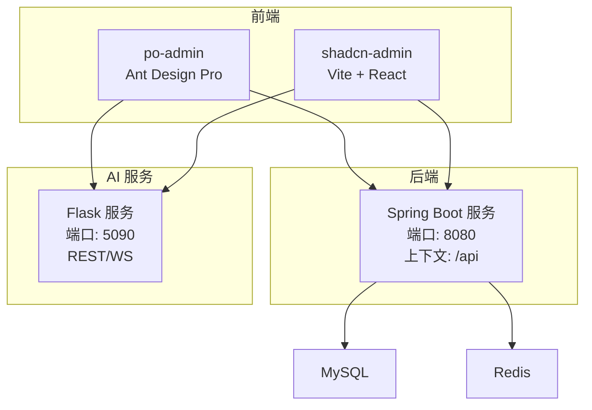
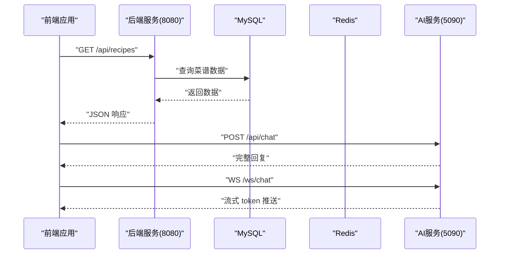
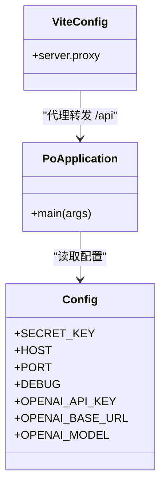

# 快速开始

<cite>
**本文引用的文件**
- [pom.xml](file://java_server/po/pom.xml)
- [application.yaml](file://java_server/po/src/main/resources/application.yaml)
- [PoApplication.java](file://java_server/po/src/main/java/com/goodzheng/po/PoApplication.java)
- [data-category.sql](file://java_server/po/src/main/resources/data-category.sql)
- [data-hunan.sql](file://java_server/po/src/main/resources/data-hunan.sql)
- [requirements.txt](file://py_server/requirements.txt)
- [config.py](file://py_server/config.py)
- [app.py](file://py_server/app.py)
- [package.json (po-admin)](file://web_client/po-admin/package.json)
- [proxy.ts](file://web_client/po-admin/config/proxy.ts)
- [vite.config.ts (shadcn-admin)](file://web_client/shadcn-admin/vite.config.ts)
</cite>

## 目录
1. [简介](#简介)
2. [项目结构](#项目结构)
3. [环境要求](#环境要求)
4. [依赖安装](#依赖安装)
5. [数据库配置与初始化](#数据库配置与初始化)
6. [首次启动流程](#首次启动流程)
7. [常见问题与排错](#常见问题与排错)
8. [调试技巧](#调试技巧)
9. [架构概览](#架构概览)
10. [结论](#结论)

## 简介
本指南面向新加入团队的开发者，帮助你在最短时间内完成“破”项目的本地开发环境搭建与系统启动。你将了解：
- 后端（Java Spring Boot）、AI服务（Python Flask + LangChain/LangGraph）和前端（两个 Web 应用）的环境要求、依赖安装、数据库配置与启动步骤。
- 常见环境问题定位方法与调试技巧，确保你能够顺利联调前后端与 AI 能力。

## 项目结构
本项目由三部分组成：
- 后端服务：基于 Spring Boot 的 Java 服务，提供 REST API、鉴权、数据持久化等能力。
- AI 服务：基于 Flask 的 Python 服务，封装 LLM 对话能力（支持 OpenAI 兼容接口），并提供 REST 与 WebSocket 两种调用方式。
- 前端应用：包含两套管理后台（Ant Design Pro 与 Shadcn Admin），用于业务管理与演示。

图表来源
- [application.yaml:4-11](file://java_server/po/src/main/resources/application.yaml#L4-L11)
- [config.py:10-24](file://py_server/config.py#L10-L24)
- [vite.config.ts:24-31](file://web_client/shadcn-admin/vite.config.ts#L24-L31)

章节来源
- [PoApplication.java:6-11](file://java_server/po/src/main/java/com/goodzheng/po/PoApplication.java#L6-L11)
- [application.yaml:4-11](file://java_server/po/src/main/resources/application.yaml#L4-L11)
- [app.py:24-50](file://py_server/app.py#L24-L50)
- [vite.config.ts:24-31](file://web_client/shadcn-admin/vite.config.ts#L24-L31)

## 环境要求
- JDK：17（由后端构建配置指定）
- Maven：建议使用项目自带的 Maven Wrapper
- MySQL：版本需兼容 MySQL Connector/J（默认使用 com.mysql.cj.jdbc.Driver）
- Redis：默认监听 127.0.0.1:6379，可配置密码
- Python：建议 3.10+（满足 requirements.txt 中库的版本要求）
- Node.js：>= 22.0.0（由 po-admin 的 engines 字段指定）
- 包管理器：npm 或 pnpm（根据前端项目需要）

章节来源
- [pom.xml:29-31](file://java_server/po/pom.xml#L29-L31)
- [application.yaml:24-52](file://java_server/po/src/main/resources/application.yaml#L24-L52)
- [requirements.txt:1-13](file://py_server/requirements.txt#L1-L13)
- [package.json (po-admin):99-101](file://web_client/po-admin/package.json#L99-L101)

## 依赖安装
- 后端（Java）
  - 进入 java_server/po 目录，使用 Maven Wrapper 编译并下载依赖：
    - Windows: mvnw.cmd
    - macOS/Linux: ./mvnw
  - 若网络受限，可在 settings.xml 配置国内镜像源或使用离线仓库。

- AI 服务（Python）
  - 在 py_server 目录下创建虚拟环境并安装依赖：
    - python -m venv .venv
    - source .venv/bin/activate（Linux/macOS）或 .venv\Scripts\activate（Windows）
    - pip install -r requirements.txt
  - 可选：在项目根目录创建 .env 文件以覆盖配置（如 OPENAI_API_KEY、OPENAI_BASE_URL、OPENAI_MODEL）。

- 前端（po-admin）
  - 进入 web_client/po-admin：
    - npm install 或 pnpm install
    - 开发模式：npm run dev
    - 生产构建：npm run build

- 前端（shadcn-admin）
  - 进入 web_client/shadcn-admin：
    - pnpm install
    - 开发模式：pnpm dev
    - 生产构建：pnpm build

章节来源
- [pom.xml:117-160](file://java_server/po/pom.xml#L117-L160)
- [requirements.txt:1-13](file://py_server/requirements.txt#L1-L13)
- [package.json (po-admin):7-32](file://web_client/po-admin/package.json#L7-L32)
- [package.json (shadcn-admin):6-19](file://web_client/shadcn-admin/package.json#L6-L19)

## 数据库配置与初始化
- 数据库连接
  - 默认地址：127.0.0.1:3306，数据库名：po
  - 用户名：root，密码：123456
  - 驱动：com.mysql.cj.jdbc.Driver
  - JPA 自动建表策略：update（开发环境常用）
  - 如需修改，请编辑 application.yaml 中的 spring.datasource 相关项。

- 种子数据
  - 分类数据：执行 data-category.sql，插入菜谱功能分类、菜系分类与饮食方式等基础数据。
  - 湖南菜谱数据：执行 data-hunan.sql，插入示例菜谱、食材与步骤等数据（依赖用户 ID=1 存在）。

- 注意事项
  - 首次运行前请确保 MySQL 已创建数据库 po，并导入上述 SQL。
  - 若使用其他数据库或账号，请同步更新 application.yaml 的连接信息与驱动类名。

章节来源
- [application.yaml:24-41](file://java_server/po/src/main/resources/application.yaml#L24-L41)
- [data-category.sql:1-39](file://java_server/po/src/main/resources/data-category.sql#L1-L39)
- [data-hunan.sql:1-204](file://java_server/po/src/main/resources/data-hunan.sql#L1-L204)

## 首次启动流程
按顺序启动以下组件：

1) 启动后端服务（Spring Boot）
   - 进入 java_server/po
   - 运行：./mvnw spring-boot:run（或 mvnw.cmd spring-boot:run）
   - 服务默认监听：http://localhost:8080/api

2) 启动 AI 服务（Flask）
   - 进入 py_server
   - 激活虚拟环境后运行：python app.py
   - 服务默认监听：http://localhost:5090
   - 提供接口：
     - GET /
     - GET /api/health
     - POST /api/chat
     - WS /ws/chat

3) 启动前端应用
   - po-admin（Ant Design Pro）
     - 进入 web_client/po-admin
     - 运行：npm run dev
     - 默认访问：http://localhost:8000
     - 代理配置：默认未启用本地代理到后端，可按需修改 config/proxy.ts
   - shadcn-admin（Vite + React）
     - 进入 web_client/shadcn-admin
     - 运行：pnpm dev
     - 默认访问：http://localhost:5173
     - 代理配置：已在 vite.config.ts 中将 /api 请求转发至 http://localhost:8080

4) 验证联调
   - 打开浏览器访问前端页面，尝试登录与查看菜谱列表。
   - 通过前端聊天页面试用 AI 对话（REST 或 WebSocket）。

图表来源
- [application.yaml:4-11](file://java_server/po/src/main/resources/application.yaml#L4-L11)
- [app.py:24-50](file://py_server/app.py#L24-L50)
- [vite.config.ts:24-31](file://web_client/shadcn-admin/vite.config.ts#L24-L31)

章节来源
- [PoApplication.java:6-11](file://java_server/po/src/main/java/com/goodzheng/po/PoApplication.java#L6-L11)
- [application.yaml:4-11](file://java_server/po/src/main/resources/application.yaml#L4-L11)
- [app.py:24-50](file://py_server/app.py#L24-L50)
- [package.json (po-admin):7-32](file://web_client/po-admin/package.json#L7-L32)
- [package.json (shadcn-admin):6-19](file://web_client/shadcn-admin/package.json#L6-L19)
- [vite.config.ts:24-31](file://web_client/shadcn-admin/vite.config.ts#L24-L31)

## 常见问题与排错
- 无法连接 MySQL
  - 检查 MySQL 是否运行、端口是否为 3306，数据库 po 是否存在。
  - 核对 application.yaml 中的用户名、密码与驱动类名是否正确。
  - 若使用 Docker 或远程数据库，确认网络连通性与防火墙设置。

- 无法连接 Redis
  - 检查 Redis 是否运行于 127.0.0.1:6379，密码是否与配置一致。
  - 若使用密码认证，确保 application.yaml 中 redis.password 正确。

- 前端无法访问后端
  - shadcn-admin 已配置将 /api 转发到 http://localhost:8080，请确认后端已启动。
  - po-admin 默认未启用本地代理，如需直连后端，请在 config/proxy.ts 中配置目标地址。

- AI 服务启动失败
  - 检查 Python 虚拟环境是否正确激活，依赖是否安装成功。
  - 若配置了 OPENAI_API_KEY 但网络不可达，服务会降级为离线演示模式；也可不配置 Key 直接联调链路。

- 端口冲突
  - 后端默认 8080，AI 服务默认 5090，前端默认 8000/5173。如遇占用，请修改对应服务的端口配置。

章节来源
- [application.yaml:24-52](file://java_server/po/src/main/resources/application.yaml#L24-L52)
- [config.py:10-24](file://py_server/config.py#L10-L24)
- [proxy.ts:12-41](file://web_client/po-admin/config/proxy.ts#L12-L41)
- [vite.config.ts:24-31](file://web_client/shadcn-admin/vite.config.ts#L24-L31)

## 调试技巧
- 后端日志
  - 日志级别：logging.level.root=INFO，com.example=DEBUG（可根据需要调整）。
  - 日志输出位置：控制台与 logs/application.log。
  - Actuator 监控：暴露 health、info、metrics、prometheus 等端点，便于健康检查与指标采集。

- 数据库调试
  - 开启 SQL 打印：spring.jpa.show-sql=true，便于观察生成的 SQL。
  - 使用 H2/MySQL 客户端工具查看表结构与数据。

- AI 服务调试
  - 通过 GET /api/health 检查服务状态。
  - 使用 curl 或 Postman 测试 POST /api/chat 与 WS /ws/chat。
  - 环境变量：SECRET_KEY、HOST、PORT、DEBUG、OPENAI_API_KEY、OPENAI_BASE_URL、OPENAI_MODEL。

- 前端调试
  - 浏览器开发者工具 Network 面板查看请求与响应。
  - 使用代理转发时，注意跨域与 Cookie 传递问题。

章节来源
- [application.yaml:69-95](file://java_server/po/src/main/resources/application.yaml#L69-L95)
- [application.yaml:35-41](file://java_server/po/src/main/resources/application.yaml#L35-L41)
- [app.py:24-50](file://py_server/app.py#L24-L50)
- [config.py:10-24](file://py_server/config.py#L10-L24)

## 架构概览
- 前端通过 HTTP 调用后端 API，后端负责业务逻辑、权限控制与数据持久化。
- AI 服务独立部署，提供统一的对话接口（REST/WS），前端可直接调用。
- 后端与 AI 服务均可通过环境变量或配置文件灵活调整行为。

图表来源
- [PoApplication.java:6-11](file://java_server/po/src/main/java/com/goodzheng/po/PoApplication.java#L6-L11)
- [config.py:10-24](file://py_server/config.py#L10-L24)
- [vite.config.ts:24-31](file://web_client/shadcn-admin/vite.config.ts#L24-L31)

## 结论
按照本指南完成环境准备、依赖安装、数据库初始化与服务启动后，即可在本地联调前后端与 AI 能力。建议在开发过程中充分利用日志与监控端点进行问题定位，并根据团队规范调整配置与端口。祝开发顺利！