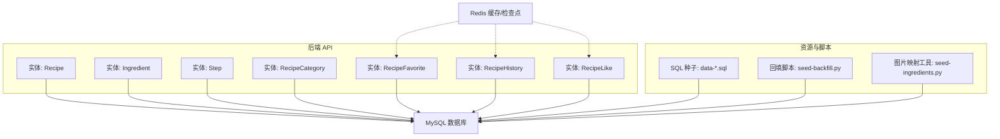
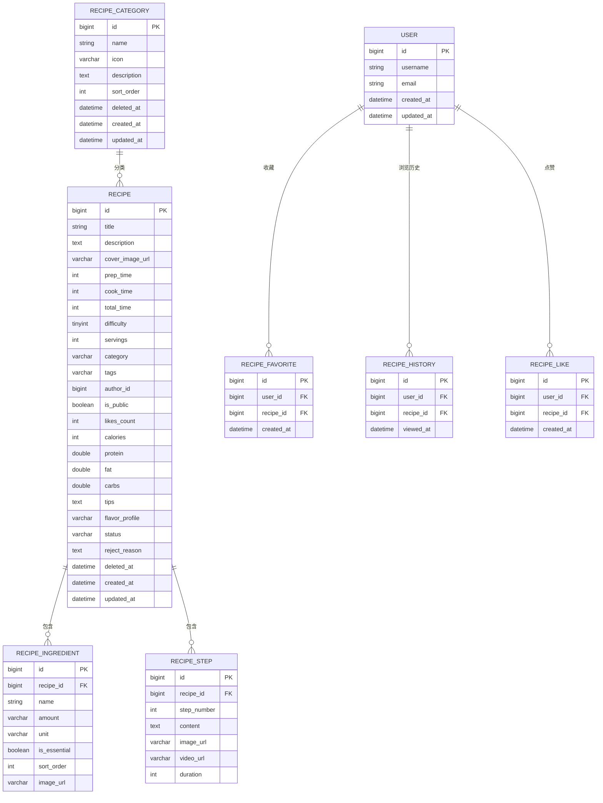
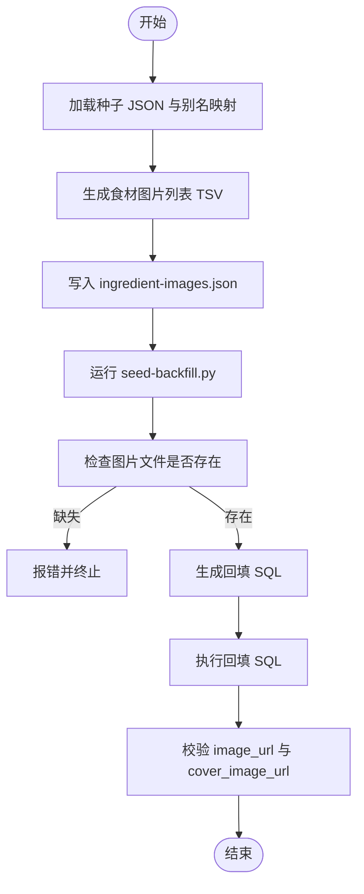

# 数据库设计

<cite>
**本文引用的文件**   
- [docker-compose.yml](file://docker-compose.yml)
- [Recipe.java](file://services/api/recipe/src/main/java/com/goodzheng/po/recipe/entity/Recipe.java)
- [Ingredient.java](file://services/api/recipe/src/main/java/com/goodzheng/po/recipe/entity/Ingredient.java)
- [Step.java](file://services/api/recipe/src/main/java/com/goodzheng/po/recipe/entity/Step.java)
- [RecipeCategory.java](file://services/api/recipe/src/main/java/com/goodzheng/po/recipe/entity/RecipeCategory.java)
- [RecipeFavorite.java](file://services/api/recipe/src/main/java/com/goodzheng/po/recipe/entity/RecipeFavorite.java)
- [RecipeHistory.java](file://services/api/recipe/src/main/java/com/goodzheng/po/recipe/entity/RecipeHistory.java)
- [RecipeLike.java](file://services/api/recipe/src/main/java/com/goodzheng/po/recipe/entity/RecipeLike.java)
- [data-category.sql](file://services/api/recipe/src/main/resources/data-category.sql)
- [data-chuan.sql](file://services/api/recipe/src/main/resources/data-chuan.sql)
- [data-gan.sql](file://services/api/recipe/src/main/resources/data-gan.sql)
- [data-hunan.sql](file://services/api/recipe/src/main/resources/data-hunan.sql)
- [data-xiang-a.sql](file://services/api/recipe/src/main/resources/data-xiang-a.sql)
- [data-xiang-b.sql](file://services/api/recipe/src/main/resources/data-xiang-b.sql)
- [data-cover-backfill.sql](file://services/api/recipe/src/main/resources/data-cover-backfill.sql)
- [data-ingredient-backfill.sql](file://services/api/recipe/src/main/resources/data-ingredient-backfill.sql)
- [seed-ingredients.py](file://tools/seed-ingredients.py)
- [seed-backfill.py](file://tools/seed-backfill.py)
</cite>

## 目录
1. [引言](#引言)
2. [项目结构](#项目结构)
3. [核心数据表与字段说明](#核心数据表与字段说明)
4. [实体关系图](#实体关系图)
5. [索引设计与约束规则](#索引设计与约束规则)
6. [数据迁移策略、版本管理与回滚方案](#数据迁移策略版本管理与回滚方案)
7. [数据初始化脚本、种子数据与批量导入工具](#数据初始化脚本种子数据与批量导入工具)
8. [查询优化策略、分页处理与性能调优建议](#查询优化策略分页处理与性能调优建议)
9. [数据备份恢复流程与灾难恢复方案](#数据备份恢复流程与灾难恢复方案)
10. [结论](#结论)

## 引言
本文件面向菜谱与烹饪助手系统的数据库设计，目标包括：
- 明确所有数据表的结构定义、字段含义、默认值与业务语义。
- 给出实体关系图，覆盖用户、菜谱、分类、食材、步骤、收藏、浏览历史、点赞等核心实体。
- 说明数据迁移策略、版本管理方式与回滚方案。
- 整理数据初始化脚本、种子数据与批量导入工具的使用方法。
- 提供查询优化、分页处理和性能调优建议。
- 给出数据备份恢复流程与灾难恢复方案。

本项目使用 MySQL 作为主数据库，Redis 作为缓存与会话/检查点存储；API 服务基于 Spring Boot + MyBatis-Plus，通过实体类映射到数据库表。

**章节来源**
- [docker-compose.yml:1-134](file://docker-compose.yml#L1-L134)

## 项目结构
数据库相关代码集中在后端 API 模块中，实体类位于 recipe 模块的 entity 包下，SQL 种子数据位于 resources 目录下，辅助工具位于 tools 目录。

**图表来源**
- [Recipe.java:1-103](file://services/api/recipe/src/main/java/com/goodzheng/po/recipe/entity/Recipe.java#L1-L103)
- [Ingredient.java:1-35](file://services/api/recipe/src/main/java/com/goodzheng/po/recipe/entity/Ingredient.java#L1-L35)
- [Step.java:1-31](file://services/api/recipe/src/main/java/com/goodzheng/po/recipe/entity/Step.java#L1-L31)
- [RecipeCategory.java:1-43](file://services/api/recipe/src/main/java/com/goodzheng/po/recipe/entity/RecipeCategory.java#L1-L43)
- [RecipeFavorite.java:1-23](file://services/api/recipe/src/main/java/com/goodzheng/po/recipe/entity/RecipeFavorite.java#L1-L23)
- [RecipeHistory.java:1-24](file://services/api/recipe/src/main/java/com/goodzheng/po/recipe/entity/RecipeHistory.java#L1-L24)
- [RecipeLike.java:1-23](file://services/api/recipe/src/main/java/com/goodzheng/po/recipe/entity/RecipeLike.java#L1-L23)
- [data-category.sql](file://services/api/recipe/src/main/resources/data-category.sql)
- [data-chuan.sql](file://services/api/recipe/src/main/resources/data-chuan.sql)
- [data-gan.sql](file://services/api/recipe/src/main/resources/data-gan.sql)
- [data-hunan.sql](file://services/api/recipe/src/main/resources/data-hunan.sql)
- [data-xiang-a.sql](file://services/api/recipe/src/main/resources/data-xiang-a.sql)
- [data-xiang-b.sql](file://services/api/recipe/src/main/resources/data-xiang-b.sql)
- [seed-backfill.py:1-114](file://tools/seed-backfill.py#L1-L114)
- [seed-ingredients.py:1-283](file://tools/seed-ingredients.py#L1-L283)

**章节来源**
- [docker-compose.yml:1-134](file://docker-compose.yml#L1-L134)

## 核心数据表与字段说明
以下表格根据实体类与 SQL 种子文件归纳出数据库表结构、字段含义与业务约束。若实体类未显式声明某列类型，则按常见约定推断（例如自增主键、时间戳）。

### 菜谱表 recipe
| 字段 | 类型 | 是否必填 | 默认值 | 说明 |
| --- | --- | --- | --- | --- |
| id | BIGINT | 是 | 自增 | 主键 |
| title | VARCHAR | 是 | - | 菜谱标题 |
| description | TEXT | 否 | - | 菜谱描述 |
| cover_image_url | VARCHAR | 否 | NULL | 封面图片路径 |
| prep_time | INT | 否 | - | 准备时间（分钟） |
| cook_time | INT | 否 | - | 烹饪时间（分钟） |
| total_time | INT | 否 | - | 总耗时（分钟） |
| difficulty | TINYINT | 否 | 1 | 难度等级：1-简单, 2-中等, 3-困难 |
| servings | INT | 否 | - | 建议食用人数 |
| category | VARCHAR | 否 | - | 分类名称（冗余字段，便于快速筛选） |
| tags | VARCHAR | 否 | - | 标签，逗号分隔字符串 |
| author_id | BIGINT | 否 | - | 作者用户 ID |
| is_public | BOOLEAN | 否 | true | 是否公开 |
| likes_count | INT | 否 | 0 | 点赞数 |
| calories | INT | 否 | - | 热量（千卡） |
| protein | DOUBLE | 否 | - | 蛋白质（克） |
| fat | DOUBLE | 否 | - | 脂肪（克） |
| carbs | DOUBLE | 否 | - | 碳水化合物（克） |
| tips | TEXT | 否 | - | 小贴士 |
| flavor_profile | VARCHAR | 否 | - | 风味特征 |
| status | VARCHAR | 否 | approved | 审核状态：pending/approved/rejected |
| reject_reason | TEXT | 否 | - | 驳回原因 |
| deleted_at | DATETIME | 否 | NULL | 软删除时间 |
| created_at | DATETIME | 否 | 当前时间 | 创建时间（不可更新） |
| updated_at | DATETIME | 否 | 当前时间 | 更新时间（自动填充） |

**章节来源**
- [Recipe.java:15-103](file://services/api/recipe/src/main/java/com/goodzheng/po/recipe/entity/Recipe.java#L15-L103)

### 食材表 recipe_ingredient
| 字段 | 类型 | 是否必填 | 默认值 | 说明 |
| --- | --- | --- | --- | --- |
| id | BIGINT | 是 | 自增 | 主键 |
| recipe_id | BIGINT | 是 | - | 所属菜谱 ID |
| name | VARCHAR | 是 | - | 食材名称 |
| amount | VARCHAR | 否 | - | 数量描述 |
| unit | VARCHAR | 否 | - | 单位 |
| is_essential | BOOLEAN | 否 | true | 是否必需 |
| sort_order | INT | 否 | 0 | 排序权重 |
| image_url | VARCHAR | 否 | NULL | 食材图片相对路径 |

**章节来源**
- [Ingredient.java:9-34](file://services/api/recipe/src/main/java/com/goodzheng/po/recipe/entity/Ingredient.java#L9-L34)

### 步骤表 recipe_step
| 字段 | 类型 | 是否必填 | 默认值 | 说明 |
| --- | --- | --- | --- | --- |
| id | BIGINT | 是 | 自增 | 主键 |
| recipe_id | BIGINT | 是 | - | 所属菜谱 ID |
| step_number | INT | 是 | - | 步骤序号 |
| content | TEXT | 是 | - | 步骤内容 |
| image_url | VARCHAR | 否 | NULL | 步骤配图 |
| video_url | VARCHAR | 否 | NULL | 步骤视频 |
| duration | INT | 否 | - | 该步骤耗时（分钟） |

**章节来源**
- [Step.java:9-30](file://services/api/recipe/src/main/java/com/goodzheng/po/recipe/entity/Step.java#L9-L30)

### 分类表 recipe_category
| 字段 | 类型 | 是否必填 | 默认值 | 说明 |
| --- | --- | --- | --- | --- |
| id | BIGINT | 是 | 自增 | 主键 |
| name | VARCHAR | 是 | - | 分类名称 |
| icon | VARCHAR | 否 | - | 图标名或 emoji |
| description | TEXT | 否 | - | 分类描述 |
| sort_order | INT | 否 | 0 | 排序权重 |
| deleted_at | DATETIME | 否 | NULL | 软删除时间 |
| created_at | DATETIME | 否 | 当前时间 | 创建时间（不可更新） |
| updated_at | DATETIME | 否 | 当前时间 | 更新时间（自动填充） |

**章节来源**
- [RecipeCategory.java:13-42](file://services/api/recipe/src/main/java/com/goodzheng/po/recipe/entity/RecipeCategory.java#L13-L42)

### 收藏表 recipe_favorite
| 字段 | 类型 | 是否必填 | 默认值 | 说明 |
| --- | --- | --- | --- | --- |
| id | BIGINT | 是 | 自增 | 主键 |
| user_id | BIGINT | 是 | - | 用户 ID |
| recipe_id | BIGINT | 是 | - | 菜谱 ID |
| created_at | DATETIME | 否 | 当前时间 | 收藏时间 |

**章节来源**
- [RecipeFavorite.java:10-22](file://services/api/recipe/src/main/java/com/goodzheng/po/recipe/entity/RecipeFavorite.java#L10-L22)

### 浏览历史表 recipe_history
| 字段 | 类型 | 是否必填 | 默认值 | 说明 |
| --- | --- | --- | --- | --- |
| id | BIGINT | 是 | 自增 | 主键 |
| user_id | BIGINT | 是 | - | 用户 ID |
| recipe_id | BIGINT | 是 | - | 菜谱 ID |
| viewed_at | DATETIME | 否 | 当前时间 | 最近浏览时间（重复浏览时覆盖更新） |

**章节来源**
- [RecipeHistory.java:10-23](file://services/api/recipe/src/main/java/com/goodzheng/po/recipe/entity/RecipeHistory.java#L10-L23)

### 点赞表 recipe_like
| 字段 | 类型 | 是否必填 | 默认值 | 说明 |
| --- | --- | --- | --- | --- |
| id | BIGINT | 是 | 自增 | 主键 |
| user_id | BIGINT | 是 | - | 用户 ID |
| recipe_id | BIGINT | 是 | - | 菜谱 ID |
| created_at | DATETIME | 否 | 当前时间 | 点赞时间 |

**章节来源**
- [RecipeLike.java:10-22](file://services/api/recipe/src/main/java/com/goodzheng/po/recipe/entity/RecipeLike.java#L10-L22)

## 实体关系图
下图展示核心实体之间的关联关系。用户表未在实体类中出现，但收藏、历史、点赞均引用 user_id，因此可认为存在用户实体。

**图表来源**
- [Recipe.java:15-103](file://services/api/recipe/src/main/java/com/goodzheng/po/recipe/entity/Recipe.java#L15-L103)
- [Ingredient.java:9-34](file://services/api/recipe/src/main/java/com/goodzheng/po/recipe/entity/Ingredient.java#L9-L34)
- [Step.java:9-30](file://services/api/recipe/src/main/java/com/goodzheng/po/recipe/entity/Step.java#L9-L30)
- [RecipeCategory.java:13-42](file://services/api/recipe/src/main/java/com/goodzheng/po/recipe/entity/RecipeCategory.java#L13-L42)
- [RecipeFavorite.java:10-22](file://services/api/recipe/src/main/java/com/goodzheng/po/recipe/entity/RecipeFavorite.java#L10-L22)
- [RecipeHistory.java:10-23](file://services/api/recipe/src/main/java/com/goodzheng/po/recipe/entity/RecipeHistory.java#L10-L23)
- [RecipeLike.java:10-22](file://services/api/recipe/src/main/java/com/goodzheng/po/recipe/entity/RecipeLike.java#L10-L22)

## 索引设计与约束规则
以下为推荐索引与约束设计，结合实体字段与常见查询场景提出。实际建表语句需由数据库迁移脚本生成并纳入版本管理。

- 主键索引
  - 所有表的主键 id 均为主键索引。
- 外键与唯一性
  - recipe_ingredient.recipe_id 应建立外键指向 recipe.id，保证数据一致性。
  - recipe_favorite.user_id + recipe_id 应建立唯一索引，防止重复收藏。
  - recipe_like.user_id + recipe_id 应建立唯一索引，防止重复点赞。
  - recipe_history.user_id + recipe_id 可考虑唯一索引，以实现“覆盖更新最近浏览时间”的业务语义。
- 常用查询索引
  - recipe.category 建立普通索引，支持按分类筛选。
  - recipe.author_id 建立普通索引，支持按作者查询。
  - recipe.status 建立普通索引，支持审核流筛选。
  - recipe.tags 可使用全文索引或前缀索引（视长度而定），用于标签搜索。
  - recipe_step.recipe_id + step_number 建立联合索引，支持按顺序读取步骤。
  - recipe_ingredient.recipe_id + sort_order 建立联合索引，支持按顺序读取食材。
- 软删除与审计字段
  - deleted_at 配合查询条件实现软删除过滤。
  - created_at / updated_at 用于审计与排序。

注意：以上为设计建议，具体索引需在迁移脚本中显式定义，并在上线前进行执行计划验证。

**章节来源**
- [Recipe.java:15-103](file://services/api/recipe/src/main/java/com/goodzheng/po/recipe/entity/Recipe.java#L15-L103)
- [Ingredient.java:9-34](file://services/api/recipe/src/main/java/com/goodzheng/po/recipe/entity/Ingredient.java#L9-L34)
- [Step.java:9-30](file://services/api/recipe/src/main/java/com/goodzheng/po/recipe/entity/Step.java#L9-L30)
- [RecipeCategory.java:13-42](file://services/api/recipe/src/main/java/com/goodzheng/po/recipe/entity/RecipeCategory.java#L13-L42)
- [RecipeFavorite.java:10-22](file://services/api/recipe/src/main/java/com/goodzheng/po/recipe/entity/RecipeFavorite.java#L10-L22)
- [RecipeHistory.java:10-23](file://services/api/recipe/src/main/java/com/goodzheng/po/recipe/entity/RecipeHistory.java#L10-L23)
- [RecipeLike.java:10-22](file://services/api/recipe/src/main/java/com/goodzheng/po/recipe/entity/RecipeLike.java#L10-L22)

## 数据迁移策略、版本管理与回滚方案
- 迁移策略
  - 以 SQL 文件作为迁移单元，按功能域拆分（如分类、川菜、赣菜、湘菜 A/B、湖南经典等）。
  - 每个迁移脚本应具备幂等性，避免重复执行造成数据不一致。
  - 对已有数据进行增量回填时，使用 UPDATE ... WHERE ... IS NULL 的条件更新，确保可重复执行。
- 版本管理
  - 将 SQL 迁移脚本纳入 Git 版本控制，命名体现版本号或功能标识（例如 v001_create_tables.sql、v002_seed_categories.sql）。
  - 在部署流水线中按顺序执行迁移脚本，记录执行日志与失败原因。
- 回滚方案
  - 针对新增表的迁移，提供对应的 DROP TABLE 脚本（谨慎使用，仅用于开发环境或紧急回滚）。
  - 针对数据变更的迁移，提供反向更新脚本（例如将新增字段置空、删除新增行）。
  - 对于回填脚本（如图片 URL 回填），采用幂等 UPDATE，允许安全重试。

示例回填脚本路径：
- 食材图片回填：[data-ingredient-backfill.sql](file://services/api/recipe/src/main/resources/data-ingredient-backfill.sql)
- 菜谱封面回填：[data-cover-backfill.sql](file://services/api/recipe/src/main/resources/data-cover-backfill.sql)

**章节来源**
- [data-category.sql](file://services/api/recipe/src/main/resources/data-category.sql)
- [data-chuan.sql](file://services/api/recipe/src/main/resources/data-chuan.sql)
- [data-gan.sql](file://services/api/recipe/src/main/resources/data-gan.sql)
- [data-hunan.sql](file://services/api/recipe/src/main/resources/data-hunan.sql)
- [data-xiang-a.sql](file://services/api/recipe/src/main/resources/data-xiang-a.sql)
- [data-xiang-b.sql](file://services/api/recipe/src/main/resources/data-xiang-b.sql)
- [data-ingredient-backfill.sql](file://services/api/recipe/src/main/resources/data-ingredient-backfill.sql)
- [data-cover-backfill.sql](file://services/api/recipe/src/main/resources/data-cover-backfill.sql)

## 数据初始化脚本、种子数据与批量导入工具
- 种子数据
  - 分类种子：[data-category.sql](file://services/api/recipe/src/main/resources/data-category.sql)
  - 菜谱种子：[data-chuan.sql](file://services/api/recipe/src/main/resources/data-chuan.sql)、[data-gan.sql](file://services/api/recipe/src/main/resources/data-gan.sql)、[data-hunan.sql](file://services/api/recipe/src/main/resources/data-hunan.sql)、[data-xiang-a.sql](file://services/api/recipe/src/main/resources/data-xiang-a.sql)、[data-xiang-b.sql](file://services/api/recipe/src/main/resources/data-xiang-b.sql)
- 回填工具
  - 食材图片映射与批量生成：[seed-ingredients.py](file://tools/seed-ingredients.py)
  - 旧数据回填（食材图片与封面）：[seed-backfill.py](file://tools/seed-backfill.py)
- 使用方法
  - 运行 Python 工具生成映射与 SQL 回填脚本。
  - 在数据库中依次执行分类与菜谱种子 SQL。
  - 执行回填脚本，确保图片资源已就绪（静态资源目录包含对应 slug 的图片文件）。
  - 校验数据完整性，确认 image_url 与 cover_image_url 已正确回填。

**图表来源**
- [seed-ingredients.py:1-283](file://tools/seed-ingredients.py#L1-L283)
- [seed-backfill.py:1-114](file://tools/seed-backfill.py#L1-L114)

**章节来源**
- [seed-ingredients.py:1-283](file://tools/seed-ingredients.py#L1-L283)
- [seed-backfill.py:1-114](file://tools/seed-backfill.py#L1-L114)

## 查询优化策略、分页处理与性能调优建议
- 查询优化
  - 优先使用覆盖索引减少回表，例如按 category、author_id、status 查询时尽量只返回必要字段。
  - 对多表关联查询（如菜谱+食材+步骤）采用分批加载或视图封装，避免一次性 JOIN 过多表。
  - 对标签搜索使用全文索引或分词索引，避免 LIKE '%keyword%' 导致全表扫描。
- 分页处理
  - 使用 LIMIT/OFFSET 分页时，对大偏移量场景建议使用基于游标或上次最大 ID 的分页方式，提升性能。
  - 对热门菜谱列表，可结合 Redis 缓存热点数据，降低数据库压力。
- 性能调优
  - 调整 MySQL 连接池大小与超时参数，匹配并发访问规模。
  - 对高频写入表（如点赞、收藏、历史）启用合适的缓冲与异步落库策略。
  - 定期分析慢查询日志，优化执行计划，必要时增加复合索引。

**章节来源**
- [Recipe.java:15-103](file://services/api/recipe/src/main/java/com/goodzheng/po/recipe/entity/Recipe.java#L15-L103)
- [Ingredient.java:9-34](file://services/api/recipe/src/main/java/com/goodzheng/po/recipe/entity/Ingredient.java#L9-L34)
- [Step.java:9-30](file://services/api/recipe/src/main/java/com/goodzheng/po/recipe/entity/Step.java#L9-L30)
- [RecipeCategory.java:13-42](file://services/api/recipe/src/main/java/com/goodzheng/po/recipe/entity/RecipeCategory.java#L13-L42)
- [RecipeFavorite.java:10-22](file://services/api/recipe/src/main/java/com/goodzheng/po/recipe/entity/RecipeFavorite.java#L10-L22)
- [RecipeHistory.java:10-23](file://services/api/recipe/src/main/java/com/goodzheng/po/recipe/entity/RecipeHistory.java#L10-L23)
- [RecipeLike.java:10-22](file://services/api/recipe/src/main/java/com/goodzheng/po/recipe/entity/RecipeLike.java#L10-L22)

## 数据备份恢复流程与灾难恢复方案
- 备份策略
  - 使用 mysqldump 对生产数据库进行全量备份，并结合 binlog 进行增量备份。
  - 备份文件加密存储，并上传至对象存储（如腾讯云 COS），保留多份副本。
  - 定时任务执行备份，并校验备份完整性。
- 恢复流程
  - 从对象存储下载最新全量备份与增量日志。
  - 先恢复全量备份，再回放增量日志至指定时间点。
  - 校验关键表数据（如 recipe、recipe_ingredient、recipe_step、recipe_category）与统计指标（likes_count）。
- 灾难恢复
  - 制定 RTO/RPO 目标，明确恢复时间与数据丢失容忍度。
  - 演练恢复流程，确保团队熟悉操作步骤。
  - 对非结构化资源（图片、音频）同步恢复，确保前端资源可用。

**章节来源**
- [docker-compose.yml:1-134](file://docker-compose.yml#L1-L134)

## 结论
本数据库设计围绕菜谱与烹饪助手的核心业务展开，明确了各表结构与字段语义，给出了实体关系图与索引约束建议，并提供了迁移策略、种子数据与回填工具的使用指南。通过合理的索引设计、分页策略与性能调优，可有效支撑高并发访问与复杂查询场景。同时，完善的备份恢复与灾难恢复方案为系统稳定性提供保障。后续可根据业务扩展需求持续演进数据模型与查询优化策略。