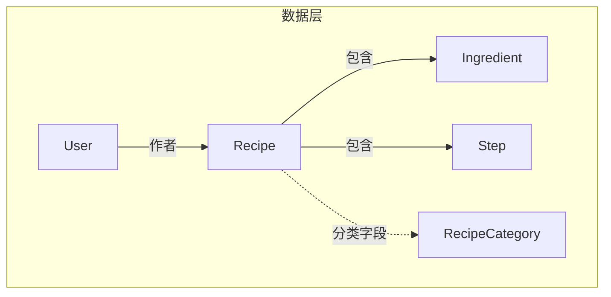
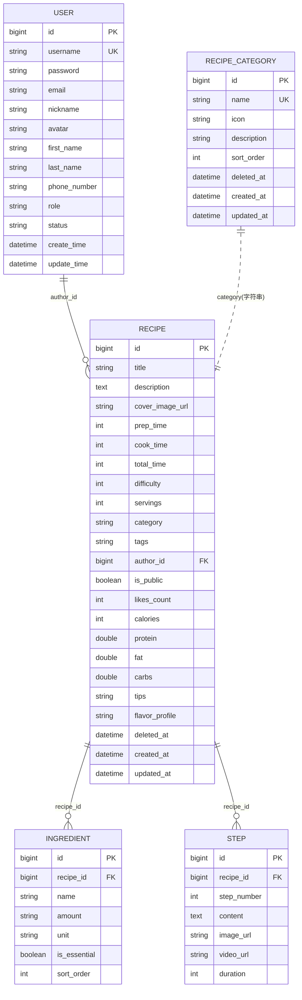
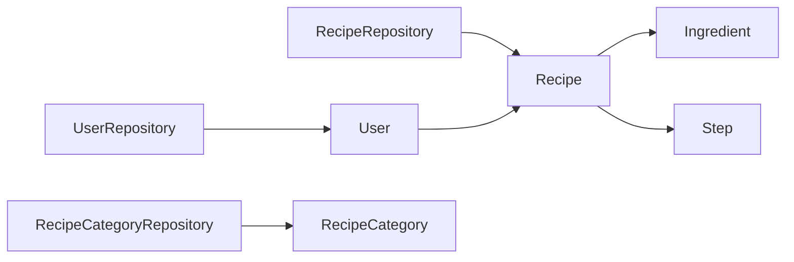
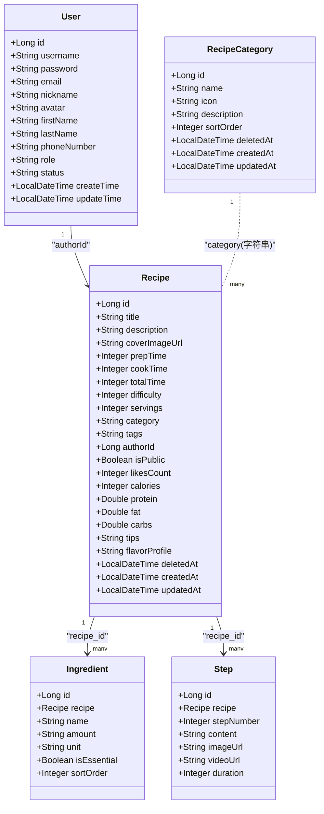

# 实体关系图

<cite>
**本文引用的文件**   
- [User.java](file://java_server/po/src/main/java/com/goodzheng/po/entity/User.java)
- [Recipe.java](file://java_server/po/src/main/java/com/goodzheng/po/entity/Recipe.java)
- [Ingredient.java](file://java_server/po/src/main/java/com/goodzheng/po/entity/Ingredient.java)
- [Step.java](file://java_server/po/src/main/java/com/goodzheng/po/entity/Step.java)
- [RecipeCategory.java](file://java_server/po/src/main/java/com/goodzheng/po/entity/RecipeCategory.java)
- [RecipeRepository.java](file://java_server/po/src/main/java/com/goodzheng/po/repository/RecipeRepository.java)
- [UserRepository.java](file://java_server/po/src/main/java/com/goodzheng/po/repository/UserRepository.java)
- [RecipeCategoryRepository.java](file://java_server/po/src/main/java/com/goodzheng/po/repository/RecipeCategoryRepository.java)
- [application.yaml](file://java_server/po/src/main/resources/application.yaml)
</cite>

## 目录
1. [简介](#简介)
2. [项目结构](#项目结构)
3. [核心组件](#核心组件)
4. [架构总览](#架构总览)
5. [详细组件分析](#详细组件分析)
6. [依赖关系分析](#依赖关系分析)
7. [性能考虑](#性能考虑)
8. [故障排查指南](#故障排查指南)
9. [结论](#结论)
10. [附录](#附录)

## 简介
本文件聚焦于菜谱管理系统的核心数据模型，围绕用户、菜谱、食材、步骤与分类之间的复杂关联关系，给出完整的实体关系图（ER）与JPA映射说明。文档重点解释一对一、一对多与多对多的实现方式、主键与外键设计原则、软删除机制的实现，以及级联操作配置，帮助开发者快速理解并扩展数据模型。

## 项目结构
后端采用Spring Boot + JPA/Hibernate，实体位于entity包，数据访问层在repository包，配置文件在resources下。核心实体包括：
- 用户 User
- 菜谱 Recipe
- 食材 Ingredient
- 步骤 Step
- 分类 RecipeCategory

图表来源
- [User.java:1-59](file://java_server/po/src/main/java/com/goodzheng/po/entity/User.java#L1-L59)
- [Recipe.java:1-93](file://java_server/po/src/main/java/com/goodzheng/po/entity/Recipe.java#L1-L93)
- [Ingredient.java:1-42](file://java_server/po/src/main/java/com/goodzheng/po/entity/Ingredient.java#L1-L42)
- [Step.java:1-40](file://java_server/po/src/main/java/com/goodzheng/po/entity/Step.java#L1-L40)
- [RecipeCategory.java:1-46](file://java_server/po/src/main/java/com/goodzheng/po/entity/RecipeCategory.java#L1-L46)

章节来源
- [application.yaml:23-41](file://java_server/po/src/main/resources/application.yaml#L23-L41)

## 核心组件
- 用户 User：系统用户，具备唯一用户名、角色、状态等属性，用于标识菜谱作者。
- 菜谱 Recipe：核心业务实体，包含标题、描述、难度、营养信息、公开性、统计点赞数、软删除时间戳等；通过一对多关联到食材和步骤。
- 食材 Ingredient：属于某个菜谱的配料项，记录名称、数量、单位、是否必需、排序等。
- 步骤 Step：菜谱的制作步骤，记录步骤序号、内容、图片/视频链接、耗时等。
- 分类 RecipeCategory：菜谱的分类维度，提供名称、图标、描述、排序权重等。

章节来源
- [User.java:1-59](file://java_server/po/src/main/java/com/goodzheng/po/entity/User.java#L1-L59)
- [Recipe.java:1-93](file://java_server/po/src/main/java/com/goodzheng/po/entity/Recipe.java#L1-L93)
- [Ingredient.java:1-42](file://java_server/po/src/main/java/com/goodzheng/po/entity/Ingredient.java#L1-L42)
- [Step.java:1-40](file://java_server/po/src/main/java/com/goodzheng/po/entity/Step.java#L1-L40)
- [RecipeCategory.java:1-46](file://java_server/po/src/main/java/com/goodzheng/po/entity/RecipeCategory.java#L1-L46)

## 架构总览
下图展示了实体间的关系与JPA注解映射要点，包括一对多、多对一、以及当前未实现的“多对多”预留位置。

图表来源
- [User.java:1-59](file://java_server/po/src/main/java/com/goodzheng/po/entity/User.java#L1-L59)
- [Recipe.java:1-93](file://java_server/po/src/main/java/com/goodzheng/po/entity/Recipe.java#L1-L93)
- [Ingredient.java:1-42](file://java_server/po/src/main/java/com/goodzheng/po/entity/Ingredient.java#L1-L42)
- [Step.java:1-40](file://java_server/po/src/main/java/com/goodzheng/po/entity/Step.java#L1-L40)
- [RecipeCategory.java:1-46](file://java_server/po/src/main/java/com/goodzheng/po/entity/RecipeCategory.java#L1-L46)

## 详细组件分析

### 用户与菜谱：一对多（作者关系）
- 设计要点
  - 用户在系统中作为菜谱的作者，通过Recipe中的authorId字段建立多对一关系（多个菜谱对应一个用户）。
  - 该关系为逻辑上的“一对多”，但当前未使用JPA双向注解维护，而是通过外键字段authorId直接引用。
- 主键与外键
  - User.id为主键，自增策略。
  - Recipe.authorId为外键，指向User.id，表示作者归属。
- 建议扩展
  - 若需双向导航，可在User中增加@OneToMany(mappedBy="author")集合，并在Recipe中增加@ManyToOne指向User，便于从用户侧查询其所有菜谱。

章节来源
- [User.java:13-15](file://java_server/po/src/main/java/com/goodzheng/po/entity/User.java#L13-L15)
- [Recipe.java:49-50](file://java_server/po/src/main/java/com/goodzheng/po/entity/Recipe.java#L49-L50)

### 菜谱与食材：一对多（级联保存/删除）
- 设计要点
  - Recipe与Ingredient为一对多关系，使用@OneToMany(mappedBy="recipe", cascade=ALL, orphanRemoval=true)进行级联控制。
  - Ingredient通过@ManyToOne(fetch=LAZY)反向持有Recipe引用，避免循环序列化与N+1查询问题。
- 级联操作
  - 新增/更新Recipe时会自动级联保存/更新其ingredients。
  - 从Recipe的ingredients集合移除某元素时，会级联删除对应的Ingredient记录（孤儿删除）。
- 排序
  - 通过@OrderBy("sortOrder ASC")保证读取顺序稳定。

章节来源
- [Recipe.java:84-87](file://java_server/po/src/main/java/com/goodzheng/po/entity/Recipe.java#L84-L87)
- [Ingredient.java:18-23](file://java_server/po/src/main/java/com/goodzheng/po/entity/Ingredient.java#L18-L23)

### 菜谱与步骤：一对多（级联保存/删除）
- 设计要点
  - Recipe与Step为一对多关系，同样使用@OneToMany(mappedBy="recipe", cascade=ALL, orphanRemoval=true)。
  - Step通过@ManyToOne(fetch=LAZY)反向持有Recipe引用。
- 排序
  - 通过@OrderBy("stepNumber ASC")保证步骤顺序。

章节来源
- [Recipe.java:89-91](file://java_server/po/src/main/java/com/goodzheng/po/entity/Recipe.java#L89-L91)
- [Step.java:18-23](file://java_server/po/src/main/java/com/goodzheng/po/entity/Step.java#L18-L23)

### 菜谱与分类：当前为字符串字段，可演进为多对多
- 现状
  - Recipe.category为字符串字段，存储单个分类名；RecipeCategory为独立实体，提供分类元数据（名称、图标、描述、排序等）。
  - 当前未建立JPA多对多关联，仅通过字符串匹配或应用层逻辑进行归类。
- 建议演进
  - 引入中间表实现多对多：Recipe与RecipeCategory之间建立ManyToMany关系，支持一个菜谱属于多个分类。
  - 若保持单分类，可将Recipe.category改为外键引用RecipeCategory.id，形成多对一关系。

章节来源
- [Recipe.java:40-46](file://java_server/po/src/main/java/com/goodzheng/po/entity/Recipe.java#L40-L46)
- [RecipeCategory.java:17-31](file://java_server/po/src/main/java/com/goodzheng/po/entity/RecipeCategory.java#L17-L31)

### 软删除机制
- 实现方式
  - Recipe与RecipeCategory均包含deletedAt字段，用于标记逻辑删除。
  - Repository层通过findByDeletedAtIsNull等方法过滤已删除记录，确保查询默认不包含软删除数据。
- 注意事项
  - 删除时应设置deletedAt而非物理删除，避免破坏外键约束与历史数据一致性。
  - 如需统一处理，可结合Hibernate @SQLDelete或审计监听器实现自动填充。

章节来源
- [Recipe.java:70-72](file://java_server/po/src/main/java/com/goodzheng/po/entity/Recipe.java#L70-L72)
- [RecipeCategory.java:33-34](file://java_server/po/src/main/java/com/goodzheng/po/entity/RecipeCategory.java#L33-L34)
- [RecipeRepository.java:20-21](file://java_server/po/src/main/java/com/goodzheng/po/repository/RecipeRepository.java#L20-L21)
- [RecipeCategoryRepository.java:12](file://java_server/po/src/main/java/com/goodzheng/po/repository/RecipeCategoryRepository.java#L12-L12)

### 主键与外键设计原则
- 主键
  - 所有实体均采用自增Long类型主键，符合MySQL最佳实践，便于分库分表迁移。
- 外键
  - 通过@JoinColumn显式声明外键列名，如ingredient.recipe_id、step.recipe_id，增强可读性与可维护性。
  - 对于作者关系，使用authorId字段作为外键，避免额外关联表。
- 唯一约束
  - User.username唯一，防止重复注册；RecipeCategory.name唯一，保证分类不重复。

章节来源
- [User.java:10-18](file://java_server/po/src/main/java/com/goodzheng/po/entity/User.java#L10-L18)
- [RecipeCategory.java:17-19](file://java_server/po/src/main/java/com/goodzheng/po/entity/RecipeCategory.java#L17-L19)
- [Ingredient.java:18-20](file://java_server/po/src/main/java/com/goodzheng/po/entity/Ingredient.java#L18-L20)
- [Step.java:18-20](file://java_server/po/src/main/java/com/goodzheng/po/entity/Step.java#L18-L20)

### 级联操作与懒加载
- 级联
  - Recipe对ingredients与steps启用CascadeType.ALL与orphanRemoval，简化CRUD操作，减少手动同步。
- 懒加载
  - 反向关系使用FetchType.LAZY，避免不必要的JOIN，提升查询性能。
- 预加载
  - Repository提供findByIdWithDetails使用LEFT JOIN FETCH预加载ingredients与steps，解决LazyInitializationException。

章节来源
- [Recipe.java:84-91](file://java_server/po/src/main/java/com/goodzheng/po/entity/Recipe.java#L84-L91)
- [Ingredient.java:18-23](file://java_server/po/src/main/java/com/goodzheng/po/entity/Ingredient.java#L18-L23)
- [Step.java:18-23](file://java_server/po/src/main/java/com/goodzheng/po/entity/Step.java#L18-L23)
- [RecipeRepository.java:16-18](file://java_server/po/src/main/java/com/goodzheng/po/repository/RecipeRepository.java#L16-L18)

## 依赖关系分析
- 实体间耦合
  - Recipe强依赖ingredients与steps（一对多），通过级联管理生命周期。
  - Ingredient与Step弱依赖Recipe（多对一），仅通过外键关联。
  - User与Recipe通过authorId形成逻辑关联，当前未双向映射。
- Repository与实体
  - RecipeRepository提供分页、关键字搜索、按作者/分类查询等常用方法，并内置软删除过滤。
  - UserRepository提供用户检索能力。
  - RecipeCategoryRepository提供分类列表与名称批量查询。

图表来源
- [RecipeRepository.java:13-35](file://java_server/po/src/main/java/com/goodzheng/po/repository/RecipeRepository.java#L13-L35)
- [UserRepository.java:13-26](file://java_server/po/src/main/java/com/goodzheng/po/repository/UserRepository.java#L13-L26)
- [RecipeCategoryRepository.java:10-17](file://java_server/po/src/main/java/com/goodzheng/po/repository/RecipeCategoryRepository.java#L10-L17)
- [Recipe.java:84-91](file://java_server/po/src/main/java/com/goodzheng/po/entity/Recipe.java#L84-L91)
- [Ingredient.java:18-23](file://java_server/po/src/main/java/com/goodzheng/po/entity/Ingredient.java#L18-L23)
- [Step.java:18-23](file://java_server/po/src/main/java/com/goodzheng/po/entity/Step.java#L18-L23)
- [User.java:49-50](file://java_server/po/src/main/java/com/goodzheng/po/entity/User.java#L49-L50)

章节来源
- [RecipeRepository.java:13-35](file://java_server/po/src/main/java/com/goodzheng/po/repository/RecipeRepository.java#L13-L35)
- [UserRepository.java:13-26](file://java_server/po/src/main/java/com/goodzheng/po/repository/UserRepository.java#L13-L26)
- [RecipeCategoryRepository.java:10-17](file://java_server/po/src/main/java/com/goodzheng/po/repository/RecipeCategoryRepository.java#L10-L17)

## 性能考虑
- 懒加载与预加载
  - 默认使用LAZY加载关联，避免N+1问题；在需要完整详情时使用LEFT JOIN FETCH预加载。
- 分页与索引
  - 查询接口普遍使用Pageable分页，建议在常用查询字段（如category、authorId、title/description）建立索引以提升性能。
- 连接池
  - HikariCP连接池大小与超时参数已在配置中设定，可根据负载调优。

章节来源
- [RecipeRepository.java:16-18](file://java_server/po/src/main/java/com/goodzheng/po/repository/RecipeRepository.java#L16-L18)
- [application.yaml:29-33](file://java_server/po/src/main/resources/application.yaml#L29-L33)

## 故障排查指南
- LazyInitializationException
  - 现象：在事务外访问懒加载集合抛出异常。
  - 解决：使用findByIdWithDetails进行JOIN FETCH预加载，或在Service层内完成数据组装。
- 软删除数据污染
  - 现象：查询结果包含已删除记录。
  - 解决：确保使用findByDeletedAtIsNull系列方法，或在自定义查询中添加deletedAt IS NULL条件。
- 级联删除误删
  - 现象：删除Recipe导致ingredients/steps被意外删除。
  - 解决：确认业务是否需要孤儿删除；若不需要，调整orphanRemoval或改用手动清理。

章节来源
- [RecipeRepository.java:16-18](file://java_server/po/src/main/java/com/goodzheng/po/repository/RecipeRepository.java#L16-L18)
- [RecipeRepository.java:20-21](file://java_server/po/src/main/java/com/goodzheng/po/repository/RecipeRepository.java#L20-L21)
- [Recipe.java:84-91](file://java_server/po/src/main/java/com/goodzheng/po/entity/Recipe.java#L84-L91)

## 结论
本数据模型以Recipe为核心，通过一对多关系组织食材与步骤，使用authorId关联用户，并通过字符串字段暂存分类。软删除机制保障了数据的可恢复性与查询隔离。后续可演进为更规范的多对多分类关系，并完善用户与菜谱的双向映射，以提升可维护性与查询效率。

## 附录

### ER图（代码级映射）

图表来源
- [User.java:1-59](file://java_server/po/src/main/java/com/goodzheng/po/entity/User.java#L1-L59)
- [Recipe.java:1-93](file://java_server/po/src/main/java/com/goodzheng/po/entity/Recipe.java#L1-L93)
- [Ingredient.java:1-42](file://java_server/po/src/main/java/com/goodzheng/po/entity/Ingredient.java#L1-L42)
- [Step.java:1-40](file://java_server/po/src/main/java/com/goodzheng/po/entity/Step.java#L1-L40)
- [RecipeCategory.java:1-46](file://java_server/po/src/main/java/com/goodzheng/po/entity/RecipeCategory.java#L1-L46)