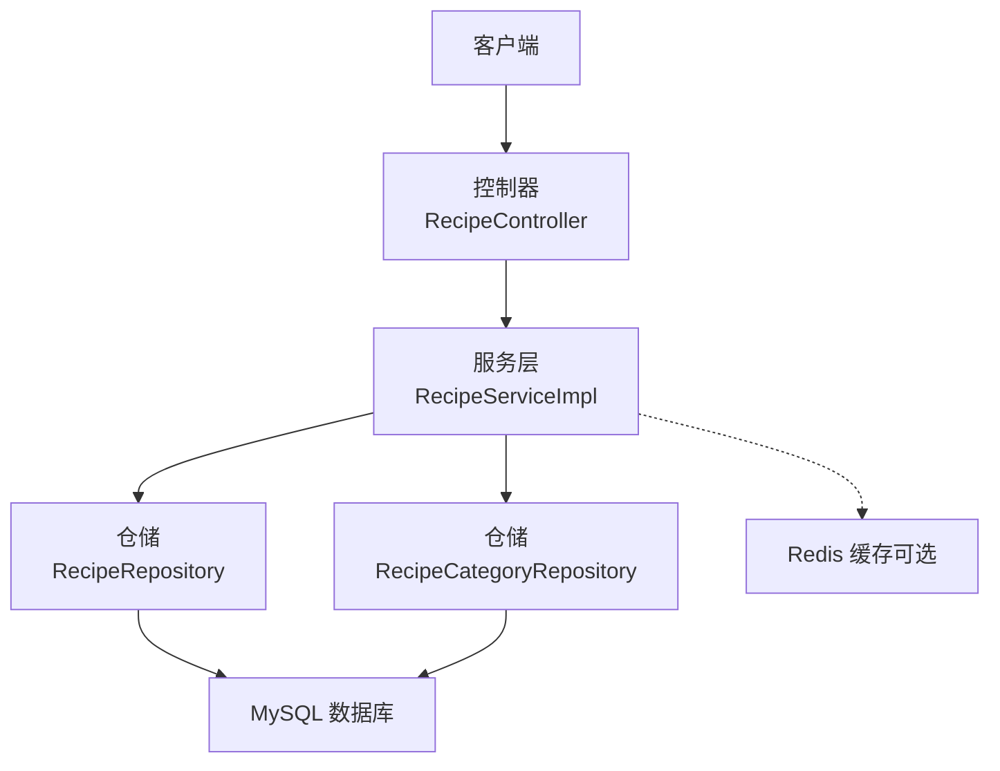
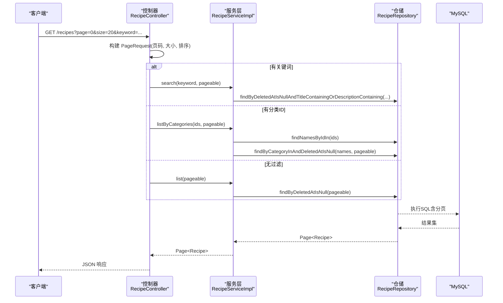
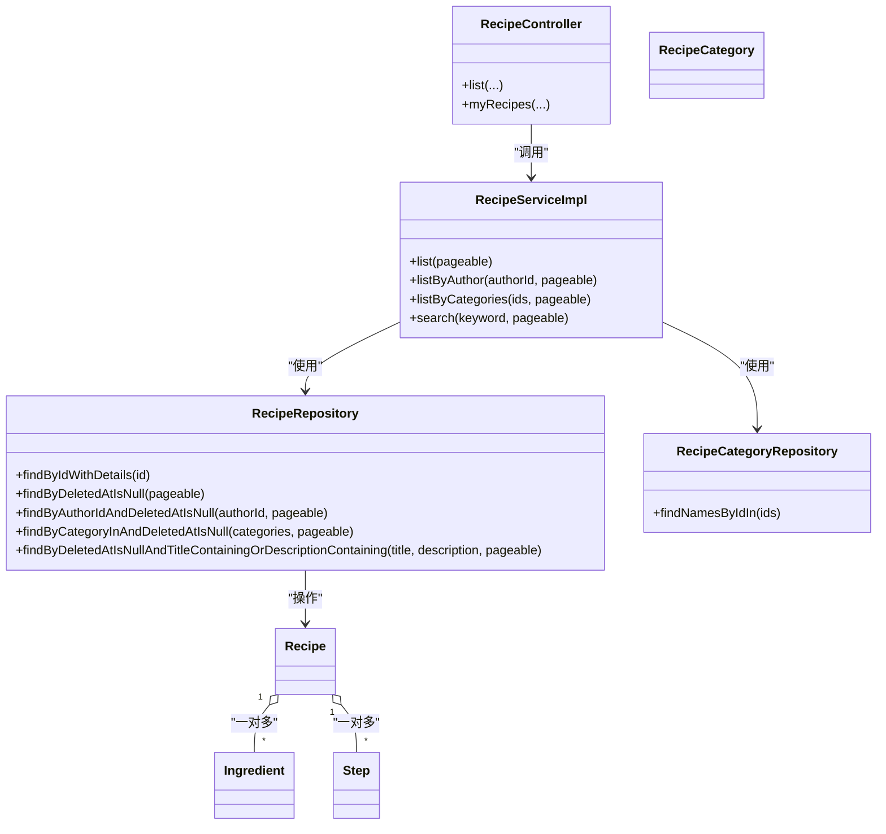

# 性能优化

<cite>
**本文引用的文件**
- [application.yaml](file://java_server/po/src/main/resources/application.yaml)
- [RecipeRepository.java](file://java_server/po/src/main/java/com/goodzheng/po/repository/RecipeRepository.java)
- [UserRepository.java](file://java_server/po/src/main/java/com/goodzheng/po/repository/UserRepository.java)
- [RecipeCategoryRepository.java](file://java_server/po/src/main/java/com/goodzheng/po/repository/RecipeCategoryRepository.java)
- [RecipeController.java](file://java_server/po/src/main/java/com/goodzheng/po/controller/RecipeController.java)
- [RecipeServiceImpl.java](file://java_server/po/src/main/java/com/goodzheng/po/service/impl/RecipeServiceImpl.java)
- [Recipe.java](file://java_server/po/src/main/java/com/goodzheng/po/entity/Recipe.java)
- [Ingredient.java](file://java_server/po/src/main/java/com/goodzheng/po/entity/Ingredient.java)
- [Step.java](file://java_server/po/src/main/java/com/goodzheng/po/entity/Step.java)
- [RecipeCategory.java](file://java_server/po/src/main/java/com/goodzheng/po/entity/RecipeCategory.java)
- [data-category.sql](file://java_server/po/src/main/resources/data-category.sql)
- [data-hunan.sql](file://java_server/po/src/main/resources/data-hunan.sql)
</cite>

## 目录
1. [简介](#简介)
2. [项目结构](#项目结构)
3. [核心组件](#核心组件)
4. [架构总览](#架构总览)
5. [详细组件分析](#详细组件分析)
6. [依赖关系分析](#依赖关系分析)
7. [性能考量](#性能考量)
8. [故障排查指南](#故障排查指南)
9. [结论](#结论)
10. [附录](#附录)

## 简介
本指南面向数据库性能优化，围绕索引设计策略、查询优化技巧、复合索引与覆盖索引的使用场景、慢查询分析与优化、分页最佳实践、缓存策略配置以及连接池参数调优展开。内容基于当前代码库中的实体模型、仓储接口、服务层与控制器实现进行落地化说明，帮助开发者识别并解决数据库性能瓶颈。

## 项目结构
本项目采用典型分层架构：
- 控制层：接收请求、组装分页参数、调用服务层
- 服务层：业务编排、事务边界、数据访问协调
- 持久层：Spring Data JPA Repository 定义查询与分页
- 实体层：JPA 实体映射表结构，定义关联与软删除等
- 配置层：数据源、连接池、JPA/Hibernate、Redis 缓存、监控端点

图表来源
- [RecipeController.java:52-68](file://java_server/po/src/main/java/com/goodzheng/po/controller/RecipeController.java#L52-L68)
- [RecipeServiceImpl.java:73-97](file://java_server/po/src/main/java/com/goodzheng/po/service/impl/RecipeServiceImpl.java#L73-L97)
- [RecipeRepository.java:13-35](file://java_server/po/src/main/java/com/goodzheng/po/repository/RecipeRepository.java#L13-L35)
- [RecipeCategoryRepository.java:10-17](file://java_server/po/src/main/java/com/goodzheng/po/repository/RecipeCategoryRepository.java#L10-L17)

章节来源
- [application.yaml:23-52](file://java_server/po/src/main/resources/application.yaml#L23-L52)
- [RecipeController.java:18-68](file://java_server/po/src/main/java/com/goodzheng/po/controller/RecipeController.java#L18-L68)
- [RecipeServiceImpl.java:19-97](file://java_server/po/src/main/java/com/goodzheng/po/service/impl/RecipeServiceImpl.java#L19-L97)

## 核心组件
- 菜谱实体与关联：Recipe 包含 ingredients 与 steps 一对多关联；通过 JOIN FETCH 预加载避免 N+1 问题
- 用户实体：sys_user，唯一约束 username，支持按关键字模糊搜索
- 分类实体：recipe_category，支持排序字段 sortOrder
- 仓储接口：提供分页查询、条件查询、JOIN FETCH 详情查询、名称批量查询
- 控制器与服务：统一分页构造、条件路由、事务标注

章节来源
- [Recipe.java:10-92](file://java_server/po/src/main/java/com/goodzheng/po/entity/Recipe.java#L10-L92)
- [Ingredient.java:9-41](file://java_server/po/src/main/java/com/goodzheng/po/entity/Ingredient.java#L9-L41)
- [Step.java:9-39](file://java_server/po/src/main/java/com/goodzheng/po/entity/Step.java#L9-L39)
- [RecipeCategory.java:8-45](file://java_server/po/src/main/java/com/goodzheng/po/entity/RecipeCategory.java#L8-L45)
- [RecipeRepository.java:13-35](file://java_server/po/src/main/java/com/goodzheng/po/repository/RecipeRepository.java#L13-L35)
- [UserRepository.java:13-26](file://java_server/po/src/main/java/com/goodzheng/po/repository/UserRepository.java#L13-L26)
- [RecipeCategoryRepository.java:10-17](file://java_server/po/src/main/java/com/goodzheng/po/repository/RecipeCategoryRepository.java#L10-L17)
- [RecipeController.java:52-83](file://java_server/po/src/main/java/com/goodzheng/po/controller/RecipeController.java#L52-L83)
- [RecipeServiceImpl.java:62-97](file://java_server/po/src/main/java/com/goodzheng/po/service/impl/RecipeServiceImpl.java#L62-L97)

## 架构总览
下图展示一次“分页列表”请求从控制器到数据库的完整调用链，体现分页参数传递、条件分支与数据返回。

图表来源
- [RecipeController.java:52-68](file://java_server/po/src/main/java/com/goodzheng/po/controller/RecipeController.java#L52-L68)
- [RecipeServiceImpl.java:73-97](file://java_server/po/src/main/java/com/goodzheng/po/service/impl/RecipeServiceImpl.java#L73-L97)
- [RecipeRepository.java:20-35](file://java_server/po/src/main/java/com/goodzheng/po/repository/RecipeRepository.java#L20-L35)

## 详细组件分析

### 索引设计与复合索引策略
- 主键与唯一索引
  - sys_user.username 具备唯一约束，天然建立唯一索引，适合登录与鉴权查找
  - recipe_category.name 具备唯一约束，适合分类快速定位
- 常用查询列建议建单列索引
  - recipe.author_id：作者维度列表、我的菜谱查询高频
  - recipe.category：分类筛选
  - recipe.deleted_at：软删除过滤普遍使用
  - recipe.is_public：公开可见性过滤
  - recipe.title/description：全文检索或前缀匹配可考虑生成列+索引或引入搜索引擎
- 复合索引原则
  - 将高选择性且常作为等值条件的列放在前面，如 (author_id, deleted_at)、(category, deleted_at)
  - 对范围查询列尽量放后，如 (author_id, deleted_at, created_at) 中 created_at 用于排序
  - 注意区分方向：若排序固定为 DESC created_at，可创建 (author_id, deleted_at, created_at DESC) 以利用索引排序
- 覆盖索引使用场景
  - 仅查询少量列时，可通过覆盖索引减少回表，例如只查 id、title、created_at 的场景
  - 在 RecipeRepository 的分页查询中，若仅需要基础字段，可考虑投影查询以减少 IO
- 注意事项
  - 避免过多索引导致写放大
  - 定期评估索引命中率与冗余索引

章节来源
- [User.java:10-18](file://java_server/po/src/main/java/com/goodzheng/po/entity/User.java#L10-L18)
- [RecipeCategory.java:17-31](file://java_server/po/src/main/java/com/goodzheng/po/entity/RecipeCategory.java#L17-L31)
- [Recipe.java:40-77](file://java_server/po/src/main/java/com/goodzheng/po/entity/Recipe.java#L40-L77)
- [RecipeRepository.java:20-35](file://java_server/po/src/main/java/com/goodzheng/po/repository/RecipeRepository.java#L20-L35)

### 查询优化技巧
- 预加载避免 N+1
  - findByIdWithDetails 使用 LEFT JOIN FETCH 一次性加载 ingredients 与 steps，避免懒加载导致的多次查询
- 分页与排序
  - 控制器统一使用 PageRequest.of(page, size, Sort.by("createdAt"))，确保稳定排序
  - 建议在 createdAt 上建立索引以加速排序
- 条件查询
  - 关键词搜索使用 LIKE 配合 LOWER()，但需注意无法有效利用普通 B-Tree 索引；可考虑生成列+函数索引或引入搜索引擎
  - 分类筛选使用 IN 列表，结合 category 索引提升效率
- 只取必要字段
  - 列表场景尽量避免 SELECT *，减少网络与内存开销

章节来源
- [RecipeRepository.java:16-18](file://java_server/po/src/main/java/com/goodzheng/po/repository/RecipeRepository.java#L16-L18)
- [RecipeController.java:52-68](file://java_server/po/src/main/java/com/goodzheng/po/controller/RecipeController.java#L52-L68)
- [RecipeServiceImpl.java:92-97](file://java_server/po/src/main/java/com/goodzheng/po/service/impl/RecipeServiceImpl.java#L92-L97)

### 慢查询分析与优化方法
- 启用 SQL 日志
  - show-sql=true 便于开发期观察生成的 SQL
- 使用 EXPLAIN 分析
  - 针对分页、关键词搜索、分类筛选等关键查询执行 EXPLAIN，关注 type、key、rows、Extra
- 常见慢查询优化
  - 关键词 LIKE '%xx%' 全模糊命中差：改用前缀匹配、生成列+函数索引或引入搜索引擎
  - 大结果集分页：确保 ORDER BY 列有索引，必要时限制 page 大小
  - 软删除过滤：确保 deleted_at 参与索引，避免全表扫描
- 监控与度量
  - Actuator endpoints 暴露 metrics/prometheus，结合外部监控系统采集慢查询指标

章节来源
- [application.yaml:35-41](file://java_server/po/src/main/resources/application.yaml#L35-L41)
- [application.yaml:84-94](file://java_server/po/src/main/resources/application.yaml#L84-L94)

### 分页查询最佳实践
- 控制器侧
  - 统一使用 PageRequest 构造分页与排序，默认按 createdAt 降序
  - 限制最大 size，防止过大分页导致内存压力
- 服务与仓储侧
  - 使用 Spring Data 的 Page<T> 返回，自动处理 count 与 content
  - 复杂条件组合时，优先选择能走索引的路径（等值 > 范围 > 模糊）
- 前端交互
  - 合理设置默认页大小，避免首屏加载过大数据

章节来源
- [RecipeController.java:52-68](file://java_server/po/src/main/java/com/goodzheng/po/controller/RecipeController.java#L52-L68)
- [RecipeRepository.java:20-35](file://java_server/po/src/main/java/com/goodzheng/po/repository/RecipeRepository.java#L20-L35)

### 缓存策略配置
- Redis 连接池
  - jedis.pool.max-active/max-idle 已配置，可根据并发调整
- 缓存建议
  - 热点数据（如分类列表、热门菜谱）可加入缓存，设置合理过期时间
  - 写操作后主动失效相关缓存键，保证一致性
- 静态资源缓存
  - web.resources.cache.period 已配置，有助于降低重复请求

章节来源
- [application.yaml:43-52](file://java_server/po/src/main/resources/application.yaml#L43-L52)
- [application.yaml:61-66](file://java_server/po/src/main/resources/application.yaml#L61-L66)

### 连接池参数调优
- HikariCP
  - maximum-pool-size：根据 CPU 核数与数据库连接能力设定，通常 2×CPU 或略高
  - minimum-idle：保持最小空闲连接，减少冷启动延迟
  - connection-timeout：连接获取超时，避免线程长时间阻塞
- Tomcat
  - max-threads、max-connections、accept-count：根据压测结果调整，避免请求排队过长
- 监控
  - 通过 Actuator 的 metrics 观察连接池使用率、等待时间与错误率

章节来源
- [application.yaml:23-33](file://java_server/po/src/main/resources/application.yaml#L23-L33)
- [application.yaml:4-11](file://java_server/po/src/main/resources/application.yaml#L4-L11)
- [application.yaml:84-94](file://java_server/po/src/main/resources/application.yaml#L84-L94)

### 实体与关联的性能要点
- 懒加载与预加载
  - Ingredient/Step 默认 LAZY，详情查询使用 JOIN FETCH 预加载，避免 N+1
- 软删除
  - deleted_at 广泛出现在查询条件中，应纳入索引设计
- 排序字段
  - RecipeCategory.sortOrder 用于分类排序，适合建立索引

章节来源
- [Ingredient.java:18-40](file://java_server/po/src/main/java/com/goodzheng/po/entity/Ingredient.java#L18-L40)
- [Step.java:18-38](file://java_server/po/src/main/java/com/goodzheng/po/entity/Step.java#L18-L38)
- [Recipe.java:70-91](file://java_server/po/src/main/java/com/goodzheng/po/entity/Recipe.java#L70-L91)
- [RecipeCategory.java:29-31](file://java_server/po/src/main/java/com/goodzheng/po/entity/RecipeCategory.java#L29-L31)

## 依赖关系分析
- 控制器依赖服务，服务依赖仓储；仓储直接对接数据库
- 详情查询通过 JOIN FETCH 同时加载关联实体，减少往返次数
- 分类查询先通过 ID 列表获取名称，再按名称集合筛选菜谱，避免多表 JOIN 带来的复杂度

图表来源
- [RecipeController.java:18-83](file://java_server/po/src/main/java/com/goodzheng/po/controller/RecipeController.java#L18-L83)
- [RecipeServiceImpl.java:19-97](file://java_server/po/src/main/java/com/goodzheng/po/service/impl/RecipeServiceImpl.java#L19-L97)
- [RecipeRepository.java:13-35](file://java_server/po/src/main/java/com/goodzheng/po/repository/RecipeRepository.java#L13-L35)
- [RecipeCategoryRepository.java:10-17](file://java_server/po/src/main/java/com/goodzheng/po/repository/RecipeCategoryRepository.java#L10-L17)
- [Recipe.java:84-91](file://java_server/po/src/main/java/com/goodzheng/po/entity/Recipe.java#L84-L91)
- [Ingredient.java:18-40](file://java_server/po/src/main/java/com/goodzheng/po/entity/Ingredient.java#L18-L40)
- [Step.java:18-38](file://java_server/po/src/main/java/com/goodzheng/po/entity/Step.java#L18-L38)

## 性能考量
- 索引命中与覆盖索引
  - 优先让查询条件与排序列命中索引；列表页尽量使用覆盖索引减少回表
- 分页与排序
  - 确保 ORDER BY 列有索引；避免无索引排序导致 filesort
- 预加载与懒加载
  - 详情查询使用 JOIN FETCH；列表查询避免加载大对象（如步骤文本）
- 缓存与连接池
  - 热点数据缓存；连接池大小与超时按压测结果调优
- 监控与诊断
  - 开启 show-sql 与 Actuator 指标；结合 EXPLAIN 与慢查询日志持续优化

[本节为通用指导，不直接分析具体文件]

## 故障排查指南
- 常见问题
  - N+1 查询：详情加载食材与步骤时未预加载，导致多次查询
  - 分页性能差：缺少排序列索引或 page size 过大
  - 关键词搜索慢：全模糊 LIKE 无法命中索引
- 排查步骤
  - 查看应用日志与 show-sql 输出，定位慢 SQL
  - 使用 EXPLAIN 分析执行计划，关注 key、rows、Extra
  - 检查连接池指标，确认是否存在连接耗尽或等待过高
  - 对热点查询添加合适索引或改写为覆盖索引
- 工具与配置
  - Actuator endpoints 暴露 health/info/metrics/prometheus
  - 静态资源缓存周期已配置，可减少重复请求

章节来源
- [application.yaml:35-41](file://java_server/po/src/main/resources/application.yaml#L35-L41)
- [application.yaml:84-94](file://java_server/po/src/main/resources/application.yaml#L84-L94)

## 结论
通过合理的索引设计（复合索引与覆盖索引）、查询优化（预加载、分页与排序）、缓存与连接池调优，以及完善的监控与诊断手段，可以显著提升数据库性能与系统稳定性。建议在生产环境持续跟踪慢查询与指标变化，迭代优化索引与查询路径。

[本节为总结性内容，不直接分析具体文件]

## 附录
- 种子数据参考
  - 分类种子数据与湖南菜谱示例可用于本地测试与性能验证

章节来源
- [data-category.sql:1-39](file://java_server/po/src/main/resources/data-category.sql#L1-L39)
- [data-hunan.sql:1-204](file://java_server/po/src/main/resources/data-hunan.sql#L1-L204)