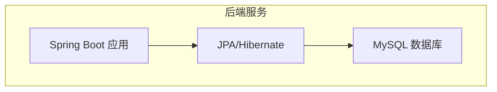
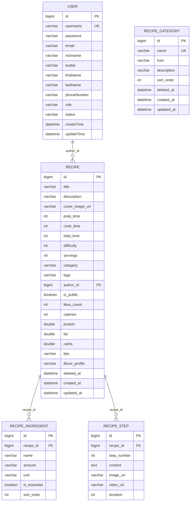
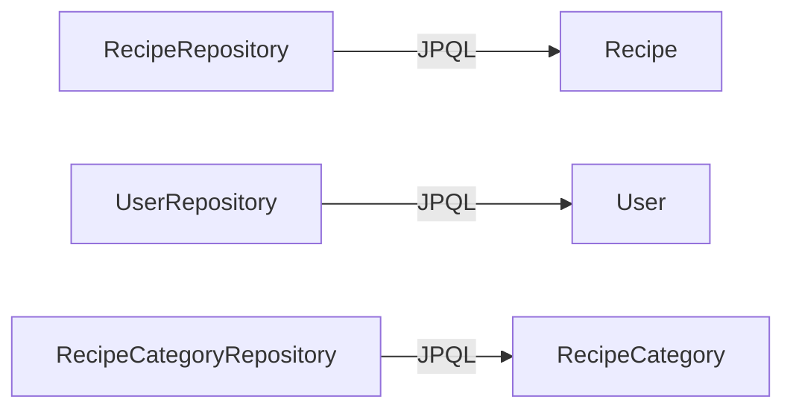
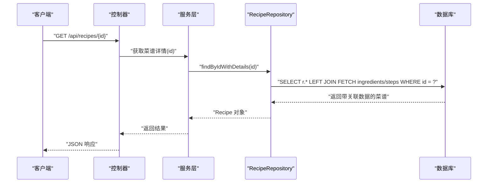

# 数据库设计

<cite>
**本文引用的文件**
- [User.java](file://java_server/po/src/main/java/com/goodzheng/po/entity/User.java)
- [Recipe.java](file://java_server/po/src/main/java/com/goodzheng/po/entity/Recipe.java)
- [Ingredient.java](file://java_server/po/src/main/java/com/goodzheng/po/entity/Ingredient.java)
- [Step.java](file://java_server/po/src/main/java/com/goodzheng/po/entity/Step.java)
- [RecipeCategory.java](file://java_server/po/src/main/java/com/goodzheng/po/entity/RecipeCategory.java)
- [application.yaml](file://java_server/po/src/main/resources/application.yaml)
- [data-category.sql](file://java_server/po/src/main/resources/data-category.sql)
- [data-hunan.sql](file://java_server/po/src/main/resources/data-hunan.sql)
- [RecipeRepository.java](file://java_server/po/src/main/java/com/goodzheng/po/repository/RecipeRepository.java)
- [UserRepository.java](file://java_server/po/src/main/java/com/goodzheng/po/repository/UserRepository.java)
- [RecipeCategoryRepository.java](file://java_server/po/src/main/java/com/goodzheng/po/repository/RecipeCategoryRepository.java)
</cite>

## 目录
1. [简介](#简介)
2. [项目结构](#项目结构)
3. [核心组件](#核心组件)
4. [架构总览](#架构总览)
5. [详细组件分析](#详细组件分析)
6. [依赖关系分析](#依赖关系分析)
7. [性能考虑](#性能考虑)
8. [故障排查指南](#故障排查指南)
9. [结论](#结论)
10. [附录](#附录)

## 简介
本数据库设计文档面向菜谱与用户管理系统，围绕用户、菜谱、食材、步骤、分类等核心实体进行建模。文档基于现有实体类与数据脚本，给出实体关系图（ERD）、表结构设计、字段定义与约束、索引策略、查询优化建议、完整建表脚本与示例数据、数据迁移与版本管理方案，以及数据访问模式的最佳实践。

## 项目结构
后端采用 Spring Boot + JPA/Hibernate + MySQL 的技术栈，实体类位于 entity 包，仓库接口位于 repository 包，应用配置在 application.yaml，种子数据以 SQL 脚本提供。JPA 的 ddl-auto 设置为 update，便于开发期自动建表；生产环境建议使用独立迁移脚本。

图表来源
- [application.yaml:23-41](file://java_server/po/src/main/resources/application.yaml#L23-L41)

章节来源
- [application.yaml:1-109](file://java_server/po/src/main/resources/application.yaml#L1-L109)

## 核心组件
- 用户表 sys_user：存储账号、认证信息、角色与状态等。
- 菜谱表 recipe：存储菜谱标题、描述、封面、时间、难度、人数、分类、标签、作者、可见性、点赞数、营养信息与软删除标记等。
- 食材表 recipe_ingredient：记录每个菜谱所需的食材名称、用量、单位、是否必需与排序。
- 步骤表 recipe_step：记录每个菜谱的制作步骤内容、图片/视频链接、耗时与顺序。
- 分类表 recipe_category：存储功能分类、菜系分类与饮食方式等，支持排序与软删除。

章节来源
- [User.java:1-59](file://java_server/po/src/main/java/com/goodzheng/po/entity/User.java#L1-L59)
- [Recipe.java:1-93](file://java_server/po/src/main/java/com/goodzheng/po/entity/Recipe.java#L1-L93)
- [Ingredient.java:1-42](file://java_server/po/src/main/java/com/goodzheng/po/entity/Ingredient.java#L1-L42)
- [Step.java:1-40](file://java_server/po/src/main/java/com/goodzheng/po/entity/Step.java#L1-L40)
- [RecipeCategory.java:1-46](file://java_server/po/src/main/java/com/goodzheng/po/entity/RecipeCategory.java#L1-L46)

## 架构总览
下图展示了核心实体之间的关系：用户与菜谱为一对多；菜谱与食材、步骤分别为一对多；分类通过菜谱的 category 字段形成逻辑上的“一对多”（一个分类可对应多个菜谱）。

图表来源
- [User.java:1-59](file://java_server/po/src/main/java/com/goodzheng/po/entity/User.java#L1-L59)
- [Recipe.java:1-93](file://java_server/po/src/main/java/com/goodzheng/po/entity/Recipe.java#L1-L93)
- [Ingredient.java:1-42](file://java_server/po/src/main/java/com/goodzheng/po/entity/Ingredient.java#L1-L42)
- [Step.java:1-40](file://java_server/po/src/main/java/com/goodzheng/po/entity/Step.java#L1-L40)
- [RecipeCategory.java:1-46](file://java_server/po/src/main/java/com/goodzheng/po/entity/RecipeCategory.java#L1-L46)

## 详细组件分析

### 用户表 sys_user
- 主键：id（自增）
- 唯一约束：username（唯一）
- 必填字段：username、password、status
- 可选字段：email、nickname、avatar、firstName、lastName、phoneNumber、role
- 时间戳：createTime（创建时填充）、updateTime（更新时自动刷新）
- 业务含义：用户账号、认证信息、角色与状态；默认角色为 admin，默认状态为 active

索引建议
- 唯一索引：username
- 常用查询索引：email、status（若按状态筛选频繁）

章节来源
- [User.java:1-59](file://java_server/po/src/main/java/com/goodzheng/po/entity/User.java#L1-L59)

### 菜谱表 recipe
- 主键：id（自增）
- 必填字段：title、difficulty、author_id、is_public
- 文本与数值：description、cover_image_url、prep_time、cook_time、total_time、servings、category、tags、likes_count、calories、protein、fat、carbs、tips、flavor_profile
- 软删除：deleted_at（NULL 表示未删除）
- 时间戳：created_at、updated_at（更新时自动刷新）
- 关联：author_id 指向 sys_user.id；category 为字符串分类名（逻辑上与 recipe_category.name 对应）

索引建议
- 复合索引：(author_id, deleted_at) 用于分页查询作者菜谱
- 复合索引：(category, deleted_at) 用于按分类分页
- 全文或前缀索引：title、description（根据搜索需求）
- 统计类：likes_count（如需热门排序）

章节来源
- [Recipe.java:1-93](file://java_server/po/src/main/java/com/goodzheng/po/entity/Recipe.java#L1-L93)

### 食材表 recipe_ingredient
- 主键：id（自增）
- 外键：recipe_id 指向 recipe.id
- 字段：name、amount、unit、is_essential、sort_order
- 用途：记录某菜谱所需食材及用量、是否必需、展示顺序

索引建议
- 复合索引：(recipe_id, sort_order) 用于按顺序获取食材列表

章节来源
- [Ingredient.java:1-42](file://java_server/po/src/main/java/com/goodzheng/po/entity/Ingredient.java#L1-L42)

### 步骤表 recipe_step
- 主键：id（自增）
- 外键：recipe_id 指向 recipe.id
- 字段：step_number、content（TEXT）、image_url、video_url、duration
- 用途：记录制作步骤的顺序、内容与多媒体资源、耗时

索引建议
- 复合索引：(recipe_id, step_number) 用于按顺序获取步骤

章节来源
- [Step.java:1-40](file://java_server/po/src/main/java/com/goodzheng/po/entity/Step.java#L1-L40)

### 分类表 recipe_category
- 主键：id（自增）
- 唯一约束：name（唯一）
- 字段：icon、description、sort_order、deleted_at、created_at、updated_at
- 用途：功能分类、菜系分类、饮食方式等，支持排序与软删除

索引建议
- 唯一索引：name
- 排序索引：sort_order（常配合 deleted_at 过滤）

章节来源
- [RecipeCategory.java:1-46](file://java_server/po/src/main/java/com/goodzheng/po/entity/RecipeCategory.java#L1-L46)

### 实体关系与实现方式
- 一对一：当前模型中未显式使用一对一映射；如未来需要用户与扩展资料一对一，可在 User 上增加 @OneToOne。
- 一对多：
  - 用户到菜谱：sys_user.id -> recipe.author_id
  - 菜谱到食材：recipe.id -> recipe_ingredient.recipe_id
  - 菜谱到步骤：recipe.id -> recipe_step.recipe_id
- 多对多：
  - 菜谱与分类：当前通过 recipe.category 字符串字段实现“逻辑多对一”（一个菜谱属于一个分类），而分类下可包含多个菜谱。若需“多对多”，应引入中间表 recipe_category_map(recipe_id, category_id)。

章节来源
- [Recipe.java:84-91](file://java_server/po/src/main/java/com/goodzheng/po/entity/Recipe.java#L84-L91)
- [Ingredient.java:18-23](file://java_server/po/src/main/java/com/goodzheng/po/entity/Ingredient.java#L18-L23)
- [Step.java:18-23](file://java_server/po/src/main/java/com/goodzheng/po/entity/Step.java#L18-L23)

## 依赖关系分析
- Repository 层定义了常用查询方法，包括分页、关键字搜索、JOIN FETCH 预加载等，体现数据访问模式与性能考量。
- 应用配置启用 JPA 显示 SQL 与自动建表，便于开发与调试。

图表来源
- [RecipeRepository.java:1-36](file://java_server/po/src/main/java/com/goodzheng/po/repository/RecipeRepository.java#L1-L36)
- [UserRepository.java:1-27](file://java_server/po/src/main/java/com/goodzheng/po/repository/UserRepository.java#L1-L27)
- [RecipeCategoryRepository.java:1-18](file://java_server/po/src/main/java/com/goodzheng/po/repository/RecipeCategoryRepository.java#L1-L18)

章节来源
- [RecipeRepository.java:1-36](file://java_server/po/src/main/java/com/goodzheng/po/repository/RecipeRepository.java#L1-L36)
- [UserRepository.java:1-27](file://java_server/po/src/main/java/com/goodzheng/po/repository/UserRepository.java#L1-L27)
- [RecipeCategoryRepository.java:1-18](file://java_server/po/src/main/java/com/goodzheng/po/repository/RecipeCategoryRepository.java#L1-L18)

## 性能考虑
- 连接池与线程池：HikariCP 最大连接数与 Tomcat 线程数已配置，可根据负载调整。
- 查询优化：
  - 使用 JOIN FETCH 预加载 ingredients 与 steps，避免 N+1 问题。
  - 分页查询时使用 Pageable，避免全表扫描。
  - 针对高频查询建立合适索引（见各表索引建议）。
- 缓存：Redis 已配置，可将热点分类、热门菜谱等放入缓存。
- 软删除：统一通过 deleted_at 过滤，确保查询范围正确。

章节来源
- [application.yaml:23-53](file://java_server/po/src/main/resources/application.yaml#L23-L53)
- [RecipeRepository.java:16-34](file://java_server/po/src/main/java/com/goodzheng/po/repository/RecipeRepository.java#L16-L34)

## 故障排查指南
- LazyInitializationException：通过 JOIN FETCH 预加载关联集合解决（见 RecipeRepository.findByIdWithDetails）。
- 分页异常：确认 Pageable 参数与排序字段存在且类型匹配。
- 搜索性能：LIKE 模糊查询可能走不到索引，必要时使用全文索引或搜索引擎。
- 事务与一致性：批量插入/更新时注意事务边界与异常回滚。

章节来源
- [RecipeRepository.java:16-18](file://java_server/po/src/main/java/com/goodzheng/po/repository/RecipeRepository.java#L16-L18)

## 结论
该数据库设计围绕用户、菜谱、食材、步骤、分类五大实体展开，采用一对多关系组织数据，并通过软删除、时间戳与排序字段提升可维护性与展示体验。结合合理的索引策略与 JPA 查询优化，可满足日常 CRUD、分页、搜索与详情展示等场景。后续可按需将分类从字符串升级为规范化表并引入多对多关系，进一步提升扩展性与查询效率。

## 附录

### 实体关系图（ERD）

图表来源
- [User.java:1-59](file://java_server/po/src/main/java/com/goodzheng/po/entity/User.java#L1-L59)
- [Recipe.java:1-93](file://java_server/po/src/main/java/com/goodzheng/po/entity/Recipe.java#L1-L93)
- [Ingredient.java:1-42](file://java_server/po/src/main/java/com/goodzheng/po/entity/Ingredient.java#L1-L42)
- [Step.java:1-40](file://java_server/po/src/main/java/com/goodzheng/po/entity/Step.java#L1-L40)
- [RecipeCategory.java:1-46](file://java_server/po/src/main/java/com/goodzheng/po/entity/RecipeCategory.java#L1-L46)

### 建表脚本（参考）
以下为基于实体类的参考建表语句（字段类型与约束与实体注解一致），可直接在 MySQL 中执行：

- 用户表
  - 表名：sys_user
  - 字段：id、username、password、email、nickname、avatar、firstName、lastName、phoneNumber、role、status、createTime、updateTime
  - 约束：id 自增主键；username 唯一；status 非空；createTime 不可更新；updateTime 自动更新

- 分类表
  - 表名：recipe_category
  - 字段：id、name、icon、description、sort_order、deleted_at、created_at、updated_at
  - 约束：id 自增主键；name 唯一；sort_order 非空；created_at 不可更新；updated_at 自动更新；deleted_at 软删除

- 菜谱表
  - 表名：recipe
  - 字段：id、title、description、cover_image_url、prep_time、cook_time、total_time、difficulty、servings、category、tags、author_id、is_public、likes_count、calories、protein、fat、carbs、tips、flavor_profile、deleted_at、created_at、updated_at
  - 约束：id 自增主键；title、difficulty、author_id、is_public 非空；created_at 不可更新；updated_at 自动更新；deleted_at 软删除

- 食材表
  - 表名：recipe_ingredient
  - 字段：id、recipe_id、name、amount、unit、is_essential、sort_order
  - 约束：id 自增主键；recipe_id 外键引用 recipe(id)；name、is_essential、sort_order 非空

- 步骤表
  - 表名：recipe_step
  - 字段：id、recipe_id、step_number、content、image_url、video_url、duration
  - 约束：id 自增主键；recipe_id 外键引用 recipe(id)；step_number、content 非空

章节来源
- [User.java:1-59](file://java_server/po/src/main/java/com/goodzheng/po/entity/User.java#L1-L59)
- [RecipeCategory.java:1-46](file://java_server/po/src/main/java/com/goodzheng/po/entity/RecipeCategory.java#L1-L46)
- [Recipe.java:1-93](file://java_server/po/src/main/java/com/goodzheng/po/entity/Recipe.java#L1-L93)
- [Ingredient.java:1-42](file://java_server/po/src/main/java/com/goodzheng/po/entity/Ingredient.java#L1-L42)
- [Step.java:1-40](file://java_server/po/src/main/java/com/goodzheng/po/entity/Step.java#L1-L40)

### 示例数据
- 分类种子数据：包含功能分类、菜系分类与饮食方式的初始数据，提供图标、描述与排序权重。
- 湖南菜谱种子数据：包含 10 道经典湘菜的菜谱、食材与步骤，作者为用户 ID=1 的 admin。

章节来源
- [data-category.sql:1-39](file://java_server/po/src/main/resources/data-category.sql#L1-L39)
- [data-hunan.sql:1-204](file://java_server/po/src/main/resources/data-hunan.sql#L1-L204)

### 数据迁移与版本管理
- 开发阶段：使用 JPA 的 ddl-auto=update 自动生成表结构，便于快速迭代。
- 生产阶段：建议关闭自动建表，改用版本化迁移脚本（如 Flyway/Liquibase），按版本号管理 DDL 变更，保证环境一致性与可回滚能力。
- 数据初始化：将 data-category.sql 与 data-hunan.sql 纳入迁移流程，作为 v1 的种子数据脚本。

章节来源
- [application.yaml:35-41](file://java_server/po/src/main/resources/application.yaml#L35-L41)
- [data-category.sql:1-39](file://java_server/po/src/main/resources/data-category.sql#L1-L39)
- [data-hunan.sql:1-204](file://java_server/po/src/main/resources/data-hunan.sql#L1-L204)

### 数据访问模式与最佳实践
- 预加载：使用 JOIN FETCH 一次性加载关联集合，避免懒加载异常与 N+1 查询。
- 分页：所有列表查询均使用 Pageable，限制返回量，提高响应速度。
- 搜索：关键字搜索使用 LIKE，但需注意性能；大数据量时可引入全文索引或外部搜索引擎。
- 软删除：统一通过 deleted_at 过滤，保证数据隔离与审计。
- 事务：写操作（新增/修改/删除）置于事务中，保证一致性。

章节来源
- [RecipeRepository.java:16-34](file://java_server/po/src/main/java/com/goodzheng/po/repository/RecipeRepository.java#L16-L34)
- [UserRepository.java:16-25](file://java_server/po/src/main/java/com/goodzheng/po/repository/UserRepository.java#L16-L25)
- [RecipeCategoryRepository.java:10-16](file://java_server/po/src/main/java/com/goodzheng/po/repository/RecipeCategoryRepository.java#L10-L16)

### 查询流程图（示例：获取单个菜谱详情）

图表来源
- [RecipeRepository.java:16-18](file://java_server/po/src/main/java/com/goodzheng/po/repository/RecipeRepository.java#L16-L18)