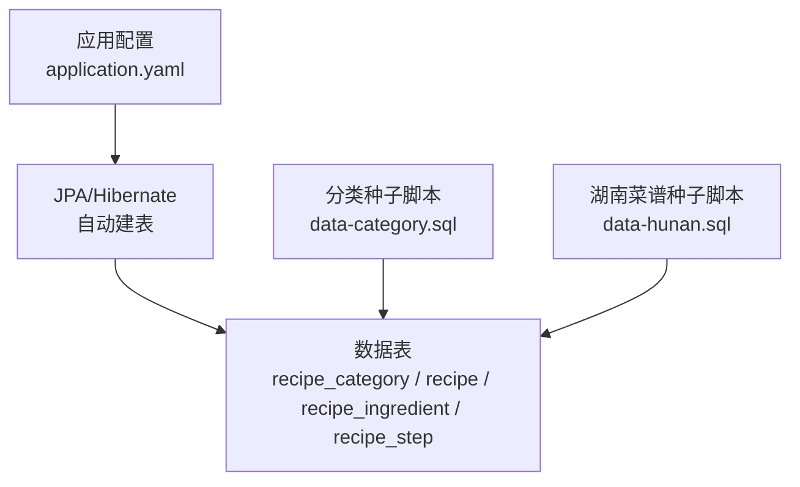
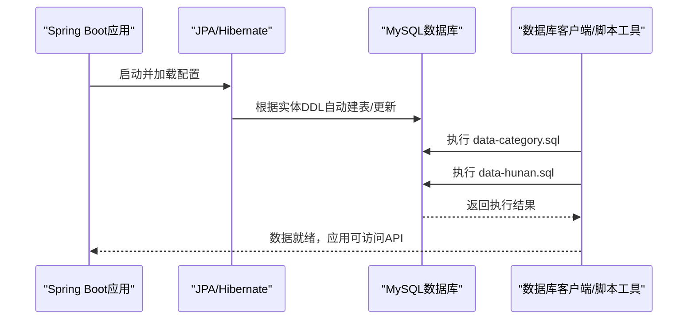
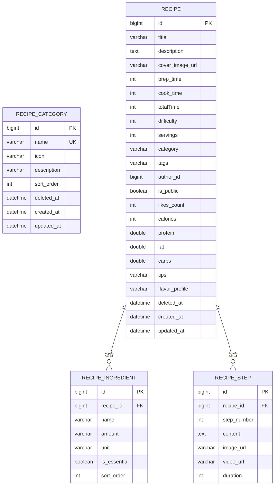

# 数据迁移

<cite>
**本文引用的文件**
- [application.yaml](file://java_server/po/src/main/resources/application.yaml)
- [data-category.sql](file://java_server/po/src/main/resources/data-category.sql)
- [data-hunan.sql](file://java_server/po/src/main/resources/data-hunan.sql)
- [RecipeCategory.java](file://java_server/po/src/main/java/com/goodzheng/po/entity/RecipeCategory.java)
- [Recipe.java](file://java_server/po/src/main/java/com/goodzheng/po/entity/Recipe.java)
- [Ingredient.java](file://java_server/po/src/main/java/com/goodzheng/po/entity/Ingredient.java)
- [Step.java](file://java_server/po/src/main/java/com/goodzheng/po/entity/Step.java)
</cite>

## 目录
1. [简介](#简介)
2. [项目结构](#项目结构)
3. [核心组件](#核心组件)
4. [架构总览](#架构总览)
5. [详细组件分析](#详细组件分析)
6. [依赖关系分析](#依赖关系分析)
7. [性能考虑](#性能考虑)
8. [故障排查指南](#故障排查指南)
9. [结论](#结论)
10. [附录](#附录)

## 简介
本文件面向数据库版本控制与数据迁移，说明本项目中SQL脚本的组织方式、命名规范、初始化与示例数据的导入方法，以及生产环境的数据迁移最佳实践。同时提供完整的数据库初始化脚本使用说明，包括湖南菜系数据和分类数据的导入步骤。

## 项目结构
- 后端为Spring Boot应用，使用JPA/Hibernate自动建表（ddl-auto: update），并通过resources下的SQL脚本进行种子数据注入。
- 数据脚本位于 resources 目录下：
  - data-category.sql：菜谱分类的初始数据（功能分类、菜系分类、饮食方式等）
  - data-hunan.sql：湖南菜系的示例菜谱数据（包含主料、步骤等）
- 实体类定义在 entity 包下，对应数据库表结构与字段约束。

图表来源
- [application.yaml:23-41](file://java_server/po/src/main/resources/application.yaml#L23-L41)
- [data-category.sql:1-39](file://java_server/po/src/main/resources/data-category.sql#L1-L39)
- [data-hunan.sql:1-204](file://java_server/po/src/main/resources/data-hunan.sql#L1-L204)

章节来源
- [application.yaml:23-41](file://java_server/po/src/main/resources/application.yaml#L23-L41)

## 核心组件
- 数据源与ORM配置：通过 application.yaml 指定MySQL连接、HikariCP连接池、JPA/Hibernate行为（如 ddl-auto: update）。
- 实体模型：
  - RecipeCategory：菜谱分类（名称唯一、排序权重、软删除、时间戳）
  - Recipe：菜谱主表（标题、描述、难度、标签、作者、统计、营养信息、软删除、时间戳）
  - Ingredient：菜谱配料（关联到菜谱、是否必需、排序）
  - Step：菜谱步骤（序号、内容、图片/视频链接、耗时）
- 种子数据脚本：
  - data-category.sql：插入分类基础数据
  - data-hunan.sql：插入湖南菜谱及对应的配料、步骤

章节来源
- [RecipeCategory.java:1-46](file://java_server/po/src/main/java/com/goodzheng/po/entity/RecipeCategory.java#L1-L46)
- [Recipe.java:1-93](file://java_server/po/src/main/java/com/goodzheng/po/entity/Recipe.java#L1-L93)
- [Ingredient.java:1-42](file://java_server/po/src/main/java/com/goodzheng/po/entity/Ingredient.java#L1-L42)
- [Step.java:1-40](file://java_server/po/src/main/java/com/goodzheng/po/entity/Step.java#L1-L40)
- [application.yaml:23-41](file://java_server/po/src/main/resources/application.yaml#L23-L41)

## 架构总览
下图展示了从应用启动到数据落库的整体流程：应用读取配置，JPA根据实体创建或更新表结构；随后由外部工具执行SQL脚本完成种子数据导入。

图表来源
- [application.yaml:23-41](file://java_server/po/src/main/resources/application.yaml#L23-L41)
- [data-category.sql:1-39](file://java_server/po/src/main/resources/data-category.sql#L1-L39)
- [data-hunan.sql:1-204](file://java_server/po/src/main/resources/data-hunan.sql#L1-L204)

## 详细组件分析

### 数据库版本控制与迁移策略
- 当前策略：使用JPA的 ddl-auto: update 自动生成或更新表结构。该方式适合开发/测试环境快速迭代，但不建议直接用于生产环境的复杂变更管理。
- 推荐策略（生产环境）：
  - 引入迁移工具（如Flyway/Liquibase），将DDL变更以版本化脚本管理，确保跨环境一致性与可回滚能力。
  - 将现有实体映射作为基线，后续所有表结构变更通过迁移脚本推进，避免在生产环境开启自动DDL。
  - 对数据变更（新增字段、默认值、索引优化）同样以迁移脚本形式发布，并在预发环境充分验证。

章节来源
- [application.yaml:35-41](file://java_server/po/src/main/resources/application.yaml#L35-L41)

### SQL脚本组织结构与命名规范
- 组织位置：resources 目录下集中存放种子数据脚本，便于打包与分发。
- 命名规范建议：
  - 按用途划分：如 data-category.sql（分类种子）、data-hunan.sql（湖南菜谱示例）
  - 若未来扩展，可按“数据域_类型_vN.sql”命名，例如：schema_v001_create_tables.sql、seed_v001_initial_data.sql
- 脚本内注释：每个脚本顶部应说明用途、依赖关系、执行顺序与注意事项。

章节来源
- [data-category.sql:1-39](file://java_server/po/src/main/resources/data-category.sql#L1-L39)
- [data-hunan.sql:1-204](file://java_server/po/src/main/resources/data-hunan.sql#L1-L204)

### 初始化数据与示例数据导入
- 分类数据导入（data-category.sql）
  - 作用：向 recipe_category 表插入功能分类、菜系分类、饮食方式等基础数据。
  - 关键字段：name（唯一）、icon、description、sort_order、created_at、updated_at。
  - 执行要点：确保目标库已存在 recipe_category 表；注意 sort_order 决定展示顺序。
- 湖南菜谱数据导入（data-hunan.sql）
  - 作用：向 recipe、recipe_ingredient、recipe_step 三张表插入10道经典湘菜的完整数据。
  - 依赖关系：先插入 recipe 获取自增ID，再插入其配料与步骤；author_id=1 表示管理员用户。
  - 关键字段：
    - recipe：title、category、tags、difficulty、servings、author_id、is_public、likes_count、营养字段、tips、flavor_profile、时间戳
    - recipe_ingredient：name、amount、unit、is_essential、sort_order
    - recipe_step：step_number、content、duration
  - 执行要点：确保 recipe 表已存在且 author_id=1 的用户存在；如需批量导入，建议在事务中执行以保证一致性。

章节来源
- [data-category.sql:1-39](file://java_server/po/src/main/resources/data-category.sql#L1-L39)
- [data-hunan.sql:1-204](file://java_server/po/src/main/resources/data-hunan.sql#L1-L204)
- [Recipe.java:1-93](file://java_server/po/src/main/java/com/goodzheng/po/entity/Recipe.java#L1-L93)
- [Ingredient.java:1-42](file://java_server/po/src/main/java/com/goodzheng/po/entity/Ingredient.java#L1-L42)
- [Step.java:1-40](file://java_server/po/src/main/java/com/goodzheng/po/entity/Step.java#L1-L40)

### 数据备份与恢复流程
- 备份策略
  - 全量备份：定期导出全库或关键业务库（如 po），保留多份历史快照。
  - 增量备份：结合数据库日志（如binlog）实现时间点恢复。
  - 备份校验：定期对备份文件进行恢复演练，确保可用性。
- 恢复策略
  - 灾难恢复：优先恢复最近一次可信的全量备份，再回放增量日志至目标时间点。
  - 误操作恢复：基于时间点恢复到误操作前状态，再进行必要修复。
- 生产注意事项
  - 备份与恢复脚本纳入版本管理，明确执行顺序与环境差异。
  - 恢复前冻结写入窗口，避免数据不一致。
  - 记录恢复过程与审计日志，便于事后复盘。

[本节为通用指导，不直接引用具体文件]

### 生产环境数据迁移最佳实践
- 迁移前置条件
  - 在预发环境完整验证迁移脚本与数据脚本。
  - 准备回滚方案（反向脚本或快照恢复）。
- 迁移执行
  - 使用迁移工具（Flyway/Liquibase）管理DDL与数据变更，禁止在生产手动执行脚本。
  - 大表变更采用在线变更策略（如分阶段加列、重建索引）。
- 监控与回滚
  - 迁移期间监控慢查询、锁等待与错误日志。
  - 一旦失败立即回滚，并定位根因后重试。

[本节为通用指导，不直接引用具体文件]

### 数据模型与关系图

图表来源
- [RecipeCategory.java:1-46](file://java_server/po/src/main/java/com/goodzheng/po/entity/RecipeCategory.java#L1-L46)
- [Recipe.java:1-93](file://java_server/po/src/main/java/com/goodzheng/po/entity/Recipe.java#L1-L93)
- [Ingredient.java:1-42](file://java_server/po/src/main/java/com/goodzheng/po/entity/Ingredient.java#L1-L42)
- [Step.java:1-40](file://java_server/po/src/main/java/com/goodzheng/po/entity/Step.java#L1-L40)

## 依赖关系分析
- 应用配置依赖：
  - application.yaml 中的 datasource 与 jpa.hibernate.ddl-auto 决定了数据库连接与表结构生成策略。
- 脚本与实体依赖：
  - data-category.sql 依赖 recipe_category 表结构（由实体映射生成）。
  - data-hunan.sql 依赖 recipe、recipe_ingredient、recipe_step 表结构，并依赖 author_id=1 的用户存在。
- 耦合性评估：
  - 脚本与实体强耦合，任何字段变更需同步更新脚本与实体映射。
  - 建议在迁移工具中统一管理DDL与数据脚本，降低手工维护成本。

章节来源
- [application.yaml:23-41](file://java_server/po/src/main/resources/application.yaml#L23-L41)
- [data-category.sql:1-39](file://java_server/po/src/main/resources/data-category.sql#L1-L39)
- [data-hunan.sql:1-204](file://java_server/po/src/main/resources/data-hunan.sql#L1-L204)

## 性能考虑
- 连接池与并发：合理设置 HikariCP 的最大连接数与超时，避免高并发下连接耗尽。
- 批量导入：对于大量数据导入，建议使用分批提交与禁用外键检查（谨慎）以提升性能。
- 索引优化：对常用查询字段（如 category、tags、author_id）建立合适索引，减少扫描开销。
- 事务边界：长事务可能引发锁竞争，尽量缩短事务范围，拆分大事务。

[本节为通用指导，不直接引用具体文件]

## 故障排查指南
- 常见问题
  - 表不存在：确认JPA已正确生成表结构或提前执行DDL脚本。
  - 唯一约束冲突：检查 data-category.sql 中分类名称是否重复。
  - 外键约束失败：确认 data-hunan.sql 中 author_id=1 的用户是否存在。
  - 字符集问题：确保数据库与连接参数使用utf8mb4，避免中文乱码。
- 定位方法
  - 查看应用日志与数据库错误日志，定位具体SQL与错误原因。
  - 使用数据库客户端单独执行脚本片段，逐步缩小问题范围。
  - 核对实体字段与脚本字段的一致性（长度、类型、可空性）。

章节来源
- [application.yaml:23-41](file://java_server/po/src/main/resources/application.yaml#L23-L41)
- [data-category.sql:1-39](file://java_server/po/src/main/resources/data-category.sql#L1-L39)
- [data-hunan.sql:1-204](file://java_server/po/src/main/resources/data-hunan.sql#L1-L204)

## 结论
本项目当前通过JPA自动建表与资源目录下的SQL脚本完成数据初始化与示例数据导入。为保障生产环境的稳定性与可追溯性，建议引入版本化迁移工具，统一管理与执行DDL与数据变更，并完善备份恢复流程与回滚策略。

[本节为总结性内容，不直接引用具体文件]

## 附录

### 数据库初始化脚本使用说明
- 前提条件
  - 已创建数据库实例与用户，并配置好 application.yaml 中的数据源。
  - 确保数据库中已存在必要的用户（如 author_id=1）。
- 执行顺序
  1) 启动应用，让JPA根据实体创建或更新表结构。
  2) 执行 data-category.sql，导入分类基础数据。
  3) 执行 data-hunan.sql，导入湖南菜谱及其配料与步骤。
- 验证方法
  - 查询 recipe_category 表，确认分类数据已入库。
  - 查询 recipe、recipe_ingredient、recipe_step 表，确认菜谱数据完整。
  - 调用相关API，验证前端展示与数据一致性。

章节来源
- [application.yaml:23-41](file://java_server/po/src/main/resources/application.yaml#L23-L41)
- [data-category.sql:1-39](file://java_server/po/src/main/resources/data-category.sql#L1-L39)
- [data-hunan.sql:1-204](file://java_server/po/src/main/resources/data-hunan.sql#L1-L204)