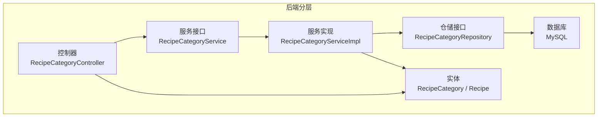
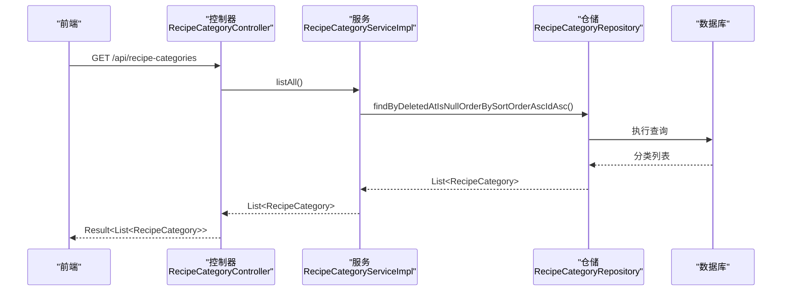
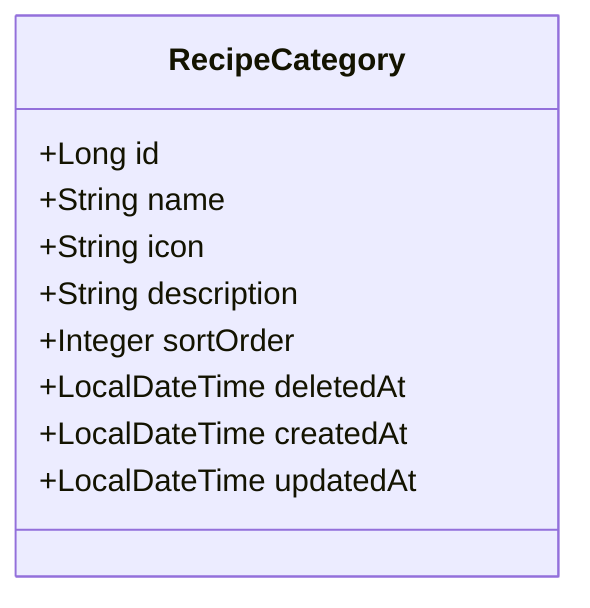
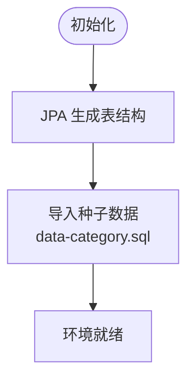

# 分类表(RecipeCategory)设计

<cite>
**本文引用的文件**
- [RecipeCategory.java](file://java_server/po/src/main/java/com/goodzheng/po/entity/RecipeCategory.java)
- [RecipeCategoryRepository.java](file://java_server/po/src/main/java/com/goodzheng/po/repository/RecipeCategoryRepository.java)
- [RecipeCategoryService.java](file://java_server/po/src/main/java/com/goodzheng/po/service/RecipeCategoryService.java)
- [RecipeCategoryServiceImpl.java](file://java_server/po/src/main/java/com/goodzheng/po/service/impl/RecipeCategoryServiceImpl.java)
- [RecipeCategoryController.java](file://java_server/po/src/main/java/com/goodzheng/po/controller/RecipeCategoryController.java)
- [Recipe.java](file://java_server/po/src/main/java/com/goodzheng/po/entity/Recipe.java)
- [data-category.sql](file://java_server/po/src/main/resources/data-category.sql)
- [application.yaml](file://java_server/po/src/main/resources/application.yaml)
</cite>

## 目录
1. [简介](#简介)
2. [项目结构](#项目结构)
3. [核心组件](#核心组件)
4. [架构总览](#架构总览)
5. [详细组件分析](#详细组件分析)
6. [依赖关系分析](#依赖关系分析)
7. [性能考虑](#性能考虑)
8. [故障排查指南](#故障排查指南)
9. [结论](#结论)
10. [附录](#附录)

## 简介
本设计文档围绕菜谱分类体系，对分类表（recipe_category）的结构、字段语义、层级与树形组织方式、排序与显示控制、与菜谱的关联关系、增删改查操作与权限控制策略、建表脚本与层次查询优化方案、以及数据维护与扩展机制进行系统化说明。目标是帮助读者快速理解并正确扩展分类能力，同时保证查询性能与维护性。

## 项目结构
- 实体层：定义分类实体与菜谱实体及其字段约束。
- 仓储层：提供分类数据的查询方法，包括按排序与可见性过滤。
- 服务层：封装业务逻辑，如列出所有未删除的分类。
- 控制器层：对外暴露分类查询接口。
- 资源层：包含分类种子数据 SQL 与数据库连接配置。

图表来源
- [RecipeCategoryController.java:11-28](file://java_server/po/src/main/java/com/goodzheng/po/controller/RecipeCategoryController.java#L11-L28)
- [RecipeCategoryService.java:7-11](file://java_server/po/src/main/java/com/goodzheng/po/service/RecipeCategoryService.java#L7-L11)
- [RecipeCategoryServiceImpl.java:12-23](file://java_server/po/src/main/java/com/goodzheng/po/service/impl/RecipeCategoryServiceImpl.java#L12-L23)
- [RecipeCategoryRepository.java:10-17](file://java_server/po/src/main/java/com/goodzheng/po/repository/RecipeCategoryRepository.java#L10-L17)
- [RecipeCategory.java:8-45](file://java_server/po/src/main/java/com/goodzheng/po/entity/RecipeCategory.java#L8-L45)
- [Recipe.java:10-92](file://java_server/po/src/main/java/com/goodzheng/po/entity/Recipe.java#L10-L92)

章节来源
- [RecipeCategoryController.java:11-28](file://java_server/po/src/main/java/com/goodzheng/po/controller/RecipeCategoryController.java#L11-L28)
- [RecipeCategoryService.java:7-11](file://java_server/po/src/main/java/com/goodzheng/po/service/RecipeCategoryService.java#L7-L11)
- [RecipeCategoryServiceImpl.java:12-23](file://java_server/po/src/main/java/com/goodzheng/po/service/impl/RecipeCategoryServiceImpl.java#L12-L23)
- [RecipeCategoryRepository.java:10-17](file://java_server/po/src/main/java/com/goodzheng/po/repository/RecipeCategoryRepository.java#L10-L17)
- [RecipeCategory.java:8-45](file://java_server/po/src/main/java/com/goodzheng/po/entity/RecipeCategory.java#L8-L45)
- [Recipe.java:10-92](file://java_server/po/src/main/java/com/goodzheng/po/entity/Recipe.java#L10-L92)

## 核心组件
- 分类实体（RecipeCategory）：定义分类主键、名称、图标、描述、排序权重、软删除标记及时间戳等字段。
- 分类仓储（RecipeCategoryRepository）：提供按“未删除 + 排序”查询与按 ID 列表批量获取名称的方法。
- 分类服务（RecipeCategoryService/Impl）：封装“列出所有未删除分类”的业务方法。
- 分类控制器（RecipeCategoryController）：对外暴露 GET 接口，返回统一结果包装。
- 菜谱实体（Recipe）：当前通过字符串字段 category 与标签 tags 与分类/标签产生弱关联；尚未建立多对多关系表。

章节来源
- [RecipeCategory.java:8-45](file://java_server/po/src/main/java/com/goodzheng/po/entity/RecipeCategory.java#L8-L45)
- [RecipeCategoryRepository.java:10-17](file://java_server/po/src/main/java/com/goodzheng/po/repository/RecipeCategoryRepository.java#L10-L17)
- [RecipeCategoryService.java:7-11](file://java_server/po/src/main/java/com/goodzheng/po/service/RecipeCategoryService.java#L7-L11)
- [RecipeCategoryServiceImpl.java:12-23](file://java_server/po/src/main/java/com/goodzheng/po/service/impl/RecipeCategoryServiceImpl.java#L12-L23)
- [RecipeCategoryController.java:11-28](file://java_server/po/src/main/java/com/goodzheng/po/controller/RecipeCategoryController.java#L11-L28)
- [Recipe.java:40-46](file://java_server/po/src/main/java/com/goodzheng/po/entity/Recipe.java#L40-L46)

## 架构总览
下图展示了从前端到数据库的调用链路，以及各层的职责分工。

图表来源
- [RecipeCategoryController.java:19-27](file://java_server/po/src/main/java/com/goodzheng/po/controller/RecipeCategoryController.java#L19-L27)
- [RecipeCategoryServiceImpl.java:18-22](file://java_server/po/src/main/java/com/goodzheng/po/service/impl/RecipeCategoryServiceImpl.java#L18-L22)
- [RecipeCategoryRepository.java:12-12](file://java_server/po/src/main/java/com/goodzheng/po/repository/RecipeCategoryRepository.java#L12-L12)

## 详细组件分析

### 分类实体与字段设计
- 主键 id：自增长整型。
- name：分类名称，唯一且必填，用于展示与检索。
- icon：图标标识（支持 Lucide 图标名或 emoji），便于前端渲染。
- description：分类描述，用于辅助信息展示。
- sortOrder：排序权重，数值越小越靠前，配合查询排序使用。
- deletedAt：软删除标记，空值表示有效记录。
- createdAt/updatedAt：创建与更新时间戳，自动维护。

图表来源
- [RecipeCategory.java:8-45](file://java_server/po/src/main/java/com/goodzheng/po/entity/RecipeCategory.java#L8-L45)

章节来源
- [RecipeCategory.java:8-45](file://java_server/po/src/main/java/com/goodzheng/po/entity/RecipeCategory.java#L8-L45)

### 分类层级与树形结构设计
- 当前模型未包含父级分类字段（如 parent_id），因此不支持多级树形结构。
- 建议扩展：在 recipe_category 表中增加 parent_id 字段以表达父子关系；为 name 与 sort_order 建立索引以提升查询性能；如需严格层级深度限制，可增加校验逻辑。
- 若需保留历史版本或审计，可引入 version 或变更日志表。

[本节为概念性设计建议，不直接分析具体代码文件]

### 分类名称、排序权重、显示状态
- 名称：name 字段唯一且必填，确保分类标识清晰。
- 排序：sortOrder 升序排列，结合 id 作为二级排序，保证稳定顺序。
- 显示状态：通过 deletedAt 是否为空控制是否可见；可扩展 is_visible 布尔字段以支持更细粒度的显示控制。

章节来源
- [RecipeCategoryRepository.java:12-12](file://java_server/po/src/main/java/com/goodzheng/po/repository/RecipeCategoryRepository.java#L12-L12)
- [RecipeCategory.java:17-39](file://java_server/po/src/main/java/com/goodzheng/po/entity/RecipeCategory.java#L17-L39)

### 分类与菜谱的多对多关联关系
- 现状：Recipe 实体中包含 category 字符串字段与 tags 字符串字段，属于弱关联，不利于规范化查询与统计。
- 建议：建立 recipe_category 中间表（recipe_id, category_id），实现真正的多对多关系；同时在 Recipe 与 RecipeCategory 之间建立双向关联映射，并提供基于分类的菜谱聚合查询。

章节来源
- [Recipe.java:40-46](file://java_server/po/src/main/java/com/goodzheng/po/entity/Recipe.java#L40-L46)

### 分类的增删改查操作与权限控制
- 读：已提供公开接口 GET /api/recipe-categories，返回所有未删除分类，无需登录。
- 写：当前仓库与服务层未暴露新增、修改、删除接口；可在控制器中补充受保护的端点，并通过鉴权拦截器或注解控制权限（例如仅管理员可写）。
- 软删除：通过设置 deletedAt 实现逻辑删除，避免物理删除带来的数据丢失风险。

章节来源
- [RecipeCategoryController.java:19-27](file://java_server/po/src/main/java/com/goodzheng/po/controller/RecipeCategoryController.java#L19-L27)
- [RecipeCategoryServiceImpl.java:18-22](file://java_server/po/src/main/java/com/goodzheng/po/service/impl/RecipeCategoryServiceImpl.java#L18-L22)

### 建表脚本与种子数据
- 建表：由 JPA/Hibernate 根据实体类自动生成表结构（ddl-auto=update）。
- 种子数据：提供 data-category.sql，包含功能分类、菜系分类、饮食方式三类初始数据，便于本地开发与环境初始化。

图表来源
- [application.yaml:36-41](file://java_server/po/src/main/resources/application.yaml#L36-L41)
- [data-category.sql:1-39](file://java_server/po/src/main/resources/data-category.sql#L1-L39)

章节来源
- [application.yaml:36-41](file://java_server/po/src/main/resources/application.yaml#L36-L41)
- [data-category.sql:1-39](file://java_server/po/src/main/resources/data-category.sql#L1-L39)

### 层次查询优化方案
- 当前查询：按 deletedAt IS NULL 且 sortOrder ASC、id ASC 排序，适合扁平列表展示。
- 未来树形查询优化：
  - 添加 parent_id 字段并在 (parent_id, sort_order) 上建立复合索引。
  - 使用递归 CTE（WITH RECURSIVE）或物化路径（path 字段）提升层级遍历效率。
  - 对常用查询维度（如按父节点、按层级深度）建立覆盖索引。
  - 将热点分类数据缓存至 Redis，减少数据库压力。

[本节为通用优化建议，不直接分析具体代码文件]

### 分类数据的维护策略与扩展机制
- 维护策略：
  - 通过软删除（deletedAt）管理生命周期，避免误删。
  - 使用 sortOrder 控制展示顺序，必要时结合 id 保证稳定性。
  - 通过唯一约束保障 name 的唯一性，防止重复分类。
- 扩展机制：
  - 增加 parent_id 实现多级分类树。
  - 增加 is_visible 字段控制前台可见性。
  - 增加 category_type 区分功能分类、菜系分类、饮食方式等维度。
  - 引入国际化字段或独立字典表支持多语言名称。

[本节为通用扩展建议，不直接分析具体代码文件]

## 依赖关系分析
- 控制器依赖服务接口，服务实现依赖仓储接口，仓储接口继承 Spring Data JPA 基础能力。
- 实体与数据库通过 JPA 注解映射，应用配置启用 Hibernate DDL 自动更新。

图表来源
- [RecipeCategoryController.java:11-28](file://java_server/po/src/main/java/com/goodzheng/po/controller/RecipeCategoryController.java#L11-L28)
- [RecipeCategoryService.java:7-11](file://java_server/po/src/main/java/com/goodzheng/po/service/RecipeCategoryService.java#L7-L11)
- [RecipeCategoryServiceImpl.java:12-23](file://java_server/po/src/main/java/com/goodzheng/po/service/impl/RecipeCategoryServiceImpl.java#L12-L23)
- [RecipeCategoryRepository.java:10-17](file://java_server/po/src/main/java/com/goodzheng/po/repository/RecipeCategoryRepository.java#L10-L17)
- [RecipeCategory.java:8-45](file://java_server/po/src/main/java/com/goodzheng/po/entity/RecipeCategory.java#L8-L45)
- [application.yaml:36-41](file://java_server/po/src/main/resources/application.yaml#L36-L41)

章节来源
- [RecipeCategoryController.java:11-28](file://java_server/po/src/main/java/com/goodzheng/po/controller/RecipeCategoryController.java#L11-L28)
- [RecipeCategoryService.java:7-11](file://java_server/po/src/main/java/com/goodzheng/po/service/RecipeCategoryService.java#L7-L11)
- [RecipeCategoryServiceImpl.java:12-23](file://java_server/po/src/main/java/com/goodzheng/po/service/impl/RecipeCategoryServiceImpl.java#L12-L23)
- [RecipeCategoryRepository.java:10-17](file://java_server/po/src/main/java/com/goodzheng/po/repository/RecipeCategoryRepository.java#L10-L17)
- [RecipeCategory.java:8-45](file://java_server/po/src/main/java/com/goodzheng/po/entity/RecipeCategory.java#L8-L45)
- [application.yaml:36-41](file://java_server/po/src/main/resources/application.yaml#L36-L41)

## 性能考虑
- 查询排序：利用 sortOrder 与 id 的联合排序，避免全表扫描后的内存排序。
- 索引建议：
  - 为 (deleted_at, sort_order, id) 建立复合索引，加速“未删除 + 排序”查询。
  - 为 name 建立唯一索引（已由 unique=true 保证）。
- 缓存策略：对频繁读取的分类列表进行 Redis 缓存，设置合理过期时间与失效策略。
- 分页与限流：当分类数量增长时，考虑分页加载与接口限流。

[本节为通用性能建议，不直接分析具体代码文件]

## 故障排查指南
- 接口返回错误：控制器捕获运行时异常并返回统一错误码与消息，检查服务层抛出的异常原因。
- 数据不可见：确认记录的 deleted_at 是否为空；检查排序字段是否正确设置。
- 数据库连接失败：核对 application.yaml 中的数据库 URL、用户名、密码与驱动配置。
- 表结构不一致：确认 JPA 的 ddl-auto 配置与实体注解一致，必要时手动同步或清理重建。

章节来源
- [RecipeCategoryController.java:19-27](file://java_server/po/src/main/java/com/goodzheng/po/controller/RecipeCategoryController.java#L19-L27)
- [application.yaml:23-41](file://java_server/po/src/main/resources/application.yaml#L23-L41)

## 结论
当前分类体系采用扁平结构，通过名称唯一性与排序权重实现有序展示，并以软删除控制可见性。与菜谱的关联仍为字符串字段形式，建议在后续迭代中引入中间表实现规范化的多对多关系，并扩展父级字段以支持树形分类。通过合理的索引与缓存策略，可显著提升查询性能与系统可用性。

## 附录
- 接口示例：GET /api/recipe-categories
- 种子数据：data-category.sql 提供功能分类、菜系分类、饮食方式的初始数据。
- 配置要点：application.yaml 中启用 JPA 自动建表与 MySQL 方言。

章节来源
- [RecipeCategoryController.java:19-27](file://java_server/po/src/main/java/com/goodzheng/po/controller/RecipeCategoryController.java#L19-L27)
- [data-category.sql:1-39](file://java_server/po/src/main/resources/data-category.sql#L1-L39)
- [application.yaml:36-41](file://java_server/po/src/main/resources/application.yaml#L36-L41)