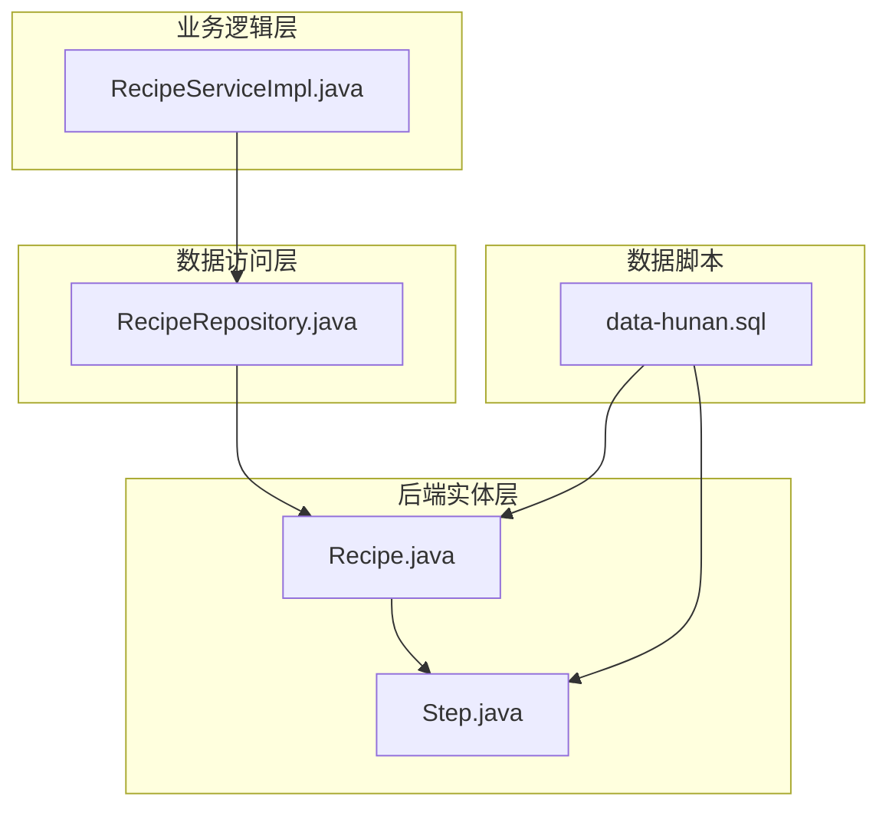
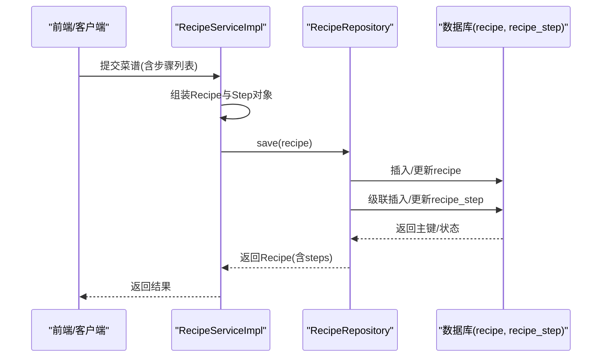
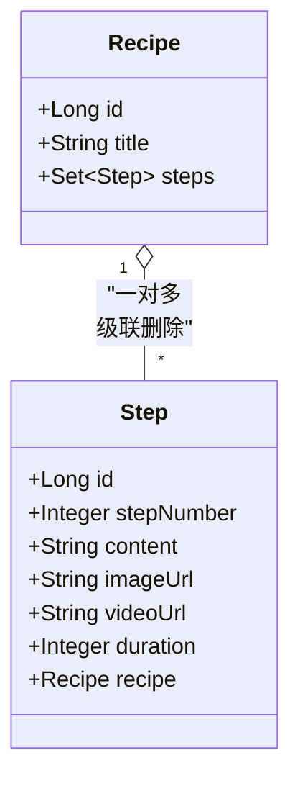
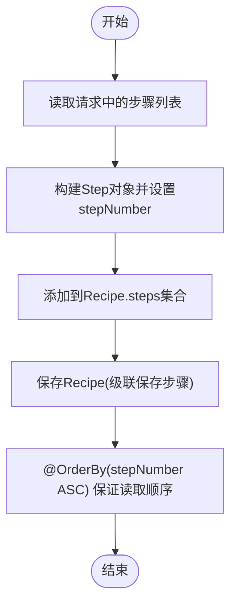
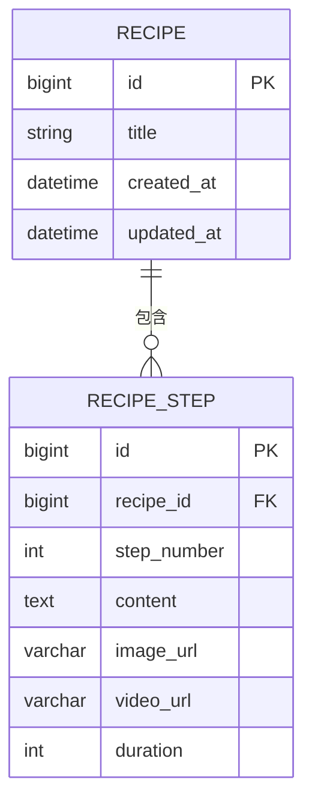

# 步骤表(Step)设计

<cite>
**本文引用的文件**
- [Step.java](file://java_server/po/src/main/java/com/goodzheng/po/entity/Step.java)
- [Recipe.java](file://java_server/po/src/main/java/com/goodzheng/po/entity/Recipe.java)
- [RecipeRequest.java](file://java_server/po/src/main/java/com/goodzheng/po/dto/RecipeRequest.java)
- [RecipeRepository.java](file://java_server/po/src/main/java/com/goodzheng/po/repository/RecipeRepository.java)
- [RecipeServiceImpl.java](file://java_server/po/src/main/java/com/goodzheng/po/service/impl/RecipeServiceImpl.java)
- [data-hunan.sql](file://java_server/po/src/main/resources/data-hunan.sql)
</cite>

## 目录
1. [简介](#简介)
2. [项目结构](#项目结构)
3. [核心组件](#核心组件)
4. [架构总览](#架构总览)
5. [详细组件分析](#详细组件分析)
6. [依赖关系分析](#依赖关系分析)
7. [性能考虑](#性能考虑)
8. [故障排查指南](#故障排查指南)
9. [结论](#结论)
10. [附录](#附录)

## 简介
本设计文档聚焦于“烹饪步骤”的数据模型与实现，围绕以下步骤展开：
- 步骤表字段设计与含义（步骤编号、描述内容、耗时等）
- 步骤间的顺序关系与排序机制
- 与菜谱表的外键关联及级联删除策略
- 步骤内容的富文本支持与格式化存储方案
- 建表脚本与查询优化建议
- 版本管理与编辑历史的设计思路

## 项目结构
后端采用 Spring Boot + JPA 的实体-仓储-服务分层。步骤数据通过 Step 实体映射到数据库表 recipe_step，并通过 Recipe 实体的双向一对多关系进行组织与管理。种子数据通过 SQL 脚本初始化。

图表来源
- [Recipe.java:10-92](file://java_server/po/src/main/java/com/goodzheng/po/entity/Recipe.java#L10-L92)
- [Step.java:9-39](file://java_server/po/src/main/java/com/goodzheng/po/entity/Step.java#L9-L39)
- [RecipeRepository.java:13-35](file://java_server/po/src/main/java/com/goodzheng/po/repository/RecipeRepository.java#L13-L35)
- [RecipeServiceImpl.java:26-140](file://java_server/po/src/main/java/com/goodzheng/po/service/impl/RecipeServiceImpl.java#L26-L140)
- [data-hunan.sql:19-203](file://java_server/po/src/main/resources/data-hunan.sql#L19-L203)

章节来源
- [Recipe.java:10-92](file://java_server/po/src/main/java/com/goodzheng/po/entity/Recipe.java#L10-L92)
- [Step.java:9-39](file://java_server/po/src/main/java/com/goodzheng/po/entity/Step.java#L9-L39)
- [RecipeRepository.java:13-35](file://java_server/po/src/main/java/com/goodzheng/po/repository/RecipeRepository.java#L13-L35)
- [RecipeServiceImpl.java:26-140](file://java_server/po/src/main/java/com/goodzheng/po/service/impl/RecipeServiceImpl.java#L26-L140)
- [data-hunan.sql:19-203](file://java_server/po/src/main/resources/data-hunan.sql#L19-L203)

## 核心组件
- 步骤实体 Step：定义步骤的核心字段与与菜谱的关联关系
- 菜谱实体 Recipe：维护与步骤的一对多关系，并声明按步骤号排序
- DTO RecipeRequest.StepItem：用于前端提交步骤数据的校验与传输
- Repository RecipeRepository：提供带预加载的查询方法，避免懒加载异常
- Service RecipeServiceImpl：负责创建/更新菜谱时批量写入步骤，以及软删除策略

章节来源
- [Step.java:9-39](file://java_server/po/src/main/java/com/goodzheng/po/entity/Step.java#L9-L39)
- [Recipe.java:84-91](file://java_server/po/src/main/java/com/goodzheng/po/entity/Recipe.java#L84-L91)
- [RecipeRequest.java:55-64](file://java_server/po/src/main/java/com/goodzheng/po/dto/RecipeRequest.java#L55-L64)
- [RecipeRepository.java:16-18](file://java_server/po/src/main/java/com/goodzheng/po/repository/RecipeRepository.java#L16-L18)
- [RecipeServiceImpl.java:46-59](file://java_server/po/src/main/java/com/goodzheng/po/service/impl/RecipeServiceImpl.java#L46-L59)

## 架构总览
下图展示了从请求到持久化的关键调用链，重点体现步骤在创建/更新时的装配与保存过程。

图表来源
- [RecipeServiceImpl.java:26-59](file://java_server/po/src/main/java/com/goodzheng/po/service/impl/RecipeServiceImpl.java#L26-L59)
- [RecipeRepository.java:16-18](file://java_server/po/src/main/java/com/goodzheng/po/repository/RecipeRepository.java#L16-L18)
- [Recipe.java:84-91](file://java_server/po/src/main/java/com/goodzheng/po/entity/Recipe.java#L84-L91)

## 详细组件分析

### 步骤实体 Step 字段设计
- id：自增主键
- recipe：多对一外键，指向所属菜谱（懒加载）
- stepNumber：步骤序号（整数），用于排序与展示
- content：步骤描述（TEXT），当前为字符串；可承载富文本内容
- imageUrl/videoUrl：可选的图片/视频链接
- duration：该步骤耗时（分钟）

说明
- 步骤内容与图片/视频结合，便于富文本渲染（如嵌入图片、视频、加粗、列表等）。
- 若需结构化富文本，可在 content 中存储 HTML/Markdown，并在前端渲染；或引入 JSON 结构体以支持更复杂的格式。

章节来源
- [Step.java:14-38](file://java_server/po/src/main/java/com/goodzheng/po/entity/Step.java#L14-L38)

### 与菜谱表的关系与级联策略
- 关系：Recipe 与 Step 为一对多，Step.recipe 为外键引用 Recipe.id
- 级联：Recipe.steps 使用 CascadeType.ALL 与 orphanRemoval=true，删除菜谱时会级联删除其所有步骤
- 排序：Recipe.steps 使用 @OrderBy("stepNumber ASC")，保证读取时按步骤号升序

图表来源
- [Recipe.java:84-91](file://java_server/po/src/main/java/com/goodzheng/po/entity/Recipe.java#L84-L91)
- [Step.java:18-23](file://java_server/po/src/main/java/com/goodzheng/po/entity/Step.java#L18-L23)

章节来源
- [Recipe.java:84-91](file://java_server/po/src/main/java/com/goodzheng/po/entity/Recipe.java#L84-L91)
- [Step.java:18-23](file://java_server/po/src/main/java/com/goodzheng/po/entity/Step.java#L18-L23)

### 步骤顺序与排序机制
- 存储层：stepNumber 作为排序依据
- 读取层：@OrderBy("stepNumber ASC") 确保集合有序
- 写入层：Service 层在创建/更新时根据传入的 StepItem 设置 stepNumber 并加入集合

图表来源
- [RecipeServiceImpl.java:46-59](file://java_server/po/src/main/java/com/goodzheng/po/service/impl/RecipeServiceImpl.java#L46-L59)
- [Recipe.java:89-91](file://java_server/po/src/main/java/com/goodzheng/po/entity/Recipe.java#L89-L91)

章节来源
- [RecipeServiceImpl.java:46-59](file://java_server/po/src/main/java/com/goodzheng/po/service/impl/RecipeServiceImpl.java#L46-L59)
- [Recipe.java:89-91](file://java_server/po/src/main/java/com/goodzheng/po/entity/Recipe.java#L89-L91)

### 富文本支持与格式化存储
- 现状：content 字段类型为 TEXT，可存储任意字符串，适合存放 HTML/Markdown
- 推荐实践：
  - 前端编辑器输出 HTML，后端原样存储至 content
  - 读取后在前端安全渲染（XSS 防护）
  - 如需强类型结构，可将 content 改为 JSON 列（视数据库支持），或在应用层封装序列化/反序列化
- 媒体资源：imageUrl/videoUrl 独立字段，便于单独检索与缓存

章节来源
- [Step.java:25-35](file://java_server/po/src/main/java/com/goodzheng/po/entity/Step.java#L25-L35)

### 建表脚本与示例数据
- 表名：recipe_step
- 关键字段：recipe_id、step_number、content、duration、image_url、video_url
- 示例数据：data-hunan.sql 中包含多条 recipe_step 记录，演示了步骤与菜谱的关联

图表来源
- [data-hunan.sql:19-203](file://java_server/po/src/main/resources/data-hunan.sql#L19-L203)
- [Step.java:11-38](file://java_server/po/src/main/java/com/goodzheng/po/entity/Step.java#L11-L38)

章节来源
- [data-hunan.sql:19-203](file://java_server/po/src/main/resources/data-hunan.sql#L19-L203)

### 版本管理与编辑历史
- 现状：未实现独立的步骤版本表或审计日志
- 建议方案：
  - 方案A（推荐）：新增 recipe_step_version 表，记录每次变更的快照（step_number、content、duration、操作人、时间戳），通过触发器或服务层拦截写操作写入
  - 方案B：在 Recipe 或 Step 上增加 version 字段（乐观锁），配合审计表记录 diff
  - 方案C：基于事件溯源，将步骤变更事件落盘，回放生成当前状态
- 与现有流程集成：在 RecipeServiceImpl 的 create/update 处统一落版，保证一致性

章节来源
- [RecipeServiceImpl.java:107-140](file://java_server/po/src/main/java/com/goodzheng/po/service/impl/RecipeServiceImpl.java#L107-L140)

## 依赖关系分析
- Entity 层：Step 依赖 Recipe（多对一），Recipe 聚合多个 Step（一对多）
- Repository 层：RecipeRepository 提供 JOIN FETCH 预加载，避免 N+1 问题
- Service 层：RecipeServiceImpl 负责步骤的装配与保存，遵循事务边界

图表来源
- [RecipeServiceImpl.java:26-140](file://java_server/po/src/main/java/com/goodzheng/po/service/impl/RecipeServiceImpl.java#L26-L140)
- [RecipeRepository.java:16-18](file://java_server/po/src/main/java/com/goodzheng/po/repository/RecipeRepository.java#L16-L18)
- [Recipe.java:84-91](file://java_server/po/src/main/java/com/goodzheng/po/entity/Recipe.java#L84-L91)
- [Step.java:18-23](file://java_server/po/src/main/java/com/goodzheng/po/entity/Step.java#L18-L23)

章节来源
- [RecipeServiceImpl.java:26-140](file://java_server/po/src/main/java/com/goodzheng/po/service/impl/RecipeServiceImpl.java#L26-L140)
- [RecipeRepository.java:16-18](file://java_server/po/src/main/java/com/goodzheng/po/repository/RecipeRepository.java#L16-L18)

## 性能考虑
- 查询优化
  - 使用 findByIdWithDetails 预加载 ingredients 与 steps，避免懒加载异常与 N+1 查询
  - 对 recipe_step.recipe_id 建立索引，加速按菜谱查询步骤
  - 对 recipe_step.step_number 建立索引，提升排序与范围查询效率
- 写入优化
  - 批量创建/更新步骤时，尽量复用同一事务，减少往返开销
  - 大文本 content 建议使用 TEXT/BLOB 类型，必要时分片或外链化
- 缓存策略
  - 对热门菜谱的步骤列表做短期缓存（如 Redis），降低热点读压力
- 分页与过滤
  - 若步骤数量巨大，可按菜谱维度分页加载步骤，按需拉取

[本节为通用性能建议，不直接分析具体文件]

## 故障排查指南
- 懒加载异常
  - 现象：获取 Recipe 后访问 steps 抛出 LazyInitializationException
  - 解决：使用 findByIdWithDetails 预加载，或在事务内访问
- 步骤顺序错乱
  - 检查 stepNumber 是否正确设置，确认 @OrderBy 生效
- 级联删除影响
  - 删除菜谱会级联删除步骤，注意备份与权限控制
- 富文本渲染安全问题
  - 对 content 进行 XSS 清洗后再渲染

章节来源
- [RecipeRepository.java:16-18](file://java_server/po/src/main/java/com/goodzheng/po/repository/RecipeRepository.java#L16-L18)
- [Recipe.java:89-91](file://java_server/po/src/main/java/com/goodzheng/po/entity/Recipe.java#L89-L91)
- [RecipeServiceImpl.java:142-151](file://java_server/po/src/main/java/com/goodzheng/po/service/impl/RecipeServiceImpl.java#L142-L151)

## 结论
- 步骤表以 stepNumber 为核心排序字段，配合 @OrderBy 保证读取顺序
- 通过 JPA 一对多关系与级联策略，简化了步骤的增删改查
- 当前 content 为 TEXT，可承载富文本；建议在前端进行安全渲染
- 建议在 Service 层引入版本管理，满足编辑历史与回滚需求
- 通过预加载与索引优化，可有效提升查询性能

[本节为总结性内容，不直接分析具体文件]

## 附录

### 步骤数据模型（字段说明）
- id：唯一标识
- recipe_id：所属菜谱ID（外键）
- step_number：步骤序号（整数）
- content：步骤描述（文本，支持富文本）
- image_url：图片地址（可选）
- video_url：视频地址（可选）
- duration：步骤耗时（分钟）

章节来源
- [Step.java:14-38](file://java_server/po/src/main/java/com/goodzheng/po/entity/Step.java#L14-L38)

### 典型查询与排序
- 按菜谱查询步骤：JOIN FETCH 预加载，避免 N+1
- 按步骤号排序：@OrderBy("stepNumber ASC")
- 分页查询菜谱：findByDeletedAtIsNull 等

章节来源
- [RecipeRepository.java:16-35](file://java_server/po/src/main/java/com/goodzheng/po/repository/RecipeRepository.java#L16-L35)

### 示例数据参考
- data-hunan.sql 提供了多道湘菜的步骤数据，可用于验证步骤关联与排序

章节来源
- [data-hunan.sql:19-203](file://java_server/po/src/main/resources/data-hunan.sql#L19-L203)