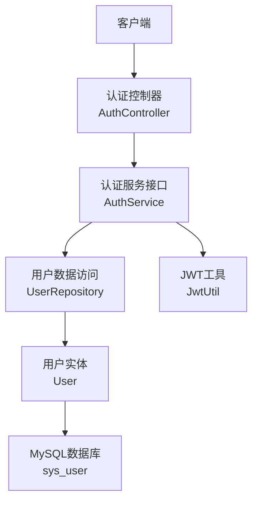
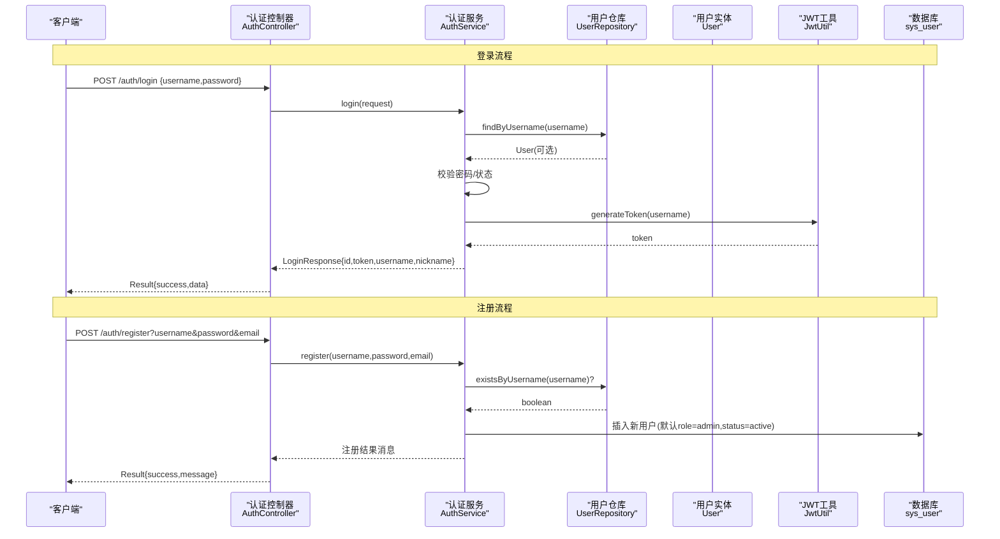
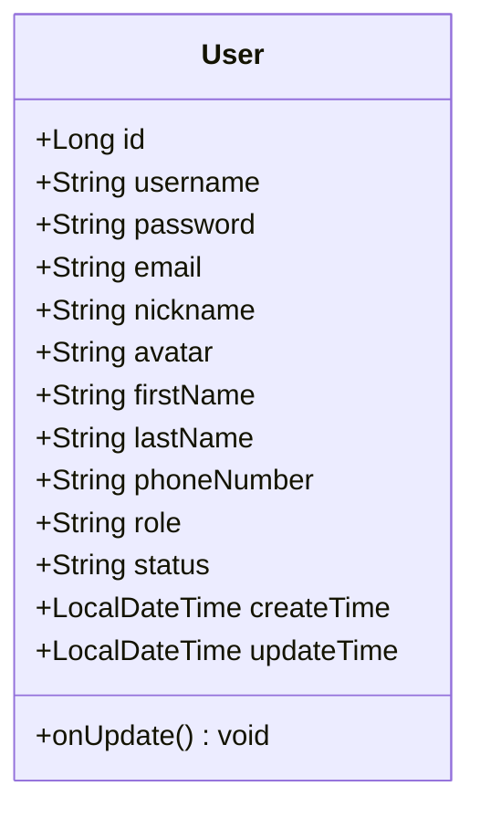
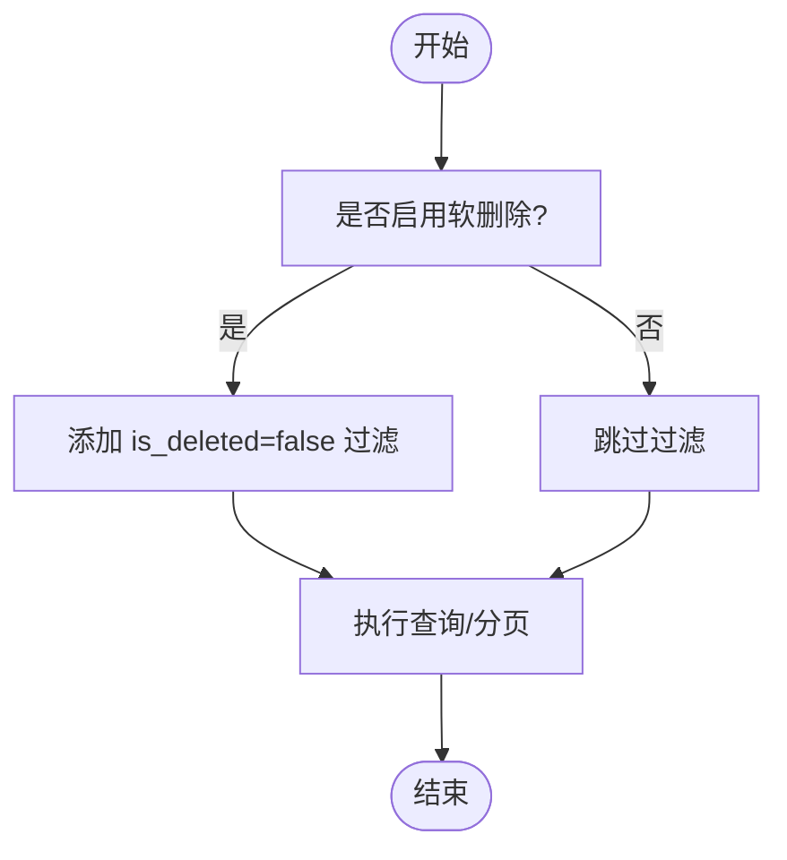
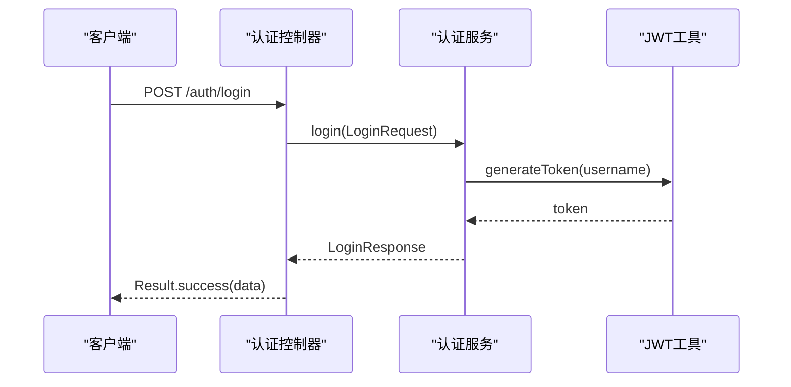
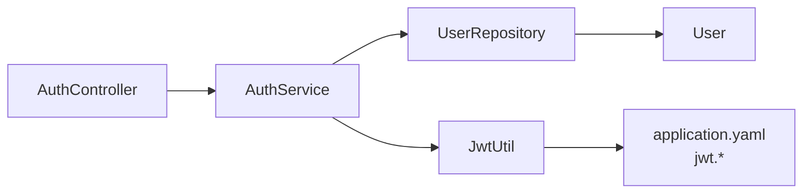

# 用户表(User)设计

<cite>
**本文引用的文件**
- [User.java](file://java_server/po/src/main/java/com/goodzheng/po/entity/User.java)
- [UserRepository.java](file://java_server/po/src/main/java/com/goodzheng/po/repository/UserRepository.java)
- [LoginRequest.java](file://java_server/po/src/main/java/com/goodzheng/po/dto/LoginRequest.java)
- [LoginResponse.java](file://java_server/po/src/main/java/com/goodzheng/po/dto/LoginResponse.java)
- [AuthController.java](file://java_server/po/src/main/java/com/goodzheng/po/controller/AuthController.java)
- [AuthService.java](file://java_server/po/src/main/java/com/goodzheng/po/service/AuthService.java)
- [JwtUtil.java](file://java_server/po/src/main/java/com/goodzheng/po/util/JwtUtil.java)
- [application.yaml](file://java_server/po/src/main/resources/application.yaml)
</cite>

## 目录
1. [简介](#简介)
2. [项目结构](#项目结构)
3. [核心组件](#核心组件)
4. [架构总览](#架构总览)
5. [详细组件分析](#详细组件分析)
6. [依赖关系分析](#依赖关系分析)
7. [性能考虑](#性能考虑)
8. [故障排查指南](#故障排查指南)
9. [结论](#结论)
10. [附录](#附录)

## 简介
本设计文档围绕用户表（sys_user）展开，系统阐述用户信息存储结构、字段定义与约束、权限控制字段设计（角色、状态）、软删除策略建议，以及注册与登录的数据结构与流程。同时提供建表脚本建议、索引优化策略和数据迁移方案，并说明隐私保护与安全考量。

## 项目结构
本项目采用典型的分层架构：控制器层处理HTTP请求，服务层实现业务逻辑，数据访问层通过JPA Repository操作数据库实体，工具类负责JWT令牌生成与校验。配置集中在application.yaml中，包含数据库、JPA、Redis与JWT等关键参数。



图表来源
- [AuthController.java:19-39](file://java_server/po/src/main/java/com/goodzheng/po/controller/AuthController.java#L19-L39)
- [AuthService.java:6-11](file://java_server/po/src/main/java/com/goodzheng/po/service/AuthService.java#L6-L11)
- [UserRepository.java:13-26](file://java_server/po/src/main/java/com/goodzheng/po/repository/UserRepository.java#L13-L26)
- [User.java:8-58](file://java_server/po/src/main/java/com/goodzheng/po/entity/User.java#L8-L58)
- [JwtUtil.java:13-55](file://java_server/po/src/main/java/com/goodzheng/po/util/JwtUtil.java#L13-L55)

章节来源
- [application.yaml:23-41](file://java_server/po/src/main/resources/application.yaml#L23-L41)
- [application.yaml:104-109](file://java_server/po/src/main/resources/application.yaml#L104-L109)

## 核心组件
- 用户实体（User）：定义sys_user表的字段映射、约束与生命周期回调。
- 数据访问（UserRepository）：提供按用户名查询、存在性检查与关键词搜索的分页能力。
- 认证控制器（AuthController）：暴露登录与注册接口，统一返回Result包装。
- 认证服务（AuthService）：封装注册与登录的业务流程（接口定义）。
- JWT工具（JwtUtil）：基于配置的密钥与过期时间生成与校验JWT。

章节来源
- [User.java:8-58](file://java_server/po/src/main/java/com/goodzheng/po/entity/User.java#L8-L58)
- [UserRepository.java:13-26](file://java_server/po/src/main/java/com/goodzheng/po/repository/UserRepository.java#L13-L26)
- [AuthController.java:11-39](file://java_server/po/src/main/java/com/goodzheng/po/controller/AuthController.java#L11-L39)
- [AuthService.java:6-11](file://java_server/po/src/main/java/com/goodzheng/po/service/AuthService.java#L6-L11)
- [JwtUtil.java:13-55](file://java_server/po/src/main/java/com/goodzheng/po/util/JwtUtil.java#L13-L55)

## 架构总览
下图展示从前端到数据库的完整调用链，包括登录与注册两个关键路径。



图表来源
- [AuthController.java:19-39](file://java_server/po/src/main/java/com/goodzheng/po/controller/AuthController.java#L19-L39)
- [AuthService.java:6-11](file://java_server/po/src/main/java/com/goodzheng/po/service/AuthService.java#L6-L11)
- [UserRepository.java:13-26](file://java_server/po/src/main/java/com/goodzheng/po/repository/UserRepository.java#L13-L26)
- [User.java:8-58](file://java_server/po/src/main/java/com/goodzheng/po/entity/User.java#L8-L58)
- [JwtUtil.java:25-33](file://java_server/po/src/main/java/com/goodzheng/po/util/JwtUtil.java#L25-L33)

## 详细组件分析

### 用户实体与表结构设计
- 表名：sys_user
- 主键：id（自增Long）
- 唯一约束：username（不可重复）
- 必填字段：username、password、status
- 可选字段：email、nickname、avatar、firstName、lastName、phoneNumber
- 角色字段：role（默认值“admin”，用于权限控制）
- 状态字段：status（枚举含义：active/inactive/invited/suspended）
- 审计字段：createTime（创建时间，仅插入时设置）、updateTime（更新时间，自动更新）
- 敏感字段：password使用@JsonIgnore避免序列化泄露



图表来源
- [User.java:8-58](file://java_server/po/src/main/java/com/goodzheng/po/entity/User.java#L8-L58)

章节来源
- [User.java:8-58](file://java_server/po/src/main/java/com/goodzheng/po/entity/User.java#L8-L58)

### 数据访问与查询优化
- 按用户名精确查找：findByUsername
- 用户名存在性检查：existsByUsername
- 多字段模糊搜索：searchByKeyword（支持username/email/firstName/lastName），分页返回Page<User>



图表来源
- [UserRepository.java:13-26](file://java_server/po/src/main/java/com/goodzheng/po/repository/UserRepository.java#L13-L26)

章节来源
- [UserRepository.java:13-26](file://java_server/po/src/main/java/com/goodzheng/po/repository/UserRepository.java#L13-L26)

### 认证流程与数据结构
- 登录请求：LoginRequest（username、password，均非空校验）
- 登录响应：LoginResponse（id、token、username、nickname）
- 控制器：/auth/login 接收请求，调用AuthService.login，捕获异常返回401错误
- JWT：JwtUtil根据配置secret与expiration生成token，支持验证与解析



图表来源
- [AuthController.java:19-27](file://java_server/po/src/main/java/com/goodzheng/po/controller/AuthController.java#L19-L27)
- [AuthService.java:6-11](file://java_server/po/src/main/java/com/goodzheng/po/service/AuthService.java#L6-L11)
- [JwtUtil.java:25-33](file://java_server/po/src/main/java/com/goodzheng/po/util/JwtUtil.java#L25-L33)
- [LoginRequest.java:6-14](file://java_server/po/src/main/java/com/goodzheng/po/dto/LoginRequest.java#L6-L14)
- [LoginResponse.java:6-14](file://java_server/po/src/main/java/com/goodzheng/po/dto/LoginResponse.java#L6-L14)

章节来源
- [AuthController.java:19-27](file://java_server/po/src/main/java/com/goodzheng/po/controller/AuthController.java#L19-L27)
- [LoginRequest.java:6-14](file://java_server/po/src/main/java/com/goodzheng/po/dto/LoginRequest.java#L6-L14)
- [LoginResponse.java:6-14](file://java_server/po/src/main/java/com/goodzheng/po/dto/LoginResponse.java#L6-L14)
- [JwtUtil.java:25-33](file://java_server/po/src/main/java/com/goodzheng/po/util/JwtUtil.java#L25-L33)

### 权限控制字段设计
- 角色（role）：当前默认值为“admin”，可用于细粒度权限控制扩展（如RBAC）。建议在后续引入角色表与用户-角色关联表以支持多角色。
- 状态（status）：控制账户生命周期（active/inactive/invited/suspended），登录时可结合状态进行鉴权拦截。
- 软删除：当前未显式实现is_deleted字段；建议在User实体增加布尔或时间戳字段，并在Repository层统一添加过滤条件，确保查询与删除逻辑一致。

章节来源
- [User.java:42-47](file://java_server/po/src/main/java/com/goodzheng/po/entity/User.java#L42-L47)
- [UserRepository.java:13-26](file://java_server/po/src/main/java/com/goodzheng/po/repository/UserRepository.java#L13-L26)

### 注册与登录的数据结构
- 注册：/auth/register 接收username、password、可选email；服务层需校验唯一性与合法性后写入sys_user。
- 登录：/auth/login 接收LoginRequest，校验通过后生成JWT并返回LoginResponse。

章节来源
- [AuthController.java:29-39](file://java_server/po/src/main/java/com/goodzheng/po/controller/AuthController.java#L29-L39)
- [AuthService.java:6-11](file://java_server/po/src/main/java/com/goodzheng/po/service/AuthService.java#L6-L11)
- [LoginRequest.java:6-14](file://java_server/po/src/main/java/com/goodzheng/po/dto/LoginRequest.java#L6-L14)
- [LoginResponse.java:6-14](file://java_server/po/src/main/java/com/goodzheng/po/dto/LoginResponse.java#L6-L14)

## 依赖关系分析
- 控制器依赖服务接口，服务依赖仓库与JWT工具，仓库依赖实体与数据库。
- 配置项jwt.secret与jwt.expiration由application.yaml注入至JwtUtil，影响令牌安全与有效期。



图表来源
- [AuthController.java:11-39](file://java_server/po/src/main/java/com/goodzheng/po/controller/AuthController.java#L11-L39)
- [AuthService.java:6-11](file://java_server/po/src/main/java/com/goodzheng/po/service/AuthService.java#L6-L11)
- [UserRepository.java:13-26](file://java_server/po/src/main/java/com/goodzheng/po/repository/UserRepository.java#L13-L26)
- [JwtUtil.java:13-23](file://java_server/po/src/main/java/com/goodzheng/po/util/JwtUtil.java#L13-L23)
- [application.yaml:104-109](file://java_server/po/src/main/resources/application.yaml#L104-L109)

章节来源
- [application.yaml:104-109](file://java_server/po/src/main/resources/application.yaml#L104-L109)

## 性能考虑
- 索引建议
  - 唯一索引：username（已由unique=true保障）
  - 查询索引：email、firstName、lastName（用于模糊搜索与常见筛选）
  - 复合索引：(status, create_time) 用于分页列表与状态筛选
  - 若启用软删除：在is_deleted上建立索引，并与常用查询组合为复合索引
- 查询优化
  - 模糊搜索尽量使用覆盖索引或前缀匹配，避免全表扫描
  - 分页查询使用Pageable限制返回量
- 连接池与JPA
  - HikariCP最大连接数与超时已在配置中设定，可根据负载调整
  - show-sql在生产环境建议关闭以减少日志开销

章节来源
- [application.yaml:23-41](file://java_server/po/src/main/resources/application.yaml#L23-L41)
- [UserRepository.java:20-25](file://java_server/po/src/main/java/com/goodzheng/po/repository/UserRepository.java#L20-L25)

## 故障排查指南
- 登录失败
  - 检查用户名是否存在、密码是否正确、账户状态是否为active
  - 查看控制器异常捕获返回的错误码（401）
- 注册失败
  - 检查用户名是否重复、邮箱格式是否合法
  - 确认数据库连接与JPA ddl-auto策略
- JWT相关
  - 校验jwt.secret与jwt.expiration配置是否正确
  - 验证token签名与过期时间是否符合预期

章节来源
- [AuthController.java:19-39](file://java_server/po/src/main/java/com/goodzheng/po/controller/AuthController.java#L19-L39)
- [JwtUtil.java:35-55](file://java_server/po/src/main/java/com/goodzheng/po/util/JwtUtil.java#L35-L55)
- [application.yaml:104-109](file://java_server/po/src/main/resources/application.yaml#L104-L109)

## 结论
本设计基于现有代码明确了用户表的核心字段、约束与权限控制字段，提供了注册与登录的数据结构与流程，并结合配置给出JWT安全策略。建议在后续迭代中完善软删除机制、细化角色管理模型，并依据查询模式补充索引以提升性能。

## 附录

### 建表脚本建议（MySQL）
以下为sys_user表的推荐DDL，涵盖字段类型、约束、默认值与索引建议。请根据实际业务需求调整长度与枚举值。

```sql
CREATE TABLE sys_user (
    id BIGINT AUTO_INCREMENT PRIMARY KEY,
    username VARCHAR(50) NOT NULL UNIQUE,
    password VARCHAR(255) NOT NULL,
    email VARCHAR(100),
    nickname VARCHAR(50),
    avatar VARCHAR(255),
    first_name VARCHAR(50),
    last_name VARCHAR(50),
    phone_number VARCHAR(20),
    role VARCHAR(50) DEFAULT 'admin',
    status VARCHAR(20) NOT NULL DEFAULT 'active',
    create_time DATETIME NOT NULL DEFAULT CURRENT_TIMESTAMP,
    update_time DATETIME NOT NULL DEFAULT CURRENT_TIMESTAMP ON UPDATE CURRENT_TIMESTAMP,
    -- 软删除字段（建议）
    is_deleted TINYINT(1) NOT NULL DEFAULT 0,
    deleted_at DATETIME NULL,
    INDEX idx_email (email),
    INDEX idx_first_last (first_name, last_name),
    INDEX idx_status_create (status, create_time),
    INDEX idx_is_deleted (is_deleted)
) ENGINE=InnoDB DEFAULT CHARSET=utf8mb4 COLLATE=utf8mb4_unicode_ci;
```

### 数据迁移方案
- 版本化迁移：使用Flyway或Liquibase管理DDL变更，确保生产环境可回滚与可追踪。
- 增量变更：新增字段（如is_deleted）时，先添加列与默认值，再逐步改造查询与写入逻辑，最后清理历史数据。
- 数据一致性：在迁移过程中对敏感字段（如password）保持只写不读，避免中间态泄露。

### 隐私保护与安全考虑
- 密码安全
  - 存储哈希：建议使用BCrypt或Argon2对密码进行哈希存储，避免明文或弱哈希。
  - 传输加密：全站HTTPS，防止中间人攻击。
- 敏感字段脱敏
  - 对外响应中避免返回password等敏感字段（已通过@JsonIgnore规避）。
- 令牌安全
  - 合理设置JWT过期时间（expiration），定期轮换密钥（secret）。
  - 服务端应校验token有效性，必要时支持黑名单或刷新机制。
- 访问控制
  - 基于role与status进行基础鉴权，后续可扩展RBAC与细粒度授权。
- 审计与合规
  - 记录关键操作日志（注册、登录、修改密码），满足审计要求。
  - 遵循最小权限原则，限制管理员接口访问。