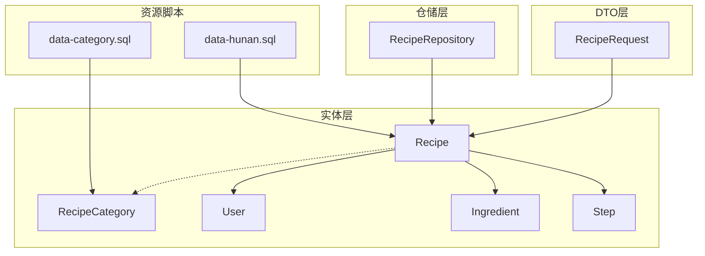
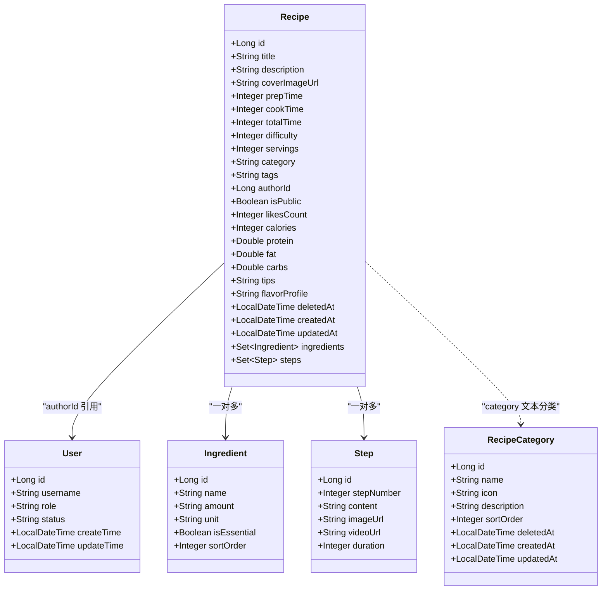
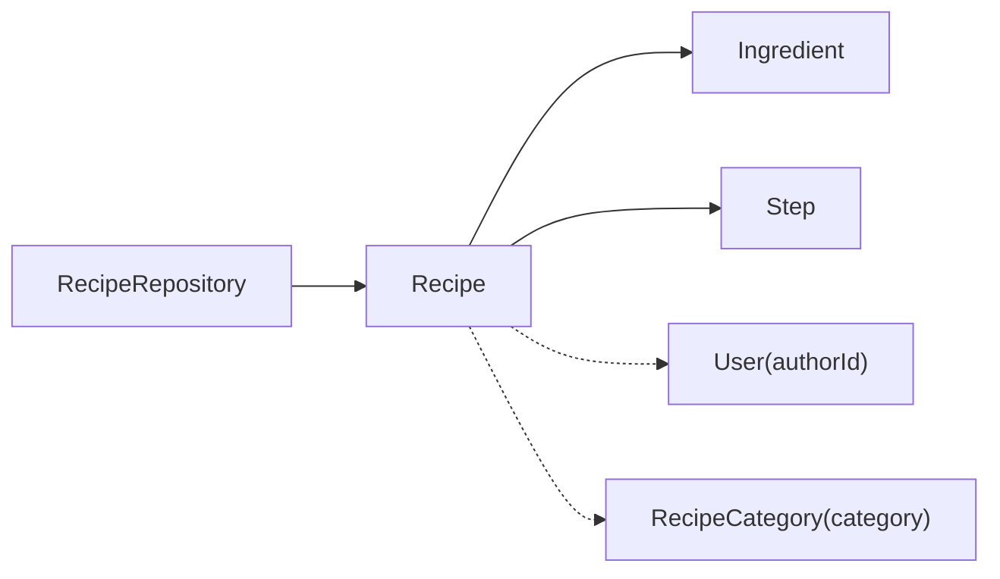

# 菜谱表(Recipe)设计

<cite>
**本文引用的文件**
- [java_server/po/src/main/java/com/goodzheng/po/entity/Recipe.java](file://java_server/po/src/main/java/com/goodzheng/po/entity/Recipe.java)
- [java_server/po/src/main/java/com/goodzheng/po/entity/RecipeCategory.java](file://java_server/po/src/main/java/com/goodzheng/po/entity/RecipeCategory.java)
- [java_server/po/src/main/java/com/goodzheng/po/entity/User.java](file://java_server/po/src/main/java/com/goodzheng/po/entity/User.java)
- [java_server/po/src/main/java/com/goodzheng/po/entity/Ingredient.java](file://java_server/po/src/main/java/com/goodzheng/po/entity/Ingredient.java)
- [java_server/po/src/main/java/com/goodzheng/po/entity/Step.java](file://java_server/po/src/main/java/com/goodzheng/po/entity/Step.java)
- [java_server/po/src/main/java/com/goodzheng/po/dto/RecipeRequest.java](file://java_server/po/src/main/java/com/goodzheng/po/dto/RecipeRequest.java)
- [java_server/po/src/main/java/com/goodzheng/po/repository/RecipeRepository.java](file://java_server/po/src/main/java/com/goodzheng/po/repository/RecipeRepository.java)
- [java_server/po/src/main/resources/data-category.sql](file://java_server/po/src/main/resources/data-category.sql)
- [java_server/po/src/main/resources/data-hunan.sql](file://java_server/po/src/main/resources/data-hunan.sql)
</cite>

## 目录
1. [简介](#简介)
2. [项目结构](#项目结构)
3. [核心组件](#核心组件)
4. [架构总览](#架构总览)
5. [详细组件分析](#详细组件分析)
6. [依赖关系分析](#依赖关系分析)
7. [性能与索引优化](#性能与索引优化)
8. [故障排查指南](#故障排查指南)
9. [结论](#结论)
10. [附录：建表脚本与数据初始化](#附录：建表脚本与数据初始化)

## 简介
本设计文档围绕菜谱（Recipe）数据模型展开，系统阐述字段设计、业务含义、关联关系、软删除机制、时间戳管理、分类与标签体系、作者与统计字段、营养信息存储格式，以及查询与索引优化方案。目标是为后端开发、数据库设计与前端对接提供统一、可落地的规范说明。

## 项目结构
- 实体层（entity）：定义菜谱、分类、用户、食材、步骤等持久化模型。
- DTO层（dto）：定义请求校验与输入契约，如 RecipeRequest。
- 仓储层（repository）：定义基于 JPA 的查询接口与常用分页、过滤方法。
- 资源脚本（resources）：包含分类种子数据与湖南菜样例数据。

图表来源
- [java_server/po/src/main/java/com/goodzheng/po/entity/Recipe.java:10-92](file://java_server/po/src/main/java/com/goodzheng/po/entity/Recipe.java#L10-L92)
- [java_server/po/src/main/java/com/goodzheng/po/entity/RecipeCategory.java:8-45](file://java_server/po/src/main/java/com/goodzheng/po/entity/RecipeCategory.java#L8-L45)
- [java_server/po/src/main/java/com/goodzheng/po/entity/User.java:8-58](file://java_server/po/src/main/java/com/goodzheng/po/entity/User.java#L8-L58)
- [java_server/po/src/main/java/com/goodzheng/po/entity/Ingredient.java:9-41](file://java_server/po/src/main/java/com/goodzheng/po/entity/Ingredient.java#L9-L41)
- [java_server/po/src/main/java/com/goodzheng/po/entity/Step.java:9-39](file://java_server/po/src/main/java/com/goodzheng/po/entity/Step.java#L9-L39)
- [java_server/po/src/main/java/com/goodzheng/po/dto/RecipeRequest.java:10-65](file://java_server/po/src/main/java/com/goodzheng/po/dto/RecipeRequest.java#L10-L65)
- [java_server/po/src/main/java/com/goodzheng/po/repository/RecipeRepository.java:13-35](file://java_server/po/src/main/java/com/goodzheng/po/repository/RecipeRepository.java#L13-L35)
- [java_server/po/src/main/resources/data-category.sql:1-39](file://java_server/po/src/main/resources/data-category.sql#L1-L39)
- [java_server/po/src/main/resources/data-hunan.sql:1-204](file://java_server/po/src/main/resources/data-hunan.sql#L1-L204)

章节来源
- [java_server/po/src/main/java/com/goodzheng/po/entity/Recipe.java:10-92](file://java_server/po/src/main/java/com/goodzheng/po/entity/Recipe.java#L10-L92)
- [java_server/po/src/main/java/com/goodzheng/po/dto/RecipeRequest.java:10-65](file://java_server/po/src/main/java/com/goodzheng/po/dto/RecipeRequest.java#L10-L65)
- [java_server/po/src/main/java/com/goodzheng/po/repository/RecipeRepository.java:13-35](file://java_server/po/src/main/java/com/goodzheng/po/repository/RecipeRepository.java#L13-L35)

## 核心组件
- 菜谱实体（Recipe）：承载菜谱基本信息、时间与难度、分类与标签、作者与统计、扩展字段、软删除与时间戳，以及与食材、步骤的一对多关系。
- 分类实体（RecipeCategory）：用于功能分类、菜系分类、饮食方式等维度，支持排序与图标描述。
- 用户实体（User）：作为作者主体，提供用户名、角色、状态等基础信息。
- 食材实体（Ingredient）：记录每道菜谱的食材清单、用量单位、是否必需与排序。
- 步骤实体（Step）：记录制作步骤、图文视频链接、单步耗时等。
- 请求DTO（RecipeRequest）：统一接收创建/更新参数，内置校验规则，并嵌套食材与步骤项。
- 仓储接口（RecipeRepository）：提供按作者、分类、关键字搜索的分页查询，以及预加载详情查询。

章节来源
- [java_server/po/src/main/java/com/goodzheng/po/entity/Recipe.java:10-92](file://java_server/po/src/main/java/com/goodzheng/po/entity/Recipe.java#L10-L92)
- [java_server/po/src/main/java/com/goodzheng/po/entity/RecipeCategory.java:8-45](file://java_server/po/src/main/java/com/goodzheng/po/entity/RecipeCategory.java#L8-L45)
- [java_server/po/src/main/java/com/goodzheng/po/entity/User.java:8-58](file://java_server/po/src/main/java/com/goodzheng/po/entity/User.java#L8-L58)
- [java_server/po/src/main/java/com/goodzheng/po/entity/Ingredient.java:9-41](file://java_server/po/src/main/java/com/goodzheng/po/entity/Ingredient.java#L9-L41)
- [java_server/po/src/main/java/com/goodzheng/po/entity/Step.java:9-39](file://java_server/po/src/main/java/com/goodzheng/po/entity/Step.java#L9-L39)
- [java_server/po/src/main/java/com/goodzheng/po/dto/RecipeRequest.java:10-65](file://java_server/po/src/main/java/com/goodzheng/po/dto/RecipeRequest.java#L10-L65)
- [java_server/po/src/main/java/com/goodzheng/po/repository/RecipeRepository.java:13-35](file://java_server/po/src/main/java/com/goodzheng/po/repository/RecipeRepository.java#L13-L35)

## 架构总览
下图展示菜谱领域核心实体之间的关系与职责边界：

图表来源
- [java_server/po/src/main/java/com/goodzheng/po/entity/Recipe.java:10-92](file://java_server/po/src/main/java/com/goodzheng/po/entity/Recipe.java#L10-L92)
- [java_server/po/src/main/java/com/goodzheng/po/entity/Ingredient.java:9-41](file://java_server/po/src/main/java/com/goodzheng/po/entity/Ingredient.java#L9-L41)
- [java_server/po/src/main/java/com/goodzheng/po/entity/Step.java:9-39](file://java_server/po/src/main/java/com/goodzheng/po/entity/Step.java#L9-L39)
- [java_server/po/src/main/java/com/goodzheng/po/entity/User.java:8-58](file://java_server/po/src/main/java/com/goodzheng/po/entity/User.java#L8-L58)
- [java_server/po/src/main/java/com/goodzheng/po/entity/RecipeCategory.java:8-45](file://java_server/po/src/main/java/com/goodzheng/po/entity/RecipeCategory.java#L8-L45)

## 详细组件分析

### 基本信息字段
- 标题（title）：必填，长度限制，用于列表展示与检索。
- 描述（description）：可选，用于简要介绍菜品特点或背景。
- 封面图片（coverImageUrl）：可选，指向图片资源的URL。

章节来源
- [java_server/po/src/main/java/com/goodzheng/po/entity/Recipe.java:19-26](file://java_server/po/src/main/java/com/goodzheng/po/entity/Recipe.java#L19-L26)

### 时间相关字段（准备时间、烹饪时间、总时间）
- 准备时间（prepTime）：单位为分钟，表示切配、腌制等前置操作所需时长。
- 烹饪时间（cookTime）：单位为分钟，表示加热、炖煮、煎炒等主烹饪过程时长。
- 总时间（totalTime）：单位为分钟，通常等于或略大于 prepTime + cookTime，用于前端展示“预计耗时”。
- 使用场景：
  - 筛选“快手菜”：通过 totalTime 阈值过滤。
  - 步骤级时长聚合：Step.duration 累加可作为细粒度参考，与 total_time 形成互补。

章节来源
- [java_server/po/src/main/java/com/goodzheng/po/entity/Recipe.java:28-31](file://java_server/po/src/main/java/com/goodzheng/po/entity/Recipe.java#L28-L31)
- [java_server/po/src/main/java/com/goodzheng/po/entity/Step.java:37-38](file://java_server/po/src/main/java/com/goodzheng/po/entity/Step.java#L37-L38)

### 难度等级与建议食用人数
- 难度（difficulty）：枚举式整数，约定为 1-简单、2-中等、3-困难；默认值为 1。
- 建议食用人数（servings）：正整数，用于份量规划与配料比例换算。
- 设计思路：以轻量枚举值降低复杂度，便于前端渲染与筛选；如需更复杂语义可扩展字典表。

章节来源
- [java_server/po/src/main/java/com/goodzheng/po/entity/Recipe.java:33-38](file://java_server/po/src/main/java/com/goodzheng/po/entity/Recipe.java#L33-L38)
- [java_server/po/src/main/java/com/goodzheng/po/dto/RecipeRequest.java:23-26](file://java_server/po/src/main/java/com/goodzheng/po/dto/RecipeRequest.java#L23-L26)

### 分类与标签系统
- 分类（category）：采用字符串字段存储单一分类名，便于快速筛选与展示；同时存在独立的 RecipeCategory 表用于维护分类元数据（名称、图标、描述、排序）。
- 标签（tags）：采用逗号分隔字符串存储多个标签，如“下饭,低脂,快手菜”，适合轻量标注与模糊检索。
- 种子数据：data-category.sql 提供了功能分类、菜系分类、饮食方式的初始数据，便于系统上线即有可用分类。

章节来源
- [java_server/po/src/main/java/com/goodzheng/po/entity/Recipe.java:40-46](file://java_server/po/src/main/java/com/goodzheng/po/entity/Recipe.java#L40-L46)
- [java_server/po/src/main/java/com/goodzheng/po/entity/RecipeCategory.java:17-31](file://java_server/po/src/main/java/com/goodzheng/po/entity/RecipeCategory.java#L17-L31)
- [java_server/po/src/main/resources/data-category.sql:6-38](file://java_server/po/src/main/resources/data-category.sql#L6-L38)

### 作者关联、公开状态与点赞数
- 作者（authorId）：非空，引用用户表主键，标识菜谱创作者。
- 公开状态（isPublic）：布尔型，默认公开，控制前台可见性。
- 点赞数（likesCount）：整型计数，默认 0，用于热度展示与排序。

章节来源
- [java_server/po/src/main/java/com/goodzheng/po/entity/Recipe.java:48-56](file://java_server/po/src/main/java/com/goodzheng/po/entity/Recipe.java#L48-L56)
- [java_server/po/src/main/java/com/goodzheng/po/entity/User.java:17-47](file://java_server/po/src/main/java/com/goodzheng/po/entity/User.java#L17-L47)

### 营养信息字段存储格式
- 卡路里（calories）：整型，单位通常为千卡（kcal）。
- 蛋白质（protein）、脂肪（fat）、碳水化合物（carbs）：浮点型，单位通常为克（g）。
- 设计考量：以数值形式存储，便于营养计算与筛选；如需更精确可引入单位字段或扩展 JSON 结构。

章节来源
- [java_server/po/src/main/java/com/goodzheng/po/entity/Recipe.java:58-62](file://java_server/po/src/main/java/com/goodzheng/po/entity/Recipe.java#L58-L62)

### 软删除机制与时间戳管理
- 软删除（deletedAt）：非空时视为已删除，查询需排除该条件。
- 创建时间（createdAt）：插入时自动填充，不可更新。
- 更新时间（updatedAt）：每次更新自动刷新，通过生命周期回调实现。
- 查询约束：仓储层所有分页与过滤查询均要求 deletedAt 为空，保证逻辑删除一致性。

章节来源
- [java_server/po/src/main/java/com/goodzheng/po/entity/Recipe.java:70-82](file://java_server/po/src/main/java/com/goodzheng/po/entity/Recipe.java#L70-L82)
- [java_server/po/src/main/java/com/goodzheng/po/repository/RecipeRepository.java:20-34](file://java_server/po/src/main/java/com/goodzheng/po/repository/RecipeRepository.java#L20-L34)

### 关联实体：食材与步骤
- 食材（Ingredient）：记录名称、用量、单位、是否必需、排序；与 Recipe 为一对多关系。
- 步骤（Step）：记录步骤序号、内容、图片/视频链接、单步耗时；与 Recipe 为一对多关系。
- 设计要点：通过外键 recipe_id 建立关联；排序字段保障展示顺序稳定。

章节来源
- [java_server/po/src/main/java/com/goodzheng/po/entity/Ingredient.java:18-40](file://java_server/po/src/main/java/com/goodzheng/po/entity/Ingredient.java#L18-L40)
- [java_server/po/src/main/java/com/goodzheng/po/entity/Step.java:18-38](file://java_server/po/src/main/java/com/goodzheng/po/entity/Step.java#L18-L38)

### 请求DTO与校验
- RecipeRequest 统一封装创建/更新参数，包含标题、描述、封面、时间、难度、人数、分类、标签、公开状态、营养信息、提示、风味特征，以及嵌套的食材与步骤列表。
- 校验规则：标题必填、难度必填、食材名称必填、步骤序号与内容必填等，确保入库数据质量。

章节来源
- [java_server/po/src/main/java/com/goodzheng/po/dto/RecipeRequest.java:10-65](file://java_server/po/src/main/java/com/goodzheng/po/dto/RecipeRequest.java#L10-L65)

## 依赖关系分析
- Recipe 与 Ingredient、Step 为强关联的一对多关系，JPA 配置了级联保存与删除，便于整体事务管理。
- Recipe 与 User 通过 authorId 进行弱关联（无外键注解），在应用层保证一致性。
- Recipe 与 RecipeCategory 通过 category 文本字段进行弱关联，配合分类表进行元数据管理。
- Repository 提供多种查询方法，覆盖按作者、分类、关键字搜索与分页，且强制过滤已删除数据。

图表来源
- [java_server/po/src/main/java/com/goodzheng/po/repository/RecipeRepository.java:13-35](file://java_server/po/src/main/java/com/goodzheng/po/repository/RecipeRepository.java#L13-L35)
- [java_server/po/src/main/java/com/goodzheng/po/entity/Recipe.java:84-91](file://java_server/po/src/main/java/com/goodzheng/po/entity/Recipe.java#L84-L91)

章节来源
- [java_server/po/src/main/java/com/goodzheng/po/entity/Recipe.java:84-91](file://java_server/po/src/main/java/com/goodzheng/po/entity/Recipe.java#L84-L91)
- [java_server/po/src/main/java/com/goodzheng/po/repository/RecipeRepository.java:13-35](file://java_server/po/src/main/java/com/goodzheng/po/repository/RecipeRepository.java#L13-L35)

## 性能与索引优化
- 推荐索引
  - 复合索引 (author_id, deleted_at)：加速“按作者查询未删除菜谱”的分页。
  - 复合索引 (category, deleted_at)：加速“按分类查询未删除菜谱”的分页。
  - 全文或前缀索引 on (title, description)：加速“关键字搜索”（根据数据库能力选择 FULLTEXT 或 LIKE 前缀优化）。
  - 普通索引 on (deleted_at)：便于全局过滤已删除数据。
  - 普通索引 on (is_public)：若频繁按公开状态过滤，可考虑添加。
  - 普通索引 on (total_time)：便于“按总时长筛选”的场景。
- 查询优化
  - 使用 findByIdWithDetails 的 JOIN FETCH 预加载 ingredients 与 steps，避免 N+1 问题。
  - 分页查询统一附加 deleted_at IS NULL 条件，减少无效数据扫描。
- 写入优化
  - 批量插入食材与步骤，减少事务次数。
  - 合理设置字符集与排序规则，避免隐式转换导致索引失效。

章节来源
- [java_server/po/src/main/java/com/goodzheng/po/repository/RecipeRepository.java:16-34](file://java_server/po/src/main/java/com/goodzheng/po/repository/RecipeRepository.java#L16-L34)

## 故障排查指南
- 懒加载异常（LazyInitializationException）
  - 现象：获取 Recipe 详情后访问 ingredients/steps 抛出异常。
  - 解决：使用 findByIdWithDetails 预加载集合，或在 Service 层显式初始化。
- 软删除数据污染
  - 现象：查询结果包含已删除菜谱。
  - 解决：确认所有查询均附加 deleted_at IS NULL 条件；检查自定义 SQL 是否遗漏。
- 标签与分类检索不准确
  - 现象：tags/category 模糊匹配效果差。
  - 解决：为 title/description 添加合适索引；必要时引入分词或全文索引；标签规范化（去空格、统一分隔符）。
- 时间字段不一致
  - 现象：updated_at 未更新或 createdAt 被修改。
  - 解决：确认使用了 @PreUpdate 回调；确保不直接覆盖 createdAt。

章节来源
- [java_server/po/src/main/java/com/goodzheng/po/repository/RecipeRepository.java:16-34](file://java_server/po/src/main/java/com/goodzheng/po/repository/RecipeRepository.java#L16-L34)
- [java_server/po/src/main/java/com/goodzheng/po/entity/Recipe.java:74-82](file://java_server/po/src/main/java/com/goodzheng/po/entity/Recipe.java#L74-L82)

## 结论
本设计以简洁实用的方式实现了菜谱的核心数据模型：通过基本字段、时间/难度/人数等配置字段、分类与标签体系、作者与统计字段、营养信息存储、软删除与时间戳管理，满足常见菜谱业务的增删改查与展示需求。结合合理的索引策略与预加载查询，可在保证数据一致性的同时获得良好的性能表现。后续可按需扩展分类表关联、标签规范化、评分与收藏等高级功能。

## 附录：建表脚本与数据初始化
以下为基于现有实体与种子数据的建表与初始化建议（概念性说明，具体语法依所用数据库而定）：

- 表：recipe
  - 主键：id（自增）
  - 字段：title、description、cover_image_url、prep_time、cook_time、total_time、difficulty、servings、category、tags、author_id、is_public、likes_count、calories、protein、fat、carbs、tips、flavor_profile、deleted_at、created_at、updated_at
  - 索引建议：
    - 复合索引 (author_id, deleted_at)
    - 复合索引 (category, deleted_at)
    - 全文或前缀索引 on (title, description)
    - 普通索引 on (deleted_at)、(is_public)、(total_time)

- 表：recipe_category
  - 主键：id（自增）
  - 字段：name（唯一）、icon、description、sort_order、deleted_at、created_at、updated_at
  - 索引建议：唯一索引 on name

- 表：sys_user
  - 主键：id（自增）
  - 字段：username（唯一）、password、email、nickname、avatar、first_name、last_name、phone_number、role、status、create_time、update_time
  - 索引建议：唯一索引 on username

- 表：recipe_ingredient
  - 主键：id（自增）
  - 字段：recipe_id（外键）、name、amount、unit、is_essential、sort_order
  - 索引建议：普通索引 on recipe_id

- 表：recipe_step
  - 主键：id（自增）
  - 字段：recipe_id（外键）、step_number、content、image_url、video_url、duration
  - 索引建议：普通索引 on recipe_id

- 数据初始化
  - 分类种子：data-category.sql 提供功能分类、菜系分类、饮食方式的初始数据。
  - 样例数据：data-hunan.sql 提供湖南菜样例，包含菜谱、食材与步骤的完整插入语句。

章节来源
- [java_server/po/src/main/resources/data-category.sql:1-39](file://java_server/po/src/main/resources/data-category.sql#L1-L39)
- [java_server/po/src/main/resources/data-hunan.sql:1-204](file://java_server/po/src/main/resources/data-hunan.sql#L1-L204)