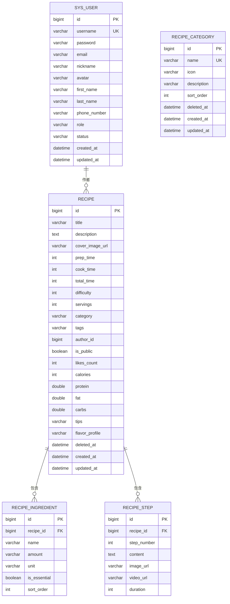
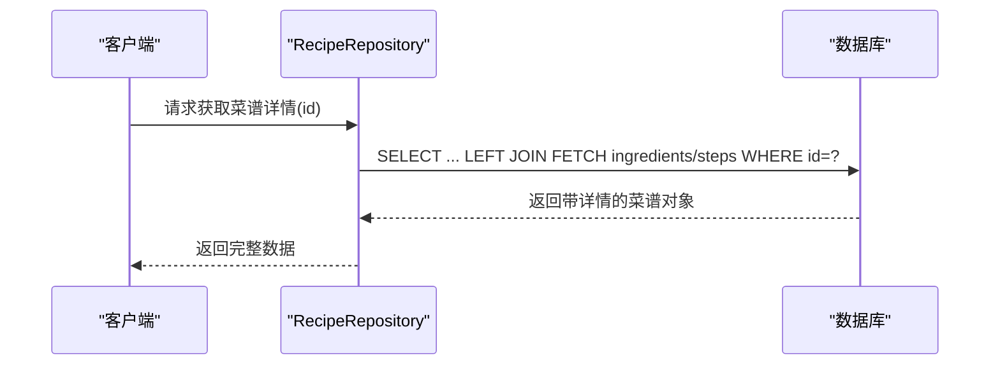

# 表结构详解

<cite>
**本文引用的文件**
- [User.java](file://java_server/po/src/main/java/com/goodzheng/po/entity/User.java)
- [Recipe.java](file://java_server/po/src/main/java/com/goodzheng/po/entity/Recipe.java)
- [Ingredient.java](file://java_server/po/src/main/java/com/goodzheng/po/entity/Ingredient.java)
- [Step.java](file://java_server/po/src/main/java/com/goodzheng/po/entity/Step.java)
- [RecipeCategory.java](file://java_server/po/src/main/java/com/goodzheng/po/entity/RecipeCategory.java)
- [UserRepository.java](file://java_server/po/src/main/java/com/goodzheng/po/repository/UserRepository.java)
- [RecipeRepository.java](file://java_server/po/src/main/java/com/goodzheng/po/repository/RecipeRepository.java)
- [RecipeCategoryRepository.java](file://java_server/po/src/main/java/com/goodzheng/po/repository/RecipeCategoryRepository.java)
- [data-category.sql](file://java_server/po/src/main/resources/data-category.sql)
- [data-hunan.sql](file://java_server/po/src/main/resources/data-hunan.sql)
</cite>

## 目录
1. [简介](#简介)
2. [项目结构与数据模型概览](#项目结构与数据模型概览)
3. [核心表详细设计](#核心表详细设计)
4. [架构与关系总览](#架构与关系总览)
5. [依赖与查询优化](#依赖与查询优化)
6. [性能与索引建议](#性能与索引建议)
7. [故障排查指南](#故障排查指南)
8. [结论](#结论)
9. [附录：建表脚本与字段注释](#附录：建表脚本与字段注释)

## 简介
本文件面向数据库设计与后端实体映射，系统化阐述用户、菜谱、食材、步骤、分类等核心表的字段定义、数据类型、约束条件与业务含义；说明关联关系、验证规则、默认值设置与索引优化策略；并提供可直接执行的建表脚本与字段注释，便于快速落地与运维。

## 项目结构与数据模型概览
- 实体层（JPA）定义了五张核心表：sys_user、recipe、recipe_ingredient、recipe_step、recipe_category。
- 资源脚本提供了分类种子数据与湖南菜样例数据，体现了分类的扁平化组织方式以及菜谱、食材、步骤的数据形态。
- Repository 层暴露了常用查询方法，体现分页、软删除过滤、关键字搜索、预加载等访问模式。

```mermaid
graph TB
subgraph "用户域"
U["表: sys_user<br/>实体: User"]
end
subgraph "菜谱域"
R["表: recipe<br/>实体: Recipe"]
I["表: recipe_ingredient<br/>实体: Ingredient"]
S["表: recipe_step<br/>实体: Step"]
C["表: recipe_category<br/>实体: RecipeCategory"]
end
R --> I
R --> S
R -.->|category(文本)| C
U -.->|authorId(外键语义)| R
```

图表来源
- [User.java:10-57](file://java_server/po/src/main/java/com/goodzheng/po/entity/User.java#L10-L57)
- [Recipe.java:12-91](file://java_server/po/src/main/java/com/goodzheng/po/entity/Recipe.java#L12-L91)
- [Ingredient.java:11-40](file://java_server/po/src/main/java/com/goodzheng/po/entity/Ingredient.java#L11-L40)
- [Step.java:11-39](file://java_server/po/src/main/java/com/goodzheng/po/entity/Step.java#L11-L39)
- [RecipeCategory.java:10-44](file://java_server/po/src/main/java/com/goodzheng/po/entity/RecipeCategory.java#L10-L44)

章节来源
- [User.java:10-57](file://java_server/po/src/main/java/com/goodzheng/po/entity/User.java#L10-L57)
- [Recipe.java:12-91](file://java_server/po/src/main/java/com/goodzheng/po/entity/Recipe.java#L12-L91)
- [Ingredient.java:11-40](file://java_server/po/src/main/java/com/goodzheng/po/entity/Ingredient.java#L11-L40)
- [Step.java:11-39](file://java_server/po/src/main/java/com/goodzheng/po/entity/Step.java#L11-L39)
- [RecipeCategory.java:10-44](file://java_server/po/src/main/java/com/goodzheng/po/entity/RecipeCategory.java#L10-L44)

## 核心表详细设计

### 用户表 sys_user
- 主键：id（自增）
- 用户名 username：非空、唯一、长度50
- 密码 password：非空（序列化忽略）
- 邮箱 email：长度100
- 昵称 nickname：长度50
- 头像 avatar：长度255
- 名 firstName / 姓 lastName：长度各50
- 手机号 phoneNumber：长度20
- 角色 role：默认 admin
- 状态 status：枚举型字符串，默认 active，取值范围 active/inactive/invited/suspended
- 创建时间 createTime：不可更新，默认当前时间
- 更新时间 updateTime：自动更新

业务含义
- 用于系统登录鉴权与权限控制（role/status）。
- 支持基础个人信息展示与维护。

验证与约束
- username 唯一且必填。
- password 必填但不在响应中返回。
- status 限定为固定集合，建议在应用层校验。

索引建议
- 对 username 建立唯一索引（由 unique 注解保证）。
- 可按需对 email、phoneNumber 建立普通索引以支持查询。

章节来源
- [User.java:10-57](file://java_server/po/src/main/java/com/goodzheng/po/entity/User.java#L10-L57)
- [UserRepository.java:13-26](file://java_server/po/src/main/java/com/goodzheng/po/repository/UserRepository.java#L13-L26)

### 菜谱表 recipe
- 主键：id（自增）
- 标题 title：非空、长度100
- 描述 description：长度500
- 封面图 coverImageUrl：长度500
- 准备时间 prepTime / 烹饪时间 cookTime / 总时长 totalTime：整数分钟
- 难度 difficulty：非空，默认1，取值 1-简单、2-中等、3-困难
- 建议食用人数 servings：整数
- 分类 category：长度50（文本），与分类表名称对应但不强制外键
- 标签 tags：逗号分隔字符串，如“下饭,低脂,快手菜”，长度500
- 作者 authorId：非空，引用用户 id
- 公开 isPublic：非空，默认 true
- 点赞数 likesCount：默认0
- 营养信息：calories（整数）、protein/fat/carbs（浮点）
- 小贴士 tips：长度500
- 风味 profile flavorProfile：长度100
- 软删除 deletedAt：时间戳
- 创建/更新时间 createdAt/updatedAt：自动维护

业务含义
- 承载菜谱的核心元数据、可见性、统计与营养信息。
- 通过 category 字段进行归类，便于前端筛选与展示。

验证与约束
- title/difficulty/authorId/isPublic 必填。
- 难度限制在 1~3 范围内，建议在应用层校验。
- 营养字段可空，按需提供。

索引建议
- 对 authorId、deletedAt、category、title/description 建立复合或单列索引以提升列表与搜索性能。
- 对 likesCount 可用于排序场景。

章节来源
- [Recipe.java:12-91](file://java_server/po/src/main/java/com/goodzheng/po/entity/Recipe.java#L12-L91)
- [RecipeRepository.java:14-35](file://java_server/po/src/main/java/com/goodzheng/po/repository/RecipeRepository.java#L14-L35)

### 食材表 recipe_ingredient
- 主键：id（自增）
- 所属菜谱 recipe_id：非空，多对一关联 recipe
- 名称 name：非空、长度100
- 用量 amount：长度50
- 单位 unit：长度20
- 是否必需 isEssential：非空，默认 true
- 排序 sortOrder：非空，默认0

业务含义
- 记录每道菜谱所需的食材明细，支持主料/辅料区分与顺序展示。

验证与约束
- name、isEssential、sortOrder 必填。
- amount/unit 灵活表达不同计量单位。

索引建议
- 对 recipe_id 建立索引以加速按菜谱查询食材。
- 可按需对 isEssential 建立索引以支持筛选。

章节来源
- [Ingredient.java:11-40](file://java_server/po/src/main/java/com/goodzheng/po/entity/Ingredient.java#L11-L40)

### 步骤表 recipe_step
- 主键：id（自增）
- 所属菜谱 recipe_id：非空，多对一关联 recipe
- 步骤序号 stepNumber：非空
- 内容 content：TEXT 类型
- 图片链接 imageUrl：长度500
- 视频链接 videoUrl：长度500
- 耗时 duration：分钟

业务含义
- 描述制作流程，支持图文/视频与分步时长，便于教学式展示。

验证与约束
- stepNumber/content 必填。
- 建议 stepNumber 在同一菜谱内唯一。

索引建议
- 对 recipe_id、stepNumber 建立联合索引以保证顺序读取效率。

章节来源
- [Step.java:11-39](file://java_server/po/src/main/java/com/goodzheng/po/entity/Step.java#L11-L39)

### 分类表 recipe_category
- 主键：id（自增）
- 名称 name：非空、唯一、长度50
- 图标 icon：长度100
- 描述 description：长度200
- 排序权重 sortOrder：非空，默认0
- 软删除 deletedAt：时间戳
- 创建/更新时间 createdAt/updatedAt：自动维护

业务含义
- 提供菜谱的分类维度，当前实现为扁平化分类（无父子层级字段），通过名称与排序控制展示顺序。
- 种子数据包含功能分类、菜系分类、饮食方式三类用途。

验证与约束
- name 唯一且必填。
- 建议对 name 建立唯一索引。

索引建议
- 对 sortOrder 建立索引以支持有序列表。
- 若后续引入层级，可增加 parent_id 并建立索引。

章节来源
- [RecipeCategory.java:10-44](file://java_server/po/src/main/java/com/goodzheng/po/entity/RecipeCategory.java#L10-L44)
- [data-category.sql:7-38](file://java_server/po/src/main/resources/data-category.sql#L7-L38)

## 架构与关系总览
- 一对多关系：一个菜谱拥有多个食材与多个步骤。
- 多对一关系：食材与步骤均通过 recipe_id 指向菜谱。
- 分类关系：菜谱通过 category 文本字段与分类名称对齐，未使用强外键约束，便于扩展与迁移。
- 用户关系：菜谱通过 authorId 关联用户，用于作者归属与权限控制。



图表来源
- [User.java:10-57](file://java_server/po/src/main/java/com/goodzheng/po/entity/User.java#L10-L57)
- [Recipe.java:12-91](file://java_server/po/src/main/java/com/goodzheng/po/entity/Recipe.java#L12-L91)
- [Ingredient.java:11-40](file://java_server/po/src/main/java/com/goodzheng/po/entity/Ingredient.java#L11-L40)
- [Step.java:11-39](file://java_server/po/src/main/java/com/goodzheng/po/entity/Step.java#L11-L39)
- [RecipeCategory.java:10-44](file://java_server/po/src/main/java/com/goodzheng/po/entity/RecipeCategory.java#L10-L44)

## 依赖与查询优化
- 预加载：通过 JOIN FETCH 一次性加载菜谱及其食材、步骤，避免懒加载异常。
- 分页：所有列表接口采用 Pageable 分页，减少内存占用。
- 软删除：统一通过 deletedAt 过滤已删除数据。
- 搜索：支持按标题/描述模糊匹配，结合关键词检索提升体验。



图表来源
- [RecipeRepository.java:16-18](file://java_server/po/src/main/java/com/goodzheng/po/repository/RecipeRepository.java#L16-L18)

章节来源
- [RecipeRepository.java:14-35](file://java_server/po/src/main/java/com/goodzheng/po/repository/RecipeRepository.java#L14-L35)

## 性能与索引建议
- 用户表
  - 唯一索引：username（已具备）
  - 可选索引：email、phone_number（若频繁查询）
- 菜谱表
  - 复合索引：(author_id, deleted_at) 用于作者列表与软删除过滤
  - 复合索引：(category, deleted_at) 用于分类列表
  - 全文/前缀索引：title、description（根据数据库能力选择）
  - 排序索引：likes_count（如需热门排序）
- 食材表
  - 索引：recipe_id（必建）
  - 可选：is_essential（用于筛选必需食材）
- 步骤表
  - 联合索引：(recipe_id, step_number) 保证顺序读取
- 分类表
  - 唯一索引：name（已具备）
  - 索引：sort_order（用于排序）

注意
- 对于 tags 的逗号分隔存储，不建议直接作为查询条件；如需高性能标签检索，建议拆分为独立关联表。
- 大字段 content（TEXT）不宜放入高频查询的 SELECT 列表，按需加载。

[本节为通用性能建议，不直接分析具体文件]

## 故障排查指南
- LazyInitializationException
  - 现象：访问 ingredients/steps 时出现懒加载异常
  - 解决：使用预加载查询（JOIN FETCH）或在事务内访问
- 软删除导致数据不可见
  - 现象：列表查询不到已删除数据
  - 解决：确认查询条件包含 deletedAt IS NULL
- 分类不一致
  - 现象：菜谱 category 与分类表 name 不一致
  - 解决：在写入时校验分类是否存在，或引入外键约束

章节来源
- [RecipeRepository.java:16-18](file://java_server/po/src/main/java/com/goodzheng/po/repository/RecipeRepository.java#L16-L18)
- [RecipeRepository.java:20-34](file://java_server/po/src/main/java/com/goodzheng/po/repository/RecipeRepository.java#L20-L34)

## 结论
该数据模型围绕“用户-菜谱-食材-步骤-分类”构建了清晰的领域边界，采用 JPA 实体映射与 Repository 查询抽象，具备良好的可扩展性与可维护性。通过合理的默认值、约束与索引策略，能够支撑常见的 CRUD、分页、搜索与详情展示场景。后续可考虑引入更严格的分类层级与标签规范化，进一步提升数据一致性与查询性能。

[本节为总结性内容，不直接分析具体文件]

## 附录：建表脚本与字段注释
以下为基于实体与种子数据的参考建表脚本与字段注释，可直接用于初始化数据库。

- 用户表 sys_user
  - 字段与约束来源于实体注解与业务需求。
  - 建议索引：username 唯一索引。

- 菜谱表 recipe
  - 字段涵盖标题、描述、封面、时间、难度、人数、分类、标签、作者、可见性、统计、营养、提示、风味、软删除与时间戳。
  - 建议索引：author_id、category、deleted_at、title/description。

- 食材表 recipe_ingredient
  - 字段包括名称、用量、单位、是否必需、排序。
  - 建议索引：recipe_id。

- 步骤表 recipe_step
  - 字段包括步骤号、内容、图片、视频、耗时。
  - 建议索引：(recipe_id, step_number)。

- 分类表 recipe_category
  - 字段包括名称、图标、描述、排序、软删除与时间戳。
  - 建议索引：name 唯一索引、sort_order。

章节来源
- [User.java:10-57](file://java_server/po/src/main/java/com/goodzheng/po/entity/User.java#L10-L57)
- [Recipe.java:12-91](file://java_server/po/src/main/java/com/goodzheng/po/entity/Recipe.java#L12-L91)
- [Ingredient.java:11-40](file://java_server/po/src/main/java/com/goodzheng/po/entity/Ingredient.java#L11-L40)
- [Step.java:11-39](file://java_server/po/src/main/java/com/goodzheng/po/entity/Step.java#L11-L39)
- [RecipeCategory.java:10-44](file://java_server/po/src/main/java/com/goodzheng/po/entity/RecipeCategory.java#L10-L44)
- [data-category.sql:7-38](file://java_server/po/src/main/resources/data-category.sql#L7-L38)
- [data-hunan.sql:7-203](file://java_server/po/src/main/resources/data-hunan.sql#L7-L203)