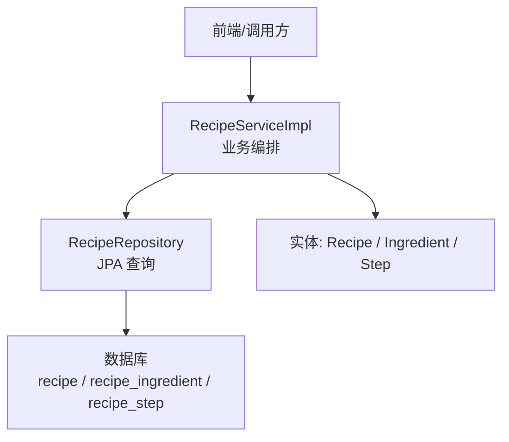
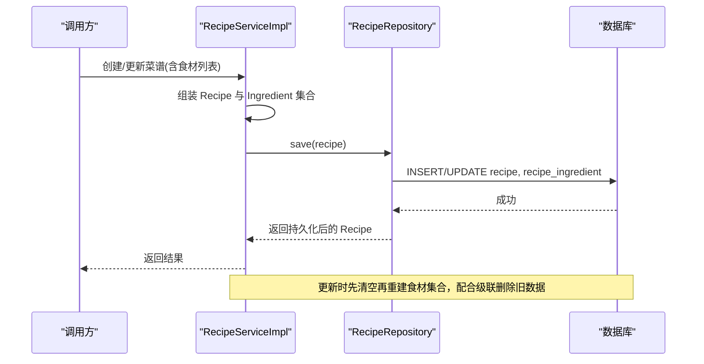
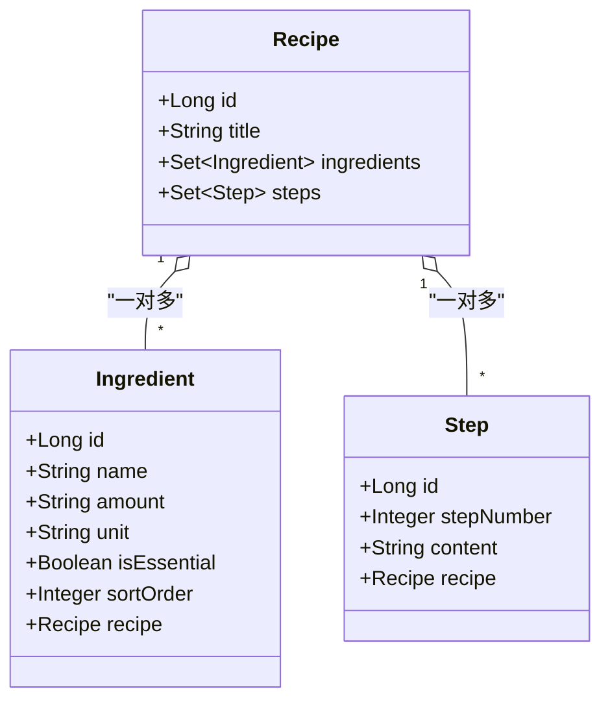
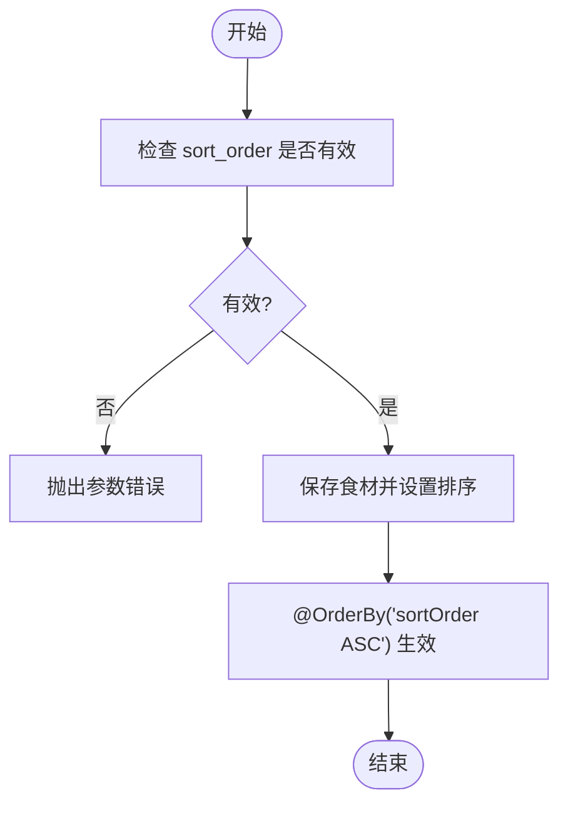
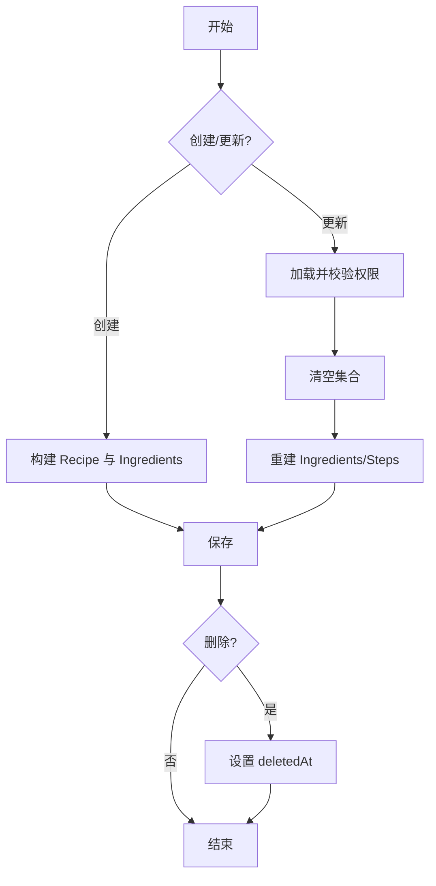
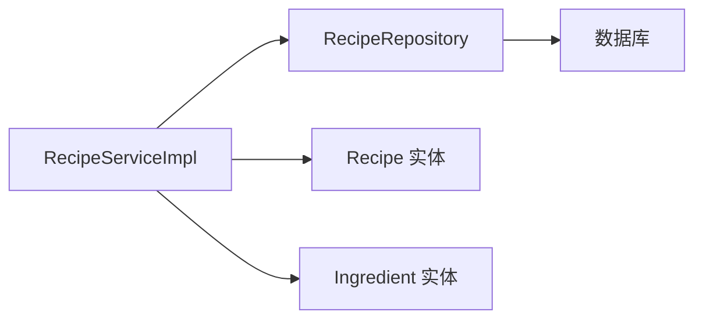

# 食材表(Ingredient)设计

<cite>
**本文引用的文件**
- [Ingredient.java](file://java_server/po/src/main/java/com/goodzheng/po/entity/Ingredient.java)
- [Recipe.java](file://java_server/po/src/main/java/com/goodzheng/po/entity/Recipe.java)
- [Step.java](file://java_server/po/src/main/java/com/goodzheng/po/entity/Step.java)
- [RecipeRepository.java](file://java_server/po/src/main/java/com/goodzheng/po/repository/RecipeRepository.java)
- [RecipeServiceImpl.java](file://java_server/po/src/main/java/com/goodzheng/po/service/impl/RecipeServiceImpl.java)
- [data-hunan.sql](file://java_server/po/src/main/resources/data-hunan.sql)
</cite>

## 目录
1. [简介](#简介)
2. [项目结构](#项目结构)
3. [核心组件](#核心组件)
4. [架构总览](#架构总览)
5. [详细组件分析](#详细组件分析)
6. [依赖关系分析](#依赖关系分析)
7. [性能考虑](#性能考虑)
8. [故障排查指南](#故障排查指南)
9. [结论](#结论)
10. [附录](#附录)

## 简介
本设计文档围绕“食材表（recipe_ingredient）”展开，系统阐述其与菜谱表的关联关系、字段定义与约束、排序机制、级联操作策略、数据标准化与单位换算建议、建表脚本要点以及查询优化与维护流程。目标是为开发者与运维人员提供一份可落地的设计与实践指南。

## 项目结构
- 实体层：包含 Recipe、Ingredient、Step 等 JPA 实体，描述数据库表结构与对象关系映射。
- 仓储层：RecipeRepository 提供基于 Spring Data JPA 的查询方法，包括预加载食材与步骤的 JOIN FETCH 查询。
- 服务层：RecipeServiceImpl 实现菜谱的创建、更新、删除等业务逻辑，并在事务中维护食材与步骤集合。
- 资源脚本：data-hunan.sql 提供种子数据，展示 recipe_ingredient 的实际插入方式与排序用法。

图表来源
- [RecipeServiceImpl.java:26-60](file://java_server/po/src/main/java/com/goodzheng/po/service/impl/RecipeServiceImpl.java#L26-L60)
- [RecipeRepository.java:16-18](file://java_server/po/src/main/java/com/goodzheng/po/repository/RecipeRepository.java#L16-L18)
- [Recipe.java:84-91](file://java_server/po/src/main/java/com/goodzheng/po/entity/Recipe.java#L84-L91)

章节来源
- [RecipeServiceImpl.java:26-60](file://java_server/po/src/main/java/com/goodzheng/po/service/impl/RecipeServiceImpl.java#L26-L60)
- [RecipeRepository.java:16-18](file://java_server/po/src/main/java/com/goodzheng/po/repository/RecipeRepository.java#L16-L18)
- [Recipe.java:84-91](file://java_server/po/src/main/java/com/goodzheng/po/entity/Recipe.java#L84-L91)

## 核心组件
- 食材实体（Ingredient）
  - 主键：自增 Long id
  - 外键：recipe_id 指向 Recipe（ManyToOne，懒加载）
  - 名称：name（必填，长度限制）
  - 用量：amount（字符串，便于保留原始表达）
  - 单位：unit（字符串，如 g、ml、个等）
  - 是否必需：isEssential（布尔，区分主料/辅料）
  - 排序：sortOrder（整数，用于保证显示顺序）
- 菜谱实体（Recipe）
  - 一对多关联 ingredients，使用 LinkedHashSet 保持插入顺序，并通过 @OrderBy("sortOrder ASC") 确保按升序返回
  - 级联：CascadeType.ALL + orphanRemoval = true，支持对食材的增删改同步持久化
- 步骤实体（Step）
  - 通过 stepNumber 控制步骤顺序，与食材的 sortOrder 设计一致

章节来源
- [Ingredient.java:14-40](file://java_server/po/src/main/java/com/goodzheng/po/entity/Ingredient.java#L14-L40)
- [Recipe.java:84-91](file://java_server/po/src/main/java/com/goodzheng/po/entity/Recipe.java#L84-L91)
- [Step.java:25-29](file://java_server/po/src/main/java/com/goodzheng/po/entity/Step.java#L25-L29)

## 架构总览
下图展示了从请求到持久化的完整链路，重点体现食材在创建/更新时的装配与保存过程，以及读取时通过 JOIN FETCH 预加载避免 N+1 问题。

图表来源
- [RecipeServiceImpl.java:26-60](file://java_server/po/src/main/java/com/goodzheng/po/service/impl/RecipeServiceImpl.java#L26-L60)
- [RecipeServiceImpl.java:99-140](file://java_server/po/src/main/java/com/goodzheng/po/service/impl/RecipeServiceImpl.java#L99-L140)
- [RecipeRepository.java:16-18](file://java_server/po/src/main/java/com/goodzheng/po/repository/RecipeRepository.java#L16-L18)

## 详细组件分析

### 实体关系与字段设计
- 一对一/一对多关系
  - Recipe 与 Ingredient 为一对多，通过 @OneToMany(mappedBy="recipe", cascade=ALL, orphanRemoval=true) 管理
  - Ingredient 通过 @ManyToOne(recipe) 反向引用，懒加载减少初始负载
- 关键字段说明
  - name：食材名称，必填且有限长，利于索引与检索
  - amount/unit：以字符串存储，兼容不同场景（如“少许”、“适量”），同时为后续标准化预留空间
  - isEssential：标记主料/辅料，便于前端展示与筛选
  - sortOrder：整数排序，结合 @OrderBy("sortOrder ASC") 保证稳定顺序
- 与步骤排序的一致性
  - Step.stepNumber 与 Ingredient.sortOrder 共同保障“步骤顺序”和“食材顺序”的可预期性

图表来源
- [Recipe.java:84-91](file://java_server/po/src/main/java/com/goodzheng/po/entity/Recipe.java#L84-L91)
- [Ingredient.java:14-40](file://java_server/po/src/main/java/com/goodzheng/po/entity/Ingredient.java#L14-L40)
- [Step.java:14-29](file://java_server/po/src/main/java/com/goodzheng/po/entity/Step.java#L14-L29)

章节来源
- [Recipe.java:84-91](file://java_server/po/src/main/java/com/goodzheng/po/entity/Recipe.java#L84-L91)
- [Ingredient.java:14-40](file://java_server/po/src/main/java/com/goodzheng/po/entity/Ingredient.java#L14-L40)
- [Step.java:14-29](file://java_server/po/src/main/java/com/goodzheng/po/entity/Step.java#L14-L29)

### 排序字段设计与步骤顺序保障
- 食材排序
  - 通过 sortOrder 字段与 @OrderBy("sortOrder ASC") 组合，确保读取时按升序排列
  - 建议在写入时由上层传入或自动生成递增序号，避免重复与乱序
- 步骤顺序
  - Step.stepNumber 作为步骤顺序标识，与食材排序思路一致，便于前后端统一处理
- 一致性校验
  - 建议在 Service 层对 sortOrder 与 stepNumber 做范围与唯一性校验，防止异常数据

图表来源
- [Recipe.java:84-91](file://java_server/po/src/main/java/com/goodzheng/po/entity/Recipe.java#L84-L91)
- [Ingredient.java:38-40](file://java_server/po/src/main/java/com/goodzheng/po/entity/Ingredient.java#L38-L40)

章节来源
- [Recipe.java:84-91](file://java_server/po/src/main/java/com/goodzheng/po/entity/Recipe.java#L84-L91)
- [Ingredient.java:38-40](file://java_server/po/src/main/java/com/goodzheng/po/entity/Ingredient.java#L38-L40)

### 外键关联与级联操作
- 外键关系
  - Ingredient.recipe_id 为必填外键，指向 Recipe.id
- 级联策略
  - Recipe.ingredients 配置 CascadeType.ALL 与 orphanRemoval=true
  - 效果：新增/更新/删除 Recipe 时，其下食材会同步增删改；删除 Recipe 将级联删除对应食材
- 更新策略
  - 更新时先清空集合再重建，确保与前端提交保持一致，避免脏数据残留

章节来源
- [Recipe.java:84-91](file://java_server/po/src/main/java/com/goodzheng/po/entity/Recipe.java#L84-L91)
- [RecipeServiceImpl.java:99-140](file://java_server/po/src/main/java/com/goodzheng/po/service/impl/RecipeServiceImpl.java#L99-L140)

### 数据标准化与单位换算机制
- 现状
  - amount 与 unit 采用字符串存储，灵活但缺乏数值计算能力
- 建议方案
  - 短期：在前端或服务端进行输入规范化（去空白、统一大小写、常见别名映射）
  - 中期：引入标准单位字典与换算规则（如重量：g/kg；体积：ml/L；计数：个/片/瓣）
  - 长期：将 amount 拆分为 numeric 与 display 两部分，numeric 用于计算，display 用于展示
- 注意事项
  - 对于“少许/适量”等非数值场景，保留文本展示，不参与计算
  - 单位换算应在 Service 层集中实现，保证一致性

章节来源
- [Ingredient.java:25-32](file://java_server/po/src/main/java/com/goodzheng/po/entity/Ingredient.java#L25-L32)
- [data-hunan.sql:10-18](file://java_server/po/src/main/resources/data-hunan.sql#L10-L18)

### 建表脚本与索引建议
- 表名与字段
  - 表名：recipe_ingredient
  - 关键字段：id、recipe_id、name、amount、unit、is_essential、sort_order
- 索引建议
  - 复合索引：(recipe_id, sort_order) 用于快速定位某菜谱下的食材并按序返回
  - 可选索引：name 前缀索引，提升名称检索性能
- 参考脚本位置
  - 种子数据中已体现字段与插入方式，可作为建表依据

章节来源
- [Ingredient.java:11-40](file://java_server/po/src/main/java/com/goodzheng/po/entity/Ingredient.java#L11-L40)
- [data-hunan.sql:10-18](file://java_server/po/src/main/resources/data-hunan.sql#L10-L18)

### 查询优化策略
- 预加载
  - 使用 JOIN FETCH 一次性加载 Recipe 及其 ingredients、steps，避免 LazyInitializationException 与 N+1 查询
- 分页与过滤
  - 列表接口使用 Pageable 分页，减少数据传输量
- 排序
  - 依赖 @OrderBy 与数据库排序，避免应用层二次排序

章节来源
- [RecipeRepository.java:16-18](file://java_server/po/src/main/java/com/goodzheng/po/repository/RecipeRepository.java#L16-L18)
- [Recipe.java:84-91](file://java_server/po/src/main/java/com/goodzheng/po/entity/Recipe.java#L84-L91)

### 数据维护与更新流程
- 创建流程
  - 构建 Recipe 与 Ingredient 集合，设置 authorId 后保存
- 更新流程
  - 获取现有 Recipe，校验作者权限，清空集合后重建食材与步骤，最后保存
- 删除流程
  - 软删除：设置 deletedAt，不物理删除，便于恢复与审计
- 事务边界
  - 所有写操作置于 @Transactional 中，保证一致性

图表来源
- [RecipeServiceImpl.java:26-60](file://java_server/po/src/main/java/com/goodzheng/po/service/impl/RecipeServiceImpl.java#L26-L60)
- [RecipeServiceImpl.java:99-151](file://java_server/po/src/main/java/com/goodzheng/po/service/impl/RecipeServiceImpl.java#L99-L151)

章节来源
- [RecipeServiceImpl.java:26-60](file://java_server/po/src/main/java/com/goodzheng/po/service/impl/RecipeServiceImpl.java#L26-L60)
- [RecipeServiceImpl.java:99-151](file://java_server/po/src/main/java/com/goodzheng/po/service/impl/RecipeServiceImpl.java#L99-L151)

## 依赖关系分析
- 组件耦合
  - RecipeServiceImpl 依赖 RecipeRepository 与实体模型，职责清晰
  - Ingredient 与 Recipe 通过 JPA 注解建立强关联，便于级联操作
- 外部依赖
  - Spring Data JPA 提供 Repository 抽象与查询推导
  - Lombok 简化样板代码
- 潜在风险
  - 大量食材/步骤时需注意内存占用与序列化开销，必要时拆分 DTO

图表来源
- [RecipeServiceImpl.java:23-24](file://java_server/po/src/main/java/com/goodzheng/po/service/impl/RecipeServiceImpl.java#L23-L24)
- [RecipeRepository.java:13-18](file://java_server/po/src/main/java/com/goodzheng/po/repository/RecipeRepository.java#L13-L18)

章节来源
- [RecipeServiceImpl.java:23-24](file://java_server/po/src/main/java/com/goodzheng/po/service/impl/RecipeServiceImpl.java#L23-L24)
- [RecipeRepository.java:13-18](file://java_server/po/src/main/java/com/goodzheng/po/repository/RecipeRepository.java#L13-L18)

## 性能考虑
- 读取优化
  - 使用 JOIN FETCH 预加载，避免多次往返数据库
  - 列表接口分页，减少响应体大小
- 写入优化
  - 批量插入食材与步骤（当前实现逐条添加，若数据量大可考虑批处理）
- 缓存策略
  - 对热点菜谱可引入缓存层（如 Redis），注意失效策略
- 索引
  - 为 (recipe_id, sort_order) 建立复合索引，加速排序与查找

[本节为通用性能建议，无需特定文件来源]

## 故障排查指南
- 常见问题
  - LazyInitializationException：未预加载导致访问延迟属性失败
    - 解决：使用 findByIdWithDetails 等 JOIN FETCH 查询
  - 排序错乱：sortOrder 未正确设置或存在重复值
    - 解决：在服务层生成唯一递增序号，或使用数据库序列
  - 级联删除误删：误删 Recipe 导致食材丢失
    - 解决：优先使用软删除，谨慎启用物理删除
- 日志与监控
  - 记录关键操作的入参与耗时，便于定位瓶颈

章节来源
- [RecipeRepository.java:16-18](file://java_server/po/src/main/java/com/goodzheng/po/repository/RecipeRepository.java#L16-L18)
- [RecipeServiceImpl.java:62-71](file://java_server/po/src/main/java/com/goodzheng/po/service/impl/RecipeServiceImpl.java#L62-L71)

## 结论
本设计通过清晰的实体关系、严格的排序字段与级联策略，确保了食材数据的有序性与一致性。结合预加载与索引优化，可在高并发场景下保持稳定性能。未来可通过单位标准化与数值化处理进一步提升计算能力与可维护性。

[本节为总结性内容，无需特定文件来源]

## 附录

### 字段定义与约束一览
- 表：recipe_ingredient
  - id：主键，自增
  - recipe_id：外键，非空
  - name：名称，非空，长度限制
  - amount：用量，字符串
  - unit：单位，字符串
  - is_essential：是否必需，布尔，默认真
  - sort_order：排序，整数，默认 0

章节来源
- [Ingredient.java:14-40](file://java_server/po/src/main/java/com/goodzheng/po/entity/Ingredient.java#L14-L40)

### 种子数据示例
- data-hunan.sql 中包含多条 recipe_ingredient 插入语句，展示了 name、amount、unit、is_essential、sort_order 的使用方式

章节来源
- [data-hunan.sql:10-18](file://java_server/po/src/main/resources/data-hunan.sql#L10-L18)