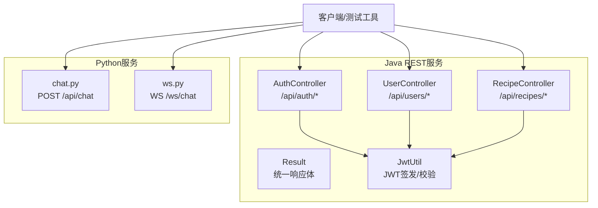
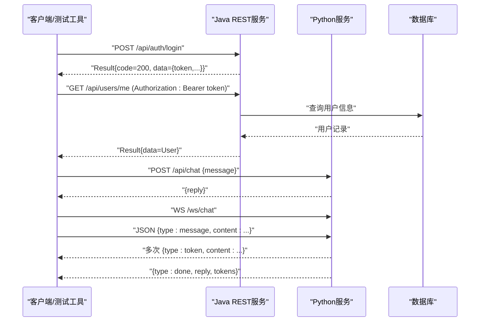
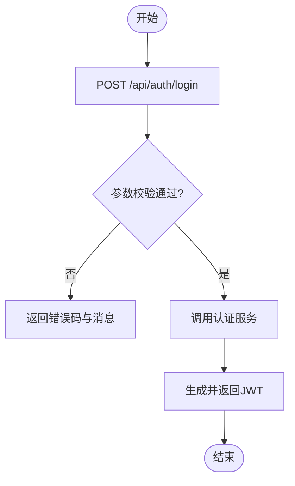
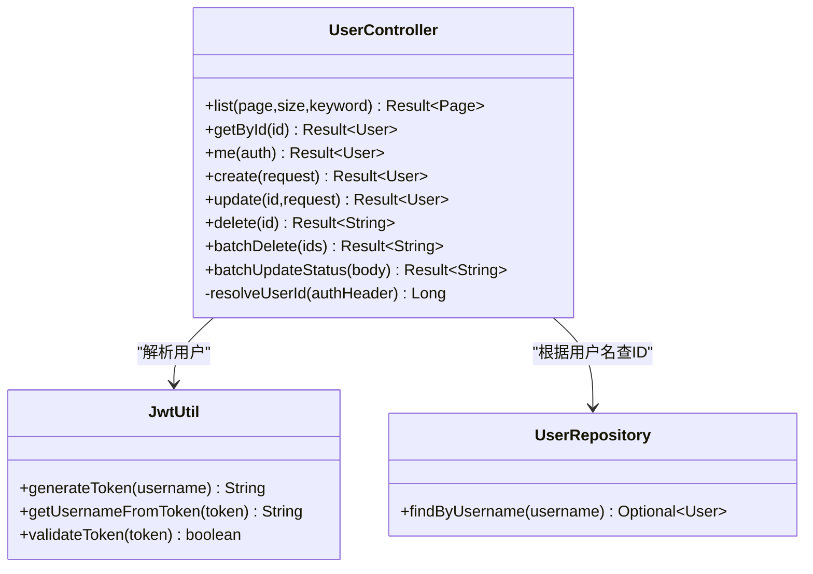
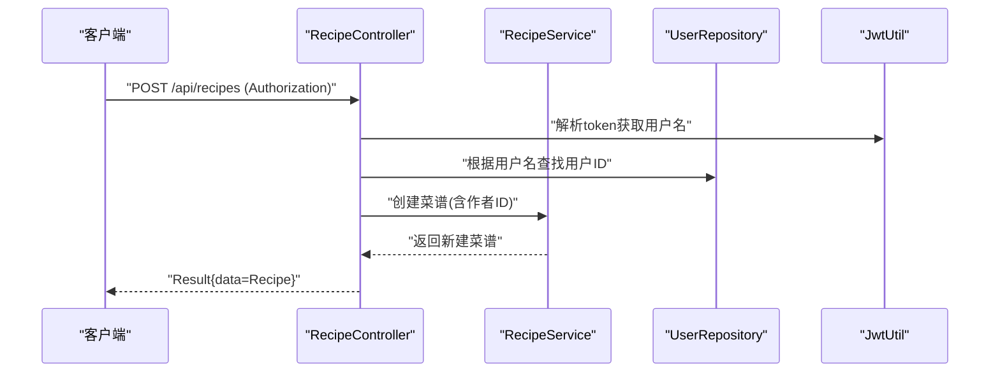
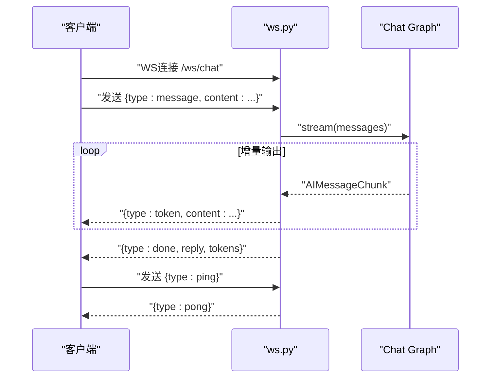
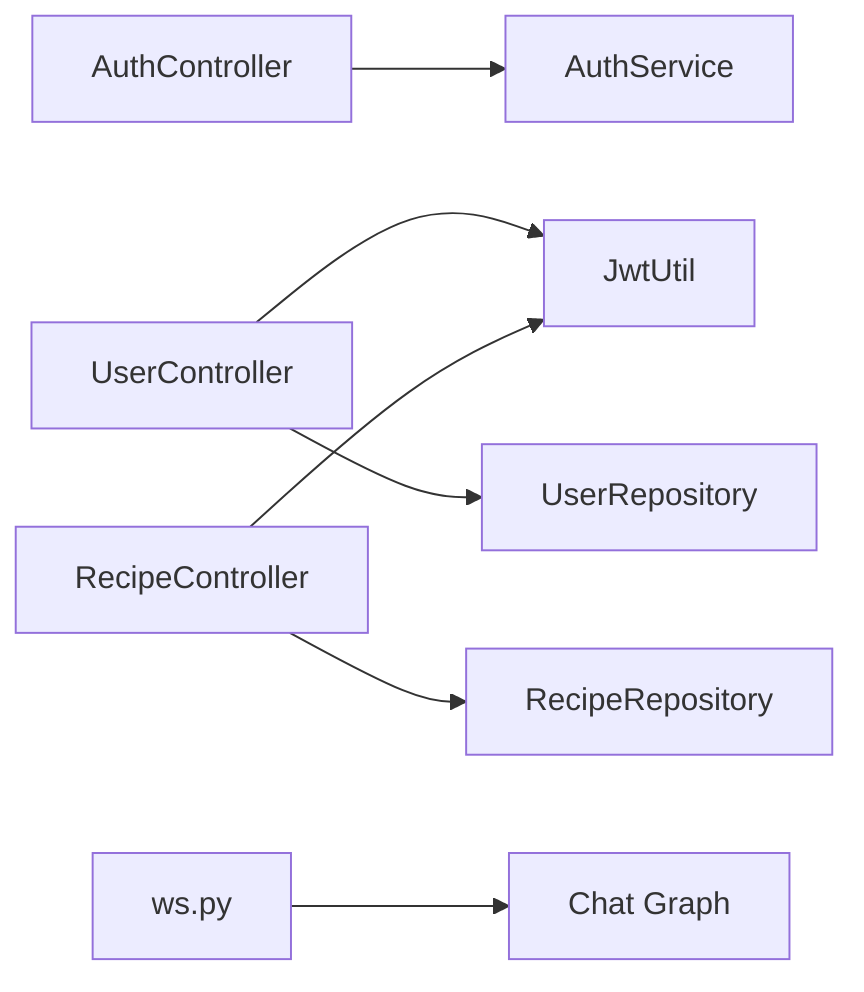

# API接口测试

<cite>
**本文引用的文件**
- [AuthController.java](file://java_server/po/src/main/java/com/goodzheng/po/controller/AuthController.java)
- [UserController.java](file://java_server/po/src/main/java/com/goodzheng/po/controller/UserController.java)
- [RecipeController.java](file://java_server/po/src/main/java/com/goodzheng/po/controller/RecipeController.java)
- [Result.java](file://java_server/po/src/main/java/com/goodzheng/po/dto/Result.java)
- [LoginRequest.java](file://java_server/po/src/main/java/com/goodzheng/po/dto/LoginRequest.java)
- [LoginResponse.java](file://java_server/po/src/main/java/com/goodzheng/po/dto/LoginResponse.java)
- [UserRequest.java](file://java_server/po/src/main/java/com/goodzheng/po/dto/UserRequest.java)
- [RecipeRequest.java](file://java_server/po/src/main/java/com/goodzheng/po/dto/RecipeRequest.java)
- [JwtUtil.java](file://java_server/po/src/main/java/com/goodzheng/po/util/JwtUtil.java)
- [application.yaml](file://java_server/po/src/main/resources/application.yaml)
- [ws.py](file://py_server/blueprints/ws.py)
- [chat.py](file://py_server/blueprints/chat.py)
- [ws_client_demo.py](file://py_server/scripts/ws_client_demo.py)
</cite>

## 目录
1. [简介](#简介)
2. [项目结构](#项目结构)
3. [核心组件](#核心组件)
4. [架构总览](#架构总览)
5. [详细组件分析](#详细组件分析)
6. [依赖关系分析](#依赖关系分析)
7. [性能考虑](#性能考虑)
8. [故障排查指南](#故障排查指南)
9. [结论](#结论)
10. [附录](#附录)

## 简介
本文件面向RESTful API与WebSocket接口的端到端测试，覆盖以下目标：
- 使用Postman集合进行接口测试：环境变量、请求脚本、响应断言。
- 自动化API测试：契约测试、性能测试、安全测试。
- WebSocket接口测试：连接建立、消息发送、实时数据验证。
- 最佳实践：错误处理、权限校验、并发测试方案。

## 项目结构
后端包含两个服务：
- Java Spring Boot REST服务（端口8080，上下文路径/api），提供认证、用户、菜谱等接口。
- Python Flask服务（默认端口5090），提供聊天REST接口和WebSocket流式对话接口。

图表来源
- [AuthController.java:11-40](file://java_server/po/src/main/java/com/goodzheng/po/controller/AuthController.java#L11-L40)
- [UserController.java:19-132](file://java_server/po/src/main/java/com/goodzheng/po/controller/UserController.java#L19-L132)
- [RecipeController.java:18-119](file://java_server/po/src/main/java/com/goodzheng/po/controller/RecipeController.java#L18-L119)
- [Result.java:7-31](file://java_server/po/src/main/java/com/goodzheng/po/dto/Result.java#L7-L31)
- [JwtUtil.java:13-55](file://java_server/po/src/main/java/com/goodzheng/po/util/JwtUtil.java#L13-L55)
- [chat.py:1-24](file://py_server/blueprints/chat.py#L1-L24)
- [ws.py:1-90](file://py_server/blueprints/ws.py#L1-L90)

章节来源
- [application.yaml:4-10](file://java_server/po/src/main/resources/application.yaml#L4-L10)
- [application.yaml:104-109](file://java_server/po/src/main/resources/application.yaml#L104-L109)

## 核心组件
- 认证与鉴权
  - 登录注册：POST /api/auth/login、POST /api/auth/register
  - JWT：基于HS256的令牌签发与解析，用于后续受保护接口鉴权
- 用户管理
  - GET /api/users（分页、可选关键词）
  - GET /api/users/{id}
  - GET /api/users/me（需Authorization: Bearer <token>）
  - POST /api/users
  - PUT /api/users/{id}
  - DELETE /api/users/{id}
  - DELETE /api/users/batch
  - PUT /api/users/batch/status
- 菜谱管理
  - POST /api/recipes（需Authorization）
  - GET /api/recipes/{id}
  - GET /api/recipes（分页、可选分类、关键词）
  - GET /api/recipes/mine（需Authorization）
  - PUT /api/recipes/{id}（需Authorization）
  - DELETE /api/recipes/{id}（需Authorization）
- 聊天接口
  - REST：POST /api/chat（一次性返回完整回复）
  - WebSocket：WS /ws/chat（流式推送token，支持ping/pong心跳）

章节来源
- [AuthController.java:19-39](file://java_server/po/src/main/java/com/goodzheng/po/controller/AuthController.java#L19-L39)
- [UserController.java:29-122](file://java_server/po/src/main/java/com/goodzheng/po/controller/UserController.java#L29-L122)
- [RecipeController.java:28-109](file://java_server/po/src/main/java/com/goodzheng/po/controller/RecipeController.java#L28-L109)
- [chat.py:10-23](file://py_server/blueprints/chat.py#L10-L23)
- [ws.py:30-89](file://py_server/blueprints/ws.py#L30-L89)

## 架构总览
下图展示从客户端到后端的调用链路与关键交互点，包括REST与WebSocket两种模式。

图表来源
- [AuthController.java:19-27](file://java_server/po/src/main/java/com/goodzheng/po/controller/AuthController.java#L19-L27)
- [UserController.java:55-64](file://java_server/po/src/main/java/com/goodzheng/po/controller/UserController.java#L55-L64)
- [chat.py:10-23](file://py_server/blueprints/chat.py#L10-L23)
- [ws.py:30-89](file://py_server/blueprints/ws.py#L30-L89)

## 详细组件分析

### 认证与鉴权（REST）
- 登录流程
  - 输入：用户名、密码（必填）
  - 输出：统一响应体Result，成功时包含token、用户基本信息
  - 鉴权：后续接口通过Authorization头携带Bearer token
- 注册流程
  - 输入：username、password、可选email
  - 输出：统一响应体Result，包含操作结果消息

图表来源
- [AuthController.java:19-27](file://java_server/po/src/main/java/com/goodzheng/po/controller/AuthController.java#L19-L27)
- [LoginRequest.java:6-14](file://java_server/po/src/main/java/com/goodzheng/po/dto/LoginRequest.java#L6-L14)
- [LoginResponse.java:6-14](file://java_server/po/src/main/java/com/goodzheng/po/dto/LoginResponse.java#L6-L14)
- [JwtUtil.java:25-33](file://java_server/po/src/main/java/com/goodzheng/po/util/JwtUtil.java#L25-L33)

章节来源
- [AuthController.java:19-39](file://java_server/po/src/main/java/com/goodzheng/po/controller/AuthController.java#L19-L39)
- [Result.java:16-30](file://java_server/po/src/main/java/com/goodzheng/po/dto/Result.java#L16-L30)
- [JwtUtil.java:35-53](file://java_server/po/src/main/java/com/goodzheng/po/util/JwtUtil.java#L35-L53)

### 用户管理（REST）
- 受保护接口通过Authorization头解析用户ID，再访问用户资源
- 支持分页、搜索、批量删除、批量状态更新

图表来源
- [UserController.java:29-132](file://java_server/po/src/main/java/com/goodzheng/po/controller/UserController.java#L29-L132)
- [JwtUtil.java:13-55](file://java_server/po/src/main/java/com/goodzheng/po/util/JwtUtil.java#L13-L55)

章节来源
- [UserController.java:29-132](file://java_server/po/src/main/java/com/goodzheng/po/controller/UserController.java#L29-L132)

### 菜谱管理（REST）
- 创建、更新、删除需要Authorization头
- 列表支持分页、按分类过滤、关键词搜索
- “我的菜谱”接口仅返回当前登录用户的菜谱

图表来源
- [RecipeController.java:28-39](file://java_server/po/src/main/java/com/goodzheng/po/controller/RecipeController.java#L28-L39)
- [JwtUtil.java:35-37](file://java_server/po/src/main/java/com/goodzheng/po/util/JwtUtil.java#L35-L37)

章节来源
- [RecipeController.java:28-119](file://java_server/po/src/main/java/com/goodzheng/po/controller/RecipeController.java#L28-L119)

### 聊天接口（REST与WebSocket）
- REST：POST /api/chat，一次性返回完整回复
- WebSocket：WS /ws/chat，流式推送token，支持ping/pong心跳

图表来源
- [ws.py:30-89](file://py_server/blueprints/ws.py#L30-L89)
- [ws_client_demo.py:19-48](file://py_server/scripts/ws_client_demo.py#L19-L48)

章节来源
- [chat.py:10-23](file://py_server/blueprints/chat.py#L10-L23)
- [ws.py:30-89](file://py_server/blueprints/ws.py#L30-L89)
- [ws_client_demo.py:1-53](file://py_server/scripts/ws_client_demo.py#L1-L53)

## 依赖关系分析
- 控制器依赖服务层与工具类：
  - AuthController依赖AuthService（未在本仓库中显示）
  - UserController、RecipeController依赖JwtUtil与对应Repository
- 统一响应体Result贯穿所有接口，便于前端或测试工具统一断言
- WebSocket服务依赖LangChain图执行器，以流式方式产出内容

图表来源
- [AuthController.java:11-27](file://java_server/po/src/main/java/com/goodzheng/po/controller/AuthController.java#L11-L27)
- [UserController.java:19-132](file://java_server/po/src/main/java/com/goodzheng/po/controller/UserController.java#L19-L132)
- [RecipeController.java:18-119](file://java_server/po/src/main/java/com/goodzheng/po/controller/RecipeController.java#L18-L119)
- [ws.py:30-89](file://py_server/blueprints/ws.py#L30-L89)

章节来源
- [application.yaml:23-41](file://java_server/po/src/main/resources/application.yaml#L23-L41)

## 性能考虑
- 连接池与线程数：Tomcat最大线程与连接数、HikariCP连接池大小影响并发能力
- 分页与排序：用户与菜谱列表均支持分页，避免全量加载
- 流式输出：WebSocket采用增量推送，降低首屏延迟与内存占用
- 建议：
  - 在压测前调整连接池与线程上限
  - 对热点接口增加缓存策略（如Redis）
  - 对大对象响应启用压缩

[本节为通用指导，不直接分析具体文件]

## 故障排查指南
- 常见错误码与场景
  - 400：参数校验失败、业务异常（如重复注册）
  - 401：未授权或令牌无效（缺少Authorization或令牌过期）
  - 404：资源不存在
  - 500：内部错误（服务端异常）
- 日志与监控
  - 应用日志输出至logs/application.log
  - Actuator暴露health、info、metrics、prometheus端点
- 调试建议
  - 检查请求头Authorization格式是否为“Bearer <token>”
  - 确认数据库与Redis连通性
  - 查看WebSocket服务端日志定位流式处理异常

章节来源
- [application.yaml:71-94](file://java_server/po/src/main/resources/application.yaml#L71-L94)
- [AuthController.java:21-38](file://java_server/po/src/main/java/com/goodzheng/po/controller/AuthController.java#L21-L38)
- [UserController.java:47-122](file://java_server/po/src/main/java/com/goodzheng/po/controller/UserController.java#L47-L122)
- [RecipeController.java:30-109](file://java_server/po/src/main/java/com/goodzheng/po/controller/RecipeController.java#L30-L109)
- [ws.py:43-85](file://py_server/blueprints/ws.py#L43-L85)

## 结论
本项目的REST与WebSocket接口具备清晰的鉴权机制、统一的响应结构与良好的可扩展性。通过规范的Postman集合与自动化测试脚本，可高效完成契约、性能与安全测试；结合流式WebSocket协议，可实现低延迟的实时交互体验。建议在CI/CD中集成自动化测试套件，持续保障接口质量与稳定性。

[本节为总结性内容，不直接分析具体文件]

## 附录

### Postman集合与环境变量
- 环境配置
  - base_url_java: http://localhost:8080/api
  - base_url_py: http://localhost:5090
  - token: 登录后保存的JWT字符串
- 预请求脚本（示例思路）
  - 登录获取token：调用POST /api/auth/login，将返回的token写入环境变量
  - 设置Authorization：在受保护接口预请求中设置Header Authorization = "Bearer {{token}}"
- 响应断言（示例思路）
  - 校验Result.code为200
  - 校验data字段存在且类型符合预期
  - 校验分页结构包含total、size、content等

[本节为操作指引，不直接分析具体文件]

### 自动化API测试脚本
- 契约测试
  - 校验请求参数校验规则（必填、长度、格式）
  - 校验响应体结构（Result.code、data字段）
- 性能测试
  - 使用JMeter/k6对登录、列表、创建接口进行并发压测
  - 关注TP95/TP99、错误率、CPU/内存使用
- 安全测试
  - 未授权访问受保护接口应返回401
  - 注入攻击、XSS、CSRF防护验证
  - JWT过期与非法签名处理

[本节为通用指导，不直接分析具体文件]

### WebSocket接口测试方法
- 连接建立
  - 使用ws://127.0.0.1:5090/ws/chat（或实际部署地址）
- 消息发送
  - 发送{"type":"message","content":"..."}触发对话
  - 发送{"type":"ping"}检测心跳
- 实时数据验证
  - 接收多次{"type":"token","content":"..."}
  - 最后接收{"type":"done","reply":"...","tokens":N}
  - 校验error类型消息是否按预期出现

章节来源
- [ws.py:30-89](file://py_server/blueprints/ws.py#L30-L89)
- [ws_client_demo.py:19-48](file://py_server/scripts/ws_client_demo.py#L19-L48)

### 最佳实践清单
- 错误处理测试
  - 覆盖参数缺失、非法值、业务异常分支
  - 校验错误码与消息的一致性
- 权限验证测试
  - 无Authorization、无效Authorization、过期Authorization
  - 不同角色访问受限资源的差异
- 并发测试方案
  - 多用户同时登录、同一资源并发修改
  - 观察锁竞争、事务隔离与一致性

[本节为通用指导，不直接分析具体文件]