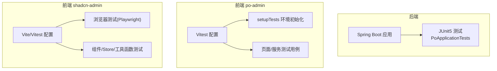
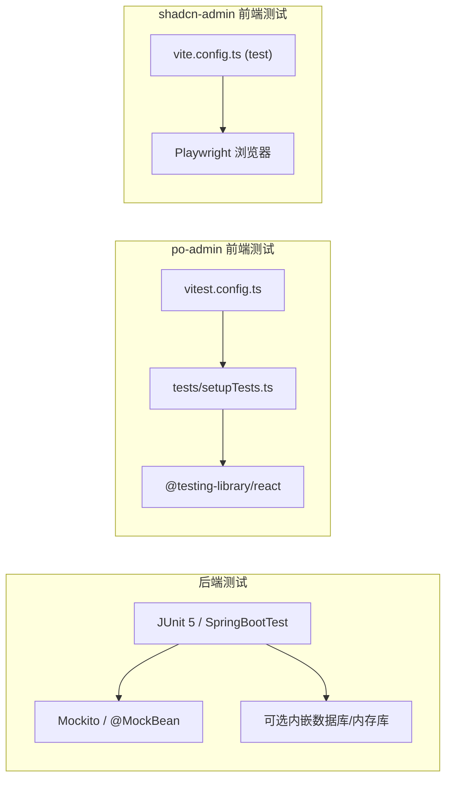
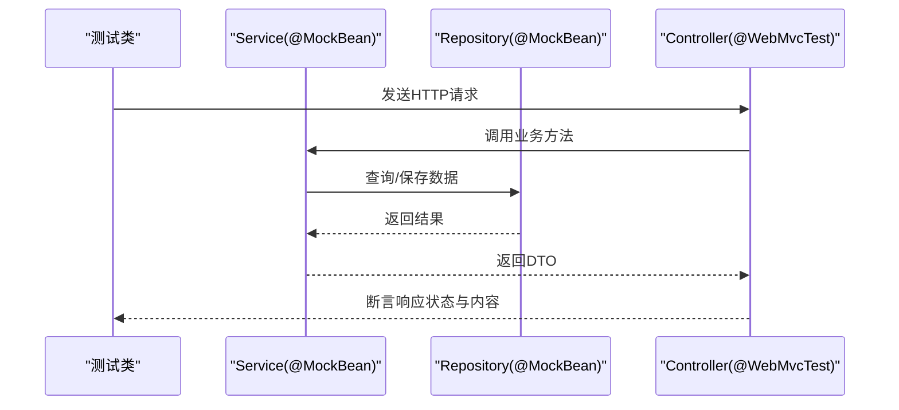
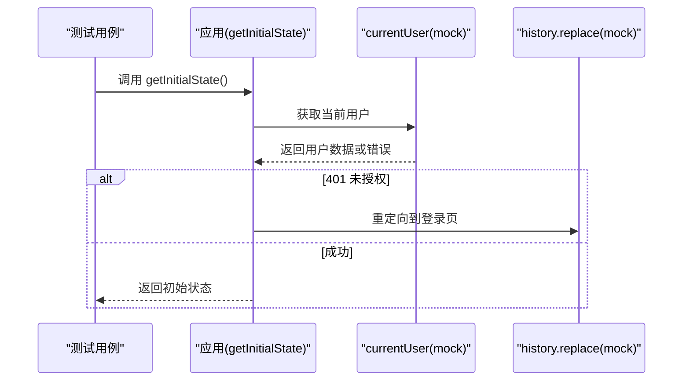
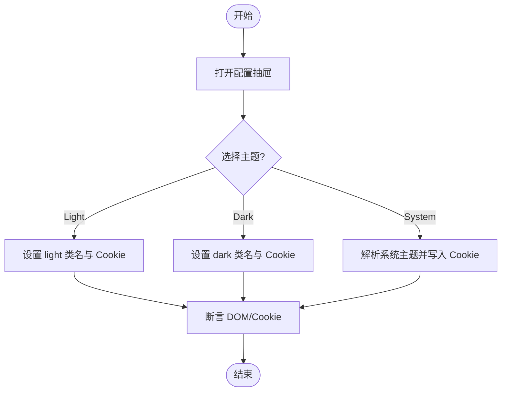
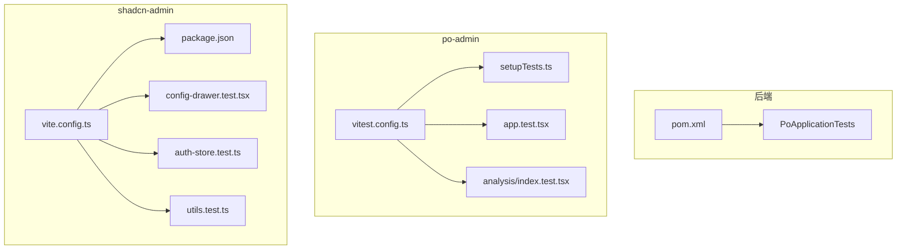

# 单元测试

<cite>
**本文引用的文件**
- [java_server/po/pom.xml](file://java_server/po/pom.xml)
- [java_server/po/src/test/java/com/goodzheng/po/PoApplicationTests.java](file://java_server/po/src/test/java/com/goodzheng/po/PoApplicationTests.java)
- [web_client/po-admin/vitest.config.ts](file://web_client/po-admin/vitest.config.ts)
- [web_client/po-admin/tests/setupTests.ts](file://web_client/po-admin/tests/setupTests.ts)
- [web_client/po-admin/package.json](file://web_client/po-admin/package.json)
- [web_client/po-admin/src/app.test.tsx](file://web_client/po-admin/src/app.test.tsx)
- [web_client/po-admin/src/pages/dashboard/analysis/index.test.tsx](file://web_client/po-admin/src/pages/dashboard/analysis/index.test.tsx)
- [web_client/shadcn-admin/vite.config.ts](file://web_client/shadcn-admin/vite.config.ts)
- [web_client/shadcn-admin/package.json](file://web_client/shadcn-admin/package.json)
- [web_client/shadcn-admin/src/stores/auth-store.test.ts](file://web_client/shadcn-admin/src/stores/auth-store.test.ts)
- [web_client/shadcn-admin/src/components/config-drawer.test.tsx](file://web_client/shadcn-admin/src/components/config-drawer.test.tsx)
- [web_client/shadcn-admin/src/lib/utils.test.ts](file://web_client/shadcn-admin/src/lib/utils.test.ts)
</cite>

## 目录
1. [简介](#简介)
2. [项目结构](#项目结构)
3. [核心组件](#核心组件)
4. [架构总览](#架构总览)
5. [详细组件分析](#详细组件分析)
6. [依赖分析](#依赖分析)
7. [性能考虑](#性能考虑)
8. [故障排查指南](#故障排查指南)
9. [结论](#结论)
10. [附录](#附录)

## 简介
本文件面向后端 Java（Spring Boot）与前端 React 的单元测试实施方案，覆盖测试框架配置、用例编写、Mock 策略、数据准备、覆盖率要求、命名规范与最佳实践。文档基于仓库中现有实现进行梳理，并提供可操作的流程与示例路径，帮助团队快速落地并持续改进测试质量。

## 项目结构
本项目包含两个前端子工程与一个后端服务：
- 后端：Spring Boot 应用，使用 JUnit 5 + Spring Boot Test 进行测试。
- 前端 po-admin：基于 Umi/Ant Design Pro，使用 Vitest + Testing Library 进行单元与集成测试。
- 前端 shadcn-admin：基于 Vite + React，使用 Vitest + Playwright 浏览器测试与 v8 覆盖率。

图表来源
- [java_server/po/src/test/java/com/goodzheng/po/PoApplicationTests.java:1-14](file://java_server/po/src/test/java/com/goodzheng/po/PoApplicationTests.java#L1-L14)
- [web_client/po-admin/vitest.config.ts:1-40](file://web_client/po-admin/vitest.config.ts#L1-L40)
- [web_client/po-admin/tests/setupTests.ts:1-106](file://web_client/po-admin/tests/setupTests.ts#L1-L106)
- [web_client/shadcn-admin/vite.config.ts:1-53](file://web_client/shadcn-admin/vite.config.ts#L1-L53)

章节来源
- [java_server/po/pom.xml:32-89](file://java_server/po/pom.xml#L32-L89)
- [web_client/po-admin/vitest.config.ts:12-38](file://web_client/po-admin/vitest.config.ts#L12-L38)
- [web_client/shadcn-admin/vite.config.ts:32-51](file://web_client/shadcn-admin/vite.config.ts#L32-L51)

## 核心组件
- 后端测试基座
  - 使用 spring-boot-starter-test 提供 JUnit 5、Mockito、Spring Test 等能力。
  - 已有基础测试类用于验证上下文加载。
- 前端 po-admin 测试基座
  - Vitest 配置启用 happy-dom 环境、全局 API、setup 文件、覆盖率报告（v8）。
  - setupTests 提供 localStorage、Worker、MessageChannel、matchMedia、ResizeObserver 等 Polyfill/Mock。
- 前端 shadcn-admin 测试基座
  - Vite 集成 Vitest，启用浏览器模式（Playwright），配置覆盖率排除规则。
  - 通过 package.json 脚本提供运行与覆盖率命令。

章节来源
- [java_server/po/pom.xml:86-89](file://java_server/po/pom.xml#L86-L89)
- [java_server/po/src/test/java/com/goodzheng/po/PoApplicationTests.java:1-14](file://java_server/po/src/test/java/com/goodzheng/po/PoApplicationTests.java#L1-L14)
- [web_client/po-admin/vitest.config.ts:12-38](file://web_client/po-admin/vitest.config.ts#L12-L38)
- [web_client/po-admin/tests/setupTests.ts:1-106](file://web_client/po-admin/tests/setupTests.ts#L1-L106)
- [web_client/shadcn-admin/vite.config.ts:32-51](file://web_client/shadcn-admin/vite.config.ts#L32-L51)
- [web_client/shadcn-admin/package.json:14-19](file://web_client/shadcn-admin/package.json#L14-L19)

## 架构总览
下图展示前后端测试在各自工程中的执行入口与关键依赖关系。

图表来源
- [java_server/po/pom.xml:86-89](file://java_server/po/pom.xml#L86-L89)
- [web_client/po-admin/vitest.config.ts:12-38](file://web_client/po-admin/vitest.config.ts#L12-L38)
- [web_client/po-admin/tests/setupTests.ts:1-106](file://web_client/po-admin/tests/setupTests.ts#L1-L106)
- [web_client/shadcn-admin/vite.config.ts:32-51](file://web_client/shadcn-admin/vite.config.ts#L32-L51)

## 详细组件分析

### 后端 Spring Boot 单元测试
- 测试框架与依赖
  - 通过 spring-boot-starter-test 引入 JUnit 5、Mockito、Spring Test 等。
- 已有用例
  - 基础上下文加载测试，确保应用能正常启动。
- 推荐实践
  - 控制器层：使用 @WebMvcTest 或 @SpringBootTest + MockMvc，配合 @MockBean 模拟 Service/Repository。
  - 服务层：使用 @ExtendWith(MockitoExtension.class) 或 @MockitoExtension，@Mock 注入依赖，@InjectMocks 构造被测对象。
  - 数据访问层：使用 @DataJpaTest/@MybatisPlus 测试注解或内存数据库（H2）+ @Sql 准备数据。
  - 认证/鉴权：对 JWT/Security 相关逻辑，使用 @WebMvcTest + 自定义 SecurityContext 或 Mock Filter。
  - 异步/事务：结合 @Transactional 回滚；对异步调用使用 Awaitility 或 Mockito 的 verify 超时。
  - 测试数据：优先使用 @Sql 或工厂方法生成稳定数据；避免硬编码随机值。
  - 命名规范：以业务场景命名，如 shouldReturnX_whenY；断言清晰、单一职责。
  - 覆盖率建议：行覆盖率≥80%，分支覆盖率≥70%（可按模块逐步提升）。

图表来源
- [java_server/po/pom.xml:86-89](file://java_server/po/pom.xml#L86-L89)
- [java_server/po/src/test/java/com/goodzheng/po/PoApplicationTests.java:1-14](file://java_server/po/src/test/java/com/goodzheng/po/PoApplicationTests.java#L1-L14)

章节来源
- [java_server/po/pom.xml:86-89](file://java_server/po/pom.xml#L86-L89)
- [java_server/po/src/test/java/com/goodzheng/po/PoApplicationTests.java:1-14](file://java_server/po/src/test/java/com/goodzheng/po/PoApplicationTests.java#L1-L14)

### 前端 po-admin 测试（Vitest + Testing Library）
- 配置要点
  - 环境：happy-dom，开启 globals，设置 setupFiles，指定 include/exclude，启用 v8 覆盖率。
  - 测试入口：tests/setupTests.ts 提供常用 Web API 的 Mock/Polyfill。
- 典型用例
  - 应用初始化流程：mock 路由与服务，验证用户信息获取与重定向逻辑。
  - 页面渲染与数据流：mock 子组件与服务，断言各区块渲染与数据传递。
- 事件处理与状态管理
  - 使用 userEvent 触发交互，waitFor 等待异步更新，断言 DOM/状态变化。
  - 对 store/状态库，采用独立实例与 resetModules 隔离副作用。

图表来源
- [web_client/po-admin/src/app.test.tsx:1-147](file://web_client/po-admin/src/app.test.tsx#L1-L147)
- [web_client/po-admin/vitest.config.ts:12-38](file://web_client/po-admin/vitest.config.ts#L12-L38)
- [web_client/po-admin/tests/setupTests.ts:1-106](file://web_client/po-admin/tests/setupTests.ts#L1-L106)

章节来源
- [web_client/po-admin/vitest.config.ts:12-38](file://web_client/po-admin/vitest.config.ts#L12-L38)
- [web_client/po-admin/tests/setupTests.ts:1-106](file://web_client/po-admin/tests/setupTests.ts#L1-L106)
- [web_client/po-admin/src/app.test.tsx:1-147](file://web_client/po-admin/src/app.test.tsx#L1-L147)
- [web_client/po-admin/src/pages/dashboard/analysis/index.test.tsx:1-241](file://web_client/po-admin/src/pages/dashboard/analysis/index.test.tsx#L1-L241)

### 前端 shadcn-admin 测试（Vitest + Playwright 浏览器测试）
- 配置要点
  - 启用浏览器模式（Playwright），配置覆盖率排除 UI 组件与资源。
  - 通过 package.json 脚本提供 run/watch/ui/coverage 命令。
- 典型用例
  - 组件集成测试：打开抽屉、切换主题/布局/方向，断言 Cookie 与 DOM class/dir 属性。
  - Store 持久化：重置模块后验证 accessToken/user 的持久与清除。
  - 工具函数：纯函数边界条件与异常输入覆盖。

图表来源
- [web_client/shadcn-admin/src/components/config-drawer.test.tsx:1-320](file://web_client/shadcn-admin/src/components/config-drawer.test.tsx#L1-L320)
- [web_client/shadcn-admin/vite.config.ts:32-51](file://web_client/shadcn-admin/vite.config.ts#L32-L51)
- [web_client/shadcn-admin/package.json:14-19](file://web_client/shadcn-admin/package.json#L14-L19)

章节来源
- [web_client/shadcn-admin/vite.config.ts:32-51](file://web_client/shadcn-admin/vite.config.ts#L32-L51)
- [web_client/shadcn-admin/package.json:14-19](file://web_client/shadcn-admin/package.json#L14-L19)
- [web_client/shadcn-admin/src/components/config-drawer.test.tsx:1-320](file://web_client/shadcn-admin/src/components/config-drawer.test.tsx#L1-L320)
- [web_client/shadcn-admin/src/stores/auth-store.test.ts:1-77](file://web_client/shadcn-admin/src/stores/auth-store.test.ts#L1-L77)
- [web_client/shadcn-admin/src/lib/utils.test.ts:1-29](file://web_client/shadcn-admin/src/lib/utils.test.ts#L1-L29)

## 依赖分析
- 后端
  - 测试依赖集中在 spring-boot-starter-test，版本由父 POM 管理。
- 前端 po-admin
  - Vitest + @vitest/coverage-v8 + happy-dom + @testing-library/*。
- 前端 shadcn-admin
  - Vitest + @vitest/browser-playwright + @vitest/coverage-v8，Playwright 驱动 Chromium。

图表来源
- [java_server/po/pom.xml:86-89](file://java_server/po/pom.xml#L86-L89)
- [web_client/po-admin/vitest.config.ts:12-38](file://web_client/po-admin/vitest.config.ts#L12-L38)
- [web_client/po-admin/tests/setupTests.ts:1-106](file://web_client/po-admin/tests/setupTests.ts#L1-L106)
- [web_client/po-admin/src/app.test.tsx:1-147](file://web_client/po-admin/src/app.test.tsx#L1-L147)
- [web_client/po-admin/src/pages/dashboard/analysis/index.test.tsx:1-241](file://web_client/po-admin/src/pages/dashboard/analysis/index.test.tsx#L1-L241)
- [web_client/shadcn-admin/vite.config.ts:32-51](file://web_client/shadcn-admin/vite.config.ts#L32-L51)
- [web_client/shadcn-admin/package.json:14-19](file://web_client/shadcn-admin/package.json#L14-L19)
- [web_client/shadcn-admin/src/components/config-drawer.test.tsx:1-320](file://web_client/shadcn-admin/src/components/config-drawer.test.tsx#L1-L320)
- [web_client/shadcn-admin/src/stores/auth-store.test.ts:1-77](file://web_client/shadcn-admin/src/stores/auth-store.test.ts#L1-L77)
- [web_client/shadcn-admin/src/lib/utils.test.ts:1-29](file://web_client/shadcn-admin/src/lib/utils.test.ts#L1-L29)

章节来源
- [java_server/po/pom.xml:86-89](file://java_server/po/pom.xml#L86-L89)
- [web_client/po-admin/vitest.config.ts:12-38](file://web_client/po-admin/vitest.config.ts#L12-L38)
- [web_client/shadcn-admin/vite.config.ts:32-51](file://web_client/shadcn-admin/vite.config.ts#L32-L51)

## 性能考虑
- 后端
  - 控制测试数据库规模，使用内存库或最小数据集；按需启用 @DirtiesContext 减少上下文重建成本。
  - 对慢查询/外部依赖使用 Mock，避免真实 I/O。
- 前端
  - 合理拆分测试粒度，避免全量渲染重型组件；按需 mock 第三方库。
  - 使用 waitFor 而非固定 sleep，减少不稳定等待时间。
  - 浏览器测试仅在必要时启用，常规单元走 happy-dom 更快。

## 故障排查指南
- 后端
  - 上下文加载失败：检查依赖是否齐全、配置文件是否可用；必要时使用 @TestPropertySource 或 @ActiveProfiles。
  - 事务回滚问题：确认测试方法是否标注 @Transactional 或使用 @Rollback。
  - Mock 未生效：确认包路径一致、@MockBean 作用域正确。
- 前端
  - 环境缺失：确保 setupTests 已引入必要的 Polyfill（localStorage、Worker、matchMedia 等）。
  - 异步断言失败：使用 waitFor 并设置合理超时；检查网络/定时器 mock。
  - 浏览器测试无法启动：按脚本安装浏览器依赖，确认 Playwright 配置与端口占用。

章节来源
- [web_client/po-admin/tests/setupTests.ts:1-106](file://web_client/po-admin/tests/setupTests.ts#L1-L106)
- [web_client/shadcn-admin/package.json:14-19](file://web_client/shadcn-admin/package.json#L14-L19)

## 结论
本项目已具备完善的测试基础设施：后端基于 JUnit 5/Spring Boot Test，前端分别基于 Vitest（happy-dom 与 Playwright 浏览器模式）。建议在现有基础上完善分层测试覆盖，统一命名与断言风格，建立覆盖率门禁，持续提升交付质量。

## 附录
- 覆盖率目标建议
  - 后端：行覆盖率≥80%，分支覆盖率≥70%。
  - 前端：核心业务模块≥80%，UI 组件可根据复杂度调整。
- 命名规范
  - 描述性命名：shouldX_whenY；测试组用 describe 包裹场景。
- 常见场景参考路径
  - 后端控制器测试：参考 Spring Boot 官方示例并结合 @WebMvcTest/@MockBean。
  - 前端应用初始化：[web_client/po-admin/src/app.test.tsx:1-147](file://web_client/po-admin/src/app.test.tsx#L1-L147)
  - 前端页面渲染与数据流：[web_client/po-admin/src/pages/dashboard/analysis/index.test.tsx:1-241](file://web_client/po-admin/src/pages/dashboard/analysis/index.test.tsx#L1-L241)
  - 前端组件集成（主题/布局/方向）：[web_client/shadcn-admin/src/components/config-drawer.test.tsx:1-320](file://web_client/shadcn-admin/src/components/config-drawer.test.tsx#L1-L320)
  - 前端 Store 持久化：[web_client/shadcn-admin/src/stores/auth-store.test.ts:1-77](file://web_client/shadcn-admin/src/stores/auth-store.test.ts#L1-L77)
  - 前端工具函数：[web_client/shadcn-admin/src/lib/utils.test.ts:1-29](file://web_client/shadcn-admin/src/lib/utils.test.ts#L1-L29)