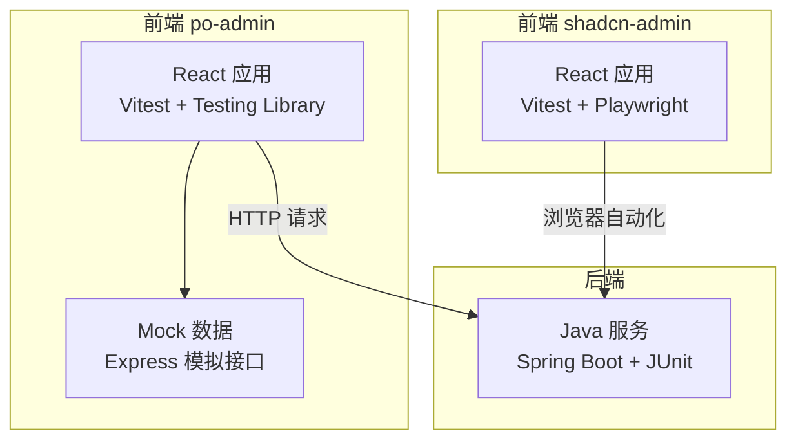
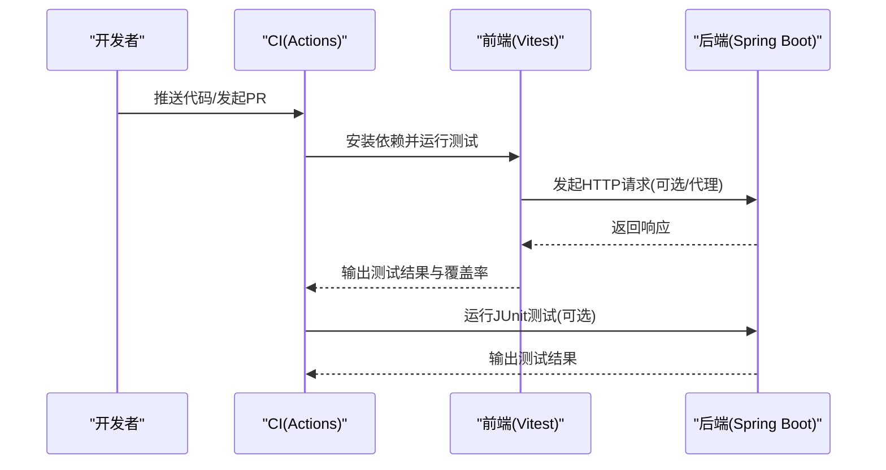
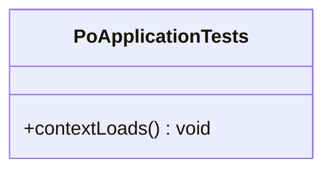
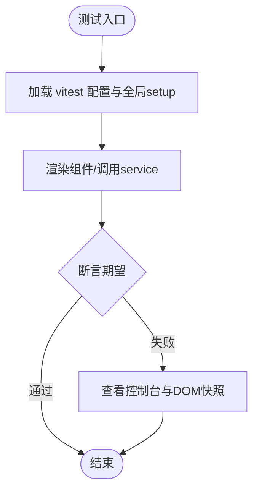
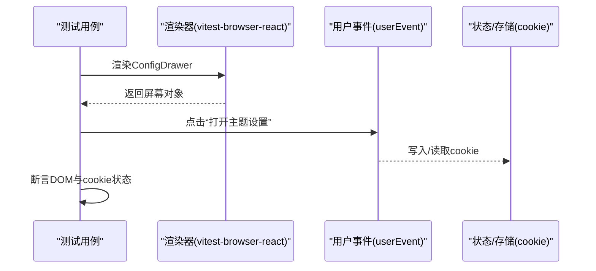
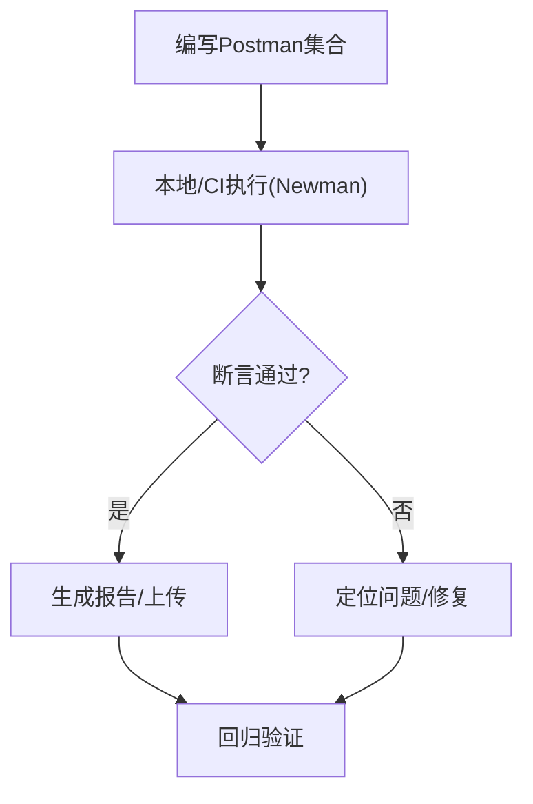
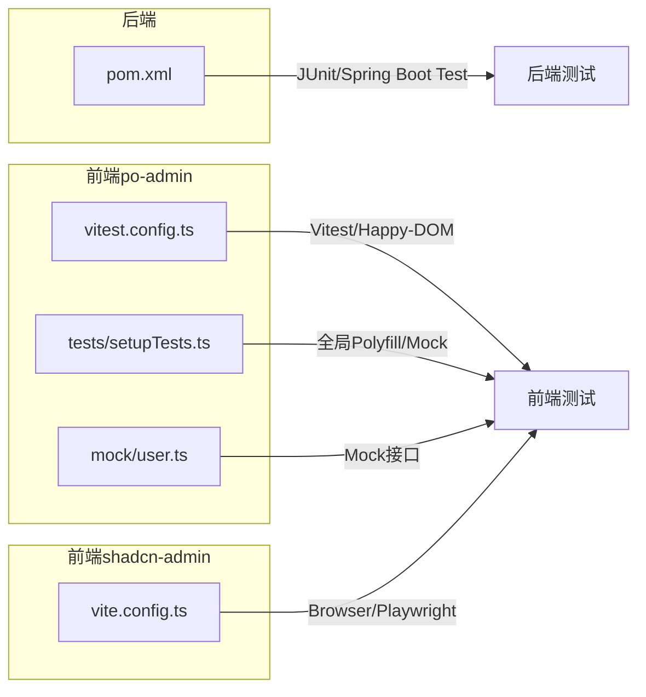

# 测试策略

<cite>
**本文引用的文件**
- [java_server/po/pom.xml](file://java_server/po/pom.xml)
- [java_server/po/src/test/java/com/goodzheng/po/PoApplicationTests.java](file://java_server/po/src/test/java/com/goodzheng/po/PoApplicationTests.java)
- [web_client/po-admin/vitest.config.ts](file://web_client/po-admin/vitest.config.ts)
- [web_client/po-admin/tests/setupTests.ts](file://web_client/po-admin/tests/setupTests.ts)
- [web_client/po-admin/package.json](file://web_client/po-admin/package.json)
- [web_client/po-admin/codecov.yml](file://web_client/po-admin/codecov.yml)
- [web_client/po-admin/.github/workflows/ci.yml](file://web_client/po-admin/.github/workflows/ci.yml)
- [web_client/po-admin/.github/workflows/coverage.yml](file://web_client/po-admin/.github/workflows/coverage.yml)
- [web_client/po-admin/mock/user.ts](file://web_client/po-admin/mock/user.ts)
- [web_client/po-admin/src/pages/dashboard/analysis/index.test.tsx](file://web_client/po-admin/src/pages/dashboard/analysis/index.test.tsx)
- [web_client/shadcn-admin/vite.config.ts](file://web_client/shadcn-admin/vite.config.ts)
- [web_client/shadcn-admin/package.json](file://web_client/shadcn-admin/package.json)
- [web_client/shadcn-admin/src/components/config-drawer.test.tsx](file://web_client/shadcn-admin/src/components/config-drawer.test.tsx)
- [web_client/shadcn-admin/src/lib/utils.test.ts](file://web_client/shadcn-admin/src/lib/utils.test.ts)
- [web_client/shadcn-admin/.github/workflows/ci.yml](file://web_client/shadcn-admin/.github/workflows/ci.yml)
</cite>

## 目录
1. [简介](#简介)
2. [项目结构](#项目结构)
3. [核心组件](#核心组件)
4. [架构总览](#架构总览)
5. [详细组件分析](#详细组件分析)
6. [依赖关系分析](#依赖关系分析)
7. [性能考量](#性能考量)
8. [故障排查指南](#故障排查指南)
9. [结论](#结论)
10. [附录](#附录)

## 简介
本测试策略文档面向多模块仓库，覆盖后端 Java（Spring Boot + JUnit）、前端 React（Vitest + Testing Library）以及端到端与 API 接口测试。目标包括：
- 明确单元测试、集成测试、端到端测试的边界与实施方法
- 规范 Mock 数据准备与环境隔离
- 定义覆盖率阈值与持续集成流程
- 提供测试数据管理、环境搭建与结果分析的实践建议

## 项目结构
仓库包含三个主要子工程：
- 后端 Java 服务：基于 Spring Boot，使用 Maven 构建，已引入 spring-boot-starter-test
- 前端 po-admin：基于 Umi/Ant Design Pro，使用 Vitest 进行单元与集成测试，配置了 V8 覆盖率
- 前端 shadcn-admin：基于 Vite + React，使用 Vitest + Playwright 浏览器模式进行测试与覆盖率

**图示来源**
- [java_server/po/pom.xml:32-89](file://java_server/po/pom.xml#L32-L89)
- [web_client/po-admin/vitest.config.ts:12-38](file://web_client/po-admin/vitest.config.ts#L12-L38)
- [web_client/shadcn-admin/vite.config.ts:24-31](file://web_client/shadcn-admin/vite.config.ts#L24-L31)

**章节来源**
- [java_server/po/pom.xml:32-89](file://java_server/po/pom.xml#L32-L89)
- [web_client/po-admin/vitest.config.ts:12-38](file://web_client/po-admin/vitest.config.ts#L12-L38)
- [web_client/shadcn-admin/vite.config.ts:24-31](file://web_client/shadcn-admin/vite.config.ts#L24-L31)

## 核心组件
- 后端测试基座：Spring Boot Test 与 JUnit 5，用于上下文加载与基础断言
- 前端 po-admin：Vitest 配置、全局 setup、页面级组件测试与 service mock
- 前端 shadcn-admin：Vitest 浏览器模式（Playwright），组件交互与状态验证
- 持续集成：GitHub Actions 执行 lint、tsc、build、test、coverage

**章节来源**
- [java_server/po/src/test/java/com/goodzheng/po/PoApplicationTests.java:1-14](file://java_server/po/src/test/java/com/goodzheng/po/PoApplicationTests.java#L1-L14)
- [web_client/po-admin/vitest.config.ts:12-38](file://web_client/po-admin/vitest.config.ts#L12-L38)
- [web_client/po-admin/tests/setupTests.ts:1-106](file://web_client/po-admin/tests/setupTests.ts#L1-L106)
- [web_client/shadcn-admin/vite.config.ts:32-50](file://web_client/shadcn-admin/vite.config.ts#L32-L50)

## 架构总览
下图展示前后端测试在 CI 中的协作关系：前端通过 Vitest 运行单元/集成测试，必要时通过浏览器模式或代理访问后端；后端通过 JUnit 启动上下文并验证服务层/控制器行为。

**图示来源**
- [web_client/po-admin/.github/workflows/ci.yml:8-56](file://web_client/po-admin/.github/workflows/ci.yml#L8-L56)
- [web_client/shadcn-admin/.github/workflows/ci.yml:12-48](file://web_client/shadcn-admin/.github/workflows/ci.yml#L12-L48)
- [web_client/shadcn-admin/vite.config.ts:24-31](file://web_client/shadcn-admin/vite.config.ts#L24-L31)

## 详细组件分析

### 后端 Java 测试（JUnit 5 + Spring Boot Test）
- 框架与依赖：spring-boot-starter-test 提供 JUnit 5、MockMvc、TestRestTemplate 等能力
- 基类用例：PoApplicationTests 使用 @SpringBootTest 加载应用上下文，便于后续扩展 Controller/Service 测试
- 推荐实践：
  - 使用 @WebMvcTest 对控制器进行切片测试，配合 @MockBean 注入 Service
  - 使用 @DataJpaTest 对 Repository 进行数据库相关测试（可结合内存库 H2）
  - 使用 @SpringBootTest + TestRestTemplate 做轻量级集成测试
  - 使用 @MockBean 替换外部依赖（如 Redis、第三方 API）

**图示来源**
- [java_server/po/src/test/java/com/goodzheng/po/PoApplicationTests.java:1-14](file://java_server/po/src/test/java/com/goodzheng/po/PoApplicationTests.java#L1-L14)

**章节来源**
- [java_server/po/pom.xml:86-89](file://java_server/po/pom.xml#L86-L89)
- [java_server/po/src/test/java/com/goodzheng/po/PoApplicationTests.java:1-14](file://java_server/po/src/test/java/com/goodzheng/po/PoApplicationTests.java#L1-L14)

### 前端 po-admin 测试（Vitest + Testing Library）
- 运行与脚本：package.json 提供 test、test:coverage、test:watch、test:ui
- 环境配置：vitest.config.ts 设置 happy-dom 环境、全局 setup、覆盖率收集（v8）
- 全局初始化：tests/setupTests.ts 提供 localStorage、Worker、MessageChannel、matchMedia、ResizeObserver 等 polyfill/mocks
- 组件测试示例：dashboard/analysis 页面测试通过 vi.mock 对 service 与 UI 组件进行隔离，验证渲染与数据传递
- 建议：
  - 将 service 层与 UI 层解耦，优先对 service 进行纯函数/异步逻辑测试
  - 使用 vi.fn()/vi.mocked() 构造确定性返回值
  - 对网络请求使用本地 mock 或拦截器，避免真实网络依赖

**图示来源**
- [web_client/po-admin/vitest.config.ts:12-38](file://web_client/po-admin/vitest.config.ts#L12-L38)
- [web_client/po-admin/tests/setupTests.ts:1-106](file://web_client/po-admin/tests/setupTests.ts#L1-L106)
- [web_client/po-admin/src/pages/dashboard/analysis/index.test.tsx:1-241](file://web_client/po-admin/src/pages/dashboard/analysis/index.test.tsx#L1-L241)

**章节来源**
- [web_client/po-admin/package.json:7-32](file://web_client/po-admin/package.json#L7-L32)
- [web_client/po-admin/vitest.config.ts:12-38](file://web_client/po-admin/vitest.config.ts#L12-L38)
- [web_client/po-admin/tests/setupTests.ts:1-106](file://web_client/po-admin/tests/setupTests.ts#L1-L106)
- [web_client/po-admin/src/pages/dashboard/analysis/index.test.tsx:1-241](file://web_client/po-admin/src/pages/dashboard/analysis/index.test.tsx#L1-L241)

### 前端 shadcn-admin 测试（Vitest + Playwright 浏览器模式）
- 运行与脚本：package.json 提供 test、test:browser、test:coverage、test:ui
- 浏览器模式：vite.config.ts 启用 browser.playwright，实例为 chromium
- 组件测试示例：config-drawer.test.tsx 使用 vitest-browser-react 渲染组件，userEvent 模拟点击，断言 cookie 与 DOM 变化
- 建议：
  - 对涉及浏览器 API 的行为（cookie、主题、布局）使用浏览器模式测试
  - 使用 clearCookies 等工具确保测试间隔离
  - 对复杂交互拆分为多个小用例，提高稳定性

**图示来源**
- [web_client/shadcn-admin/vite.config.ts:32-50](file://web_client/shadcn-admin/vite.config.ts#L32-L50)
- [web_client/shadcn-admin/src/components/config-drawer.test.tsx:1-320](file://web_client/shadcn-admin/src/components/config-drawer.test.tsx#L1-L320)

**章节来源**
- [web_client/shadcn-admin/package.json:6-19](file://web_client/shadcn-admin/package.json#L6-L19)
- [web_client/shadcn-admin/vite.config.ts:32-50](file://web_client/shadcn-admin/vite.config.ts#L32-L50)
- [web_client/shadcn-admin/src/components/config-drawer.test.tsx:1-320](file://web_client/shadcn-admin/src/components/config-drawer.test.tsx#L1-L320)

### API 接口测试策略（Postman 与自动化）
- 本地 Mock：po-admin 提供 Express 风格的 mock 路由，可用于快速验证前端错误分支与边界条件
- 自动化建议：
  - 使用 Postman 集合组织登录、鉴权、业务 CRUD 场景，导出为 JSON 供团队共享
  - 使用 Newman 在 CI 中执行集合，生成报告
  - 结合环境变量区分 dev/test/prod 环境
- 与前端联动：前端可通过代理指向本地后端或 Mock 服务，保证联调效率

**章节来源**
- [web_client/po-admin/mock/user.ts:102-144](file://web_client/po-admin/mock/user.ts#L102-L144)

### 测试覆盖率要求
- 前端 po-admin：使用 v8 提供者，输出 text/json/html 报告；当前 codecov.yml 将覆盖率标记为 informational，不阻塞 PR
- 建议阈值：
  - 行覆盖率 ≥ 80%
  - 分支覆盖率 ≥ 70%
  - 关键路径（认证、支付、权限）≥ 90%
- 报告位置：CI 步骤中执行 coverage 命令后上传至 Codecov/GitHub Artifacts

**章节来源**
- [web_client/po-admin/vitest.config.ts:25-35](file://web_client/po-admin/vitest.config.ts#L25-L35)
- [web_client/po-admin/codecov.yml:1-12](file://web_client/po-admin/codecov.yml#L1-L12)

### 持续集成配置
- po-admin：
  - CI：lint、tsc、build 在多平台矩阵执行
  - Coverage：独立 workflow 执行 ut 与 coverage 任务
- shadcn-admin：
  - CI：安装依赖、lint、format check、安装浏览器、运行测试、构建
- 建议：
  - 统一 Node 版本缓存
  - 并行化 jobs，缩短流水线时间
  - 失败时保留日志与产物以便排查

**章节来源**
- [web_client/po-admin/.github/workflows/ci.yml:8-56](file://web_client/po-admin/.github/workflows/ci.yml#L8-L56)
- [web_client/po-admin/.github/workflows/coverage.yml:1-21](file://web_client/po-admin/.github/workflows/coverage.yml#L1-L21)
- [web_client/shadcn-admin/.github/workflows/ci.yml:12-48](file://web_client/shadcn-admin/.github/workflows/ci.yml#L12-L48)

## 依赖关系分析
- 后端：spring-boot-starter-test 提供测试基础设施；MyBatis-Plus、JPA、Redis、MySQL 驱动作为运行时依赖
- 前端 po-admin：Vitest、Testing Library、happy-dom、@testing-library/jest-dom、mockjs；通过 vite.config 与 setup 文件完成环境装配
- 前端 shadcn-admin：Vitest、Playwright、vitest-browser-react；通过 vite.config 启用浏览器模式与覆盖率

**图示来源**
- [java_server/po/pom.xml:32-89](file://java_server/po/pom.xml#L32-L89)
- [web_client/po-admin/vitest.config.ts:12-38](file://web_client/po-admin/vitest.config.ts#L12-L38)
- [web_client/po-admin/tests/setupTests.ts:1-106](file://web_client/po-admin/tests/setupTests.ts#L1-L106)
- [web_client/po-admin/mock/user.ts:102-144](file://web_client/po-admin/mock/user.ts#L102-L144)
- [web_client/shadcn-admin/vite.config.ts:32-50](file://web_client/shadcn-admin/vite.config.ts#L32-L50)

**章节来源**
- [java_server/po/pom.xml:32-89](file://java_server/po/pom.xml#L32-L89)
- [web_client/po-admin/vitest.config.ts:12-38](file://web_client/po-admin/vitest.config.ts#L12-L38)
- [web_client/po-admin/tests/setupTests.ts:1-106](file://web_client/po-admin/tests/setupTests.ts#L1-L106)
- [web_client/po-admin/mock/user.ts:102-144](file://web_client/po-admin/mock/user.ts#L102-L144)
- [web_client/shadcn-admin/vite.config.ts:32-50](file://web_client/shadcn-admin/vite.config.ts#L32-L50)

## 性能考量
- 测试隔离：每个用例前清理状态（cookie、localStorage、全局变量），避免相互污染
- 异步处理：合理设置超时与等待策略，避免不必要的 sleep
- 资源控制：限制并发与内存占用（CI 中设置 NODE_OPTIONS）
- 覆盖率裁剪：排除生成代码、样式文件、类型声明，减少噪音
- 浏览器测试：仅在必要时启用浏览器模式，提升执行速度

[本节为通用指导，无需特定文件引用]

## 故障排查指南
- 前端测试无法找到元素：检查 render 是否包裹必要 Provider，确认 data-testid/role/name 选择器
- 网络请求失败：确认 mock/代理配置是否正确，检查请求路径与参数
- 浏览器模式不稳定：确保浏览器已安装，必要时增加重试与等待
- 覆盖率异常：检查 include/exclude 规则，确认源文件未被打包工具转换导致映射丢失
- CI 失败：查看各 job 日志，定位具体步骤失败原因

**章节来源**
- [web_client/po-admin/tests/setupTests.ts:1-106](file://web_client/po-admin/tests/setupTests.ts#L1-L106)
- [web_client/shadcn-admin/vite.config.ts:24-31](file://web_client/shadcn-admin/vite.config.ts#L24-L31)
- [web_client/po-admin/.github/workflows/ci.yml:8-56](file://web_client/po-admin/.github/workflows/ci.yml#L8-L56)

## 结论
本策略以现有工程为基础，明确了三层测试的实施要点：后端 JUnit 切片与集成测试、前端 Vitest 单元/集成/浏览器测试、API 接口测试与 CI 流水线。通过统一的覆盖率标准与稳定的环境隔离，可有效提升质量与交付效率。建议在后续迭代中逐步完善用例覆盖、强化关键路径断言，并将 API 测试纳入常态化回归。

[本节为总结性内容，无需特定文件引用]

## 附录
- 常用命令
  - 前端 po-admin：npm run test / npm run test:coverage / npm run test:ui
  - 前端 shadcn-admin：pnpm test / pnpm test:coverage / pnpm test:ui
  - 后端：mvn test
- 最佳实践清单
  - 用例命名清晰，按功能域组织
  - 优先测试公共逻辑与边界条件
  - 使用固定种子生成随机数据，保证可重复性
  - 对外部依赖一律 Mock，保持测试快速稳定
  - 在 CI 中同时执行 lint、tsc、test、build、coverage

[本节为补充信息，无需特定文件引用]