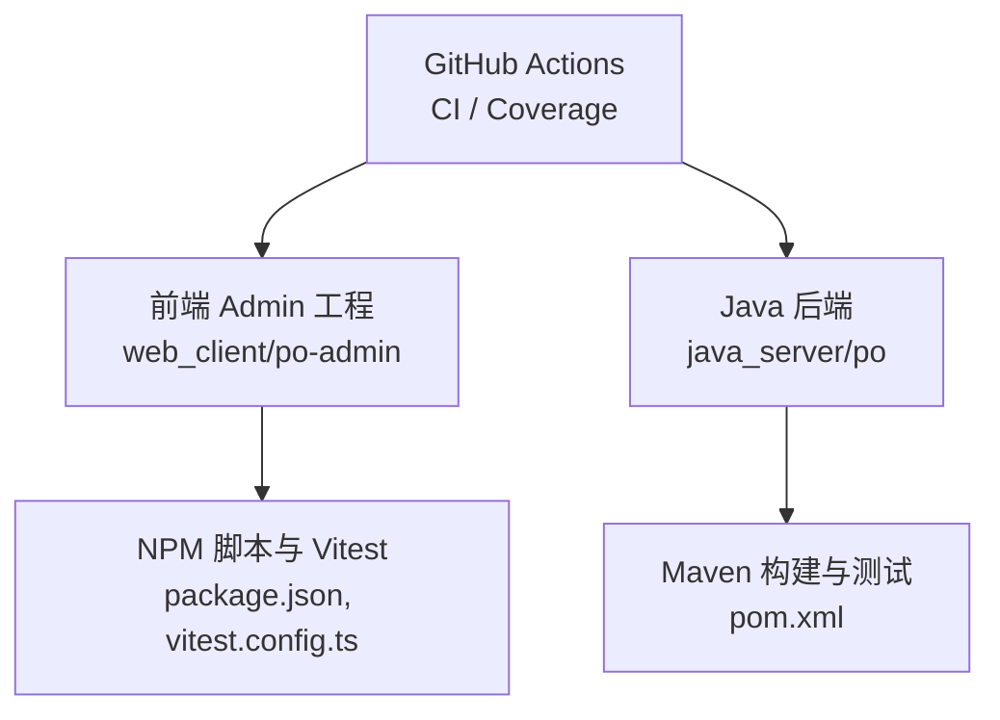
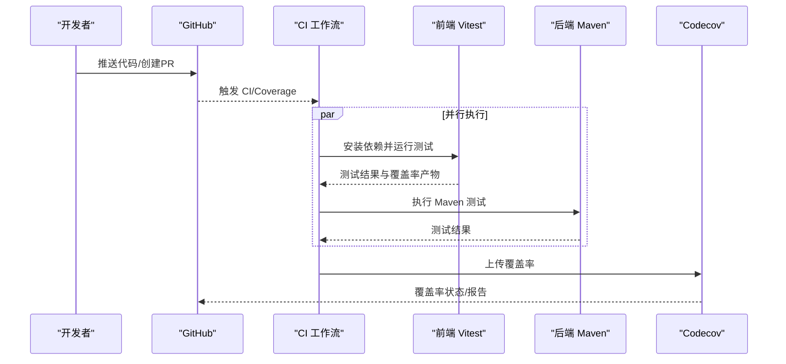
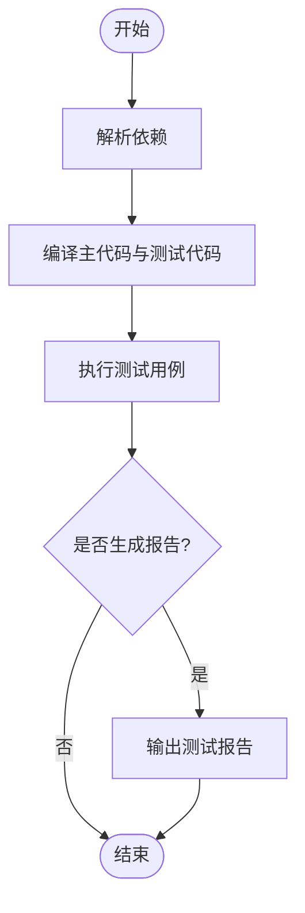
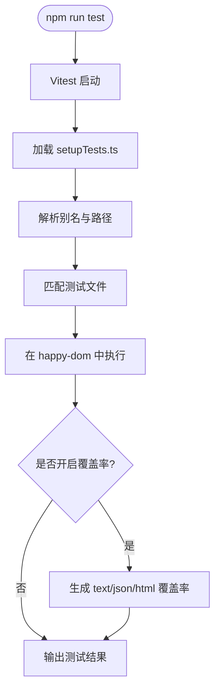
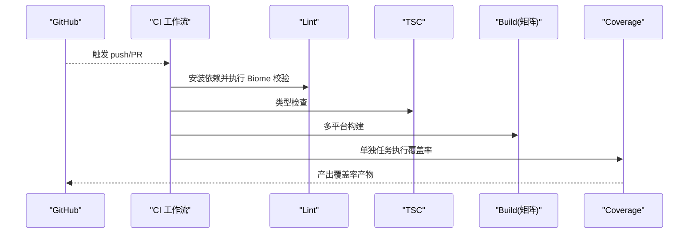
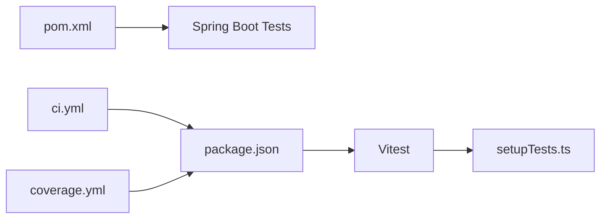

# 测试自动化

<cite>
**本文引用的文件**
- [pom.xml](file://java_server/po/pom.xml)
- [PoApplicationTests.java](file://java_server/po/src/test/java/com/goodzheng/po/PoApplicationTests.java)
- [application.yaml](file://java_server/po/src/main/resources/application.yaml)
- [package.json](file://web_client/po-admin/package.json)
- [vitest.config.ts](file://web_client/po-admin/vitest.config.ts)
- [setupTests.ts](file://web_client/po-admin/tests/setupTests.ts)
- [ci.yml](file://web_client/po-admin/.github/workflows/ci.yml)
- [coverage.yml](file://web_client/po-admin/.github/workflows/coverage.yml)
- [codecov.yml](file://web_client/po-admin/codecov.yml)
- [dependabot.yml](file://web_client/po-admin/.github/dependabot.yml)
</cite>

## 目录
1. [简介](#简介)
2. [项目结构](#项目结构)
3. [核心组件](#核心组件)
4. [架构总览](#架构总览)
5. [详细组件分析](#详细组件分析)
6. [依赖关系分析](#依赖关系分析)
7. [性能考虑](#性能考虑)
8. [故障排查指南](#故障排查指南)
9. [结论](#结论)
10. [附录](#附录)

## 简介
本文件面向持续集成中的测试自动化，覆盖后端 Java（Maven）与前端（NPM/Vitest）的测试执行、报告生成与失败处理；并给出 GitHub Actions 流水线在多环境、并行执行与结果通知方面的设计建议。同时提供测试数据管理、测试环境自动化、覆盖率统计、质量门禁与发布前检查的落地方案。

## 项目结构
仓库包含三个主要子工程：
- java_server/po：Spring Boot 后端，使用 Maven 构建与测试
- web_client/po-admin：Ant Design Pro 前端，使用 Umi + Vitest 进行单元测试与覆盖率收集
- web_client/shadcn-admin：另一个前端工程（当前文档聚焦 po-admin）

图表来源
- [pom.xml:117-159](file://java_server/po/pom.xml#L117-L159)
- [package.json:7-32](file://web_client/po-admin/package.json#L7-L32)
- [vitest.config.ts:1-39](file://web_client/po-admin/vitest.config.ts#L1-L39)
- [ci.yml:1-56](file://web_client/po-admin/.github/workflows/ci.yml#L1-L56)
- [coverage.yml:1-22](file://web_client/po-admin/.github/workflows/coverage.yml#L1-L22)

章节来源
- [pom.xml:117-159](file://java_server/po/pom.xml#L117-L159)
- [package.json:7-32](file://web_client/po-admin/package.json#L7-L32)
- [vitest.config.ts:1-39](file://web_client/po-admin/vitest.config.ts#L1-L39)
- [ci.yml:1-56](file://web_client/po-admin/.github/workflows/ci.yml#L1-L56)
- [coverage.yml:1-22](file://web_client/po-admin/.github/workflows/coverage.yml#L1-L22)

## 核心组件
- 后端测试基座
  - Spring Boot Test 依赖已引入，默认通过 Maven 生命周期执行测试
  - 示例测试类用于验证应用上下文加载
- 前端测试框架
  - Vitest 作为测试运行器，配置了 happy-dom 环境、全局设置、覆盖率采集与测试用例匹配规则
  - 测试前置 setup 文件提供 localStorage、Worker、MessageChannel 等浏览器 API 的模拟
- CI 流水线
  - CI 工作流执行 lint、类型检查与多平台构建
  - Coverage 工作流执行测试覆盖率收集
- 覆盖率上报
  - Codecov 配置将覆盖率状态设置为信息性，不阻断 PR

章节来源
- [pom.xml:85-89](file://java_server/po/pom.xml#L85-L89)
- [PoApplicationTests.java:1-14](file://java_server/po/src/test/java/com/goodzheng/po/PoApplicationTests.java#L1-L14)
- [vitest.config.ts:12-38](file://web_client/po-admin/vitest.config.ts#L12-L38)
- [setupTests.ts:1-106](file://web_client/po-admin/tests/setupTests.ts#L1-L106)
- [ci.yml:8-56](file://web_client/po-admin/.github/workflows/ci.yml#L8-L56)
- [coverage.yml:8-22](file://web_client/po-admin/.github/workflows/coverage.yml#L8-L22)
- [codecov.yml:1-13](file://web_client/po-admin/codecov.yml#L1-L13)

## 架构总览
下图展示了从代码提交到测试执行的端到端流程，包括前后端并行任务、覆盖率收集与上报。

图表来源
- [ci.yml:8-56](file://web_client/po-admin/.github/workflows/ci.yml#L8-L56)
- [coverage.yml:8-22](file://web_client/po-admin/.github/workflows/coverage.yml#L8-L22)
- [pom.xml:117-159](file://java_server/po/pom.xml#L117-L159)
- [package.json:27-31](file://web_client/po-admin/package.json#L27-L31)

## 详细组件分析

### Maven 测试配置与执行
- 测试依赖
  - 引入 spring-boot-starter-test，启用 JUnit 5 与 Spring 测试能力
- 编译插件
  - maven-compiler-plugin 在 compile 与 test-compile 阶段配置 Lombok 注解处理器
- 执行方式
  - 通过 Maven 生命周期（如 mvn test）自动执行 src/test 下的测试类
  - 示例测试类 PoApplicationTests 验证应用上下文加载

图表来源
- [pom.xml:85-89](file://java_server/po/pom.xml#L85-L89)
- [pom.xml:123-158](file://java_server/po/pom.xml#L123-L158)
- [PoApplicationTests.java:1-14](file://java_server/po/src/test/java/com/goodzheng/po/PoApplicationTests.java#L1-L14)

章节来源
- [pom.xml:85-89](file://java_server/po/pom.xml#L85-L89)
- [pom.xml:123-158](file://java_server/po/pom.xml#L123-L158)
- [PoApplicationTests.java:1-14](file://java_server/po/src/test/java/com/goodzheng/po/PoApplicationTests.java#L1-L14)

### NPM 脚本与 Vitest 测试配置
- 脚本命令
  - test：运行 Vitest
  - test:coverage：运行带覆盖率收集的测试
  - test:watch/test:ui：开发与 UI 模式
- Vitest 配置要点
  - 环境：happy-dom
  - 全局变量：开启
  - 初始化文件：tests/setupTests.ts
  - 用例匹配：src/**/*.{test,spec}.{ts,tsx}
  - 排除项：Umi 集成测试、node_modules、dist、.umi
  - 覆盖率：v8 提供者，text/json/html 报告，包含 src 下 ts/tsx，排除特定目录与样式文件
  - 超时与无用例通过：15s 超时，允许无用例通过

图表来源
- [package.json:27-31](file://web_client/po-admin/package.json#L27-L31)
- [vitest.config.ts:1-39](file://web_client/po-admin/vitest.config.ts#L1-L39)
- [setupTests.ts:1-106](file://web_client/po-admin/tests/setupTests.ts#L1-L106)

章节来源
- [package.json:27-31](file://web_client/po-admin/package.json#L27-L31)
- [vitest.config.ts:12-38](file://web_client/po-admin/vitest.config.ts#L12-L38)
- [setupTests.ts:1-106](file://web_client/po-admin/tests/setupTests.ts#L1-L106)

### GitHub Actions 流水线与多环境并行
- CI 工作流
  - 触发：push 与 pull_request
  - 任务：lint、tsc、build（矩阵策略：ubuntu/windows/macOS）
  - 缓存：npm 依赖缓存
  - 环境变量：CI、NODE_ENV=test、NODE_OPTIONS 内存限制
- Coverage 工作流
  - 触发：push 与 pull_request
  - 步骤：安装依赖、运行 ut 工具链、执行测试覆盖率
- Dependabot
  - 定期更新 npm 与 github-actions 依赖

图表来源
- [ci.yml:1-56](file://web_client/po-admin/.github/workflows/ci.yml#L1-L56)
- [coverage.yml:1-22](file://web_client/po-admin/.github/workflows/coverage.yml#L1-L22)
- [dependabot.yml:1-22](file://web_client/po-admin/.github/dependabot.yml#L1-L22)

章节来源
- [ci.yml:1-56](file://web_client/po-admin/.github/workflows/ci.yml#L1-L56)
- [coverage.yml:1-22](file://web_client/po-admin/.github/workflows/coverage.yml#L1-L22)
- [dependabot.yml:1-22](file://web_client/po-admin/.github/dependabot.yml#L1-L22)

### 测试数据管理与测试环境自动化
- 后端数据
  - 资源目录包含 SQL 数据脚本，可用于初始化或重置测试数据库
  - 应用配置文件 application.yaml 可区分不同环境的数据库与缓存连接参数
- 前端测试数据
  - 通过 setupTests.ts 注入 localStorage、Worker、MessageChannel 等浏览器 API 的模拟
  - 使用 happy-dom 提供 DOM 环境，避免真实浏览器依赖
- 建议实践
  - 为每个测试套件准备独立的数据集或事务回滚策略
  - 使用环境变量切换测试数据源（如 H2/MySQL），并通过 CI 注入对应配置

章节来源
- [application.yaml](file://java_server/po/src/main/resources/application.yaml)
- [setupTests.ts:1-106](file://web_client/po-admin/tests/setupTests.ts#L1-L106)

### 覆盖率统计、质量门禁与发布前检查
- 覆盖率统计
  - 前端：Vitest 使用 v8 提供者，输出 text/json/html 三种格式
  - 上报：可通过 Codecov 进行可视化展示（当前配置为信息性状态，不阻断 PR）
- 质量门禁
  - 建议在 CI 中增加阈值检查（例如最低覆盖率），未达标则标记失败
  - 结合 Dependabot 保持依赖更新，减少安全与兼容性问题
- 发布前检查
  - 在合并分支前强制通过 lint、tsc、测试与构建
  - 对关键模块添加契约测试或接口测试，确保前后端联调稳定

章节来源
- [vitest.config.ts:25-35](file://web_client/po-admin/vitest.config.ts#L25-L35)
- [coverage.yml:8-22](file://web_client/po-admin/.github/workflows/coverage.yml#L8-L22)
- [codecov.yml:1-13](file://web_client/po-admin/codecov.yml#L1-L13)
- [ci.yml:8-56](file://web_client/po-admin/.github/workflows/ci.yml#L8-L56)
- [dependabot.yml:1-22](file://web_client/po-admin/.github/dependabot.yml#L1-L22)

## 依赖关系分析
- 后端
  - Spring Boot Test 依赖驱动测试运行
  - Lombok 注解处理器参与编译期代码生成
- 前端
  - Vitest 依赖 happy-dom 提供 DOM 环境
  - setupTests.ts 提供全局模拟，降低对外部环境的耦合
- CI
  - 工作流依赖 Node.js 版本与 npm 缓存
  - 矩阵策略实现跨平台构建

图表来源
- [pom.xml:85-89](file://java_server/po/pom.xml#L85-L89)
- [package.json:27-31](file://web_client/po-admin/package.json#L27-L31)
- [vitest.config.ts:12-38](file://web_client/po-admin/vitest.config.ts#L12-L38)
- [setupTests.ts:1-106](file://web_client/po-admin/tests/setupTests.ts#L1-L106)
- [ci.yml:8-56](file://web_client/po-admin/.github/workflows/ci.yml#L8-L56)
- [coverage.yml:8-22](file://web_client/po-admin/.github/workflows/coverage.yml#L8-L22)

章节来源
- [pom.xml:85-89](file://java_server/po/pom.xml#L85-L89)
- [package.json:27-31](file://web_client/po-admin/package.json#L27-L31)
- [vitest.config.ts:12-38](file://web_client/po-admin/vitest.config.ts#L12-L38)
- [setupTests.ts:1-106](file://web_client/po-admin/tests/setupTests.ts#L1-L106)
- [ci.yml:8-56](file://web_client/po-admin/.github/workflows/ci.yml#L8-L56)
- [coverage.yml:8-22](file://web_client/po-admin/.github/workflows/coverage.yml#L8-L22)

## 性能考虑
- 前端测试
  - 合理设置测试超时与并行度，避免单用例阻塞整体执行
  - 使用 happy-dom 替代真实浏览器，提升执行速度
  - 通过 exclude 排除无关目录，减少扫描开销
- 后端测试
  - 控制测试数据量，必要时使用内存数据库或轻量级容器
  - 利用 Maven 缓存与增量编译缩短构建时间
- CI 优化
  - 启用依赖缓存与构建缓存
  - 矩阵任务拆分 lint/tsc/build，提高吞吐

[本节为通用指导，不直接分析具体文件]

## 故障排查指南
- 前端测试失败
  - 检查 vitest.config.ts 的 include/exclude 是否正确匹配用例
  - 确认 setupTests.ts 中全局模拟是否覆盖被测代码所需 API
  - 查看覆盖率配置是否误排除了关键源码
- 后端测试失败
  - 检查 Spring Boot Test 依赖与测试类注解
  - 确认数据库与 Redis 等外部依赖在测试环境中可用
  - 若上下文加载失败，检查 application.yaml 的配置与环境变量
- CI 失败
  - 核对 Node.js 版本与缓存策略
  - 检查矩阵任务的环境变量与内存限制
  - 确认覆盖率产物路径与上传步骤正确

章节来源
- [vitest.config.ts:12-38](file://web_client/po-admin/vitest.config.ts#L12-L38)
- [setupTests.ts:1-106](file://web_client/po-admin/tests/setupTests.ts#L1-L106)
- [pom.xml:85-89](file://java_server/po/pom.xml#L85-L89)
- [application.yaml](file://java_server/po/src/main/resources/application.yaml)
- [ci.yml:8-56](file://web_client/po-admin/.github/workflows/ci.yml#L8-L56)

## 结论
本项目已具备完善的测试基础：后端基于 Spring Boot Test 与 Maven，前端基于 Vitest 与 happy-dom，并通过 GitHub Actions 实现 CI 与覆盖率收集。建议在现有基础上进一步完善质量门禁（覆盖率阈值）、统一测试数据管理策略，并在合并前强制执行全量检查，以提升交付质量与稳定性。

[本节为总结，不直接分析具体文件]

## 附录
- 常用命令参考
  - 后端：mvn test
  - 前端：npm run test、npm run test:coverage
- 相关配置位置
  - 后端：pom.xml、application.yaml
  - 前端：package.json、vitest.config.ts、tests/setupTests.ts
  - CI：.github/workflows/ci.yml、.github/workflows/coverage.yml
  - 覆盖率：codecov.yml

章节来源
- [pom.xml:117-159](file://java_server/po/pom.xml#L117-L159)
- [application.yaml](file://java_server/po/src/main/resources/application.yaml)
- [package.json:27-31](file://web_client/po-admin/package.json#L27-L31)
- [vitest.config.ts:12-38](file://web_client/po-admin/vitest.config.ts#L12-L38)
- [setupTests.ts:1-106](file://web_client/po-admin/tests/setupTests.ts#L1-L106)
- [ci.yml:8-56](file://web_client/po-admin/.github/workflows/ci.yml#L8-L56)
- [coverage.yml:8-22](file://web_client/po-admin/.github/workflows/coverage.yml#L8-L22)
- [codecov.yml:1-13](file://web_client/po-admin/codecov.yml#L1-L13)