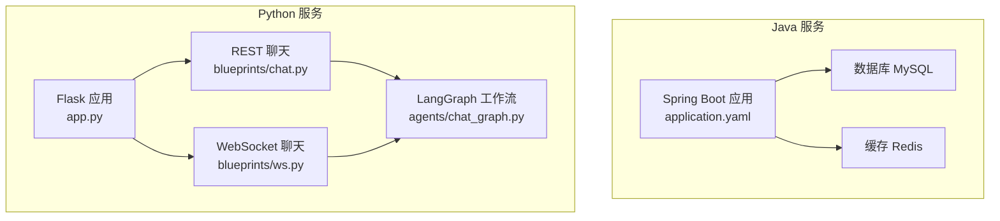
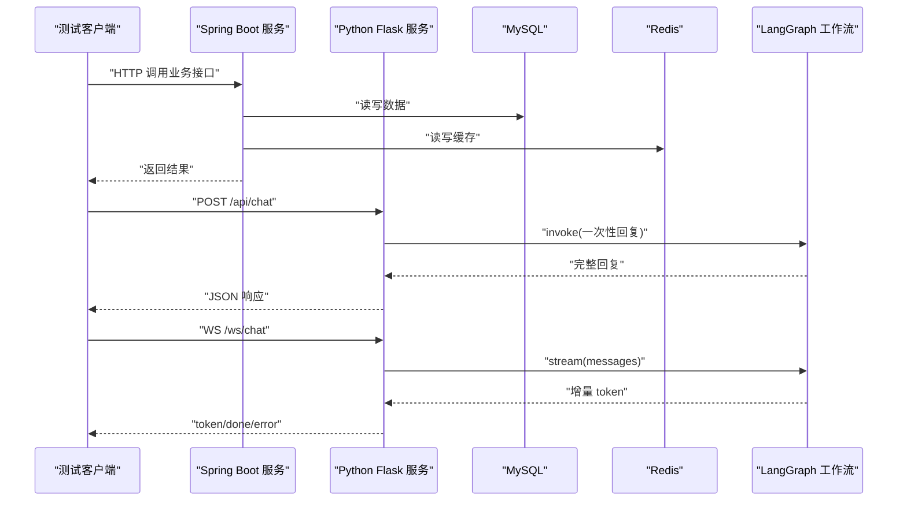
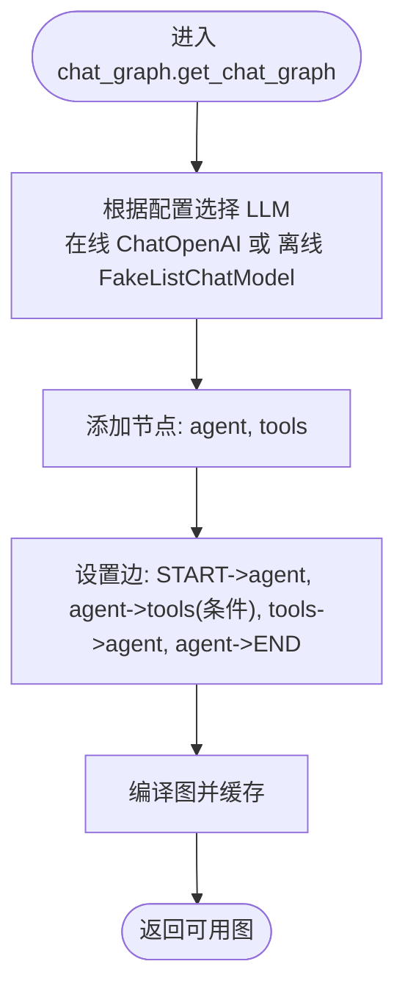
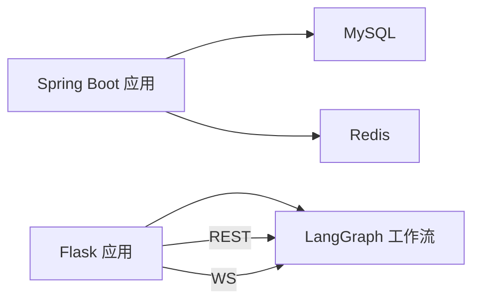

# 集成测试

<cite>
**本文引用的文件**
- [PoApplicationTests.java](file://java_server/po/src/test/java/com/goodzheng/po/PoApplicationTests.java)
- [application.yaml](file://java_server/po/src/main/resources/application.yaml)
- [pom.xml](file://java_server/po/pom.xml)
- [app.py](file://py_server/app.py)
- [config.py](file://py_server/config.py)
- [extensions.py](file://py_server/extensions.py)
- [chat.py](file://py_server/blueprints/chat.py)
- [ws.py](file://py_server/blueprints/ws.py)
- [chat_graph.py](file://py_server/agents/chat_graph.py)
</cite>

## 目录
1. [简介](#简介)
2. [项目结构](#项目结构)
3. [核心组件](#核心组件)
4. [架构总览](#架构总览)
5. [详细组件分析](#详细组件分析)
6. [依赖关系分析](#依赖关系分析)
7. [性能考虑](#性能考虑)
8. [故障排查指南](#故障排查指南)
9. [结论](#结论)
10. [附录](#附录)

## 简介
本文件面向多服务项目的跨服务集成测试，覆盖以下目标：
- Spring Boot 集成测试配置与数据库、Redis 缓存测试环境搭建
- Python AI 服务的集成测试方法，包括 LangGraph 工作流测试与 WebSocket 连接测试
- 微服务间通信的测试方案（HTTP 接口与消息队列）
- 测试数据准备、测试环境隔离与测试结果验证的最佳实践

本项目包含：
- Java 后端（Spring Boot），提供 REST API、JPA/MyBatis-Plus、Redis、Actuator 等能力
- Python 后端（Flask + LangGraph），提供 REST 对话与 WebSocket 流式对话
- 前端工程（Ant Design Pro/Shadcn Admin），用于联调与演示

## 项目结构
- java_server/po：Spring Boot 应用，含控制器、服务、仓储、配置与基础测试类
- py_server：Flask 应用，注册蓝图（REST/WS），构建并缓存 LangGraph 图
- web_client：前端工程，具备示例页面与服务调用封装

图表来源
- [application.yaml:1-109](file://java_server/po/src/main/resources/application.yaml#L1-L109)
- [app.py:1-51](file://py_server/app.py#L1-L51)
- [chat.py:1-24](file://py_server/blueprints/chat.py#L1-L24)
- [ws.py:1-90](file://py_server/blueprints/ws.py#L1-L90)
- [chat_graph.py:1-92](file://py_server/agents/chat_graph.py#L1-L92)

章节来源
- [application.yaml:1-109](file://java_server/po/src/main/resources/application.yaml#L1-L109)
- [app.py:1-51](file://py_server/app.py#L1-L51)

## 核心组件
- Spring Boot 应用
  - 通过 application.yaml 配置服务器端口、上下文路径、数据源、JPA、Redis、日志、Actuator 等
  - 使用 spring-boot-starter-test 进行集成测试
- Python Flask 应用
  - 工厂模式创建应用，注册 CORS、Sock、蓝图
  - 启动时编译并缓存 LangGraph 图，便于后续快速响应
  - 暴露 REST /api/chat 与 WS /ws/chat 两个入口
- LangGraph 工作流
  - 支持在线 LLM（OpenAI 兼容）与离线假模型两种模式
  - 工具节点支持函数调用（如获取当前时间）
  - 流式输出通过 stream_mode="messages" 推送增量 token

章节来源
- [application.yaml:1-109](file://java_server/po/src/main/resources/application.yaml#L1-L109)
- [pom.xml:32-115](file://java_server/po/pom.xml#L32-L115)
- [app.py:24-47](file://py_server/app.py#L24-L47)
- [chat_graph.py:46-86](file://py_server/agents/chat_graph.py#L46-L86)

## 架构总览
下图展示从客户端到各服务的请求链路，以及测试关注点。

图表来源
- [application.yaml:1-109](file://java_server/po/src/main/resources/application.yaml#L1-L109)
- [chat.py:10-23](file://py_server/blueprints/chat.py#L10-L23)
- [ws.py:30-89](file://py_server/blueprints/ws.py#L30-L89)
- [chat_graph.py:75-86](file://py_server/agents/chat_graph.py#L75-L86)

## 详细组件分析

### Spring Boot 集成测试策略
- 测试基座
  - 使用 @SpringBootTest 启动完整上下文，便于端到端验证
  - 建议结合 @AutoConfigureTestDatabase 或内存数据库（H2）替换真实数据源，确保测试隔离
- 数据库测试
  - 在测试环境切换为内嵌数据库或独立测试库，避免污染生产数据
  - 使用事务回滚或脚本初始化（data-*.sql）准备测试数据
- Redis 缓存测试
  - 使用嵌入式 Redis 或独立测试实例；通过配置覆盖 host/port/password
  - 对热点读场景编写用例，验证缓存命中与失效逻辑
- 外部 API 模拟
  - 使用 @WebMvcTest + MockMvc 对控制器进行切片测试
  - 对下游 HTTP 调用使用 WireMock 或 TestRestTemplate 的 stub 机制
- Actuator 与健康检查
  - 可借助 Actuator 的健康端点进行服务可用性验证

章节来源
- [PoApplicationTests.java:6-11](file://java_server/po/src/test/java/com/goodzheng/po/PoApplicationTests.java#L6-L11)
- [application.yaml:23-53](file://java_server/po/src/main/resources/application.yaml#L23-L53)
- [pom.xml:32-115](file://java_server/po/pom.xml#L32-L115)

### Python AI 服务集成测试策略
- 应用启动与预热
  - 通过 create_app 构建应用，并在启动时编译 LangGraph 图，保证首次请求即走缓存路径
- REST 对话测试（/api/chat）
  - 构造 JSON 请求体，校验返回字段与状态码
  - 覆盖空消息、异常分支（网络/模型不可用）等边界条件
- WebSocket 流式对话测试（/ws/chat）
  - 建立连接后发送 {"type":"message","content":"..."}，断言收到多个 token 帧与最终的 done 帧
  - 校验心跳 ping/pong、错误帧 error 的处理
- LangGraph 工作流测试
  - 直接调用 get_chat_graph() 获取编译后的图，分别以 invoke 与 stream 方式执行
  - 覆盖工具调用分支（agent -> tools -> agent -> END）与非工具调用分支（END）
  - 在无 OPENAI_API_KEY 时验证离线假模型行为

图表来源
- [chat_graph.py:46-86](file://py_server/agents/chat_graph.py#L46-L86)

章节来源
- [app.py:24-47](file://py_server/app.py#L24-L47)
- [chat.py:10-23](file://py_server/blueprints/chat.py#L10-L23)
- [ws.py:30-89](file://py_server/blueprints/ws.py#L30-L89)
- [chat_graph.py:46-86](file://py_server/agents/chat_graph.py#L46-L86)

### 微服务间通信测试方案
- HTTP 接口测试
  - 使用 TestRestTemplate 或 RestAssured 对 Spring Boot 控制器发起请求
  - 使用 WireMock 模拟第三方 HTTP 依赖，验证重试、超时、降级逻辑
- 消息队列测试（通用建议）
  - 使用嵌入式 Broker（如内存 RabbitMQ/In-Memory Kafka）或 Docker Compose 启动测试实例
  - 通过监听队列消费断言消息内容与顺序，必要时引入延迟/失败重放用例
- 端到端编排
  - 将 Spring Boot 与 Python 服务同时启动，通过 HTTP/WS 串联验证跨服务流程
  - 使用容器化编排（Docker Compose）管理依赖服务（MySQL、Redis、Broker）

[本节为通用指导，不直接分析具体文件]

## 依赖关系分析
- Spring Boot 依赖
  - JPA、Redis、Web MVC、Actuator、Validation、Security Crypto、JWT 等
  - 测试依赖 spring-boot-starter-test
- Python 依赖
  - Flask、flask-cors、flask-sock、langchain-core、langgraph、langchain-openai
- 运行时配置
  - application.yaml 定义数据库、Redis、日志、Actuator 等
  - config.py 通过环境变量注入 LLM 参数与服务地址

图表来源
- [pom.xml:32-115](file://java_server/po/pom.xml#L32-L115)
- [application.yaml:23-53](file://java_server/po/src/main/resources/application.yaml#L23-L53)
- [chat_graph.py:46-86](file://py_server/agents/chat_graph.py#L46-L86)

章节来源
- [pom.xml:32-115](file://java_server/po/pom.xml#L32-L115)
- [application.yaml:23-53](file://java_server/po/src/main/resources/application.yaml#L23-L53)
- [config.py:10-25](file://py_server/config.py#L10-L25)

## 性能考虑
- 数据库连接池
  - HikariCP 最大连接数与空闲线程需按压测调整，避免连接耗尽
- Redis 连接池
  - 合理设置 max-active/max-idle，减少握手开销
- LangGraph 图缓存
  - 使用 lru_cache 缓存编译后的图，降低首请求延迟
- 流式输出
  - WebSocket 流式推送可减少首字节延迟，提升交互体验
- 并发与超时
  - Tomcat 线程与连接上限需匹配预期 QPS；对外部依赖设置超时与熔断

[本节为通用指导，不直接分析具体文件]

## 故障排查指南
- Spring Boot
  - 通过 Actuator 健康端点检查数据库与 Redis 连通性
  - 开启 show-sql 观察 SQL 执行情况，定位慢查询
- Python 服务
  - 未配置 OPENAI_API_KEY 时自动降级为离线模式，便于本地联调
  - WebSocket 处理异常会返回 error 帧，并记录服务端日志
- 常见问题
  - 端口冲突：确认 server.port、Config.PORT
  - 跨域问题：CORS 资源路径需覆盖 /api/* 与 /ws/*
  - 认证失败：检查 JWT 密钥与过期时间配置

章节来源
- [application.yaml:84-109](file://java_server/po/src/main/resources/application.yaml#L84-L109)
- [config.py:10-25](file://py_server/config.py#L10-L25)
- [ws.py:67-89](file://py_server/blueprints/ws.py#L67-L89)

## 结论
- 通过分层测试策略（单元、集成、端到端）与隔离的测试环境，可有效保障跨服务集成的稳定性
- Spring Boot 侧重点在于数据库与缓存的正确性、外部依赖的模拟与健壮性
- Python 侧重点在于 LangGraph 工作流的正确性与 WebSocket 流式协议的一致性
- 建议在 CI 中统一编排依赖服务（MySQL、Redis、可选 MQ），实现一键回归

[本节为总结性内容，不直接分析具体文件]

## 附录
- 测试数据准备
  - 使用 data-*.sql 初始化基础数据；测试用例优先使用事务回滚或独立测试库
- 测试环境隔离
  - 通过 profiles 或环境变量区分 dev/test/prod；测试环境关闭不必要功能（如邮件、定时任务）
- 测试结果验证
  - 断言状态码、响应体关键字段、数据库最终态、缓存命中情况、消息队列消费结果
- 最佳实践清单
  - 每个用例只验证一个职责
  - 对外部依赖一律 Mock 或替换为测试替身
  - 保持用例幂等与可重复执行
  - 记录关键日志与指标，便于失败回溯

[本节为通用指导，不直接分析具体文件]