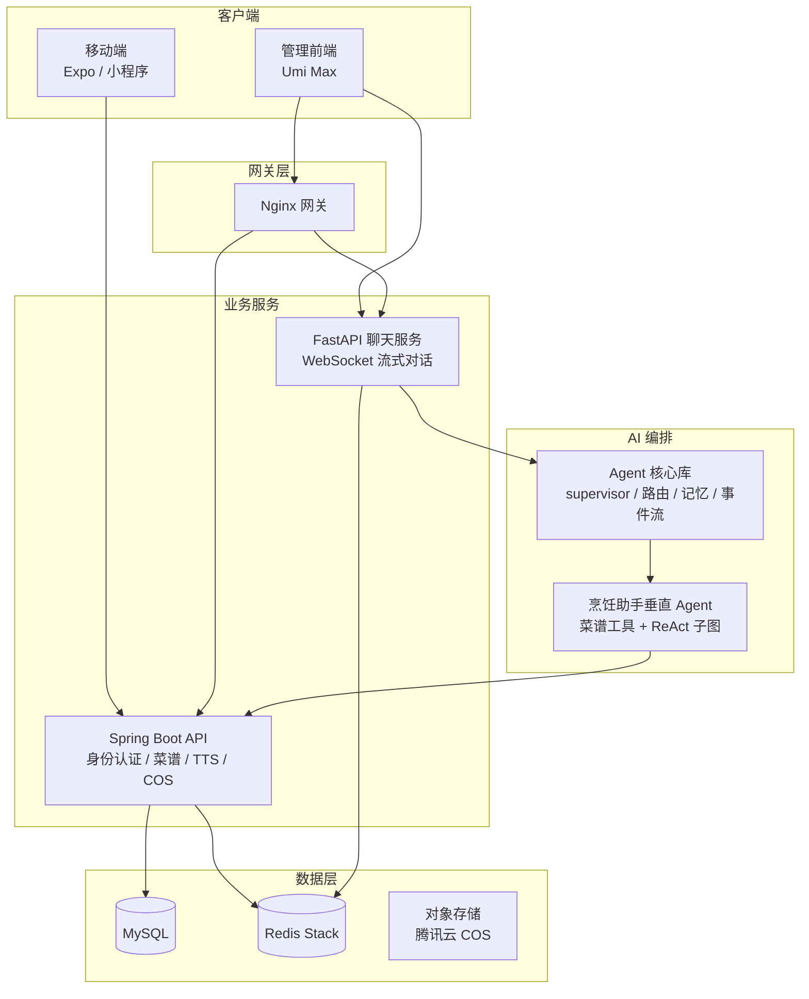
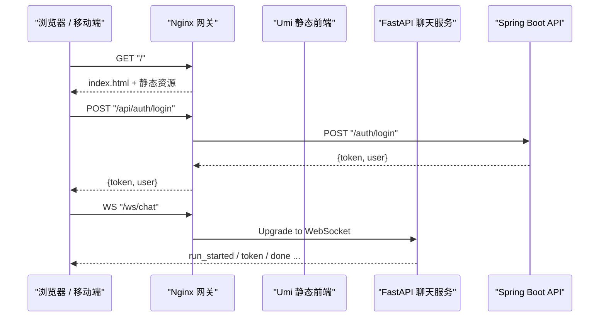
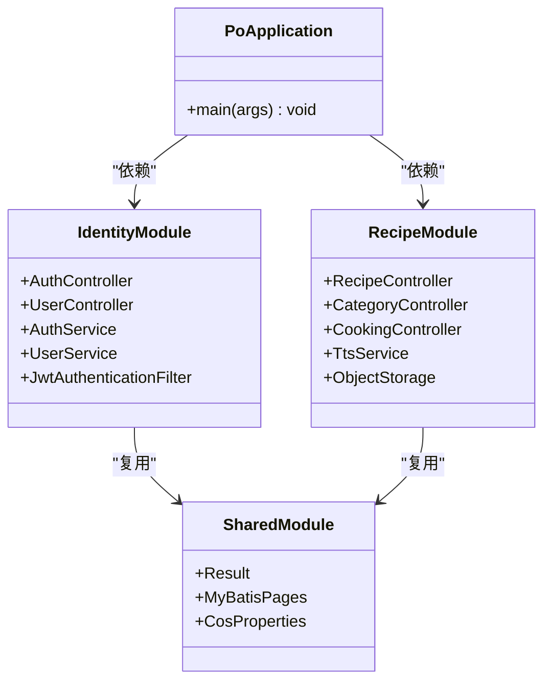
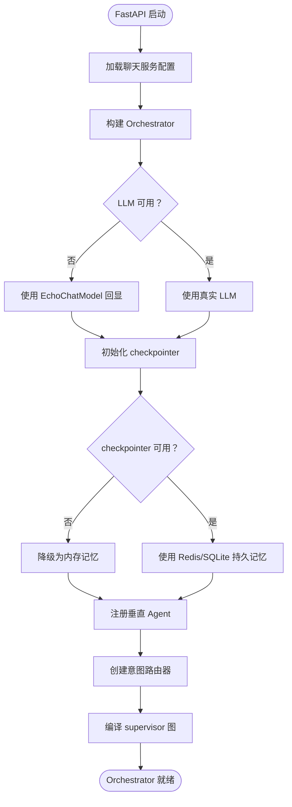
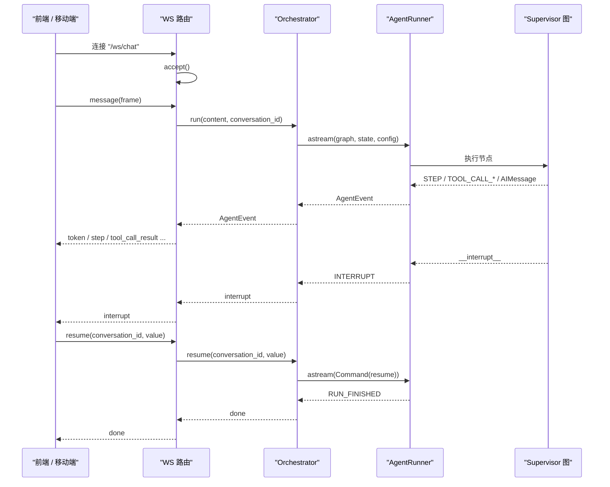
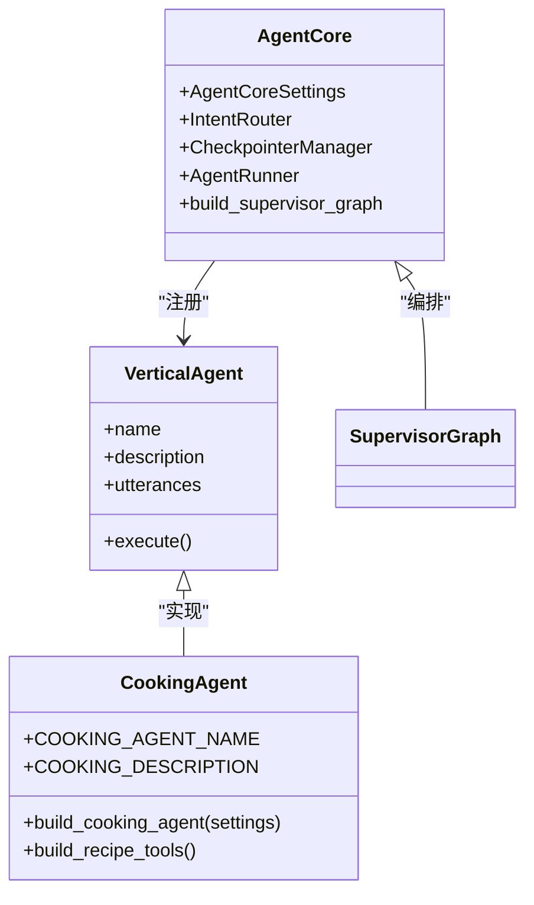
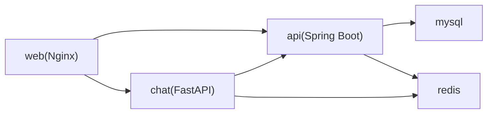
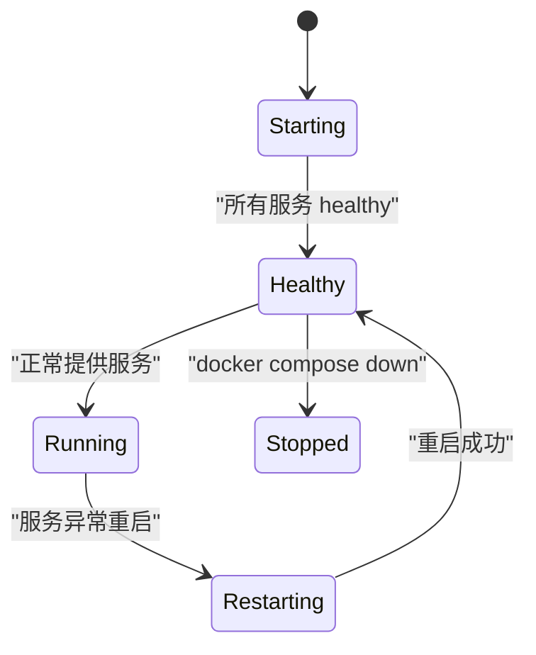

# 系统架构

<cite>
**本文引用的文件**   
- [README.md](file://README.md)
- [docker-compose.yml](file://docker-compose.yml)
- [nginx.conf](file://infra/nginx/nginx.conf)
- [pom.xml](file://services/api/pom.xml)
- [PoApplication.java](file://services/api/api-bootstrap/src/main/java/com/goodzheng/po/PoApplication.java)
- [main.py](file://services/chat/app/main.py)
- [agent.py](file://services/chat/app/agent.py)
- [ws.py](file://services/chat/app/routers/ws.py)
- [__init__.py（agent-core）](file://services/agent-core/src/po_agent_core/__init__.py)
- [runner.py](file://services/agent-core/src/po_agent_core/runner/runner.py)
- [__init__.py（agent-cooking）](file://services/agent-cooking/src/po_agent_cooking/__init__.py)
</cite>

## 目录
1. [引言](#引言)
2. [项目结构](#项目结构)
3. [核心组件](#核心组件)
4. [架构总览](#架构总览)
5. [详细组件分析](#详细组件分析)
6. [依赖关系分析](#依赖关系分析)
7. [性能与扩展性](#性能与扩展性)
8. [部署与容器化](#部署与容器化)
9. [故障排查指南](#故障排查指南)
10. [结论](#结论)

## 引言
PO 是一个菜谱与用户业务的全栈 Monorepo：前端管理端、移动端、共享类型包，后端 Spring Boot API，Python FastAPI 聊天服务，以及基于 LangGraph 的 Agent 编排库。整体采用微服务式划分，但通过 Docker Compose 统一编排；对外仅暴露 Nginx 网关，内部服务通过 compose 网络互通。

该文档聚焦系统级架构设计，说明前后端职责边界、RESTful 与 WebSocket 通信机制、Nginx 路由策略、数据流向、容器化部署方式，以及如何扩展新服务和功能模块。

## 项目结构
仓库按“应用 + 服务 + 基础设施”分层组织：
- `apps`：管理前端 Umi Max 应用、Expo 移动端、微信小程序端。
- `packages/types`：前后端共享 TypeScript 类型。
- `services`：后端 API（Java）、聊天服务（Python）、Agent 核心库、烹饪助手垂直 Agent。
- `infra/nginx`：Nginx 网关配置。
- `scripts`：本地开发与服务启动脚本。
- `tools`：数据填充与辅助工具。

**图表来源**
- [README.md:16-43](file://README.md#L16-L43)
- [docker-compose.yml:7-128](file://docker-compose.yml#L7-L128)
- [nginx.conf:1-114](file://infra/nginx/nginx.conf#L1-L114)

**章节来源**
- [README.md:1-34](file://README.md#L1-L34)

## 核心组件
- **管理前端**：Umi Max + React + Ant Design，负责后台管理、菜谱编辑、用户审批等页面；生产由 Nginx 托管静态资源。
- **移动端**：Expo SDK + React Native + expo-router，直连后端 REST API；“AI 指导”标签页连接聊天服务的 WebSocket。
- **共享类型**：`@po/types`，定义 API、聊天帧、身份、菜谱等 TS 类型，前后端共用。
- **后端 API**：Spring Boot 多模块单体，包含 identity（用户、认证、JWT）、recipe（菜谱、分类、TTS、COS）、shared（公共 DTO、分页、存储抽象），对外前缀 `/api`。
- **聊天服务**：FastAPI，提供健康检查、items CRUD、WebSocket 流式聊天；装配 agent-core 与 cooking 插槽，LLM 或 checkpointer 不可用时降级。
- **Agent 核心库**：纯 Python 库，提供 supervisor 图、意图路由、会话记忆、事件流翻译、工具注册，不含 Web 框架依赖。
- **烹饪助手垂直 Agent**：封装菜谱检索、详情、分类三个工具与 ReAct 子图，按 cooking 角色取模型，并调用后端菜谱接口。

**章节来源**
- [README.md:5-14](file://README.md#L5-L14)
- [pom.xml:29-34](file://services/api/pom.xml#L29-L34)
- [__init__.py（agent-core）:1-13](file://services/agent-core/src/po_agent_core/__init__.py#L1-L13)
- [__init__.py（agent-cooking）:1-10](file://services/agent-cooking/src/po_agent_cooking/__init__.py#L1-L10)

## 架构总览
请求统一从 Nginx 进入，按路径前缀分流：
- `/`：返回 Umi 静态前端，SPA history 路由回退到 `index.html`，带 hash 的资源长缓存。
- `/ws/chat`：转发到 chat 服务的 WebSocket 端点，用于流式聊天。
- `/api/health`、`/api/items/**`：转发到 chat 服务的 FastAPI REST 接口。
- `/api/**`（其余）：转发到 api 服务的 Spring Boot，其自身 `server.servlet.context-path=/api` 已消费前缀。

**图表来源**
- [nginx.conf:55-96](file://infra/nginx/nginx.conf#L55-L96)
- [main.py:7-13](file://services/chat/app/main.py#L7-L13)
- [README.md:36-43](file://README.md#L36-L43)

**章节来源**
- [nginx.conf:1-114](file://infra/nginx/nginx.conf#L1-L114)
- [README.md:36-43](file://README.md#L36-L43)

## 详细组件分析

### 后端 API 服务（Spring Boot）
后端是 Maven reactor 聚合工程，只暴露 `api-bootstrap` 为可执行应用；其他模块作为依赖被组装：
- `shared`：公共 DTO、Result、MyBatis 分页适配、对象存储抽象。
- `identity`：用户实体、登录注册、JWT 过滤器、权限常量、微信登录。
- `recipe`：菜谱、分类、步骤、食材、封面、TTS、COS 上传。
- `api-bootstrap`：启动类、application 配置、context-path 设为 `/api`。

**图表来源**
- [PoApplication.java:7-12](file://services/api/api-bootstrap/src/main/java/com/goodzheng/po/PoApplication.java#L7-L12)
- [pom.xml:29-34](file://services/api/pom.xml#L29-L34)

**章节来源**
- [pom.xml:1-96](file://services/api/pom.xml#L1-L96)
- [PoApplication.java:1-15](file://services/api/api-bootstrap/src/main/java/com/goodzheng/po/PoApplication.java#L1-L15)

### 聊天服务（FastAPI）
聊天服务是 FastAPI 宿主，负责：
- 生命周期管理：启动时构建 Orchestrator，关闭时释放 checkpointer。
- CORS 中间件：允许前端跨域访问。
- 路由装配：`/api/health`、`/api/items/*` 走 REST，`/ws/chat` 走 WebSocket。
- 编排装配：根据环境变量选择 LLM、checkpointer、垂直 Agent，失败时逐级降级。

**图表来源**
- [main.py:24-70](file://services/chat/app/main.py#L24-L70)
- [agent.py:231-279](file://services/chat/app/agent.py#L231-L279)

**章节来源**
- [main.py:1-76](file://services/chat/app/main.py#L1-L76)
- [agent.py:1-32](file://services/chat/app/agent.py#L1-L32)

### WebSocket 流式聊天协议
WebSocket 端点是聊天服务的唯一协议翻译层，把 agent-core 的统一事件流映射为 JSON 帧：
- 入站帧：`message`（新消息）、`resume`（中断后继续）、`ping`（心跳）。
- 出站帧：`run_started`、`thinking`、`plan`、`step`、`tool_call_start/args/end/result`、`interrupt`、`done`、`error`。
- 会话记忆：通过 `conversation_id` 映射 LangGraph 的 `thread_id`，实现多轮上下文。
- 中断恢复：垂直 Agent 触发人机确认时发送 `interrupt`，前端必须等待 `done` 后再发 `resume`。

**图表来源**
- [ws.py:67-83](file://services/chat/app/routers/ws.py#L67-L83)
- [ws.py:131-189](file://services/chat/app/routers/ws.py#L131-L189)
- [agent.py:139-175](file://services/chat/app/agent.py#L139-L175)
- [runner.py:1-28](file://services/agent-core/src/po_agent_core/runner/runner.py#L1-L28)

**章节来源**
- [ws.py:1-49](file://services/chat/app/routers/ws.py#L1-L49)
- [ws.py:131-189](file://services/chat/app/routers/ws.py#L131-L189)
- [agent.py:112-175](file://services/chat/app/agent.py#L112-L175)
- [runner.py:1-28](file://services/agent-core/src/po_agent_core/runner/runner.py#L1-L28)

### Agent 核心库与垂直 Agent
- **agent-core**：纯库，禁止 import Web 框架；提供配置、错误、事件、LLM 工厂、记忆、意图路由、supervisor 图、Runner、工具注册。一次请求流程：宿主读取配置 → 创建意图路由 → 构建 supervisor 图 → Runner 运行图 → 输出 AgentEvent。
- **agent-cooking**：垂直 Agent，对外暴露 `build_cooking_agent`；内置菜谱检索、详情、分类工具，按 cooking 角色取模型，模型或后端不可用时降级。

**图表来源**
- [__init__.py（agent-core）:17-34](file://services/agent-core/src/po_agent_core/__init__.py#L17-L34)
- [__init__.py（agent-cooking）:14-35](file://services/agent-cooking/src/po_agent_cooking/__init__.py#L14-L35)

**章节来源**
- [__init__.py（agent-core）:1-72](file://services/agent-core/src/po_agent_core/__init__.py#L1-L72)
- [__init__.py（agent-cooking）:1-65](file://services/agent-cooking/src/po_agent_cooking/__init__.py#L1-L65)

## 依赖关系分析
服务间依赖如下：
- `web`（Nginx）依赖 `api` 和 `chat` 健康检查通过后启动。
- `api` 依赖 `mysql` 和 `redis` 健康检查。
- `chat` 依赖 `redis` 健康检查，并依赖 `api` 健康检查（避免空查菜谱接口）。
- `chat` 通过环境变量注入 `COOKING_API_BASE_URL` 调用后端菜谱接口。
- `chat` 通过 `AGENT_CORE_LLM_*` 环境变量选择 LLM，未配置时降级为离线模式。
- `api` 通过 `SPRING_DATASOURCE_*` 和 `SPRING_DATA_REDIS_*` 连接数据库与缓存。

**图表来源**
- [docker-compose.yml:44-128](file://docker-compose.yml#L44-L128)

**章节来源**
- [docker-compose.yml:44-128](file://docker-compose.yml#L44-L128)

## 性能与扩展性
- **Nginx 优化**：开启 gzip、keepalive、WebSocket 升级头映射，静态资源带 hash 长缓存 30 天。
- **聊天服务降级链**：LLM 不可用 → EchoChatModel；checkpointer 不可用 → memory；垂直 Agent 装配失败 → 跳过插槽；意图路由 embedding 不可用 → 关键词路由。
- **会话记忆**：默认使用 Redis Stack（支持 JSON.SET + FT.SEARCH），不可用时降级为进程内 memory，不影响服务可用性。
- **扩展点**：
  - 新增垂直 Agent：在 `_builtin_agents` 中延迟导入并注册 `VerticalAgent`。
  - 新增 REST 接口：在后端新增模块并在 `api-bootstrap` 中引入。
  - 新增 WebSocket 帧：在 `ws.py` 的 `_EVENT_TO_FRAME` 映射表中登记新事件类型。
  - 新增环境变量：在 `.env.example` 和 `docker-compose.yml` 中声明透传。

**章节来源**
- [nginx.conf:26-37](file://infra/nginx/nginx.conf#L26-L37)
- [agent.py:3-16](file://services/chat/app/agent.py#L3-L16)
- [agent.py:210-228](file://services/chat/app/agent.py#L210-L228)
- [ws.py:67-83](file://services/chat/app/routers/ws.py#L67-L83)

## 部署与容器化
Docker Compose 编排五个服务：
- `mysql`：MySQL 8.4，命名卷 `mysql_data`。
- `redis`：Redis Stack Server，命名卷 `redis_data`。
- `api`：Spring Boot，端口 8080，命名卷 `uploads_data`。
- `chat`：FastAPI，端口 5090。
- `web`：Nginx，对外暴露 `${WEB_PORT:-8000}:80`。

环境变量通过 `.env` 注入，遵循 12 因子原则；容器内不含 `application-local.yaml`。

**图表来源**
- [docker-compose.yml:7-134](file://docker-compose.yml#L7-L134)

**章节来源**
- [docker-compose.yml:7-134](file://docker-compose.yml#L7-L134)
- [README.md:45-86](file://README.md#L45-L86)

## 故障排查指南
- **聊天服务无法连接 LLM**：检查 `AGENT_CORE_LLM_PROVIDER`、`AGENT_CORE_LLM_MODEL`、`AGENT_CORE_LLM_API_KEY`；服务会降级为 EchoChatModel。
- **会话记忆丢失**：检查 `AGENT_CORE_CHECKPOINTER` 和 `AGENT_CORE_REDIS_URL`；若 Redis 不可用，会降级为 memory。
- **WebSocket 断连**：检查 Nginx 的 `proxy_read_timeout` 和 `proxy_send_timeout`；确保前端正确处理 `interrupt` 和 `resume`。
- **后端 API 启动失败**：检查 `MYSQL_*`、`REDIS_*`、`JWT_SECRET`；查看 `docker compose logs api`。
- **Nginx 路由错误**：检查 `nginx.conf` 中的 location 匹配顺序；修改后执行 `nginx -t && nginx -s reload`。

**章节来源**
- [agent.py:178-207](file://services/chat/app/agent.py#L178-L207)
- [ws.py:145-189](file://services/chat/app/routers/ws.py#L145-L189)
- [docker-compose.yml:44-128](file://docker-compose.yml#L44-L128)

## 结论
PO 项目采用清晰的前后端分离与微服务式划分：Nginx 作为统一入口，Spring Boot 处理业务 API，FastAPI 提供实时聊天与 AI 编排，Agent 核心库与垂直 Agent 解耦领域逻辑。通过 Docker Compose 统一管理依赖与健康检查，配合环境变量实现 12 因子部署。系统在 LLM、checkpointer、垂直 Agent 层面均设计了降级链，保证服务可用性。扩展新服务或功能时，应遵循现有约定：新增模块、注册插槽、定义环境变量，并保持协议稳定。