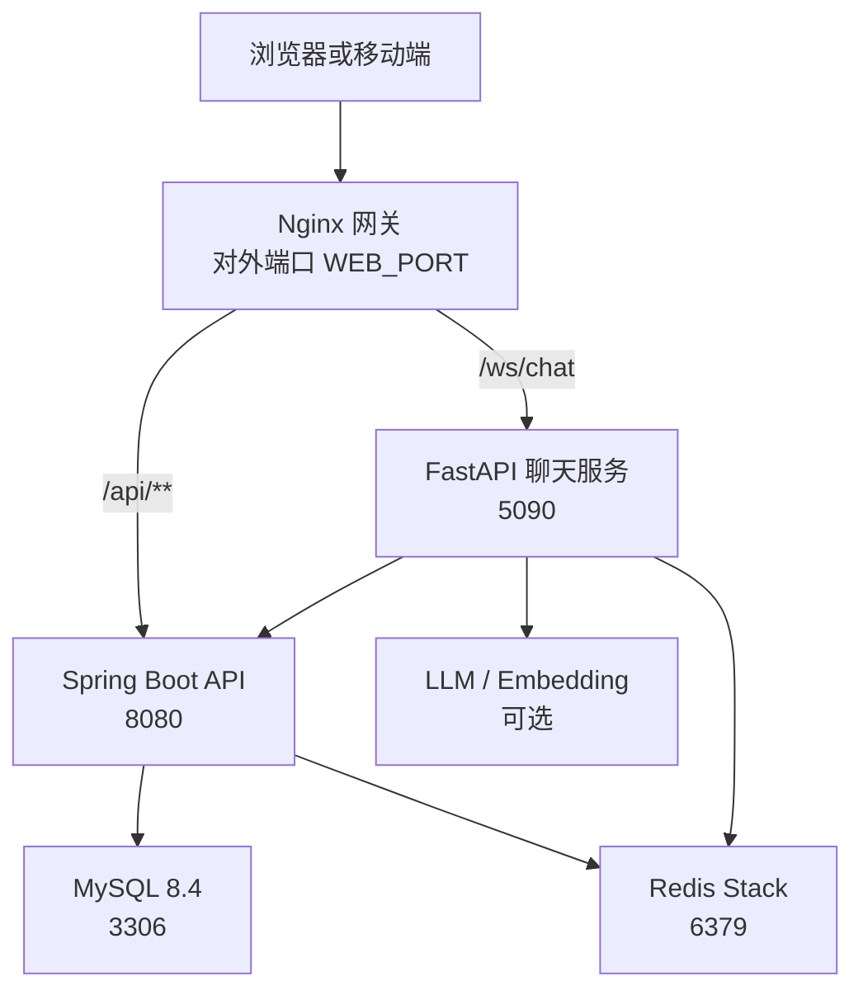
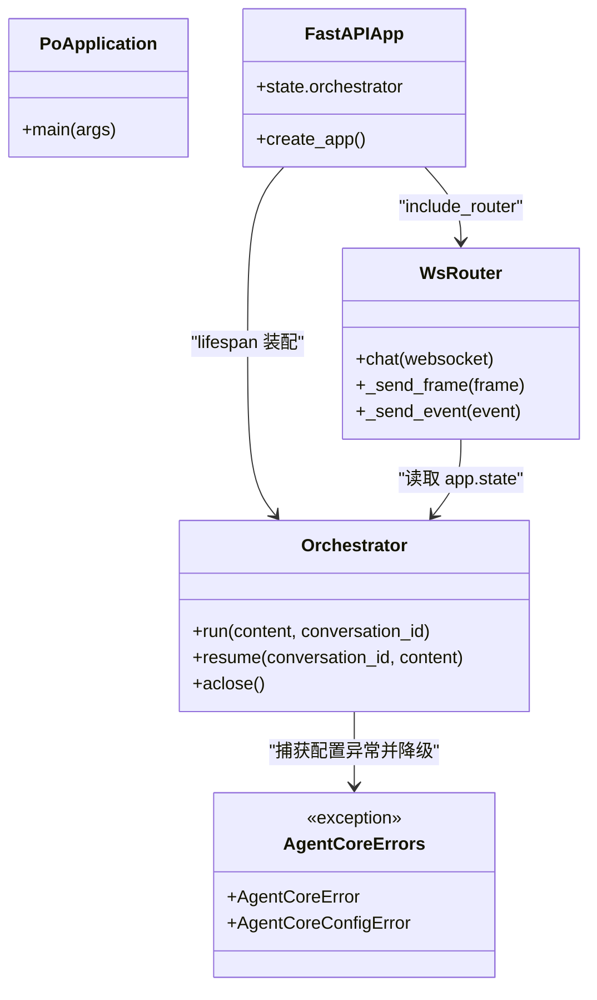
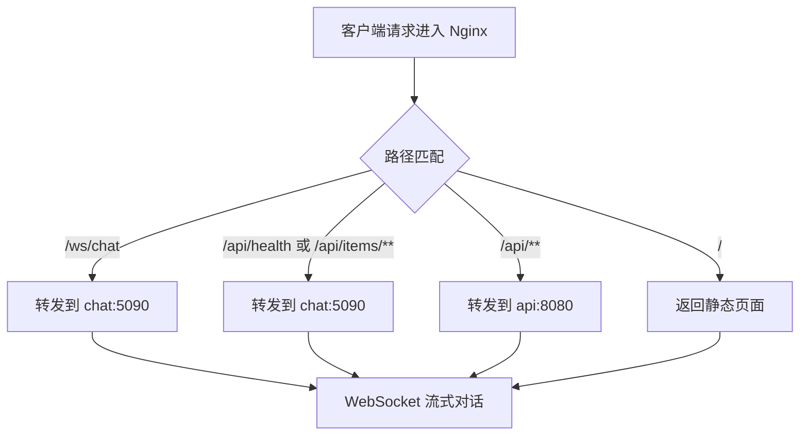

# 故障排查

<cite>
**本文引用的文件**   
- [README.md](file://README.md)
- [docker-compose.yml](file://docker-compose.yml)
- [application.yaml](file://services/api/api-bootstrap/src/main/resources/application.yaml)
- [PoApplication.java](file://services/api/api-bootstrap/src/main/java/com/goodzheng/po/PoApplication.java)
- [main.py](file://services/chat/app/main.py)
- [ws.py](file://services/chat/app/routers/ws.py)
- [errors.py](file://services/agent-core/src/po_agent_core/errors.py)
- [nginx.conf](file://infra/nginx/nginx.conf)
- [deploy-redis.sh](file://scripts/deploy-redis.sh)
- [DEPLOY_CLOUDRUN.md](file://services/api/DEPLOY_CLOUDRUN.md)
- [requestErrorConfig.ts](file://apps/admin-web/src/requestErrorConfig.ts)
- [agent-chat.ts](file://apps/cooking-app/src/lib/ai/agent-chat.ts)
</cite>

## 目录
1. [简介](#简介)
2. [项目结构与依赖拓扑](#项目结构与依赖拓扑)
3. [核心组件与关键入口](#核心组件与关键入口)
4. [架构总览与请求路径](#架构总览与请求路径)
5. [服务启动失败排查](#服务启动失败排查)
6. [端口冲突与网关分流问题](#端口冲突与网关分流问题)
7. [依赖服务不可用处理方案](#依赖服务不可用处理方案)
8. [数据库连接问题诊断](#数据库连接问题诊断)
9. [Redis 缓存异常诊断](#redis-缓存异常诊断)
10. [第三方服务调用失败诊断](#第三方服务调用失败诊断)
11. [日志分析方法与错误堆栈解读](#日志分析方法与错误堆栈解读)
12. [性能瓶颈定位技巧](#性能瓶颈定位技巧)
13. [容器网络、文件权限与内存泄漏排查](#容器网络文件权限与内存泄漏排查)
14. [应急预案与恢复操作步骤](#应急预案与恢复操作步骤)
15. [结论](#结论)

## 简介
本指南面向运维、后端与前端工程师，覆盖 po 全栈 Monorepo 在本地开发、Docker Compose 编排以及生产部署中的常见故障。重点包括：
- 服务启动失败的快速定位
- 端口冲突与 Nginx 网关分流异常
- MySQL、Redis、LLM、对象存储等依赖不可用的降级与恢复
- WebSocket 聊天链路断连、超时与协议帧异常
- 日志采集、错误堆栈解读、性能指标分析
- 容器网络、文件权限、内存泄漏的排查流程
- 可执行的应急预案与回滚步骤

## 项目结构与依赖拓扑
po 是前后端与 Agent 编排的全栈仓库：管理前端通过 Nginx 网关访问 Spring Boot API 与 FastAPI 聊天服务；聊天服务依赖 agent-core 与 cooking agent；所有外部依赖（MySQL、Redis）由 docker-compose 编排。

**图表来源**
- [README.md:36-57](file://README.md#L36-L57)
- [docker-compose.yml:8-128](file://docker-compose.yml#L8-L128)

**章节来源**
- [README.md:1-34](file://README.md#L1-L34)
- [docker-compose.yml:1-134](file://docker-compose.yml#L1-L134)

## 核心组件与关键入口
- Spring Boot 启动类：`PoApplication`，统一暴露 `/api` 前缀，Actuator 健康检查用于 compose 健康探针。
- FastAPI 应用工厂：`app.main.create_app` 装配 Orchestrator、CORS、REST 路由与 WS 路由；lifespan 负责启动时构建编排器、关闭时释放资源。
- WebSocket 路由：`app.routers.ws.chat` 将 LangGraph 事件流翻译为 JSON 帧，并处理 `ping`、`resume`、`error`、`done` 等交互。
- Agent Core 异常体系：`AgentCoreError` 与 `AgentCoreConfigError` 用于区分配置缺失与运行时错误，驱动降级链。

**图表来源**
- [PoApplication.java:1-15](file://services/api/api-bootstrap/src/main/java/com/goodzheng/po/PoApplication.java#L1-L15)
- [main.py:16-75](file://services/chat/app/main.py#L16-L75)
- [ws.py:51-189](file://services/chat/app/routers/ws.py#L51-L189)
- [errors.py:1-19](file://services/agent-core/src/po_agent_core/errors.py#L1-L19)

**章节来源**
- [PoApplication.java:1-15](file://services/api/api-bootstrap/src/main/java/com/goodzheng/po/PoApplication.java#L1-L15)
- [main.py:1-75](file://services/chat/app/main.py#L1-L75)
- [ws.py:1-189](file://services/chat/app/routers/ws.py#L1-L189)
- [errors.py:1-19](file://services/agent-core/src/po_agent_core/errors.py#L1-L19)

## 架构总览与请求路径
网关按路径分流：
- `/ws/chat` → chat:5090
- `/api/health`、`/api/items/**` → chat:5090
- `/api/**`（其余）→ api:8080
- `/` → Nginx 静态页面

**图表来源**
- [README.md:36-44](file://README.md#L36-L44)

**章节来源**
- [README.md:36-44](file://README.md#L36-L44)

## 服务启动失败排查
### 通用步骤
1. 查看 compose 状态与健康检查：
   - `docker compose ps`
   - `docker compose logs -f <service>`
2. 确认 `.env` 必填变量是否注入：
   - `MYSQL_*`、`JWT_SECRET`、`WEB_PORT`、`REDIS_PASSWORD`
3. 冒烟验证：
   - `curl http://localhost:${WEB_PORT}/api/actuator/health`
   - `curl http://localhost:${WEB_PORT}/api/health`

### Spring Boot API 启动失败
- 检查 Actuator 健康检查命令是否成功：compose 使用 `http://localhost:8080/api/actuator/health`。
- 检查 `server.servlet.context-path=/api` 是否与 Nginx 转发一致。
- 检查数据库与 Redis 健康检查是否先通过。

**章节来源**
- [docker-compose.yml:44-82](file://docker-compose.yml#L44-L82)
- [application.yaml:4-8](file://services/api/api-bootstrap/src/main/resources/application.yaml#L4-L8)
- [README.md:101-109](file://README.md#L101-L109)

### FastAPI 聊天服务启动失败
- 检查 lifespan 是否装配 Orchestrator；若 LLM Key 缺失或 checkpointer 不可达，应降级而非启动失败。
- 检查 CORS 白名单与 `/api/health` 健康接口。
- 检查 `COOKING_API_BASE_URL` 指向内网 `http://api:8080/api`。

**章节来源**
- [main.py:24-49](file://services/chat/app/main.py#L24-L49)
- [docker-compose.yml:84-113](file://docker-compose.yml#L84-L113)

### Nginx 网关启动失败
- 检查 `infra/nginx/nginx.conf` 挂载与语法：`docker compose exec web nginx -t && docker compose exec web nginx -s reload`。
- 检查对外端口 `${WEB_PORT:-8000}` 是否被占用。

**章节来源**
- [docker-compose.yml:115-128](file://docker-compose.yml#L115-L128)
- [README.md:122](file://README.md#L122)

## 端口冲突与网关分流问题
### 端口冲突
- 默认对外端口 `WEB_PORT=8000`；若本地 Umi dev server 也占 8000，需停掉 compose 的 web 或修改前端端口。
- Spring Boot 可通过 `SERVER_PORT` 临时换端口，避免 IDE 实例占用 8080。

**章节来源**
- [README.md:137-149](file://README.md#L137-L149)
- [docker-compose.yml:119-120](file://docker-compose.yml#L119-L120)

### 网关分流异常
- 确认 Nginx 规则中 `/api/**`、`/ws/chat`、`/api/health`、`/api/items/**` 的上游地址正确。
- 确认 Spring Boot 的 `context-path=/api` 与 Nginx 转发一致。
- 确认 WebSocket 不走 `/api` 前缀，而是独立 `/ws/chat`。

**章节来源**
- [README.md:36-44](file://README.md#L36-L44)
- [application.yaml:4-8](file://services/api/api-bootstrap/src/main/resources/application.yaml#L4-L8)
- [main.py:6-14](file://services/chat/app/main.py#L6-L14)

## 依赖服务不可用处理方案
### LLM 与 Embedding 不可用
- 未配置或密钥无效时，聊天服务降级为离线模型；意图路由降级为本地关键词模式。
- 观察日志中的警告信息，确认降级路径生效。

**章节来源**
- [README.md:76-77](file://README.md#L76-L77)
- [errors.py:12-18](file://services/agent-core/src/po_agent_core/errors.py#L12-L18)

### 菜谱后端不可用
- 烹饪助手工具层把数据源异常转为可读错误文本，不会让整轮对话直接以 RUN_ERROR 收场。
- 前端收到 error 帧后走本地规则兜底。

**章节来源**
- [ws.py:155-159](file://services/chat/app/routers/ws.py#L155-L159)
- [agent-chat.ts:155-159](file://apps/cooking-app/src/lib/ai/agent-chat.ts#L155-L159)

### 第三方服务（讯飞 TTS、腾讯云 COS、微信小程序）不可用
- TTS 未配置时 `/api/tts` 返回可读错误，不影响服务启动。
- COS 密钥从环境变量注入，桶与地域有默认值；若 CDN base-url 留空则使用默认域名。
- 微信云托管内网可能因 TLS 证书问题导致 HTTPS 失败，需调整 `WECHAT_API_BASE_URL`。

**章节来源**
- [docker-compose.yml:56-67](file://docker-compose.yml#L56-L67)
- [application.yaml:98-120](file://services/api/api-bootstrap/src/main/resources/application.yaml#L98-L120)
- [README.md:94-96](file://README.md#L94-L96)

## 数据库连接问题诊断
### 常见问题
- 数据库账号密码错误、库名不一致、时区或字符集不匹配。
- MySQL 健康检查未通过导致 api 延迟启动。
- schema.sql 幂等建表失败。

### 诊断步骤
1. 检查 compose mysql 健康检查与 `MYSQL_*` 环境变量。
2. 检查 `SPRING_DATASOURCE_*` 是否注入正确。
3. 查看 api 日志中 MyBatis-Plus SQL 输出与连接异常。
4. 确认 `schema.sql` 已执行且无权限问题。

**章节来源**
- [docker-compose.yml:8-22](file://docker-compose.yml#L8-L22)
- [docker-compose.yml:48-50](file://docker-compose.yml#L48-L50)
- [application.yaml:18-22](file://services/api/api-bootstrap/src/main/resources/application.yaml#L18-L22)
- [application.yaml:41-53](file://services/api/api-bootstrap/src/main/resources/application.yaml#L41-L53)

## Redis 缓存异常诊断
### 常见问题
- 使用了普通 redis 镜像而非 Redis Stack，导致 langgraph checkpoint 无法使用 JSON.SET/FT.SEARCH。
- 密码不一致导致 healthcheck 误报或连接失败。
- 云托管环境拉取镜像受限，需使用加速镜像或预推镜像。

### 诊断步骤
1. 确认 compose 使用 `redis-stack-server` 镜像。
2. 检查 `REDIS_PASSWORD` 与 `AGENT_CORE_REDIS_URL`、`SPRING_DATA_REDIS_*` 一致。
3. 查看 chat 日志中 checkpointer 策略是否为 redis；若降级为 memory，说明 Redis Stack 不可用。
4. 云托管场景参考 `deploy-redis.sh` 与 `DEPLOY_CLOUDRUN.md`。

**章节来源**
- [docker-compose.yml:24-42](file://docker-compose.yml#L24-L42)
- [docker-compose.yml:99-100](file://docker-compose.yml#L99-L100)
- [deploy-redis.sh:1-17](file://scripts/deploy-redis.sh#L1-L17)
- [DEPLOY_CLOUDRUN.md:76-80](file://services/api/DEPLOY_CLOUDRUN.md#L76-L80)

## 第三方服务调用失败诊断
### LLM 调用失败
- 检查 `AGENT_CORE_LLM_PROVIDER`、`AGENT_CORE_LLM_MODEL`、`AGENT_CORE_LLM_API_KEY`。
- 若配置缺失或密钥无效，聊天服务会降级为离线模型；观察日志中的降级告警。

**章节来源**
- [docker-compose.yml:94-96](file://docker-compose.yml#L94-L96)
- [errors.py:12-18](file://services/agent-core/src/po_agent_core/errors.py#L12-L18)

### 对象存储与语音合成
- 检查 COS 与讯飞 TTS 的环境变量是否注入。
- 若未配置，对应接口返回可读错误但不影响服务启动。

**章节来源**
- [docker-compose.yml:56-67](file://docker-compose.yml#L56-L67)
- [application.yaml:98-120](file://services/api/api-bootstrap/src/main/resources/application.yaml#L98-L120)

## 日志分析方法与错误堆栈解读
### 日志采集
- 使用 `docker compose logs -f <service>` 跟踪 api、chat、web、mysql、redis。
- 关注以下关键字：
  - `DOWN`：Redis 组件不可用
  - `unknown command`：Redis Stack 模块缺失
  - `RUN_ERROR`：Agent 运行错误
  - `WS 聊天处理异常`：WebSocket 处理异常
  - `intent routing`、`embedding`、`checkpointer`：意图路由与记忆相关告警

**章节来源**
- [README.md:114-116](file://README.md#L114-L116)
- [ws.py:184-188](file://services/chat/app/routers/ws.py#L184-L188)
- [deploy-redis.sh:4-8](file://scripts/deploy-redis.sh#L4-L8)

### 错误堆栈解读
- 前端错误：`BizError` 携带 `code`、`message`、`showType`、`data`，由 `requestErrorConfig.ts` 统一处理。
- WebSocket 错误：服务端返回 `error` 帧，内容包含具体原因；前端在 `agent-chat.ts` 中消费并展示。
- Agent Core 配置错误：`AgentCoreConfigError` 表示配置缺失，宿主应降级而非抛错。

**章节来源**
- [requestErrorConfig.ts:44-82](file://apps/admin-web/src/requestErrorConfig.ts#L44-L82)
- [ws.py:145-151](file://services/chat/app/routers/ws.py#L145-L151)
- [agent-chat.ts:155-159](file://apps/cooking-app/src/lib/ai/agent-chat.ts#L155-L159)
- [errors.py:8-18](file://services/agent-core/src/po_agent_core/errors.py#L8-L18)

## 性能瓶颈定位技巧
- 使用 Actuator metrics 与 prometheus 端点收集 JVM 与业务指标。
- 关注 MyBatis-Plus SQL 日志，识别慢查询与 N+1 查询。
- 监控 WebSocket 连接数与消息吞吐，避免单连接长时间阻塞。
- 观察 Redis 命中率与 checkpoint 写入延迟。

**章节来源**
- [application.yaml:58-68](file://services/api/api-bootstrap/src/main/resources/application.yaml#L58-L68)
- [application.yaml:41-53](file://services/api/api-bootstrap/src/main/resources/application.yaml#L41-L53)

## 容器网络、文件权限与内存泄漏排查
### 容器网络问题
- 确认 compose 内部服务名解析正常：`api`、`chat`、`mysql`、`redis`。
- 检查 Nginx 上游地址是否正确指向容器服务名。
- 若 WebSocket 升级失败，确认前端代理与网关均支持 WS。

**章节来源**
- [docker-compose.yml:70-106](file://docker-compose.yml#L70-L106)
- [README.md:36-44](file://README.md#L36-L44)

### 文件权限问题
- 上传目录 `uploads_data` 映射到 `/app/uploads`，确保容器内写入权限。
- Nginx 配置只读挂载，修改后需 reload。

**章节来源**
- [docker-compose.yml:68-69](file://docker-compose.yml#L68-L69)
- [docker-compose.yml:121-122](file://docker-compose.yml#L121-L122)
- [README.md:122](file://README.md#L122)

### 内存泄漏排查
- 观察 JVM 堆与 GC 日志，结合 Actuator metrics 定位增长趋势。
- 检查 WebSocket 连接是否及时关闭，避免长连接堆积。
- 检查 Redis checkpoint 是否持续增长，必要时清理过期会话。

**章节来源**
- [application.yaml:58-68](file://services/api/api-bootstrap/src/main/resources/application.yaml#L58-L68)
- [ws.py:131-189](file://services/chat/app/routers/ws.py#L131-L189)

## 应急预案与恢复操作步骤
### 服务全部不可用
1. `docker compose down` 停止栈。
2. 检查 `.env` 必填项：`MYSQL_*`、`JWT_SECRET`、`REDIS_PASSWORD`。
3. `docker compose up -d --build` 重建并启动。
4. 等待 healthy 后冒烟验证 `/api/actuator/health` 与 `/api/health`。

**章节来源**
- [README.md:90-109](file://README.md#L90-L109)
- [docker-compose.yml:75-81](file://docker-compose.yml#L75-L81)

### 仅 API 不可用
1. `docker compose logs -f api` 查看启动异常。
2. 检查 MySQL 与 Redis 健康检查是否通过。
3. 若 Actuator 健康检查失败，检查 `context-path` 与端口。

**章节来源**
- [docker-compose.yml:44-82](file://docker-compose.yml#L44-L82)
- [application.yaml:4-8](file://services/api/api-bootstrap/src/main/resources/application.yaml#L4-L8)

### 仅聊天服务不可用
1. `docker compose logs -f chat` 查看 Orchestrator 装配日志。
2. 检查 LLM 与 embedding 配置；若缺失，确认降级为离线模式。
3. 检查 Redis Stack 是否可用；若降级为 memory checkpointer，修复 Redis Stack。

**章节来源**
- [main.py:24-49](file://services/chat/app/main.py#L24-L49)
- [docker-compose.yml:84-113](file://docker-compose.yml#L84-L113)
- [deploy-redis.sh:4-8](file://scripts/deploy-redis.sh#L4-L8)

### 仅前端访问失败
1. 检查 Nginx 配置语法与 reload。
2. 检查对外端口 `WEB_PORT` 是否被占用。
3. 确认静态资源与历史路由回退 `index.html`。

**章节来源**
- [docker-compose.yml:115-128](file://docker-compose.yml#L115-L128)
- [README.md:122](file://README.md#L122)

### WebSocket 断连或无回复
1. 检查前端代理 `/ws` 是否转发到 chat:5090。
2. 查看 ws.py 日志中的 `WS 聊天处理异常`。
3. 确认客户端发送的 `conversation_id` 与 `resume` 帧符合协议。

**章节来源**
- [ws.py:131-189](file://services/chat/app/routers/ws.py#L131-L189)
- [agent-chat.ts:146-188](file://apps/cooking-app/src/lib/ai/agent-chat.ts#L146-L188)

## 结论
本指南围绕 po 全栈项目的关键入口、依赖拓扑与降级机制，提供了从服务启动、端口与网关、数据库与 Redis、第三方服务、日志与堆栈到性能与容器的完整排查路径。实际排障时建议优先确认 compose 健康检查与环境变量，再逐层定位 API、Chat、Nginx 与前端代理，最后结合 Actuator、SQL 日志与 WebSocket 帧协议进行根因分析与恢复。