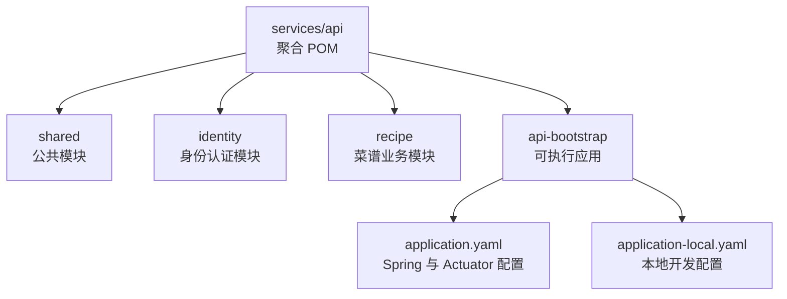
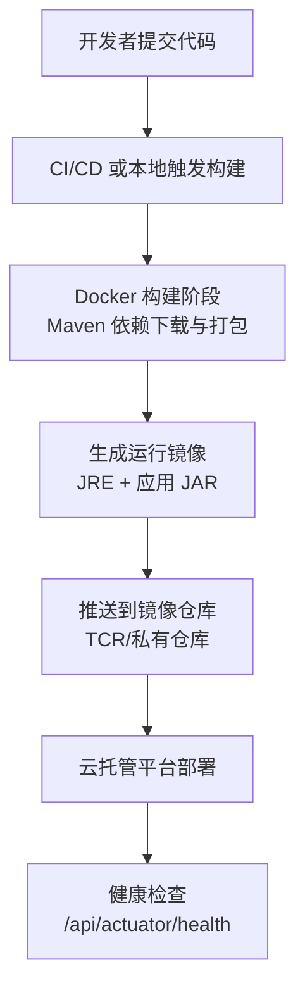
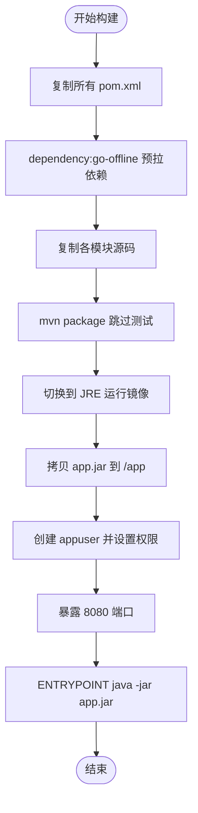
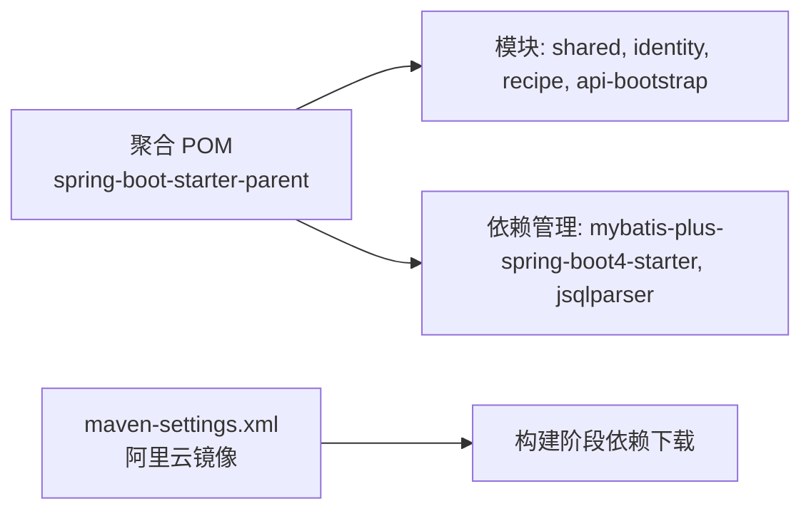
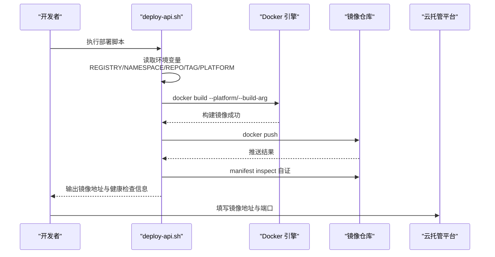
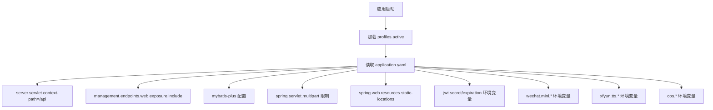
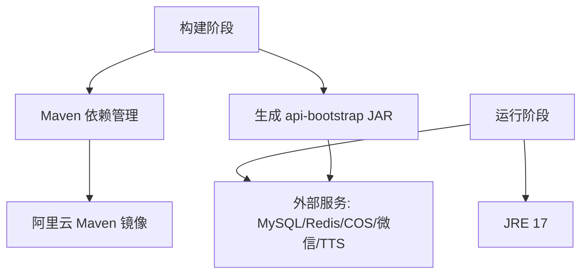
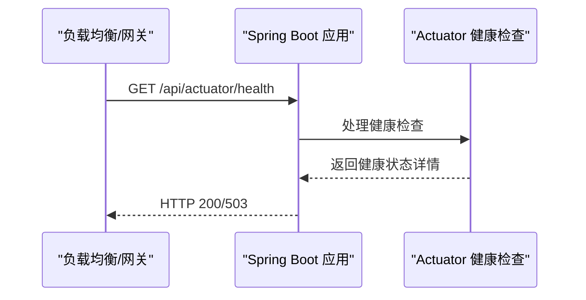
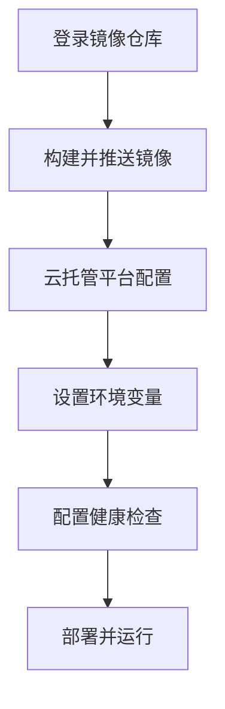

# API 服务部署

<cite>
**本文引用的文件**   
- [services/api/Dockerfile](file://services/api/Dockerfile)
- [scripts/deploy-api.sh](file://scripts/deploy-api.sh)
- [services/api/pom.xml](file://services/api/pom.xml)
- [services/api/maven-settings.xml](file://services/api/maven-settings.xml)
- [services/api/api-bootstrap/src/main/resources/application.yaml](file://services/api/api-bootstrap/src/main/resources/application.yaml)
- [services/api/api-bootstrap/src/main/resources/application-local.yaml](file://services/api/api-bootstrap/src/main/resources/application-local.yaml)
</cite>

## 目录
1. [简介](#简介)
2. [项目结构](#项目结构)
3. [核心组件](#核心组件)
4. [架构总览](#架构总览)
5. [详细组件分析](#详细组件分析)
6. [依赖关系分析](#依赖关系分析)
7. [性能与构建优化](#性能与构建优化)
8. [生产环境配置要点](#生产环境配置要点)
9. [健康检查端点](#健康检查端点)
10. [云托管平台部署步骤](#云托管平台部署步骤)
11. [故障排查指南](#故障排查指南)
12. [结论](#结论)

## 简介
本文面向 Spring Boot API 服务的部署与运维，重点说明：
- Docker 镜像构建流程、Maven 依赖管理与多阶段构建优化。
- 基础镜像选择策略（本地加速镜像与官方镜像切换）。
- 部署脚本参数与环境变量（REGISTRY、NAMESPACE、REPO、TAG、PLATFORM 等）。
- 生产环境 application.yaml 关键配置项（数据库、Redis、腾讯云 COS、JWT、微信小程序、讯飞 TTS 等）。
- 健康检查端点 /api/actuator/health 的配置与使用。
- 在云托管平台的部署步骤与环境变量要求。

## 项目结构
API 服务位于 services/api 模块，采用 Maven 多模块聚合工程，包含 shared、identity、recipe、api-bootstrap 四个子模块；其中 api-bootstrap 是可执行应用入口。Docker 构建通过 services/api/Dockerfile 完成，部署脚本位于 scripts/deploy-api.sh。

**图表来源**
- [services/api/pom.xml:29-34](file://services/api/pom.xml#L29-L34)
- [services/api/api-bootstrap/src/main/resources/application.yaml:1-120](file://services/api/api-bootstrap/src/main/resources/application.yaml#L1-L120)
- [services/api/api-bootstrap/src/main/resources/application-local.yaml:1-49](file://services/api/api-bootstrap/src/main/resources/application-local.yaml#L1-L49)

**章节来源**
- [services/api/pom.xml:1-96](file://services/api/pom.xml#L1-L96)

## 核心组件
- 构建与运行镜像：services/api/Dockerfile
- 部署脚本：scripts/deploy-api.sh
- Maven 聚合工程与依赖管理：services/api/pom.xml
- Maven 国内镜像加速：services/api/maven-settings.xml
- 应用配置：services/api/api-bootstrap/src/main/resources/application.yaml 与 application-local.yaml

**章节来源**
- [services/api/Dockerfile:1-42](file://services/api/Dockerfile#L1-L42)
- [scripts/deploy-api.sh:1-61](file://scripts/deploy-api.sh#L1-L61)
- [services/api/pom.xml:1-96](file://services/api/pom.xml#L1-L96)
- [services/api/maven-settings.xml:1-14](file://services/api/maven-settings.xml#L1-L14)
- [services/api/api-bootstrap/src/main/resources/application.yaml:1-120](file://services/api/api-bootstrap/src/main/resources/application.yaml#L1-L120)
- [services/api/api-bootstrap/src/main/resources/application-local.yaml:1-49](file://services/api/api-bootstrap/src/main/resources/application-local.yaml#L1-L49)

## 架构总览
下图展示从源码到镜像再到云托管的端到端流程，包括 Maven 依赖拉取、多阶段构建、镜像推送与健康检查。

**图表来源**
- [services/api/Dockerfile:1-42](file://services/api/Dockerfile#L1-L42)
- [scripts/deploy-api.sh:35-60](file://scripts/deploy-api.sh#L35-L60)
- [services/api/api-bootstrap/src/main/resources/application.yaml:58-68](file://services/api/api-bootstrap/src/main/resources/application.yaml#L58-L68)

## 详细组件分析

### Docker 镜像构建与多阶段优化
- 构建阶段：
  - 使用 Maven 镜像作为构建基础，复制所有 pom.xml 并执行 dependency:go-offline 预拉取依赖，充分利用层缓存。
  - 随后复制各模块源码，执行 mvn package 跳过测试，输出可执行 JAR。
- 运行阶段：
  - 使用精简 JRE 镜像，安装 curl 用于健康检查，创建非 root 用户 appuser，暴露 8080 端口。
  - 将构建产物拷贝为 app.jar 并以 java -jar 启动。

**图表来源**
- [services/api/Dockerfile:1-42](file://services/api/Dockerfile#L1-L42)

**章节来源**
- [services/api/Dockerfile:1-42](file://services/api/Dockerfile#L1-L42)

### Maven 依赖管理与镜像加速
- 聚合 POM 声明 Spring Boot 父工程与 Java 17，模块包含 shared、identity、recipe、api-bootstrap。
- 统一依赖版本管理 MyBatis-Plus 及其分页插件。
- maven-settings.xml 配置阿里云 Maven 镜像，加速依赖下载。

**图表来源**
- [services/api/pom.xml:7-51](file://services/api/pom.xml#L7-L51)
- [services/api/maven-settings.xml:1-14](file://services/api/maven-settings.xml#L1-L14)

**章节来源**
- [services/api/pom.xml:1-96](file://services/api/pom.xml#L1-L96)
- [services/api/maven-settings.xml:1-14](file://services/api/maven-settings.xml#L1-L14)

### 部署脚本参数与环境变量
- 环境变量优先级：
  - REGISTRY、NAMESPACE、REPO、TAG、PLATFORM 可直接覆盖默认值。
  - USE_OFFICIAL_IMAGES=1 时切换为官方基础镜像，否则使用国内加速镜像。
  - BUILD_IMAGE、RUNTIME_IMAGE 可进一步指定具体镜像标签。
- 默认值：
  - REGISTRY=ccr.ccs.tencentyun.com
  - NAMESPACE=tcb-100053273154-byrm
  - REPO=ca-eyxzseoz_po
  - TAG=prod
  - PLATFORM=linux/amd64
- 工作流程：
  - docker build 传入 --platform 与 --build-arg 基础镜像参数。
  - docker push 推送镜像。
  - 自证 manifest inspect 验证 tag 是否可解析。
  - 输出云托管部署所需信息：镜像地址、监听端口、健康检查路径、环境变量提示。

**图表来源**
- [scripts/deploy-api.sh:19-60](file://scripts/deploy-api.sh#L19-L60)

**章节来源**
- [scripts/deploy-api.sh:1-61](file://scripts/deploy-api.sh#L1-L61)

### 应用配置与运行参数
- 服务器上下文路径：/api，与网关转发规则一致。
- Spring Profile：默认激活 local，生产需设置为 prod。
- 文件上传限制：单文件最大 10MB，请求体最大 100MB。
- 静态资源位置：classpath:/static/, classpath:/public/, file:uploads/。
- MyBatis-Plus：mapper-locations、全局主键自增、更新策略 always、SQL 日志输出。
- Actuator：暴露 health、info、metrics、prometheus；health 显示详细信息；info env 启用。
- JWT：secret 与 expiration 支持环境变量注入。
- 微信小程序：app-id、app-secret、api-base-url 支持环境变量。
- 讯飞 TTS：app-id、api-key、api-secret、vcn 支持环境变量。
- 腾讯云 COS：secret-id、secret-key、region、bucket、key-prefix、base-url 支持环境变量。

**图表来源**
- [services/api/api-bootstrap/src/main/resources/application.yaml:4-120](file://services/api/api-bootstrap/src/main/resources/application.yaml#L4-L120)

**章节来源**
- [services/api/api-bootstrap/src/main/resources/application.yaml:1-120](file://services/api/api-bootstrap/src/main/resources/application.yaml#L1-L120)
- [services/api/api-bootstrap/src/main/resources/application-local.yaml:1-49](file://services/api/api-bootstrap/src/main/resources/application-local.yaml#L1-L49)

## 依赖关系分析
- 构建期依赖：
  - Maven 镜像（eclipse-temurin 17）+ 阿里云 Maven 镜像加速。
  - 依赖预拉取（dependency:go-offline）提升构建稳定性与速度。
- 运行期依赖：
  - JRE 17。
  - 外部服务：MySQL、Redis、腾讯云 COS、微信小程序接口、讯飞 TTS。
- 模块依赖：
  - api-bootstrap 依赖 shared、identity、recipe 模块编译产物。

**图表来源**
- [services/api/Dockerfile:1-42](file://services/api/Dockerfile#L1-L42)
- [services/api/maven-settings.xml:1-14](file://services/api/maven-settings.xml#L1-L14)
- [services/api/api-bootstrap/src/main/resources/application.yaml:41-120](file://services/api/api-bootstrap/src/main/resources/application.yaml#L41-L120)

**章节来源**
- [services/api/Dockerfile:1-42](file://services/api/Dockerfile#L1-L42)
- [services/api/maven-settings.xml:1-14](file://services/api/maven-settings.xml#L1-L14)
- [services/api/api-bootstrap/src/main/resources/application.yaml:41-120](file://services/api/api-bootstrap/src/main/resources/application.yaml#L41-L120)

## 性能与构建优化
- 分层缓存优化：先复制 pom.xml 再复制源码，确保依赖变更不影响源码层缓存。
- 依赖预拉取：dependency:go-offline 避免运行时网络波动影响构建。
- 最小化运行镜像：仅安装必要工具（curl），使用非 root 用户运行。
- 跳过测试：构建阶段 -DskipTests，测试由 CI 与 compose 环境承担。
- 国内镜像加速：Maven 与 Docker 基础镜像均优先使用国内加速源，减少超时与等待。

[本节为通用指导，不直接分析具体文件]

## 生产环境配置要点
- 激活 profile：
  - 生产环境需设置 SPRING_PROFILES_ACTIVE=prod。
- 数据库连接：
  - 通过环境变量或外部配置中心注入 spring.datasource.url、username、password、driver-class-name。
  - 本地开发使用 application-local.yaml 中的示例值。
- Redis 配置：
  - 若使用 Redis，需在外部配置中提供 spring.redis.host/port/password 等参数（当前 application.yaml 未显式声明 Redis 配置，请根据实际引入的 starter 补充）。
- 腾讯云 COS：
  - 必须提供 COS_SECRET_ID、COS_SECRET_KEY、COS_REGION、COS_BUCKET、COS_KEY_PREFIX、可选 COS_BASE_URL。
- JWT：
  - 必须提供 JWT_SECRET（Base64），JWT_EXPIRATION 可选。
- 微信小程序：
  - 必须提供 WECHAT_MINI_APP_ID、WECHAT_MINI_APP_SECRET，WECHAT_API_BASE_URL 在云托管内网场景可能为 http。
- 讯飞 TTS：
  - 必须提供 IFLYTEK_APP_ID、IFLYTEK_API_KEY、IFLYTEK_API_SECRET，IFLYTEK_TTS_VCN 可选。

**章节来源**
- [scripts/deploy-api.sh:57-60](file://scripts/deploy-api.sh#L57-L60)
- [services/api/api-bootstrap/src/main/resources/application.yaml:78-120](file://services/api/api-bootstrap/src/main/resources/application.yaml#L78-L120)
- [services/api/api-bootstrap/src/main/resources/application-local.yaml:1-49](file://services/api/api-bootstrap/src/main/resources/application-local.yaml#L1-L49)

## 健康检查端点
- 端点路径：/api/actuator/health
- 暴露范围：health、info、metrics、prometheus
- 行为：
  - show-details: always 返回详细健康状态。
  - info.env.enabled=true 暴露环境变量信息。
- 使用方法：
  - 在云托管平台“健康检查”字段填写 /api/actuator/health。
  - 监听端口为 8080。

**图表来源**
- [services/api/api-bootstrap/src/main/resources/application.yaml:58-68](file://services/api/api-bootstrap/src/main/resources/application.yaml#L58-L68)
- [scripts/deploy-api.sh:57-60](file://scripts/deploy-api.sh#L57-L60)

**章节来源**
- [services/api/api-bootstrap/src/main/resources/application.yaml:58-68](file://services/api/api-bootstrap/src/main/resources/application.yaml#L58-L68)
- [scripts/deploy-api.sh:57-60](file://scripts/deploy-api.sh#L57-L60)

## 云托管平台部署步骤
- 前置条件：
  - 已登录镜像仓库（TCR 访问凭证固定密码）。
  - 具备镜像仓库命名空间与仓库权限。
- 构建与推送：
  - 执行 scripts/deploy-api.sh，或通过 pnpm api:deploy。
  - 如需使用官方基础镜像，设置 USE_OFFICIAL_IMAGES=1。
  - 可通过 TAG 覆盖版本号，如 TAG=v2。
- 平台配置：
  - 镜像地址：REGISTRY/NAMESPACE/REPO:TAG
  - 监听端口：8080
  - 健康检查：/api/actuator/health
  - 环境变量：SPRING_PROFILES_ACTIVE=prod，以及数据库、Redis、COS、JWT、微信、TTS 等密钥与连接信息。

**图表来源**
- [scripts/deploy-api.sh:11-12](file://scripts/deploy-api.sh#L11-L12)
- [scripts/deploy-api.sh:35-60](file://scripts/deploy-api.sh#L35-L60)

**章节来源**
- [scripts/deploy-api.sh:1-61](file://scripts/deploy-api.sh#L1-L61)

## 故障排查指南
- 镜像推送失败：
  - 检查 docker login 是否过期，使用 TCR 固定密码重新登录。
  - 确认镜像仓库地址、命名空间、仓库名是否正确。
- 镜像不可解析：
  - 脚本会执行 manifest inspect 自证，若失败则退出并提示重登。
- 健康检查失败：
  - 确认 context-path 为 /api，健康检查路径为 /api/actuator/health。
  - 检查 Actuator 暴露的 endpoints 是否包含 health。
- 数据库连接失败：
  - 检查 spring.datasource.url、username、password 是否正确。
  - 确认数据库实例可达且账号权限正确。
- Redis 连接失败：
  - 检查 spring.redis.* 配置是否齐全（host/port/password）。
- COS 上传失败：
  - 检查 COS_SECRET_ID、COS_SECRET_KEY、COS_REGION、COS_BUCKET 是否正确。
  - 确认 bucket 存在且权限正确。
- JWT 鉴权失败：
  - 检查 JWT_SECRET 是否为 Base64 格式，JWT_EXPIRATION 是否合理。
- 微信小程序接口失败：
  - 检查 WECHAT_MINI_APP_ID、WECHAT_MINI_APP_SECRET。
  - 云托管内网场景下 WECHAT_API_BASE_URL 可能需要使用 http。

**章节来源**
- [scripts/deploy-api.sh:50-55](file://scripts/deploy-api.sh#L50-L55)
- [services/api/api-bootstrap/src/main/resources/application.yaml:58-120](file://services/api/api-bootstrap/src/main/resources/application.yaml#L58-L120)

## 结论
本部署文档围绕 Spring Boot API 服务的镜像构建、依赖管理、部署脚本与生产环境配置展开，提供了从源码到云托管的完整链路说明。通过多阶段构建与镜像加速优化，结合严格的环境变量管理，可在云托管平台上稳定运行并提供健康检查能力。建议在生产环境中使用外部配置中心或密钥管理服务统一管理敏感配置，并持续监控 Actuator 指标与 Prometheus 数据以保障系统稳定性。