# Docker Compose 部署

<cite>
**本文引用的文件**   
- [docker-compose.yml](file://docker-compose.yml)
- [.env.example](file://.env.example)
- [infra/nginx/nginx.conf](file://infra/nginx/nginx.conf)
- [services/api/Dockerfile](file://services/api/Dockerfile)
- [services/chat/Dockerfile](file://services/chat/Dockerfile)
- [apps/admin-web/Dockerfile](file://apps/admin-web/Dockerfile)
- [scripts/deploy-api.sh](file://scripts/deploy-api.sh)
- [scripts/deploy-chat.sh](file://scripts/deploy-chat.sh)
- [scripts/deploy-redis.sh](file://scripts/deploy-redis.sh)
</cite>

## 目录
1. [简介](#简介)
2. [项目结构](#项目结构)
3. [核心组件](#核心组件)
4. [架构总览](#架构总览)
5. [详细组件分析](#详细组件分析)
6. [依赖与网络拓扑](#依赖与网络拓扑)
7. [环境变量与安全配置](#环境变量与安全配置)
8. [数据卷与持久化](#数据卷与持久化)
9. [数据库初始化与备份恢复](#数据库初始化与备份恢复)
10. [启动、停止与重启](#启动停止与重启)
11. [监控、日志与健康检查](#监控日志与健康检查)
12. [故障排查指南](#故障排查指南)
13. [性能与优化建议](#性能与优化建议)
14. [结论](#结论)

## 简介
本仓库提供基于 Docker Compose 的一键部署方案，统一编排 MySQL、Redis Stack、Spring Boot API、FastAPI 聊天服务以及 Nginx Web 网关。通过单一 compose 文件完成服务发现、健康检查、依赖顺序、端口暴露、数据持久化和反向代理分流，适合本地开发、演示和轻量生产环境。

## 项目结构
围绕部署的关键目录与文件如下：
- 根目录 `docker-compose.yml`：定义全部容器服务、依赖关系、健康检查和数据卷。
- `.env.example`：所有可配置的环境变量模板，包含数据库、JWT、TTS、对象存储、LLM 等敏感信息占位。
- `infra/nginx/nginx.conf`：Nginx 网关规则，将前端静态资源、聊天 WebSocket/接口、后端 API 按前缀分流。
- `services/api/Dockerfile`：Spring Boot 多阶段构建镜像，运行 JRE + 应用 Jar。
- `services/chat/Dockerfile`：FastAPI + LangGraph 聊天服务镜像，安装本地 Python 包并暴露 5090 端口。
- `apps/admin-web/Dockerfile`：Umi 前端构建产物 + Nginx 静态托管镜像。
- `scripts/deploy-*.sh`：面向云托管的镜像构建与推送脚本（非 Compose 必需，但有助于理解服务端口和健康端点）。

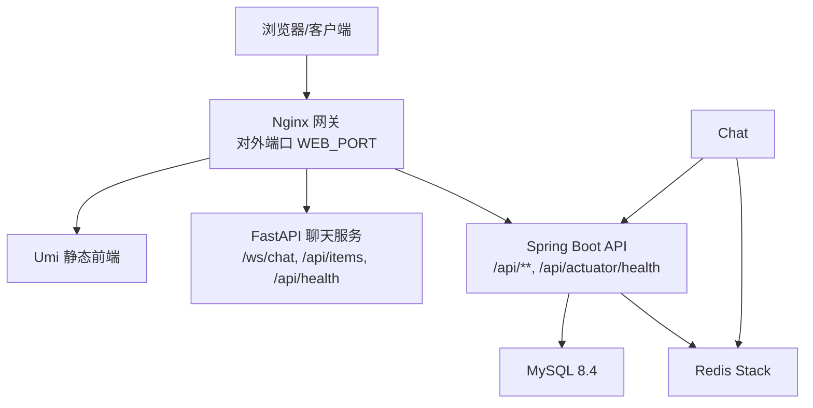

**图表来源**
- [docker-compose.yml:7-128](file://docker-compose.yml#L7-L128)
- [infra/nginx/nginx.conf:39-111](file://infra/nginx/nginx.conf#L39-L111)

**章节来源**
- [docker-compose.yml:1-134](file://docker-compose.yml#L1-L134)
- [.env.example:1-88](file://.env.example#L1-L88)

## 核心组件
- MySQL：业务关系型数据库，使用命名卷持久化数据目录。
- Redis Stack：启用 JSON 与搜索模块，供聊天会话状态持久化及 API 缓存。
- API 服务：Spring Boot 应用，连接 MySQL 与 Redis，暴露 `/api` 上下文路径。
- 聊天服务：FastAPI + LangGraph，支持 WebSocket 流式对话，通过 Redis 做 checkpointer。
- Web 网关：Nginx 聚合入口，静态资源与 API 同源访问，避免跨域问题。

**章节来源**
- [docker-compose.yml:8-128](file://docker-compose.yml#L8-L128)
- [services/api/Dockerfile:26-41](file://services/api/Dockerfile#L26-L41)
- [services/chat/Dockerfile:31-41](file://services/chat/Dockerfile#L31-L41)
- [apps/admin-web/Dockerfile:23-28](file://apps/admin-web/Dockerfile#L23-L28)

## 架构总览
系统采用“单入口网关 + 多后端服务”的架构：
- 外部流量只暴露 Nginx 端口（默认 8000），由 Nginx 根据 URL 前缀转发到不同服务。
- API 服务负责用户认证、菜谱等业务逻辑，读写 MySQL，并使用 Redis 做缓存与会话辅助。
- 聊天服务负责实时对话、智能体编排，依赖 Redis 保存 LangGraph 检查点。
- 前端 Umi 应用由 Nginx 直接托管，路由回退到 index.html，实现 SPA 体验。

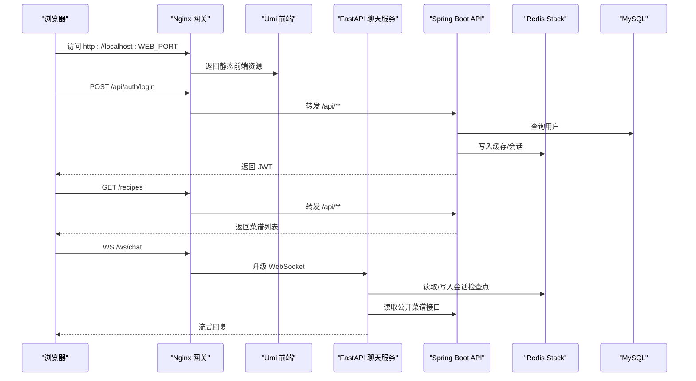

**图表来源**
- [infra/nginx/nginx.conf:55-96](file://infra/nginx/nginx.conf#L55-L96)
- [docker-compose.yml:44-113](file://docker-compose.yml#L44-L113)

## 详细组件分析

### MySQL 服务
- 镜像版本固定为 MySQL 8.4。
- 通过环境变量注入数据库名、用户名和密码；密码未设置时强制失败，防止误用空口令。
- 数据目录挂载到命名卷 `mysql_data`，保证容器重建后数据不丢失。
- 健康检查使用 `mysqladmin ping`，配合重试与超时，确保 API 在数据库就绪后再启动。

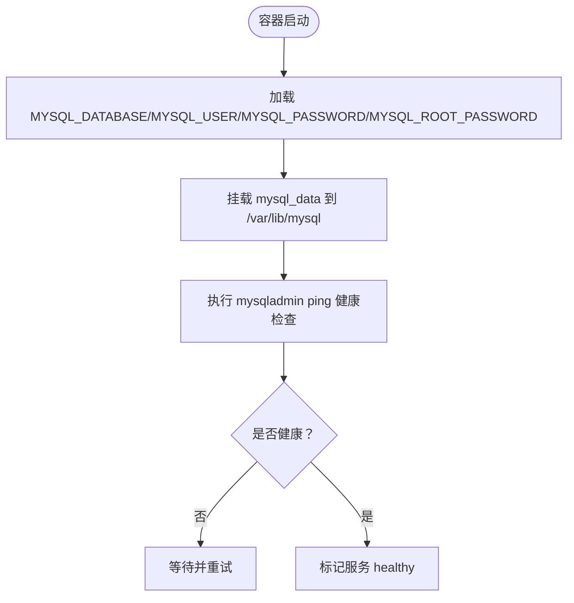

**图表来源**
- [docker-compose.yml:8-22](file://docker-compose.yml#L8-L22)

**章节来源**
- [docker-compose.yml:8-22](file://docker-compose.yml#L8-L22)

### Redis Stack 服务
- 使用 Redis Stack Server，以启用 JSON 与 RediSearch 能力，满足 LangGraph 检查点与语义索引需求。
- 通过 `REDIS_ARGS` 传入密码与 AOF 持久化开关，同时把 `REDIS_PASSWORD` 注入容器以便健康检查可用。
- 数据目录挂载到 `redis_data`，开启 AOF 提升数据安全。
- 健康检查通过 `redis-cli -a $REDIS_PASSWORD ping` 验证连通性。

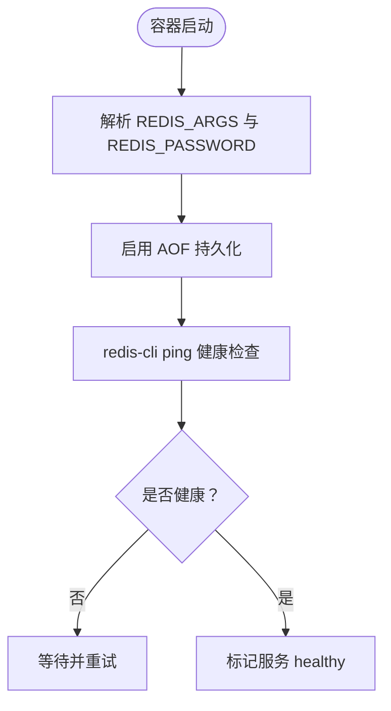

**图表来源**
- [docker-compose.yml:24-42](file://docker-compose.yml#L24-L42)

**章节来源**
- [docker-compose.yml:24-42](file://docker-compose.yml#L24-L42)

### API 服务（Spring Boot）
- 构建上下文为 `./services/api`，多阶段构建：先 Maven 拉依赖打包，再 JRE 运行。
- 运行时暴露 8080 端口，并通过环境变量注入数据库连接、Redis 地址、JWT 密钥、讯飞 TTS 与腾讯云 COS 配置。
- 依赖 MySQL 与 Redis 健康后才启动，自身健康检查调用 `/api/actuator/health`。
- 上传目录挂载到 `uploads_data`，便于文件持久化。

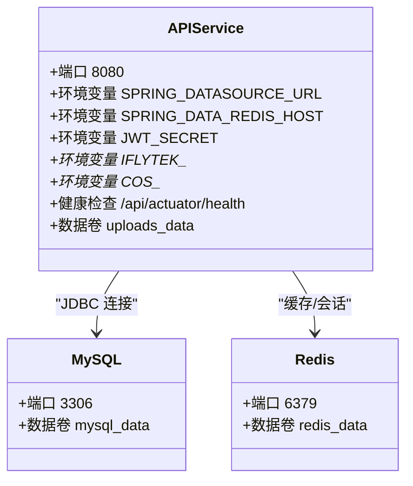

**图表来源**
- [docker-compose.yml:44-82](file://docker-compose.yml#L44-L82)
- [services/api/Dockerfile:26-41](file://services/api/Dockerfile#L26-L41)

**章节来源**
- [docker-compose.yml:44-82](file://docker-compose.yml#L44-L82)
- [services/api/Dockerfile:1-42](file://services/api/Dockerfile#L1-L42)

### 聊天服务（FastAPI + LangGraph）
- 构建上下文为仓库根，安装本地 Python 包 `agent-core` 与 `agent-cooking`，并启用 Redis extra。
- 运行时暴露 5090 端口，通过环境变量控制 CORS、LLM 提供商、模型、Embedding 与 Redis 连接。
- 依赖 Redis 健康，并在 API 就绪后启动以减少首次请求空查。
- 健康检查调用 `/api/health`。

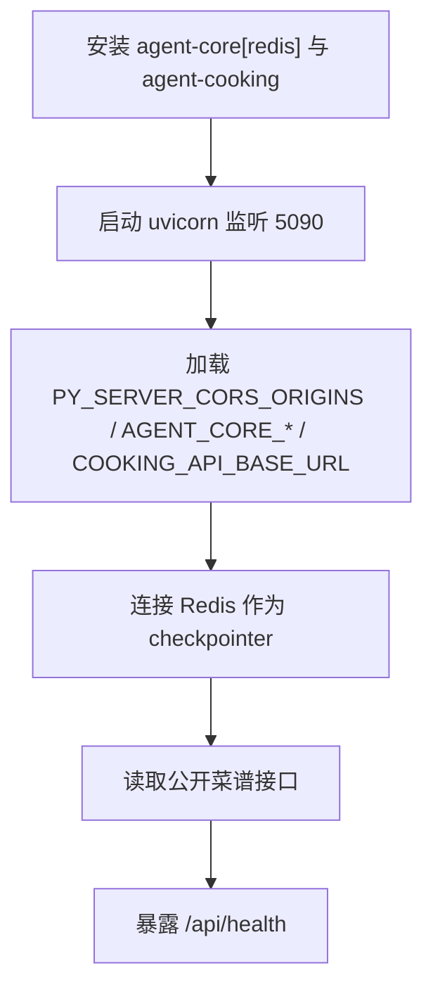

**图表来源**
- [services/chat/Dockerfile:20-41](file://services/chat/Dockerfile#L20-L41)
- [docker-compose.yml:84-113](file://docker-compose.yml#L84-L113)

**章节来源**
- [docker-compose.yml:84-113](file://docker-compose.yml#L84-L113)
- [services/chat/Dockerfile:1-42](file://services/chat/Dockerfile#L1-L42)

### Web 网关（Nginx）
- 构建上下文为仓库根，使用 Node 构建 Umi 前端，最终镜像基于 Nginx 托管静态资源。
- 通过只读挂载 `infra/nginx/nginx.conf` 提供反向代理规则。
- 对外暴露 `WEB_PORT`（默认 8000），内部转发到 API 与聊天服务。
- 关键分流：
  - `/`：Umi 静态前端，SPA 路由回退到 index.html。
  - `/ws/chat`：WebSocket 长连接，转发到聊天服务。
  - `/api/health` 与 `/api/items*`：转发到聊天服务。
  - `/api/**`：其余转发到 Spring Boot API。

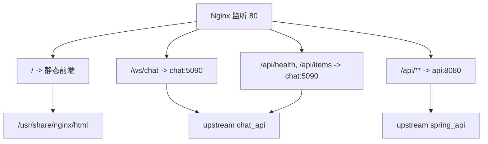

**图表来源**
- [apps/admin-web/Dockerfile:23-28](file://apps/admin-web/Dockerfile#L23-L28)
- [infra/nginx/nginx.conf:39-111](file://infra/nginx/nginx.conf#L39-L111)

**章节来源**
- [docker-compose.yml:115-128](file://docker-compose.yml#L115-L128)
- [apps/admin-web/Dockerfile:1-28](file://apps/admin-web/Dockerfile#L1-L28)
- [infra/nginx/nginx.conf:1-114](file://infra/nginx/nginx.conf#L1-L114)

## 依赖与网络拓扑
- 服务间通信通过 Docker Compose 内置网络进行，服务名即主机名：
  - API 访问 MySQL：`mysql:3306`
  - API 访问 Redis：`redis:6379`
  - 聊天服务访问 Redis：`redis:6379`
  - 聊天服务访问 API：`api:8080`
  - Nginx 访问 API：`api:8080`
  - Nginx 访问聊天服务：`chat:5090`
- 外部仅暴露 Nginx 端口 `WEB_PORT`，其他服务端口不直接对外。

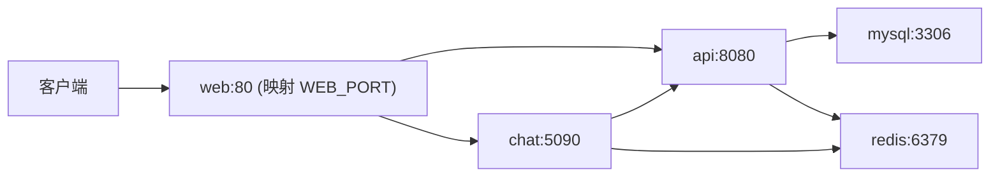

**图表来源**
- [docker-compose.yml:44-128](file://docker-compose.yml#L44-L128)

**章节来源**
- [docker-compose.yml:44-128](file://docker-compose.yml#L44-L128)

## 环境变量与安全配置
- 所有环境变量集中管理于 `.env.example`，复制为 `.env` 后按需修改；`.env` 被忽略提交，避免泄露。
- 敏感项包括：
  - 数据库密码：`MYSQL_PASSWORD`、`MYSQL_ROOT_PASSWORD`
  - JWT 密钥：`JWT_SECRET`（Base64，解码后至少 32 字节）
  - 讯飞 TTS：`IFLYTEK_APP_ID`、`IFLYTEK_API_KEY`、`IFLYTEK_API_SECRET`
  - 腾讯云 COS：`COS_SECRET_ID`、`COS_SECRET_KEY`
  - LLM 与 Embedding：`AGENT_CORE_LLM_API_KEY`、`AGENT_CORE_EMBEDDING_API_KEY`
- 部分变量有默认值，未配置时服务仍可启动但功能降级（如 TTS、COS、Embedding）。
- 容器内健康检查需要对应密码变量已注入，否则探针可能误报。

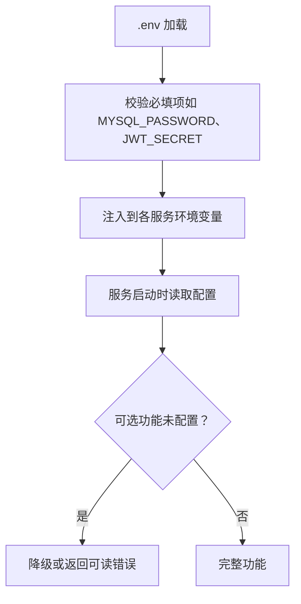

**图表来源**
- [.env.example:1-88](file://.env.example#L1-L88)
- [docker-compose.yml:10-100](file://docker-compose.yml#L10-L100)

**章节来源**
- [.env.example:1-88](file://.env.example#L1-L88)
- [docker-compose.yml:10-100](file://docker-compose.yml#L10-L100)

## 数据卷与持久化
- `mysql_data`：MySQL 数据目录 `/var/lib/mysql`，保证数据库迁移与数据持久化。
- `redis_data`：Redis 数据目录 `/data`，结合 AOF 提升数据安全性。
- `uploads_data`：API 上传目录 `/app/uploads`，用于头像、文件与 TTS 音频落盘。
- 所有卷均为命名卷，便于跨容器共享与宿主机备份。

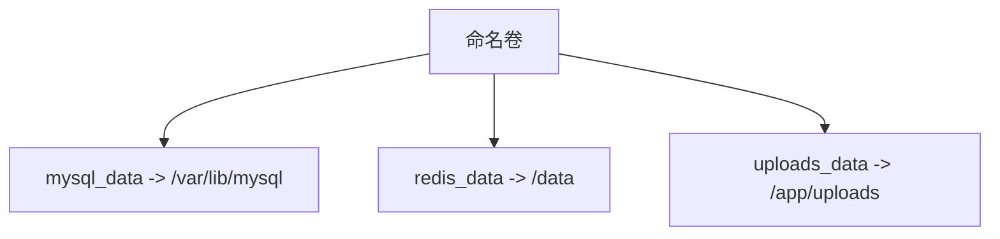

**图表来源**
- [docker-compose.yml:15-36](file://docker-compose.yml#L15-L36)
- [docker-compose.yml:68-69](file://docker-compose.yml#L68-L69)
- [docker-compose.yml:130-133](file://docker-compose.yml#L130-L133)

**章节来源**
- [docker-compose.yml:15-36](file://docker-compose.yml#L15-L36)
- [docker-compose.yml:68-69](file://docker-compose.yml#L68-L69)
- [docker-compose.yml:130-133](file://docker-compose.yml#L130-L133)

## 数据库初始化与备份恢复
- 初始化脚本：
  - 仓库包含 SQL 种子数据与工具脚本，例如 `services/recipe/resources/data-*.sql` 与 `tools/seed-sql.py`，可在容器外或通过临时容器执行。
  - 建议在 MySQL 容器启动后，手动执行初始化脚本创建表结构与基础数据。
- 备份策略：
  - 使用 `mysqldump` 对 `MYSQL_DATABASE` 指定库进行逻辑备份，输出到宿主机或对象存储。
  - 定期备份 `mysql_data` 命名卷内容，或使用 `docker cp` 导出容器内数据目录。
- 恢复策略：
  - 停止相关服务，清空目标库或重新初始化，再导入备份 SQL。
  - 若使用命名卷，可直接替换 `mysql_data` 中数据目录并重启 MySQL。

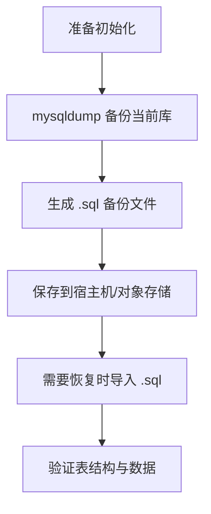

**图表来源**
- [docker-compose.yml:8-22](file://docker-compose.yml#L8-L22)

**章节来源**
- [docker-compose.yml:8-22](file://docker-compose.yml#L8-L22)

## 启动、停止与重启
- 启动：
  - 复制环境变量模板：`cp .env.example .env`
  - 一键启动并构建：`docker compose up -d --build`
  - 网关入口：`http://localhost:${WEB_PORT}`
- 停止：
  - `docker compose down`
  - 如需删除数据卷：`docker compose down -v`
- 重启：
  - 单个服务：`docker compose restart <service>`
  - 全部服务：`docker compose restart`
- 查看状态与日志：
  - 状态：`docker compose ps`
  - 日志：`docker compose logs -f <service>`

**章节来源**
- [docker-compose.yml:1-4](file://docker-compose.yml#L1-L4)

## 监控、日志与健康检查
- 健康检查：
  - MySQL：`mysqladmin ping`
  - Redis：`redis-cli -a $REDIS_PASSWORD ping`
  - API：`curl -fsS http://localhost:8080/api/actuator/health`
  - 聊天服务：`python -c "import urllib.request; urllib.request.urlopen('http://127.0.0.1:5090/api/health')"`
- 日志收集：
  - 使用 `docker compose logs -f` 查看实时日志。
  - 可将日志输出到宿主机目录，通过挂载日志卷或配置 Docker logging driver 实现集中收集。
- 监控建议：
  - 结合 Prometheus/Grafana 采集 MySQL、Redis、API 与聊天服务的指标。
  - 对 Nginx 接入层启用访问日志与错误日志，便于定位上游服务异常。

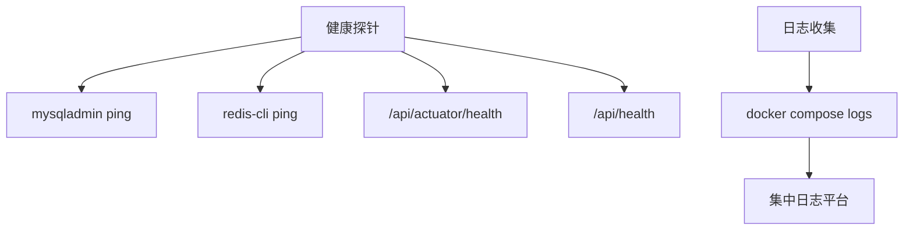

**图表来源**
- [docker-compose.yml:17-41](file://docker-compose.yml#L17-L41)
- [docker-compose.yml:75-81](file://docker-compose.yml#L75-L81)
- [docker-compose.yml:107-112](file://docker-compose.yml#L107-L112)

**章节来源**
- [docker-compose.yml:17-41](file://docker-compose.yml#L17-L41)
- [docker-compose.yml:75-81](file://docker-compose.yml#L75-L81)
- [docker-compose.yml:107-112](file://docker-compose.yml#L107-L112)

## 故障排查指南
- 无法连接 MySQL：
  - 检查 `.env` 中的 `MYSQL_PASSWORD`、`MYSQL_ROOT_PASSWORD` 是否正确。
  - 确认 MySQL 健康检查通过：`docker compose logs mysql`。
- Redis 命令未知或会话降级：
  - 必须使用 Redis Stack，普通 Redis 缺少 JSON/RediSearch 模块。
  - 检查 `REDIS_PASSWORD` 与 `REDIS_ARGS` 配置一致。
- API 启动失败：
  - 检查数据库与 Redis 健康状态。
  - 检查 JWT 密钥长度与 Base64 编码是否符合要求。
  - 查看 `/api/actuator/health` 响应。
- 聊天服务无法连接 Redis：
  - 检查 `AGENT_CORE_CHECKPOINTER=redis` 与 `AGENT_CORE_REDIS_URL`。
  - 确认 Redis Stack 已启用且密码正确。
- 前端无法访问 API：
  - 确认 Nginx 分流规则生效，URL 前缀匹配 `/api/**`。
  - 检查 CORS 配置 `PY_SERVER_CORS_ORIGINS` 是否包含前端域名。

**章节来源**
- [docker-compose.yml:10-100](file://docker-compose.yml#L10-L100)
- [infra/nginx/nginx.conf:55-96](file://infra/nginx/nginx.conf#L55-L96)

## 性能与优化建议
- 构建加速：
  - API 与聊天服务 Dockerfile 默认使用国内加速基础镜像，减少依赖拉取时间。
  - Maven 使用阿里云镜像加速依赖下载。
- 资源限制：
  - 可为各服务添加 CPU/内存限制，避免单服务占用过多资源。
- 缓存与压缩：
  - Nginx 已启用 gzip 与静态资源缓存，提升前端加载性能。
- 连接池：
  - 调整 API 的数据库连接池大小与 Redis 连接池参数，匹配并发量。

**章节来源**
- [services/api/Dockerfile:1-24](file://services/api/Dockerfile#L1-L24)
- [services/chat/Dockerfile:1-27](file://services/chat/Dockerfile#L1-L27)
- [infra/nginx/nginx.conf:26-31](file://infra/nginx/nginx.conf#L26-L31)

## 结论
本部署方案通过 Docker Compose 统一管理 MySQL、Redis Stack、API、聊天服务与 Nginx 网关，提供清晰的服务依赖、健康检查、数据持久化与环境变量管理。配合 `.env.example` 与 Nginx 分流规则，可实现从前端到后端的一体化访问体验。对于生产环境，建议结合对象存储、日志集中化与监控系统，进一步提升稳定性与可观测性。