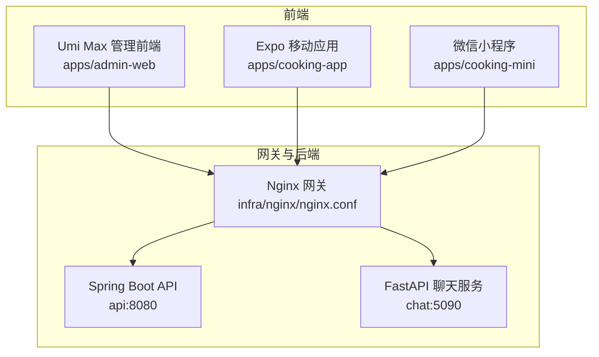
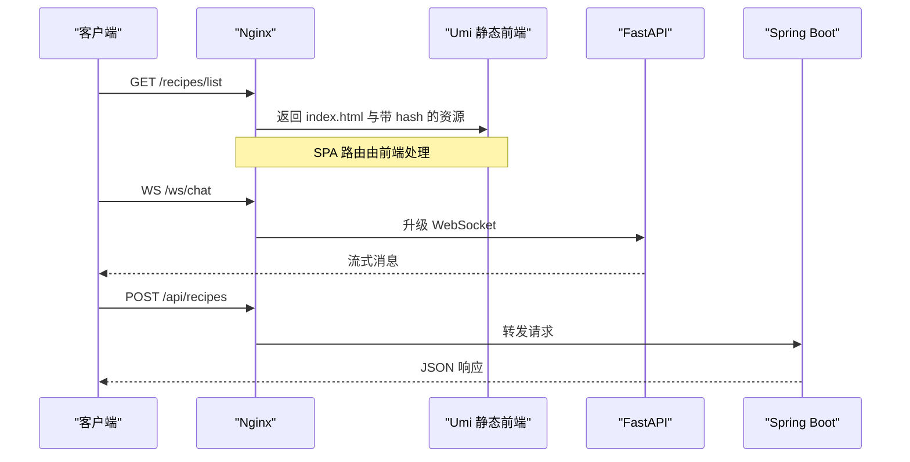
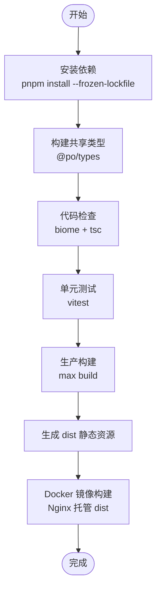
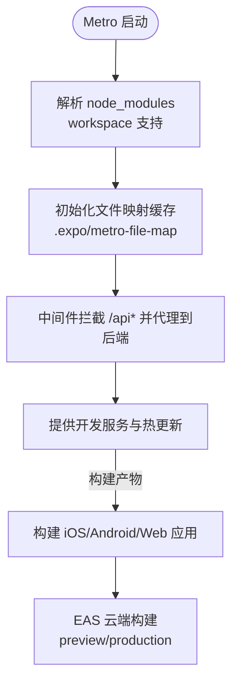
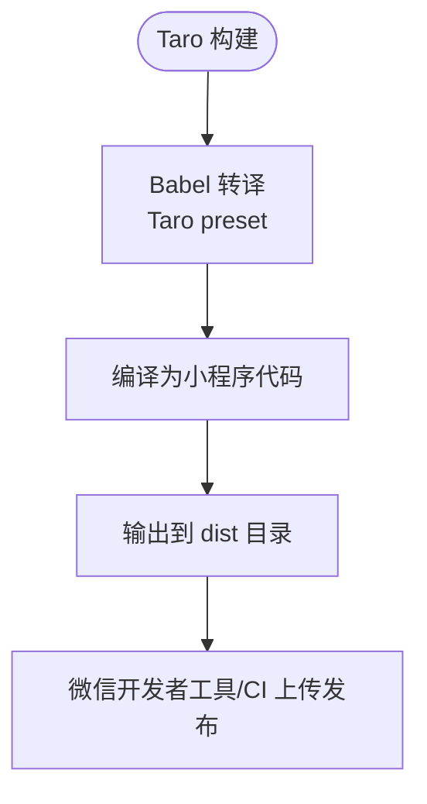
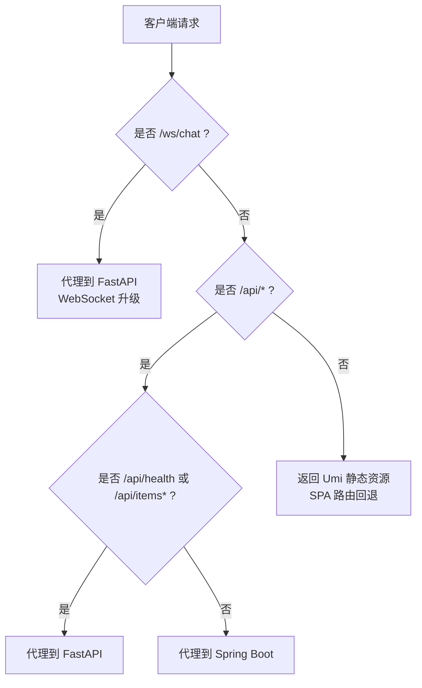
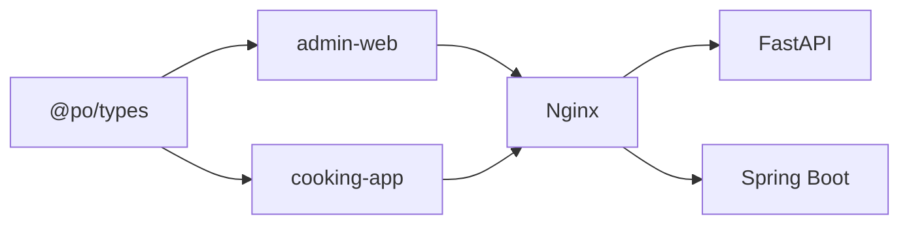
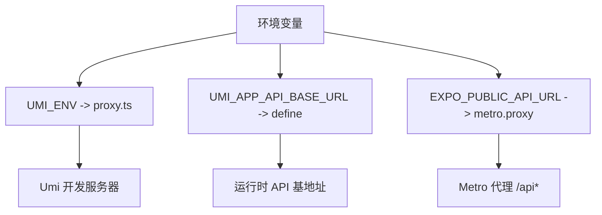

# Web 应用部署

<cite>
**本文引用的文件**   
- [apps/admin-web/package.json](file://apps/admin-web/package.json)
- [apps/admin-web/config/config.ts](file://apps/admin-web/config/config.ts)
- [apps/admin-web/config/proxy.ts](file://apps/admin-web/config/proxy.ts)
- [apps/admin-web/config/routes.ts](file://apps/admin-web/config/routes.ts)
- [apps/admin-web/Dockerfile](file://apps/admin-web/Dockerfile)
- [.github/workflows/ci.yml](file://.github/workflows/ci.yml)
- [infra/nginx/nginx.conf](file://infra/nginx/nginx.conf)
- [apps/cooking-app/app.json](file://apps/cooking-app/app.json)
- [apps/cooking-app/eas.json](file://apps/cooking-app/eas.json)
- [apps/cooking-app/metro.config.js](file://apps/cooking-app/metro.config.js)
- [apps/cooking-app/package.json](file://apps/cooking-app/package.json)
- [apps/cooking-mini/project.config.json](file://apps/cooking-mini/project.config.json)
- [apps/cooking-mini/src/app.config.ts](file://apps/cooking-mini/src/app.config.ts)
- [apps/cooking-mini/babel.config.js](file://apps/cooking-mini/babel.config.js)
</cite>

## 目录
1. [简介](#简介)
2. [项目结构](#项目结构)
3. [核心组件](#核心组件)
4. [架构总览](#架构总览)
5. [详细组件分析](#详细组件分析)
6. [依赖关系分析](#依赖关系分析)
7. [性能与缓存策略](#性能与缓存策略)
8. [多环境与配置管理](#多环境与配置管理)
9. [CDN、HTTPS 与安全头](#cdnhttps-与安全头)
10. [故障排查指南](#故障排查指南)
11. [结论](#结论)

## 简介
本部署文档面向 Umi Max 管理前端、Expo 移动应用与微信小程序，覆盖构建流程、静态资源优化、反向代理、路由规则、多环境配置、CDN 与 HTTPS 安全等主题。目标是帮助运维与研发在开发、测试、生产环境中稳定发布并高效运行。

## 项目结构
仓库采用多包工作区组织，前端相关主要位于 apps 目录：
- apps/admin-web：Umi Max 管理后台（Web）
- apps/cooking-app：基于 Expo/React Native 的移动应用（iOS/Android/Web）
- apps/cooking-mini：基于 Taro 的微信小程序
- infra/nginx：Nginx 网关与静态资源分发
- .github/workflows：CI 流水线

图示来源
- [apps/admin-web/config/config.ts:36-240](file://apps/admin-web/config/config.ts#L36-L240)
- [infra/nginx/nginx.conf:18-112](file://infra/nginx/nginx.conf#L18-L112)

章节来源
- [apps/admin-web/package.json:1-128](file://apps/admin-web/package.json#L1-L128)
- [apps/cooking-app/package.json:1-71](file://apps/cooking-app/package.json#L1-L71)
- [apps/cooking-mini/project.config.json:1-19](file://apps/cooking-mini/project.config.json#L1-L19)
- [infra/nginx/nginx.conf:1-114](file://infra/nginx/nginx.conf#L1-L114)

## 核心组件
- Umi Max 管理前端：负责页面渲染、路由、国际化、OpenAPI 代码生成、静态资源构建与导出。
- Expo 移动应用：跨平台打包 iOS/Android/Web，使用 Metro 作为开发服务器与打包器。
- 微信小程序：Taro 编译产物由微信开发者工具或 CI 构建。
- Nginx 网关：统一入口，按路径分流到静态资源、FastAPI 与 Spring Boot。

章节来源
- [apps/admin-web/config/config.ts:36-240](file://apps/admin-web/config/config.ts#L36-L240)
- [apps/cooking-app/metro.config.js:1-54](file://apps/cooking-app/metro.config.js#L1-L54)
- [apps/cooking-mini/src/app.config.ts:1-57](file://apps/cooking-mini/src/app.config.ts#L1-L57)
- [infra/nginx/nginx.conf:18-112](file://infra/nginx/nginx.conf#L18-L112)

## 架构总览
整体访问链路如下：
- 浏览器/客户端请求进入 Nginx
- / 路径返回 Umi 静态 SPA，开启 history 模式回退
- /ws/chat 与 /api/items* 转发至 FastAPI
- 其余 /api/** 转发至 Spring Boot
- 静态资源启用强缓存，HTML 不缓存

图示来源
- [infra/nginx/nginx.conf:47-112](file://infra/nginx/nginx.conf#L47-L112)
- [apps/admin-web/config/routes.ts:13-193](file://apps/admin-web/config/routes.ts#L13-L193)

## 详细组件分析

### Umi Max 管理前端构建与部署
- 构建脚本与环境变量
  - 构建命令：max build
  - 预览命令：max preview
  - 分析命令：ANALYZE=1 max build
  - 环境变量：UMI_ENV、CI、COMMIT_HASH、UMI_APP_API_BASE_URL
- TypeScript 编译
  - 通过 pnpm workspace 先构建共享类型包 @po/types，再构建 admin
  - CI 中执行 tsc 检查与 lint
- 资源优化与静态文件生成
  - 开启 hash 与 exportStatic，输出带哈希的静态资源与按路由生成的目录
  - publicPath 为根路径，适配 Nginx 根站点部署
  - headScripts 注入 loading 脚本缓解首屏白屏
- 路由与插件
  - routes.ts 定义业务路由与权限控制
  - 启用 antd、locale、reactQuery、openAPI、tailwindcss 等插件
- Docker 构建
  - 多阶段构建：Node 构建 + Nginx 运行
  - dist 目录挂载到 Nginx 静态目录

图示来源
- [.github/workflows/ci.yml:14-47](file://.github/workflows/ci.yml#L14-L47)
- [apps/admin-web/Dockerfile:1-28](file://apps/admin-web/Dockerfile#L1-L28)
- [apps/admin-web/config/config.ts:36-240](file://apps/admin-web/config/config.ts#L36-L240)

章节来源
- [apps/admin-web/package.json:7-31](file://apps/admin-web/package.json#L7-L31)
- [apps/admin-web/config/config.ts:36-240](file://apps/admin-web/config/config.ts#L36-L240)
- [apps/admin-web/config/routes.ts:13-193](file://apps/admin-web/config/routes.ts#L13-L193)
- [apps/admin-web/Dockerfile:1-28](file://apps/admin-web/Dockerfile#L1-L28)
- [.github/workflows/ci.yml:14-47](file://.github/workflows/ci.yml#L14-L47)

### Expo 移动应用打包与配置
- 应用元数据与平台配置
  - app.json 定义应用名、标识符、图标、scheme、插件与 EAS 项目 ID
  - ios.bundleIdentifier 与 android.package 用于签名与上架
- EAS 构建
  - eas.json 定义 preview（APK）与 production（AAB）构建目标
  - autoIncrement 自动递增版本号
- Metro 开发与代理
  - metro.config.js 设置 watchFolders、nodeModulesPaths、文件映射缓存目录
  - 开发时通过 http-proxy-middleware 将 /api 代理到 EXPO_PUBLIC_API_URL 指向的后端
- 脚本与依赖
  - package.json 提供 start、android、ios、web、prebuild、lint、typecheck、test 等脚本

图示来源
- [apps/cooking-app/metro.config.js:1-54](file://apps/cooking-app/metro.config.js#L1-L54)
- [apps/cooking-app/app.json:1-54](file://apps/cooking-app/app.json#L1-L54)
- [apps/cooking-app/eas.json:1-20](file://apps/cooking-app/eas.json#L1-L20)
- [apps/cooking-app/package.json:59-69](file://apps/cooking-app/package.json#L59-L69)

章节来源
- [apps/cooking-app/app.json:1-54](file://apps/cooking-app/app.json#L1-L54)
- [apps/cooking-app/eas.json:1-20](file://apps/cooking-app/eas.json#L1-L20)
- [apps/cooking-app/metro.config.js:1-54](file://apps/cooking-app/metro.config.js#L1-L54)
- [apps/cooking-app/package.json:1-71](file://apps/cooking-app/package.json#L1-L71)

### 微信小程序构建与发布
- 工程配置
  - project.config.json 指定 miniprogramRoot 为 dist，启用压缩与最小化
  - app.config.ts 定义 pages、window、tabBar 等小程序配置
- 编译与转译
  - babel.config.js 使用 Taro preset，支持 React + TypeScript
- 构建产物
  - 构建后输出到 dist 目录，由微信开发者工具或 CI 进行上传发布

图示来源
- [apps/cooking-mini/project.config.json:1-19](file://apps/cooking-mini/project.config.json#L1-L19)
- [apps/cooking-mini/src/app.config.ts:1-57](file://apps/cooking-mini/src/app.config.ts#L1-L57)
- [apps/cooking-mini/babel.config.js:1-12](file://apps/cooking-mini/babel.config.js#L1-L12)

章节来源
- [apps/cooking-mini/project.config.json:1-19](file://apps/cooking-mini/project.config.json#L1-L19)
- [apps/cooking-mini/src/app.config.ts:1-57](file://apps/cooking-mini/src/app.config.ts#L1-L57)
- [apps/cooking-mini/babel.config.js:1-12](file://apps/cooking-mini/babel.config.js#L1-L12)

### Nginx 反向代理与路由规则
- 分流规则
  - / 返回 Umi 静态 SPA，try_files 回退到 index.html
  - /ws/chat 转发至 FastAPI，支持 WebSocket 升级
  - /api/health 与 /api/items* 转发至 FastAPI
  - 其余 /api/** 转发至 Spring Boot
- 静态资源缓存
  - 对 js/css/图片/字体等资源设置 30 天缓存与 immutable
  - HTML 不缓存，确保版本更新及时生效
- 性能与安全
  - gzip 压缩
  - client_max_body_size 对齐后端上传限制
  - absolute_redirect off 避免相对重定向问题

图示来源
- [infra/nginx/nginx.conf:47-112](file://infra/nginx/nginx.conf#L47-L112)

章节来源
- [infra/nginx/nginx.conf:1-114](file://infra/nginx/nginx.conf#L1-L114)

## 依赖关系分析
- 前端与后端
  - Umi 前端通过 Nginx 与后端解耦，生产环境不再使用本地代理
  - 开发环境通过 UMI_ENV 选择 dev/test/pre 代理目标
- 移动端与后端
  - Metro 开发服务器将 /api 代理到 EXPO_PUBLIC_API_URL 指定的后端 origin
- 类型共享
  - @po/types 被 admin-web 与 cooking-app 共同引用，需优先构建

图示来源
- [apps/admin-web/config/config.ts:231-239](file://apps/admin-web/config/config.ts#L231-L239)
- [apps/cooking-app/metro.config.js:26-51](file://apps/cooking-app/metro.config.js#L26-L51)
- [infra/nginx/nginx.conf:39-96](file://infra/nginx/nginx.conf#L39-L96)

章节来源
- [apps/admin-web/config/proxy.ts:12-47](file://apps/admin-web/config/proxy.ts#L12-L47)
- [apps/cooking-app/metro.config.js:1-54](file://apps/cooking-app/metro.config.js#L1-L54)
- [infra/nginx/nginx.conf:18-112](file://infra/nginx/nginx.conf#L18-L112)

## 性能与缓存策略
- 静态资源
  - 启用 hash 文件名，配合 Nginx 的 expires 30d 与 Cache-Control: public, immutable
  - HTML 不缓存，保证新版本可立即生效
- 传输优化
  - Nginx 开启 gzip，压缩文本、JSON、JS、CSS、SVG 等
  - 调整 keepalive_timeout 与 sendfile 提升并发性能
- SPA 路由
  - try_files $uri $uri/ /index.html 确保前端路由正常工作
- 上传大小
  - client_max_body_size 与后端 multipart 上限保持一致，避免 413 错误

章节来源
- [infra/nginx/nginx.conf:22-31](file://infra/nginx/nginx.conf#L22-L31)
- [infra/nginx/nginx.conf:98-111](file://infra/nginx/nginx.conf#L98-L111)
- [apps/admin-web/config/config.ts:44-47](file://apps/admin-web/config/config.ts#L44-L47)

## 多环境与配置管理
- Umi Max 管理前端
  - UMI_ENV 控制代理目标：dev/test/pre
  - UMI_APP_API_BASE_URL 注入为 process.env.UMI_APP_API_BASE_URL，供运行时使用
  - COMMIT_HASH 注入 __APP_VERSION__ 与 __UMI_VERSION__ 等常量
- Expo 移动应用
  - EXPO_PUBLIC_API_URL 决定 Metro 代理后端 origin
  - app.json 中的 extra.eas.projectId 用于 EAS 构建
- 微信小程序
  - project.config.json 控制编译选项与输出目录
  - app.config.ts 定义页面与 tabBar 等运行时配置

图示来源
- [apps/admin-web/config/config.ts:10-10](file://apps/admin-web/config/config.ts#L10-L10)
- [apps/admin-web/config/config.ts:231-239](file://apps/admin-web/config/config.ts#L231-L239)
- [apps/admin-web/config/proxy.ts:12-47](file://apps/admin-web/config/proxy.ts#L12-L47)
- [apps/cooking-app/metro.config.js:26-51](file://apps/cooking-app/metro.config.js#L26-L51)
- [apps/cooking-app/app.json:45-51](file://apps/cooking-app/app.json#L45-L51)

章节来源
- [apps/admin-web/config/config.ts:10-10](file://apps/admin-web/config/config.ts#L10-L10)
- [apps/admin-web/config/config.ts:231-239](file://apps/admin-web/config/config.ts#L231-L239)
- [apps/admin-web/config/proxy.ts:12-47](file://apps/admin-web/config/proxy.ts#L12-L47)
- [apps/cooking-app/metro.config.js:26-51](file://apps/cooking-app/metro.config.js#L26-L51)
- [apps/cooking-app/app.json:45-51](file://apps/cooking-app/app.json#L45-L51)

## CDN、HTTPS 与安全头
- CDN 部署建议
  - 将 Umi 产出的静态资源（含 hash）上传至 CDN，并在 Nginx 中将静态资源路径指向 CDN 域名
  - HTML 仍由 Nginx 直接返回，避免缓存旧版本
- HTTPS 配置
  - 在 Nginx 层终止 TLS，监听 443 并配置证书
  - 强制 HTTP 跳转 HTTPS，并设置 HSTS
- 安全头
  - 添加 X-Frame-Options、X-Content-Type-Options、Referrer-Policy、Permissions-Policy 等
  - 针对 API 路径启用 CORS 白名单与速率限制（视后端能力）

说明：本节为通用部署实践建议，未直接分析具体配置文件。

## 故障排查指南
- 前端构建失败
  - 确认 Node 版本满足 engines 要求
  - 先构建 @po/types，再构建 admin-web
  - 检查 pnpm 锁文件与工作区依赖
- 代理异常
  - 开发环境检查 UMI_ENV 与 UMI_APP_API_BASE_URL
  - 移动端检查 EXPO_PUBLIC_API_URL 是否合法 URL
- Nginx 路由问题
  - 确认 / 路径 try_files 回退到 index.html
  - 检查 /ws/chat 的 Upgrade 与 Connection 头映射
  - 校验静态资源正则匹配与缓存头
- 移动端缓存损坏
  - Metro 文件映射缓存目录写入中断会导致全量扫描；确保独占实例与正确目录权限

章节来源
- [apps/admin-web/package.json:95-97](file://apps/admin-web/package.json#L95-L97)
- [.github/workflows/ci.yml:14-47](file://.github/workflows/ci.yml#L14-L47)
- [apps/admin-web/config/proxy.ts:12-47](file://apps/admin-web/config/proxy.ts#L12-L47)
- [apps/cooking-app/metro.config.js:17-24](file://apps/cooking-app/metro.config.js#L17-L24)
- [infra/nginx/nginx.conf:33-37](file://infra/nginx/nginx.conf#L33-L37)
- [infra/nginx/nginx.conf:98-111](file://infra/nginx/nginx.conf#L98-L111)

## 结论
本项目通过 Umi Max、Expo 与 Taro 分别支撑 Web、移动与小程序三端，借助 Nginx 统一网关实现静态资源与后端服务的清晰分流。结合 CI、Docker 与多环境变量，可在开发、测试、生产环境稳定构建与发布。建议在上线前完善 CDN、HTTPS 与安全头配置，并根据业务规模调优 Nginx 与后端参数。