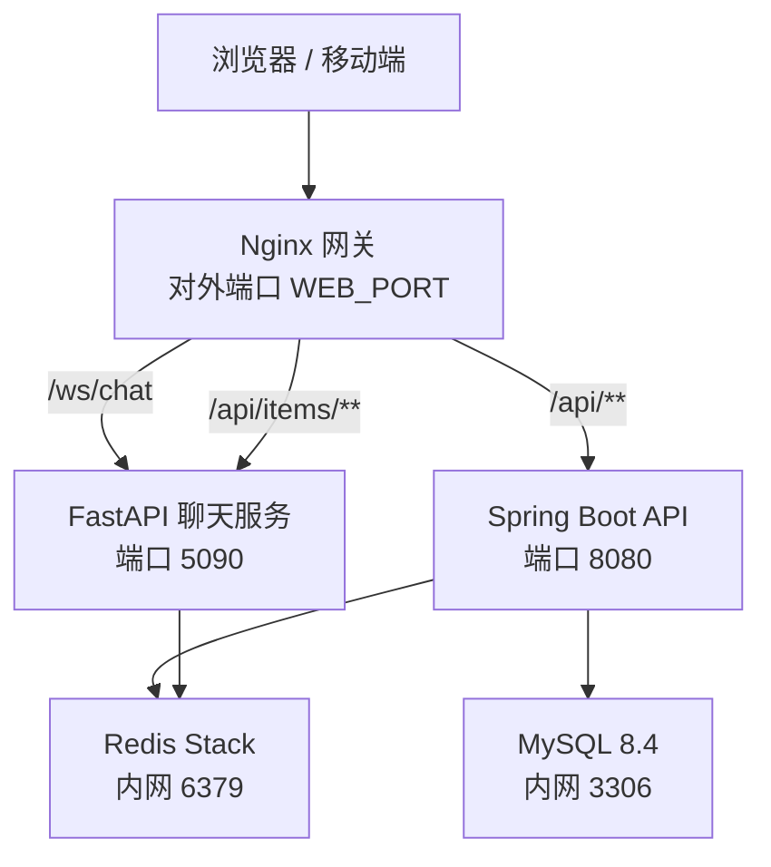
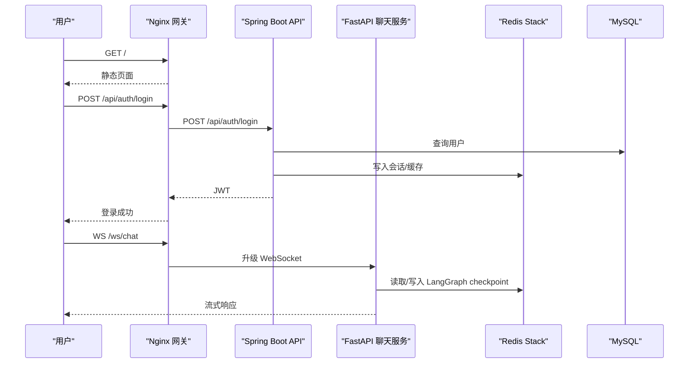
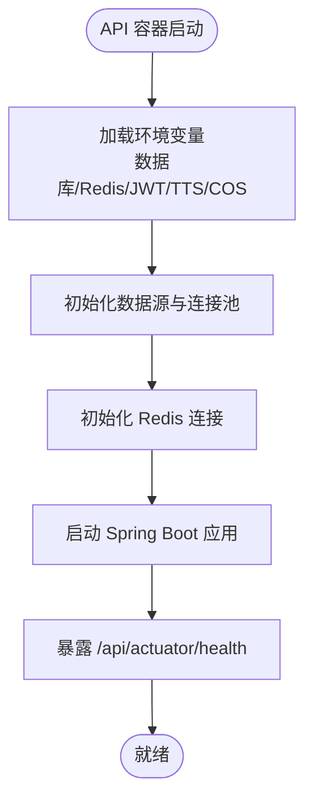
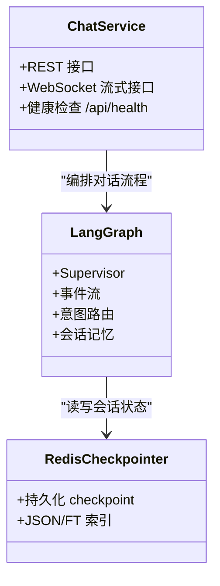
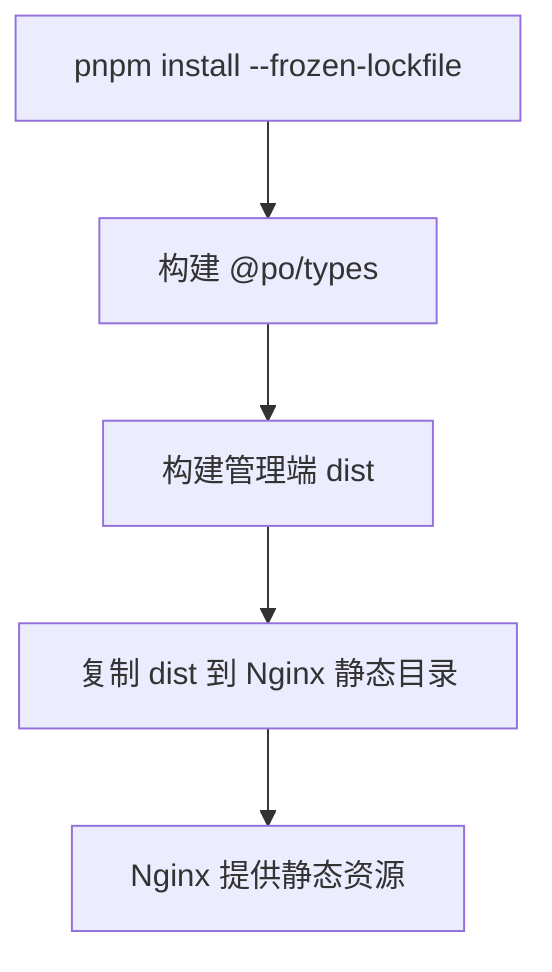
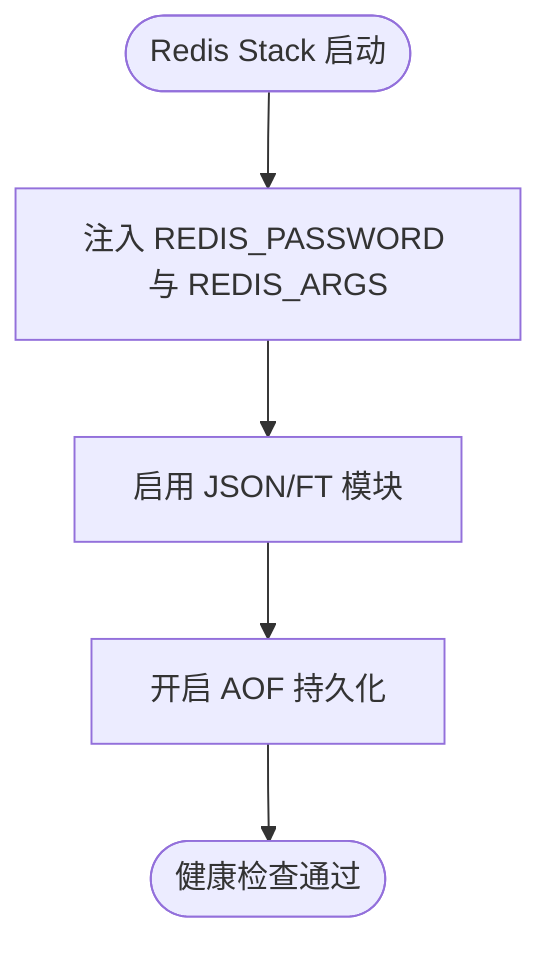
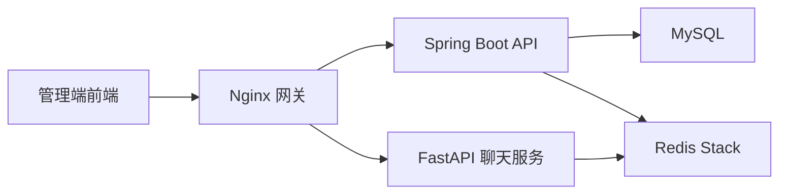

# 服务部署

<cite>
**本文引用的文件**   
- [README.md](file://README.md)
- [docker-compose.yml](file://docker-compose.yml)
- [services/api/Dockerfile](file://services/api/Dockerfile)
- [services/chat/Dockerfile](file://services/chat/Dockerfile)
- [apps/admin-web/Dockerfile](file://apps/admin-web/Dockerfile)
- [scripts/deploy-api.sh](file://scripts/deploy-api.sh)
- [scripts/deploy-chat.sh](file://scripts/deploy-chat.sh)
- [scripts/deploy-redis.sh](file://scripts/deploy-redis.sh)
- [services/api/pom.xml](file://services/api/pom.xml)
- [services/chat/pyproject.toml](file://services/chat/pyproject.toml)
- [apps/admin-web/package.json](file://apps/admin-web/package.json)
- [pnpm-workspace.yaml](file://pnpm-workspace.yaml)
- [services/api/api-bootstrap/src/main/resources/application.yaml](file://services/api/api-bootstrap/src/main/resources/application.yaml)
</cite>

## 目录
1. [引言](#引言)
2. [项目结构](#项目结构)
3. [核心组件](#核心组件)
4. [架构总览](#架构总览)
5. [详细组件分析](#详细组件分析)
6. [依赖关系分析](#依赖关系分析)
7. [性能与可观测性](#性能与可观测性)
8. [故障排查指南](#故障排查指南)
9. [结论](#结论)
10. [附录：环境变量与脚本参数](#附录环境变量与脚本参数)

## 引言
本文件面向生产环境的服务部署，覆盖 Spring Boot API、FastAPI 聊天服务、管理端前端以及 Redis 持久化组件的独立构建、容器化编排、健康检查、网络隔离与安全策略。文档同时说明 LangGraph 集成、Redis Checkpointer 配置、服务间通信路径，以及微信云托管镜像推送脚本的使用方法。

## 项目结构
仓库采用多语言 Monorepo：
- 管理前端：Umi Max + React，产物由 Nginx 托管。
- 业务 API：Spring Boot 4 + MyBatis-Plus + MySQL + Redis + JWT。
- 聊天服务：FastAPI + WebSocket + LangGraph，垂直 Agent 通过本地 Python 包接入。
- 基础设施：MySQL、Redis Stack（含 JSON/FT 能力）、Nginx 网关。
- 编排：Docker Compose 统一启动，仅 web 暴露宿主机端口。

**图示来源**
- [docker-compose.yml:44-128](file://docker-compose.yml#L44-L128)
- [README.md:36-57](file://README.md#L36-L57)

**章节来源**
- [README.md:1-34](file://README.md#L1-L34)
- [docker-compose.yml:1-134](file://docker-compose.yml#L1-L134)

## 核心组件
- Spring Boot API：Maven 多模块聚合，构建产物为 `api-bootstrap`；对外 `/api` 前缀，Actuator 健康端点位于 `/api/actuator/health`。
- FastAPI 聊天服务：提供 REST 与 WebSocket 流式接口，LangGraph 会话状态通过 Redis Checkpointer 持久化。
- 管理端前端：Node 22 + pnpm workspace 构建静态资源，Nginx 反向代理后端。
- Redis：使用 Redis Stack（JSON/RediSearch），供 LangGraph 与 Spring Data Redis 共用。

**章节来源**
- [services/api/Dockerfile:1-42](file://services/api/Dockerfile#L1-L42)
- [services/chat/Dockerfile:1-42](file://services/chat/Dockerfile#L1-L42)
- [apps/admin-web/Dockerfile:1-28](file://apps/admin-web/Dockerfile#L1-L28)
- [docker-compose.yml:24-42](file://docker-compose.yml#L24-L42)

## 架构总览
请求从 Nginx 进入后按路径分流：
- `/ws/chat` → chat:5090（WebSocket）
- `/api/health`、`/api/items/**` → chat:5090（FastAPI）
- `/api/**`（其余）→ api:8080（Spring Boot，context-path=/api）
- `/` → Nginx 静态资源（history 回退 index.html，带 hash 资源长缓存）

**图示来源**
- [docker-compose.yml:84-128](file://docker-compose.yml#L84-L128)
- [services/api/api-bootstrap/src/main/resources/application.yaml:4-8](file://services/api/api-bootstrap/src/main/resources/application.yaml#L4-L8)

**章节来源**
- [README.md:36-57](file://README.md#L36-L57)
- [docker-compose.yml:44-128](file://docker-compose.yml#L44-L128)

## 详细组件分析

### Spring Boot API 服务
- 构建与运行
  - 多阶段 Dockerfile：构建阶段使用 Maven 镜像拉取依赖并打包；运行阶段使用 JRE 镜像，最小化体积。
  - 聚合 POM 定义 Java 17、Spring Boot 父工程、MyBatis-Plus 版本管理与 Lombok 注解处理器。
  - 应用入口为 `api-bootstrap`，其他模块作为依赖参与 reactor 构建。
- 依赖管理
  - 通过 `pom.xml` 统一管理 MyBatis-Plus 及其分页插件版本。
  - 构建时优先使用阿里云 Maven 镜像加速依赖下载。
- 健康检查与监控
  - Actuator 暴露 health、info、metrics、prometheus。
  - Compose 健康检查调用 `/api/actuator/health`，要求返回 `status=UP`。
- 配置注入
  - 数据库、Redis、JWT、TTS、COS 等敏感配置通过环境变量注入，符合 12 因子原则。
  - context-path 固定为 `/api`，与网关转发规则一致。

**图示来源**
- [services/api/Dockerfile:26-42](file://services/api/Dockerfile#L26-L42)
- [services/api/pom.xml:1-96](file://services/api/pom.xml#L1-L96)
- [services/api/api-bootstrap/src/main/resources/application.yaml:58-68](file://services/api/api-bootstrap/src/main/resources/application.yaml#L58-L68)

**章节来源**
- [services/api/Dockerfile:1-42](file://services/api/Dockerfile#L1-L42)
- [services/api/pom.xml:1-96](file://services/api/pom.xml#L1-L96)
- [services/api/api-bootstrap/src/main/resources/application.yaml:4-37](file://services/api/api-bootstrap/src/main/resources/application.yaml#L4-L37)
- [docker-compose.yml:44-82](file://docker-compose.yml#L44-L82)

### FastAPI 聊天服务
- 构建与运行
  - 基于 Python 3.11 slim 镜像，安装 FastAPI、Uvicorn、Pydantic Settings。
  - 本地 Python 包 `agent-core`、`agent-cooking` 随镜像一起拷贝并安装；`agent-core` 需启用 `[redis]` extra 以支持 LangGraph Redis Checkpointer。
  - 构建期执行冒烟导入，确保镜像可运行。
- LangGraph 与 Redis Checkpointer
  - 通过 `AGENT_CORE_CHECKPOINTER=redis` 与 `AGENT_CORE_REDIS_URL` 启用 Redis 持久化。
  - 若未配置或 Redis 不可用，服务降级为内存 checkpointer，保证可用性。
- 健康检查
  - 提供 `/api/health`，Compose 健康检查通过 Python urllib 访问该端点。

**图示来源**
- [services/chat/Dockerfile:20-35](file://services/chat/Dockerfile#L20-L35)
- [docker-compose.yml:84-113](file://docker-compose.yml#L84-L113)

**章节来源**
- [services/chat/Dockerfile:1-42](file://services/chat/Dockerfile#L1-L42)
- [services/chat/pyproject.toml:1-29](file://services/chat/pyproject.toml#L1-L29)
- [docker-compose.yml:84-113](file://docker-compose.yml#L84-L113)

### 管理端前端与静态资源部署
- 构建流程
  - Node 22 + pnpm workspace，先安装依赖再构建共享类型包 `@po/types`，最后构建管理端。
  - 生产构建输出到 `dist`，由 Nginx 托管。
- 静态资源部署
  - 运行阶段使用 Nginx Alpine 镜像，挂载 `infra/nginx/nginx.conf` 实现反向代理与路由回退。
  - 前端 baseURL 为空，所有后端请求经 Nginx 统一转发。

**图示来源**
- [apps/admin-web/Dockerfile:5-28](file://apps/admin-web/Dockerfile#L5-L28)
- [apps/admin-web/package.json:1-128](file://apps/admin-web/package.json#L1-L128)
- [pnpm-workspace.yaml:1-5](file://pnpm-workspace.yaml#L1-L5)

**章节来源**
- [apps/admin-web/Dockerfile:1-28](file://apps/admin-web/Dockerfile#L1-L28)
- [apps/admin-web/package.json:1-128](file://apps/admin-web/package.json#L1-L128)
- [pnpm-workspace.yaml:1-5](file://pnpm-workspace.yaml#L1-L5)

### Redis 与 LangGraph Checkpointer
- 镜像选择
  - 必须使用 Redis Stack（包含 RedisJSON 与 RediSearch），否则 LangGraph 的 JSON.SET/FT.SEARCH 命令不可用，checkpointer 会静默降级为 memory。
- 安全与持久化
  - 通过 `REDIS_ARGS` 设置密码与开启 AOF 持久化。
  - Compose 健康检查使用 redis-cli ping 验证连通性。
- 服务集成
  - API 通过 Spring Data Redis 访问缓存与会话。
  - Chat 通过 LangGraph Redis Checkpointer 持久化对话状态。

**图示来源**
- [docker-compose.yml:24-42](file://docker-compose.yml#L24-L42)
- [scripts/deploy-redis.sh:1-62](file://scripts/deploy-redis.sh#L1-L62)

**章节来源**
- [docker-compose.yml:24-42](file://docker-compose.yml#L24-L42)
- [scripts/deploy-redis.sh:1-62](file://scripts/deploy-redis.sh#L1-L62)

## 依赖关系分析
- 服务依赖
  - API 依赖 MySQL 与 Redis。
  - Chat 依赖 Redis，并在启动时等待 Redis 就绪；可选依赖 API 的菜谱接口。
  - Web 依赖 API 与 Chat 的健康状态后再启动。
- 构建依赖
  - API：Maven 聚合模块，依赖 Lombok、MyBatis-Plus。
  - Chat：Python 包依赖 FastAPI、Uvicorn、pydantic-settings、langgraph-checkpoint-redis（通过 agent-core[redis]）。
  - Admin Web：Node 22、pnpm workspace、Umi Max。

**图示来源**
- [docker-compose.yml:44-128](file://docker-compose.yml#L44-L128)
- [services/api/pom.xml:1-96](file://services/api/pom.xml#L1-L96)
- [services/chat/pyproject.toml:1-29](file://services/chat/pyproject.toml#L1-L29)

**章节来源**
- [docker-compose.yml:44-128](file://docker-compose.yml#L44-L128)
- [services/api/pom.xml:1-96](file://services/api/pom.xml#L1-L96)
- [services/chat/pyproject.toml:1-29](file://services/chat/pyproject.toml#L1-L29)

## 性能与可观测性
- 健康检查
  - API：`/api/actuator/health`，返回 UP 表示就绪。
  - Chat：`/api/health`，Python urllib 探测。
  - Redis：redis-cli ping。
  - MySQL：mysqladmin ping。
- 监控指标
  - API 暴露 metrics 与 prometheus 端点，便于接入监控系统。
- 资源优化
  - API 运行镜像仅包含 JRE 与 curl，减少攻击面。
  - Chat 镜像禁用字节码生成与 pip 缓存，减小体积。
  - 前端静态资源由 Nginx 提供，配合长缓存提升首屏性能。

**章节来源**
- [services/api/api-bootstrap/src/main/resources/application.yaml:58-68](file://services/api/api-bootstrap/src/main/resources/application.yaml#L58-L68)
- [docker-compose.yml:17-22](file://docker-compose.yml#L17-L22)
- [docker-compose.yml:37-42](file://docker-compose.yml#L37-L42)
- [docker-compose.yml:75-82](file://docker-compose.yml#L75-L82)
- [docker-compose.yml:107-113](file://docker-compose.yml#L107-L113)

## 故障排查指南
- 无法连接 Redis
  - 确认使用的是 Redis Stack 而非普通 Redis。
  - 检查 `REDIS_PASSWORD` 与 `AGENT_CORE_REDIS_URL`、`SPRING_DATA_REDIS_*` 是否一致。
  - 查看 Chat 日志中是否出现 unknown command 或降级为 memory checkpointer。
- API 健康检查失败
  - 确认 MySQL 与 Redis 已 healthy。
  - 检查 JWT_SECRET 是否为 Base64 且解码后至少 32 字节。
  - 查看 Actuator health 详情定位具体组件 DOWN 原因。
- Chat 无法建立 WebSocket
  - 确认 Nginx 正确转发 `/ws/chat` 到 chat:5090。
  - 检查 CORS 白名单 `PY_SERVER_CORS_ORIGINS` 是否包含前端域名。
- 前端静态资源 404
  - 确认 Nginx 挂载了 `infra/nginx/nginx.conf`。
  - 检查构建产物是否复制到 `/usr/share/nginx/html`。

**章节来源**
- [docker-compose.yml:24-42](file://docker-compose.yml#L24-L42)
- [docker-compose.yml:44-82](file://docker-compose.yml#L44-L82)
- [docker-compose.yml:84-113](file://docker-compose.yml#L84-L113)
- [apps/admin-web/Dockerfile:23-28](file://apps/admin-web/Dockerfile#L23-L28)

## 结论
本项目通过 Docker Compose 将 Spring Boot API、FastAPI 聊天服务、Nginx 网关与 Redis Stack 统一编排，仅暴露 web 端口，内部服务通过 compose 网络互通。API 与 Chat 均具备健康检查，Web 延迟启动确保依赖就绪。LangGraph 通过 Redis Checkpointer 持久化会话状态，结合 Redis Stack 的 JSON/FT 能力实现高效检索。生产部署推荐使用提供的脚本推送镜像至微信云托管，并通过环境变量注入敏感配置，遵循 12 因子原则。

## 附录：环境变量与脚本参数

### 环境变量（根 .env）
- 数据库：`MYSQL_DATABASE`、`MYSQL_USER`、`MYSQL_PASSWORD`、`MYSQL_ROOT_PASSWORD`
- 认证：`JWT_SECRET`、`JWT_EXPIRATION`
- 默认管理员：`APP_SEED_DEFAULT_ADMIN`
- 网关端口：`WEB_PORT`
- 聊天服务 CORS：`PY_SERVER_CORS_ORIGINS`
- LLM 与 Embedding：`AGENT_CORE_LLM_PROVIDER`、`AGENT_CORE_LLM_MODEL`、`AGENT_CORE_LLM_API_KEY`、`AGENT_CORE_EMBEDDING_*`
- 前端开发代理：`UMI_APP_API_BASE_URL`

**章节来源**
- [README.md:59-86](file://README.md#L59-L86)

### 服务间通信配置
- Nginx 转发规则
  - `/ws/chat` → chat:5090
  - `/api/health`、`/api/items/**` → chat:5090
  - `/api/**`（其余）→ api:8080
  - `/` → 静态资源
- 服务端口
  - API：8080（内网）
  - Chat：5090（内网）
  - Web：`${WEB_PORT:-8000}:80`（对外）

**章节来源**
- [README.md:36-57](file://README.md#L36-L57)
- [docker-compose.yml:115-128](file://docker-compose.yml#L115-L128)

### 生产部署脚本使用方法
- API 镜像构建与推送
  - 推荐入口：`pnpm api:deploy`
  - 直接执行：`bash scripts/deploy-api.sh`
  - 覆盖 tag：`TAG=v2 bash scripts/deploy-api.sh`
  - 使用官方基础镜像：`USE_OFFICIAL_IMAGES=1 bash scripts/deploy-api.sh`
  - 前置：手动登录镜像仓库（TCR 固定密码）
- Chat 镜像构建与推送
  - 推荐入口：`pnpm chat:deploy`
  - 直接执行：`bash scripts/deploy-chat.sh`
  - 覆盖 tag：`TAG=v2 bash scripts/deploy-chat.sh`
  - 使用官方基础镜像：`USE_OFFICIAL_IMAGES=1 bash scripts/deploy-chat.sh`
  - 注意：构建上下文为仓库根，因依赖本地 Python 包
- Redis Stack 镜像转推
  - 推荐入口：`pnpm redis:deploy`
  - 指定版本：`REDIS_VERSION=7.4.0-v3 bash scripts/deploy-redis.sh`
  - 注意：使用单架构转换避免多架构 manifest list 不完整问题

**章节来源**
- [scripts/deploy-api.sh:1-61](file://scripts/deploy-api.sh#L1-L61)
- [scripts/deploy-chat.sh:1-60](file://scripts/deploy-chat.sh#L1-L60)
- [scripts/deploy-redis.sh:1-62](file://scripts/deploy-redis.sh#L1-L62)