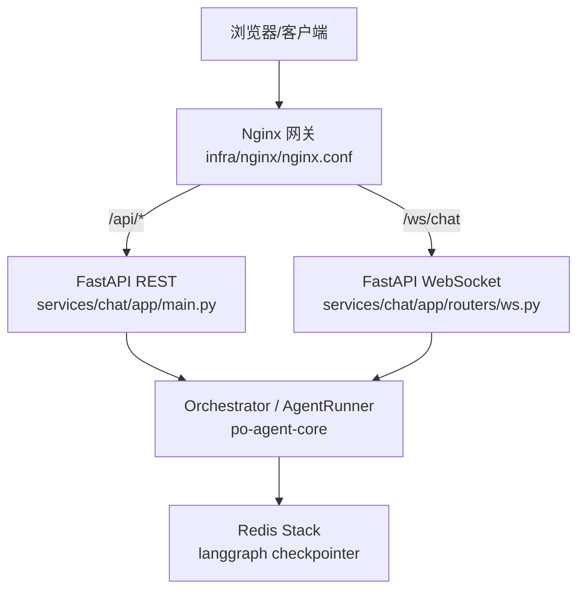
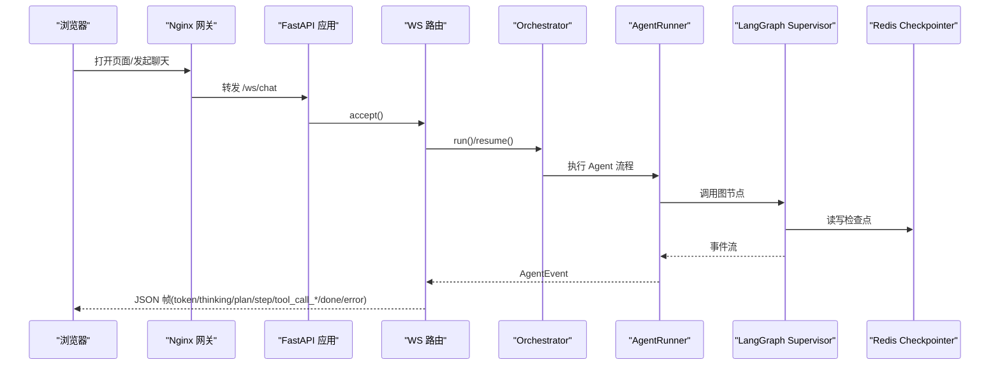
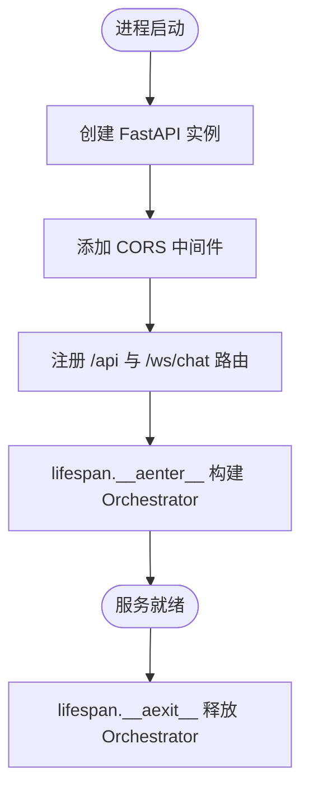
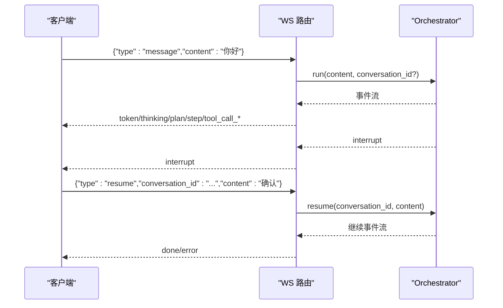
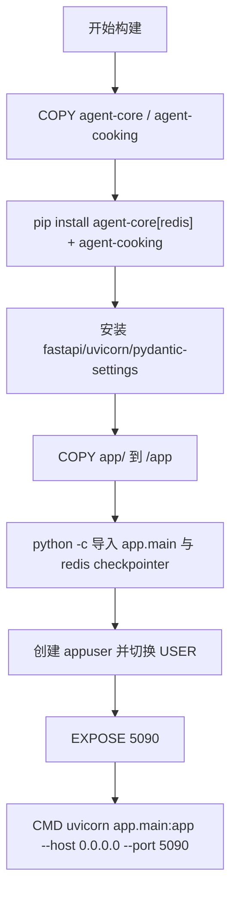
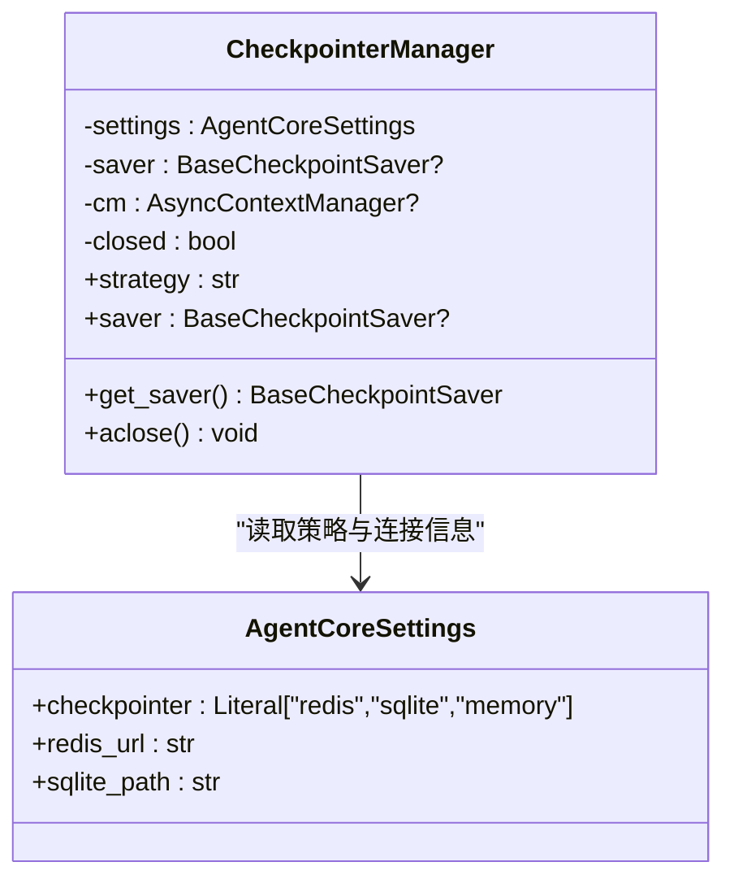

# 聊天服务部署

<cite>
**本文引用的文件**   
- [services/chat/Dockerfile](file://services/chat/Dockerfile)
- [services/chat/pyproject.toml](file://services/chat/pyproject.toml)
- [services/chat/app/main.py](file://services/chat/app/main.py)
- [services/chat/app/config.py](file://services/chat/app/config.py)
- [services/chat/app/routers/ws.py](file://services/chat/app/routers/ws.py)
- [docker-compose.yml](file://docker-compose.yml)
- [infra/nginx/nginx.conf](file://infra/nginx/nginx.conf)
- [services/agent-core/src/po_agent_core/memory/checkpointer.py](file://services/agent-core/src/po_agent_core/memory/checkpointer.py)
- [services/agent-core/src/po_agent_core/config.py](file://services/agent-core/src/po_agent_core/config.py)
</cite>

## 目录
1. [简介](#简介)
2. [项目结构](#项目结构)
3. [核心组件](#核心组件)
4. [架构总览](#架构总览)
5. [详细组件分析](#详细组件分析)
6. [依赖与镜像构建](#依赖与镜像构建)
7. [Redis Checkpointer 与会话持久化](#redis-checkpointer-与会话持久化)
8. [WebSocket、CORS 与安全策略](#websocketcors-与安全策略)
9. [启动参数、日志与性能调优](#启动参数日志与性能调优)
10. [AI Agent 集成与错误处理](#ai-agent-集成与错误处理)
11. [故障排查](#故障排查)
12. [结论](#结论)

## 简介
本文件面向生产与运维场景，说明 FastAPI 聊天服务的部署方式与关键配置。内容覆盖 Python 依赖管理（FastAPI、LangChain/LangGraph、po-agent-core）、Docker 镜像构建优化、虚拟环境安装顺序、Redis Checkpointer 连接与会话持久化、WebSocket 端口与 CORS 安全策略、启动参数与日志、以及 AI Agent 系统的集成与降级机制。

## 项目结构
聊天服务位于 `services/chat`，由 FastAPI 提供 REST 与 WebSocket 接口；编排能力来自本地包 `po-agent-core` 与 `po-agent-cooking`；Redis 作为 LangGraph 的 Checkpoint 存储；Nginx 作为统一网关转发前端、REST 与 WebSocket。

**图表来源**
- [infra/nginx/nginx.conf:1-76](file://infra/nginx/nginx.conf#L1-L76)
- [services/chat/app/main.py:1-76](file://services/chat/app/main.py#L1-L76)
- [services/chat/app/routers/ws.py:1-189](file://services/chat/app/routers/ws.py#L1-L189)
- [docker-compose.yml:84-113](file://docker-compose.yml#L84-L113)

**章节来源**
- [services/chat/app/__init__.py:1-25](file://services/chat/app/__init__.py#L1-L25)
- [infra/nginx/nginx.conf:1-76](file://infra/nginx/nginx.conf#L1-L76)

## 核心组件
- FastAPI 应用工厂与生命周期：负责挂载路由、CORS、装配 Orchestrator 并在关闭时释放资源。
- 宿主配置：监听地址、端口、CORS 白名单，使用 `PY_SERVER_` 前缀与环境变量。
- WebSocket 路由：将 Agent 事件流映射为 JSON 帧，支持心跳、中断恢复与多轮会话。
- CheckpointerManager：统一管理 memory/sqlite/redis 三种检查点后端，延迟初始化并显式关闭。
- AgentCoreSettings：LLM、Embedding、Checkpointer、路由阈值等编排配置，使用 `AGENT_CORE_` 前缀。

**章节来源**
- [services/chat/app/main.py:1-76](file://services/chat/app/main.py#L1-L76)
- [services/chat/app/config.py:1-60](file://services/chat/app/config.py#L1-L60)
- [services/chat/app/routers/ws.py:1-189](file://services/chat/app/routers/ws.py#L1-L189)
- [services/agent-core/src/po_agent_core/memory/checkpointer.py:1-116](file://services/agent-core/src/po_agent_core/memory/checkpointer.py#L1-L116)
- [services/agent-core/src/po_agent_core/config.py:1-111](file://services/agent-core/src/po_agent_core/config.py#L1-L111)

## 架构总览
聊天服务通过 FastAPI 暴露 `/api/*` REST 与 `/ws/chat` WebSocket；Nginx 在容器网络中把请求转发到 chat 服务；Agent 编排层基于 LangGraph，Checkpointer 默认使用 Redis，未就绪时按策略降级。

**图表来源**
- [infra/nginx/nginx.conf:55-69](file://infra/nginx/nginx.conf#L55-L69)
- [services/chat/app/routers/ws.py:131-189](file://services/chat/app/routers/ws.py#L131-L189)
- [services/agent-core/src/po_agent_core/memory/checkpointer.py:67-99](file://services/agent-core/src/po_agent_core/memory/checkpointer.py#L67-L99)

## 详细组件分析

### FastAPI 应用与生命周期
- 入口模块定义 `create_app`，注入 CORS 中间件，注册 `/api` 前缀的 health/items 路由，以及不带 `/api` 前缀的 `/ws/chat`。
- 自定义 `AppLifespan` 在启动时构建 Orchestrator 并写入 `app.state`，在关闭时调用 `aclose()` 释放外部连接。
- 测试可通过传入替身 Orchestrator 避免运行 lifespan。

**图表来源**
- [services/chat/app/main.py:24-75](file://services/chat/app/main.py#L24-L75)

**章节来源**
- [services/chat/app/main.py:1-76](file://services/chat/app/main.py#L1-L76)

### 宿主配置（端口、CORS）
- 使用 `pydantic-settings` 读取 `PY_SERVER_*` 环境变量，默认 host=0.0.0.0、port=5090。
- CORS 白名单以逗号分隔字符串形式配置，解析为列表后传给 FastAPI CORS 中间件。
- `.env` 与同进程中的 `AGENT_CORE_*` 共用同一文件，但通过不同前缀隔离命名空间。

**章节来源**
- [services/chat/app/config.py:18-59](file://services/chat/app/config.py#L18-L59)
- [services/chat/app/main.py:52-70](file://services/chat/app/main.py#L52-L70)

### WebSocket 路由与帧协议
- 端点路径固定为 `/ws/chat`，不携带 `/api` 前缀，便于 Nginx 单独代理。
- 入站帧类型包括 `message`、`resume`、`ping`；出站帧类型包括 `run_started`、`token`、`thinking`、`plan`、`step`、`tool_call_start/args/end/result`、`interrupt`、`done`、`error`。
- 会话通过 `conversation_id` 映射 LangGraph 的 thread_id；未传则服务端生成，用于多轮记忆。
- 中断恢复时序要求前端先消费到 `done`，再发送 `resume`，避免结果交错。

**图表来源**
- [services/chat/app/routers/ws.py:67-83](file://services/chat/app/routers/ws.py#L67-L83)
- [services/chat/app/routers/ws.py:131-189](file://services/chat/app/routers/ws.py#L131-L189)

**章节来源**
- [services/chat/app/routers/ws.py:1-189](file://services/chat/app/routers/ws.py#L1-L189)

## 依赖与镜像构建

### Python 依赖管理
- 聊天服务依赖 FastAPI、Uvicorn、Pydantic Settings 与本地包 `po-agent-core`。
- 开发可选依赖包含 pytest 与 httpx。
- 本地包不在 PyPI，需按依赖顺序安装：先 `po-agent-core[redis]`，再 `po-agent-cooking`，最后安装 chat 自身依赖。

**章节来源**
- [services/chat/pyproject.toml:1-29](file://services/chat/pyproject.toml#L1-L29)

### Docker 镜像构建优化
- 基础镜像默认走国内加速源，可通过构建参数覆盖回官方镜像。
- 设置 `PIP_NO_CACHE_DIR=1` 与清华 PyPI 源，减少构建体积与网络失败概率。
- 先安装两个本地包（带 `[redis]` extra），再安装 FastAPI/Uvicorn/Pydantic Settings，最后复制 `app/` 源码。
- 构建期冒烟导入 `app.main` 与 `langgraph.checkpoint.redis`，确保镜像可运行。
- 容器内以非 root 用户 `appuser` 运行，暴露 5090 端口。

**图表来源**
- [services/chat/Dockerfile:1-42](file://services/chat/Dockerfile#L1-L42)

**章节来源**
- [services/chat/Dockerfile:1-42](file://services/chat/Dockerfile#L1-L42)

### 虚拟环境与本地安装顺序
- 推荐在仓库根使用 pnpm workspace 提供的脚本安装，保证本地包顺序正确。
- 若手动安装，应先 `pip install -e "../agent-core[dev]"`，再 `pip install -e ".[dev]"`。
- 注意 `po-agent-core` 的 `[redis]` extra 必须安装，否则 Redis Checkpointer 会静默降级为 memory。

**章节来源**
- [services/chat/pyproject.toml:13-18](file://services/chat/pyproject.toml#L13-L18)
- [services/chat/Dockerfile:20-27](file://services/chat/Dockerfile#L20-L27)

## Redis Checkpointer 与会话持久化

### Checkpointer 策略与选择
- 支持 `redis`、`sqlite`、`memory` 三种策略，默认 `redis`。
- `CheckpointerManager` 延迟初始化 saver，首次 `get_saver()` 建立连接并执行 schema 初始化。
- 连接失败时向上抛异常，由宿主装配层决定降级策略；管理器本身不做静默降级。

**图表来源**
- [services/agent-core/src/po_agent_core/memory/checkpointer.py:49-116](file://services/agent-core/src/po_agent_core/memory/checkpointer.py#L49-L116)
- [services/agent-core/src/po_agent_core/config.py:97-100](file://services/agent-core/src/po_agent_core/config.py#L97-L100)

**章节来源**
- [services/agent-core/src/po_agent_core/memory/checkpointer.py:1-116](file://services/agent-core/src/po_agent_core/memory/checkpointer.py#L1-L116)
- [services/agent-core/src/po_agent_core/config.py:97-100](file://services/agent-core/src/po_agent_core/config.py#L97-L100)

### Redis 连接与会话持久化
- 通过 `AGENT_CORE_CHECKPOINTER=redis` 与 `AGENT_CORE_REDIS_URL` 指定 Redis 连接。
- docker-compose 中 Redis 使用 Redis Stack 镜像，启用 JSON 与搜索模块，满足 LangGraph Redis Checkpointer 需求。
- 会话状态保存在 Redis，thread_id 对应 `conversation_id`，实现跨请求的多轮记忆。

**章节来源**
- [docker-compose.yml:24-42](file://docker-compose.yml#L24-L42)
- [docker-compose.yml:99-100](file://docker-compose.yml#L99-L100)
- [services/chat/app/routers/ws.py:17-20](file://services/chat/app/routers/ws.py#L17-L20)

## WebSocket、CORS 与安全策略

### WebSocket 端口与代理
- FastAPI 默认监听 5090 端口；Nginx 将 `/ws/chat` 转发到 chat 服务，并设置长连接超时。
- 前端在开发态通过独立的 `/ws` 代理转发 WebSocket，与 `/api` 代理分离。

**章节来源**
- [services/chat/Dockerfile:38-41](file://services/chat/Dockerfile#L38-L41)
- [infra/nginx/nginx.conf:55-69](file://infra/nginx/nginx.conf#L55-L69)

### CORS 配置
- 通过 `PY_SERVER_CORS_ORIGINS` 配置允许的来源，逗号分隔；解析为列表后启用 `allow_credentials=True`。
- 生产建议仅放行可信域名，避免使用通配符。

**章节来源**
- [services/chat/app/config.py:36-49](file://services/chat/app/config.py#L36-L49)
- [services/chat/app/main.py:60-66](file://services/chat/app/main.py#L60-L66)
- [docker-compose.yml:89-90](file://docker-compose.yml#L89-L90)

### 安全策略建议
- 限制 CORS 来源为实际前端域名。
- 在网关层启用 HTTPS，并限制访问来源 IP。
- 对 WebSocket 增加鉴权头校验（例如 JWT），并在上游网关层做速率限制。
- 最小化暴露端口，仅开放 80/443 给公网，内部服务通过容器网络通信。

## 启动参数、日志与性能调优

### 启动命令与参数
- 容器内通过 Uvicorn 启动：`python -m uvicorn app.main:app --host 0.0.0.0 --port 5090`。
- 宿主机可通过环境变量覆盖 host/port/CORS；LLM 与 Checkpointer 通过 `AGENT_CORE_*` 环境变量配置。

**章节来源**
- [services/chat/Dockerfile:40-41](file://services/chat/Dockerfile#L40-L41)
- [docker-compose.yml:89-100](file://docker-compose.yml#L89-L100)

### 日志配置
- 容器内启用 `PYTHONUNBUFFERED=1`，避免日志缓冲导致排查困难。
- WebSocket 路由对异常进行日志记录，客户端断开属于正常结束不记错误。

**章节来源**
- [services/chat/Dockerfile:11-13](file://services/chat/Dockerfile#L11-L13)
- [services/chat/app/routers/ws.py:181-188](file://services/chat/app/routers/ws.py#L181-L188)

### 性能调优选项
- Nginx 开启 gzip 压缩，调整 keepalive 与 worker_connections。
- WebSocket 长连接超时设置为 3600s，适配长时间流式回复。
- FastAPI 侧可根据负载调整 Uvicorn workers 数量与线程数。
- Redis 使用 Redis Stack 并启用 AOF，保障数据持久性与查询能力。

**章节来源**
- [infra/nginx/nginx.conf:18-31](file://infra/nginx/nginx.conf#L18-L31)
- [infra/nginx/nginx.conf:66-68](file://infra/nginx/nginx.conf#L66-L68)
- [docker-compose.yml:24-42](file://docker-compose.yml#L24-L42)

## AI Agent 集成与错误处理

### 编排器装配与降级
- 应用生命周期在启动时构建 Orchestrator，关闭时释放资源。
- 装配层内置完整降级链：LLM Key 缺失或 Checkpointer 不可达时仍可返回可用 Orchestrator，保证服务监听端口。
- CheckpointerManager 对连接失败抛出异常，由上层决定降级策略。

**章节来源**
- [services/chat/app/main.py:24-49](file://services/chat/app/main.py#L24-L49)
- [services/agent-core/src/po_agent_core/memory/checkpointer.py:67-99](file://services/agent-core/src/po_agent_core/memory/checkpointer.py#L67-L99)

### 错误处理机制
- WebSocket 帧校验失败返回 `error` 帧，不中断连接，客户端可修正协议。
- 客户端断开或发送失败被识别为 `_ClientGone`，不记录错误。
- 其他异常记录日志并上抛，交由框架关闭连接，避免静默掩盖故障。

**章节来源**
- [services/chat/app/routers/ws.py:144-151](file://services/chat/app/routers/ws.py#L144-L151)
- [services/chat/app/routers/ws.py:181-188](file://services/chat/app/routers/ws.py#L181-L188)

## 故障排查

### 常见问题与定位
- Redis 未启动或版本不对：Chat 可能静默降级为 memory；确认使用 Redis Stack 镜像并启用 JSON/FT 模块。
- LLM Key 缺失：服务仍可启动，但对话可能走兜底模型；检查 `AGENT_CORE_LLM_API_KEY` 与 provider 配置。
- CORS 报错：检查 `PY_SERVER_CORS_ORIGINS` 是否包含前端域名。
- WebSocket 断连：确认 Nginx 的 Upgrade 与 Connection 头配置，以及长连接超时设置。

**章节来源**
- [docker-compose.yml:24-42](file://docker-compose.yml#L24-L42)
- [docker-compose.yml:89-100](file://docker-compose.yml#L89-L100)
- [infra/nginx/nginx.conf:33-37](file://infra/nginx/nginx.conf#L33-L37)
- [infra/nginx/nginx.conf:55-69](file://infra/nginx/nginx.conf#L55-L69)

## 结论
本部署文档明确了 FastAPI 聊天服务的关键配置与运行机制：通过 pyproject 与 Dockerfile 管理依赖与镜像构建，使用 Redis Stack 作为 LangGraph 的检查点存储以实现会话持久化，借助 Nginx 完成 WebSocket 与 REST 的统一接入，并通过环境变量隔离宿主与编排配置。在生产环境中，应严格限制 CORS、启用 HTTPS、合理设置超时与并发参数，并确保 Redis 与 LLM 凭据的正确性，以获得稳定可靠的聊天体验。