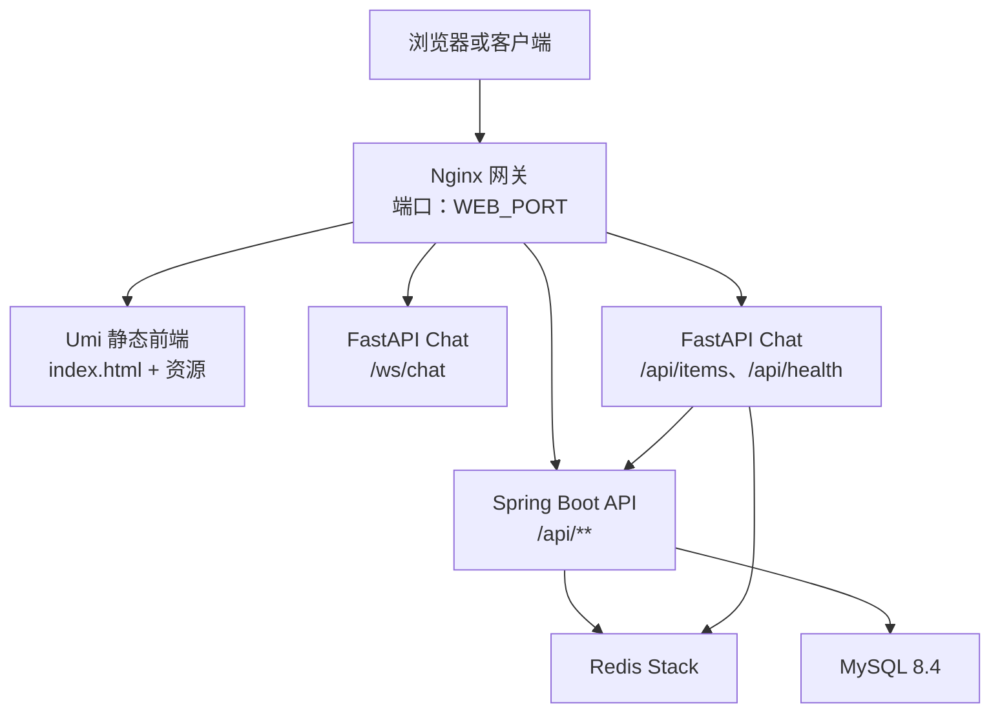
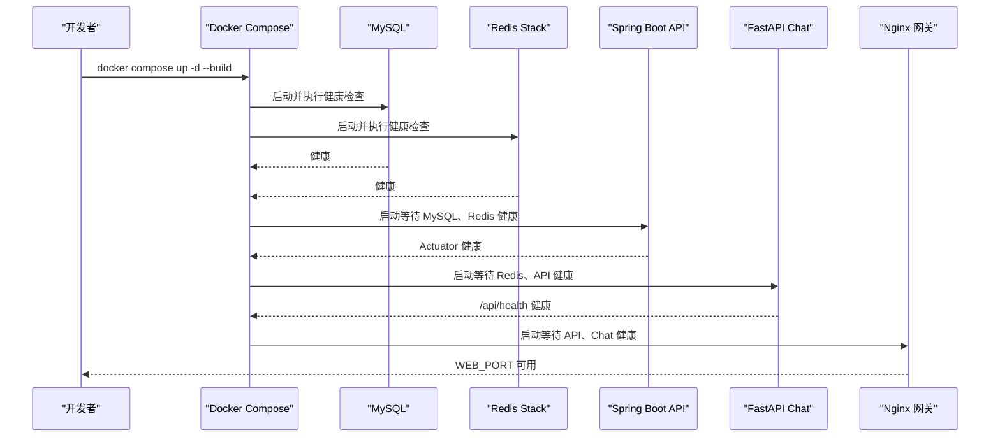
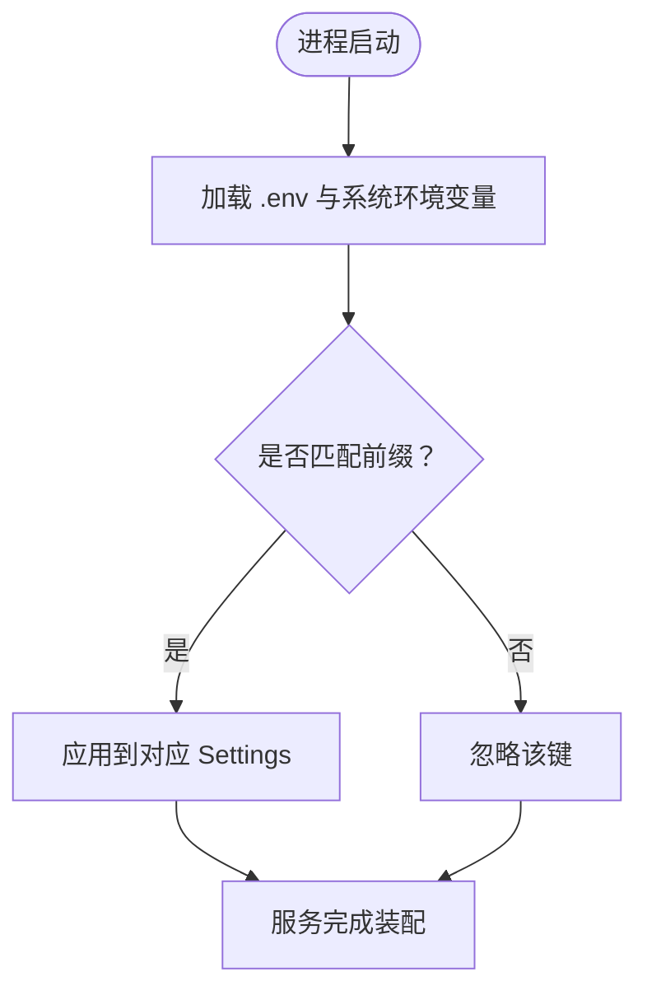
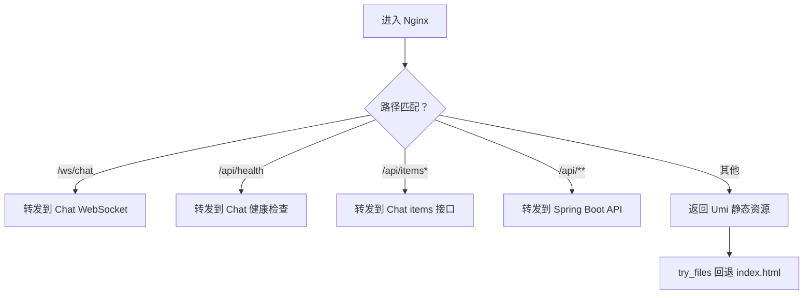
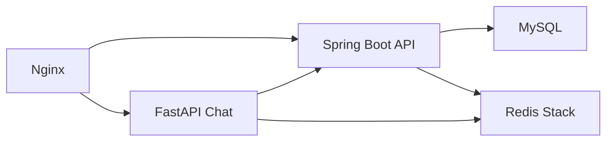

# 环境配置

<cite>
**本文引用的文件**   
- [docker-compose.yml](file://docker-compose.yml)
- [nginx.conf](file://infra/nginx/nginx.conf)
- [application.yaml](file://services/api/api-bootstrap/src/main/resources/application.yaml)
- [CosProperties.java](file://services/api/shared/src/main/java/com/goodzheng/po/shared/storage/CosProperties.java)
- [config.py（聊天服务宿主配置）](file://services/chat/app/config.py)
- [config.py（Agent Core 配置）](file://services/agent-core/src/po_agent_core/config.py)
- [README.md](file://README.md)
- [ci.yml](file://.github/workflows/ci.yml)
</cite>

## 目录
1. [简介](#简介)
2. [项目结构与环境总览](#项目结构与环境总览)
3. [Docker Compose 编排与启动顺序](#docker-compose-编排与启动顺序)
4. [环境变量与安全存储](#环境变量与安全存储)
5. [Nginx 反向代理与路由规则](#nginx-反向代理与路由规则)
6. [核心组件依赖关系](#核心组件依赖关系)
7. [本地开发完整搭建流程](#本地开发完整搭建流程)
8. [常见问题排查](#常见问题排查)
9. [性能与可观测性建议](#性能与可观测性建议)
10. [结论](#结论)

## 简介
本文面向本地开发与联调，系统性说明本仓库的环境配置方式。重点包括：
- Docker Compose 如何编排 MySQL、Redis Stack、Spring Boot API、FastAPI Chat 服务与 Nginx 网关；
- 环境变量管理策略，尤其是数据库连接、JWT 密钥、讯飞 TTS、腾讯云 COS 等敏感信息的安全注入；
- Nginx 的反向代理、WebSocket 支持、静态资源缓存与健康检查；
- 常见环境问题定位方法与解决建议。

## 项目结构与环境总览
本项目采用多语言、多服务架构：
- 前端 Admin Web 使用 Umi 构建，由 Nginx 提供静态资源；
- Spring Boot API 暴露 REST 接口，统一以 `/api` 为上下文路径；
- FastAPI Chat 服务承载 WebSocket 聊天与部分业务接口；
- Redis Stack 作为聊天服务的记忆后端与缓存；
- MySQL 作为持久化数据源；
- Nginx 作为统一入口网关，按前缀分流到不同服务。

**图表来源**
- [docker-compose.yml:8-128](file://docker-compose.yml#L8-L128)
- [nginx.conf:39-111](file://infra/nginx/nginx.conf#L39-L111)

**章节来源**
- [docker-compose.yml:1-5](file://docker-compose.yml#L1-L5)
- [README.md:67-87](file://README.md#L67-L87)

## Docker Compose 编排与启动顺序
Compose 定义了五个关键服务：
- `mysql`：业务数据库，带健康检查与持久卷；
- `redis`：Redis Stack，启用密码与 AOF，供聊天服务 checkpointer 与缓存使用；
- `api`：Spring Boot API，依赖 MySQL 与 Redis，通过 Actuator 暴露健康端点；
- `chat`：FastAPI Chat，依赖 Redis 与 API，提供 WebSocket 与部分 HTTP 接口；
- `web`：Nginx 网关，对外暴露 `WEB_PORT`，依赖 API 与 Chat 就绪。

启动顺序由 `depends_on` 与 `condition: service_healthy` 控制：
1. MySQL 与 Redis 先启动并达到健康状态；
2. API 在 MySQL、Redis 健康后启动；
3. Chat 在 Redis 与 API 健康后启动；
4. Nginx 在 API 与 Chat 健康后启动。

**图表来源**
- [docker-compose.yml:17-22](file://docker-compose.yml#L17-L22)
- [docker-compose.yml:37-42](file://docker-compose.yml#L37-L42)
- [docker-compose.yml:70-82](file://docker-compose.yml#L70-L82)
- [docker-compose.yml:101-113](file://docker-compose.yml#L101-L113)
- [docker-compose.yml:123-128](file://docker-compose.yml#L123-L128)

**章节来源**
- [docker-compose.yml:8-128](file://docker-compose.yml#L8-L128)

## 环境变量与安全存储
### 环境变量优先级与注入方式
- 容器内不依赖 `application-local.yaml`，所有配置通过环境变量注入，符合十二因子原则；
- Spring Boot API 的 `application.yaml` 中大量使用 `${VAR:default}` 形式，由 Compose 的 `environment` 覆盖；
- Chat 服务使用 pydantic-settings，分别读取 `PY_SERVER_*`（宿主配置）与 `AGENT_CORE_*`（Agent Core 配置），两者共用同一份 `.env` 但命名空间隔离；
- CI 环境通过 GitHub Actions 直接注入等价变量，保证测试与本地行为一致。

**图表来源**
- [config.py（聊天服务宿主配置）:18-34](file://services/chat/app/config.py#L18-L34)
- [config.py（Agent Core 配置）:58-75](file://services/agent-core/src/po_agent_core/config.py#L58-L75)

**章节来源**
- [application.yaml:78-120](file://services/api/api-bootstrap/src/main/resources/application.yaml#L78-L120)
- [config.py（聊天服务宿主配置）:18-49](file://services/chat/app/config.py#L18-L49)
- [config.py（Agent Core 配置）:58-111](file://services/agent-core/src/po_agent_core/config.py#L58-L111)
- [ci.yml:103-114](file://.github/workflows/ci.yml#L103-L114)

### 数据库连接
- MySQL 用户名、密码、库名由 `MYSQL_USER`、`MYSQL_PASSWORD`、`MYSQL_DATABASE` 注入；
- API 的 `SPRING_DATASOURCE_URL`、`SPRING_DATASOURCE_USERNAME`、`SPRING_DATASOURCE_PASSWORD` 由 Compose 注入；
- 默认时区、字符集、公钥检索参数已在 URL 中配置，避免连接异常。

安全建议：
- 不要将 `.env` 提交到版本库；
- 生产环境应使用密钥管理服务或平台提供的 Secret 注入机制；
- 数据库密码必须强随机，且最小权限原则。

**章节来源**
- [docker-compose.yml:10-22](file://docker-compose.yml#L10-L22)
- [docker-compose.yml:48-50](file://docker-compose.yml#L48-L50)

### JWT 密钥
- `JWT_SECRET` 要求 Base64 编码，解码后至少 32 字节；
- API 通过 `jwt.secret` 与 `jwt.expiration` 读取，默认值来自 `application.yaml`；
- 本地开发可使用占位值，但生产必须替换；
- README 提供了生成强密钥的命令参考。

安全建议：
- 密钥不得硬编码在代码或镜像中；
- 定期轮换密钥，注意旧 Token 失效影响；
- 日志中禁止打印密钥或 Token。

**章节来源**
- [docker-compose.yml:53-54](file://docker-compose.yml#L53-L54)
- [application.yaml:78-85](file://services/api/api-bootstrap/src/main/resources/application.yaml#L78-L85)
- [README.md:67-84](file://README.md#L67-L84)

### 第三方服务配置
#### 讯飞 TTS
- 变量：`IFLYTEK_APP_ID`、`IFLYTEK_API_KEY`、`IFLYTEK_API_SECRET`、`IFLYTEK_TTS_VCN`；
- 未配置时 API 返回可读错误，不影响服务启动；
- 适用于音频合成、TTS 音频落桶等场景。

#### 腾讯云 COS
- 变量：`COS_SECRET_ID`、`COS_SECRET_KEY`、`COS_REGION`、`COS_BUCKET`、`COS_KEY_PREFIX`、`COS_BASE_URL`；
- Java 侧通过 `CosProperties` 读取，默认地域 `ap-shanghai`，默认桶名已给出；
- 支持自定义 CDN 或静态域名访问地址。

安全建议：
- 云厂商密钥仅从环境变量注入，不落库、不打入镜像；
- 桶策略限制公网直写，只读域名用于前端访问；
- 生产环境建议使用子账号与最小权限。

**章节来源**
- [docker-compose.yml:56-67](file://docker-compose.yml#L56-L67)
- [application.yaml:99-120](file://services/api/api-bootstrap/src/main/resources/application.yaml#L99-L120)
- [CosProperties.java:1-44](file://services/api/shared/src/main/java/com/goodzheng/po/shared/storage/CosProperties.java#L1-L44)

### 聊天服务与 Agent Core 配置
- `PY_SERVER_CORS_ORIGINS`：聊天服务 CORS 白名单；
- `COOKING_API_BASE_URL`：聊天服务调用 API 的内网地址；
- `AGENT_CORE_LLM_PROVIDER`、`AGENT_CORE_LLM_MODEL`、`AGENT_CORE_LLM_API_KEY`：LLM 提供商、模型与密钥；
- `AGENT_CORE_EMBEDDING_*`：意图路由 embedding 配置；
- `AGENT_CORE_CHECKPOINTER`、`AGENT_CORE_REDIS_URL`：记忆后端与 Redis 连接；
- 未配置 LLM 或 embedding 时，聊天服务降级为离线模式或本地路由，接口仍可用。

**章节来源**
- [docker-compose.yml:89-100](file://docker-compose.yml#L89-L100)
- [config.py（聊天服务宿主配置）:18-49](file://services/chat/app/config.py#L18-L49)
- [config.py（Agent Core 配置）:77-111](file://services/agent-core/src/po_agent_core/config.py#L77-L111)

## Nginx 反向代理与路由规则
Nginx 作为统一入口，承担以下职责：
- 提供 Umi 静态前端资源，支持 SPA history 路由回退；
- 将 WebSocket 请求 `/ws/chat` 转发到 FastAPI Chat；
- 将 `/api/health` 与 `/api/items*` 转发到 FastAPI Chat；
- 将其余 `/api/**` 转发到 Spring Boot API；
- 开启 gzip、长缓存静态资源、大请求体支持；
- 配置 WebSocket 升级头映射，保障流式回复不断连。

**图表来源**
- [nginx.conf:3-8](file://infra/nginx/nginx.conf#L3-L8)
- [nginx.conf:55-96](file://infra/nginx/nginx.conf#L55-L96)
- [nginx.conf:98-111](file://infra/nginx/nginx.conf#L98-L111)

### 路由规则明细
- `/`：Umi 静态前端，`try_files` 回退到 `index.html`；
- `/ws/chat`：WebSocket，设置 `Upgrade` 与 `Connection` 头，长超时；
- `/api/health`：Chat 健康检查；
- `/api/items*`：Chat 的 items CRUD；
- `/api/**`：Spring Boot API，包含认证、用户、菜谱、TTS、COS 上传等业务接口；
- 静态资源正则匹配 js/css/图片/字体等，设置 30 天缓存与不可变头。

### 负载均衡与健康检查
- 当前 upstream 单实例：`spring_api` 指向 `api:8080`，`chat_api` 指向 `chat:5090`；
- 若需水平扩展，可在 upstream 中添加多个后端实例；
- 健康检查由 Compose 的 `healthcheck` 负责，Nginx 本身不主动探测后端健康；
- 可通过外部监控访问 `/api/actuator/health` 与 `/api/health` 判断服务状态。

**章节来源**
- [nginx.conf:12-111](file://infra/nginx/nginx.conf#L12-L111)
- [docker-compose.yml:75-82](file://docker-compose.yml#L75-L82)
- [docker-compose.yml:107-113](file://docker-compose.yml#L107-L113)

## 核心组件依赖关系
- API 依赖 MySQL 与 Redis；
- Chat 依赖 Redis 与 API；
- Nginx 依赖 API 与 Chat；
- 所有服务均配置健康检查，确保启动顺序正确；
- 上传文件通过 `uploads_data` 卷持久化，便于调试与备份。

**图表来源**
- [docker-compose.yml:70-82](file://docker-compose.yml#L70-L82)
- [docker-compose.yml:101-113](file://docker-compose.yml#L101-L113)
- [docker-compose.yml:123-128](file://docker-compose.yml#L123-L128)

**章节来源**
- [docker-compose.yml:44-128](file://docker-compose.yml#L44-L128)

## 本地开发完整搭建流程
### 前置准备
- 安装 Docker Desktop 与 Docker Compose；
- 确保本机未被占用端口：`WEB_PORT`（默认 8000）、`5090`（Chat）、`8080`（API 内部）、`3306`（MySQL）、`6379`（Redis）。

### 初始化环境变量
- 复制示例环境变量文件（若存在）或直接创建 `.env`；
- 必填项至少包括：`MYSQL_DATABASE`、`MYSQL_USER`、`MYSQL_PASSWORD`、`MYSQL_ROOT_PASSWORD`、`JWT_SECRET`；
- 可选项包括：`WEB_PORT`、`PY_SERVER_CORS_ORIGINS`、第三方服务密钥等；
- 如需默认管理员种子，设置 `APP_SEED_DEFAULT_ADMIN=true`，并在首次登录后立即修改密码。

### 启动服务
- 在项目根目录执行：`docker compose up -d --build`；
- 观察各服务健康状态：`docker compose ps`；
- 访问网关入口：`http://localhost:${WEB_PORT}`。

### 验证关键接口
- 前端页面应正常加载；
- 调用 `/api/health` 确认 Chat 健康；
- 调用 `/api/actuator/health` 确认 API 健康；
- 尝试 WebSocket 聊天连接 `/ws/chat`；
- 如启用 TTS 与 COS，上传或合成音频并验证对象可访问。

**章节来源**
- [docker-compose.yml:1-4](file://docker-compose.yml#L1-L4)
- [docker-compose.yml:115-128](file://docker-compose.yml#L115-L128)
- [README.md:67-87](file://README.md#L67-L87)

## 常见问题排查
### MySQL 无法连接
- 现象：API 启动失败或数据库连接异常；
- 排查：
  - 检查 `MYSQL_PASSWORD` 与 `MYSQL_ROOT_PASSWORD` 是否正确；
  - 确认 `SPRING_DATASOURCE_URL` 中的库名、时区、字符集；
  - 查看 MySQL 健康检查日志；
- 解决：修正 `.env` 后重启 API 服务。

**章节来源**
- [docker-compose.yml:10-22](file://docker-compose.yml#L10-L22)
- [docker-compose.yml:48-50](file://docker-compose.yml#L48-L50)

### Redis 健康检查误报
- 现象：Redis 被标记为不健康，或自定义密码下探针失败；
- 原因：健康检查使用容器内展开的 `REDIS_PASSWORD`，若未注入则退化为默认值；
- 解决：确保 `REDIS_PASSWORD` 已注入，并与 `REDIS_ARGS` 保持一致。

**章节来源**
- [docker-compose.yml:24-42](file://docker-compose.yml#L24-L42)

### API Actuator 健康检查失败
- 现象：API 一直未就绪，Nginx 延迟启动；
- 排查：
  - 确认 `server.servlet.context-path=/api`；
  - 检查 Actuator 端点是否暴露；
  - 查看 `curl http://localhost:8080/api/actuator/health` 响应；
- 解决：修正数据库、Redis 或 JWT 配置后重启。

**章节来源**
- [docker-compose.yml:75-82](file://docker-compose.yml#L75-L82)
- [application.yaml:55-68](file://services/api/api-bootstrap/src/main/resources/application.yaml#L55-L68)

### Chat WebSocket 断连或流式回复中断
- 现象：聊天消息卡顿或连接断开；
- 排查：
  - 确认 Nginx 已配置 WebSocket 升级头映射；
  - 检查 `proxy_read_timeout` 与 `proxy_send_timeout`；
  - 确认 CORS 白名单包含前端来源；
- 解决：调整 Nginx 超时与 CORS 配置。

**章节来源**
- [nginx.conf:33-37](file://infra/nginx/nginx.conf#L33-L37)
- [nginx.conf:55-69](file://infra/nginx/nginx.conf#L55-L69)
- [config.py（聊天服务宿主配置）:36-49](file://services/chat/app/config.py#L36-L49)

### 静态资源 404 或前端路由刷新空白
- 现象：访问 `/recipes/...` 刷新后 404；
- 原因：SPA history 路由需要回退到 `index.html`；
- 解决：确认 Nginx `location /` 的 `try_files $uri $uri/ /index.html`。

**章节来源**
- [nginx.conf:98-103](file://infra/nginx/nginx.conf#L98-L103)

### 上传文件或 TTS 音频无法访问
- 现象：头像、封面、TTS 音频返回空或 404；
- 排查：
  - 确认 `uploads_data` 卷已挂载；
  - 检查 COS 配置与桶策略；
  - 验证 `COS_BASE_URL` 或默认域名是否可访问；
- 解决：修正 COS 配置或修复对象权限。

**章节来源**
- [docker-compose.yml:61-67](file://docker-compose.yml#L61-L67)
- [CosProperties.java:16-44](file://services/api/shared/src/main/java/com/goodzheng/po/shared/storage/CosProperties.java#L16-L44)

## 性能与可观测性建议
- 合理设置 Nginx `client_max_body_size` 与 Spring `multipart.max-request-size`，避免大文件上传失败；
- 对静态资源启用 gzip 与长缓存，减少带宽与请求数；
- 使用 Actuator 暴露 health、info、metrics、prometheus，接入监控系统；
- 对 Redis 启用 AOF 与持久卷，防止数据丢失；
- 对 MySQL 与 Redis 进行容量规划与慢查询分析。

**章节来源**
- [nginx.conf:26-31](file://infra/nginx/nginx.conf#L26-L31)
- [application.yaml:23-37](file://services/api/api-bootstrap/src/main/resources/application.yaml#L23-L37)
- [application.yaml:55-68](file://services/api/api-bootstrap/src/main/resources/application.yaml#L55-L68)

## 结论
本项目的本地环境以 Docker Compose 为核心，通过环境变量实现配置与凭据的安全注入。Nginx 作为统一网关，按前缀分流到前端、Chat 与 API，并提供 WebSocket 支持与静态资源缓存。开发时应严格管理 `.env`，避免敏感信息泄露；生产环境应结合平台 Secret 管理与密钥轮换机制，确保系统稳定与安全。