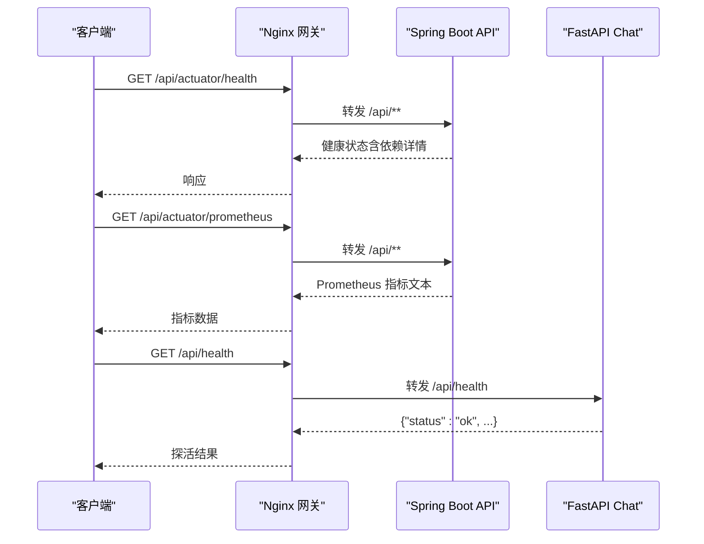
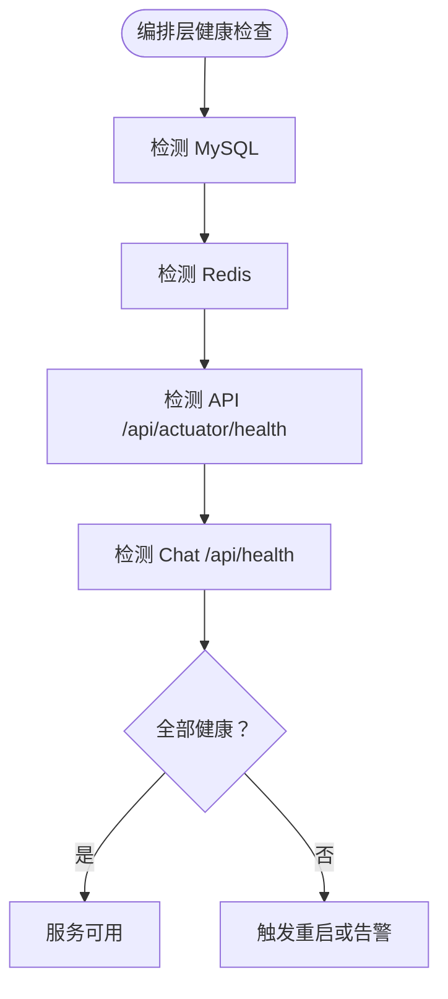
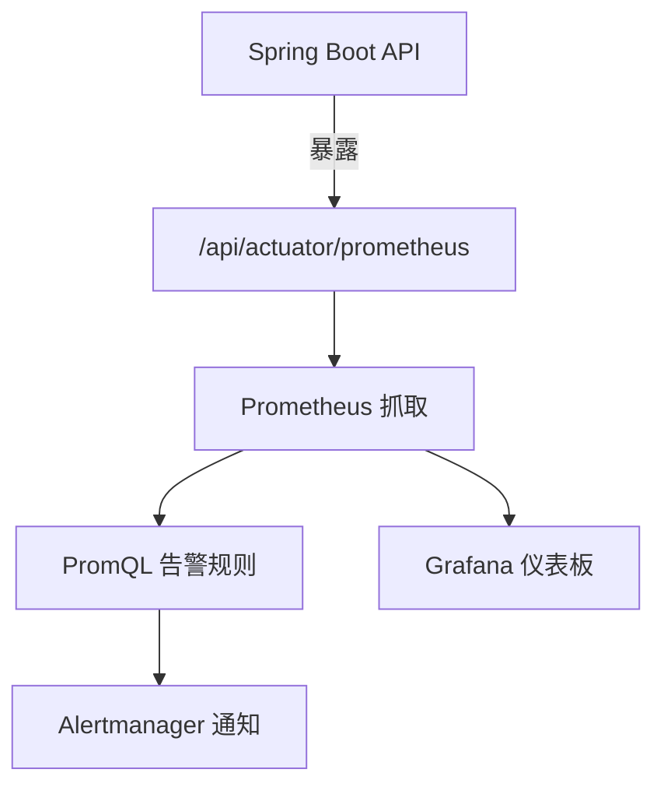
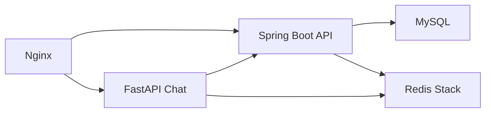

# 监控与日志

<cite>
**本文引用的文件**   
- [docker-compose.yml](file://docker-compose.yml)
- [nginx.conf](file://infra/nginx/nginx.conf)
- [application.yaml](file://services/api/api-bootstrap/src/main/resources/application.yaml)
- [pom.xml（api-bootstrap）](file://services/api/api-bootstrap/pom.xml)
- [health.py](file://services/chat/app/routers/health.py)
- [SecurityConfig.java](file://services/api/identity/src/main/java/com/goodzheng/po/identity/security/SecurityConfig.java)
- [README.md](file://README.md)
</cite>

## 目录
1. [简介](#简介)
2. [项目结构](#项目结构)
3. [核心组件](#核心组件)
4. [架构总览](#架构总览)
5. [详细组件分析](#详细组件分析)
6. [依赖关系分析](#依赖关系分析)
7. [性能与可观测性建议](#性能与可观测性建议)
8. [故障排查指南](#故障排查指南)
9. [结论](#结论)

## 简介
本文件面向“监控与日志”主题，聚焦以下目标：
- 服务健康检查端点配置与状态监控机制
- 日志级别、格式与轮转策略现状与建议
- Prometheus 指标暴露与 Grafana 仪表板、告警规则落地方案
- 性能分析方法与瓶颈定位技巧
- 分布式追踪与链路追踪实现思路

当前仓库已具备基础的可观测能力：Spring Boot 侧通过 Actuator 暴露健康、信息、指标与 Prometheus 端点；FastAPI 侧提供轻量探活接口；Nginx 作为统一网关按路径分流。容器编排中为各服务定义了健康检查探针，便于编排层自动拉起与故障恢复。

## 项目结构
从可观测性视角，关键位置如下：
- 网关层：Nginx 统一入口，转发 /api/** 到 Spring Boot，/api/health 和 /ws/chat 等路由到 FastAPI
- API 服务：Spring Boot，启用 Actuator 与 Micrometer Prometheus 注册器
- Chat 服务：FastAPI，提供 /api/health 探活
- 编排层：docker-compose 定义 MySQL、Redis、API、Chat、Web 的健康检查与启动顺序

```mermaid
graph TB
Client["客户端"] --> Nginx["Nginx 网关<br/>统一入口"]
Nginx --> |"/api/**"| Api["Spring Boot API<br/>Actuator + Prometheus"]
Nginx --> |"/api/health"|"FastAPI Chat<br/>探活端点"
Nginx --> |"/ws/chat"|"FastAPI Chat<br/>WebSocket"
Api --> DB["MySQL"]
Api --> Cache["Redis Stack"]
```

**图表来源**
- [nginx.conf:1-114](file://infra/nginx/nginx.conf#L1-L114)
- [application.yaml:58-68](file://services/api/api-bootstrap/src/main/resources/application.yaml#L58-L68)
- [health.py:15-21](file://services/chat/app/routers/health.py#L15-L21)

**章节来源**
- [nginx.conf:1-114](file://infra/nginx/nginx.conf#L1-L114)
- [application.yaml:58-68](file://services/api/api-bootstrap/src/main/resources/application.yaml#L58-L68)
- [health.py:15-21](file://services/chat/app/routers/health.py#L15-L21)

## 核心组件
- 健康检查
  - Spring Boot：通过 Actuator 暴露 /api/actuator/health（受 context-path=/api 影响），并开启详细信息输出
  - FastAPI：暴露 /api/health，返回进程存活与 agent-core 版本
- 指标采集
  - Spring Boot：Micrometer + Prometheus 注册器，暴露 /api/actuator/prometheus
- 安全与访问控制
  - Actuator 端点放行，允许外部监控系统访问
- 编排与健康探测
  - docker-compose 对 MySQL、Redis、API、Chat 均配置健康检查，确保依赖就绪后再启动上游服务

**章节来源**
- [application.yaml:58-68](file://services/api/api-bootstrap/src/main/resources/application.yaml#L58-L68)
- [pom.xml（api-bootstrap）:60-67](file://services/api/api-bootstrap/pom.xml#L60-L67)
- [health.py:15-21](file://services/chat/app/routers/health.py#L15-L21)
- [docker-compose.yml:17-42](file://docker-compose.yml#L17-L42)
- [docker-compose.yml:75-82](file://docker-compose.yml#L75-L82)
- [docker-compose.yml:107-113](file://docker-compose.yml#L107-L113)

## 架构总览
下图展示请求在网关与各服务间的流转，以及健康检查与指标采集的落点。



**图表来源**
- [nginx.conf:71-96](file://infra/nginx/nginx.conf#L71-L96)
- [application.yaml:58-68](file://services/api/api-bootstrap/src/main/resources/application.yaml#L58-L68)
- [health.py:15-21](file://services/chat/app/routers/health.py#L15-L21)

## 详细组件分析

### 健康检查与状态监控
- Spring Boot（API 服务）
  - 暴露端点：/api/actuator/health、/api/actuator/info、/api/actuator/metrics、/api/actuator/prometheus
  - 健康检查显示详细信息，便于观察数据库、缓存等依赖状态
  - Actuator 路径在 SecurityConfig 中放行，避免鉴权拦截
- FastAPI（Chat 服务）
  - 暴露端点：/api/health，返回进程存活与 agent-core 版本
  - 该端点不依赖下游编排服务，适合快速判断进程是否存活
- 编排层健康检查
  - MySQL：使用 mysqladmin ping 探测
  - Redis：使用 redis-cli ping 探测
  - API：调用 /api/actuator/health 并校验 status=UP
  - Chat：调用 /api/health 确认进程可达



**图表来源**
- [docker-compose.yml:17-42](file://docker-compose.yml#L17-L42)
- [docker-compose.yml:75-82](file://docker-compose.yml#L75-L82)
- [docker-compose.yml:107-113](file://docker-compose.yml#L107-L113)

**章节来源**
- [application.yaml:58-68](file://services/api/api-bootstrap/src/main/resources/application.yaml#L58-L68)
- [SecurityConfig.java:89-89](file://services/api/identity/src/main/java/com/goodzheng/po/identity/security/SecurityConfig.java#L89-L89)
- [health.py:15-21](file://services/chat/app/routers/health.py#L15-L21)
- [docker-compose.yml:17-42](file://docker-compose.yml#L17-L42)
- [docker-compose.yml:75-82](file://docker-compose.yml#L75-L82)
- [docker-compose.yml:107-113](file://docker-compose.yml#L107-L113)

### 指标暴露与 Prometheus/Grafana/告警
- 指标暴露
  - 依赖：spring-boot-starter-actuator、micrometer-registry-prometheus
  - 配置：management.endpoints.web.exposure.include 包含 health、info、metrics、prometheus
  - 访问路径：/api/actuator/prometheus（受 context-path=/api 影响）
- Prometheus 抓取
  - 建议在 Prometheus 中添加 job，target 指向 Nginx 对外端口下的 /api/actuator/prometheus
- Grafana 仪表板
  - 添加 Prometheus 数据源后，导入 Spring Boot 官方仪表盘（如 JVM、HTTP Server、JDBC、Redis 等）
- 告警规则
  - 基于 Prometheus 规则文件定义阈值，例如：
    - HTTP 错误率超过阈值
    - 接口 P95/P99 延迟升高
    - 内存、GC、线程数异常
    - 数据库连接池耗尽、慢查询增多
    - Redis 连接失败或延迟升高



**图表来源**
- [pom.xml（api-bootstrap）:60-67](file://services/api/api-bootstrap/pom.xml#L60-L67)
- [application.yaml:58-68](file://services/api/api-bootstrap/src/main/resources/application.yaml#L58-L68)

**章节来源**
- [pom.xml（api-bootstrap）:60-67](file://services/api/api-bootstrap/pom.xml#L60-L67)
- [application.yaml:58-68](file://services/api/api-bootstrap/src/main/resources/application.yaml#L58-L68)

### 日志级别、格式与轮转
- 现状
  - MyBatis-Plus 在开发环境开启 SQL 打印（StdOutImpl）
  - Python 侧使用标准 logging 模块，但未集中配置日志级别、格式与轮转
- 建议
  - Spring Boot
    - 生产关闭 SQL 打印，按需开启 WARN/ERROR 级别业务日志
    - 使用 JSON 结构化日志（如 Logback + Layout），便于 ELK/Loki 解析
    - 配置日志滚动策略（按天/大小），保留合理周期
  - FastAPI
    - 统一日志格式（JSON），包含 trace_id、request_id、level、message、duration
    - 配置日志轮转（按天/大小），结合 sidecar 或宿主日志收集器（Fluent Bit/Filebeat）
  - 链路追踪
    - 引入 OpenTelemetry，注入 trace_id 到日志字段
    - 后端服务上报 traces 至 Jaeger/Tempo，前端可配合浏览器扩展查看网络耗时

**章节来源**
- [application.yaml:51-53](file://services/api/api-bootstrap/src/main/resources/application.yaml#L51-L53)

### 性能分析与瓶颈定位
- 指标维度
  - HTTP：请求量、延迟分位、错误率、活跃连接
  - JVM：堆/非堆内存、GC 次数与停顿、CPU 使用率、线程数
  - 数据库：连接池使用率、慢查询、事务时长
  - Redis：连接数、命中率、命令延迟
- 工具与方法
  - 使用 Grafana 仪表盘观察趋势与峰值
  - 使用 Prometheus 记录自定义业务指标（如队列积压、LLM 调用耗时）
  - 使用 JFR/Async Profiler 进行 CPU/热点方法采样
  - 使用 Arthas 在线诊断（JVM 热插拔、方法耗时、线程栈）
  - 使用 k6/JMeter 压测，结合指标与日志定位瓶颈

[本节为通用指导，不直接分析具体文件]

### 分布式追踪与链路追踪
- 方案建议
  - 采用 OpenTelemetry Java Agent 或 SDK，为 Spring Boot 应用自动埋点
  - 为 FastAPI 接入 OpenTelemetry Python SDK，跨进程传播 trace_id
  - 将 traces 上报至 Jaeger 或 Tempo，并在 Grafana 中集成 Trace 视图
  - 在日志中携带 trace_id，关联日志与链路
- 关键配置项
  - 服务名、实例 ID、采样率
  - 导出器（OTLP/Zipkin/Jaeger）
  - 上下文传播（HTTP Header、消息队列）

[本节为通用指导，不直接分析具体文件]

## 依赖关系分析
- 组件耦合
  - Nginx 与 API/Chat 强耦合于路径前缀与反向代理配置
  - API 依赖 MySQL、Redis，Actuator 健康检查会反映这些依赖状态
  - Chat 依赖 Redis（持久化 checkpoint）、API（菜谱接口）
- 外部依赖
  - Prometheus、Grafana、Alertmanager 为可选的外部系统
  - LLM/TTS/COS 等第三方服务未配置时，API/Chat 应降级而非崩溃



**图表来源**
- [nginx.conf:39-96](file://infra/nginx/nginx.conf#L39-L96)
- [docker-compose.yml:44-113](file://docker-compose.yml#L44-L113)

**章节来源**
- [nginx.conf:39-96](file://infra/nginx/nginx.conf#L39-L96)
- [docker-compose.yml:44-113](file://docker-compose.yml#L44-L113)

## 性能与可观测性建议
- 指标采集
  - 确保 /api/actuator/prometheus 稳定可达，避免被鉴权拦截
  - 为关键业务接口增加自定义指标（计数、直方图、摘要）
- 日志治理
  - 统一日志格式，避免敏感信息泄露
  - 生产环境关闭 verbose 日志，按需开启审计日志
- 告警设计
  - 区分严重性与恢复策略，避免告警风暴
  - 设置静默期、抑制规则，提升告警有效性
- 容量规划
  - 根据 QPS、P99 延迟与资源利用率设定扩容阈值
  - 关注数据库与缓存的连接池与慢查询

[本节为通用指导，不直接分析具体文件]

## 故障排查指南
- 常见问题
  - Actuator 被安全拦截：确认 SecurityConfig 放行 /actuator/**
  - 健康检查误报：检查 context-path 与探针 URL 是否一致
  - Redis 不可用：检查密码、网络连通性与 Redis Stack 镜像
  - Chat 探活正常但业务异常：检查下游 API 与 LLM/TTS 配置
- 快速验证
  - 本地冒烟：参考 README 中的 curl 示例，验证 /api/actuator/health 与 /api/health
  - 容器编排：查看 docker-compose 健康检查日志，定位哪个依赖未就绪

**章节来源**
- [SecurityConfig.java:89-89](file://services/api/identity/src/main/java/com/goodzheng/po/identity/security/SecurityConfig.java#L89-L89)
- [README.md:104-105](file://README.md#L104-L105)
- [README.md:149-149](file://README.md#L149-L149)

## 结论
本项目已具备基础的可观测能力：Spring Boot 侧通过 Actuator 暴露健康与 Prometheus 指标，FastAPI 侧提供轻量探活，Nginx 统一入口并按路径分流，编排层对各服务实施健康检查。在此基础上，建议完善日志规范化与轮转、引入分布式追踪、构建 Grafana 仪表板与 Prometheus 告警规则，从而形成完整的监控与日志体系，支撑线上稳定性与性能优化。