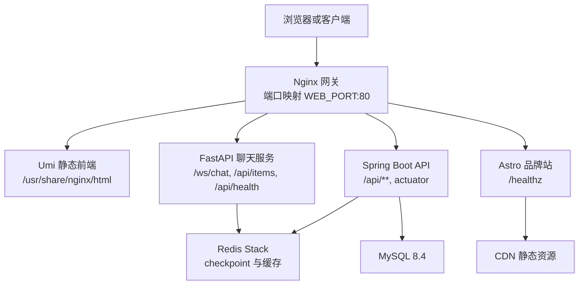
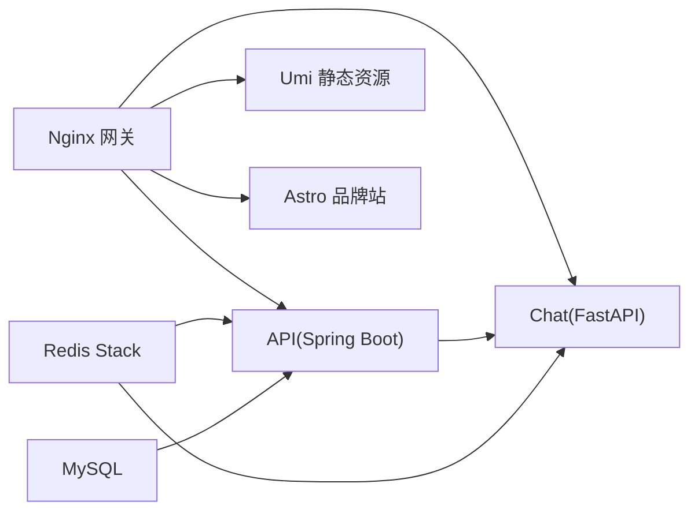
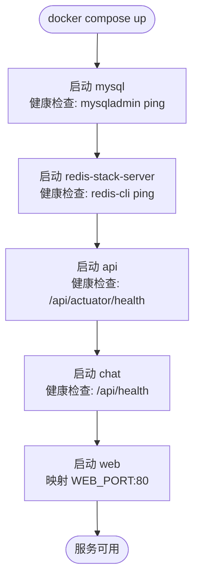
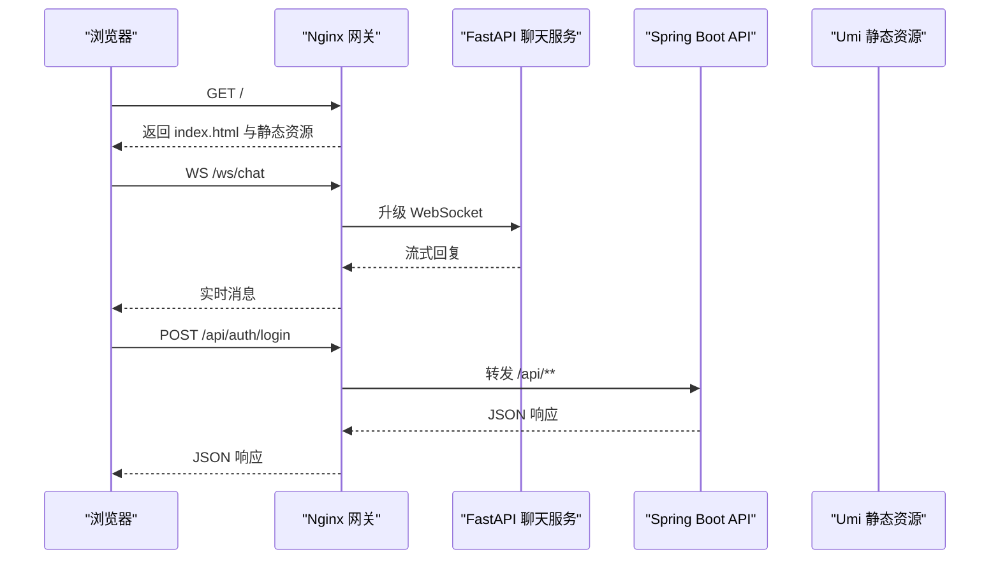
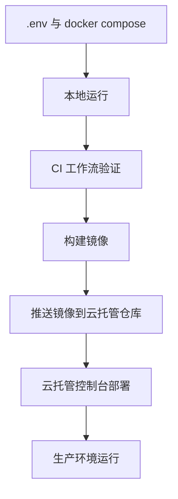
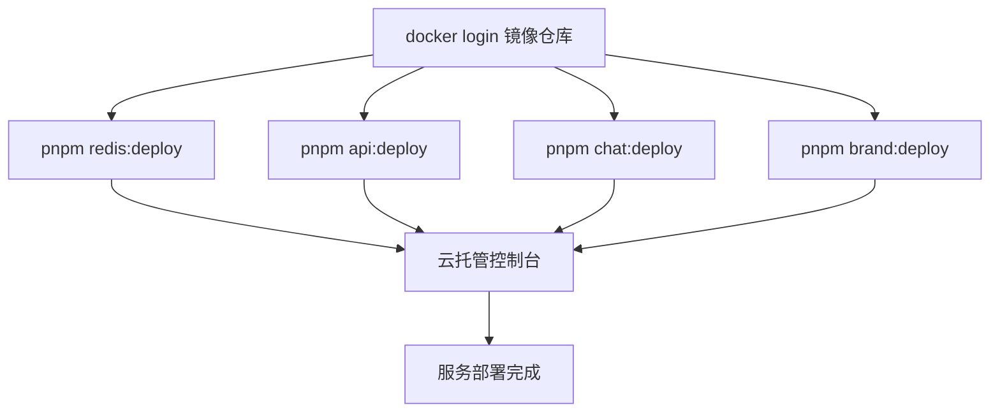
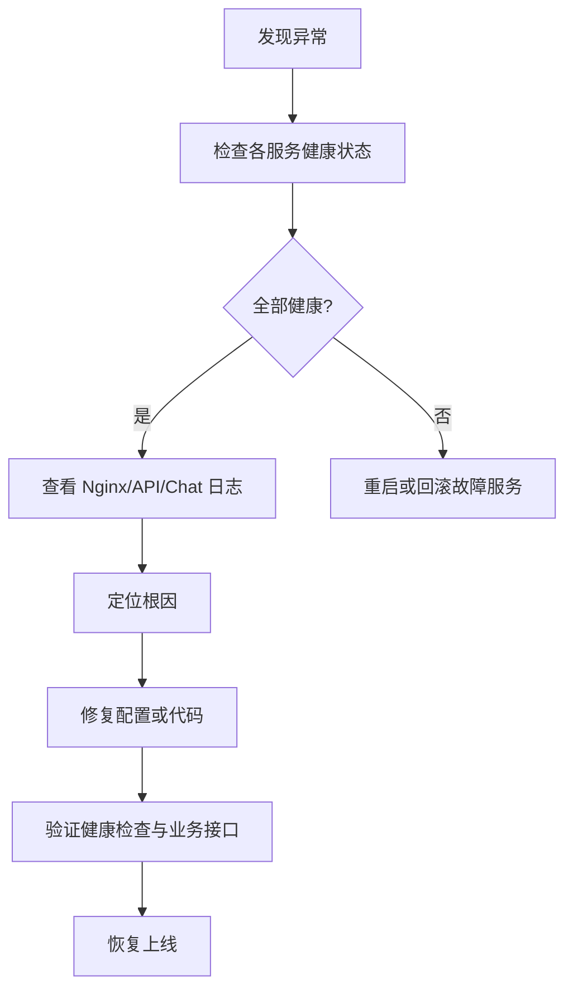

# 部署与运维

<cite>
**本文引用的文件**   
- [docker-compose.yml](file://docker-compose.yml)
- [nginx.conf](file://infra/nginx/nginx.conf)
- [admin-web Dockerfile](file://apps/admin-web/Dockerfile)
- [api Dockerfile](file://services/api/Dockerfile)
- [chat Dockerfile](file://services/chat/Dockerfile)
- [deploy-api.sh](file://scripts/deploy-api.sh)
- [deploy-chat.sh](file://scripts/deploy-chat.sh)
- [deploy-redis.sh](file://scripts/deploy-redis.sh)
- [deploy-brand.sh](file://scripts/deploy-brand.sh)
- [package.json](file://package.json)
- [CI 工作流](file://.github/workflows/ci.yml)
- [chat 云托管部署说明](file://services/chat/DEPLOY_CLOUDRUN.md)
</cite>

## 更新摘要
**变更内容**   
- 新增微信云托管完整部署脚本，覆盖 API、Chat、Redis、Brand 四个服务
- 补充多服务自动化部署流程与镜像仓库配置
- 更新生产部署章节，详细说明云托管环境下的服务编排与内网通信
- 增强故障排查指南，包含 Redis Stack 模块缺失、多架构镜像转推等常见问题

## 目录
1. [引言](#引言)
2. [项目结构与部署边界](#项目结构与部署边界)
3. [核心服务与依赖关系](#核心服务与依赖关系)
4. [Docker Compose 编排方案](#docker-compose-编排方案)
5. [Nginx 反向代理与网关](#nginx-反向代理与网关)
6. [环境变量、配置组织与敏感信息管理](#环境变量配置组织与敏感信息管理)
7. [本地开发、测试与生产部署流程](#本地开发测试与生产部署流程)
8. [微信云托管部署方案](#微信云托管部署方案)
9. [监控、健康检查与日志收集](#监控健康检查与日志收集)
10. [性能调优、容量规划与扩容策略](#性能调优容量规划与扩容策略)
11. [故障排查指南与应急预案](#故障排查指南与应急预案)
12. [结论](#结论)

## 引言
本文件面向部署与运维人员，说明该全栈项目的整体架构、服务依赖、Docker Compose 编排、Nginx 网关分流、环境变量管理、CI/CD 流水线、微信云托管部署、监控告警、日志分析、性能调优、容量规划、扩容策略以及常见故障排查方法。文档以仓库中实际存在的编排文件、镜像构建脚本和 CI 配置为依据，避免臆测未实现能力。

## 项目结构与部署边界
该项目采用多应用、多语言、多服务的单体仓库结构：
- 前端管理后台基于 Umi Max，构建产物由 Nginx 静态托管。
- API 服务为 Spring Boot，提供认证、用户、菜谱等后端接口。
- 聊天服务为 FastAPI + LangGraph，提供 WebSocket 聊天与烹饪助手插槽。
- 品牌介绍站基于 Astro，提供静态网站服务。
- 数据层使用 MySQL 与 Redis Stack（RedisJSON/RediSearch）。
- 统一入口通过 Nginx 按路径前缀分流到前端、聊天服务和 API 服务。
- 云端部署通过 Bash 脚本将镜像推送到微信云托管内置镜像仓库。



**图表来源**
- [docker-compose.yml:7-128](file://docker-compose.yml#L7-L128)
- [nginx.conf:39-111](file://infra/nginx/nginx.conf#L39-L111)

**章节来源**
- [docker-compose.yml:1-134](file://docker-compose.yml#L1-L134)
- [nginx.conf:1-114](file://infra/nginx/nginx.conf#L1-L114)

## 核心服务与依赖关系
- MySQL：持久化业务数据；Compose 定义健康检查，API 启动前必须就绪。
- Redis Stack：聊天服务 checkpoint、API 缓存；普通 Redis 不满足 RedisJSON/RediSearch 需求。
- API（Spring Boot）：依赖 MySQL、Redis、JWT、讯飞 TTS、腾讯云 COS；暴露 `/api` 上下文路径。
- Chat（FastAPI）：依赖 Redis、API 的菜谱接口；暴露 `/api/health` 与 WebSocket `/ws/chat`。
- Brand（Astro）：静态站点，无需数据库依赖，通过 Nginx 提供 HTTP 服务。
- Web（Nginx）：对外暴露 `WEB_PORT`，内部转发到 chat、api 和 brand。



**图表来源**
- [docker-compose.yml:8-128](file://docker-compose.yml#L8-L128)
- [nginx.conf:39-111](file://infra/nginx/nginx.conf#L39-L111)

**章节来源**
- [docker-compose.yml:8-128](file://docker-compose.yml#L8-L128)

## Docker Compose 编排方案
### 服务清单与职责
| 服务 | 镜像或构建上下文 | 主要端口 | 关键依赖 | 健康检查 |
|---|---|---:|---|---|
| mysql | `mysql:8.4` | 3306（容器内） | 无 | `mysqladmin ping` |
| redis | `redis-stack-server` | 6379（容器内） | 无 | `redis-cli ping` |
| api | `./services/api` | 8080（容器内） | mysql、redis | `/api/actuator/health` |
| chat | `./services/chat` | 5090（容器内） | redis、api | `/api/health` |
| web | `./apps/admin-web` | 80（容器内），映射 `WEB_PORT` | api、chat | 无显式探针 |

### 依赖顺序与启动策略
- `api` 等待 `mysql` 与 `redis` 健康后启动。
- `chat` 等待 `redis` 与 `api` 健康后启动。
- `web` 等待 `api` 与 `chat` 健康后启动。
- 所有服务默认 `restart: unless-stopped`，便于本地与测试环境恢复。

### 数据卷与持久化
- `mysql_data`：MySQL 数据目录。
- `redis_data`：Redis AOF 数据目录。
- `uploads_data`：API 上传文件目录。



**图表来源**
- [docker-compose.yml:17-128](file://docker-compose.yml#L17-L128)

**章节来源**
- [docker-compose.yml:1-134](file://docker-compose.yml#L1-L134)

## Nginx 反向代理与网关
### 路由规则
- `/`：Umi 静态前端，SPA 回退到 `index.html`。
- `/ws/chat`：FastAPI WebSocket，长连接超时设置为 3600 秒。
- `/api/health`：FastAPI 健康检查。
- `/api/items*`：FastAPI 的 items CRUD。
- `/api/**`：其余请求转发到 Spring Boot API，包含认证、用户、菜谱与 actuator。

### 关键配置要点
- `client_max_body_size 100m`：与 Spring multipart 上限对齐。
- `gzip on`：启用压缩，覆盖文本、JSON、JS、SVG 等类型。
- WebSocket 升级头映射：根据 `$http_upgrade` 动态设置 `Connection`。
- `absolute_redirect off`：避免 Nginx 生成带容器内端口的绝对重定向。
- 静态资源带 hash 可长期缓存，入口 HTML 不缓存。



**图表来源**
- [nginx.conf:39-111](file://infra/nginx/nginx.conf#L39-L111)

**章节来源**
- [nginx.conf:1-114](file://infra/nginx/nginx.conf#L1-L114)

## 环境变量、配置组织与敏感信息管理
### 环境变量注入方式
- Compose 通过 `.env` 文件注入数据库密码、JWT 密钥、Redis 密码、第三方服务密钥等。
- API 使用 Spring 12 因子风格环境变量，例如 `SPRING_DATASOURCE_*`、`SPRING_DATA_REDIS_*`、`JWT_SECRET`、`IFLYTEK_*`、`COS_*`。
- Chat 使用 `PY_SERVER_*` 与 `AGENT_CORE_*` 命名空间，包括 LLM provider、model、API key、embedding、checkpointer、Redis URL 等。
- Nginx 通过挂载配置文件，不直接读取 `.env`。

### 敏感信息保护建议
- 不要提交真实 `.env`；仅保留示例或占位值。
- 生产环境使用云托管环境变量或密钥管理服务注入。
- JWT secret、数据库密码、Redis 密码、讯飞 TTS 密钥、腾讯云 COS 密钥应严格隔离。
- 对上传目录与日志目录进行权限控制，避免容器内非特权用户写入敏感路径。

### 配置优先级
- 环境变量优先于 YAML 配置。
- Compose 中显式声明的环境变量会覆盖默认值。
- Chat 与 agent-core 共用 `.env` 时需注意命名空间前缀，避免 pydantic-settings 解析异常。

**章节来源**
- [docker-compose.yml:10-100](file://docker-compose.yml#L10-L100)
- [chat Dockerfile:11-41](file://services/chat/Dockerfile#L11-L41)

## 本地开发、测试与生产部署流程
### 本地开发
- 准备 `.env`，至少包含数据库密码、JWT secret、Redis 密码。
- 执行 `docker compose up -d --build`。
- 访问 `http://localhost:${WEB_PORT}` 打开前端。
- API 健康检查：`curl http://localhost:${WEB_PORT}/api/actuator/health`。
- Chat 健康检查：`curl http://localhost:${WEB_PORT}/api/health`。

### 测试环境
- 使用 CI 工作流验证前端 lint/test/build、移动端 lint/typecheck/test、API verify、Chat pytest。
- CI 中启动 MySQL 与 Redis 服务容器，并通过环境变量注入数据库与 Redis 连接参数。
- Chat 与 agent-core 在 CI 中以本地包形式安装并运行测试。

### 生产部署
- API：使用 `scripts/deploy-api.sh` 构建并推送镜像到微信云托管镜像仓库。
- Chat：使用 `scripts/deploy-chat.sh` 构建并推送镜像到微信云托管镜像仓库。
- Redis：使用 `scripts/deploy-redis.sh` 将 Redis Stack 转换为单架构镜像并推送。
- Brand：使用 `scripts/deploy-brand.sh` 构建品牌站镜像并推送。
- 云托管控制台从镜像部署，填写监听端口与健康检查路径。



**图表来源**
- [CI 工作流:13-161](file://.github/workflows/ci.yml#L13-L161)
- [deploy-api.sh:19-61](file://scripts/deploy-api.sh#L19-L61)
- [deploy-chat.sh:19-60](file://scripts/deploy-chat.sh#L19-L60)
- [deploy-redis.sh:19-62](file://scripts/deploy-redis.sh#L19-L62)

**章节来源**
- [.github/workflows/ci.yml:1-161](file://.github/workflows/ci.yml#L1-L161)
- [deploy-api.sh:1-61](file://scripts/deploy-api.sh#L1-L61)
- [deploy-chat.sh:1-60](file://scripts/deploy-chat.sh#L1-L60)
- [deploy-redis.sh:1-62](file://scripts/deploy-redis.sh#L1-L62)

## 微信云托管部署方案
### 镜像仓库与构建配置
- 镜像仓库：`ccr.ccs.tencentyun.com`，命名空间 `tcb-100053273154-byrm`。
- 平台限制：云托管只支持 `linux/amd64` 架构。
- 基础镜像：默认使用国内加速镜像（DaoCloud），可通过 `USE_OFFICIAL_IMAGES=1` 切换官方镜像。
- 登录凭证：使用 TCR「访问凭证」固定密码，非账号登录密码。

### 各服务部署脚本
#### API 服务部署
- 脚本：`scripts/deploy-api.sh`
- 镜像仓库名：`ca-eyxzseoz_po`
- 监听端口：8080
- 健康检查：`/api/actuator/health`
- 环境变量：参考 `services/api/application-prod.json`

#### Chat 服务部署
- 脚本：`scripts/deploy-chat.sh`
- 镜像仓库名：`ca-eyxzseoz_po-chat`
- 监听端口：5090
- 健康检查：`/api/health`
- 特殊要求：构建上下文必须是仓库根目录，因为依赖本地 Python 包。

#### Redis 服务部署
- 脚本：`scripts/deploy-redis.sh`
- 镜像仓库名：`ca-eyxzseoz_redis`
- 监听端口：6379
- 特殊要求：必须使用 Redis Stack（redis-stack-server），不能是普通 Redis。
- 多架构处理：通过空壳 Dockerfile 将多架构镜像转换为单架构镜像。

#### Brand 服务部署
- 脚本：`scripts/deploy-brand.sh`
- 镜像仓库名：`brand`
- 监听端口：8080
- 健康检查：`/healthz`
- 域名配置：通过 `SITE_URL` 环境变量注入站点域名。

### 一键部署命令
```bash
# 登录镜像仓库
docker login ccr.ccs.tencentyun.com --username=100053273154

# 部署各个服务
pnpm redis:deploy        # 部署 Redis Stack
pnpm api:deploy         # 部署 API 服务
pnpm chat:deploy        # 部署 Chat 服务
pnpm brand:deploy       # 部署品牌站

# 使用官方镜像（需要网络代理）
pnpm api:deploy:official
pnpm chat:deploy:official
pnpm redis:deploy:official
pnpm brand:deploy:official
```

### 内网通信配置
- 内网地址格式：`ca-<环境ID>.<服务名>.<repo>.<域>.com:<端口>`
- Redis 内网地址：`ca-eyxzseoz.redis.pm1sjzj4.g66pwcq9.com:6379`
- API 内网地址：`ca-eyxzseoz.po.pm1sjzj4.g66pwcq9.com:8080`
- Chat 内网地址：`ca-eyxzseoz.chat.pm1sjzj4.g66pwcq9.com:5090`



**图表来源**
- [deploy-api.sh:19-61](file://scripts/deploy-api.sh#L19-L61)
- [deploy-chat.sh:19-60](file://scripts/deploy-chat.sh#L19-L60)
- [deploy-redis.sh:19-62](file://scripts/deploy-redis.sh#L19-L62)
- [deploy-brand.sh:19-78](file://scripts/deploy-brand.sh#L19-L78)

**章节来源**
- [deploy-api.sh:1-61](file://scripts/deploy-api.sh#L1-L61)
- [deploy-chat.sh:1-60](file://scripts/deploy-chat.sh#L1-L60)
- [deploy-redis.sh:1-62](file://scripts/deploy-redis.sh#L1-L62)
- [deploy-brand.sh:1-78](file://scripts/deploy-brand.sh#L1-L78)
- [package.json:20-52](file://package.json#L20-L52)
- [chat 云托管部署说明:1-227](file://services/chat/DEPLOY_CLOUDRUN.md#L1-L227)

## 监控、健康检查与日志收集
### 健康检查
- MySQL：`mysqladmin ping`。
- Redis：`redis-cli ping`。
- API：`/api/actuator/health`。
- Chat：`/api/health`。
- Brand：`/healthz`。
- Nginx：无显式健康检查，可通过外部探针探测 `WEB_PORT` 与 `/api/health`。

### 监控建议
- 使用云平台提供的服务指标与日志采集。
- 对 API 的 Actuator 暴露必要健康与度量端点，但注意生产环境安全限制。
- 对 Nginx 接入访问日志与错误日志，结合集中式日志平台进行分析。
- 对 Redis 与 MySQL 使用云数据库监控面板观察连接数、慢查询、内存与磁盘使用率。

### 日志收集
- API 运行阶段创建 `/app/logs` 目录，建议挂载到宿主机或接入日志服务。
- Chat 输出标准输出日志，建议接入容器日志采集。
- Nginx 访问日志与错误日志建议挂载到宿主机或接入日志服务。

**章节来源**
- [docker-compose.yml:17-112](file://docker-compose.yml#L17-L112)
- [api Dockerfile:30-41](file://services/api/Dockerfile#L30-L41)

## 性能调优、容量规划与扩容策略
### Nginx 性能
- 已启用 `sendfile`、`tcp_nopush`、`keepalive_timeout`、`gzip`。
- 静态资源开启长期缓存，减少重复下载。
- WebSocket 长连接超时设置为 3600 秒，适合流式回复场景。

### API 性能
- 使用 JRE 运行镜像，减少运行时开销。
- 上传目录与日志目录分离，便于扩容与清理。
- 建议在生产环境调整 JVM 参数与连接池大小，依据负载压测结果优化。

### Chat 性能
- 使用 Python slim 基础镜像，减少镜像体积。
- 依赖 Redis Stack 作为 checkpoint 存储，避免内存退化。
- 建议根据并发会话数与 LLM 调用频率调整 uvicorn worker 数量与线程数。

### Brand 性能
- Astro 静态站点构建产物体积小，适合 CDN 分发。
- Nginx 提供 HTTP 服务，支持 gzip 压缩与静态资源缓存。

### 容量规划
- MySQL：关注连接数、慢查询、索引命中率、磁盘 I/O。
- Redis：关注内存使用、AOF 文件大小、命令延迟。
- API：关注 CPU、内存、GC 停顿、HTTP 响应时间、错误率。
- Chat：关注 WebSocket 连接数、LLM 调用延迟、Redis 操作延迟。
- Brand：关注静态资源访问量、CDN 命中率。

### 扩容策略
- 水平扩容 API 与 Chat 实例，配合负载均衡器分发请求。
- 垂直扩容 MySQL 与 Redis，提升 CPU、内存与磁盘吞吐。
- 前端静态资源迁移至 CDN，降低源站压力。
- Brand 站点可直接部署到静态托管服务，无需额外服务器。

**章节来源**
- [nginx.conf:12-31](file://infra/nginx/nginx.conf#L12-L31)
- [api Dockerfile:26-41](file://services/api/Dockerfile#L26-L41)
- [chat Dockerfile:9-41](file://services/chat/Dockerfile#L9-L41)

## 故障排查指南与应急预案
### 常见问题
- Redis 启动失败或健康检查误报：
  - 确认使用 `redis-stack-server`，而非普通 Redis。
  - 确认 `REDIS_PASSWORD` 与 `REDIS_ARGS` 一致，且 healthcheck 使用相同密码。
- Chat 无法使用 Redis checkpoint：
  - 确认安装了带有 `redis` extra 的 agent-core。
  - 确认 `AGENT_CORE_CHECKPOINTER=redis` 与 `AGENT_CORE_REDIS_URL` 正确。
- API 无法连接数据库或 Redis：
  - 确认 `SPRING_DATASOURCE_*` 与 `SPRING_DATA_REDIS_*` 环境变量正确。
  - 确认 MySQL 与 Redis 服务健康。
- Nginx 静态资源 404：
  - 确认 Umi 构建产物已复制到 `/usr/share/nginx/html`。
  - 确认 `try_files` 与 `absolute_redirect off` 配置生效。
- WebSocket 断开：
  - 确认 Nginx 的 `Upgrade` 与 `Connection` 头映射正确。
  - 确认 `proxy_read_timeout` 与 `proxy_send_timeout` 足够大。
- 镜像推送失败：
  - 确认 `docker login` 使用 TCR 访问凭证密码。
  - 确认镜像仓库名与云托管控制台显示的一致。
- 多架构镜像问题：
  - Redis Stack 镜像需要通过空壳 Dockerfile 转换为单架构镜像。
  - 使用 `docker manifest inspect` 验证镜像是否成功推送。

### 应急处理
- 快速回滚：使用云托管控制台回滚到上一个稳定镜像版本。
- 隔离故障服务：暂停问题服务，保留日志与快照以便分析。
- 降级功能：未配置 LLM 或 TTS 时，服务应返回可读错误而非启动失败。
- 数据备份：定期备份 MySQL 与 Redis 数据，确保可恢复。



**章节来源**
- [docker-compose.yml:17-112](file://docker-compose.yml#L17-L112)
- [nginx.conf:55-96](file://infra/nginx/nginx.conf#L55-L96)

## 结论
本项目通过 Docker Compose 统一管理 MySQL、Redis Stack、Spring Boot API、FastAPI Chat 与 Nginx 网关，形成清晰的依赖链与健康检查机制。Nginx 作为统一入口，按路径前缀分流到静态前端、聊天服务与 API 服务。环境变量与敏感信息通过 Compose 与云托管注入，避免硬编码。CI 工作流覆盖前端、移动端、API 与 Chat 的构建与测试。生产部署通过 Bash 脚本将镜像推送到微信云托管镜像仓库，并在控制台完成部署。新增的完整云部署脚本覆盖了 API、Chat、Redis、Brand 四个服务，提供了标准化的部署流程和故障排查指导。运维侧应重点关注健康检查、日志采集、性能指标与容量规划，建立完善的故障排查与应急预案。