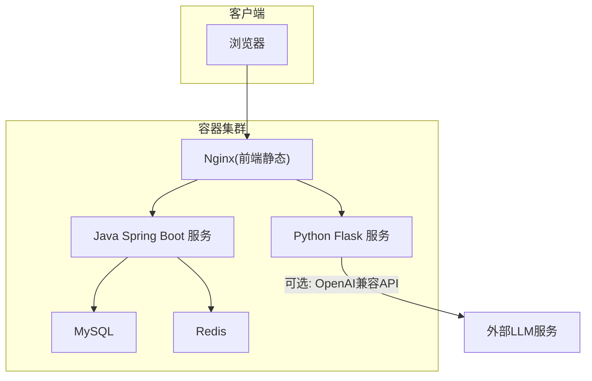
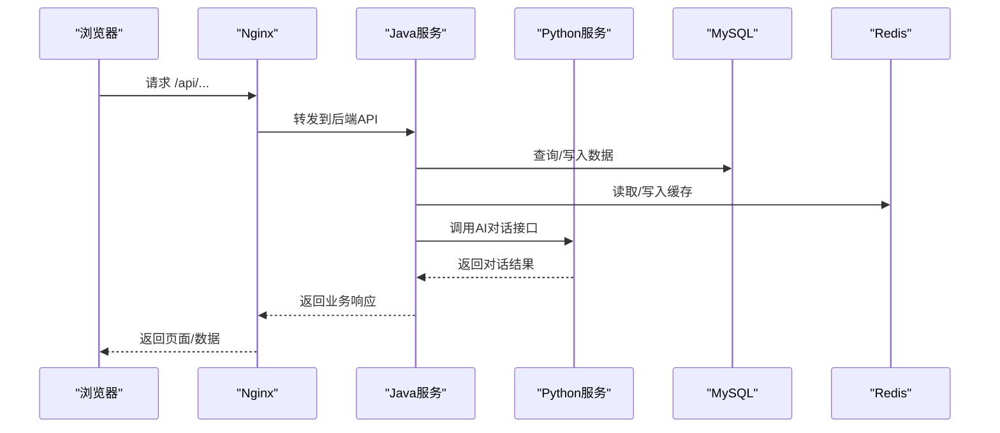
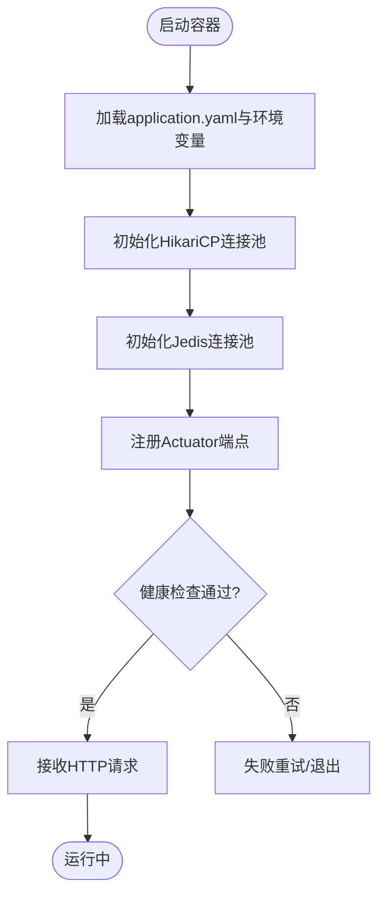
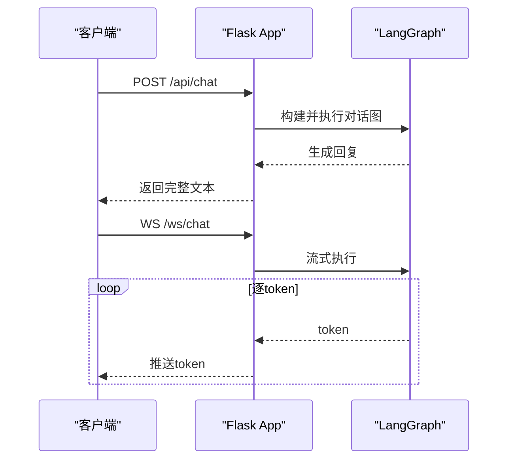
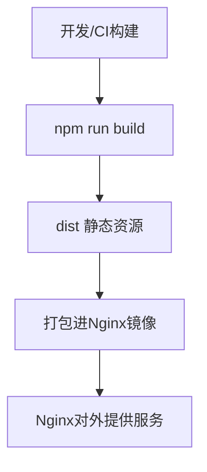
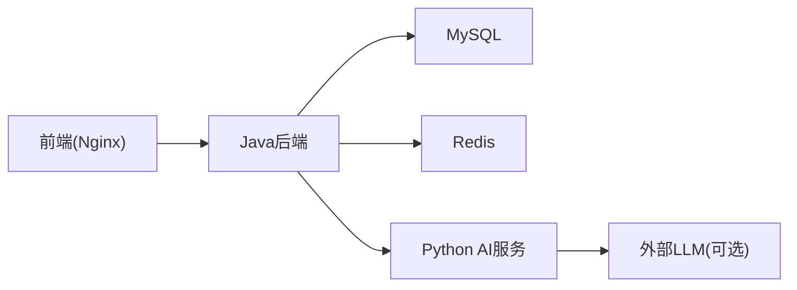

# Docker容器化部署

<cite>
**本文引用的文件**
- [java_server/po/pom.xml](file://java_server/po/pom.xml)
- [java_server/po/src/main/resources/application.yaml](file://java_server/po/src/main/resources/application.yaml)
- [py_server/app.py](file://py_server/app.py)
- [py_server/config.py](file://py_server/config.py)
- [py_server/requirements.txt](file://py_server/requirements.txt)
- [web_client/po-admin/package.json](file://web_client/po-admin/package.json)
</cite>

## 目录
1. [简介](#简介)
2. [项目结构](#项目结构)
3. [核心组件](#核心组件)
4. [架构总览](#架构总览)
5. [详细组件分析](#详细组件分析)
6. [依赖关系分析](#依赖关系分析)
7. [性能与优化](#性能与优化)
8. [故障排查指南](#故障排查指南)
9. [结论](#结论)
10. [附录：Dockerfile与编排配置模板](#附录dockerfile与编排配置模板)

## 简介
本文件面向多技术栈应用（Java后端、Python AI服务、前端静态站点）的容器化与编排，提供生产可用的镜像构建策略、Compose编排方案、网络与数据卷管理、监控日志采集以及安全与版本治理建议。文档基于仓库中的实际代码与配置文件进行说明，确保可落地执行。

## 项目结构
本项目包含三个主要子系统：
- Java后端：Spring Boot Web服务，暴露REST API，集成MySQL、Redis、Actuator/Prometheus指标。
- Python AI服务：Flask + LangGraph聊天服务，支持REST与WebSocket流式对话。
- 前端：Ant Design Pro（Umi Max）构建的静态资源，适合由Nginx等Web服务器托管。

[无直接源码映射，概念性架构图]

## 核心组件
- Java后端
  - 技术栈：Spring Boot、MyBatis-Plus、JPA、Redis(Jedis)、MySQL、JWT、Actuator/Prometheus。
  - 关键配置：端口、上下文路径、数据库连接池、缓存、文件上传限制、日志、监控端点。
- Python AI服务
  - 技术栈：Flask、Flask-Sock、Flask-CORS、LangChain/LangGraph、OpenAI兼容接口。
  - 关键能力：REST一次性回复、WebSocket流式回复、健康检查、环境变量驱动配置。
- 前端
  - 技术栈：React + Umi Max + Ant Design Pro，构建为静态资源，通过Nginx对外提供服务。

**章节来源**
- [java_server/po/pom.xml:1-163](file://java_server/po/pom.xml#L1-L163)
- [java_server/po/src/main/resources/application.yaml:1-109](file://java_server/po/src/main/resources/application.yaml#L1-L109)
- [py_server/app.py:1-51](file://py_server/app.py#L1-L51)
- [py_server/config.py:1-25](file://py_server/config.py#L1-L25)
- [py_server/requirements.txt:1-13](file://py_server/requirements.txt#L1-L13)
- [web_client/po-admin/package.json:1-132](file://web_client/po-admin/package.json#L1-L132)

## 架构总览
从请求到响应的典型流程：
- 浏览器访问前端页面，由Nginx提供静态资源并反向代理至后端API。
- Java后端处理业务逻辑，读写MySQL与Redis，必要时调用Python AI服务完成智能问答。
- Python AI服务通过LangGraph编排模型调用，返回文本或流式Token。

[无直接源码映射，概念性时序图]

## 详细组件分析

### Java后端容器化
- 构建产物：Spring Boot可执行JAR。
- 运行环境：JRE 17基础镜像；暴露端口8080；上下文路径/api。
- 外部依赖：MySQL、Redis；可通过环境变量覆盖数据库与缓存地址。
- 监控：Actuator暴露health/info/metrics/prometheus。

**章节来源**
- [java_server/po/src/main/resources/application.yaml:1-109](file://java_server/po/src/main/resources/application.yaml#L1-L109)
- [java_server/po/pom.xml:1-163](file://java_server/po/pom.xml#L1-L163)

### Python AI服务容器化
- 入口：Flask应用工厂创建app，注册蓝图，预热LangGraph图。
- 监听：默认HOST=0.0.0.0, PORT=5090，DEBUG可由环境变量控制。
- 依赖：Flask、Flask-Sock、Flask-CORS、LangChain/LangGraph、python-dotenv。
- 接口：/、/api/health、/api/chat、/ws/chat。

**章节来源**
- [py_server/app.py:1-51](file://py_server/app.py#L1-L51)
- [py_server/config.py:1-25](file://py_server/config.py#L1-L25)
- [py_server/requirements.txt:1-13](file://py_server/requirements.txt#L1-L13)

### 前端静态站点容器化
- 构建：使用Umi Max构建命令生成静态资源。
- 运行：由Nginx提供静态文件服务，反向代理后端API。
- 依赖：Node.js >= 22（构建期），运行时仅需Nginx。

**章节来源**
- [web_client/po-admin/package.json:1-132](file://web_client/po-admin/package.json#L1-L132)

## 依赖关系分析
- Java后端依赖：
  - 数据库：MySQL（JDBC）。
  - 缓存：Redis（Jedis）。
  - 监控：Actuator + Prometheus。
- Python服务依赖：
  - 可选外部LLM：OpenAI兼容接口（可通过BASE_URL与MODEL切换）。
- 前端依赖：
  - 构建期Node.js；运行期Nginx。

**章节来源**
- [java_server/po/src/main/resources/application.yaml:1-109](file://java_server/po/src/main/resources/application.yaml#L1-L109)
- [py_server/config.py:1-25](file://py_server/config.py#L1-L25)

## 性能与优化
- 镜像体积优化
  - Java：使用多阶段构建，第一阶段编译打包，第二阶段仅拷贝JAR与JRE；启用分层缓存；剔除测试与调试依赖。
  - Python：使用多阶段构建，第一阶段安装依赖并缓存wheel，第二阶段仅拷贝虚拟环境与代码；选择精简基础镜像。
  - 前端：构建期使用Node镜像，运行期仅Nginx镜像；开启gzip/brotli压缩。
- 运行时优化
  - Java：合理设置JVM参数（堆大小、GC）、Tomcat线程与连接数、HikariCP连接池；启用Prometheus指标。
  - Python：使用gunicorn/uwsgi替代开发服务器；合理设置工作进程与并发；启用CORS白名单。
  - Nginx：开启keepalive、缓存静态资源、限流与访问日志。
- 安全扫描与版本管理
  - 使用Trivy/Clair对镜像进行漏洞扫描；固定基础镜像版本；制品库归档镜像标签（git commit/sha）。
  - 敏感信息通过环境变量注入，不写入镜像。

[本节为通用指导，不直接引用具体文件]

## 故障排查指南
- 启动失败
  - Java：检查数据库/Redis连通性、端口冲突、上下文路径；查看Actuator health与日志。
  - Python：检查.env或环境变量是否生效、端口占用、CORS配置；访问/api/health验证。
  - 前端：确认Nginx静态目录挂载正确、反向代理路径匹配。
- 性能问题
  - Java：观察Prometheus指标（CPU、内存、连接池、慢SQL）；调整线程与连接池。
  - Python：评估LangGraph图复杂度与外部LLM延迟；考虑缓存与批处理。
- 日志收集
  - Java：输出到stdout/stderr，配合sidecar或日志采集器集中收集。
  - Python：统一JSON格式日志，便于结构化检索。
  - Nginx：access/error日志接入ELK/ Loki。

**章节来源**
- [java_server/po/src/main/resources/application.yaml:81-109](file://java_server/po/src/main/resources/application.yaml#L81-L109)
- [py_server/app.py:1-51](file://py_server/app.py#L1-L51)

## 结论
通过多阶段构建与最小化运行镜像，结合Compose编排与标准化环境变量，可实现Java后端、Python AI服务与前端站点的稳定容器化部署。配合监控与日志体系，可在生产环境获得高可用与可观测性。

[本节为总结，不直接引用具体文件]

## 附录：Dockerfile与编排配置模板

以下模板用于指导在本仓库基础上编写实际的Dockerfile与docker-compose.yml。请根据实际路径与端口进行调整。

- Java后端（多阶段构建）
  - 构建阶段：使用maven镜像编译打包，跳过测试，启用增量缓存。
  - 运行阶段：使用jre17精简镜像，复制JAR，暴露8080，设置时区与JVM参数。
  - 环境变量：DATABASE_URL、REDIS_HOST、REDIS_PORT、JWT_SECRET等。

- Python AI服务（多阶段构建）
  - 构建阶段：使用python镜像，安装requirements并缓存依赖。
  - 运行阶段：复制虚拟环境与代码，暴露5090，设置HOST/PORT/DEBUG/OPENAI_*等环境变量。

- 前端（Nginx）
  - 构建阶段：使用node镜像执行构建命令，产出dist。
  - 运行阶段：使用nginx镜像，将dist复制到html目录，配置反向代理到Java与Python服务。

- Compose编排
  - 服务定义：frontend、backend、ai、mysql、redis。
  - 网络：自定义bridge网络，服务间通过服务名通信。
  - 数据卷：持久化MySQL数据与日志。
  - 依赖：使用depends_on与服务就绪探针（如wait-for-it或healthcheck）保证启动顺序。
  - 环境变量：集中管理各服务所需配置，避免硬编码。

- 生产最佳实践
  - 镜像签名与漏洞扫描；只读根文件系统；非root用户运行。
  - 资源限制：CPU/内存上限与下限；优雅停机。
  - 配置外置：使用ConfigMap/Secret或环境变量注入。
  - 监控告警：Prometheus+Grafana；错误率与延迟阈值告警。

[本节为模板与指导，不直接引用具体文件]