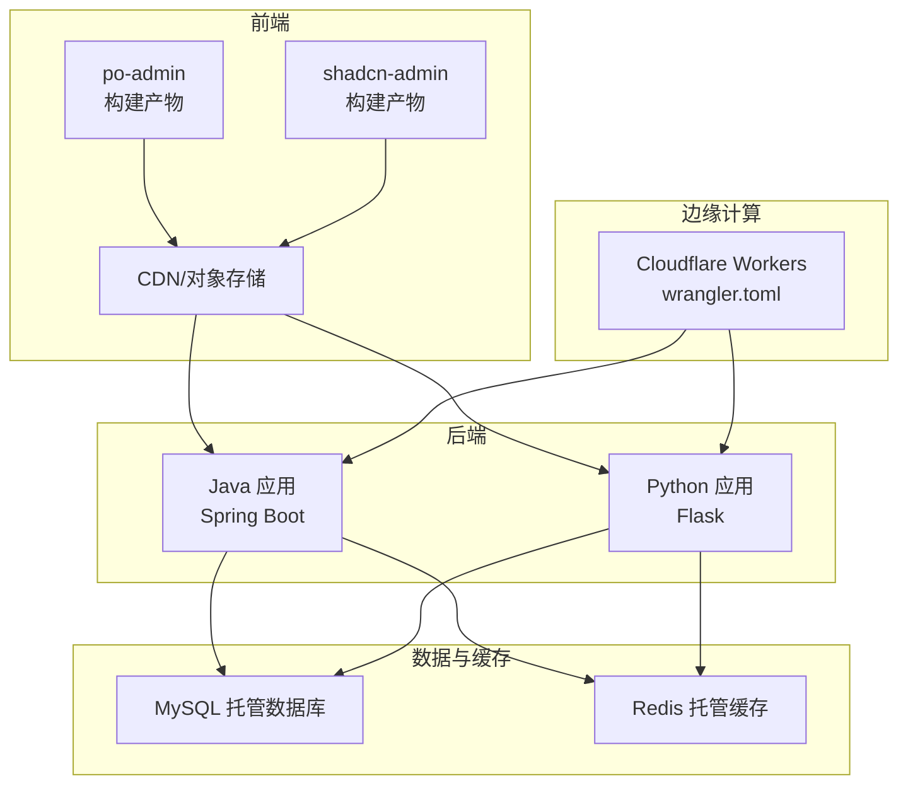
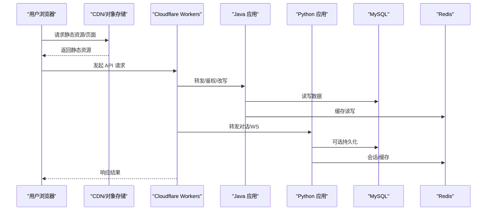
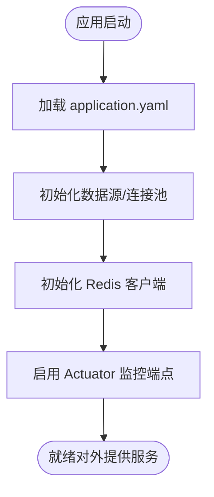
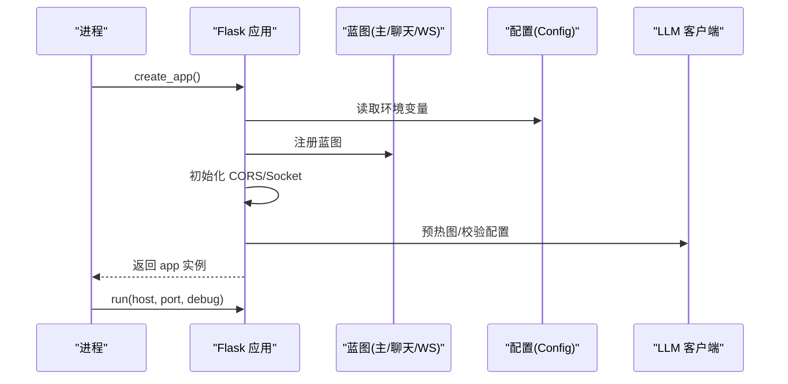
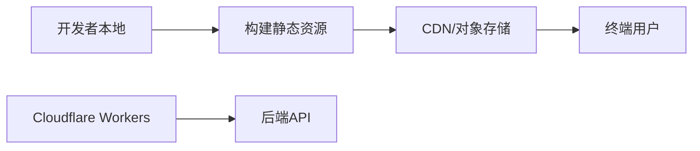
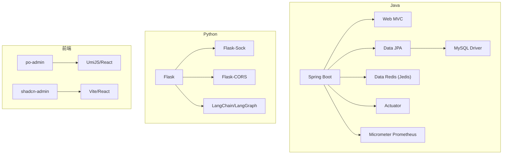

# 云服务部署

<cite>
**本文引用的文件**
- [java_server/po/pom.xml](file://java_server/po/pom.xml)
- [java_server/po/src/main/resources/application.yaml](file://java_server/po/src/main/resources/application.yaml)
- [java_server/po/src/main/java/com/goodzheng/po/PoApplication.java](file://java_server/po/src/main/java/com/goodzheng/po/PoApplication.java)
- [py_server/config.py](file://py_server/config.py)
- [py_server/requirements.txt](file://py_server/requirements.txt)
- [py_server/app.py](file://py_server/app.py)
- [web_client/po-admin/package.json](file://web_client/po-admin/package.json)
- [web_client/shadcn-admin/package.json](file://web_client/shadcn-admin/package.json)
- [web_client/po-admin/cloudflare-worker/wrangler.toml](file://web_client/po-admin/cloudflare-worker/wrangler.toml)
- [web_client/shadcn-admin/netlify.toml](file://web_client/shadcn-admin/netlify.toml)
</cite>

## 目录
1. [简介](#简介)
2. [项目结构](#项目结构)
3. [核心组件](#核心组件)
4. [架构总览](#架构总览)
5. [详细组件分析](#详细组件分析)
6. [依赖分析](#依赖分析)
7. [性能考虑](#性能考虑)
8. [故障排查指南](#故障排查指南)
9. [结论](#结论)
10. [附录：云平台部署方案](#附录云平台部署方案)

## 简介
本指南面向将本项目（Java 后端、Python 后端、前端静态资源与边缘函数）部署到主流云平台的工程实践，覆盖应用服务器配置、数据库服务集成、对象存储与 CDN 加速、负载均衡与自动扩缩容、高可用架构设计、容器化与微服务、Serverless 函数、监控日志告警等。文档基于仓库内现有配置与脚本进行可落地的说明，并给出阿里云、腾讯云、AWS 的差异化建议。

## 项目结构
本项目包含三个主要部分：
- Java 后端：Spring Boot 应用，提供 REST API，内置 Actuator 监控与 Prometheus 指标暴露。
- Python 后端：Flask 应用，提供聊天 REST 与 WebSocket 接口，支持 LLM 调用。
- 前端与边缘：两个前端工程（Ant Design Pro 与 Shadcn Admin），以及 Cloudflare Worker 边缘函数；另有 Netlify 路由配置用于 SPA 回退。

图表来源
- [web_client/po-admin/package.json:7-32](file://web_client/po-admin/package.json#L7-L32)
- [web_client/shadcn-admin/package.json:6-19](file://web_client/shadcn-admin/package.json#L6-L19)
- [web_client/po-admin/cloudflare-worker/wrangler.toml:1-6](file://web_client/po-admin/cloudflare-worker/wrangler.toml#L1-L6)
- [java_server/po/src/main/resources/application.yaml:1-109](file://java_server/po/src/main/resources/application.yaml#L1-L109)
- [py_server/app.py:1-51](file://py_server/app.py#L1-L51)

章节来源
- [web_client/po-admin/package.json:7-32](file://web_client/po-admin/package.json#L7-L32)
- [web_client/shadcn-admin/package.json:6-19](file://web_client/shadcn-admin/package.json#L6-L19)
- [web_client/po-admin/cloudflare-worker/wrangler.toml:1-6](file://web_client/po-admin/cloudflare-worker/wrangler.toml#L1-L6)
- [java_server/po/src/main/resources/application.yaml:1-109](file://java_server/po/src/main/resources/application.yaml#L1-L109)
- [py_server/app.py:1-51](file://py_server/app.py#L1-L51)

## 核心组件
- Java 后端（Spring Boot）
  - 端口与上下文路径：默认监听 8080，上下文路径 /api。
  - 数据源：MySQL（JDBC），连接池 HikariCP。
  - 缓存：Redis（Jedis）。
  - 监控：Actuator 暴露 health/info/metrics/prometheus。
  - 启动类：PoApplication。
- Python 后端（Flask）
  - 入口：app.py 创建 Flask 应用，注册蓝图，初始化 CORS 与 WebSocket。
  - 配置：config.py 通过环境变量加载 SECRET_KEY、HOST、PORT、DEBUG、LLM 相关参数。
  - 依赖：flask、flask-sock、flask-cors、langchain、langgraph 等。
- 前端与边缘
  - po-admin：基于 UmiJS/Ant Design Pro，提供构建与预览脚本。
  - shadcn-admin：基于 Vite + React，提供构建与预览脚本。
  - Cloudflare Worker：wrangler.toml 定义名称、入口与变量。
  - Netlify：netlify.toml 提供 SPA 路由回退。

章节来源
- [java_server/po/src/main/java/com/goodzheng/po/PoApplication.java:1-14](file://java_server/po/src/main/java/com/goodzheng/po/PoApplication.java#L1-L14)
- [java_server/po/src/main/resources/application.yaml:1-109](file://java_server/po/src/main/resources/application.yaml#L1-L109)
- [py_server/app.py:1-51](file://py_server/app.py#L1-L51)
- [py_server/config.py:1-25](file://py_server/config.py#L1-L25)
- [py_server/requirements.txt:1-13](file://py_server/requirements.txt#L1-L13)
- [web_client/po-admin/package.json:7-32](file://web_client/po-admin/package.json#L7-L32)
- [web_client/shadcn-admin/package.json:6-19](file://web_client/shadcn-admin/package.json#L6-L19)
- [web_client/po-admin/cloudflare-worker/wrangler.toml:1-6](file://web_client/po-admin/cloudflare-worker/wrangler.toml#L1-L6)
- [web_client/shadcn-admin/netlify.toml:1-4](file://web_client/shadcn-admin/netlify.toml#L1-L4)

## 架构总览
整体采用前后端分离与多语言后端组合：
- 前端静态资源通过 CDN/对象存储分发，提升全球访问速度。
- 边缘函数（Cloudflare Workers）可用于鉴权、请求改写、轻量逻辑或缓存命中。
- Java 后端承载核心业务 API，Python 后端承载对话与流式能力。
- 数据库与缓存使用托管服务，保障高可用与弹性。

图表来源
- [web_client/po-admin/cloudflare-worker/wrangler.toml:1-6](file://web_client/po-admin/cloudflare-worker/wrangler.toml#L1-L6)
- [java_server/po/src/main/resources/application.yaml:1-109](file://java_server/po/src/main/resources/application.yaml#L1-L109)
- [py_server/app.py:1-51](file://py_server/app.py#L1-L51)

## 详细组件分析

### Java 后端（Spring Boot）
- 应用服务器
  - 端口与上下文：8080，/api。
  - Tomcat 线程与连接数：max-threads=200，max-connections=1000，accept-count=100。
- 数据层
  - MySQL 连接：JDBC URL、用户名、密码、驱动类名。
  - 连接池：HikariCP 最大池大小、最小空闲、超时。
  - JPA/Hibernate：方言、DDL 策略、SQL 输出开关、OpenInView。
- 缓存
  - Redis：主机、端口、密码、超时、Jedis 连接池。
- 监控与可观测性
  - Actuator 暴露健康、信息、指标与 Prometheus 端点。
  - Micrometer Prometheus 注册器已引入。
- 启动类
  - PoApplication 作为 Spring Boot 入口。

图表来源
- [java_server/po/src/main/resources/application.yaml:1-109](file://java_server/po/src/main/resources/application.yaml#L1-L109)
- [java_server/po/src/main/java/com/goodzheng/po/PoApplication.java:1-14](file://java_server/po/src/main/java/com/goodzheng/po/PoApplication.java#L1-L14)

章节来源
- [java_server/po/src/main/resources/application.yaml:1-109](file://java_server/po/src/main/resources/application.yaml#L1-L109)
- [java_server/po/src/main/java/com/goodzheng/po/PoApplication.java:1-14](file://java_server/po/src/main/java/com/goodzheng/po/PoApplication.java#L1-L14)
- [java_server/po/pom.xml:32-115](file://java_server/po/pom.xml#L32-L115)

### Python 后端（Flask）
- 应用工厂与蓝图
  - create_app 装配 Flask，注册 main/chat/ws 蓝图，初始化 CORS 与 WebSocket。
  - 启动时预热 LangGraph 图，便于尽早发现配置问题。
- 配置与环境
  - 通过 config.py 读取 .env 与环境变量，包括密钥、服务地址端口、调试模式、LLM 接入参数。
- 依赖
  - Web 框架与扩展：flask、flask-sock、flask-cors。
  - LLM 编排：langchain、langchain-openai、langgraph。

图表来源
- [py_server/app.py:1-51](file://py_server/app.py#L1-L51)
- [py_server/config.py:1-25](file://py_server/config.py#L1-L25)
- [py_server/requirements.txt:1-13](file://py_server/requirements.txt#L1-L13)

章节来源
- [py_server/app.py:1-51](file://py_server/app.py#L1-L51)
- [py_server/config.py:1-25](file://py_server/config.py#L1-L25)
- [py_server/requirements.txt:1-13](file://py_server/requirements.txt#L1-L13)

### 前端与边缘
- po-admin
  - 构建与开发脚本：build/dev/preview/test 等。
  - 构建产物为静态资源，适合放置于 CDN/对象存储。
- shadcn-admin
  - 基于 Vite 构建，提供 build/preview 等脚本。
  - netlify.toml 提供 SPA 路由回退，便于直接托管。
- Cloudflare Workers
  - wrangler.toml 定义名称、入口与变量，可作为边缘网关或轻量代理。

图表来源
- [web_client/po-admin/package.json:7-32](file://web_client/po-admin/package.json#L7-L32)
- [web_client/shadcn-admin/package.json:6-19](file://web_client/shadcn-admin/package.json#L6-L19)
- [web_client/po-admin/cloudflare-worker/wrangler.toml:1-6](file://web_client/po-admin/cloudflare-worker/wrangler.toml#L1-L6)
- [web_client/shadcn-admin/netlify.toml:1-4](file://web_client/shadcn-admin/netlify.toml#L1-L4)

章节来源
- [web_client/po-admin/package.json:7-32](file://web_client/po-admin/package.json#L7-L32)
- [web_client/shadcn-admin/package.json:6-19](file://web_client/shadcn-admin/package.json#L6-L19)
- [web_client/po-admin/cloudflare-worker/wrangler.toml:1-6](file://web_client/po-admin/cloudflare-worker/wrangler.toml#L1-L6)
- [web_client/shadcn-admin/netlify.toml:1-4](file://web_client/shadcn-admin/netlify.toml#L1-L4)

## 依赖分析
- Java 依赖
  - Spring Boot 4.1.1（父 POM）、Web MVC、Data JPA、Data Redis（Jedis）、Actuator、Micrometer Prometheus、MySQL 驱动、JWT、Validation、Security Crypto。
- Python 依赖
  - Flask、Flask-Sock、Flask-CORS、LangChain/LangGraph/OpenAI 兼容 SDK、python-dotenv。
- 前端依赖
  - po-admin：React、Ant Design、TanStack Query、UmiJS 生态等。
  - shadcn-admin：React、Vite、Tailwind、Zustand、i18next 等。

图表来源
- [java_server/po/pom.xml:32-115](file://java_server/po/pom.xml#L32-L115)
- [py_server/requirements.txt:1-13](file://py_server/requirements.txt#L1-L13)
- [web_client/po-admin/package.json:37-92](file://web_client/po-admin/package.json#L37-L92)
- [web_client/shadcn-admin/package.json:21-95](file://web_client/shadcn-admin/package.json#L21-L95)

章节来源
- [java_server/po/pom.xml:32-115](file://java_server/po/pom.xml#L32-L115)
- [py_server/requirements.txt:1-13](file://py_server/requirements.txt#L1-L13)
- [web_client/po-admin/package.json:37-92](file://web_client/po-admin/package.json#L37-L92)
- [web_client/shadcn-admin/package.json:21-95](file://web_client/shadcn-admin/package.json#L21-L95)

## 性能考虑
- Java 后端
  - 合理设置 Tomcat 线程与连接上限，结合压测调优。
  - 调整 HikariCP 连接池大小与超时，避免连接耗尽。
  - 开启 JPA SQL 输出仅用于调试，生产环境关闭。
  - 利用 Redis 做热点数据缓存，降低数据库压力。
  - 使用 Actuator+Prometheus 采集指标，配合 Grafana/云监控可视化。
- Python 后端
  - 根据并发需求选择 WSGI/ASGI 服务器（如 Gunicorn/Uvicorn），并配置 worker 数量。
  - 对 LLM 调用增加超时与重试策略，避免长尾阻塞。
  - 使用 Redis 做会话/限流/缓存。
- 前端与边缘
  - 静态资源走 CDN，开启压缩与缓存头。
  - 使用 Cloudflare Workers 做边缘鉴权/改写/缓存，减少回源。
  - 前端按需分包与懒加载，减少首屏体积。

[本节为通用指导，不直接分析具体文件]

## 故障排查指南
- Java 后端
  - 健康检查：访问 Actuator health 端点确认服务状态。
  - 指标采集：访问 metrics/prometheus 端点获取 Prometheus 格式指标。
  - 日志：查看 logs/application.log 与系统日志，定位异常堆栈。
- Python 后端
  - 健康检查：GET /api/health 验证服务可用性。
  - 配置校验：检查 .env 与环境变量是否生效（SECRET_KEY、OPENAI_API_KEY、BASE_URL、MODEL）。
  - 日志：关注控制台输出与错误日志，定位 LLM 调用失败原因。
- 前端与边缘
  - 构建失败：检查 Node 版本与依赖安装，参考 package.json scripts。
  - 路由回退：Netlify SPA 回退需确保 netlify.toml 正确配置。
  - 边缘函数：通过 wrangler dev 本地调试，再部署至 Cloudflare。

章节来源
- [java_server/po/src/main/resources/application.yaml:82-95](file://java_server/po/src/main/resources/application.yaml#L82-L95)
- [py_server/app.py:1-51](file://py_server/app.py#L1-L51)
- [web_client/shadcn-admin/netlify.toml:1-4](file://web_client/shadcn-admin/netlify.toml#L1-L4)
- [web_client/po-admin/cloudflare-worker/wrangler.toml:1-6](file://web_client/po-admin/cloudflare-worker/wrangler.toml#L1-L6)

## 结论
本项目具备清晰的多语言后端与前端分离架构，天然适配云原生部署。通过托管数据库与缓存、CDN/对象存储、负载均衡与自动扩缩容、容器化与 Serverless 的组合，可在主流云平台上实现高可用、可扩展、易运维的生产级部署。建议在 CI/CD 中固化构建与发布流程，统一配置管理，完善监控告警与日志分析体系。

[本节为总结性内容，不直接分析具体文件]

## 附录：云平台部署方案

### 通用部署步骤
- 构建
  - Java：使用 Maven 打包为可执行 Jar。
  - Python：冻结依赖（pip freeze 或 requirements.txt），准备 WSGI/ASGI 服务器。
  - 前端：分别构建 po-admin 与 shadcn-admin 静态资源。
- 配置管理
  - 使用环境变量注入敏感信息（数据库、Redis、JWT、LLM Key）。
  - 将 application.yaml 中的数据库/Redis 地址替换为云托管地址。
- 安全与网络
  - 仅开放必要端口（如 80/443 由 LB/网关处理，后端仅内网访问）。
  - 使用 VPC/私有子网隔离数据库与缓存。
- 监控与日志
  - 收集应用日志到集中式日志服务。
  - 暴露 Prometheus 指标，接入云监控或自建 Grafana。

### 阿里云（Alibaba Cloud）
- 应用服务器
  - 使用 ACK（Kubernetes）或 SAE（Serverless App Engine）部署 Java/Python 应用。
  - 通过环境变量注入数据库、Redis、JWT、LLM Key。
- 数据库与缓存
  - 使用 RDS MySQL 与 Redis 托管版，配置白名单与只读副本。
- 对象存储与 CDN
  - 静态资源上传 OSS，开启 CDN 加速与 HTTPS。
- 负载均衡与自动扩缩容
  - SLB/ALB 挂载后端 ECS/ACK 节点，配置健康检查。
  - HPA 基于 CPU/内存或自定义指标（Prometheus）自动扩缩容。
- 监控与日志
  - 使用 ARMS/SLS 采集日志与链路追踪。
  - 使用云监控与 Prometheus 对接展示指标。

### 腾讯云（Tencent Cloud）
- 应用服务器
  - TKE（Kubernetes）或 SCF（Serverless 函数）部署 Python 微服务；Java 服务可放 TKE。
- 数据库与缓存
  - CDB MySQL 与 TencentDB for Redis，配置高可用与备份。
- 对象存储与 CDN
  - COS 存放静态资源，搭配 CDN 加速。
- 负载均衡与自动扩缩容
  - CLB 挂载后端，结合 KEDA/HPA 实现弹性伸缩。
- 监控与日志
  - 使用 CLS 日志服务与监控平台，接入 Prometheus 指标。

### AWS
- 应用服务器
  - EKS（Kubernetes）或 Fargate/EC2 运行 Java/Python 应用。
- 数据库与缓存
  - RDS MySQL 与 ElastiCache Redis，启用多 AZ。
- 对象存储与 CDN
  - S3 存放静态资源，CloudFront 加速与 HTTPS。
- 负载均衡与自动扩缩容
  - ALB/NLB 挂载目标组，HPA/VPA 或 Cluster Autoscaler 自动扩缩容。
- 监控与日志
  - CloudWatch Logs 与 Metrics，Prometheus/Grafana 或 Managed Service。

### 容器化与微服务
- 容器镜像
  - Java：基于精简基础镜像，仅包含运行时与 Jar。
  - Python：基于 slim 镜像，安装依赖后以 gunicorn/uvicorn 启动。
  - 前端：Nginx 镜像托管静态资源。
- 编排与服务发现
  - Kubernetes Deployment/Service/Ingress 管理生命周期与流量。
  - 使用 ConfigMap/Secret 管理配置与密钥。
- 微服务拆分
  - 将 Java 与 Python 服务拆分为独立微服务，按职责划分。
  - 通过 API Gateway/Ingress 统一入口。

### Serverless 函数
- Cloudflare Workers
  - 使用 wrangler.toml 配置名称、入口与变量，部署边缘函数。
  - 适用于鉴权、请求改写、缓存命中、轻量聚合。
- 其他云函数
  - 阿里云 FC、腾讯云 SCF、AWS Lambda 可按需承载无状态任务。

### 监控、日志与告警
- 指标
  - Java：Actuator + Prometheus 暴露指标。
  - Python：可接入 OpenTelemetry 或自研指标上报。
- 日志
  - 统一采集到集中式日志服务，结构化输出，便于检索与分析。
- 告警
  - 基于阈值与规则（CPU、内存、错误率、延迟）配置告警通道（邮件/短信/IM）。
  - 结合 SLO/SLI 制定告警策略。

### 不同云平台特性与定制化建议
- 阿里云
  - 推荐 ACK + ARMS + SLS + RDS + Redis + OSS + CDN 的组合。
  - 利用 HPA 与弹性伸缩组实现成本优化。
- 腾讯云
  - 推荐 TKE + CLS + CDB + Redis + COS + CDN。
  - 使用 KEDA 触发器实现事件驱动的弹性。
- AWS
  - 推荐 EKS/Fargate + CloudWatch + RDS + ElastiCache + S3 + CloudFront。
  - 使用 Auto Scaling 与 Spot 实例降低成本。

[本节为通用指导，不直接分析具体文件]