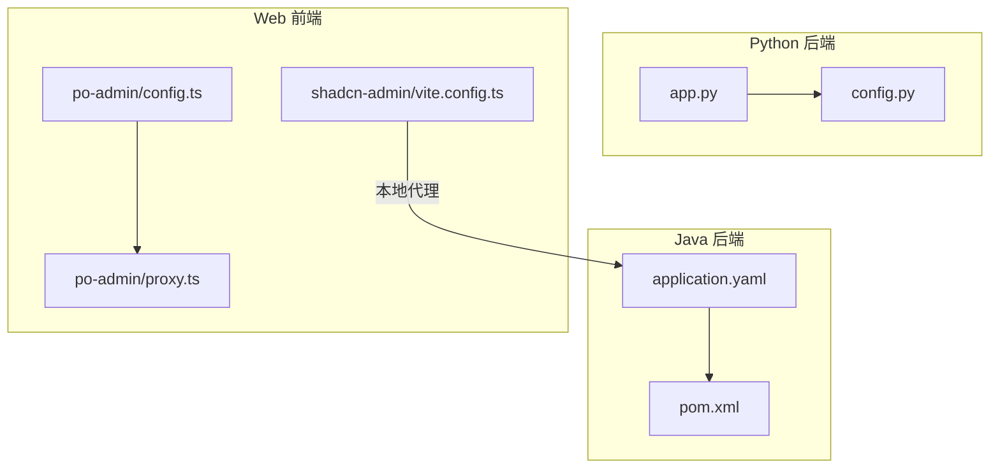
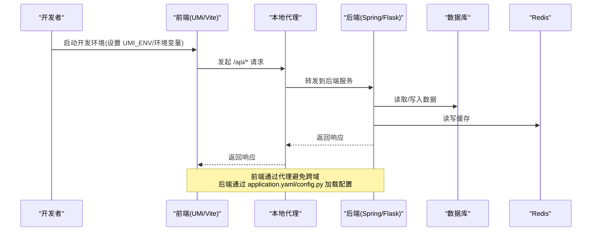
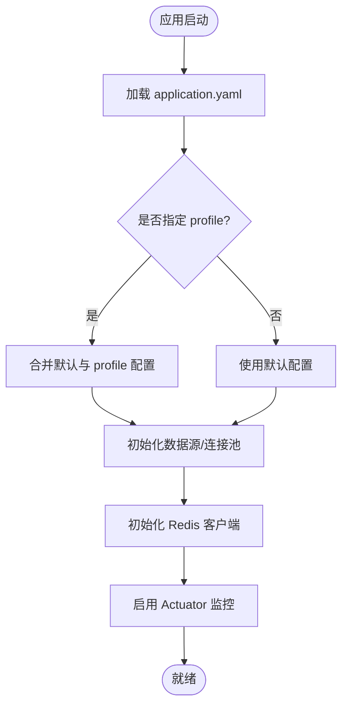
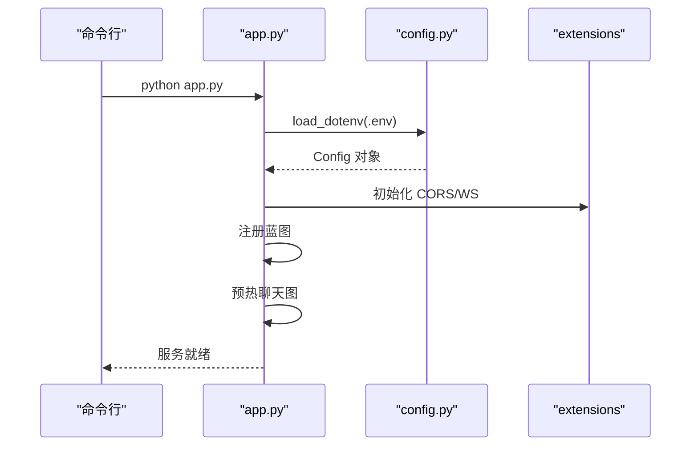
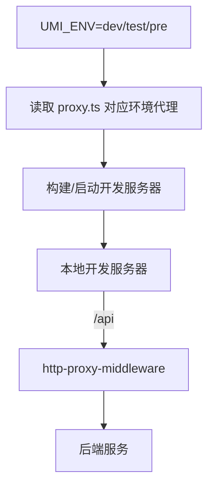
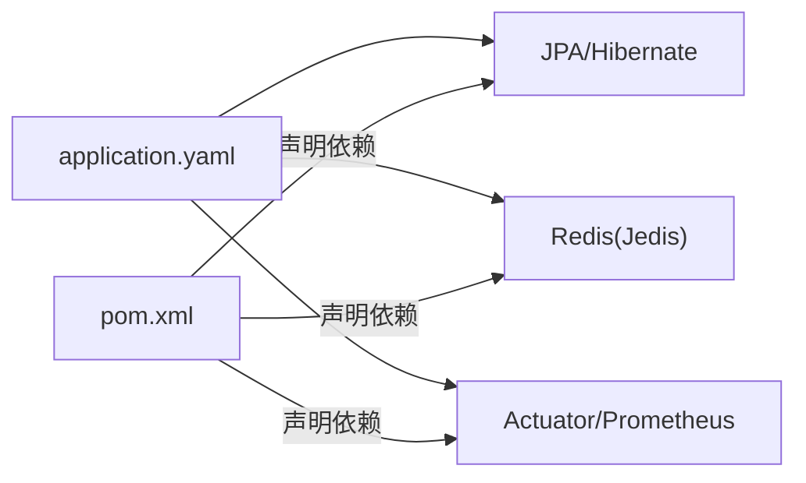

# 环境配置管理

<cite>
**本文引用的文件**
- [application.yaml](file://java_server/po/src/main/resources/application.yaml)
- [pom.xml](file://java_server/po/pom.xml)
- [config.py](file://py_server/config.py)
- [app.py](file://py_server/app.py)
- [config.ts](file://web_client/po-admin/config/config.ts)
- [proxy.ts](file://web_client/po-admin/config/proxy.ts)
- [package.json](file://web_client/po-admin/package.json)
- [vite.config.ts](file://web_client/shadcn-admin/vite.config.ts)
- [.gitignore](file://py_server/.gitignore)
- [wrangler.toml](file://web_client/po-admin/cloudflare-worker/wrangler.toml)
</cite>

## 目录
1. [简介](#简介)
2. [项目结构](#项目结构)
3. [核心组件](#核心组件)
4. [架构总览](#架构总览)
5. [详细组件分析](#详细组件分析)
6. [依赖关系分析](#依赖关系分析)
7. [性能考虑](#性能考虑)
8. [故障排查指南](#故障排查指南)
9. [结论](#结论)
10. [附录](#附录)

## 简介
本文件面向本仓库的 Spring Boot、Flask 与 React（Umi/Max 与 Vite）三端，系统化说明开发、测试、生产环境的配置差异与管理策略。重点覆盖：
- 环境变量与配置文件管理
- 敏感信息保护机制
- 数据库连接、Redis 缓存、第三方 API 密钥等关键配置项
- 配置热更新、配置中心集成思路与版本控制方案
- 不同环境的配置模板与迁移脚本建议

## 项目结构
本项目包含三个主要子系统：
- Java 后端（Spring Boot）：通过 application.yaml 集中管理服务器、数据源、JPA、Redis、日志、Actuator 与自定义业务配置；通过 profiles 切换环境。
- Python 后端（Flask）：通过 config.py 加载 .env 环境变量，支持服务端口、调试开关与 LLM 相关配置；应用入口 app.py 将配置注入 Flask。
- Web 前端（React）：
  - po-admin（Umi/Max）：通过 config.ts 与 proxy.ts 管理构建、代理、国际化、插件等；通过 UMI_ENV 区分 dev/test/pre 等环境。
  - shadcn-admin（Vite）：通过 vite.config.ts 配置本地代理与测试运行器。

**图表来源**
- [application.yaml:1-109](file://java_server/po/src/main/resources/application.yaml#L1-L109)
- [pom.xml:1-163](file://java_server/po/pom.xml#L1-L163)
- [config.py:1-25](file://py_server/config.py#L1-L25)
- [app.py:1-51](file://py_server/app.py#L1-L51)
- [config.ts:1-237](file://web_client/po-admin/config/config.ts#L1-L237)
- [proxy.ts:1-42](file://web_client/po-admin/config/proxy.ts#L1-L42)
- [vite.config.ts:1-53](file://web_client/shadcn-admin/vite.config.ts#L1-L53)

**章节来源**
- [application.yaml:1-109](file://java_server/po/src/main/resources/application.yaml#L1-L109)
- [config.py:1-25](file://py_server/config.py#L1-L25)
- [config.ts:1-237](file://web_client/po-admin/config/config.ts#L1-L237)
- [proxy.ts:1-42](file://web_client/po-admin/config/proxy.ts#L1-L42)
- [vite.config.ts:1-53](file://web_client/shadcn-admin/vite.config.ts#L1-L53)

## 核心组件
- Spring Boot 配置中心（application.yaml）
  - 服务器基础参数、上下文路径、Tomcat 线程池
  - 数据源（MySQL）、HikariCP 连接池、JPA/Hibernate
  - Redis（Jedis）连接与连接池
  - 文件上传限制、静态资源缓存
  - 日志级别与输出、Actuator 监控端点暴露
  - 自定义业务配置与 JWT 密钥
- Flask 配置（config.py + app.py）
  - 从 .env 读取 SECRET_KEY、HOST、PORT、DEBUG
  - LLM 兼容接口配置（OPENAI_API_KEY、BASE_URL、MODEL），未配置时降级为离线演示模式
  - 应用工厂将配置注入 Flask，并初始化 CORS、WebSocket 扩展
- Umi/Max 前端（config.ts + proxy.ts）
  - 通过 UMI_ENV 选择代理与环境变量
  - 代理配置用于本地联调后端接口
  - 构建产物 hash、国际化、主题、OpenAPI 代码生成等
- Vite 前端（vite.config.ts）
  - 本地开发代理到后端 /api
  - 测试配置（Playwright、覆盖率排除）

**章节来源**
- [application.yaml:1-109](file://java_server/po/src/main/resources/application.yaml#L1-L109)
- [config.py:1-25](file://py_server/config.py#L1-L25)
- [app.py:1-51](file://py_server/app.py#L1-L51)
- [config.ts:1-237](file://web_client/po-admin/config/config.ts#L1-L237)
- [proxy.ts:1-42](file://web_client/po-admin/config/proxy.ts#L1-L42)
- [vite.config.ts:1-53](file://web_client/shadcn-admin/vite.config.ts#L1-L53)

## 架构总览
下图展示前后端与服务间的环境配置与请求流向，以及代理与配置加载的关键路径。

**图表来源**
- [config.ts:78-84](file://web_client/po-admin/config/config.ts#L78-L84)
- [proxy.ts:28-40](file://web_client/po-admin/config/proxy.ts#L28-L40)
- [vite.config.ts:24-31](file://web_client/shadcn-admin/vite.config.ts#L24-L31)
- [application.yaml:23-52](file://java_server/po/src/main/resources/application.yaml#L23-L52)
- [config.py:10-25](file://py_server/config.py#L10-L25)

## 详细组件分析

### Spring Boot 环境配置（application.yaml）
- 多环境切换
  - 使用 spring.profiles.active 指定当前激活的配置集（示例中为 dev）。可通过命令行或环境变量覆盖。
- 数据源与连接池
  - MySQL 连接 URL、用户名、密码、驱动类名
  - HikariCP 最大连接数、最小空闲、连接超时
- JPA/Hibernate
  - 数据库方言、DDL 自动更新、SQL 打印、视图打开策略
- Redis 缓存
  - 主机、端口、密码、超时、Jedis 连接池大小
- 其他
  - 文件上传大小限制、静态资源缓存周期
  - 日志级别与输出路径
  - Actuator 监控端点（health、info、metrics、prometheus）
  - 自定义业务配置与 JWT 密钥

**图表来源**
- [application.yaml:16-21](file://java_server/po/src/main/resources/application.yaml#L16-L21)
- [application.yaml:23-52](file://java_server/po/src/main/resources/application.yaml#L23-L52)
- [application.yaml:69-109](file://java_server/po/src/main/resources/application.yaml#L69-L109)

**章节来源**
- [application.yaml:1-109](file://java_server/po/src/main/resources/application.yaml#L1-L109)

### Flask 环境配置（config.py + app.py）
- 配置加载
  - 优先从 py_server/.env 加载环境变量，未提供则使用默认值
  - 支持通过系统环境变量覆盖
- 关键配置项
  - 服务监听地址与端口、调试开关
  - 安全密钥 SECRET_KEY
  - LLM 兼容接口：OPENAI_API_KEY、OPENAI_BASE_URL、OPENAI_MODEL
- 应用装配
  - 应用工厂 create_app 将配置注入 Flask，注册蓝图与扩展
  - 启动时预热 LangGraph 图，便于尽早暴露配置问题

**图表来源**
- [config.py:1-25](file://py_server/config.py#L1-L25)
- [app.py:24-51](file://py_server/app.py#L24-L51)

**章节来源**
- [config.py:1-25](file://py_server/config.py#L1-L25)
- [app.py:1-51](file://py_server/app.py#L1-L51)

### Umi/Max 前端配置（config.ts + proxy.ts）
- 环境区分
  - 通过 UMI_ENV 选择代理与环境变量（dev/test/pre）
- 代理策略
  - 本地开发时将 /api 请求代理至后端，避免跨域
  - 生产环境代理不生效，需由部署层处理反向代理
- 构建与特性
  - 开启 hash 产物、国际化、主题、OpenAPI 代码生成、Mock 开关等

**图表来源**
- [config.ts:10-10](file://web_client/po-admin/config/config.ts#L10-L10)
- [config.ts:78-84](file://web_client/po-admin/config/config.ts#L78-L84)
- [proxy.ts:28-40](file://web_client/po-admin/config/proxy.ts#L28-L40)

**章节来源**
- [config.ts:1-237](file://web_client/po-admin/config/config.ts#L1-L237)
- [proxy.ts:1-42](file://web_client/po-admin/config/proxy.ts#L1-L42)
- [package.json:7-32](file://web_client/po-admin/package.json#L7-L32)

### Vite 前端配置（vite.config.ts）
- 本地代理
  - 将 /api 请求代理到 http://localhost:8080（Spring Boot 默认端口）
- 测试与覆盖率
  - 基于 Playwright 的浏览器测试，覆盖率排除 UI 组件与路由生成文件

**章节来源**
- [vite.config.ts:1-53](file://web_client/shadcn-admin/vite.config.ts#L1-L53)

## 依赖关系分析
- Spring Boot 依赖
  - 数据访问：spring-boot-starter-data-jpa、mysql-connector-j
  - 缓存：spring-boot-starter-data-redis（替换为 Jedis）
  - 监控：spring-boot-starter-actuator、micrometer-registry-prometheus
  - 开发工具：spring-boot-devtools
- 前端依赖
  - Umi/Max 生态：@umijs/max、openapi 插件、request-record
  - Vite 生态：@vitejs/plugin-react、tailwindcss、playwright

**图表来源**
- [application.yaml:23-52](file://java_server/po/src/main/resources/application.yaml#L23-L52)
- [pom.xml:32-115](file://java_server/po/pom.xml#L32-L115)

**章节来源**
- [pom.xml:1-163](file://java_server/po/pom.xml#L1-L163)
- [application.yaml:1-109](file://java_server/po/src/main/resources/application.yaml#L1-L109)

## 性能考虑
- 数据库连接池
  - 根据并发量调整 HikariCP 的最大连接数与超时，避免连接耗尽
- Redis 连接池
  - 合理设置 Jedis 连接池大小与超时，降低网络抖动影响
- 静态资源缓存
  - 生产环境开启强缓存与 CDN，减少重复请求
- 前端代理与构建
  - 开发阶段使用代理提升联调效率；生产阶段通过反向代理统一出口
  - 开启产物 hash 与按需加载，提升缓存命中率与首屏性能

[本节为通用指导，无需特定文件引用]

## 故障排查指南
- Spring Boot
  - 检查 spring.profiles.active 是否正确激活目标环境
  - 核对数据库与 Redis 的连接信息、密码与网络可达性
  - 通过 Actuator 健康端点查看各组件状态
- Flask
  - 确认 .env 已正确加载且未被提交到版本库（参考 .gitignore）
  - 若 LLM 未配置，服务会降级为离线演示模式，注意功能差异
- 前端
  - 确认 UMI_ENV 与 proxy.ts 中的目标地址一致
  - 检查本地代理是否成功转发到后端（浏览器 Network 面板）
  - Vite 环境下确认 /api 代理目标端口与后端一致

**章节来源**
- [application.yaml:16-21](file://java_server/po/src/main/resources/application.yaml#L16-L21)
- [application.yaml:23-52](file://java_server/po/src/main/resources/application.yaml#L23-L52)
- [config.py:1-25](file://py_server/config.py#L1-L25)
- [proxy.ts:28-40](file://web_client/po-admin/config/proxy.ts#L28-L40)
- [vite.config.ts:24-31](file://web_client/shadcn-admin/vite.config.ts#L24-L31)
- [.gitignore:7-8](file://py_server/.gitignore#L7-L8)

## 结论
本项目采用“配置文件 + 环境变量”的分层策略：
- Spring Boot 以 application.yaml 为核心，结合 profiles 实现环境隔离
- Flask 通过 .env 与系统环境变量注入配置，保证敏感信息不出库
- 前端通过构建期环境变量与代理配置，实现开发与测试环境的灵活切换
建议在后续演进中引入配置中心与密钥管理服务，进一步提升可维护性与安全性。

[本节为总结性内容，无需特定文件引用]

## 附录

### 环境变量与配置文件清单（按环境）
- 通用
  - 数据库连接：URL、用户名、密码、驱动类名
  - Redis：主机、端口、密码、超时、连接池大小
  - 日志：根日志级别、输出路径
  - 监控：Actuator 端点白名单
- 开发
  - Spring Boot：profiles.active=dev；JPA ddl-auto=update；show-sql=true
  - Flask：DEBUG=1；可选 LLM 离线模式
  - 前端：UMI_ENV=dev；本地代理指向后端
- 测试
  - Spring Boot：profiles.active=test；关闭 ddl-auto 或改为 validate
  - Flask：DEBUG=0；使用测试数据库与 Redis
  - 前端：UMI_ENV=test；代理指向测试后端
- 生产
  - Spring Boot：profiles.active=prod；ddl-auto 关闭；严格日志级别；连接池与超时按容量调优
  - Flask：DEBUG=0；强制 HTTPS；仅暴露必要端口
  - 前端：UMI_ENV=prod；禁用代理；通过反向代理与 CDN 发布

**章节来源**
- [application.yaml:16-21](file://java_server/po/src/main/resources/application.yaml#L16-L21)
- [application.yaml:23-52](file://java_server/po/src/main/resources/application.yaml#L23-L52)
- [config.py:10-25](file://py_server/config.py#L10-L25)
- [config.ts:78-84](file://web_client/po-admin/config/config.ts#L78-L84)
- [proxy.ts:28-40](file://web_client/po-admin/config/proxy.ts#L28-L40)

### 敏感信息保护机制
- 禁止将 .env、密钥、证书等提交到版本库
- 使用环境变量注入敏感信息（数据库密码、JWT 密钥、LLM Key）
- 生产环境通过平台级密钥管理服务（如云厂商 KMS、Vault）注入
- 前端不包含任何服务端密钥，仅包含构建期常量

**章节来源**
- [.gitignore:7-8](file://py_server/.gitignore#L7-L8)
- [config.py:1-25](file://py_server/config.py#L1-L25)
- [application.yaml:99-109](file://java_server/po/src/main/resources/application.yaml#L99-L109)

### 配置热更新与配置中心集成
- Spring Boot
  - 可使用 @RefreshScope + Spring Cloud Config/Nacos/Apollo 实现运行时刷新
  - 对非敏感配置（如开关、阈值）进行热更新，敏感配置仍建议重启
- Flask
  - 可在进程内监听配置变更事件，重新加载部分配置；敏感配置建议重启
- 前端
  - 构建期常量无法热更新；运行时配置应通过后端 API 下发（如 feature flags）

[本节为通用实践建议，无需特定文件引用]

### 配置版本控制方案
- 将公共配置纳入版本库，环境差异通过环境变量或外部配置中心管理
- 使用分支或标签管理不同环境的基线配置
- 变更记录与审计：所有配置变更走 PR 评审与自动化校验

[本节为通用实践建议，无需特定文件引用]

### 不同环境的配置模板（建议）
- Spring Boot
  - application.yml（公共）+ application-{profile}.yml（dev/test/prod）
  - 通过 spring.profiles.active 切换
- Flask
  - .env.example（模板）+ .env（本地，忽略）
  - 通过环境变量覆盖
- 前端
  - 通过 UMI_ENV 与构建脚本注入不同代理与常量

**章节来源**
- [application.yaml:16-21](file://java_server/po/src/main/resources/application.yaml#L16-L21)
- [config.py:1-25](file://py_server/config.py#L1-L25)
- [config.ts:10-10](file://web_client/po-admin/config/config.ts#L10-L10)
- [proxy.ts:28-40](file://web_client/po-admin/config/proxy.ts#L28-L40)

### 迁移脚本（建议）
- 数据库
  - 使用 Flyway/Liquibase 管理 SQL 迁移脚本，按环境执行
- 缓存
  - 提供 Redis 键前缀与过期策略的迁移脚本，避免键冲突
- 前端
  - 通过 CI/CD 在构建时注入环境变量，确保产物与目标环境一致

[本节为通用实践建议，无需特定文件引用]

### 第三方服务与部署配置
- Cloudflare Worker（示例）
  - 通过 wrangler.toml 的 [vars] 注入环境变量（如 ENVIRONMENT）
  - 生产环境通过平台变量管理敏感信息

**章节来源**
- [wrangler.toml:1-6](file://web_client/po-admin/cloudflare-worker/wrangler.toml#L1-L6)