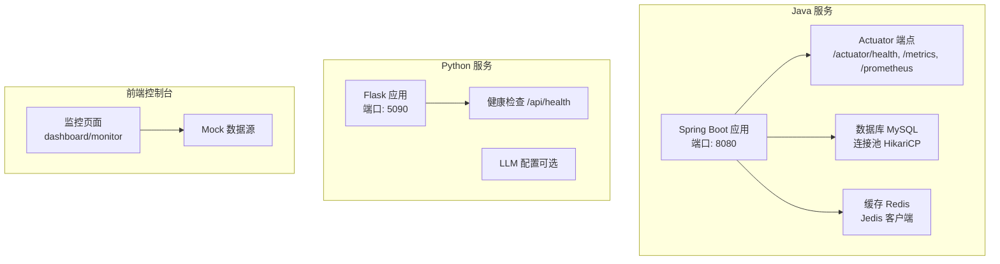
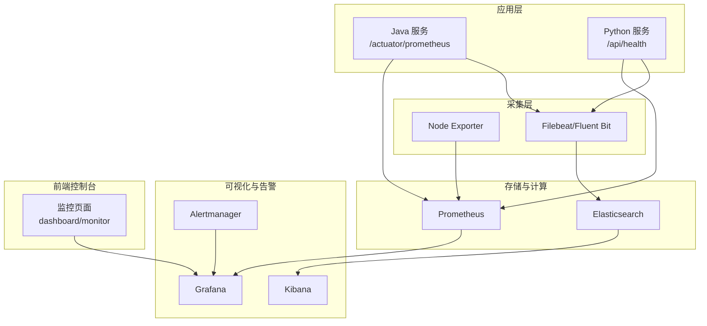
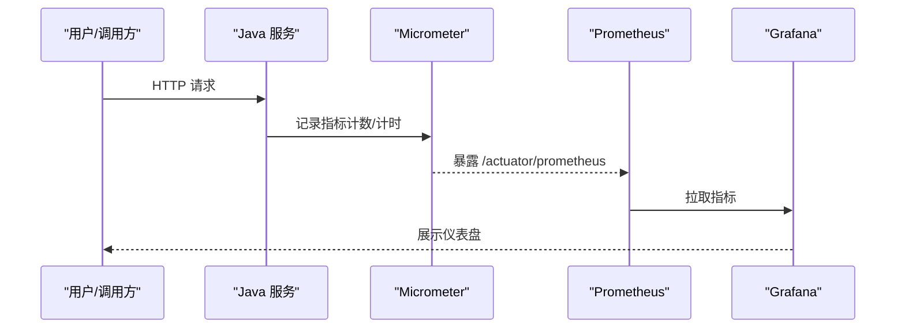
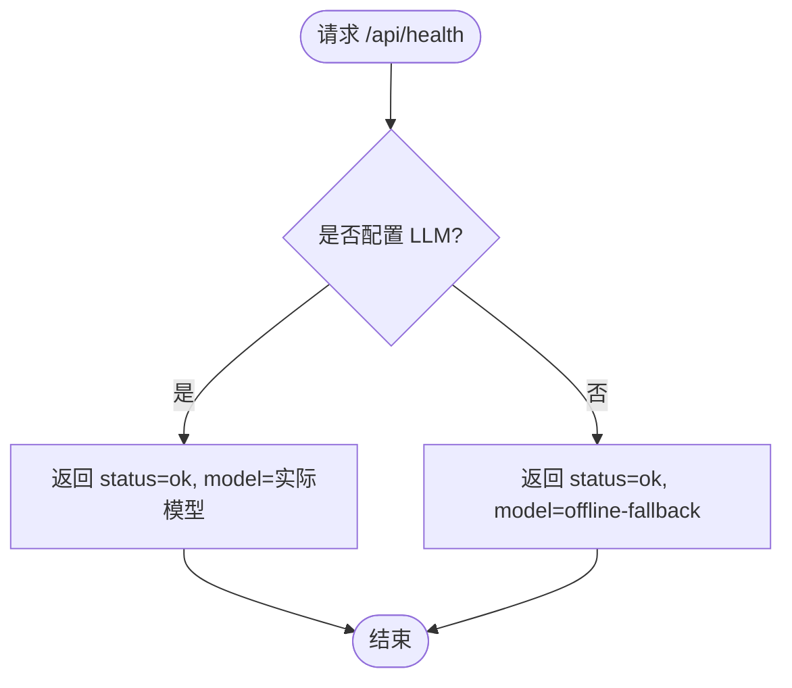
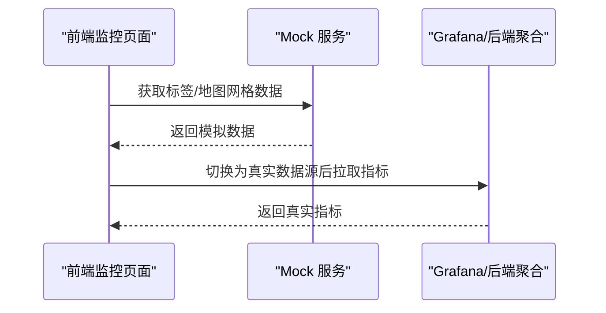
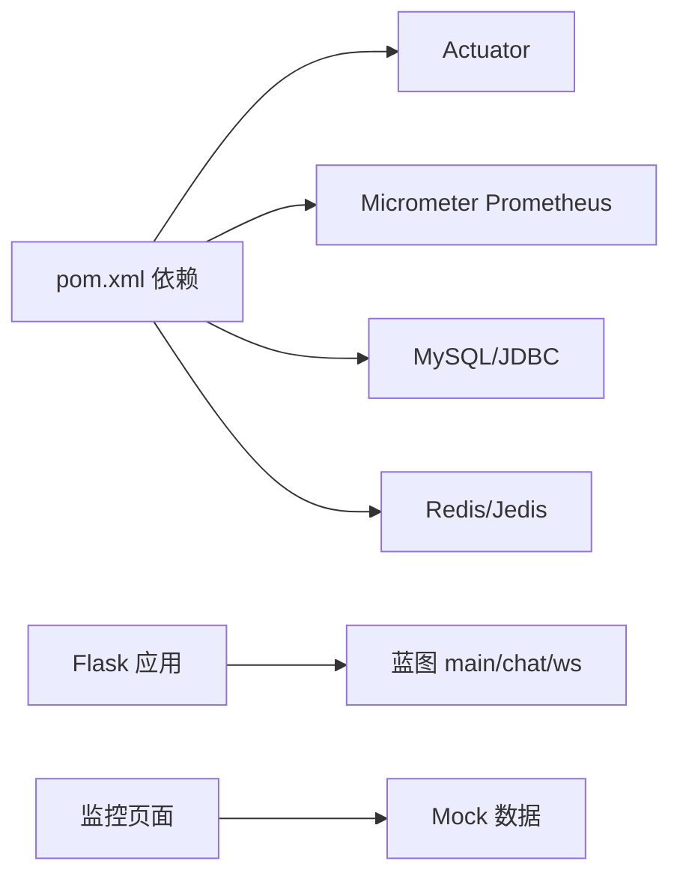

# 监控运维

<cite>
**本文引用的文件**
- [application.yaml](file://java_server/po/src/main/resources/application.yaml)
- [pom.xml](file://java_server/po/pom.xml)
- [app.py](file://py_server/app.py)
- [main.py](file://py_server/blueprints/main.py)
- [config.py](file://py_server/config.py)
- [index.tsx](file://web_client/po-admin/src/pages/dashboard/monitor/index.tsx)
- [_mock.ts](file://web_client/po-admin/src/pages/dashboard/monitor/_mock.ts)
- [index.ts](file://web_client/po-admin/cloudflare-worker/src/index.ts)
</cite>

## 目录
1. [简介](#简介)
2. [项目结构](#项目结构)
3. [核心组件](#核心组件)
4. [架构总览](#架构总览)
5. [详细组件分析](#详细组件分析)
6. [依赖关系分析](#依赖关系分析)
7. [性能与容量规划](#性能与容量规划)
8. [故障排查指南](#故障排查指南)
9. [结论](#结论)
10. [附录：落地清单](#附录：落地清单)

## 简介
本指南面向本仓库的多语言服务（Java Spring Boot、Python Flask、前端管理控制台），提供端到端的监控运维方案，覆盖应用性能监控、系统资源监控、业务指标采集、Prometheus 监控体系搭建、Grafana 可视化面板配置、告警规则设置、日志收集与分析（ELK）、健康检查接口、服务发现机制、故障自愈策略、容量规划、性能调优、灾难恢复、CI/CD 集成与自动化部署回滚，以及常见运维问题的诊断方法。

## 项目结构
本项目包含三个主要子系统：
- Java 后端服务：基于 Spring Boot，已启用 Actuator 与 Prometheus 指标暴露，提供 /actuator/prometheus 等端点。
- Python 后端服务：基于 Flask，提供基础路由与健康检查接口 /api/health。
- Web 前端控制台：Ant Design Pro 风格的管理后台，内置“监控”页面用于展示数据（当前使用 mock 数据）。

**图表来源**
- [application.yaml:1-109](file://java_server/po/src/main/resources/application.yaml#L1-L109)
- [app.py:1-51](file://py_server/app.py#L1-L51)
- [main.py:1-30](file://py_server/blueprints/main.py#L1-L30)
- [index.tsx:1-131](file://web_client/po-admin/src/pages/dashboard/monitor/index.tsx#L1-L131)
- [_mock.ts:1-27](file://web_client/po-admin/src/pages/dashboard/monitor/_mock.ts#L1-L27)

**章节来源**
- [application.yaml:1-109](file://java_server/po/src/main/resources/application.yaml#L1-L109)
- [app.py:1-51](file://py_server/app.py#L1-L51)
- [main.py:1-30](file://py_server/blueprints/main.py#L1-L30)
- [index.tsx:1-131](file://web_client/po-admin/src/pages/dashboard/monitor/index.tsx#L1-L131)
- [_mock.ts:1-27](file://web_client/po-admin/src/pages/dashboard/monitor/_mock.ts#L1-L27)

## 核心组件
- 应用性能监控（APM）
  - Java 侧通过 Actuator + Micrometer 暴露 JVM、HTTP、DB、Redis 等指标至 /actuator/prometheus。
  - Python 侧可接入 prom-client 或 flask-prometheus 以暴露自定义指标（建议扩展）。
- 系统资源监控
  - 通过 Node Exporter 采集主机 CPU、内存、磁盘、网络等指标。
- 业务指标收集
  - 在 Java 服务中埋点关键业务操作（如登录、下单、查询），通过 Micrometer 计数器/计时器上报。
  - 在 Python 服务中统计 LLM 调用耗时、错误率等。
- 日志收集与分析
  - Java 输出结构化日志到文件；建议接入 Filebeat/Fluent Bit -> Logstash/Elasticsearch -> Kibana。
  - Python 输出标准输出日志；容器化后可由 sidecar 或 DaemonSet 收集。
- 健康检查与服务发现
  - Java 暴露 /actuator/health；Python 暴露 /api/health。
  - 服务注册建议使用 Nacos 或 Consul（需按需引入依赖并配置）。
- 告警与可视化
  - Prometheus 抓取指标，Grafana 构建仪表盘，Alertmanager 发送告警。

**章节来源**
- [application.yaml:68-95](file://java_server/po/src/main/resources/application.yaml#L68-L95)
- [pom.xml:61-68](file://java_server/po/pom.xml#L61-L68)
- [main.py:22-29](file://py_server/blueprints/main.py#L22-L29)

## 架构总览
下图展示了从数据采集到可视化的完整链路，包括 Java/Python 应用、Prometheus、Grafana、Alertmanager、ELK 栈及前端控制台。

[此图为概念性架构图，不直接映射具体源码文件]

## 详细组件分析

### 组件A：Java 服务监控与指标
- 已启用 Actuator 的 health、info、metrics、prometheus 端点，便于 Prometheus 抓取。
- 通过 Micrometer 将 JVM、Tomcat、HikariCP、Redis、HTTP 请求等指标标准化暴露。
- 建议补充业务指标埋点（如登录成功次数、接口耗时直方图）。

**图表来源**
- [application.yaml:82-95](file://java_server/po/src/main/resources/application.yaml#L82-L95)
- [pom.xml:61-68](file://java_server/po/pom.xml#L61-L68)

**章节来源**
- [application.yaml:82-95](file://java_server/po/src/main/resources/application.yaml#L82-L95)
- [pom.xml:61-68](file://java_server/po/pom.xml#L61-L68)

### 组件B：Python 服务健康检查与可扩展指标
- 提供 /api/health，返回服务状态、是否配置 LLM、模型名称等。
- 建议在蓝图中增加 /metrics 端点，暴露 prom-client 指标（如请求数、延迟、错误率）。

**图表来源**
- [main.py:22-29](file://py_server/blueprints/main.py#L22-L29)

**章节来源**
- [main.py:22-29](file://py_server/blueprints/main.py#L22-L29)
- [app.py:1-51](file://py_server/app.py#L1-L51)
- [config.py:10-25](file://py_server/config.py#L10-L25)

### 组件C：前端监控页面与数据源
- 监控页面位于 dashboard/monitor，当前使用本地 mock 数据渲染图表。
- 生产环境应替换为真实指标数据源（如 Grafana API 或直接对接后端聚合接口）。

**图表来源**
- [index.tsx:1-131](file://web_client/po-admin/src/pages/dashboard/monitor/index.tsx#L1-L131)
- [_mock.ts:1-27](file://web_client/po-admin/src/pages/dashboard/monitor/_mock.ts#L1-L27)
- [index.ts:1-59](file://web_client/po-admin/cloudflare-worker/src/index.ts#L1-L59)

**章节来源**
- [index.tsx:1-131](file://web_client/po-admin/src/pages/dashboard/monitor/index.tsx#L1-L131)
- [_mock.ts:1-27](file://web_client/po-admin/src/pages/dashboard/monitor/_mock.ts#L1-L27)
- [index.ts:1-59](file://web_client/po-admin/cloudflare-worker/src/index.ts#L1-L59)

## 依赖关系分析
- Java 服务依赖：
  - spring-boot-starter-actuator：提供健康检查与指标端点。
  - micrometer-registry-prometheus：将指标暴露给 Prometheus。
  - HikariCP、Jedis、MySQL Connector：数据库与缓存连接。
- Python 服务依赖：
  - Flask、蓝图模块、环境变量配置。
- 前端：
  - Ant Design Pro 监控页面，当前使用 mock 数据，后续可对接真实数据源。

**图表来源**
- [pom.xml:33-84](file://java_server/po/pom.xml#L33-L84)
- [app.py:14-47](file://py_server/app.py#L14-L47)
- [_mock.ts:1-27](file://web_client/po-admin/src/pages/dashboard/monitor/_mock.ts#L1-L27)

**章节来源**
- [pom.xml:33-84](file://java_server/po/pom.xml#L33-L84)
- [app.py:14-47](file://py_server/app.py#L14-L47)
- [_mock.ts:1-27](file://web_client/po-admin/src/pages/dashboard/monitor/_mock.ts#L1-L27)

## 性能与容量规划
- 应用性能调优
  - Tomcat 线程与连接：根据并发峰值调整 max-threads、max-connections、accept-count。
  - 数据库连接池：合理设置最大连接数与空闲连接，避免连接耗尽。
  - Redis 连接池：控制最大活跃连接与超时时间，防止热点键导致抖动。
  - JVM 参数：堆大小、GC 策略、元空间、启动参数优化。
- 容量规划
  - 压测基线：通过 JMeter/Locust 对核心接口进行压测，确定 QPS、RT、CPU、内存阈值。
  - 水平扩展：无状态服务多副本部署，结合负载均衡与自动扩缩容。
  - 存储容量：日志、指标、历史数据的保留周期与磁盘规划。
- 灾难恢复
  - 备份策略：数据库全量+增量备份，对象存储归档。
  - 恢复演练：定期演练 RTO/RPO 目标，验证恢复流程。
  - 灰度发布：金丝雀发布与蓝绿部署，降低变更风险。

[本节为通用指导，不直接分析具体文件]

## 故障排查指南
- 常见问题定位
  - 服务不可用：检查 /actuator/health 与 /api/health 返回值。
  - 指标缺失：确认 Prometheus 抓取目标状态、服务暴露端点可达。
  - 日志缺失：检查日志轮转策略、磁盘空间、Filebeat/Fluent Bit 状态。
  - 高延迟：查看慢请求、数据库慢查询、Redis 大 Key、GC 停顿。
- 处理步骤
  - 快速止血：限流、降级、熔断、扩容。
  - 根因分析：结合指标、日志、链路追踪定位瓶颈。
  - 复盘改进：完善监控、告警、预案与自动化修复脚本。

[本节为通用指导，不直接分析具体文件]

## 结论
本项目已具备基础的监控能力：Java 服务通过 Actuator 暴露指标，Python 服务提供健康检查，前端具备监控页面框架。建议按本指南逐步补齐 Prometheus/Grafana/Alertmanager、ELK 日志体系、服务发现与告警联动，形成闭环的可观测性与自动化运维能力。

[本节为总结性内容，不直接分析具体文件]

## 附录：落地清单
- Prometheus 监控体系搭建
  - 配置 scrape_configs 抓取 /actuator/prometheus 与 Node Exporter。
  - 设置全局抓取间隔、超时、标签。
- Grafana 可视化面板配置
  - 导入官方 JVM/Tomcat/MySQL/Redis 面板。
  - 创建业务指标面板（登录成功率、接口 RT、错误率）。
- 告警规则设置
  - 定义关键指标阈值（CPU、内存、磁盘、错误率、延迟）。
  - 配置 Alertmanager 通知渠道（邮件、企业微信、钉钉）。
- 日志收集与分析（ELK）
  - 安装 Filebeat/Fluent Bit 采集应用日志。
  - 配置 Logstash 解析与索引策略。
  - 在 Kibana 建立索引模式与看板。
- 健康检查接口实现
  - Java：/actuator/health（已启用）。
  - Python：/api/health（已实现）。
- 服务发现机制
  - 引入 Nacos/Consul，注册服务实例，动态刷新配置。
- 故障自愈策略
  - 基于健康检查的自动重启与滚动更新。
  - 异常流量下的自动降级与熔断。
- CI/CD 流水线集成
  - 代码扫描、单元测试、构建镜像、推送镜像仓库。
  - 自动化部署到测试/生产环境，支持回滚。
- 回滚策略
  - 版本标记与快照，一键回滚到上一稳定版本。
  - 灰度发布与快速切流。

[本节为实施清单，不直接分析具体文件]