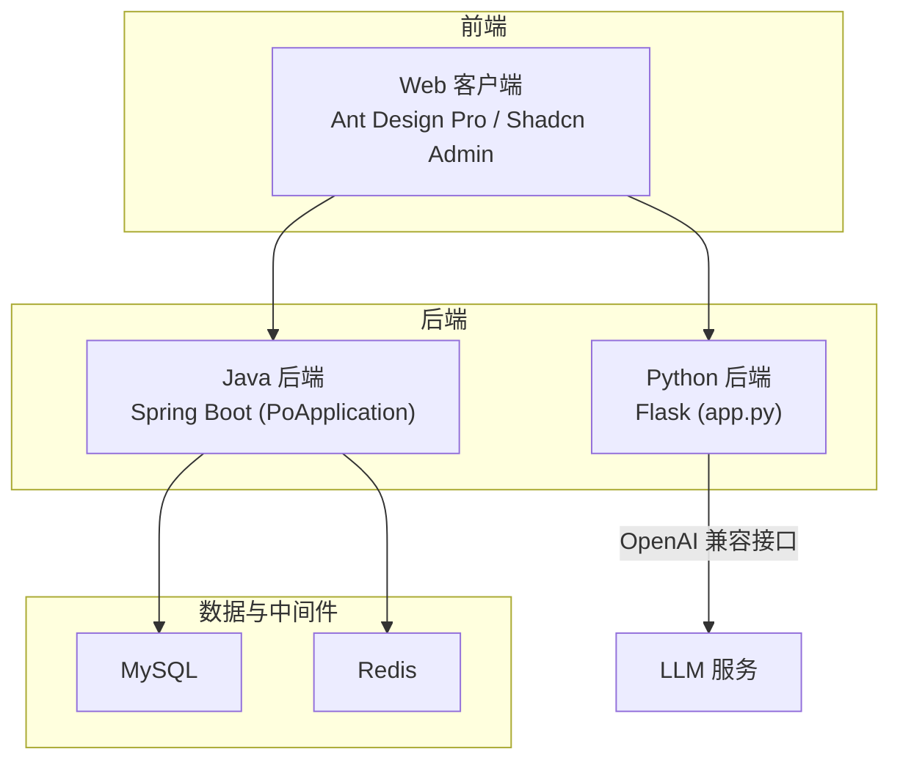
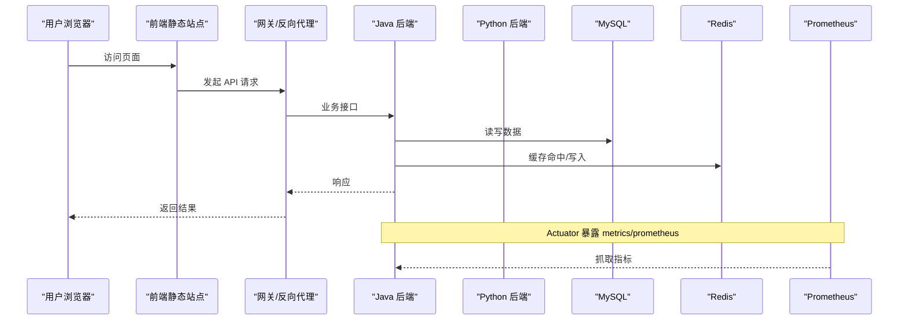
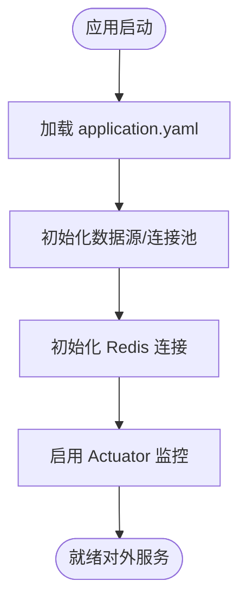
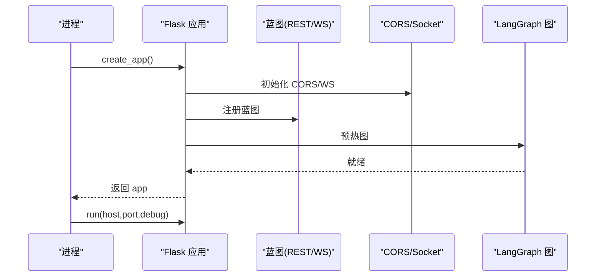
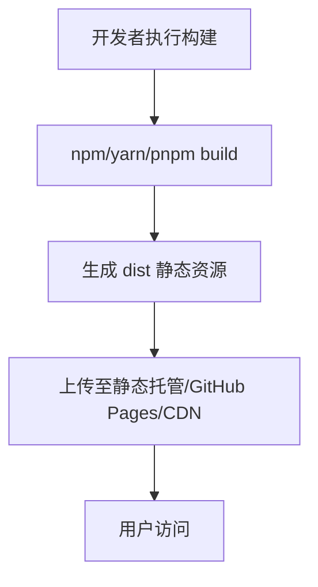
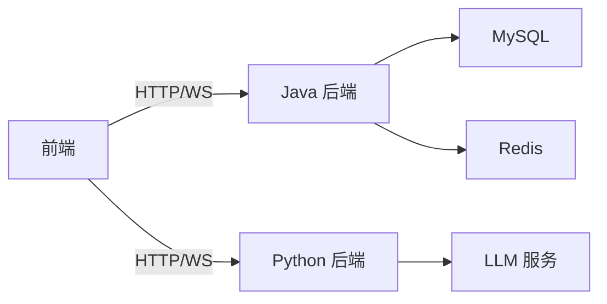

# 部署指南

<cite>
**本文引用的文件**
- [java_server/po/src/main/resources/application.yaml](file://java_server/po/src/main/resources/application.yaml)
- [java_server/po/pom.xml](file://java_server/po/pom.xml)
- [java_server/po/src/main/java/com/goodzheng/po/PoApplication.java](file://java_server/po/src/main/java/com/goodzheng/po/PoApplication.java)
- [py_server/app.py](file://py_server/app.py)
- [py_server/config.py](file://py_server/config.py)
- [py_server/requirements.txt](file://py_server/requirements.txt)
- [web_client/po-admin/package.json](file://web_client/po-admin/package.json)
- [web_client/po-admin/config/proxy.ts](file://web_client/po-admin/config/proxy.ts)
- [web_client/po-admin/.github/workflows/ci.yml](file://web_client/po-admin/.github/workflows/ci.yml)
- [web_client/po-admin/.github/workflows/deploy.yml](file://web_client/po-admin/.github/workflows/deploy.yml)
- [web_client/shadcn-admin/netlify.toml](file://web_client/shadcn-admin/netlify.toml)
</cite>

## 目录
1. [简介](#简介)
2. [项目结构](#项目结构)
3. [核心组件](#核心组件)
4. [架构总览](#架构总览)
5. [详细组件分析](#详细组件分析)
6. [依赖关系分析](#依赖关系分析)
7. [性能考虑](#性能考虑)
8. [故障排查指南](#故障排查指南)
9. [结论](#结论)
10. [附录：环境与模板](#附录环境与模板)

## 简介
本指南面向生产环境，覆盖 Docker 容器化、云服务部署与本地生产配置；详细说明环境变量、数据库连接、第三方服务集成；给出负载均衡、缓存策略、监控告警的配置建议；提供 CI/CD 流水线示例与自动化部署流程；并包含性能优化、安全加固与故障恢复方案。文档同时为开发、测试、生产三类环境提供可落地的配置模板与最佳实践。

## 项目结构
本项目由三部分组成：
- Java 后端（Spring Boot）：提供 REST API、JPA/MyBatis-Plus、Redis 缓存、Actuator 监控与 Prometheus 指标暴露。
- Python 后端（Flask + LangChain/LangGraph）：提供聊天对话的 REST 与 WebSocket 接口，支持 OpenAI 兼容 LLM。
- Web 前端（Ant Design Pro / Shadcn Admin）：构建静态资源并通过 CDN/对象存储或反向代理提供服务。

**图表来源**
- [java_server/po/src/main/java/com/goodzheng/po/PoApplication.java:1-14](file://java_server/po/src/main/java/com/goodzheng/po/PoApplication.java#L1-L14)
- [py_server/app.py:1-51](file://py_server/app.py#L1-L51)
- [java_server/po/src/main/resources/application.yaml:1-109](file://java_server/po/src/main/resources/application.yaml#L1-L109)

**章节来源**
- [java_server/po/src/main/java/com/goodzheng/po/PoApplication.java:1-14](file://java_server/po/src/main/java/com/goodzheng/po/PoApplication.java#L1-L14)
- [py_server/app.py:1-51](file://py_server/app.py#L1-L51)
- [java_server/po/src/main/resources/application.yaml:1-109](file://java_server/po/src/main/resources/application.yaml#L1-L109)

## 核心组件
- Java 后端
  - 应用入口：Spring Boot 启动类，默认监听端口与上下文路径在配置中定义。
  - 数据访问：JPA/Hibernate + MySQL；可选 MyBatis-Plus。
  - 缓存：Redis（Jedis）。
  - 监控：Actuator 暴露 health/info/metrics/prometheus。
  - 安全：JWT 密钥与过期时间。
- Python 后端
  - 应用工厂：创建 Flask 应用、注册蓝图、初始化 CORS 与 WebSocket。
  - 配置：通过 .env 与环境变量加载 SECRET_KEY、HOST、PORT、DEBUG 及 LLM 相关参数。
  - 依赖：Flask、LangChain/LangGraph、OpenAI 兼容接口。
- 前端
  - 构建脚本与运行命令在 package.json 中定义。
  - 代理配置用于开发/测试环境转发到后端。

**章节来源**
- [java_server/po/src/main/resources/application.yaml:1-109](file://java_server/po/src/main/resources/application.yaml#L1-L109)
- [java_server/po/pom.xml:1-163](file://java_server/po/pom.xml#L1-L163)
- [py_server/app.py:1-51](file://py_server/app.py#L1-L51)
- [py_server/config.py:1-25](file://py_server/config.py#L1-L25)
- [py_server/requirements.txt:1-13](file://py_server/requirements.txt#L1-L13)
- [web_client/po-admin/package.json:1-132](file://web_client/po-admin/package.json#L1-L132)
- [web_client/po-admin/config/proxy.ts:1-42](file://web_client/po-admin/config/proxy.ts#L1-L42)

## 架构总览
下图展示请求从浏览器到前后端再到数据库与缓存的完整链路，以及监控指标的采集点。

**图表来源**
- [java_server/po/src/main/resources/application.yaml:82-94](file://java_server/po/src/main/resources/application.yaml#L82-L94)
- [java_server/po/pom.xml:62-68](file://java_server/po/pom.xml#L62-L68)

## 详细组件分析

### Java 后端（Spring Boot）
- 启动与路由
  - 应用入口为 Spring Boot 主类，默认端口与上下文路径由配置文件控制。
- 数据库与连接池
  - 使用 HikariCP 管理连接池，需根据并发与查询特征调整最大连接数与超时。
- 缓存
  - Redis 作为缓存层，注意密码、超时与连接池大小。
- 监控
  - Actuator 暴露健康检查与 Prometheus 指标，便于接入监控系统。
- 安全
  - JWT 密钥与过期时间需在生产环境使用强随机值与合理过期策略。

**图表来源**
- [java_server/po/src/main/resources/application.yaml:1-109](file://java_server/po/src/main/resources/application.yaml#L1-L109)
- [java_server/po/pom.xml:62-68](file://java_server/po/pom.xml#L62-L68)

**章节来源**
- [java_server/po/src/main/java/com/goodzheng/po/PoApplication.java:1-14](file://java_server/po/src/main/java/com/goodzheng/po/PoApplication.java#L1-L14)
- [java_server/po/src/main/resources/application.yaml:1-109](file://java_server/po/src/main/resources/application.yaml#L1-L109)
- [java_server/po/pom.xml:1-163](file://java_server/po/pom.xml#L1-L163)

### Python 后端（Flask + LLM）
- 应用工厂
  - 创建 Flask 应用，注册蓝图，初始化 CORS 与 WebSocket。
  - 启动时预编译 LangGraph 图，以便尽早暴露配置问题。
- 配置与环境变量
  - 通过 .env 与环境变量注入 SECRET_KEY、HOST、PORT、DEBUG 以及 LLM 相关参数。
- 依赖
  - Flask、LangChain/LangGraph、OpenAI 兼容接口。

**图表来源**
- [py_server/app.py:1-51](file://py_server/app.py#L1-L51)
- [py_server/config.py:1-25](file://py_server/config.py#L1-L25)

**章节来源**
- [py_server/app.py:1-51](file://py_server/app.py#L1-L51)
- [py_server/config.py:1-25](file://py_server/config.py#L1-L25)
- [py_server/requirements.txt:1-13](file://py_server/requirements.txt#L1-L13)

### 前端（构建与部署）
- 构建与脚本
  - 通过 package.json 中的脚本进行开发与构建。
- 代理配置
  - 开发/测试环境通过 proxy.ts 将 /api 转发至后端地址。
- 静态站点托管
  - 可通过 GitHub Pages、Netlify 等静态托管服务发布。

**图表来源**
- [web_client/po-admin/package.json:1-132](file://web_client/po-admin/package.json#L1-L132)
- [web_client/po-admin/config/proxy.ts:1-42](file://web_client/po-admin/config/proxy.ts#L1-L42)
- [web_client/shadcn-admin/netlify.toml:1-4](file://web_client/shadcn-admin/netlify.toml#L1-L4)

**章节来源**
- [web_client/po-admin/package.json:1-132](file://web_client/po-admin/package.json#L1-L132)
- [web_client/po-admin/config/proxy.ts:1-42](file://web_client/po-admin/config/proxy.ts#L1-L42)
- [web_client/shadcn-admin/netlify.toml:1-4](file://web_client/shadcn-admin/netlify.toml#L1-L4)

## 依赖关系分析
- 外部依赖
  - MySQL：持久化数据存储。
  - Redis：缓存与会话/热点数据。
  - LLM（OpenAI 兼容）：Python 后端的对话能力。
  - 监控：Prometheus（通过 Micrometer 暴露指标）。
- 内部耦合
  - 前端依赖后端 REST/WS 接口。
  - Java 后端依赖 MySQL 与 Redis。
  - Python 后端依赖 LLM 服务。

**图表来源**
- [java_server/po/src/main/resources/application.yaml:23-52](file://java_server/po/src/main/resources/application.yaml#L23-L52)
- [py_server/config.py:10-25](file://py_server/config.py#L10-L25)

**章节来源**
- [java_server/po/src/main/resources/application.yaml:23-52](file://java_server/po/src/main/resources/application.yaml#L23-L52)
- [py_server/config.py:10-25](file://py_server/config.py#L10-L25)

## 性能考虑
- 连接池与线程
  - 调整 Tomcat 线程与连接池大小，结合压测确定上限。
  - 关注数据库连接池的最大连接数与空闲连接回收策略。
- 缓存策略
  - 对读多写少的热点数据优先走 Redis；设置合理的 TTL 与失效策略。
  - 静态资源开启浏览器缓存与 CDN 缓存。
- 监控与观测
  - 启用 Actuator 的 health、metrics、prometheus；配合 Grafana/Prometheus 可视化。
  - 收集 JVM 指标、GC 耗时、慢查询日志。
- 资源限制
  - 容器化时设置 CPU/Memory 限制，避免 OOM。
  - 文件上传大小限制需与业务匹配。

[本节为通用性能建议，不直接引用具体代码]

## 故障排查指南
- 启动失败
  - 检查数据库/Redis 连通性与凭据；确认端口未被占用。
  - Python 后端启动时会预编译 LangGraph 图，若配置错误会立即暴露。
- 接口异常
  - 查看 Actuator 健康检查与日志；核对 JWT 密钥与过期时间。
  - 检查 CORS 与跨域配置是否满足前端域名。
- 性能问题
  - 通过 Prometheus 指标定位瓶颈（CPU、内存、GC、慢查询）。
  - 检查连接池耗尽、Redis 大 Key、未命中导致的回源压力。
- 日志与审计
  - 集中收集应用日志与访问日志；设置保留策略与告警阈值。

**章节来源**
- [java_server/po/src/main/resources/application.yaml:82-94](file://java_server/po/src/main/resources/application.yaml#L82-L94)
- [py_server/app.py:41-47](file://py_server/app.py#L41-L47)

## 结论
本指南基于仓库现有配置与依赖，给出了生产环境的容器化、云服务与本地部署方案，涵盖环境变量、数据库与缓存、监控告警、CI/CD、性能与安全等关键主题。建议按“先稳定、再扩展”的原则逐步落地，并在上线前完成容量规划与演练。

## 附录：环境与模板

### 环境变量清单（推荐）
- Java 后端
  - 服务器：SERVER_PORT、SERVER_SERVLET_CONTEXT-PATH
  - 数据库：SPRING_DATASOURCE_URL、SPRING_DATASOURCE_USERNAME、SPRING_DATASOURCE_PASSWORD
  - 缓存：SPRING_REDIS_HOST、SPRING_REDIS_PORT、SPRING_REDIS_PASSWORD
  - 监控：MANAGEMENT_ENDPOINTS_WEB_EXPOSURE_INCLUDE
  - 安全：JWT_SECRET、JWT_EXPIRATION
- Python 后端
  - 服务：SECRET_KEY、HOST、PORT、DEBUG
  - LLM：OPENAI_API_KEY、OPENAI_BASE_URL、OPENAI_MODEL
- 前端
  - 构建：NODE_ENV、UMI_ENV（如适用）
  - 代理：TEST/Pre 目标地址（proxy.ts）

**章节来源**
- [java_server/po/src/main/resources/application.yaml:4-109](file://java_server/po/src/main/resources/application.yaml#L4-L109)
- [py_server/config.py:10-25](file://py_server/config.py#L10-L25)
- [web_client/po-admin/config/proxy.ts:24-41](file://web_client/po-admin/config/proxy.ts#L24-L41)

### 数据库连接设置（MySQL）
- 使用连接池（HikariCP），生产环境建议：
  - 最大连接数根据并发与数据库承载能力评估。
  - 连接超时与空闲回收策略需与数据库侧保持一致。
- 时区与字符集：确保与业务一致（Asia/Shanghai、utf8mb4）。

**章节来源**
- [java_server/po/src/main/resources/application.yaml:23-33](file://java_server/po/src/main/resources/application.yaml#L23-L33)

### 缓存策略（Redis）
- 连接与认证：配置 host/port/password，设置合适的 timeout。
- 连接池：根据 QPS 调整 max-active/max-idle。
- 缓存设计：热点数据优先缓存；设置合理 TTL；避免大 Key。

**章节来源**
- [java_server/po/src/main/resources/application.yaml:43-52](file://java_server/po/src/main/resources/application.yaml#L43-L52)

### 第三方服务集成（LLM）
- Python 后端通过环境变量注入 OPENAI_API_KEY、OPENAI_BASE_URL、OPENAI_MODEL。
- 未配置 Key 时可降级为离线演示模式，便于联调。

**章节来源**
- [py_server/config.py:20-25](file://py_server/config.py#L20-L25)

### 负载均衡与反向代理
- 建议使用 Nginx/云负载均衡器：
  - 对 Java 与 Python 服务分别做健康检查与权重分配。
  - 统一 HTTPS 终止与静态资源缓存。
  - 针对长连接（WebSocket）启用相应协议支持。

[本节为通用实践，不直接引用具体代码]

### 监控与告警
- 启用 Actuator 的 health、info、metrics、prometheus。
- 采集 JVM、系统与应用指标，结合 Prometheus+Grafana 可视化。
- 设置关键指标告警：错误率、延迟、连接池使用率、Redis 命中率等。

**章节来源**
- [java_server/po/src/main/resources/application.yaml:82-94](file://java_server/po/src/main/resources/application.yaml#L82-L94)
- [java_server/po/pom.xml:62-68](file://java_server/po/pom.xml#L62-L68)

### CI/CD 流水线示例
- 前端 CI
  - 安装依赖、类型检查、构建产物。
  - 多平台矩阵构建，设置 Node 版本与缓存。
- 前端部署
  - 构建后将 dist 发布到 GitHub Pages（或静态托管）。
- 建议补充
  - 后端镜像构建与推送（Docker）。
  - 自动滚动更新与回滚策略。
  - 制品库与签名校验。

**章节来源**
- [web_client/po-admin/.github/workflows/ci.yml:1-56](file://web_client/po-admin/.github/workflows/ci.yml#L1-L56)
- [web_client/po-admin/.github/workflows/deploy.yml:1-32](file://web_client/po-admin/.github/workflows/deploy.yml#L1-L32)

### 容器化部署（Docker）
- Java 后端
  - 基础镜像选择 JDK 17 精简版。
  - 挂载日志目录与配置文件；通过环境变量覆盖敏感信息。
  - 设置健康检查与资源限制。
- Python 后端
  - 基础镜像选择 Python 3.x。
  - 安装依赖（requirements.txt），以 gunicorn/uwsgi 等 WSGI 服务器运行。
  - 通过 .env 注入配置。
- 前端
  - 构建阶段使用 Node 22，产出静态资源；最终镜像仅包含 Nginx 与 dist。

[本节为通用实践，不直接引用具体代码]

### 安全加固措施
- 密钥管理：JWT 密钥、数据库密码、Redis 密码必须来自密钥管理服务或环境变量，禁止硬编码。
- 最小权限：数据库账号仅授予必要权限；网络隔离（内网访问数据库/缓存）。
- 传输安全：全站 HTTPS；禁用不安全协议。
- 输入校验：服务端校验所有入参；限制文件大小与请求体大小。
- 日志脱敏：避免记录敏感信息。

**章节来源**
- [java_server/po/src/main/resources/application.yaml:96-109](file://java_server/po/src/main/resources/application.yaml#L96-L109)
- [py_server/config.py:10-18](file://py_server/config.py#L10-L18)

### 故障恢复方案
- 备份与恢复：数据库定期快照；重要配置与密钥纳入版本管理与备份。
- 灰度与回滚：发布前灰度验证；支持一键回滚到上一稳定版本。
- 熔断与降级：对第三方服务（LLM）设置超时与重试上限；不可用时降级为离线模式。
- 自愈：容器编排平台自动重启失败实例；健康检查剔除异常节点。

[本节为通用实践，不直接引用具体代码]

### 不同环境的配置模板与最佳实践
- 开发环境
  - 本地数据库与 Redis；调试开关开启；日志级别更详细。
  - 前端代理指向本地后端。
- 测试环境
  - 独立数据库与缓存；关闭调试；严格校验。
  - 自动化测试与质量门禁。
- 生产环境
  - 高可用数据库与缓存集群；限流与熔断；全量监控与告警。
  - 密钥与证书集中管理；最小权限与网络隔离。

**章节来源**
- [web_client/po-admin/config/proxy.ts:24-41](file://web_client/po-admin/config/proxy.ts#L24-L41)
- [java_server/po/src/main/resources/application.yaml:16-21](file://java_server/po/src/main/resources/application.yaml#L16-L21)
- [py_server/config.py:10-18](file://py_server/config.py#L10-L18)