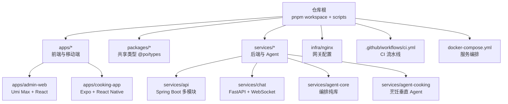
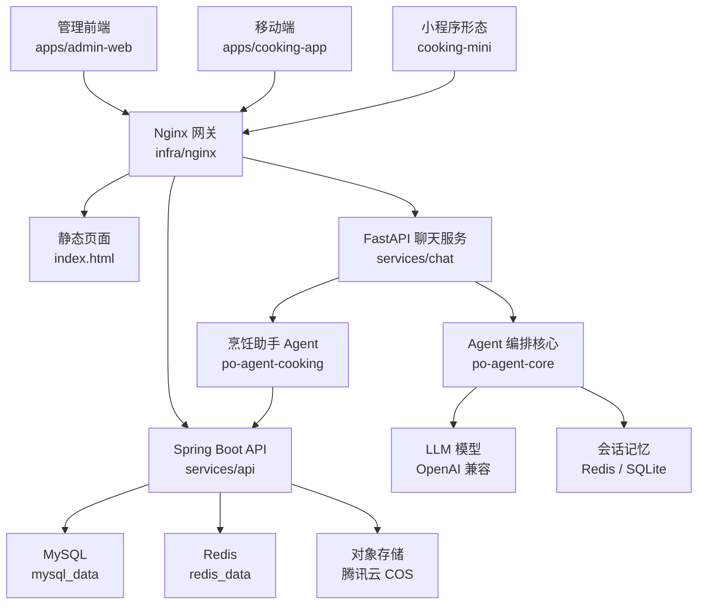
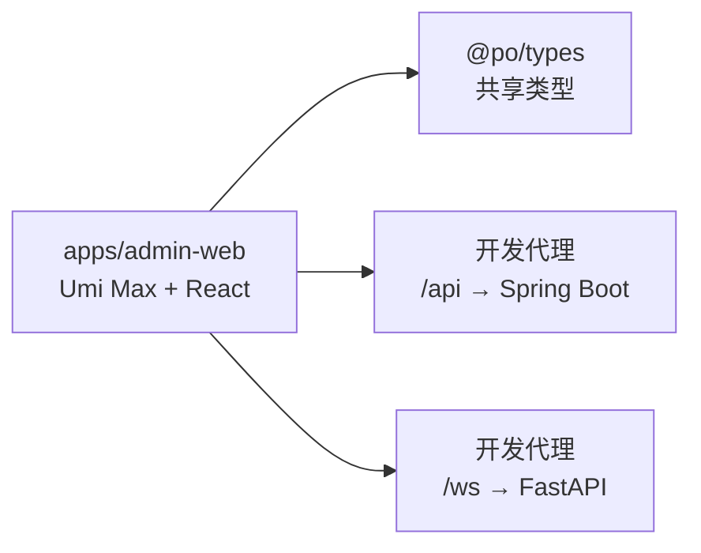
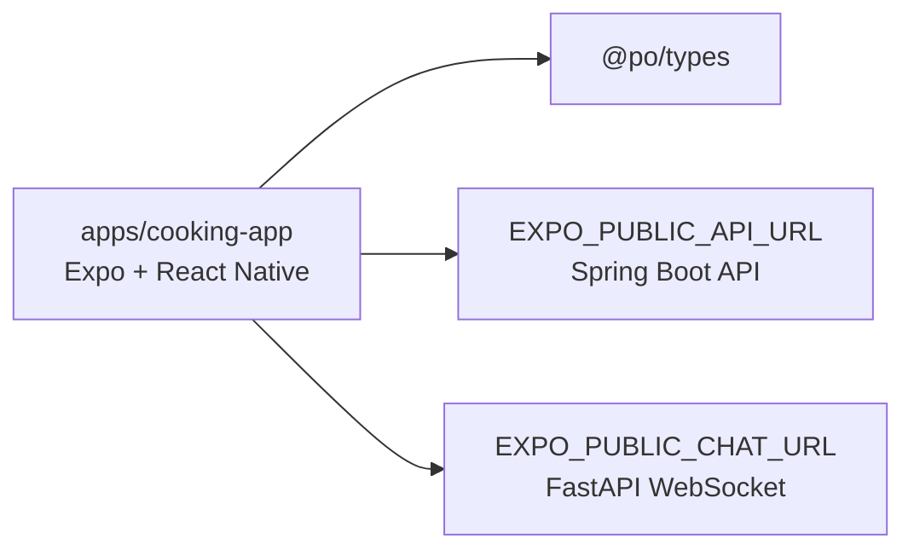
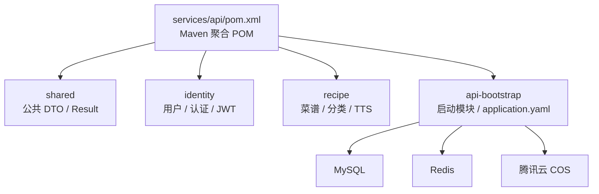
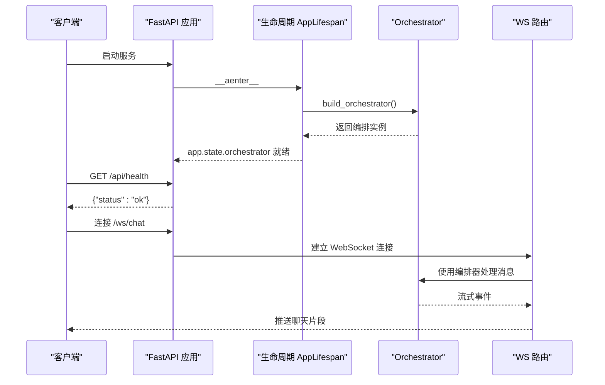
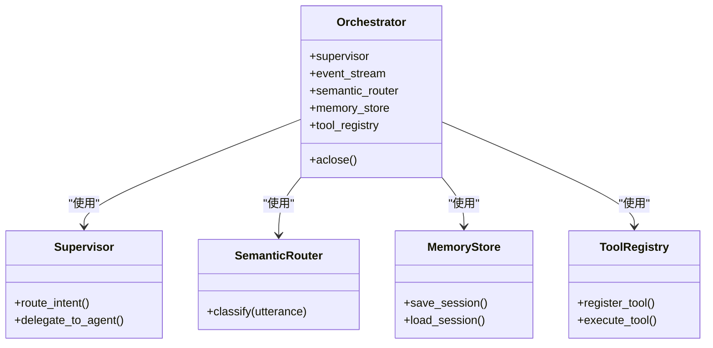
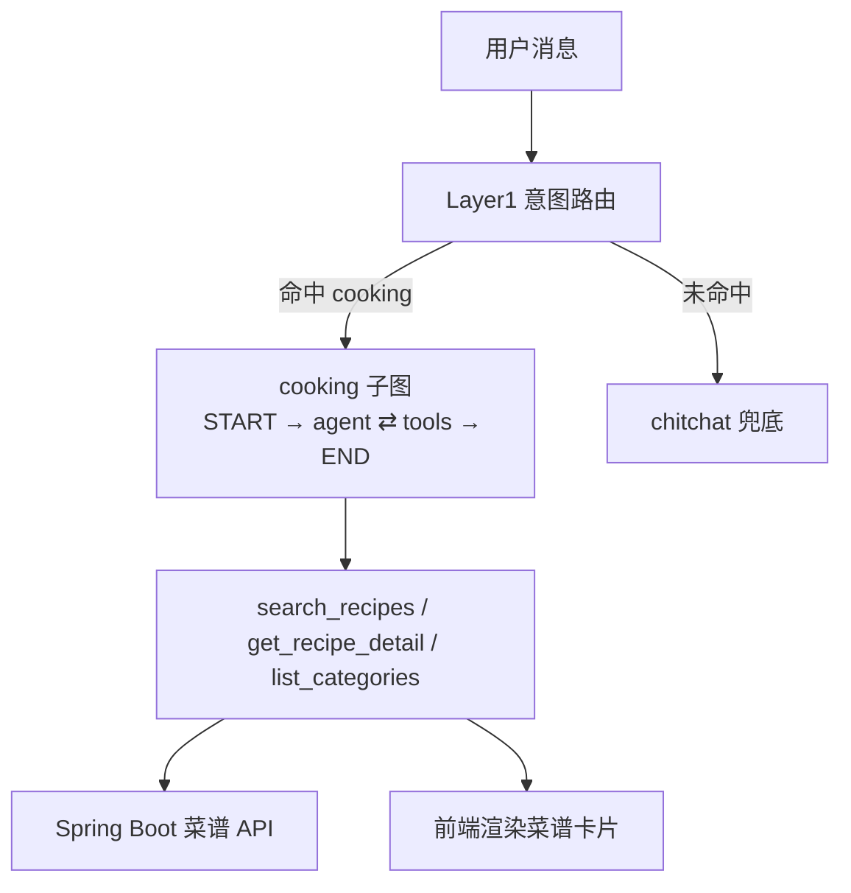
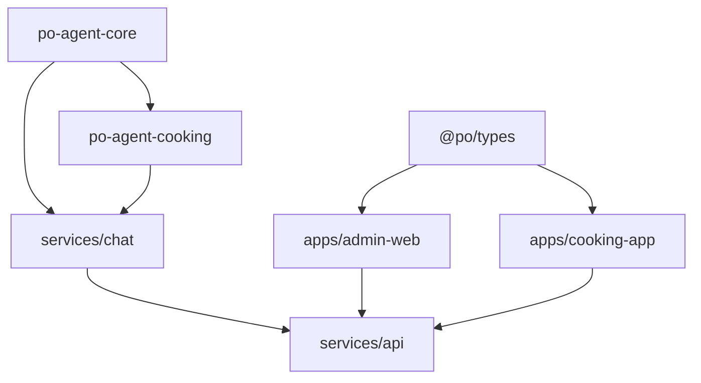

# 项目概述

<cite>
**本文引用的文件**   
- [README.md](file://README.md)
- [package.json](file://package.json)
- [pnpm-workspace.yaml](file://pnpm-workspace.yaml)
- [docker-compose.yml](file://docker-compose.yml)
- [services/api/pom.xml](file://services/api/pom.xml)
- [packages/types/src/index.ts](file://packages/types/src/index.ts)
- [apps/admin-web/package.json](file://apps/admin-web/package.json)
- [apps/cooking-app/package.json](file://apps/cooking-app/package.json)
- [services/chat/app/main.py](file://services/chat/app/main.py)
- [services/agent-core/README.md](file://services/agent-core/README.md)
- [services/agent-cooking/README.md](file://services/agent-cooking/README.md)
</cite>

## 目录
1. [引言](#引言)
2. [项目结构](#项目结构)
3. [核心组件](#核心组件)
4. [架构总览](#架构总览)
5. [详细组件分析](#详细组件分析)
6. [依赖关系分析](#依赖关系分析)
7. [性能与可靠性特性](#性能与可靠性特性)
8. [快速开始指南](#快速开始指南)
9. [故障排查](#故障排查)
10. [结论](#结论)

## 引言
PO 烹饪助手是一个面向“智能烹饪 + 菜谱管理 + 用户认证”的全栈 Monorepo。它把前端管理端、移动端、共享类型、后端业务 API、流式聊天服务、Agent 编排库和部署编排放在同一个仓库中，通过 pnpm workspace 与 Maven reactor 统一构建、测试和发布。

项目的核心目标包括：
- **智能烹饪助手**：基于 LangGraph 的 ReAct 子图，结合意图路由、记忆与会话持久化，为用户提供“找菜 → 看细节 → 报分类”的对话式指导。
- **菜谱管理系统**：提供菜谱、分类、审核、收藏、TTS 语音等能力，由 Spring Boot 单体多模块后端承载。
- **用户认证系统**：支持账号注册登录、JWT、微信登录、角色与审批状态，为管理端与移动端提供身份基础。
- **跨平台体验**：管理端使用 Umi Max + React，移动端使用 Expo SDK + React Native，同时保留微信小程序形态的 `cooking-mini`。
- **可运维生产环境**：通过 Docker Compose 编排 MySQL、Redis、Spring Boot API、FastAPI 聊天服务和 Nginx 网关，实现一键启动与滚动更新。

选择这种多语言、多平台组合的原因在于：
- 前端生态成熟且职责清晰：Umi Max 适合后台管理，Expo 适合跨平台移动应用。
- Java/Spring Boot 在业务 API、权限、事务和数据一致性方面更稳健。
- Python/FastAPI/LangGraph 更适合流式 LLM 编排、异步 I/O 和 Agent 实验。
- Monorepo 能复用前后端共享类型、统一脚本、统一 CI 和统一部署配置。

**章节来源**
- [README.md:1-14](file://README.md#L1-L14)

## 项目结构
仓库采用分层 + 领域划分的 Monorepo 结构：
- `apps/*`：面向用户的客户端应用，包括管理前端 `admin-web` 和移动端 `cooking-app`。
- `packages/*`：跨语言或跨应用共享的类型包，当前主要是 TypeScript 类型 `@po/types`。
- `services/*`：服务端代码，包括 Spring Boot 业务 API、Python FastAPI 聊天宿主、Agent 编排核心库和烹饪垂直 Agent。
- `infra/nginx`：Nginx 网关配置。
- `scripts`：仓库根脚本，封装 Java、Python、移动端和部署命令。
- `.github/workflows/ci.yml`：持续集成流水线。
- `docker-compose.yml`：生产与服务编排。



**图表来源**
- [pnpm-workspace.yaml:1-5](file://pnpm-workspace.yaml#L1-L5)
- [docker-compose.yml:1-134](file://docker-compose.yml#L1-L134)

**章节来源**
- [pnpm-workspace.yaml:1-5](file://pnpm-workspace.yaml#L1-L5)
- [README.md:16-34](file://README.md#L16-L34)

## 核心组件
本项目可以抽象为以下核心组件：

| 组件 | 技术栈 | 主要职责 | 关键路径 |
| --- | --- | --- | --- |
| 管理前端 | Umi Max 4 + React 19 + Ant Design 6 + React Query 5 | 用户管理、菜谱管理、仪表盘、聊天入口 | `apps/admin-web` |
| 移动端 | Expo SDK 57 + React Native + expo-router + NativeWind | 菜谱浏览、AI 指导、个人中心、登录注册 | `apps/cooking-app` |
| 共享类型 | TypeScript 包 `@po/types` | 前后端共享 API、聊天、身份、菜谱类型 | `packages/types` |
| 业务 API | Java 17 + Spring Boot 4 + MyBatis-Plus + MySQL + Redis + JWT | 用户认证、菜谱 CRUD、分类、TTS、存储 | `services/api` |
| 聊天服务 | Python 3.11 + FastAPI + WebSocket + LangGraph | 流式聊天、意图路由、会话记忆、Agent 宿主 | `services/chat` |
| Agent 编排核心 | Python 纯库 `po-agent-core` | supervisor、事件流、语义路由、记忆、工具注册 | `services/agent-core` |
| 烹饪助手 Agent | Python 纯库 `po-agent-cooking` | 菜谱检索、详情、分类工具 + ReAct 子图 | `services/agent-cooking` |
| 网关与编排 | Nginx + Docker Compose | 静态资源托管、请求分流、健康检查、端口暴露 | `infra/nginx`、`docker-compose.yml` |

这些组件共同构成“前端 → 网关 → 业务 API / 聊天服务 → 数据库 / 缓存 / 外部模型”的完整链路。

**章节来源**
- [README.md:5-14](file://README.md#L5-L14)
- [services/agent-core/README.md:1-10](file://services/agent-core/README.md#L1-L10)
- [services/agent-cooking/README.md:1-35](file://services/agent-cooking/README.md#L1-L35)

## 架构总览
从用户请求到数据落盘，整体流程如下：



**图表来源**
- [docker-compose.yml:8-128](file://docker-compose.yml#L8-L128)
- [services/chat/app/main.py:1-76](file://services/chat/app/main.py#L1-L76)
- [services/agent-core/README.md:1-10](file://services/agent-core/README.md#L1-L10)
- [services/agent-cooking/README.md:1-35](file://services/agent-cooking/README.md#L1-L35)

### 请求分流规则
网关根据 URL 前缀决定上游：
- `/ws/chat`：转发到聊天服务的 WebSocket。
- `/api/health`、`/api/items/**`：转发到聊天服务的 REST 接口。
- `/api/**`（其余）：转发到 Spring Boot API。
- `/`：返回 Nginx 托管的前端静态资源，history 模式回退到 `index.html`。

```mermaid
flowchart TD
Start["请求进入 Nginx"] --> PathCheck{"路径匹配"}
PathCheck --> |"/ws/chat"| WSChat["转发到 chat:5090<br/>WebSocket"]
PathCheck --> |"/api/health" 或 "/api/items/**"| ChatREST["转发到 chat:5090<br/>FastAPI REST"]
PathCheck --> |"/api/**"| SpringApi["转发到 api:8080<br/>Spring Boot"]
PathCheck --> |"其他路径"| Static["返回静态 index.html"]
WSChat --> End["响应客户端"]
ChatREST --> End
SpringApi --> End
Static --> End
```

**图表来源**
- [README.md:36-44](file://README.md#L36-L44)

**章节来源**
- [README.md:16-44](file://README.md#L16-L44)
- [docker-compose.yml:115-128](file://docker-compose.yml#L115-L128)

## 详细组件分析

### 管理前端 apps/admin-web
管理端是 PO 的管理控制台，负责用户审批、菜谱编辑、分类管理和数据分析。它依赖 `@po/types` 中的共享类型，并通过 Umi Max 的代理机制在开发阶段将 `/api` 转发到 Spring Boot，将 `/ws` 转发到聊天服务。

关键点：
- 使用 Umi Max 4、React 19、Ant Design 6 和 React Query 5。
- 通过 `workspace:*` 引用 `@po/types`，保证前后端类型一致。
- 提供 lint、test、build、preview 等脚本，便于本地开发和 CI。



**图表来源**
- [apps/admin-web/package.json:1-128](file://apps/admin-web/package.json#L1-L128)
- [packages/types/src/index.ts:1-30](file://packages/types/src/index.ts#L1-L30)

**章节来源**
- [apps/admin-web/package.json:1-128](file://apps/admin-web/package.json#L1-L128)
- [packages/types/src/index.ts:1-30](file://packages/types/src/index.ts#L1-L30)

### 移动端 apps/cooking-app
移动端是面向普通用户的做菜助手，包含首页、分类、菜谱详情、AI 指导、个人中心等功能。它同样引用 `@po/types`，并通过环境变量控制 API 地址和聊天地址。

关键点：
- 使用 Expo SDK 57、React Native、expo-router 和 NativeWind。
- 支持 Android、iOS、Web 三种运行目标。
- “AI 指导”标签页连接聊天服务的 WebSocket；连接失败时回退到本地菜谱规则。



**图表来源**
- [apps/cooking-app/package.json:1-71](file://apps/cooking-app/package.json#L1-L71)
- [README.md:171-182](file://README.md#L171-L182)

**章节来源**
- [apps/cooking-app/package.json:1-71](file://apps/cooking-app/package.json#L1-L71)
- [README.md:171-192](file://README.md#L171-L192)

### 共享类型 packages/types
`@po/types` 是前后端契约的核心。它导出 API 分页结果、聊天帧、用户身份、菜谱实体等类型，避免前端手写接口定义导致的不一致。

关键点：
- 只暴露类型，不引入运行时逻辑。
- 被管理端和移动端以 `workspace:*` 引用。
- 类型覆盖 `api`、`chat`、`identity`、`recipe` 四个领域。

```mermaid
classDiagram
class PoTypes {
"+PageResponse"
"+Result"
"+ChatMessage"
"+ChatRequestParams"
"+LoginRequest"
"+UserItem"
"+Recipe"
"+RecipeCategory"
"+Step"
}
```

**图表来源**
- [packages/types/src/index.ts:1-30](file://packages/types/src/index.ts#L1-L30)

**章节来源**
- [packages/types/src/index.ts:1-30](file://packages/types/src/index.ts#L1-L30)

### 业务 API services/api
后端是 Spring Boot 4 的多模块单体，按领域划分为 `shared`、`identity`、`recipe`、`api-bootstrap`。父 POM 声明 Java 17、MyBatis-Plus 版本和 Lombok，只有 `api-bootstrap` 作为可执行应用启动。

关键点：
- 使用 Maven reactor 统一管理模块依赖和构建。
- `server.servlet.context-path=/api` 让所有后端接口带 `/api` 前缀。
- 通过环境变量注入数据库、Redis、JWT、TTS、COS 等配置。
- 默认不创建超管账号，可通过环境变量或注册页面初始化。



**图表来源**
- [services/api/pom.xml:1-96](file://services/api/pom.xml#L1-L96)
- [docker-compose.yml:44-82](file://docker-compose.yml#L44-L82)

**章节来源**
- [services/api/pom.xml:1-96](file://services/api/pom.xml#L1-L96)
- [README.md:139-151](file://README.md#L139-L151)
- [docker-compose.yml:44-82](file://docker-compose.yml#L44-L82)

### 聊天服务 services/chat
聊天服务是 FastAPI 宿主，负责装配 Orchestrator、挂载健康检查、REST 路由和 WebSocket 路由。它在启动生命周期中构建编排器，关闭时释放 checkpointer 连接。

关键点：
- REST 路由统一带 `/api` 前缀。
- WebSocket 路由 `/ws/chat` 不带 `/api`，以便前端单独代理。
- 支持 CORS，允许管理端和移动端跨域访问。
- 若 LLM 或 checkpointer 不可用，仍会降级为可用状态，保证服务可启动。



**图表来源**
- [services/chat/app/main.py:1-76](file://services/chat/app/main.py#L1-L76)

**章节来源**
- [services/chat/app/main.py:1-76](file://services/chat/app/main.py#L1-L76)

### Agent 编排核心 services/agent-core
`po-agent-core` 是框架无关的纯库，提供 supervisor、事件流翻译、语义路由、记忆、工具注册等能力。它禁止直接依赖 Web 框架，也不持有全局单例，所有重资源延迟创建。

关键点：
- 作为纯库供 `services/chat` 和未来独立 Agent 服务复用。
- 垂直 Agent 通过插槽接入，不包含业务领域知识。
- 支持 Redis 或 SQLite 作为 checkpointer。



**图表来源**
- [services/agent-core/README.md:1-10](file://services/agent-core/README.md#L1-L10)

**章节来源**
- [services/agent-core/README.md:1-10](file://services/agent-core/README.md#L1-L10)

### 烹饪助手 Agent services/agent-cooking
`po-agent-cooking` 是烹饪领域的垂直 Agent，把“找菜、看详情、报分类”封装成 ReAct 子图，并注册进聊天宿主的内置 Agent 列表。它不独立部署，也不含模型配置，模型走 agent-core 的角色槽位。

关键点：
- 通过 `build_cooking_agent` 暴露装配入口。
- 使用 HTTP 调用 Spring Boot 的菜谱接口作为工具。
- 未安装时宿主仍可启动，仅跳过该插槽。
- 模型或后端不可用时逐级降级。



**图表来源**
- [services/agent-cooking/README.md:13-23](file://services/agent-cooking/README.md#L13-L23)
- [services/agent-cooking/README.md:25-35](file://services/agent-cooking/README.md#L25-L35)

**章节来源**
- [services/agent-cooking/README.md:1-35](file://services/agent-cooking/README.md#L1-L35)

## 依赖关系分析
Monorepo 的依赖关系分为三层：
- **前端层**：`apps/admin-web` 和 `apps/cooking-app` 都依赖 `@po/types`。
- **Agent 层**：`services/agent-cooking` 依赖 `po-agent-core`，聊天宿主 `services/chat` 同时依赖两者。
- **部署层**：Docker Compose 编排 MySQL、Redis、API、Chat、Web，并按健康状态依赖启动。



**图表来源**
- [apps/admin-web/package.json:35-36](file://apps/admin-web/package.json#L35-L36)
- [apps/cooking-app/package.json:9-9](file://apps/cooking-app/package.json#L9-L9)
- [services/agent-cooking/pyproject.toml:6-13](file://services/agent-cooking/pyproject.toml#L6-L13)
- [services/agent-core/pyproject.toml:6-13](file://services/agent-core/pyproject.toml#L6-L13)
- [docker-compose.yml:44-128](file://docker-compose.yml#L44-L128)

**章节来源**
- [apps/admin-web/package.json:35-36](file://apps/admin-web/package.json#L35-L36)
- [apps/cooking-app/package.json:9-9](file://apps/cooking-app/package.json#L9-L9)
- [services/agent-core/pyproject.toml:1-29](file://services/agent-core/pyproject.toml#L1-L29)
- [services/agent-cooking/pyproject.toml:1-30](file://services/agent-cooking/pyproject.toml#L1-L30)
- [docker-compose.yml:44-128](file://docker-compose.yml#L44-L128)

## 性能与可靠性特性
- **健康检查与依赖顺序**：Compose 中 `api` 依赖 MySQL 和 Redis 健康状态，`chat` 依赖 Redis 和 API 健康状态，`web` 最后等待二者就绪后再启动。
- **降级策略**：
  - 聊天服务在未配置 LLM 或未配置有效密钥时降级为离线模式。
  - 意图路由未配置 embedding 时降级为本地关键词路由。
  - 移动端 AI 指导连不上聊天服务时回退到本地菜谱规则。
- **会话持久化**：Agent 核心支持 Redis 或 SQLite checkpointer，生产推荐 Redis Stack，因为 LangGraph 的 Redis checkpointer 需要 JSON 和搜索能力。
- **静态资源缓存**：Nginx 对带 hash 的资源设置长缓存，提升首屏和重复访问性能。
- **容器隔离**：只有 `web` 暴露宿主机端口，其余服务仅在 compose 网络内互通，降低攻击面。

**章节来源**
- [docker-compose.yml:24-42](file://docker-compose.yml#L24-L42)
- [docker-compose.yml:70-128](file://docker-compose.yml#L70-L128)
- [README.md:76-78](file://README.md#L76-L78)
- [README.md:182-182](file://README.md#L182-L182)

## 快速开始指南

### 首次部署
1. 复制环境变量模板并修改数据库与 JWT 配置。
2. 使用 Docker Compose 构建并启动全部服务。
3. 等待所有服务 healthy 后访问网关入口。
4. 冒烟验证 Spring Boot 健康接口、FastAPI 健康接口和用户注册接口。

**章节来源**
- [README.md:61-109](file://README.md#L61-L109)

### 本地开发
本地开发需要 Node ≥ 22、pnpm 10、JDK 17、Python 3.11，以及本地 MySQL 8.4 与 Redis。

推荐顺序：
1. 启动 Spring Boot API：`pnpm api:start`。
2. 启动 FastAPI 聊天服务：`pnpm chat:install && pnpm chat:start`。
3. 启动管理端：`pnpm admin:dev`。
4. 启动移动端：`cp apps/cooking-app/.env.example apps/cooking-app/.env && pnpm mobile:start`。

**章节来源**
- [README.md:124-192](file://README.md#L124-L192)

### 常用脚本
仓库根脚本统一了各子项目的构建、测试和启动命令：
- `pnpm types:build`：构建共享类型。
- `pnpm admin:dev` / `admin:build`：管理端开发与构建。
- `pnpm api:start` / `api:verify`：后端启动与验证。
- `pnpm chat:start` / `chat:test`：聊天服务启动与测试。
- `pnpm mobile:start` / `mobile:android` / `mobile:ios` / `mobile:web`：移动端开发。

**章节来源**
- [package.json:10-46](file://package.json#L10-L46)
- [README.md:196-217](file://README.md#L196-L217)

## 故障排查
常见问题与定位方式：

| 现象 | 可能原因 | 排查建议 |
| --- | --- | --- |
| 启动后无法访问管理端 | Nginx 未就绪或静态资源未构建 | 查看 `docker compose ps`，确认 `web` 健康；检查 `infra/nginx/nginx.conf` |
| Spring Boot 健康检查失败 | MySQL 或 Redis 未就绪 | 查看 `mysql`、`redis` 日志；确认 `.env` 中数据库密码和 Redis 密码 |
| 聊天服务启动成功但无 LLM 能力 | 未配置 LLM 或密钥无效 | 检查 `AGENT_CORE_LLM_*` 环境变量；服务会降级为离线模式 |
| 移动端 AI 指导无响应 | WebSocket 地址错误或代理未生效 | 检查 `EXPO_PUBLIC_CHAT_URL`；浏览器版走同源 `/api`，移动端需正确推导 5090 端口 |
| 菜谱接口调用失败 | 聊天服务内部工具调用 API 失败 | 检查 `COOKING_API_BASE_URL`；容器内应指向 `http://api:8080/api` |
| 提交代码被拒绝 | Husky + commitlint 钩子拦截 | 遵循 conventional commits，不要使用 `--no-verify` |

**章节来源**
- [docker-compose.yml:17-42](file://docker-compose.yml#L17-L42)
- [docker-compose.yml:75-113](file://docker-compose.yml#L75-L113)
- [README.md:88-122](file://README.md#L88-L122)
- [README.md:228-231](file://README.md#L228-L231)

## 结论
PO 烹饪助手全栈 Monorepo 通过清晰的职责划分和多技术栈组合，实现了“智能烹饪助手 + 菜谱管理 + 用户认证 + 跨平台前端 + 可运维部署”的完整闭环。Monorepo 的优势体现在：
- **代码共享**：`@po/types` 统一前后端类型契约。
- **统一构建流程**：pnpm workspace 管理前端与 Python 包，Maven reactor 管理 Java 模块。
- **统一测试与 CI**：前端、移动端、Java、Python 在同一流水线中验证。
- **统一部署**：Docker Compose 编排数据库、缓存、API、聊天服务和网关。
- **可演进架构**：Agent 核心与垂直 Agent 解耦，便于未来扩展更多领域 Agent。

对于新用户，建议先阅读 README 中的“首次部署”和“本地开发”，再根据自己关注的方向深入对应模块：前端关注 `apps/admin-web` 与 `apps/cooking-app`，后端关注 `services/api`，AI 能力关注 `services/chat`、`services/agent-core` 与 `services/agent-cooking`。