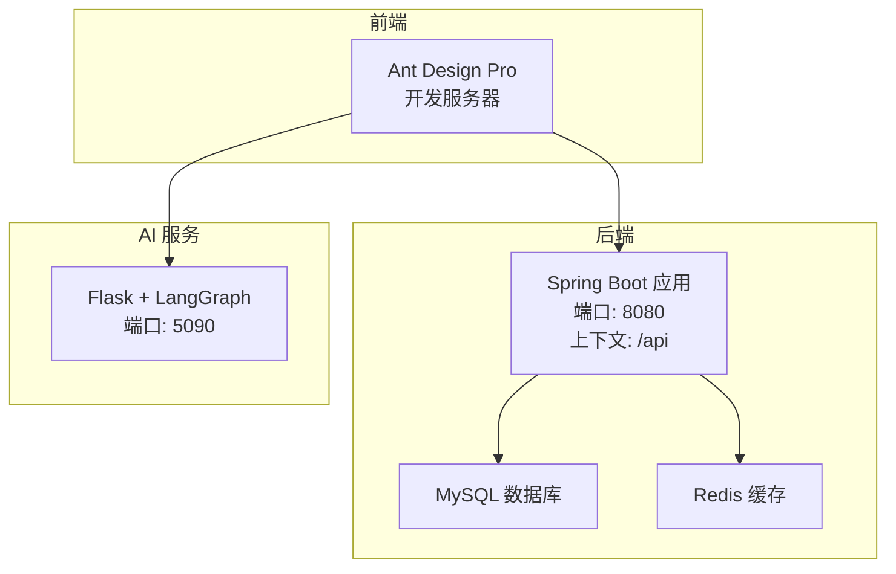
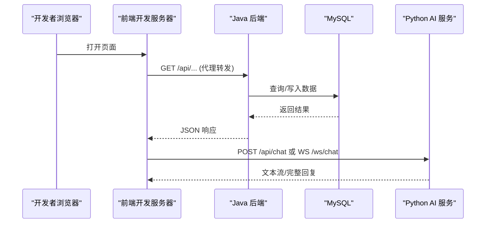
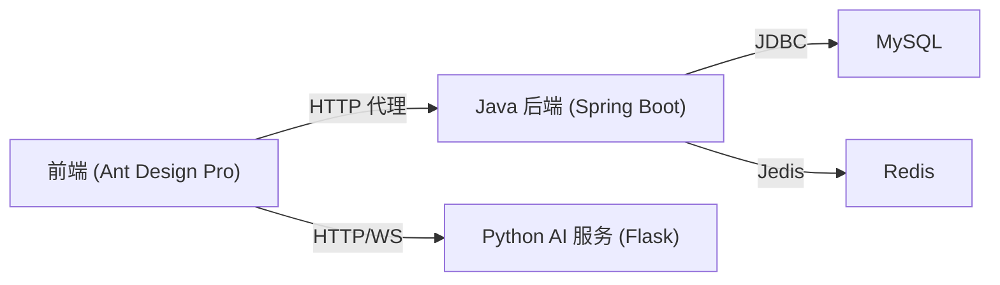

# 快速开始指南

<cite>
**本文引用的文件**
- [pom.xml](file://java_server/po/pom.xml)
- [application.yaml](file://java_server/po/src/main/resources/application.yaml)
- [PoApplication.java](file://java_server/po/src/main/java/com/goodzheng/po/PoApplication.java)
- [data-category.sql](file://java_server/po/src/main/resources/data-category.sql)
- [data-hunan.sql](file://java_server/po/src/main/resources/data-hunan.sql)
- [requirements.txt](file://py_server/requirements.txt)
- [config.py](file://py_server/config.py)
- [app.py](file://py_server/app.py)
- [package.json (po-admin)](file://web_client/po-admin/package.json)
- [proxy.ts](file://web_client/po-admin/config/proxy.ts)
</cite>

## 目录
1. [简介](#简介)
2. [项目结构](#项目结构)
3. [核心组件](#核心组件)
4. [架构总览](#架构总览)
5. [详细组件分析](#详细组件分析)
6. [依赖关系分析](#依赖关系分析)
7. [性能注意事项](#性能注意事项)
8. [故障排查指南](#故障排查指南)
9. [结论](#结论)
10. [附录：命令与配置模板](#附录：命令与配置模板)

## 简介
本指南面向新加入项目的开发者，提供从零到一搭建“破”项目开发环境的完整步骤。内容包括：
- 环境准备：Java JDK、Python、Node.js 版本要求
- 代码克隆与依赖安装
- 数据库初始化（MySQL）
- 服务启动顺序与配置：Java 后端、Python AI 服务、前端开发服务器
- 常见问题与解决方案：数据库连接、API 端口、环境变量等
- 验证安装成功的测试方法与调试技巧
- 完整的命令行操作示例与配置文件模板

## 项目结构
本项目由三个主要部分组成：
- Java 后端服务：Spring Boot 应用，提供 REST API、JPA/MyBatis-Plus 数据访问、Redis 缓存、Actuator 监控
- Python AI 服务：Flask + LangChain/LangGraph，提供聊天对话接口与 WebSocket 流式推送
- Web 前端：Ant Design Pro（Umi Max）管理后台，支持代理转发至后端 API

图表来源
- [application.yaml:4-8](file://java_server/po/src/main/resources/application.yaml#L4-L8)
- [config.py:16-18](file://py_server/config.py#L16-L18)
- [package.json (po-admin):7-32](file://web_client/po-admin/package.json#L7-L32)

章节来源
- [application.yaml:1-109](file://java_server/po/src/main/resources/application.yaml#L1-L109)
- [config.py:1-25](file://py_server/config.py#L1-L25)
- [package.json (po-admin):1-132](file://web_client/po-admin/package.json#L1-L132)

## 核心组件
- Java 后端服务
  - 入口类：[PoApplication.java](file://java_server/po/src/main/java/com/goodzheng/po/PoApplication.java)
  - 配置：[application.yaml](file://java_server/po/src/main/resources/application.yaml)
  - 依赖：Maven 构建，使用 Spring Boot 4.1.1、MyBatis-Plus、JPA、Redis、JWT、Actuator 等
- Python AI 服务
  - 入口：[app.py](file://py_server/app.py)
  - 配置：[config.py](file://py_server/config.py)
  - 依赖：Flask、WebSocket、LangChain/LangGraph、OpenAI 兼容接口
- Web 前端
  - 包管理：npm/yarn/pnpm，脚本见 [package.json (po-admin)](file://web_client/po-admin/package.json)
  - 代理配置：[proxy.ts](file://web_client/po-admin/config/proxy.ts)

章节来源
- [PoApplication.java:1-14](file://java_server/po/src/main/java/com/goodzheng/po/PoApplication.java#L1-L14)
- [application.yaml:1-109](file://java_server/po/src/main/resources/application.yaml#L1-L109)
- [pom.xml:1-163](file://java_server/po/pom.xml#L1-L163)
- [app.py:1-51](file://py_server/app.py#L1-L51)
- [config.py:1-25](file://py_server/config.py#L1-L25)
- [requirements.txt:1-13](file://py_server/requirements.txt#L1-L13)
- [package.json (po-admin):1-132](file://web_client/po-admin/package.json#L1-L132)
- [proxy.ts:1-42](file://web_client/po-admin/config/proxy.ts#L1-L42)

## 架构总览
系统采用前后端分离架构，前端通过本地开发代理将 API 请求转发到 Java 后端；AI 能力由独立的 Python 服务提供，前端可直接调用或经后端桥接。

图表来源
- [application.yaml:4-8](file://java_server/po/src/main/resources/application.yaml#L4-L8)
- [app.py:24-51](file://py_server/app.py#L24-L51)
- [proxy.ts:28-40](file://web_client/po-admin/config/proxy.ts#L28-L40)

## 详细组件分析

### 环境准备
- Java JDK
  - 版本要求：根据 Maven 配置，需使用 Java 17
  - 参考：[pom.xml:29-31](file://java_server/po/pom.xml#L29-L31)
- Python
  - 版本建议：Python 3.9+（满足 Flask/LangChain 生态）
  - 依赖清单：[requirements.txt:1-13](file://py_server/requirements.txt#L1-L13)
- Node.js
  - 版本要求：>= 22.0.0（引擎限制）
  - 参考：[package.json (po-admin):99-101](file://web_client/po-admin/package.json#L99-L101)

章节来源
- [pom.xml:29-31](file://java_server/po/pom.xml#L29-L31)
- [requirements.txt:1-13](file://py_server/requirements.txt#L1-L13)
- [package.json (po-admin):99-101](file://web_client/po-admin/package.json#L99-L101)

### 数据库准备与初始化
- 数据库类型：MySQL
- 默认连接信息（可修改）：
  - 地址：127.0.0.1:3306
  - 数据库名：po
  - 用户名：root
  - 密码：123456
  - 时区：Asia/Shanghai
  - 字符集：utf-8
  - 参考：[application.yaml:24-28](file://java_server/po/src/main/resources/application.yaml#L24-L28)
- JPA 自动建表策略：update（开发环境常用）
  - 参考：[application.yaml:36-41](file://java_server/po/src/main/resources/application.yaml#L36-L41)
- 种子数据脚本：
  - 分类数据：[data-category.sql](file://java_server/po/src/main/resources/data-category.sql)
  - 湖南菜谱数据：[data-hunan.sql](file://java_server/po/src/main/resources/data-hunan.sql)

操作步骤（示例）
- 创建数据库并导入种子数据
  - mysql -u root -p -D po < java_server/po/src/main/resources/data-category.sql
  - mysql -u root -p -D po < java_server/po/src/main/resources/data-hunan.sql
- 启动 Java 后端后，JPA 会根据实体自动更新表结构（DDL 策略为 update）

章节来源
- [application.yaml:24-41](file://java_server/po/src/main/resources/application.yaml#L24-L41)
- [data-category.sql:1-39](file://java_server/po/src/main/resources/data-category.sql#L1-L39)
- [data-hunan.sql:1-204](file://java_server/po/src/main/resources/data-hunan.sql#L1-L204)

### Redis 缓存
- 默认配置：
  - 主机：127.0.0.1
  - 端口：6379
  - 密码：123456
  - 超时：2000ms
  - 连接池：最大活跃 8，最大空闲 8
  - 参考：[application.yaml:43-53](file://java_server/po/src/main/resources/application.yaml#L43-L53)
- 若未启用 Redis，请确保服务可用或在配置中调整相关参数

章节来源
- [application.yaml:43-53](file://java_server/po/src/main/resources/application.yaml#L43-L53)

### Java 后端服务启动
- 入口类：[PoApplication.java](file://java_server/po/src/main/java/com/goodzheng/po/PoApplication.java)
- 服务端口与上下文路径：
  - 端口：8080
  - 上下文路径：/api
  - 参考：[application.yaml:4-8](file://java_server/po/src/main/resources/application.yaml#L4-L8)
- 启动方式（任选其一）
  - Maven 启动：mvn spring-boot:run
  - IDE 直接运行 PoApplication.main
- 健康检查与监控（Actuator）
  - 暴露端点：health, info, metrics, prometheus
  - 参考：[application.yaml:84-94](file://java_server/po/src/main/resources/application.yaml#L84-L94)

章节来源
- [PoApplication.java:1-14](file://java_server/po/src/main/java/com/goodzheng/po/PoApplication.java#L1-L14)
- [application.yaml:4-8](file://java_server/po/src/main/resources/application.yaml#L4-L8)
- [application.yaml:84-94](file://java_server/po/src/main/resources/application.yaml#L84-L94)

### Python AI 服务启动
- 入口与路由说明：
  - 根路径：服务信息
  - 健康检查：GET /api/health
  - REST 对话：POST /api/chat
  - WebSocket 流式对话：WS /ws/chat
  - 参考：[app.py:1-13](file://py_server/app.py#L1-L13)
- 监听地址与端口：
  - HOST：0.0.0.0（可通过环境变量覆盖）
  - PORT：5090（可通过环境变量覆盖）
  - DEBUG：0/1（可通过环境变量覆盖）
  - 参考：[config.py:16-18](file://py_server/config.py#L16-L18)
- 启动方式
  - python app.py
- LLM 配置（可选）
  - OPENAI_API_KEY、OPENAI_BASE_URL、OPENAI_MODEL
  - 未配置 Key 时自动降级为离线演示模式
  - 参考：[config.py:20-24](file://py_server/config.py#L20-L24)

章节来源
- [app.py:1-51](file://py_server/app.py#L1-L51)
- [config.py:16-24](file://py_server/config.py#L16-L24)

### 前端开发服务器启动
- 包管理器：npm/yarn/pnpm（Node >= 22）
- 启动脚本：
  - npm run dev 或 yarn dev 或 pnpm dev
  - 参考：[package.json (po-admin):7-32](file://web_client/po-admin/package.json#L7-L32)
- 代理配置：
  - 默认开发环境未配置代理（可取消注释按需调整）
  - 测试/预发环境已配置代理目标
  - 参考：[proxy.ts:12-40](file://web_client/po-admin/config/proxy.ts#L12-L40)
- 本地联调建议：
  - 将前端代理目标指向 Java 后端：target: 'http://localhost:8080'
  - 如需对接 AI 服务，可在前端直接调用 http://localhost:5090

章节来源
- [package.json (po-admin):7-32](file://web_client/po-admin/package.json#L7-L32)
- [proxy.ts:12-40](file://web_client/po-admin/config/proxy.ts#L12-L40)

## 依赖关系分析
- Java 后端依赖
  - MySQL 驱动：mysql-connector-j
  - Redis：jedis
  - 安全与校验：spring-security-crypto、validation
  - JWT：jjwt 系列
  - 监控：actuator、micrometer-prometheus
  - 参考：[pom.xml:32-115](file://java_server/po/pom.xml#L32-L115)
- Python AI 服务依赖
  - Web：flask、flask-sock、flask-cors
  - LLM：langchain、langchain-openai、langgraph
  - 工具：python-dotenv
  - 参考：[requirements.txt:1-13](file://py_server/requirements.txt#L1-L13)
- 前端依赖
  - 框架：@umijs/max、antd、react
  - 工具：typescript、vitest、biome
  - 参考：[package.json (po-admin):37-93](file://web_client/po-admin/package.json#L37-L93)

图表来源
- [pom.xml:32-115](file://java_server/po/pom.xml#L32-L115)
- [requirements.txt:1-13](file://py_server/requirements.txt#L1-L13)
- [package.json (po-admin):37-93](file://web_client/po-admin/package.json#L37-L93)

章节来源
- [pom.xml:32-115](file://java_server/po/pom.xml#L32-L115)
- [requirements.txt:1-13](file://py_server/requirements.txt#L1-L13)
- [package.json (po-admin):37-93](file://web_client/po-admin/package.json#L37-L93)

## 性能注意事项
- 线程与连接池
  - Tomcat 最大线程数：200
  - HikariCP 最大连接池大小：10
  - 参考：[application.yaml:8-10](file://java_server/po/src/main/resources/application.yaml#L8-L10)、[application.yaml:29-33](file://java_server/po/src/main/resources/application.yaml#L29-L33)
- 文件上传限制
  - 单文件大小：10MB
  - 请求体大小：100MB
  - 参考：[application.yaml:54-59](file://java_server/po/src/main/resources/application.yaml#L54-L59)
- Redis 连接池
  - 最大活跃/空闲：8
  - 参考：[application.yaml:49-52](file://java_server/po/src/main/resources/application.yaml#L49-L52)

章节来源
- [application.yaml:8-10](file://java_server/po/src/main/resources/application.yaml#L8-L10)
- [application.yaml:29-33](file://java_server/po/src/main/resources/application.yaml#L29-L33)
- [application.yaml:49-52](file://java_server/po/src/main/resources/application.yaml#L49-L52)
- [application.yaml:54-59](file://java_server/po/src/main/resources/application.yaml#L54-L59)

## 故障排查指南
- 数据库连接失败
  - 检查 MySQL 是否运行、端口 3306 是否开放
  - 核对 application.yaml 中的 url、username、password
  - 确认数据库名称为 po，且已导入种子数据
  - 参考：[application.yaml:24-28](file://java_server/po/src/main/resources/application.yaml#L24-L28)
- Redis 连接失败
  - 检查 Redis 是否运行、端口 6379 是否开放
  - 核对 password、timeout、pool 配置
  - 参考：[application.yaml:43-53](file://java_server/po/src/main/resources/application.yaml#L43-L53)
- API 端口冲突
  - Java 后端默认端口 8080，可通过 application.yaml 的 server.port 修改
  - 参考：[application.yaml:4-5](file://java_server/po/src/main/resources/application.yaml#L4-L5)
- 环境变量未生效（Python 服务）
  - 确认 .env 文件存在且位于 py_server 目录下
  - 检查 SECRET_KEY、HOST、PORT、DEBUG、OPENAI_* 变量
  - 参考：[config.py:1-24](file://py_server/config.py#L1-L24)
- 前端代理不生效
  - 开发环境默认未配置代理，需在 proxy.ts 中设置 target 为后端地址
  - 参考：[proxy.ts:12-40](file://web_client/po-admin/config/proxy.ts#L12-L40)

章节来源
- [application.yaml:4-5](file://java_server/po/src/main/resources/application.yaml#L4-L5)
- [application.yaml:24-28](file://java_server/po/src/main/resources/application.yaml#L24-L28)
- [application.yaml:43-53](file://java_server/po/src/main/resources/application.yaml#L43-L53)
- [config.py:1-24](file://py_server/config.py#L1-L24)
- [proxy.ts:12-40](file://web_client/po-admin/config/proxy.ts#L12-L40)

## 结论
按照本指南完成环境准备、依赖安装、数据库初始化与服务启动后，即可在本地联调“破”项目的前后端与 AI 能力。建议在开发过程中优先保证数据库与 Redis 可用，再依次启动 Java 后端、Python AI 服务与前端开发服务器，并通过健康检查与简单 API 调用验证链路连通性。

## 附录：命令与配置模板

- 环境准备
  - 安装 Java 17、Python 3.9+、Node.js >= 22
  - 参考：[pom.xml:29-31](file://java_server/po/pom.xml#L29-L31)、[requirements.txt:1-13](file://py_server/requirements.txt#L1-L13)、[package.json (po-admin):99-101](file://web_client/po-admin/package.json#L99-L101)

- 数据库初始化
  - 创建数据库 po
  - 导入分类与菜谱种子数据
  - 参考：[data-category.sql:1-39](file://java_server/po/src/main/resources/data-category.sql#L1-L39)、[data-hunan.sql:1-204](file://java_server/po/src/main/resources/data-hunan.sql#L1-L204)

- 启动 Java 后端
  - 进入 java_server/po 目录
  - 执行 mvn spring-boot:run
  - 访问 http://localhost:8080/api/...
  - 参考：[PoApplication.java:9-11](file://java_server/po/src/main/java/com/goodzheng/po/PoApplication.java#L9-L11)、[application.yaml:4-8](file://java_server/po/src/main/resources/application.yaml#L4-L8)

- 启动 Python AI 服务
  - 进入 py_server 目录
  - 创建虚拟环境并安装依赖：pip install -r requirements.txt
  - 创建 .env 文件（可选），设置 SECRET_KEY、HOST、PORT、DEBUG、OPENAI_*
  - 执行 python app.py
  - 访问 http://localhost:5090/api/health
  - 参考：[requirements.txt:1-13](file://py_server/requirements.txt#L1-L13)、[config.py:16-24](file://py_server/config.py#L16-L24)、[app.py:24-51](file://py_server/app.py#L24-L51)

- 启动前端开发服务器
  - 进入 web_client/po-admin 目录
  - 安装依赖：npm install / yarn / pnpm
  - 启动：npm run dev / yarn dev / pnpm dev
  - 如需代理到后端，编辑 proxy.ts 设置 target 为 http://localhost:8080
  - 参考：[package.json (po-admin):7-32](file://web_client/po-admin/package.json#L7-L32)、[proxy.ts:12-40](file://web_client/po-admin/config/proxy.ts#L12-L40)

- 环境变量模板（py_server/.env）
  - SECRET_KEY=your-secret-key
  - HOST=0.0.0.0
  - PORT=5090
  - DEBUG=0
  - OPENAI_API_KEY=your-key
  - OPENAI_BASE_URL=https://your-endpoint
  - OPENAI_MODEL=gpt-4o-mini
  - 参考：[config.py:13-24](file://py_server/config.py#L13-L24)

- 常见验证方法
  - Java 后端健康检查：访问 Actuator 端点 health/info/metrics/prometheus
    - 参考：[application.yaml:84-94](file://java_server/po/src/main/resources/application.yaml#L84-L94)
  - Python AI 服务健康检查：GET http://localhost:5090/api/health
    - 参考：[app.py:1-13](file://py_server/app.py#L1-L13)
  - 前端联调：打开浏览器访问 http://localhost:端口（默认由 Umi Max 指定），查看控制台网络请求是否成功转发到后端与 AI 服务
    - 参考：[package.json (po-admin):7-32](file://web_client/po-admin/package.json#L7-L32)