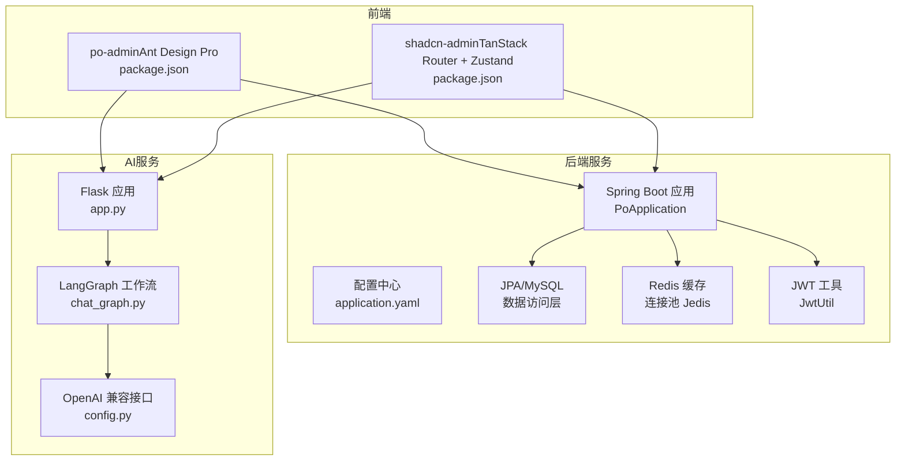
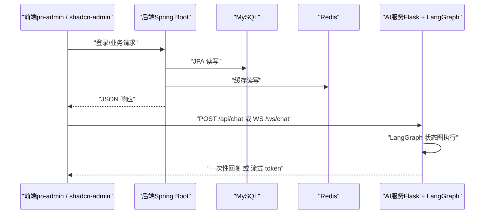
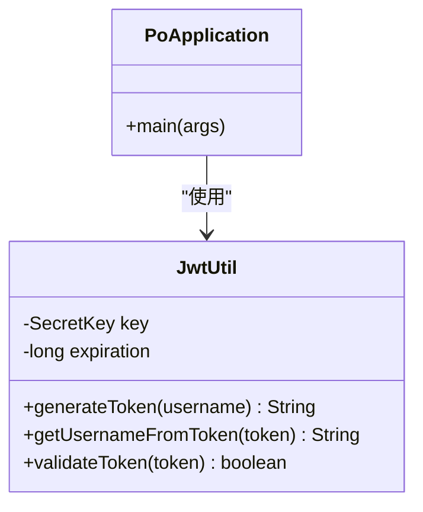
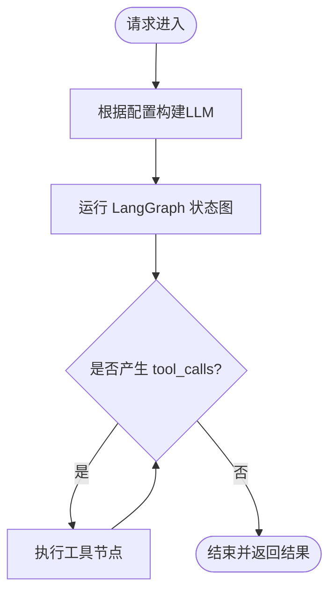
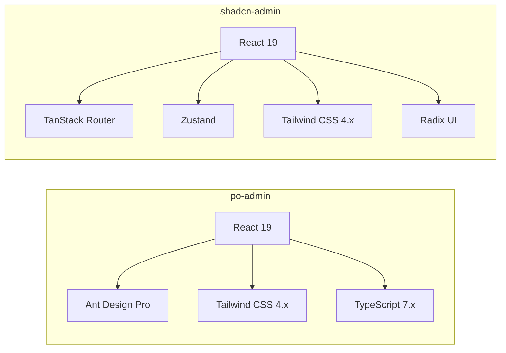

# 技术栈介绍

<cite>
**本文引用的文件**
- [pom.xml](file://java_server/po/pom.xml)
- [application.yaml](file://java_server/po/src/main/resources/application.yaml)
- [PoApplication.java](file://java_server/po/src/main/java/com/goodzheng/po/PoApplication.java)
- [JwtUtil.java](file://java_server/po/src/main/java/com/goodzheng/po/util/JwtUtil.java)
- [requirements.txt](file://py_server/requirements.txt)
- [config.py](file://py_server/config.py)
- [app.py](file://py_server/app.py)
- [chat_graph.py](file://py_server/agents/chat_graph.py)
- [package.json（po-admin）](file://web_client/po-admin/package.json)
- [tailwind.config.js（po-admin）](file://web_client/po-admin/tailwind.config.js)
- [package.json（shadcn-admin）](file://web_client/shadcn-admin/package.json)
- [tsconfig.json（shadcn-admin）](file://web_client/shadcn-admin/tsconfig.json)
- [__root.tsx（shadcn-admin）](file://web_client/shadcn-admin/src/routes/__root.tsx)
</cite>

## 目录
1. [简介](#简介)
2. [项目结构](#项目结构)
3. [核心组件](#核心组件)
4. [架构总览](#架构总览)
5. [详细组件分析](#详细组件分析)
6. [依赖关系与兼容性](#依赖关系与兼容性)
7. [性能考量](#性能考量)
8. [故障排查指南](#故障排查指南)
9. [结论](#结论)
10. [附录](#附录)

## 简介
本技术栈文档面向“破”项目的后端、AI服务与前端三大子系统，系统梳理并解释其技术选型、关键依赖、版本兼容性与协作方式。内容既为初学者提供背景知识，也为有经验的开发者提供深入的技术分析与优化建议。

## 项目结构
项目由三个主要子工程构成：
- 后端服务（Java/Spring Boot）：提供业务接口、数据持久化、认证鉴权与缓存能力。
- AI服务（Python/Flask + LangGraph）：封装大模型调用与工作流编排，支持REST与WebSocket流式输出。
- 前端应用（React生态）：包含两套管理端实现（基于Ant Design Pro与Shadcn Admin），均使用现代前端工具链。

图表来源
- [PoApplication.java:1-14](file://java_server/po/src/main/java/com/goodzheng/po/PoApplication.java#L1-L14)
- [application.yaml:1-109](file://java_server/po/src/main/resources/application.yaml#L1-L109)
- [app.py:1-51](file://py_server/app.py#L1-L51)
- [chat_graph.py:1-92](file://py_server/agents/chat_graph.py#L1-L92)
- [package.json（po-admin）:1-132](file://web_client/po-admin/package.json#L1-L132)
- [package.json（shadcn-admin）:1-98](file://web_client/shadcn-admin/package.json#L1-L98)

章节来源
- [PoApplication.java:1-14](file://java_server/po/src/main/java/com/goodzheng/po/PoApplication.java#L1-L14)
- [application.yaml:1-109](file://java_server/po/src/main/resources/application.yaml#L1-L109)
- [app.py:1-51](file://py_server/app.py#L1-L51)
- [chat_graph.py:1-92](file://py_server/agents/chat_graph.py#L1-L92)
- [package.json（po-admin）:1-132](file://web_client/po-admin/package.json#L1-L132)
- [package.json（shadcn-admin）:1-98](file://web_client/shadcn-admin/package.json#L1-L98)

## 核心组件
- 后端（Spring Boot）
  - Web框架：Spring Boot 4.1.1（父POM），配合 spring-boot-starter-webmvc 提供HTTP服务。
  - 数据持久化：spring-boot-starter-data-jpa 与 MySQL 驱动；HikariCP 连接池；Hibernate方言与DDL策略在配置中声明。
  - 缓存：spring-boot-starter-data-redis 集成 Redis，客户端使用 Jedis（已排除默认 lettuce）。
  - 监控与可观测性：Actuator + Micrometer Prometheus 注册表。
  - 安全与认证：JWT（jjwt 0.12.6）+ Spring Security Crypto。
  - 开发辅助：DevTools、Lombok、Validation。
- AI服务（Python）
  - Web框架：Flask >= 3.0，扩展 Flask-Sock（WebSocket）、Flask-CORS。
  - LLM编排：LangChain >= 0.3、LangGraph >= 0.2、langchain-openai >= 0.2。
  - 配置与环境：python-dotenv，支持通过环境变量覆盖 OPENAI_* 参数，未配置时降级离线演示模式。
- 前端（React生态）
  - po-admin：基于 Umi Max/Ant Design Pro，React 19，Tailwind CSS 4.x，TypeScript 7.x，构建与测试工具链完善。
  - shadcn-admin：基于 Vite + React 19，TanStack Router、Zustand、Tailwind CSS 4.x、Radix UI 组件库、i18n、表单校验等。

章节来源
- [pom.xml:1-163](file://java_server/po/pom.xml#L1-L163)
- [application.yaml:1-109](file://java_server/po/src/main/resources/application.yaml#L1-L109)
- [requirements.txt:1-13](file://py_server/requirements.txt#L1-L13)
- [config.py:1-25](file://py_server/config.py#L1-L25)
- [package.json（po-admin）:1-132](file://web_client/po-admin/package.json#L1-L132)
- [package.json（shadcn-admin）:1-98](file://web_client/shadcn-admin/package.json#L1-L98)

## 架构总览
整体采用前后端分离与微服务解耦思路：前端通过 REST/WebSocket 与后端和AI服务交互；后端负责用户、菜谱等业务数据与权限控制；AI服务专注对话工作流与大模型调用。

图表来源
- [PoApplication.java:1-14](file://java_server/po/src/main/java/com/goodzheng/po/PoApplication.java#L1-L14)
- [application.yaml:1-109](file://java_server/po/src/main/resources/application.yaml#L1-L109)
- [app.py:1-51](file://py_server/app.py#L1-L51)
- [chat_graph.py:1-92](file://py_server/agents/chat_graph.py#L1-L92)

## 详细组件分析

### 后端：Spring Boot + JPA + Redis + JWT
- 启动与配置
  - 应用入口：Spring Boot 主类初始化容器。
  - 配置项：端口、上下文路径、数据库连接、JPA/Hibernate、Redis、静态资源、日志、Actuator暴露端点、JWT密钥与过期时间。
- 数据访问
  - 使用 JPA 与 MySQL，开启 SQL 打印与自动更新DDL；HikariCP 连接池大小与超时可控。
- 缓存
  - Redis 通过 Jedis 连接池接入，用于热点数据缓存与会话/令牌相关存储（可按需扩展）。
- 认证
  - JWT 工具类负责生成、解析与校验令牌；结合 Spring Security Crypto 进行密码处理。
- 可观测性
  - Actuator 暴露健康、指标与Prometheus抓取点，便于监控告警。

图表来源
- [PoApplication.java:1-14](file://java_server/po/src/main/java/com/goodzheng/po/PoApplication.java#L1-L14)
- [JwtUtil.java:1-56](file://java_server/po/src/main/java/com/goodzheng/po/util/JwtUtil.java#L1-L56)

章节来源
- [application.yaml:1-109](file://java_server/po/src/main/resources/application.yaml#L1-L109)
- [pom.xml:1-163](file://java_server/po/pom.xml#L1-L163)
- [JwtUtil.java:1-56](file://java_server/po/src/main/java/com/goodzheng/po/util/JwtUtil.java#L1-L56)

### AI服务：Flask + LangGraph + OpenAI 兼容接口
- 应用工厂
  - 创建 Flask 应用，注册蓝图（主页、聊天、WebSocket），启用 CORS 与 Sock，启动前编译并缓存 LangGraph 图。
- 工作流引擎
  - 基于 LangGraph 的 StateGraph 构建 ReAct 循环：agent -> tools -> agent ... -> END。
  - 工具节点 ToolNode 绑定工具（如获取当前时间）；当模型返回 tool_calls 时进入工具执行，否则结束。
  - 未配置 OPENAI_API_KEY 时自动降级为离线假模型，保证联调链路可用。
- 配置与环境
  - 通过 dotenv 加载 .env，支持 HOST、PORT、DEBUG 以及 OPENAI_* 环境变量；未配置 Key 时走离线模式。

图表来源
- [app.py:1-51](file://py_server/app.py#L1-L51)
- [chat_graph.py:1-92](file://py_server/agents/chat_graph.py#L1-L92)
- [config.py:1-25](file://py_server/config.py#L1-L25)

章节来源
- [app.py:1-51](file://py_server/app.py#L1-L51)
- [chat_graph.py:1-92](file://py_server/agents/chat_graph.py#L1-L92)
- [config.py:1-25](file://py_server/config.py#L1-L25)
- [requirements.txt:1-13](file://py_server/requirements.txt#L1-L13)

### 前端：React + TypeScript + TanStack Router + Zustand + Tailwind CSS
- po-admin（企业级后台模板）
  - 基于 Umi Max 与 Ant Design Pro，React 19，Tailwind CSS 4.x，TypeScript 7.x；提供丰富的页面与组件生态，适合快速搭建管理后台。
  - 构建脚本、国际化、Mock、测试与代码质量工具齐全。
- shadcn-admin（轻量现代后台）
  - 基于 Vite + React 19，使用 TanStack Router 进行路由管理，Zustand 进行状态管理，Tailwind CSS 4.x 样式体系，Radix UI 原子组件，i18n、表单校验（Zod）等。
  - 根路由注入 QueryClient，并在开发环境挂载调试面板。

图表来源
- [package.json（po-admin）:1-132](file://web_client/po-admin/package.json#L1-L132)
- [tailwind.config.js（po-admin）:1-4](file://web_client/po-admin/tailwind.config.js#L1-L4)
- [package.json（shadcn-admin）:1-98](file://web_client/shadcn-admin/package.json#L1-L98)
- [tsconfig.json（shadcn-admin）:1-19](file://web_client/shadcn-admin/tsconfig.json#L1-L19)
- [__root.tsx（shadcn-admin）:1-31](file://web_client/shadcn-admin/src/routes/__root.tsx#L1-L31)

章节来源
- [package.json（po-admin）:1-132](file://web_client/po-admin/package.json#L1-L132)
- [tailwind.config.js（po-admin）:1-4](file://web_client/po-admin/tailwind.config.js#L1-L4)
- [package.json（shadcn-admin）:1-98](file://web_client/shadcn-admin/package.json#L1-L98)
- [tsconfig.json（shadcn-admin）:1-19](file://web_client/shadcn-admin/tsconfig.json#L1-L19)
- [__root.tsx（shadcn-admin）:1-31](file://web_client/shadcn-admin/src/routes/__root.tsx#L1-L31)

## 依赖关系与兼容性
- 后端
  - Java 17，Spring Boot 4.1.1（父POM），MyBatis-Plus Starter 3.5.17（可选增强），JPA 与 MySQL 驱动，Redis（Jedis），JWT 0.12.6，Actuator + Prometheus。
  - 配置项涵盖数据库、连接池、JPA、Redis、文件上传限制、静态资源缓存、日志级别与监控端点。
- AI服务
  - Python 依赖：Flask >= 3.0、Flask-Sock、Flask-CORS；LangChain >= 0.3、langchain-openai >= 0.2、LangGraph >= 0.2；python-dotenv。
  - 环境变量：OPENAI_API_KEY、OPENAI_BASE_URL、OPENAI_MODEL；未配置时自动降级离线模式。
- 前端
  - po-admin：React 19、Umi Max、Ant Design Pro、Tailwind CSS 4.x、TypeScript 7.x、Node >= 22。
  - shadcn-admin：React 19、Vite、TanStack Router、Zustand、Tailwind CSS 4.x、Radix UI、TypeScript ~6.0。

章节来源
- [pom.xml:1-163](file://java_server/po/pom.xml#L1-L163)
- [application.yaml:1-109](file://java_server/po/src/main/resources/application.yaml#L1-L109)
- [requirements.txt:1-13](file://py_server/requirements.txt#L1-L13)
- [config.py:1-25](file://py_server/config.py#L1-L25)
- [package.json（po-admin）:1-132](file://web_client/po-admin/package.json#L1-L132)
- [package.json（shadcn-admin）:1-98](file://web_client/shadcn-admin/package.json#L1-L98)

## 性能考量
- 后端
  - 连接池：合理设置 HikariCP 最大连接数与空闲连接，避免数据库瓶颈。
  - 缓存：利用 Redis 缓存热点数据与会话信息，降低数据库压力。
  - 监控：通过 Actuator + Prometheus 采集指标，定位慢查询与异常。
- AI服务
  - 工作流：LangGraph 图预编译缓存，减少首次请求延迟；流式输出提升用户体验。
  - 模型：优先选择低延迟模型与合适的 temperature；必要时对工具调用做限流与重试。
- 前端
  - 路由懒加载与代码分割；合理使用状态管理（Zustand）避免不必要重渲染。
  - 样式按需引入与 Tree-shaking；使用 Tailwind 原子类减少CSS体积。

[本节为通用指导，不直接分析具体文件]

## 故障排查指南
- 后端
  - 数据库连接失败：检查 application.yaml 中的 datasource URL、用户名、密码与驱动类名。
  - Redis 连接失败：核对 host、port、password 与 Jedis 连接池配置。
  - JWT 校验失败：确认 jwt.secret 与 jwt.expiration 配置正确，客户端携带的 Token 未过期且签名一致。
  - 监控不可用：检查 management.endpoints.web.exposure.include 是否包含所需端点。
- AI服务
  - 无法调用模型：确认 OPENAI_API_KEY、OPENAI_BASE_URL、OPENAI_MODEL 是否正确；未配置时将进入离线演示模式。
  - WebSocket 不通：检查 Flask-Sock 与 CORS 配置，确保前端域名与协议匹配。
- 前端
  - 路由与状态：在开发环境启用 TanStack Router Devtools 与 React Query Devtools 辅助定位问题。
  - 样式冲突：Tailwind 4.x 与第三方组件库样式隔离，注意作用域与优先级。

章节来源
- [application.yaml:1-109](file://java_server/po/src/main/resources/application.yaml#L1-L109)
- [JwtUtil.java:1-56](file://java_server/po/src/main/java/com/goodzheng/po/util/JwtUtil.java#L1-L56)
- [config.py:1-25](file://py_server/config.py#L1-L25)
- [__root.tsx（shadcn-admin）:1-31](file://web_client/shadcn-admin/src/routes/__root.tsx#L1-L31)

## 结论
本项目以 Spring Boot 构建稳健的后端服务，结合 JPA、Redis 与 JWT 形成完整的数据与安全闭环；AI服务通过 Flask + LangGraph 提供灵活的大模型编排与流式交互；前端采用 React 生态的两套方案满足不同场景需求。整体技术选型兼顾开发效率、可维护性与可扩展性，适合持续迭代与团队协作。

[本节为总结性内容，不直接分析具体文件]

## 附录
- 关键配置位置
  - 后端：application.yaml（服务、数据库、缓存、监控、JWT）
  - AI服务：config.py（环境变量与模型参数）
  - 前端：各 package.json（依赖与脚本）、tailwind.config.js（样式范围）
- 推荐实践
  - 将敏感配置放入环境变量或密钥管理服务。
  - 为 LangGraph 工作流增加错误恢复与重试机制。
  - 前端统一错误处理与全局加载态，提升用户体验。

[本节为补充说明，不直接分析具体文件]