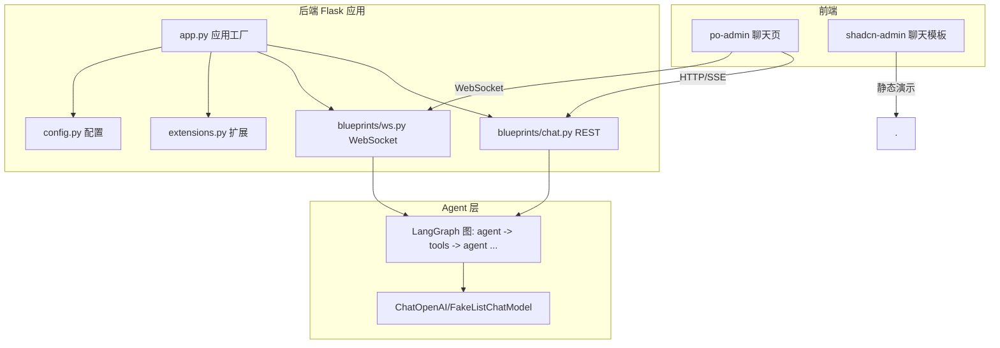
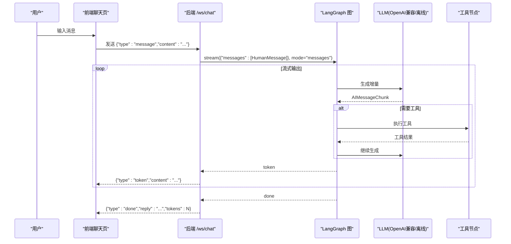
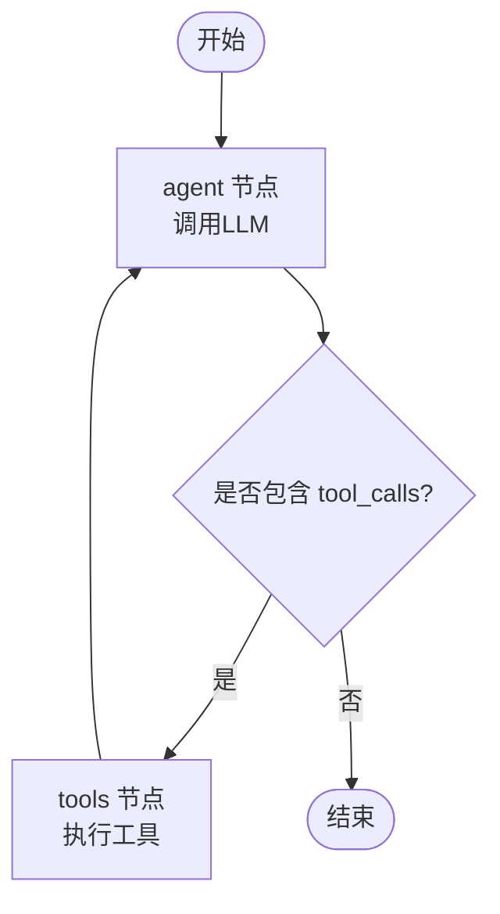
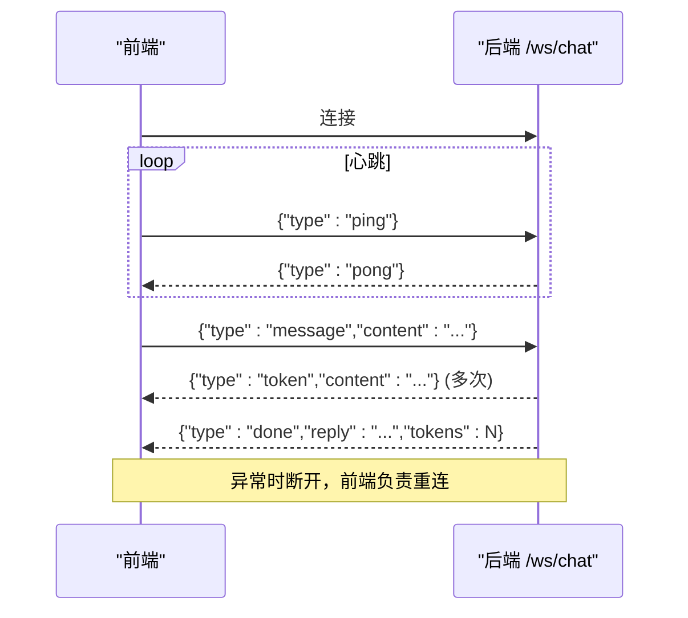
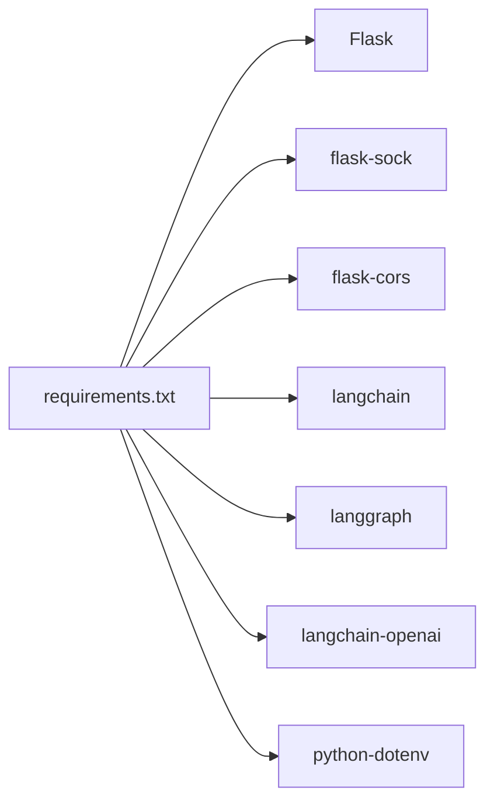

# AI智能对话系统

<cite>
**本文引用的文件**
- [chat_graph.py](file://py_server/agents/chat_graph.py)
- [ws.py](file://py_server/blueprints/ws.py)
- [config.py](file://py_server/config.py)
- [app.py](file://py_server/app.py)
- [extensions.py](file://py_server/extensions.py)
- [chat.py](file://py_server/blueprints/chat.py)
- [requirements.txt](file://py_server/requirements.txt)
- [ws_client_demo.py](file://py_server/scripts/ws_client_demo.py)
- [index.tsx](file://web_client/po-admin/src/pages/chatbot/index.tsx)
- [service.ts](file://web_client/po-admin/src/pages/chatbot/service.ts)
- [data.d.ts](file://web_client/po-admin/src/pages/chatbot/data.d.ts)
</cite>

## 目录
1. [简介](#简介)
2. [项目结构](#项目结构)
3. [核心组件](#核心组件)
4. [架构总览](#架构总览)
5. [详细组件分析](#详细组件分析)
6. [依赖关系分析](#依赖关系分析)
7. [性能与优化](#性能与优化)
8. [故障排查指南](#故障排查指南)
9. [结论](#结论)
10. [附录：API文档与前端集成示例](#附录api文档与前端集成示例)

## 简介
本系统是一个基于 LangGraph 的AI智能对话后端，提供REST与WebSocket两种接口，支持流式响应、工具调用、多模型接入（OpenAI兼容）与离线降级。前端包含两个聊天界面示例：一个基于Ant Design Pro的现代化聊天页，另一个为通用聊天模板页面。系统通过Flask构建，使用flask-sock管理WebSocket，LangChain/LangGraph编排对话流程，支持SSE风格的逐token推送。

## 项目结构
- Python后端（py_server）
  - agents：LangGraph工作流定义（节点、状态、条件边）
  - blueprints：Flask路由（REST /api/chat、WS /ws/chat）
  - config：配置加载与环境变量
  - extensions：全局扩展实例（CORS、Sock）
  - app：应用工厂与启动入口
  - scripts：联调脚本（WebSocket客户端演示）
- Web前端（web_client）
  - po-admin：Ant Design Pro聊天页，使用@ant-design/x-sdk进行流式对话
  - shadcn-admin：通用聊天模板页面（静态数据展示）

图表来源
- [app.py:24-44](file://py_server/app.py#L24-L44)
- [chat.py:10-23](file://py_server/blueprints/chat.py#L10-L23)
- [ws.py:30-89](file://py_server/blueprints/ws.py#L30-L89)
- [chat_graph.py:46-86](file://py_server/agents/chat_graph.py#L46-L86)

章节来源
- [app.py:1-51](file://py_server/app.py#L1-L51)
- [extensions.py:1-7](file://py_server/extensions.py#L1-L7)
- [config.py:1-25](file://py_server/config.py#L1-L25)

## 核心组件
- LangGraph 工作流
  - 状态：消息列表自动累加
  - 节点：agent（调用LLM）、tools（执行工具）
  - 条件边：根据最后一条消息是否包含tool_calls决定进入tools或结束
- 多模型集成
  - 优先使用OpenAI兼容接口（可自定义base_url与model）
  - 未配置Key时自动降级为离线假模型，保证链路可用
- WebSocket实时通信
  - 协议：JSON文本帧，支持message/ping/pong/token/done/error
  - 流式：以“messages”模式增量输出，逐token推送
- REST一次性回复
  - POST /api/chat，返回完整回复内容
- 前端聊天界面
  - Ant Design Pro聊天页：使用XProvider/OpenAIChatProvider处理SSE流
  - 支持思考过程显示、Markdown渲染、自动滚动等

章节来源
- [chat_graph.py:40-86](file://py_server/agents/chat_graph.py#L40-L86)
- [ws.py:1-13](file://py_server/blueprints/ws.py#L1-L13)
- [chat.py:1-24](file://py_server/blueprints/chat.py#L1-L24)
- [index.tsx:116-333](file://web_client/po-admin/src/pages/chatbot/index.tsx#L116-L333)
- [service.ts:1-19](file://web_client/po-admin/src/pages/chatbot/service.ts#L1-L19)

## 架构总览
系统采用前后端分离架构：前端通过REST或WebSocket与后端交互；后端通过LangGraph编排对话流程，动态选择模型并执行工具；WebSocket以流式方式将增量token推送到前端，实现即时反馈。

图表来源
- [ws.py:30-89](file://py_server/blueprints/ws.py#L30-L89)
- [chat_graph.py:59-86](file://py_server/agents/chat_graph.py#L59-L86)

## 详细组件分析

### LangGraph 工作流设计
- 状态管理
  - ChatState仅维护消息列表，并使用add_messages注解实现自动追加
- 节点定义
  - agent：调用LLM，返回新的消息
  - tools：使用ToolNode执行工具
- 流程控制
  - 从START到agent
  - 条件边：若最后一条消息包含tool_calls则进入tools，否则结束
  - tools完成后回到agent，形成ReAct循环
- 模型绑定与降级
  - 已配置OPENAI_API_KEY：使用ChatOpenAI并绑定工具，开启streaming
  - 未配置：使用FakeListChatModel返回固定提示，便于离线联调

图表来源
- [chat_graph.py:40-86](file://py_server/agents/chat_graph.py#L40-L86)

章节来源
- [chat_graph.py:26-92](file://py_server/agents/chat_graph.py#L26-L92)

### 多模型集成方案
- OpenAI兼容接口
  - 通过Config读取OPENAI_BASE_URL、OPENAI_MODEL、OPENAI_API_KEY
  - 在agent节点中通过bind_tools绑定工具
- 模型切换策略
  - 运行时按配置构建LLM；未配置Key时自动降级为离线假模型
  - 可通过环境变量快速切换模型与基地址
- 配置管理
  - 统一在config.py中集中管理，支持.env覆盖

章节来源
- [config.py:10-25](file://py_server/config.py#L10-L25)
- [chat_graph.py:46-57](file://py_server/agents/chat_graph.py#L46-L57)

### WebSocket 实时通信
- 连接建立
  - 前端通过WebSocket连接到/ws/chat
  - 服务端记录连接日志，处理心跳ping/pong
- 消息传输
  - 客户端发送{"type":"message","content":"..."}
  - 服务端解析后调用LangGraph流式输出，逐token推送{"type":"token","content":"..."}
  - 一轮结束后发送{"type":"done","reply":"...","tokens":N}
- 错误重连机制
  - 服务端捕获ConnectionClosed并退出循环
  - 前端需自行实现断线检测与重连逻辑（如指数退避）
  - 建议结合心跳ping/pong判断连接健康度

图表来源
- [ws.py:30-89](file://py_server/blueprints/ws.py#L30-L89)
- [ws_client_demo.py:19-48](file://py_server/scripts/ws_client_demo.py#L19-L48)

章节来源
- [ws.py:1-90](file://py_server/blueprints/ws.py#L1-L90)
- [ws_client_demo.py:1-53](file://py_server/scripts/ws_client_demo.py#L1-L53)

### 流式响应处理
- SSE数据传输
  - 后端使用LangGraph的stream_mode="messages"获取增量输出
  - 将每个AIMessageChunk的内容作为token推送给前端
- 前端实时更新
  - 使用@ant-design/x-sdk的OpenAIChatProvider处理SSE流
  - XMarkdown支持流式渲染，提升用户体验
- 性能优化
  - 避免频繁DOM更新：合并小片段或使用虚拟滚动
  - 合理设置流式动画与打字效果，减少卡顿
  - 前端可缓存历史消息，减少重复渲染

章节来源
- [ws.py:67-82](file://py_server/blueprints/ws.py#L67-L82)
- [index.tsx:98-114](file://web_client/po-admin/src/pages/chatbot/index.tsx#L98-L114)
- [service.ts:12-18](file://web_client/po-admin/src/pages/chatbot/service.ts#L12-L18)

### 对话历史管理与上下文维护
- 后端
  - ChatState中的messages字段自动累加，维持上下文
  - 每次调用传入当前消息列表，确保多轮对话连贯
- 前端
  - useXChat内部维护conversationKey对应的消息历史
  - 支持多条对话并行（不同key），互不干扰

章节来源
- [chat_graph.py:40-44](file://py_server/agents/chat_graph.py#L40-L44)
- [index.tsx:167-176](file://web_client/po-admin/src/pages/chatbot/index.tsx#L167-L176)

### 工具调用机制
- 工具定义
  - get_current_time：返回服务器本地时间
- 触发条件
  - 当LLM返回的消息包含tool_calls时，进入tools节点执行
- 执行流程
  - ToolNode执行工具并将结果回传给agent继续生成

章节来源
- [chat_graph.py:26-32](file://py_server/agents/chat_graph.py#L26-L32)
- [chat_graph.py:67-86](file://py_server/agents/chat_graph.py#L67-L86)

## 依赖关系分析
- 后端依赖
  - Flask、flask-sock、flask-cors：Web框架与WebSocket、跨域
  - langchain、langgraph、langchain-openai：LLM编排与模型接入
  - python-dotenv：环境变量加载
- 前端依赖
  - @ant-design/x-sdk：流式聊天能力
  - antd、@ant-design/pro-components：UI组件

图表来源
- [requirements.txt:1-13](file://py_server/requirements.txt#L1-L13)

章节来源
- [requirements.txt:1-13](file://py_server/requirements.txt#L1-L13)

## 性能与优化
- 后端
  - 预热LangGraph图：应用启动时编译图，首次请求更快
  - 流式输出：降低首字节延迟，提升感知速度
  - 工具调用：按需执行，避免无谓开销
- 前端
  - 流式渲染：XMarkdown streaming模式减少重绘
  - 消息合并：对极短token进行合并，减少更新频率
  - 虚拟滚动：长对话场景下提升滚动性能
- 网络
  - 心跳检测：定期ping/pong保持连接活跃
  - 断线重连：指数退避与最大重试次数限制

[本节为通用指导，无需特定文件引用]

## 故障排查指南
- WebSocket连接失败
  - 检查端口与CORS配置
  - 确认服务已启动且监听正确地址
- 流式无响应
  - 查看后端日志，确认是否进入异常分支
  - 验证OPENAI_API_KEY与BASE_URL是否正确
- 工具调用不生效
  - 确认模型是否支持tool_calls
  - 检查工具函数返回值格式
- 前端渲染卡顿
  - 减少高频更新，合并token
  - 关闭不必要的动画效果

章节来源
- [ws.py:83-85](file://py_server/blueprints/ws.py#L83-L85)
- [chat_graph.py:46-57](file://py_server/agents/chat_graph.py#L46-L57)

## 结论
本系统通过LangGraph实现了可扩展的对话工作流，结合WebSocket流式输出与多模型接入，提供了高性能、易扩展的AI对话后端。前端示例展示了现代聊天界面的实现方式，适合快速集成与二次开发。

[本节为总结性内容，无需特定文件引用]

## 附录：API文档与前端集成示例

### REST API
- POST /api/chat
  - 请求体：{"message": "你的问题"}
  - 响应：{"reply": "完整回复"}
  - 错误：{"error": "字段 message 不能为空"} 或 {"error": "内部错误，请查看服务端日志"}

章节来源
- [chat.py:10-23](file://py_server/blueprints/chat.py#L10-L23)

### WebSocket 协议
- 端点：/ws/chat
- 客户端 -> 服务端
  - {"type": "message", "content": "..."} 发起对话
  - {"type": "ping"} 心跳
- 服务端 -> 客户端
  - {"type": "token", "content": "..."} 增量token
  - {"type": "done", "reply": "...", "tokens": N} 本轮结束
  - {"type": "pong"} 心跳应答
  - {"type": "error", "message": "..."} 错误信息

章节来源
- [ws.py:1-13](file://py_server/blueprints/ws.py#L1-L13)
- [ws.py:30-89](file://py_server/blueprints/ws.py#L30-L89)

### 前端集成示例（Ant Design Pro）
- 创建Provider：使用OpenAIChatProvider并配置request参数
- 使用useXChat：管理消息历史、发送请求、解析消息
- 渲染：Bubble.List配合XMarkdown实现流式Markdown显示
- 思考过程：解析assistant消息中的think标签，展示思考内容

章节来源
- [service.ts:12-18](file://web_client/po-admin/src/pages/chatbot/service.ts#L12-L18)
- [index.tsx:167-176](file://web_client/po-admin/src/pages/chatbot/index.tsx#L167-L176)
- [index.tsx:51-72](file://web_client/po-admin/src/pages/chatbot/index.tsx#L51-L72)
- [index.tsx:98-114](file://web_client/po-admin/src/pages/chatbot/index.tsx#L98-L114)

### 联调脚本
- 使用scripts/ws_client_demo.py测试WebSocket流式对话
- 默认发送“现在几点了？”并打印流式输出与完成统计

章节来源
- [ws_client_demo.py:19-48](file://py_server/scripts/ws_client_demo.py#L19-L48)