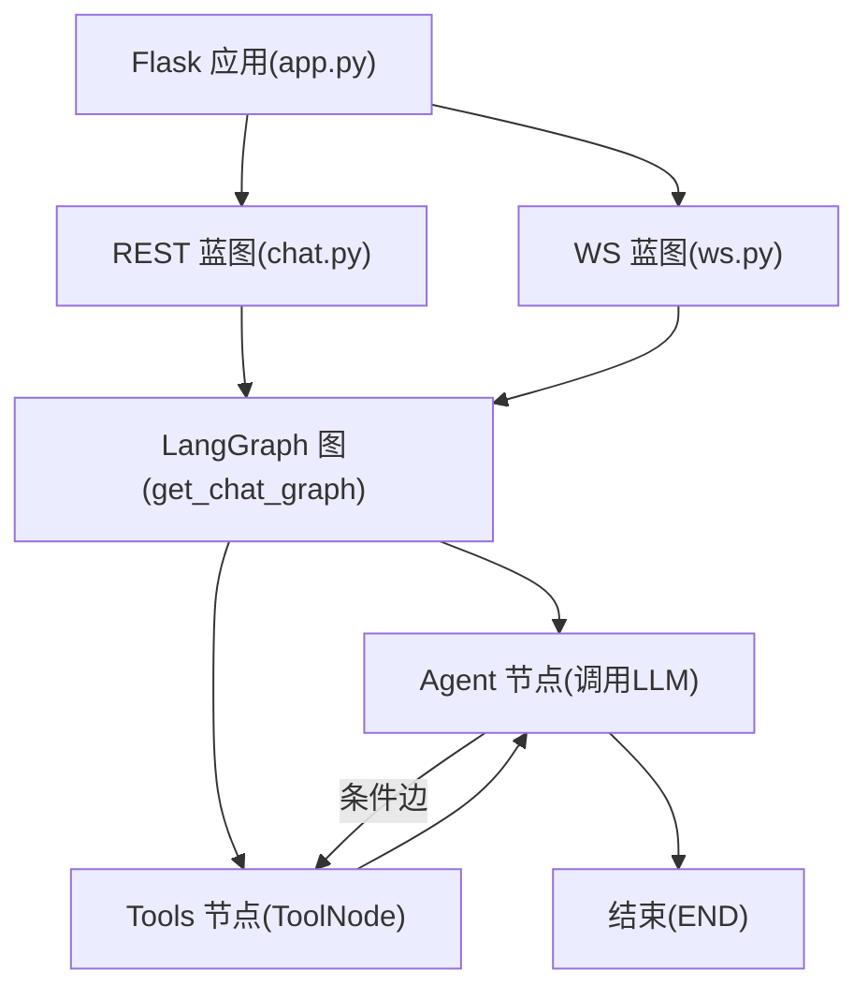
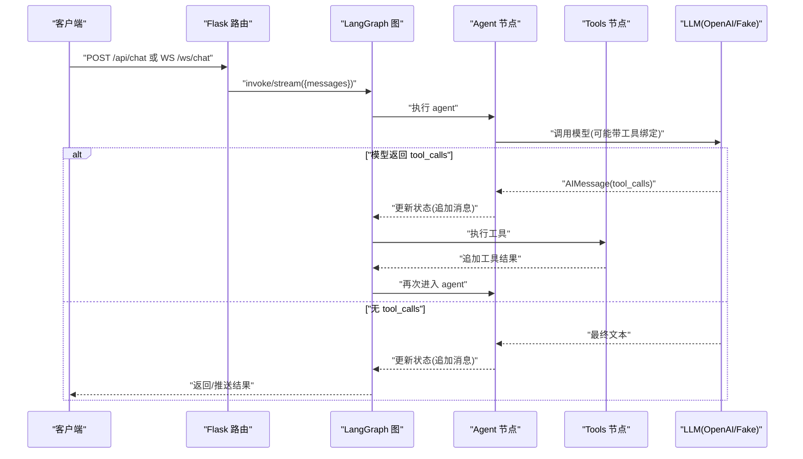
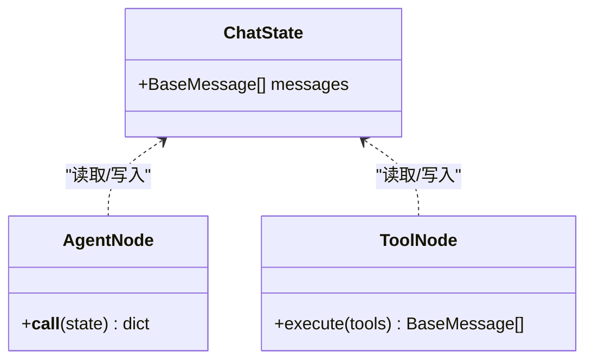
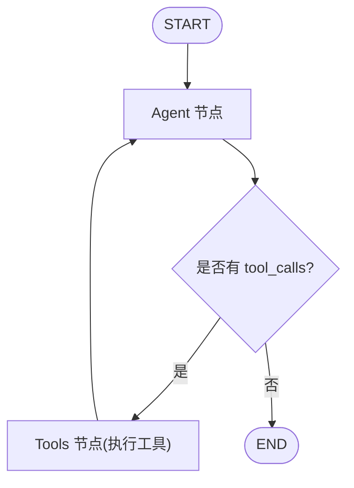
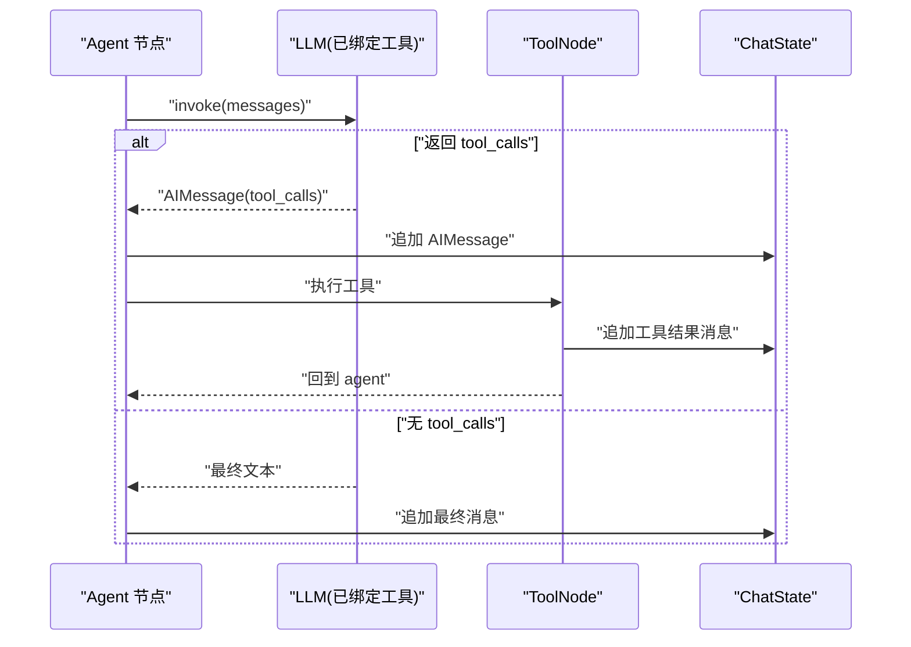
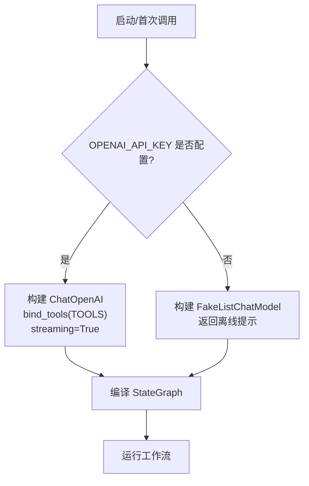
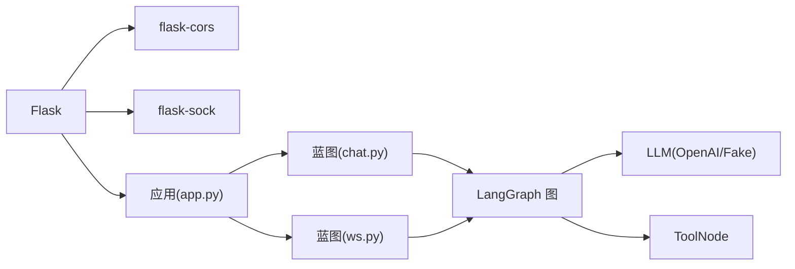
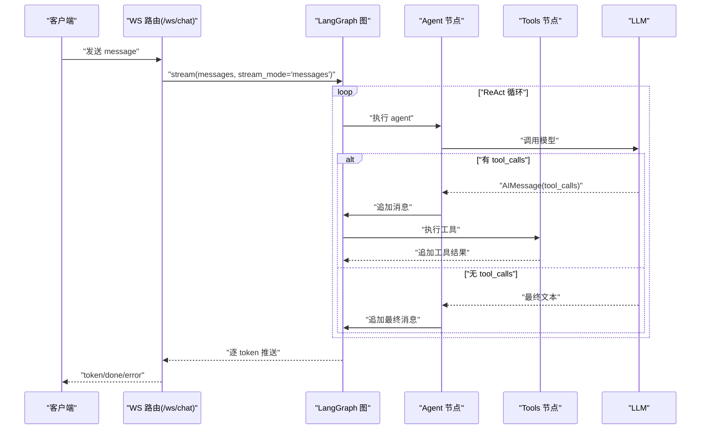

# LangGraph工作流引擎

<cite>
**本文引用的文件**
- [chat_graph.py](file://py_server/agents/chat_graph.py)
- [config.py](file://py_server/config.py)
- [app.py](file://py_server/app.py)
- [chat.py](file://py_server/blueprints/chat.py)
- [ws.py](file://py_server/blueprints/ws.py)
- [extensions.py](file://py_server/extensions.py)
- [requirements.txt](file://py_server/requirements.txt)
- [ws_client_demo.py](file://py_server/scripts/ws_client_demo.py)
</cite>

## 目录
1. [简介](#简介)
2. [项目结构](#项目结构)
3. [核心组件](#核心组件)
4. [架构总览](#架构总览)
5. [详细组件分析](#详细组件分析)
6. [依赖关系分析](#依赖关系分析)
7. [性能考虑](#性能考虑)
8. [故障排查指南](#故障排查指南)
9. [结论](#结论)
10. [附录：使用示例与流程图](#附录使用示例与流程图)

## 简介
本技术文档围绕基于 LangGraph 的对话工作流展开，重点说明以下方面：
- 基于 StateGraph 的对话流程设计：节点定义（agent、tools）、状态管理（ChatState）、条件边控制。
- ReAct 循环模式实现：START→agent→tools→agent→END 的完整流程。
- 工具调用机制：@tool 装饰器使用、ToolNode 集成、工具执行结果处理。
- 离线降级策略：FakeListChatModel 配置、API 密钥检测、无缝切换机制。
- 工作流编译优化：lru_cache 缓存、单例模式、性能考虑。
- 提供完整的代码示例路径和流程图，帮助开发者理解复杂的工作流编排逻辑。

## 项目结构
Python 后端位于 py_server 目录，采用 Flask 作为 Web 框架，结合 LangChain/LangGraph 构建对话工作流。关键文件职责如下：
- agents/chat_graph.py：定义 LangGraph 图、节点、状态、工具、条件边与编译缓存。
- blueprints/chat.py：REST 接口 /api/chat，一次性返回完整回复。
- blueprints/ws.py：WebSocket 接口 /ws/chat，逐 token 推送流式输出。
- config.py：应用配置与环境变量加载（含 LLM 配置）。
- app.py：Flask 应用工厂，注册蓝图并预热工作流。
- extensions.py：Flask 扩展实例（CORS、Sock）。
- requirements.txt：依赖声明。
- scripts/ws_client_demo.py：WebSocket 联调客户端脚本。

图表来源
- [app.py:24-44](file://py_server/app.py#L24-L44)
- [chat.py:10-23](file://py_server/blueprints/chat.py#L10-L23)
- [ws.py:30-89](file://py_server/blueprints/ws.py#L30-L89)
- [chat_graph.py:75-86](file://py_server/agents/chat_graph.py#L75-L86)

章节来源
- [app.py:1-51](file://py_server/app.py#L1-L51)
- [chat_graph.py:1-92](file://py_server/agents/chat_graph.py#L1-L92)

## 核心组件
- ChatState：对话状态，维护消息列表，支持自动追加（add_messages）。
- Agent 节点：封装 LLM 调用，将响应消息追加到状态。
- Tools 节点：通过 ToolNode 统一执行工具，并将结果追加到状态。
- 条件边：根据最后一条消息是否包含 tool_calls 决定继续调用工具或结束。
- 工作流编译缓存：get_chat_graph 使用 lru_cache 保证进程内单例，避免重复编译。

章节来源
- [chat_graph.py:40-86](file://py_server/agents/chat_graph.py#L40-L86)

## 架构总览
整体架构由三层组成：
- 接入层：Flask REST 与 WebSocket 路由，负责请求解析、错误处理与协议转换。
- 编排层：LangGraph StateGraph 定义 ReAct 循环，协调 agent 与 tools 节点。
- 模型与工具层：OpenAI 兼容 LLM（可流式）或离线 FakeListChatModel；工具函数通过 @tool 装饰器注册并由 ToolNode 执行。

图表来源
- [chat_graph.py:59-86](file://py_server/agents/chat_graph.py#L59-L86)
- [chat.py:10-23](file://py_server/blueprints/chat.py#L10-L23)
- [ws.py:67-82](file://py_server/blueprints/ws.py#L67-L82)

## 详细组件分析

### 状态管理与节点定义
- ChatState：TypedDict，包含 messages 字段，类型为 BaseMessage 列表，并使用 add_messages 注解实现消息自动累加。
- Agent 节点：接收当前状态中的消息，调用 LLM 得到响应，并以 {"messages": [response]} 形式回写状态。
- Tools 节点：使用 ToolNode(TOOLS)，自动识别并执行工具调用，将结果追加到状态。

图表来源
- [chat_graph.py:40-64](file://py_server/agents/chat_graph.py#L40-L64)
- [chat_graph.py:75-86](file://py_server/agents/chat_graph.py#L75-L86)

章节来源
- [chat_graph.py:40-64](file://py_server/agents/chat_graph.py#L40-L64)

### 条件边控制与 ReAct 循环
- 条件边函数 _should_continue：检查最后一条消息是否存在 tool_calls 属性，若有则返回 "tools"，否则返回 END。
- 图结构：START→agent→(条件边)→tools→agent→...→END，形成经典 ReAct 循环。

图表来源
- [chat_graph.py:67-86](file://py_server/agents/chat_graph.py#L67-L86)

章节来源
- [chat_graph.py:67-86](file://py_server/agents/chat_graph.py#L67-L86)

### 工具调用机制
- @tool 装饰器：用于声明工具函数，例如 get_current_time，返回格式化时间字符串。
- 工具集合：TOOLS = [get_current_time]，在构建 LLM 时通过 bind_tools 绑定到模型。
- ToolNode 集成：在图中添加 "tools" 节点，自动解析 AIMessage 中的 tool_calls 并执行对应工具，将结果追加到状态。
- 结果处理：工具执行后，状态中追加工具结果消息，随后再次进入 agent 节点进行下一轮推理。

图表来源
- [chat_graph.py:26-32](file://py_server/agents/chat_graph.py#L26-L32)
- [chat_graph.py:46-56](file://py_server/agents/chat_graph.py#L46-L56)
- [chat_graph.py:75-86](file://py_server/agents/chat_graph.py#L75-L86)

章节来源
- [chat_graph.py:26-32](file://py_server/agents/chat_graph.py#L26-L32)
- [chat_graph.py:46-56](file://py_server/agents/chat_graph.py#L46-L56)
- [chat_graph.py:75-86](file://py_server/agents/chat_graph.py#L75-L86)

### 离线降级策略
- API 密钥检测：is_llm_configured() 判断 OPENAI_API_KEY 是否配置。
- 模型选择：若配置了 OPENAI_API_KEY，则使用 ChatOpenAI（支持 streaming），并绑定工具；否则使用 FakeListChatModel，返回预设离线提示。
- 无缝切换：工作流编译阶段根据配置动态选择模型，无需修改图结构，即可在在线与离线模式间切换。

图表来源
- [chat_graph.py:46-56](file://py_server/agents/chat_graph.py#L46-L56)
- [chat_graph.py:75-86](file://py_server/agents/chat_graph.py#L75-L86)
- [config.py:20-24](file://py_server/config.py#L20-L24)

章节来源
- [chat_graph.py:46-56](file://py_server/agents/chat_graph.py#L46-L56)
- [config.py:10-24](file://py_server/config.py#L10-L24)

### 工作流编译优化
- lru_cache 缓存：get_chat_graph 使用 @lru_cache(maxsize=1) 确保进程内单例，避免重复编译图。
- 单例模式：首次调用后缓存图对象，后续请求直接复用，降低启动与调用开销。
- 性能考虑：
  - 预热：应用启动时调用 get_chat_graph()，提前暴露配置问题。
  - 流式输出：WS 接口使用 graph.stream(stream_mode="messages") 逐 token 推送，提升交互体验。
  - 错误隔离：REST 与 WS 均捕获异常并返回友好错误信息，便于定位问题。

章节来源
- [chat_graph.py:75-86](file://py_server/agents/chat_graph.py#L75-L86)
- [app.py:41-43](file://py_server/app.py#L41-L43)
- [ws.py:67-82](file://py_server/blueprints/ws.py#L67-L82)

## 依赖关系分析
- Flask 与扩展：flask、flask-sock、flask-cors 提供 Web 能力与跨域支持。
- LangChain/LangGraph：langchain、langgraph、langchain-openai 提供 LLM 编排与工具调用能力。
- 环境变量：python-dotenv 加载 .env 配置。

图表来源
- [requirements.txt:1-13](file://py_server/requirements.txt#L1-L13)
- [app.py:24-44](file://py_server/app.py#L24-L44)
- [chat_graph.py:75-86](file://py_server/agents/chat_graph.py#L75-L86)

章节来源
- [requirements.txt:1-13](file://py_server/requirements.txt#L1-L13)
- [app.py:24-44](file://py_server/app.py#L24-L44)

## 性能考虑
- 图编译缓存：lru_cache 避免重复编译，减少 CPU 与内存占用。
- 流式输出：WS 接口以消息块增量推送，降低首屏延迟，提升用户体验。
- 错误快速失败：REST 与 WS 均捕获异常并返回明确错误码与信息，便于监控与排障。
- 配置预热：应用启动即编译图，尽早发现配置错误，避免运行时失败。

[本节为通用性能建议，不直接分析具体文件]

## 故障排查指南
- 常见问题：
  - 未配置 OPENAI_API_KEY：工作流将进入离线模式，返回预设提示。可通过 is_llm_configured() 检测。
  - 无效 JSON 帧：WS 客户端发送非 JSON 数据会收到错误提示。
  - 空消息：REST 与 WS 均校验 message/content 是否为空，为空则返回 400 或错误帧。
- 日志与调试：
  - 服务端记录连接建立/断开与错误堆栈，便于定位问题。
  - 使用 ws_client_demo.py 进行端到端联调，观察 token 推送与完成帧。

章节来源
- [chat_graph.py:89-92](file://py_server/agents/chat_graph.py#L89-L92)
- [ws.py:43-65](file://py_server/blueprints/ws.py#L43-L65)
- [chat.py:10-23](file://py_server/blueprints/chat.py#L10-L23)
- [ws_client_demo.py:19-52](file://py_server/scripts/ws_client_demo.py#L19-L52)

## 结论
该工作流基于 LangGraph 的 StateGraph 实现了经典的 ReAct 循环，具备以下特点：
- 清晰的节点与状态管理，易于扩展新工具与新节点。
- 条件边控制灵活，支持多轮工具调用与终止。
- 离线降级策略完善，保障开发联调与演示场景可用性。
- 编译缓存与流式输出提升性能与交互体验。
- 完善的错误处理与日志记录，便于运维与排障。

[本节为总结性内容，不直接分析具体文件]

## 附录：使用示例与流程图

### REST 接口示例
- 请求：POST /api/chat，JSON body 包含 message 字段。
- 响应：JSON 包含 reply 字段，为完整回复文本。
- 错误：当 message 为空时返回 400；内部异常返回 500。

章节来源
- [chat.py:10-23](file://py_server/blueprints/chat.py#L10-L23)

### WebSocket 接口示例
- 连接：WS /ws/chat。
- 客户端消息：{"type": "message", "content": "..."}。
- 服务端推送：{"type": "token", "content": "..."} 多次，最后 {"type": "done", "reply": "...", "tokens": N}。
- 心跳：{"type": "ping"} → {"type": "pong"}。
- 错误：{"type": "error", "message": "..."}。

章节来源
- [ws.py:30-89](file://py_server/blueprints/ws.py#L30-L89)

### 端到端流程图

图表来源
- [ws.py:67-82](file://py_server/blueprints/ws.py#L67-L82)
- [chat_graph.py:59-86](file://py_server/agents/chat_graph.py#L59-L86)