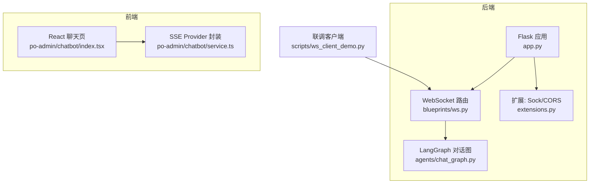
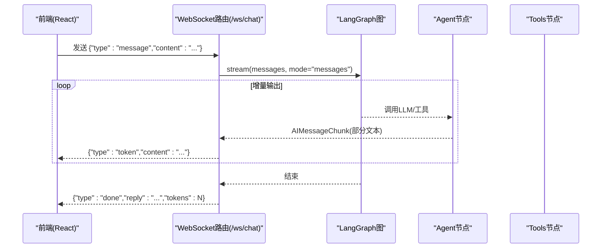
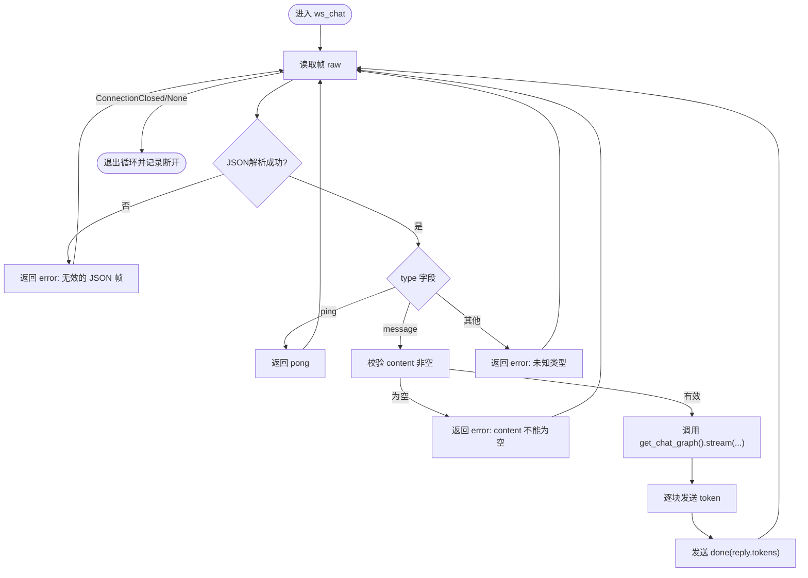
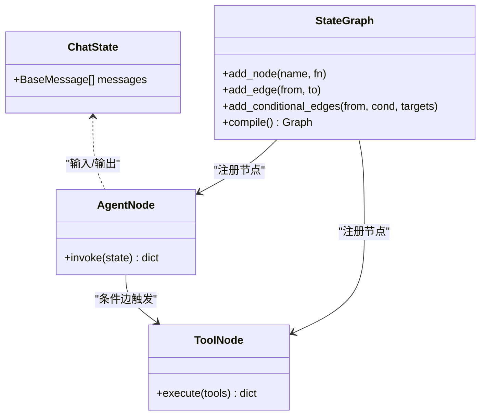
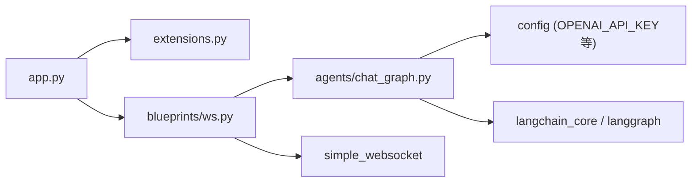

# WebSocket实时通信

<cite>
**本文引用的文件**
- [py_server/blueprints/ws.py](file://py_server/blueprints/ws.py)
- [py_server/app.py](file://py_server/app.py)
- [py_server/agents/chat_graph.py](file://py_server/agents/chat_graph.py)
- [py_server/extensions.py](file://py_server/extensions.py)
- [py_server/scripts/ws_client_demo.py](file://py_server/scripts/ws_client_demo.py)
- [web_client/po-admin/src/pages/chatbot/index.tsx](file://web_client/po-admin/src/pages/chatbot/index.tsx)
- [web_client/po-admin/src/pages/chatbot/service.ts](file://web_client/po-admin/src/pages/chatbot/service.ts)
</cite>

## 目录
1. [简介](#简介)
2. [项目结构](#项目结构)
3. [核心组件](#核心组件)
4. [架构总览](#架构总览)
5. [详细组件分析](#详细组件分析)
6. [依赖关系分析](#依赖关系分析)
7. [性能考量](#性能考量)
8. [故障排查指南](#故障排查指南)
9. [结论](#结论)
10. [附录](#附录)

## 简介
本技术文档围绕仓库中的WebSocket实时通信能力，系统化说明连接建立、握手协议、消息格式、流式响应、连接生命周期管理、并发策略与故障恢复机制，并提供前后端集成要点与排错建议。后端基于Flask + flask-sock实现WebSocket路由，结合LangGraph图驱动对话；前端提供Python联调客户端与React聊天页面示例。

## 项目结构
- 后端（Python）
  - 应用入口：创建Flask应用、注册蓝图、初始化CORS与Sock扩展、预热LangGraph图。
  - WebSocket路由：定义/ws/chat路径，处理消息帧、心跳、错误与流式输出。
  - 智能体图：基于LangGraph的ReAct循环，支持工具调用与流式输出。
  - 扩展：统一创建flask-sock与CORS实例。
- 前端（Web）
  - React聊天页：使用Ant Design X的聊天组件与Provider进行流式渲染。
  - 服务层：封装OpenAI兼容SSE Provider用于流式请求。
- 联调脚本
  - Python WebSocket客户端：发送消息、接收token流、打印完成与错误。

图示来源
- [py_server/app.py:24-43](file://py_server/app.py#L24-L43)
- [py_server/blueprints/ws.py:23-31](file://py_server/blueprints/ws.py#L23-L31)
- [py_server/agents/chat_graph.py:75-86](file://py_server/agents/chat_graph.py#L75-L86)
- [py_server/extensions.py:1-7](file://py_server/extensions.py#L1-L7)
- [web_client/po-admin/src/pages/chatbot/index.tsx:116-176](file://web_client/po-admin/src/pages/chatbot/index.tsx#L116-L176)
- [web_client/po-admin/src/pages/chatbot/service.ts:1-19](file://web_client/po-admin/src/pages/chatbot/service.ts#L1-L19)

章节来源
- [py_server/app.py:1-51](file://py_server/app.py#L1-L51)
- [py_server/blueprints/ws.py:1-90](file://py_server/blueprints/ws.py#L1-L90)
- [py_server/agents/chat_graph.py:1-92](file://py_server/agents/chat_graph.py#L1-L92)
- [py_server/extensions.py:1-7](file://py_server/extensions.py#L1-L7)
- [web_client/po-admin/src/pages/chatbot/index.tsx:1-333](file://web_client/po-admin/src/pages/chatbot/index.tsx#L1-L333)
- [web_client/po-admin/src/pages/chatbot/service.ts:1-19](file://web_client/po-admin/src/pages/chatbot/service.ts#L1-L19)

## 核心组件
- WebSocket路由（/ws/chat）
  - 负责接收JSON文本帧、校验类型、执行心跳、驱动LangGraph流式输出并返回增量token与完成帧。
- LangGraph对话图
  - ReAct循环：agent节点生成回复或工具调用，tools节点执行工具，条件边决定继续或结束。
  - 支持真实模型（开启streaming）与离线假模型降级，保证链路可联调。
- 应用工厂与扩展
  - 初始化Sock与CORS，注册蓝图，预热图以尽早暴露配置问题。
- 前端聊天页与服务封装
  - 使用X SDK的Provider进行流式渲染；通过手动模式控制请求与解析。
- 联调客户端
  - 演示发送message、接收token/done/error、优雅关闭连接。

章节来源
- [py_server/blueprints/ws.py:26-90](file://py_server/blueprints/ws.py#L26-L90)
- [py_server/agents/chat_graph.py:46-86](file://py_server/agents/chat_graph.py#L46-L86)
- [py_server/app.py:24-43](file://py_server/app.py#L24-L43)
- [web_client/po-admin/src/pages/chatbot/index.tsx:116-176](file://web_client/po-admin/src/pages/chatbot/index.tsx#L116-L176)
- [web_client/po-admin/src/pages/chatbot/service.ts:1-19](file://web_client/po-admin/src/pages/chatbot/service.ts#L1-L19)
- [py_server/scripts/ws_client_demo.py:1-53](file://py_server/scripts/ws_client_demo.py#L1-L53)

## 架构总览
下图展示从前端到后端的完整数据流：前端发起请求（REST/SSE或WebSocket），后端路由分发至对话图，图内按ReAct循环产出增量token并通过WebSocket推送给前端。

图示来源
- [py_server/blueprints/ws.py:30-89](file://py_server/blueprints/ws.py#L30-L89)
- [py_server/agents/chat_graph.py:59-86](file://py_server/agents/chat_graph.py#L59-L86)

## 详细组件分析

### WebSocket路由（/ws/chat）
- 握手与连接
  - 由flask-sock接管HTTP升级，进入ws_chat处理器。
- 消息协议（JSON文本帧）
  - 客户端 -> 服务端
    - message: {"type":"message","content":"..."} 发起一轮对话
    - ping: {"type":"ping"} 心跳探测
  - 服务端 -> 客户端
    - token: {"type":"token","content":"..."} 增量token
    - done: {"type":"done","reply":"...","tokens":N} 本轮结束
    - pong: {"type":"pong"} 心跳应答
    - error: {"type":"error","message":"..."} 错误信息
- 处理流程
  - 读取帧 -> 解析JSON -> 校验type -> 心跳或业务分支 -> 驱动LangGraph流式输出 -> 逐条推送token -> 推送done -> 异常捕获与日志。
- 连接生命周期
  - 连接成功记录日志 -> 循环接收 -> 捕获ConnectionClosed或None退出 -> finally记录断开日志。

图示来源
- [py_server/blueprints/ws.py:30-89](file://py_server/blueprints/ws.py#L30-L89)

章节来源
- [py_server/blueprints/ws.py:1-90](file://py_server/blueprints/ws.py#L1-L90)

### LangGraph对话图
- 状态与节点
  - ChatState包含消息列表，自动累加。
  - agent节点：调用LLM生成回复或工具调用。
  - tools节点：执行工具（如获取当前时间）。
  - 条件边：若存在tool_calls则进入tools，否则结束。
- 流式支持
  - 真实模型启用streaming=True，配合ws层的stream_mode="messages"逐块推送。
- 降级策略
  - 未配置OPENAI_API_KEY时，使用FakeListChatModel返回固定文案，确保链路可联调。

图示来源
- [py_server/agents/chat_graph.py:40-86](file://py_server/agents/chat_graph.py#L40-L86)

章节来源
- [py_server/agents/chat_graph.py:1-92](file://py_server/agents/chat_graph.py#L1-L92)

### 应用工厂与扩展
- 初始化顺序
  - 创建Flask应用 -> 加载配置 -> 初始化Sock与CORS -> 注册蓝图 -> 预热图。
- CORS策略
  - 对/api/*与/ws/*开放跨域，便于前端联调。
- 启动参数
  - host/port/debug来自配置对象。

章节来源
- [py_server/app.py:24-51](file://py_server/app.py#L24-L51)
- [py_server/extensions.py:1-7](file://py_server/extensions.py#L1-L7)

### 前端集成（React聊天页）
- 流式渲染
  - 使用@ant-design/x的Bubble与XMarkdown，在status为updating时启用流式更新。
- Provider与请求
  - 通过createChatProvider封装OpenAIChatProvider，使用XRequest手动模式，设置model与stream=true。
- 交互流程
  - 用户输入 -> onRequest触发 -> 框架内部维护会话与解析 -> 逐步更新UI。

章节来源
- [web_client/po-admin/src/pages/chatbot/index.tsx:74-114](file://web_client/po-admin/src/pages/chatbot/index.tsx#L74-L114)
- [web_client/po-admin/src/pages/chatbot/index.tsx:116-176](file://web_client/po-admin/src/pages/chatbot/index.tsx#L116-L176)
- [web_client/po-admin/src/pages/chatbot/service.ts:1-19](file://web_client/po-admin/src/pages/chatbot/service.ts#L1-L19)

### 联调客户端（Python）
- 功能
  - 连接ws://127.0.0.1:5090/ws/chat，发送message，循环接收token/done/error，最后显式关闭连接。
- 用途
  - 快速验证后端WebSocket链路、协议与流式行为。

章节来源
- [py_server/scripts/ws_client_demo.py:1-53](file://py_server/scripts/ws_client_demo.py#L1-L53)

## 依赖关系分析
- 模块耦合
  - app.py依赖extensions.py（Sock/CORS）、blueprints.ws、blueprints.chat、blueprints.main。
  - blueprints.ws依赖agents.chat_graph（get_chat_graph）。
  - agents.chat_graph依赖config（OPENAI_API_KEY等）与LangChain/LangGraph库。
- 外部依赖
  - simple_websocket：WebSocket收发。
  - langchain_core/langgraph：对话图与消息类型。
  - flask_cors/flask_sock：CORS与WebSocket桥接。

图示来源
- [py_server/app.py:14-43](file://py_server/app.py#L14-L43)
- [py_server/blueprints/ws.py:14-21](file://py_server/blueprints/ws.py#L14-L21)
- [py_server/agents/chat_graph.py:11-23](file://py_server/agents/chat_graph.py#L11-L23)

章节来源
- [py_server/app.py:14-43](file://py_server/app.py#L14-L43)
- [py_server/blueprints/ws.py:14-21](file://py_server/blueprints/ws.py#L14-L21)
- [py_server/agents/chat_graph.py:11-23](file://py_server/agents/chat_graph.py#L11-L23)

## 性能考量
- 长连接与并发
  - flask-sock在多worker/多线程下每个连接占用一个工作单元；生产环境建议使用gevent worker提升并发能力。
- 流式传输
  - 使用stream_mode="messages"与LLM streaming=True，减少首字延迟，提升用户体验。
- 资源与内存
  - 对话图使用lru_cache缓存编译后的图，避免重复构建开销。
  - 前端流式渲染按需更新UI，注意控制消息长度与滚动性能。

章节来源
- [py_server/README.md:123-125](file://py_server/README.md#L123-L125)
- [py_server/agents/chat_graph.py:75-86](file://py_server/agents/chat_graph.py#L75-L86)

## 故障排查指南
- 常见错误与定位
  - 无效JSON帧：检查客户端发送格式，确保包含type与必要字段。
  - 未知消息类型：仅支持message与ping，其他将被拒绝。
  - content为空：message必须携带非空content。
  - 对话处理失败：查看服务端日志，确认LangGraph图与模型配置。
- 连接异常
  - ConnectionClosed或receive返回None：视为连接断开，需在前端做重连与状态同步。
- 配置问题
  - 未配置OPENAI_API_KEY将进入离线模式，无法调用真实模型与工具。
- 调试建议
  - 使用scripts/ws_client_demo.py验证链路。
  - 打开DEBUG模式观察请求与异常堆栈。

章节来源
- [py_server/blueprints/ws.py:43-89](file://py_server/blueprints/ws.py#L43-L89)
- [py_server/agents/chat_graph.py:46-57](file://py_server/agents/chat_graph.py#L46-L57)

## 结论
本项目实现了基于WebSocket的实时流式对话能力：后端通过flask-sock路由与LangGraph图驱动增量token推送，前端以React组件与Provider实现即时渲染。整体设计简洁清晰，具备心跳检测、错误处理与降级策略。生产部署建议采用gevent worker以提升并发，并结合前端重连与队列机制增强鲁棒性。

## 附录

### 协议规范（JSON文本帧）
- 客户端 -> 服务端
  - message: {"type":"message","content":"..."}
  - ping: {"type":"ping"}
- 服务端 -> 客户端
  - token: {"type":"token","content":"..."}
  - done: {"type":"done","reply":"...","tokens":N}
  - pong: {"type":"pong"}
  - error: {"type":"error","message":"..."}

章节来源
- [py_server/blueprints/ws.py:1-13](file://py_server/blueprints/ws.py#L1-L13)

### 连接生命周期管理
- 建立：HTTP升级为WebSocket，进入ws_chat处理器。
- 收发：循环接收帧，解析并分发；流式输出逐条推送。
- 异常：捕获ConnectionClosed与解析异常，返回error并继续或退出。
- 断开：finally记录日志，释放资源。

章节来源
- [py_server/blueprints/ws.py:30-89](file://py_server/blueprints/ws.py#L30-L89)

### 并发处理策略
- 线程安全：单连接单处理器，无共享可变状态；图编译结果缓存。
- 资源清理：finally中记录断开；前端显式关闭连接。
- 内存管理：限制消息长度与滚动区域；避免一次性加载过多历史。

章节来源
- [py_server/agents/chat_graph.py:75-86](file://py_server/agents/chat_graph.py#L75-L86)
- [py_server/scripts/ws_client_demo.py:46-48](file://py_server/scripts/ws_client_demo.py#L46-L48)

### 客户端集成示例（稳定聊天）
- 后端WebSocket联调
  - 运行scripts/ws_client_demo.py，发送message，观察token/done/error。
- 前端React聊天
  - 使用createChatProvider封装OpenAIChatProvider，设置manual与stream=true。
  - 在Bubble中根据status控制流式更新，结合XMarkdown渲染。
- 断线重连与状态同步（建议）
  - 前端监听连接关闭事件，指数退避重试。
  - 维护本地消息队列，重连后补发未确认消息。
  - 使用lastToken或lastDone序号进行增量同步。

章节来源
- [py_server/scripts/ws_client_demo.py:19-48](file://py_server/scripts/ws_client_demo.py#L19-L48)
- [web_client/po-admin/src/pages/chatbot/service.ts:1-19](file://web_client/po-admin/src/pages/chatbot/service.ts#L1-L19)
- [web_client/po-admin/src/pages/chatbot/index.tsx:74-114](file://web_client/po-admin/src/pages/chatbot/index.tsx#L74-L114)