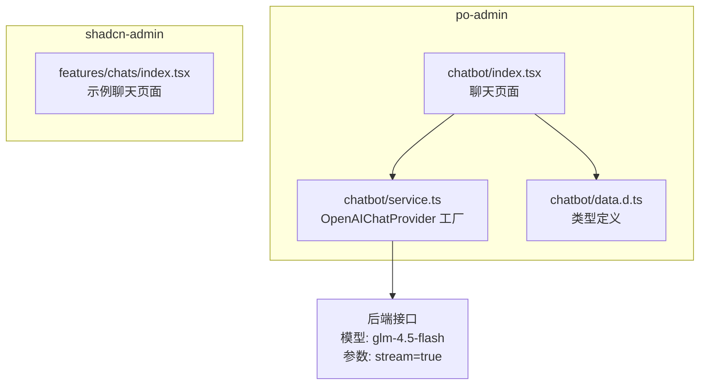
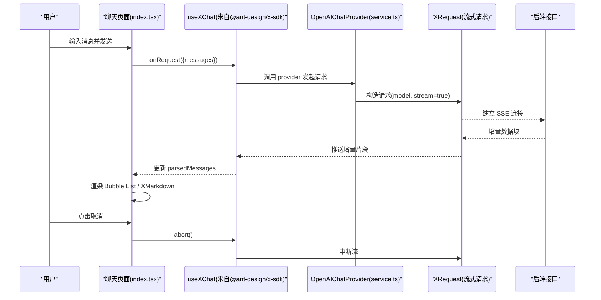
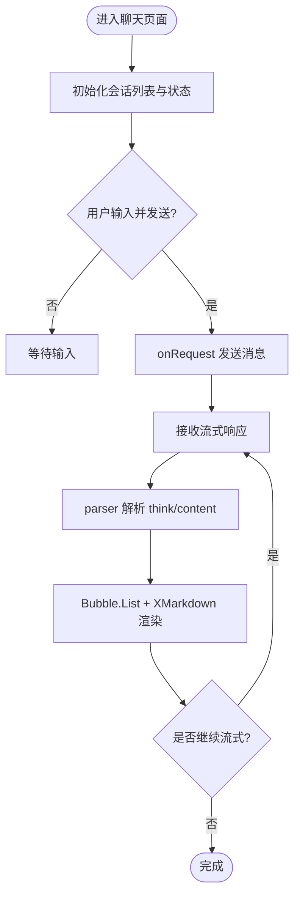
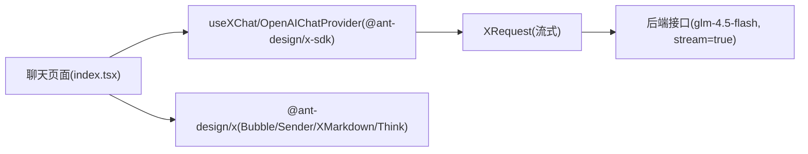

# 前端集成与界面

<cite>
**本文引用的文件**
- [web_client/po-admin/src/pages/chatbot/index.tsx](file://web_client/po-admin/src/pages/chatbot/index.tsx)
- [web_client/po-admin/src/pages/chatbot/service.ts](file://web_client/po-admin/src/pages/chatbot/service.ts)
- [web_client/po-admin/src/pages/chatbot/data.d.ts](file://web_client/po-admin/src/pages/chatbot/data.d.ts)
- [web_client/shadcn-admin/src/features/chats/index.tsx](file://web_client/shadcn-admin/src/features/chats/index.tsx)
</cite>

## 目录
1. [简介](#简介)
2. [项目结构](#项目结构)
3. [核心组件](#核心组件)
4. [架构总览](#架构总览)
5. [详细组件分析](#详细组件分析)
6. [依赖关系分析](#依赖关系分析)
7. [性能考虑](#性能考虑)
8. [故障排查指南](#故障排查指南)
9. [结论](#结论)
10. [附录](#附录)

## 简介
本文件面向前端集成与界面开发，聚焦于聊天场景的 React 组件架构、WebSocket/流式响应（SSE）客户端集成、消息渲染与用户交互处理、状态管理、UI 组件设计、样式定制与无障碍访问，以及高级功能（文件上传、表情符号、Markdown 渲染）的集成方案。文档基于仓库中实际的前端代码进行梳理，提供从连接到消息显示的完整流程说明，并给出可操作的优化建议与排错指引。

## 项目结构
本项目包含两个前端工程：
- po-admin：基于 Ant Design Pro 的后台管理应用，内置聊天页面，使用 @ant-design/x-sdk 提供的 OpenAIChatProvider 实现流式对话。
- shadcn-admin：基于 shadcn/ui 的管理模板，包含一个示例聊天页面（静态数据演示）。

图表来源
- [web_client/po-admin/src/pages/chatbot/index.tsx:1-333](file://web_client/po-admin/src/pages/chatbot/index.tsx#L1-L333)
- [web_client/po-admin/src/pages/chatbot/service.ts:1-19](file://web_client/po-admin/src/pages/chatbot/service.ts#L1-L19)
- [web_client/po-admin/src/pages/chatbot/data.d.ts:1-13](file://web_client/po-admin/src/pages/chatbot/data.d.ts#L1-L13)
- [web_client/shadcn-admin/src/features/chats/index.tsx:1-354](file://web_client/shadcn-admin/src/features/chats/index.tsx#L1-L354)

章节来源
- [web_client/po-admin/src/pages/chatbot/index.tsx:1-333](file://web_client/po-admin/src/pages/chatbot/index.tsx#L1-L333)
- [web_client/po-admin/src/pages/chatbot/service.ts:1-19](file://web_client/po-admin/src/pages/chatbot/service.ts#L1-L19)
- [web_client/po-admin/src/pages/chatbot/data.d.ts:1-13](file://web_client/po-admin/src/pages/chatbot/data.d.ts#L1-L13)
- [web_client/shadcn-admin/src/features/chats/index.tsx:1-354](file://web_client/shadcn-admin/src/features/chats/index.tsx#L1-L354)

## 核心组件
- 聊天页面（po-admin）
  - 使用 @ant-design/x 的 Bubble、Conversations、Sender、XMarkdown、Think 等组件构建聊天界面。
  - 通过 useXChat 钩子与 OpenAIChatProvider 协作，完成请求发起、流式解析与历史累积。
  - 自定义 parser 将后端返回的消息内容解析为统一格式，支持“思考过程”与“正文”分离展示。
- 服务层（po-admin）
  - createChatProvider 工厂函数创建 OpenAIChatProvider，封装 XRequest，设置 model 与 stream 参数。
- 类型定义（po-admin）
  - ConversationItem、ParsedMessage 等类型用于会话列表与消息解析。
- 示例聊天（shadcn-admin）
  - 基于本地数据的聊天 UI 示例，展示消息气泡、输入框、搜索与布局。

章节来源
- [web_client/po-admin/src/pages/chatbot/index.tsx:1-333](file://web_client/po-admin/src/pages/chatbot/index.tsx#L1-L333)
- [web_client/po-admin/src/pages/chatbot/service.ts:1-19](file://web_client/po-admin/src/pages/chatbot/service.ts#L1-L19)
- [web_client/po-admin/src/pages/chatbot/data.d.ts:1-13](file://web_client/po-admin/src/pages/chatbot/data.d.ts#L1-L13)
- [web_client/shadcn-admin/src/features/chats/index.tsx:1-354](file://web_client/shadcn-admin/src/features/chats/index.tsx#L1-L354)

## 架构总览
聊天流程采用“页面 + Provider + 流式解析”的分层架构：
- 页面层：负责 UI 渲染、用户交互、会话管理与消息展示。
- 服务层：封装网络请求与流式协议（SSE），由 @ant-design/x-sdk 内部处理。
- 解析层：自定义 parser 将原始消息转换为统一结构，供 UI 消费。

图表来源
- [web_client/po-admin/src/pages/chatbot/index.tsx:116-333](file://web_client/po-admin/src/pages/chatbot/index.tsx#L116-L333)
- [web_client/po-admin/src/pages/chatbot/service.ts:1-19](file://web_client/po-admin/src/pages/chatbot/service.ts#L1-L19)

## 详细组件分析

### 聊天页面（po-admin）
- 会话管理
  - 使用本地 state 维护会话列表与当前激活会话，支持新建、删除与切换。
- 消息发送与取消
  - 通过 useXChat 的 onRequest 发送消息；isRequesting 控制加载态；abort 支持中断流。
- 消息解析与渲染
  - 自定义 parser 识别 <think>...</think> 标签，拆分“思考过程”和“正文”。
  - 使用 Bubble.List 渲染消息，roleConfig 区分用户与 AI 的头像、位置与打字动画。
  - 使用 XMarkdown 渲染 Markdown，并根据 status 控制流式更新动画。
- 欢迎页与输入区
  - 无消息时显示打字机效果的欢迎标题；输入区使用 Sender 组件，支持自动高度与提交/取消。

图表来源
- [web_client/po-admin/src/pages/chatbot/index.tsx:51-114](file://web_client/po-admin/src/pages/chatbot/index.tsx#L51-L114)
- [web_client/po-admin/src/pages/chatbot/index.tsx:178-222](file://web_client/po-admin/src/pages/chatbot/index.tsx#L178-L222)

章节来源
- [web_client/po-admin/src/pages/chatbot/index.tsx:1-333](file://web_client/po-admin/src/pages/chatbot/index.tsx#L1-L333)

### 服务层（po-admin）
- createChatProvider
  - 使用 OpenAIChatProvider 封装 XRequest，设置 model 与 stream 参数，启用手动模式以配合 useXChat 的生命周期。
- 环境变量
  - 通过 CHAT_API_URL 配置后端地址，便于多环境部署。

章节来源
- [web_client/po-admin/src/pages/chatbot/service.ts:1-19](file://web_client/po-admin/src/pages/chatbot/service.ts#L1-L19)

### 类型定义（po-admin）
- ConversationItem
  - key、label、group、isDraft 描述会话项的结构。
- ParsedMessage
  - 区分 user 与 assistant，assistant 可选 thinkContent 字段用于展示“思考过程”。

章节来源
- [web_client/po-admin/src/pages/chatbot/data.d.ts:1-13](file://web_client/po-admin/src/pages/chatbot/data.d.ts#L1-L13)

### 示例聊天（shadcn-admin）
- 功能概览
  - 左侧联系人列表、右侧聊天窗口、搜索过滤、消息按日期分组、移动端适配。
- 数据与交互
  - 使用本地 JSON 数据模拟聊天记录；点击联系人切换会话；表单输入与发送按钮占位。
- 可扩展点
  - 可接入真实后端、增加文件上传、表情选择器、Markdown 预览等。

章节来源
- [web_client/shadcn-admin/src/features/chats/index.tsx:1-354](file://web_client/shadcn-admin/src/features/chats/index.tsx#L1-L354)

## 依赖关系分析
- 组件依赖
  - 聊天页面依赖 @ant-design/x 系列组件与 @ant-design/x-sdk 的 useXChat/OpenAIChatProvider。
  - 服务层依赖 XRequest 与 OpenAIChatProvider。
- 外部依赖
  - 后端接口通过环境变量注入，支持不同环境的模型与流式开关。

图表来源
- [web_client/po-admin/src/pages/chatbot/index.tsx:1-333](file://web_client/po-admin/src/pages/chatbot/index.tsx#L1-L333)
- [web_client/po-admin/src/pages/chatbot/service.ts:1-19](file://web_client/po-admin/src/pages/chatbot/service.ts#L1-L19)

章节来源
- [web_client/po-admin/src/pages/chatbot/index.tsx:1-333](file://web_client/po-admin/src/pages/chatbot/index.tsx#L1-L333)
- [web_client/po-admin/src/pages/chatbot/service.ts:1-19](file://web_client/po-admin/src/pages/chatbot/service.ts#L1-L19)

## 性能考虑
- 流式渲染
  - 使用 XMarkdown 的 streaming 模式结合 status 控制增量更新，避免整段重绘。
- 列表渲染
  - Bubble.List 配合 autoScroll 提升长列表滚动体验；合理限制最大宽度减少重排。
- 计算优化
  - 使用 useMemo 缓存 bubbleItems 与 provider，减少重复计算。
- 内存与网络
  - 及时中止未完成的请求（abort）；在会话切换或卸载时清理资源。
- 主题与样式
  - 通过 antd 的 styles 与 CSS-in-JS 局部覆盖，避免全局样式污染。

[本节为通用指导，不直接分析具体文件]

## 故障排查指南
- 连接与流式问题
  - 检查环境变量 CHAT_API_URL 是否正确指向后端。
  - 确认请求参数 model 与 stream 已正确设置。
  - 观察 isRequesting 状态与浏览器网络面板，确认 SSE 连接是否建立。
- 解析异常
  - 若 think 标签缺失或格式不符，parser 会降级为普通内容；确保后端输出符合预期。
- 错误提示
  - 可在 useXChat 回调中捕获错误并提示用户；必要时记录日志以便定位。
- 取消与重试
  - 使用 abort 中断正在进行的流；在网络不稳定时提供重试机制。

章节来源
- [web_client/po-admin/src/pages/chatbot/service.ts:1-19](file://web_client/po-admin/src/pages/chatbot/service.ts#L1-L19)
- [web_client/po-admin/src/pages/chatbot/index.tsx:168-188](file://web_client/po-admin/src/pages/chatbot/index.tsx#L168-L188)

## 结论
本项目的聊天界面以 @ant-design/x-sdk 为核心，实现了简洁高效的流式对话体验。通过自定义 parser 与 XMarkdown 的流式渲染，兼顾了可读性与性能。建议在后续迭代中补充错误边界、离线策略、国际化与更完善的无障碍支持，并在 shadcn-admin 示例中逐步接入真实后端能力。

[本节为总结性内容，不直接分析具体文件]

## 附录

### 集成示例：从连接到消息显示
- 步骤
  - 在页面中使用 createChatProvider 创建 provider，并通过 useXChat 获取 onRequest、parsedMessages 等方法。
  - 用户发送消息后，onRequest 触发流式请求；provider 内部维护历史与增量更新。
  - 使用 Bubble.List 与 roleConfig 渲染消息；XMarkdown 根据 status 控制流式动画。
  - 支持 abort 中断请求；会话切换时更新 activeKey。
- 关键点
  - 使用 parser 将后端消息统一为 ParsedMessage。
  - 通过 isRequesting 控制输入区加载态。
  - 使用 useMemo 优化渲染性能。

章节来源
- [web_client/po-admin/src/pages/chatbot/index.tsx:116-333](file://web_client/po-admin/src/pages/chatbot/index.tsx#L116-L333)
- [web_client/po-admin/src/pages/chatbot/service.ts:1-19](file://web_client/po-admin/src/pages/chatbot/service.ts#L1-L19)

### 样式定制：主题、响应式与无障碍
- 主题
  - 通过 antd 的 Token 与样式变量定制主题；在 Bubble/Sender 上使用 styles 属性局部覆盖。
- 响应式
  - 使用媒体查询与 Tailwind 类名（shadcn-admin）或 antd 栅格（po-admin）适配不同屏幕尺寸。
- 无障碍
  - 为关键控件添加 aria-label、role 与键盘导航；确保焦点可见与语义化结构。

[本节为通用指导，不直接分析具体文件]

### 高级功能：文件上传、表情符号、Markdown 渲染
- 文件上传
  - 在 Sender 旁增加附件按钮，选择文件后转为 Base64 或分片上传至后端；在消息体中附加元数据。
- 表情符号
  - 引入表情选择器，插入到输入框光标位置；支持富文本预览。
- Markdown 渲染
  - 使用 XMarkdown 渲染代码块、表格与链接；对不安全内容进行白名单过滤。

[本节为通用指导，不直接分析具体文件]