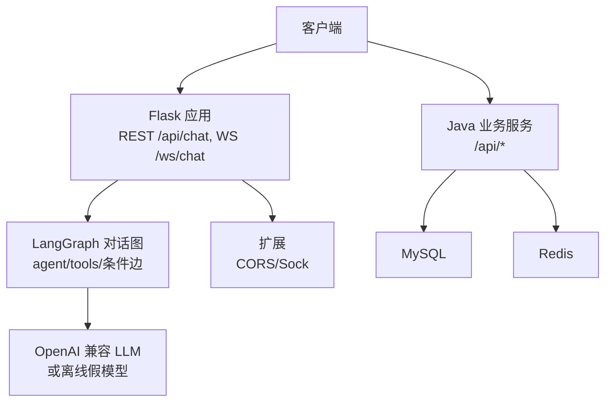
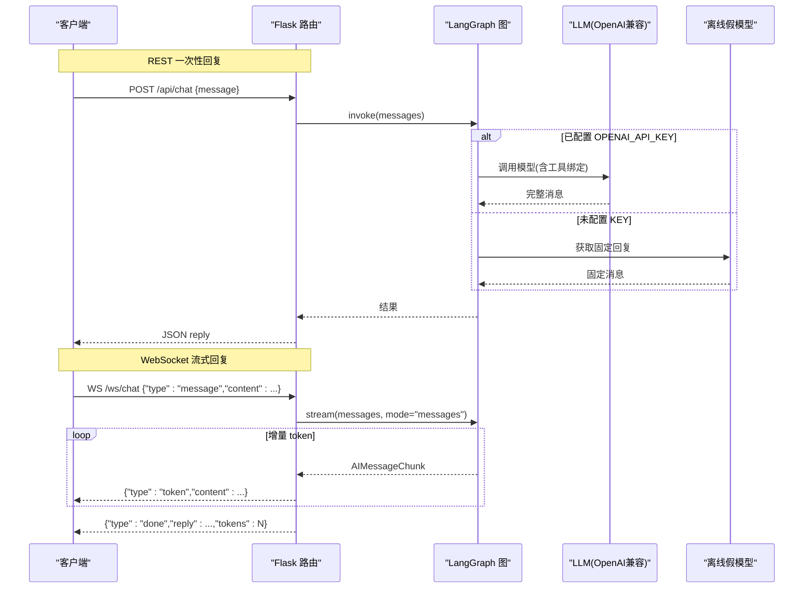
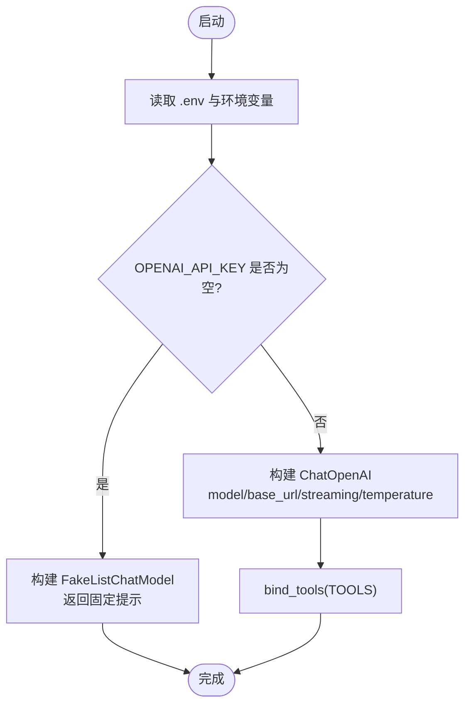
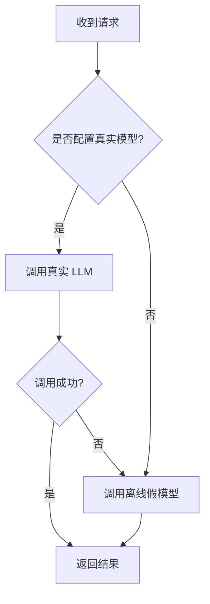
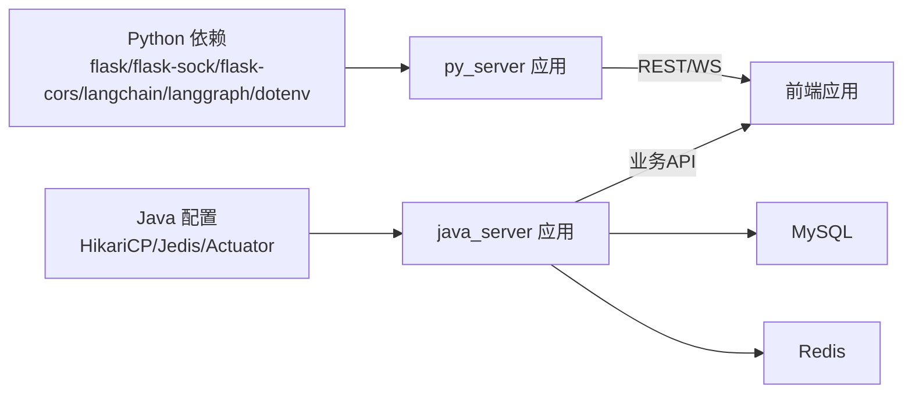

# 多模型集成方案

<cite>
**本文引用的文件**
- [app.py](file://py_server/app.py)
- [config.py](file://py_server/config.py)
- [extensions.py](file://py_server/extensions.py)
- [chat_graph.py](file://py_server/agents/chat_graph.py)
- [chat.py](file://py_server/blueprints/chat.py)
- [ws.py](file://py_server/blueprints/ws.py)
- [main.py](file://py_server/blueprints/main.py)
- [requirements.txt](file://py_server/requirements.txt)
- [application.yaml](file://java_server/po/src/main/resources/application.yaml)
</cite>

## 目录
1. [简介](#简介)
2. [项目结构](#项目结构)
3. [核心组件](#核心组件)
4. [架构总览](#架构总览)
5. [详细组件分析](#详细组件分析)
6. [依赖关系分析](#依赖关系分析)
7. [性能考虑](#性能考虑)
8. [故障排查指南](#故障排查指南)
9. [结论](#结论)
10. [附录](#附录)

## 简介
本方案围绕“多模型集成”的目标，提供一套以 OpenAI 兼容接口为核心的后端服务。通过统一配置与智能体编排，支持在 OpenAI、DeepSeek、通义千问等任意 OpenAI 兼容服务之间切换；同时内置离线降级能力，确保在无 Key 或外部服务不可用时仍可联调。服务暴露 REST 一次性回复与 WebSocket 流式回复两种模式，并提供健康检查与健康状态上报（是否已配置真实大模型）。

## 项目结构
- Python 后端（py_server）：基于 Flask + LangChain/LangGraph，负责路由、配置加载、智能体图构建与执行、WebSocket 流式输出。
- Java 后端（java_server）：提供业务 API、数据库连接池、缓存与监控端点，可作为上层网关或业务聚合层。
- Web 前端（web_client）：管理后台与聊天页面示例，可对接后端 REST/WS 接口。

图表来源
- [app.py:24-47](file://py_server/app.py#L24-L47)
- [chat_graph.py:75-86](file://py_server/agents/chat_graph.py#L75-L86)
- [application.yaml:23-52](file://java_server/po/src/main/resources/application.yaml#L23-L52)

章节来源
- [app.py:24-47](file://py_server/app.py#L24-L47)
- [application.yaml:1-109](file://java_server/po/src/main/resources/application.yaml#L1-L109)

## 核心组件
- 配置中心：集中读取环境变量与 .env，定义服务与 LLM 相关参数。
- 智能体编排：基于 LangGraph 的 ReAct 循环，动态绑定工具并处理工具调用分支。
- 路由层：REST 一次性回复与 WebSocket 流式回复双通道。
- 健康检查：暴露服务状态与 LLM 配置情况。
- 扩展：跨域与 WebSocket 支持。

章节来源
- [config.py:10-24](file://py_server/config.py#L10-L24)
- [chat_graph.py:46-86](file://py_server/agents/chat_graph.py#L46-L86)
- [chat.py:10-23](file://py_server/blueprints/chat.py#L10-L23)
- [ws.py:30-89](file://py_server/blueprints/ws.py#L30-L89)
- [main.py:22-29](file://py_server/blueprints/main.py#L22-L29)
- [extensions.py:1-7](file://py_server/extensions.py#L1-L7)

## 架构总览
下图展示了从请求进入、智能体执行到返回结果的完整流程，包括 REST 一次性返回与 WebSocket 流式返回两条路径。

图表来源
- [chat.py:10-23](file://py_server/blueprints/chat.py#L10-L23)
- [ws.py:30-89](file://py_server/blueprints/ws.py#L30-L89)
- [chat_graph.py:46-86](file://py_server/agents/chat_graph.py#L46-L86)

## 详细组件分析

### OpenAI 兼容接口实现
- API 密钥管理：通过环境变量读取 OPENAI_API_KEY；为空时自动启用离线演示模式。
- 基础 URL 配置：OPENAI_BASE_URL 用于指向任意 OpenAI 兼容服务（如 DeepSeek、通义千问等），为空则使用默认上游。
- 请求参数映射：ChatOpenAI 实例化时传入 model、api_key、base_url、streaming、temperature，并通过 bind_tools 绑定工具列表。

图表来源
- [config.py:10-24](file://py_server/config.py#L10-L24)
- [chat_graph.py:46-56](file://py_server/agents/chat_graph.py#L46-L56)

章节来源
- [config.py:10-24](file://py_server/config.py#L10-L24)
- [chat_graph.py:46-56](file://py_server/agents/chat_graph.py#L46-L56)

### 模型切换策略
- 动态模型选择：通过 OPENAI_MODEL 指定模型名称；可在运行时通过环境变量覆盖。
- 负载均衡：当前实现为单实例直连上游；如需多模型或多实例负载，可在 _build_llm 中引入选择器（按权重/延迟/错误率轮询）。
- 故障转移机制：当 OPENAI_API_KEY 缺失或上游不可用时，自动回退至离线假模型，保证链路可用。

图表来源
- [chat_graph.py:46-56](file://py_server/agents/chat_graph.py#L46-L56)
- [main.py:22-29](file://py_server/blueprints/main.py#L22-L29)

章节来源
- [chat_graph.py:46-56](file://py_server/agents/chat_graph.py#L46-L56)
- [main.py:22-29](file://py_server/blueprints/main.py#L22-L29)

### 配置管理系统
- 环境变量读取：使用 python-dotenv 加载 .env，再通过 os.getenv 读取各项配置。
- 配置文件结构：Config 类集中定义服务端口、调试开关以及 LLM 相关键值。
- 热重载支持：开发模式下可通过 DEBUG 开启；生产建议使用进程管理器配合信号重启以实现配置热更新。

章节来源
- [config.py:1-24](file://py_server/config.py#L1-L24)
- [app.py:24-47](file://py_server/app.py#L24-L47)

### 降级策略
- 离线模式配置：未设置 OPENAI_API_KEY 时，自动使用 FakeListChatModel 返回固定提示，便于无 Key 联调。
- 假模型使用：在 agent 节点中，若为假模型则不绑定工具（避免 tool_calls 异常）。
- 服务可用性检测：/api/health 返回 llm_configured 字段，指示是否已配置真实大模型及当前模型名。

章节来源
- [chat_graph.py:34-56](file://py_server/agents/chat_graph.py#L34-L56)
- [main.py:22-29](file://py_server/blueprints/main.py#L22-L29)

### 性能优化
- 连接池管理：Java 侧使用 HikariCP 连接池（maximum-pool-size、minimum-idle、connection-timeout）；Python 侧由 LangChain/OpenAI SDK 管理 HTTP 连接。
- 请求缓存：可对高频查询结果引入 Redis 缓存（Java 侧已配置 Redis 连接池）。
- 超时设置：数据库连接超时、Redis 超时已在配置中体现；LLM 请求超时建议在上游或反向代理层统一控制。

章节来源
- [application.yaml:23-52](file://java_server/po/src/main/resources/application.yaml#L23-L52)

### 多种 LLM 提供商集成示例
- OpenAI：设置 OPENAI_API_KEY，保持 OPENAI_BASE_URL 为空或使用官方地址。
- DeepSeek：设置 OPENAI_BASE_URL 为 https://api.deepseek.com/v1，并指定对应模型名。
- 通义千问：设置 OPENAI_BASE_URL 为阿里云提供的 OpenAI 兼容地址，并指定模型名。
- 其他：任何遵循 OpenAI 接口的服务均可通过 base_url 接入。

章节来源
- [config.py:20-24](file://py_server/config.py#L20-L24)
- [README.md:102-113](file://py_server/README.md#L102-L113)

### 监控与日志记录
- 请求追踪：REST 与 WebSocket 入口均记录关键日志（连接、断开、错误堆栈）。
- 性能指标：Java 侧暴露 Actuator 端点（health/info/metrics/prometheus），可用于采集 QPS、延迟、错误率等指标。
- 错误统计：Python 侧捕获异常并记录日志；Java 侧可通过统一异常处理器汇总错误码与次数。

章节来源
- [ws.py:30-89](file://py_server/blueprints/ws.py#L30-L89)
- [chat.py:10-23](file://py_server/blueprints/chat.py#L10-L23)
- [application.yaml:82-95](file://java_server/po/src/main/resources/application.yaml#L82-L95)

## 依赖关系分析
- Python 后端依赖：Flask、flask-sock、flask-cors、LangChain/LangGraph、python-dotenv。
- Java 后端依赖：Spring Boot、HikariCP、JPA/Hibernate、Redis/Jedis、Actuator。
- 前后端交互：前端通过 REST 与 WebSocket 与 Python 后端通信；Java 后端作为业务服务与数据层。

图表来源
- [requirements.txt:1-13](file://py_server/requirements.txt#L1-L13)
- [application.yaml:23-52](file://java_server/po/src/main/resources/application.yaml#L23-L52)

章节来源
- [requirements.txt:1-13](file://py_server/requirements.txt#L1-L13)
- [application.yaml:23-52](file://java_server/po/src/main/resources/application.yaml#L23-L52)

## 性能考虑
- 连接池：合理设置数据库连接池大小与空闲数，避免连接耗尽导致请求阻塞。
- 超时：为数据库、缓存、外部 LLM 请求设置合适的超时时间，防止长尾请求拖垮系统。
- 流式输出：优先使用 WebSocket 流式返回，降低首字节延迟，提升用户体验。
- 缓存：对热点数据（如工具结果、常见问答）进行缓存，减少重复计算与上游调用。
- 并发：根据服务器资源调整线程池与工作进程数，结合压测确定最佳参数。

[本节为通用指导，无需特定文件引用]

## 故障排查指南
- 无法连接 LLM：检查 OPENAI_API_KEY 与 OPENAI_BASE_URL 是否正确；通过 /api/health 确认 llm_configured 状态。
- WebSocket 断连：查看 ws.py 中的连接日志与错误帧；确认网络与防火墙策略。
- 工具调用失败：确认模型是否支持 tool_calls；离线模式下不会触发工具调用。
- 数据库连接失败：核对 application.yaml 中的数据源与连接池配置；检查 MySQL 服务状态。
- 缓存异常：检查 Redis 连接与密码；必要时关闭缓存重试逻辑。

章节来源
- [ws.py:30-89](file://py_server/blueprints/ws.py#L30-L89)
- [chat.py:10-23](file://py_server/blueprints/chat.py#L10-L23)
- [application.yaml:23-52](file://java_server/po/src/main/resources/application.yaml#L23-L52)

## 结论
本方案以 OpenAI 兼容接口为核心，实现了统一的模型接入与智能体编排，具备灵活的模型切换与可靠的降级机制。通过 REST 与 WebSocket 双通道满足不同场景需求，并结合 Java 后端的连接池、缓存与监控能力，形成完整的端到端解决方案。建议在上线前完善负载均衡、熔断与告警策略，进一步提升稳定性与可观测性。

## 附录
- 环境变量清单（示例）
  - SECRET_KEY：应用密钥
  - HOST/PORT/DEBUG：服务监听与调试开关
  - OPENAI_API_KEY：上游 API 密钥
  - OPENAI_BASE_URL：上游基础地址
  - OPENAI_MODEL：模型名称
- 接口清单
  - GET /：服务信息
  - GET /api/health：健康检查（含 LLM 配置状态）
  - POST /api/chat：一次性对话
  - WS /ws/chat：流式对话

章节来源
- [config.py:10-24](file://py_server/config.py#L10-L24)
- [main.py:9-29](file://py_server/blueprints/main.py#L9-L29)
- [chat.py:10-23](file://py_server/blueprints/chat.py#L10-L23)
- [ws.py:30-89](file://py_server/blueprints/ws.py#L30-L89)