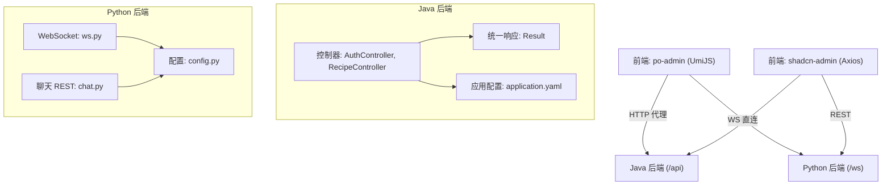
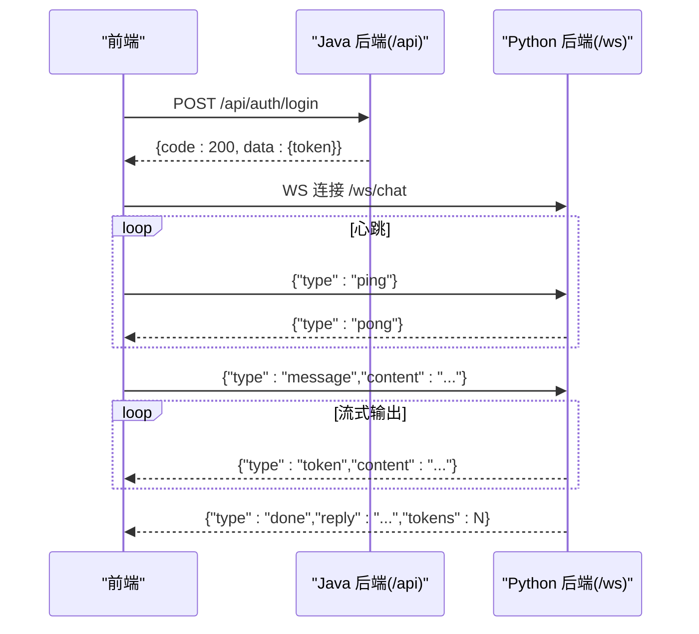
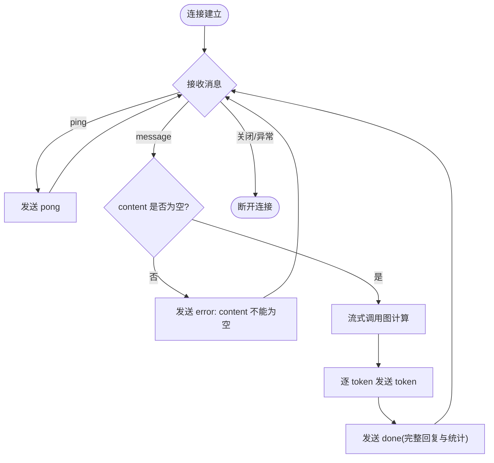
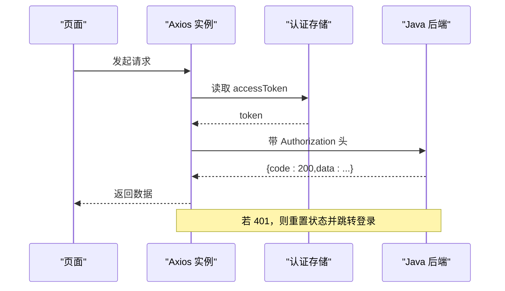
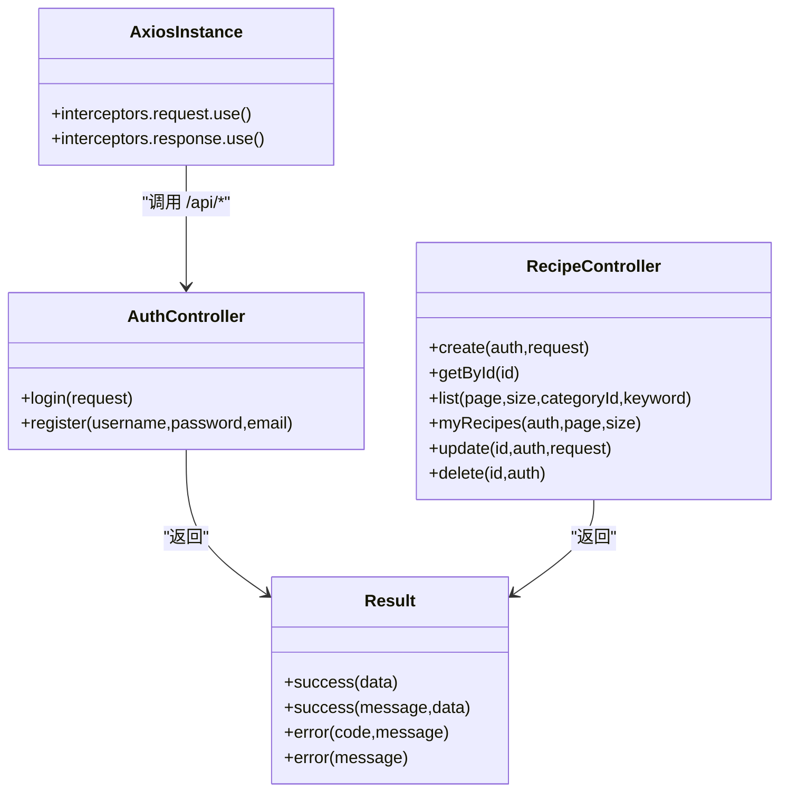

# 前后端数据交互

<cite>
**本文引用的文件**
- [AuthController.java](file://java_server/po/src/main/java/com/goodzheng/po/controller/AuthController.java)
- [RecipeController.java](file://java_server/po/src/main/java/com/goodzheng/po/controller/RecipeController.java)
- [Result.java](file://java_server/po/src/main/java/com/goodzheng/po/dto/Result.java)
- [LoginRequest.java](file://java_server/po/src/main/java/com/goodzheng/po/dto/LoginRequest.java)
- [application.yaml](file://java_server/po/src/main/resources/application.yaml)
- [ws.py](file://py_server/blueprints/ws.py)
- [chat.py](file://py_server/blueprints/chat.py)
- [config.py](file://py_server/config.py)
- [axios.ts](file://web_client/shadcn-admin/src/lib/axios.ts)
- [requestErrorConfig.ts](file://web_client/po-admin/src/requestErrorConfig.ts)
- [proxy.ts](file://web_client/po-admin/config/proxy.ts)
- [api.ts](file://web_client/po-admin/src/services/ant-design-pro/api.ts)
</cite>

## 目录
1. [简介](#简介)
2. [项目结构](#项目结构)
3. [核心组件](#核心组件)
4. [架构总览](#架构总览)
5. [详细组件分析](#详细组件分析)
6. [依赖关系分析](#依赖关系分析)
7. [性能考虑](#性能考虑)
8. [故障排查指南](#故障排查指南)
9. [结论](#结论)
10. [附录：接口契约与使用指南](#附录接口契约与使用指南)

## 简介
本技术文档围绕前后端数据交互模式，系统阐述 RESTful API 设计规范、WebSocket 实时通信实现、数据格式标准化、前端请求封装、跨域解决方案，并提供完整的接口契约与最佳实践。目标读者包括初学者（快速上手）与开发者（集成参考）。

## 项目结构
本项目包含三个主要部分：
- Java 后端服务：提供 RESTful API，统一响应体 Result，基于 Spring Boot，上下文路径 /api。
- Python 后端服务：提供聊天 REST 接口与 WebSocket 流式对话。
- 前端客户端：两个前端工程，分别采用 UmiJS + Ant Design Pro 的 request 配置与 Shadcn Admin 的 Axios 封装。

图表来源
- [application.yaml:4-7](file://java_server/po/src/main/resources/application.yaml#L4-L7)
- [AuthController.java:11-19](file://java_server/po/src/main/java/com/goodzheng/po/controller/AuthController.java#L11-L19)
- [RecipeController.java:18-29](file://java_server/po/src/main/java/com/goodzheng/po/controller/RecipeController.java#L18-L29)
- [ws.py:23-30](file://py_server/blueprints/ws.py#L23-L30)
- [chat.py:7-10](file://py_server/blueprints/chat.py#L7-L10)
- [config.py:10-18](file://py_server/config.py#L10-L18)

章节来源
- [application.yaml:4-7](file://java_server/po/src/main/resources/application.yaml#L4-L7)
- [AuthController.java:11-19](file://java_server/po/src/main/java/com/goodzheng/po/controller/AuthController.java#L11-L19)
- [RecipeController.java:18-29](file://java_server/po/src/main/java/com/goodzheng/po/controller/RecipeController.java#L18-L29)
- [ws.py:23-30](file://py_server/blueprints/ws.py#L23-L30)
- [chat.py:7-10](file://py_server/blueprints/chat.py#L7-L10)
- [config.py:10-18](file://py_server/config.py#L10-L18)

## 核心组件
- 统一响应体 Result：所有 HTTP 响应以 { code, message, data } 形式返回，成功码 200，错误码由业务定义。
- 认证与鉴权：登录注册通过 AuthController；受保护资源通过 Authorization 头携带 JWT，后端解析用户身份。
- 菜谱资源：RecipeController 提供 CRUD 与分页查询、按分类筛选、搜索等能力。
- 聊天服务：Python 提供一次性回复 REST 接口与流式对话 WebSocket。
- 前端请求封装：
  - po-admin：基于 UmiJS request 的错误处理与拦截器配置。
  - shadcn-admin：基于 Axios 的请求/响应拦截器，自动注入 Bearer Token，处理 401 跳转。
- 跨域与代理：
  - Java 后端启用 @CrossOrigin 允许跨域。
  - 前端开发环境通过代理将 /api 转发到后端。

章节来源
- [Result.java:7-31](file://java_server/po/src/main/java/com/goodzheng/po/dto/Result.java#L7-L31)
- [AuthController.java:11-39](file://java_server/po/src/main/java/com/goodzheng/po/controller/AuthController.java#L11-L39)
- [RecipeController.java:18-118](file://java_server/po/src/main/java/com/goodzheng/po/controller/RecipeController.java#L18-L118)
- [ws.py:23-90](file://py_server/blueprints/ws.py#L23-L90)
- [chat.py:7-24](file://py_server/blueprints/chat.py#L7-L24)
- [requestErrorConfig.ts:28-108](file://web_client/po-admin/src/requestErrorConfig.ts#L28-L108)
- [axios.ts:34-86](file://web_client/shadcn-admin/src/lib/axios.ts#L34-L86)
- [proxy.ts:12-41](file://web_client/po-admin/config/proxy.ts#L12-L41)

## 架构总览
前后端通过 HTTP 与 WebSocket 两种协议协作：
- HTTP：用于常规资源操作与一次性对话。
- WebSocket：用于长连接、增量 token 推送的流式对话。

图表来源
- [AuthController.java:19-27](file://java_server/po/src/main/java/com/goodzheng/po/controller/AuthController.java#L19-L27)
- [ws.py:30-89](file://py_server/blueprints/ws.py#L30-L89)

## 详细组件分析

### RESTful API 设计规范
- HTTP 方法使用
  - GET：读取资源（如菜谱列表、详情、我的菜谱）。
  - POST：创建资源（如创建菜谱）、执行动作（如登录、注册）。
  - PUT：更新资源（如更新菜谱）。
  - DELETE：删除资源（如软删除菜谱）。
- URL 设计原则
  - 资源名词复数化：/recipes。
  - 子资源与过滤：/{id}、/mine、?categoryId=...、?keyword=...。
  - 统一前缀：Java 后端 context-path 为 /api。
- 状态码约定
  - 业务层统一使用 Result.code：200 表示成功；其他为错误码（如 400、401、404）。
  - HTTP 状态码保持 2xx 成功，业务错误通过 code 表达。
- 参数校验
  - 使用注解进行入参校验（如用户名、密码必填）。

章节来源
- [RecipeController.java:28-118](file://java_server/po/src/main/java/com/goodzheng/po/controller/RecipeController.java#L28-L118)
- [AuthController.java:19-39](file://java_server/po/src/main/java/com/goodzheng/po/controller/AuthController.java#L19-L39)
- [Result.java:16-31](file://java_server/po/src/main/java/com/goodzheng/po/dto/Result.java#L16-L31)
- [LoginRequest.java:6-14](file://java_server/po/src/main/java/com/goodzheng/po/dto/LoginRequest.java#L6-L14)
- [application.yaml:4-7](file://java_server/po/src/main/resources/application.yaml#L4-L7)

### WebSocket 实时通信
- 连接管理
  - 路由：/ws/chat。
  - 生命周期：连接建立、消息循环、异常关闭、断开日志记录。
- 消息协议（JSON 文本帧）
  - 客户端 -> 服务端：{"type":"message","content":"..."}, {"type":"ping"}。
  - 服务端 -> 客户端：{"type":"token","content":"..."}, {"type":"done","reply":"...","tokens":N}, {"type":"pong"}, {"type":"error","message":"..."}。
- 事件处理机制
  - 收到 message：调用图计算并逐 token 推送。
  - 收到 ping：回发 pong。
  - 非法 JSON 或未知 type：返回 error。
  - 异常：记录日志并返回 error。

图表来源
- [ws.py:30-89](file://py_server/blueprints/ws.py#L30-L89)

章节来源
- [ws.py:23-90](file://py_server/blueprints/ws.py#L23-L90)

### 数据格式标准化
- 统一响应结构
  - { code, message, data }，成功时 code=200。
- 错误处理规范
  - 业务异常捕获后返回 Result.error(code, message)。
  - 前端根据 code 与 showType 决定提示方式或跳转。
- 数据验证规则
  - 后端使用注解校验请求体字段（如用户名、密码必填）。
  - 前端在发起请求前可进行基础校验（建议结合表单库）。

章节来源
- [Result.java:7-31](file://java_server/po/src/main/java/com/goodzheng/po/dto/Result.java#L7-L31)
- [AuthController.java:19-39](file://java_server/po/src/main/java/com/goodzheng/po/controller/AuthController.java#L19-L39)
- [LoginRequest.java:6-14](file://java_server/po/src/main/java/com/goodzheng/po/dto/LoginRequest.java#L6-L14)
- [requestErrorConfig.ts:28-108](file://web_client/po-admin/src/requestErrorConfig.ts#L28-L108)

### 前端请求封装
- Axios 配置（shadcn-admin）
  - baseURL: /api，超时设置，Content-Type 固定。
  - 请求拦截器：自动附加 Authorization: Bearer <token>。
  - 响应拦截器：
    - 若后端返回 code!=200，则拒绝 Promise。
    - 401：清空本地态并跳转到登录页。
- UmiJS request 错误处理（po-admin）
  - 自定义 errorThrower 将业务失败转为 BizError。
  - errorHandler 根据 showType 选择 message/notification/重定向。
  - 支持网络离线、无响应等场景提示。

图表来源
- [axios.ts:34-86](file://web_client/shadcn-admin/src/lib/axios.ts#L34-L86)

章节来源
- [axios.ts:34-86](file://web_client/shadcn-admin/src/lib/axios.ts#L34-L86)
- [requestErrorConfig.ts:28-108](file://web_client/po-admin/src/requestErrorConfig.ts#L28-L108)

### 跨域解决方案
- CORS 配置
  - Java 控制器级 @CrossOrigin(origins = "*") 允许跨域。
- 代理设置
  - 前端开发环境通过 proxy.ts 将 /api 转发至后端地址，避免跨域问题。
- 安全策略
  - 生产环境建议限制 origins 白名单。
  - 敏感接口需鉴权（Authorization 头），并配合后端校验。

章节来源
- [AuthController.java:11-14](file://java_server/po/src/main/java/com/goodzheng/po/controller/AuthController.java#L11-L14)
- [RecipeController.java:18-21](file://java_server/po/src/main/java/com/goodzheng/po/controller/RecipeController.java#L18-L21)
- [proxy.ts:12-41](file://web_client/po-admin/config/proxy.ts#L12-L41)

## 依赖关系分析
- 控制器依赖服务与工具类：
  - AuthController 依赖 AuthService。
  - RecipeController 依赖 RecipeService、JwtUtil、UserRepository。
- 前端依赖：
  - shadcn-admin 的 axios 实例依赖认证存储与路由。
  - po-admin 的错误处理依赖 UmiJS request 插件。

图表来源
- [AuthController.java:11-39](file://java_server/po/src/main/java/com/goodzheng/po/controller/AuthController.java#L11-L39)
- [RecipeController.java:18-118](file://java_server/po/src/main/java/com/goodzheng/po/controller/RecipeController.java#L18-L118)
- [Result.java:7-31](file://java_server/po/src/main/java/com/goodzheng/po/dto/Result.java#L7-L31)
- [axios.ts:34-86](file://web_client/shadcn-admin/src/lib/axios.ts#L34-L86)

章节来源
- [AuthController.java:11-39](file://java_server/po/src/main/java/com/goodzheng/po/controller/AuthController.java#L11-L39)
- [RecipeController.java:18-118](file://java_server/po/src/main/java/com/goodzheng/po/controller/RecipeController.java#L18-L118)
- [Result.java:7-31](file://java_server/po/src/main/java/com/goodzheng/po/dto/Result.java#L7-L31)
- [axios.ts:34-86](file://web_client/shadcn-admin/src/lib/axios.ts#L34-L86)

## 性能考虑
- 连接池与线程
  - Tomcat 最大线程与连接数可调，数据库连接池大小与空闲最小值可优化。
- 缓存
  - Redis 已配置，可用于热点数据缓存（如菜谱列表、分类）。
- 流式输出
  - WebSocket 流式推送减少首屏等待时间，提升用户体验。
- 静态资源
  - 开启缓存周期，降低重复加载开销。

章节来源
- [application.yaml:4-11](file://java_server/po/src/main/resources/application.yaml#L4-L11)
- [application.yaml:23-52](file://java_server/po/src/main/resources/application.yaml#L23-L52)
- [application.yaml:61-67](file://java_server/po/src/main/resources/application.yaml#L61-L67)
- [ws.py:67-82](file://py_server/blueprints/ws.py#L67-L82)

## 故障排查指南
- 常见错误与定位
  - 401 未授权：检查 Authorization 头是否携带有效 token；前端 401 会触发登出与跳转。
  - 400 参数错误：检查请求体是否符合校验规则（如用户名、密码必填）。
  - 404 资源不存在：检查 ID 是否存在。
  - WebSocket 错误：检查 JSON 帧格式、content 是否为空、服务端日志。
- 前端错误处理
  - po-admin：BizError 的 showType 控制展示方式；网络离线与无响应有专门提示。
  - shadcn-admin：Axios 响应拦截器对 code!=200 进行拒绝，401 强制登出。
- 日志与监控
  - Java 后端日志级别与文件输出已配置；Actuator 暴露健康与指标端点。

章节来源
- [AuthController.java:19-39](file://java_server/po/src/main/java/com/goodzheng/po/controller/AuthController.java#L19-L39)
- [RecipeController.java:28-118](file://java_server/po/src/main/java/com/goodzheng/po/controller/RecipeController.java#L28-L118)
- [ws.py:43-89](file://py_server/blueprints/ws.py#L43-L89)
- [requestErrorConfig.ts:28-108](file://web_client/po-admin/src/requestErrorConfig.ts#L28-L108)
- [axios.ts:51-86](file://web_client/shadcn-admin/src/lib/axios.ts#L51-L86)
- [application.yaml:68-94](file://java_server/po/src/main/resources/application.yaml#L68-L94)

## 结论
本项目通过统一的 Result 响应体、严格的参数校验、完善的错误处理与拦截器机制，实现了前后端解耦与稳定交互。REST 与 WebSocket 的组合满足批量数据与实时对话两类典型场景。建议在后续迭代中完善生产环境 CORS 白名单、增加重试与熔断策略、补充接口测试与覆盖率。

## 附录：接口契约与使用指南

### REST 接口清单
- 认证
  - POST /api/auth/login
    - 请求体：{ username, password }（必填）
    - 响应：{ code, message, data:{ token } }
  - POST /api/auth/register
    - 查询参数：username, password, email(可选)
    - 响应：{ code, message, data:"注册结果" }
- 菜谱
  - POST /api/recipes
    - 请求头：Authorization: Bearer <token>
    - 请求体：RecipeRequest（按实体字段）
    - 响应：{ code, message, data:Recipe }
  - GET /api/recipes/{id}
    - 响应：{ code, message, data:Recipe }
  - GET /api/recipes?page=0&size=20&categoryId[]=...&keyword=...
    - 响应：{ code, message, data:Page<Recipe> }
  - GET /api/recipes/mine?page=0&size=20
    - 请求头：Authorization: Bearer <token>
    - 响应：{ code, message, data:Page<Recipe> }
  - PUT /api/recipes/{id}
    - 请求头：Authorization: Bearer <token>
    - 请求体：RecipeRequest
    - 响应：{ code, message, data:Recipe }
  - DELETE /api/recipes/{id}
    - 请求头：Authorization: Bearer <token>
    - 响应：{ code, message, data:"删除成功" }
- 聊天（一次性）
  - POST /api/chat
    - 请求体：{ message }
    - 响应：{ reply }

章节来源
- [AuthController.java:19-39](file://java_server/po/src/main/java/com/goodzheng/po/controller/AuthController.java#L19-L39)
- [RecipeController.java:28-118](file://java_server/po/src/main/java/com/goodzheng/po/controller/RecipeController.java#L28-L118)
- [chat.py:7-24](file://py_server/blueprints/chat.py#L7-L24)

### WebSocket 协议
- 连接：ws(s)://host/ws/chat
- 消息类型
  - 客户端 -> 服务端：
    - {"type":"message","content":"..."}
    - {"type":"ping"}
  - 服务端 -> 客户端：
    - {"type":"token","content":"..."}
    - {"type":"done","reply":"...","tokens":N}
    - {"type":"pong"}
    - {"type":"error","message":"..."}

章节来源
- [ws.py:23-90](file://py_server/blueprints/ws.py#L23-L90)

### 前端集成要点
- 认证流程
  - 登录后保存 token；Axios 请求拦截器自动附加 Authorization。
  - 401 时清空本地态并跳转登录页。
- 错误处理
  - po-admin：通过 errorConfig 统一处理 BizError 与网络异常。
  - shadcn-admin：Axios 响应拦截器对业务错误进行拒绝与提示。
- 代理与跨域
  - 开发环境通过 proxy.ts 将 /api 转发到后端。
  - 生产环境建议配置反向代理或严格 CORS 白名单。

章节来源
- [axios.ts:34-86](file://web_client/shadcn-admin/src/lib/axios.ts#L34-L86)
- [requestErrorConfig.ts:28-108](file://web_client/po-admin/src/requestErrorConfig.ts#L28-L108)
- [proxy.ts:12-41](file://web_client/po-admin/config/proxy.ts#L12-L41)

### 错误码定义
- 200：成功
- 400：参数错误或业务校验失败
- 401：未授权（Token 缺失或过期）
- 404：资源不存在
- 500：服务器内部错误

章节来源
- [Result.java:16-31](file://java_server/po/src/main/java/com/goodzheng/po/dto/Result.java#L16-L31)
- [AuthController.java:19-39](file://java_server/po/src/main/java/com/goodzheng/po/controller/AuthController.java#L19-L39)
- [RecipeController.java:28-118](file://java_server/po/src/main/java/com/goodzheng/po/controller/RecipeController.java#L28-L118)

### 复杂数据同步场景示例
- 场景：用户在编辑菜谱时，需要实时预览步骤与配料变化，并在提交时保证一致性。
- 方案：
  - 使用 WebSocket 建立会话，前端将变更片段以 message 推送，服务端流式返回中间状态 token。
  - 最终提交通过 REST 接口完成持久化，确保强一致。
  - 前端在 401 时中断 WS 并重试登录流程。

章节来源
- [ws.py:67-82](file://py_server/blueprints/ws.py#L67-L82)
- [RecipeController.java:85-108](file://java_server/po/src/main/java/com/goodzheng/po/controller/RecipeController.java#L85-L108)
- [axios.ts:61-80](file://web_client/shadcn-admin/src/lib/axios.ts#L61-L80)