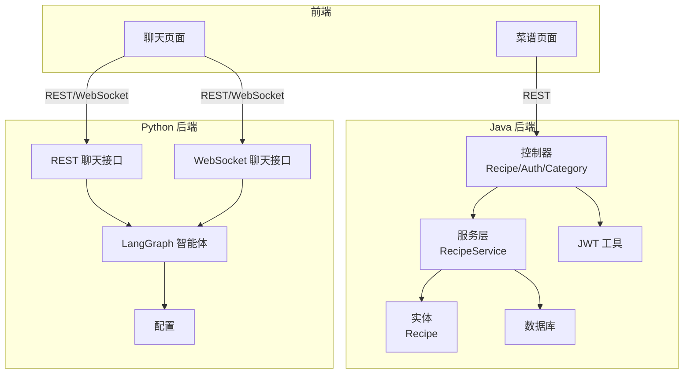
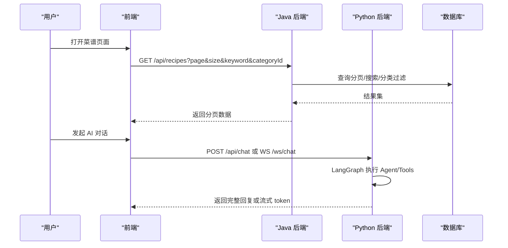
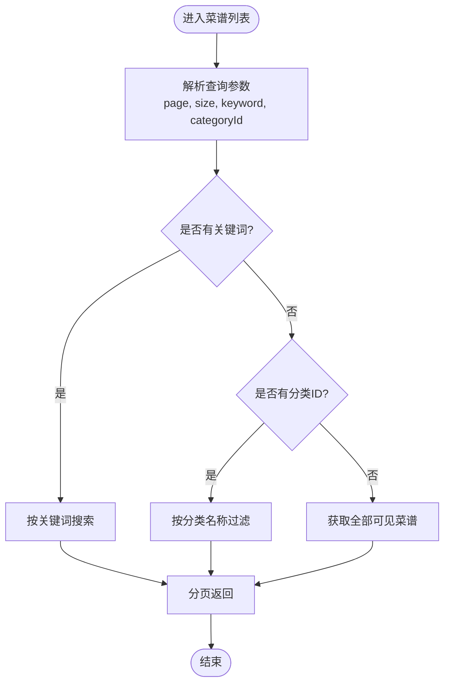
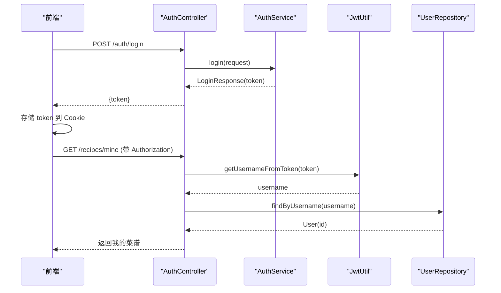
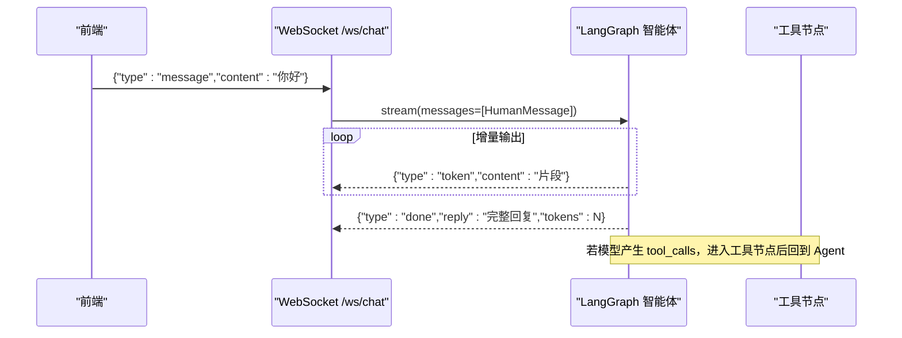
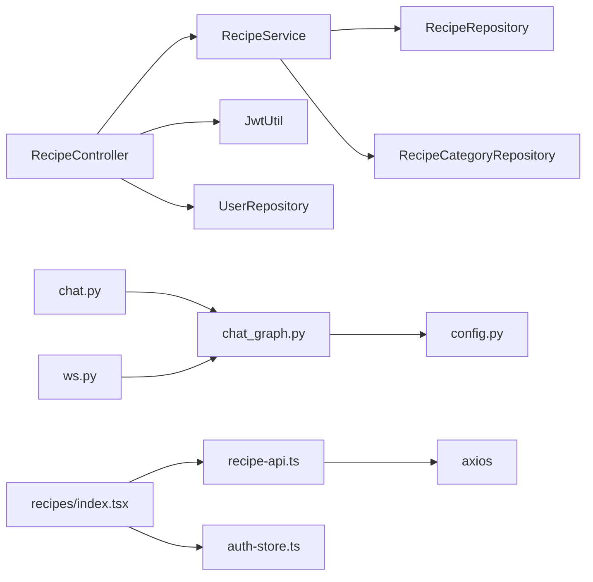

# 核心功能特性

<cite>
**本文引用的文件**
- [RecipeController.java](file://java_server/po/src/main/java/com/goodzheng/po/controller/RecipeController.java)
- [AuthController.java](file://java_server/po/src/main/java/com/goodzheng/po/controller/AuthController.java)
- [RecipeCategoryController.java](file://java_server/po/src/main/java/com/goodzheng/po/controller/RecipeCategoryController.java)
- [RecipeServiceImpl.java](file://java_server/po/src/main/java/com/goodzheng/po/service/impl/RecipeServiceImpl.java)
- [Recipe.java](file://java_server/po/src/main/java/com/goodzheng/po/entity/Recipe.java)
- [JwtUtil.java](file://java_server/po/src/main/java/com/goodzheng/po/util/JwtUtil.java)
- [application.yaml](file://java_server/po/src/main/resources/application.yaml)
- [chat.py](file://py_server/blueprints/chat.py)
- [ws.py](file://py_server/blueprints/ws.py)
- [chat_graph.py](file://py_server/agents/chat_graph.py)
- [config.py](file://py_server/config.py)
- [recipes/index.tsx](file://web_client/shadcn-admin/src/features/recipes/index.tsx)
- [recipe-api.ts](file://web_client/shadcn-admin/src/features/recipes/api/recipe-api.ts)
- [auth-store.ts](file://web_client/shadcn-admin/src/stores/auth-store.ts)
</cite>

## 目录
1. [简介](#简介)
2. [项目结构](#项目结构)
3. [核心组件](#核心组件)
4. [架构总览](#架构总览)
5. [详细组件分析](#详细组件分析)
6. [依赖关系分析](#依赖关系分析)
7. [性能考量](#性能考量)
8. [故障排查指南](#故障排查指南)
9. [结论](#结论)
10. [附录](#附录)

## 简介
本项目为“破”菜谱管理系统，提供完整的菜谱管理、分类管理、搜索与分页、用户认证授权，以及基于 LangGraph 的 AI 智能对话能力。系统采用前后端分离架构：
- 后端 Java（Spring Boot）提供 RESTful API，负责菜谱 CRUD、分类查询、JWT 认证等。
- 后端 Python（Flask + LangGraph）提供 AI 对话接口，支持一次性回复与 WebSocket 流式输出，具备工具调用与多模型兼容能力。
- 前端 React（Ant Design Pro / shadcn-admin）实现页面交互、状态管理与数据同步。

本章节聚焦于各功能模块的职责与协作方式，帮助初学者快速理解系统能力，并为开发者提供后续深入分析的入口。

## 项目结构
- 后端 Java（Spring Boot）
  - 控制器层：REST 接口定义（菜谱、分类、认证）。
  - 服务层：业务逻辑封装（创建/更新/删除/查询/搜索/分页）。
  - 实体与仓储：JPA 实体映射与数据库访问。
  - 安全：JWT 令牌生成与解析。
  - 配置：应用端口、数据源、Redis、日志、JWT 参数等。
- 后端 Python（Flask）
  - 蓝图路由：REST 聊天接口与 WebSocket 聊天接口。
  - 智能体：LangGraph 图构建、ReAct 循环、工具节点、流式输出。
  - 配置：读取 .env 环境变量，支持 OpenAI 兼容模型或离线演示模式。
- 前端（React）
  - 页面：菜谱列表页、聊天页等。
  - 数据层：基于 React Query 的查询与变更 Hook，统一 axios 请求封装。
  - 状态：Zustand 存储 JWT 与用户信息。

图表来源
- [RecipeController.java:18-119](file://java_server/po/src/main/java/com/goodzheng/po/controller/RecipeController.java#L18-L119)
- [AuthController.java:11-40](file://java_server/po/src/main/java/com/goodzheng/po/controller/AuthController.java#L11-L40)
- [RecipeCategoryController.java:11-28](file://java_server/po/src/main/java/com/goodzheng/po/controller/RecipeCategoryController.java#L11-L28)
- [RecipeServiceImpl.java:19-174](file://java_server/po/src/main/java/com/goodzheng/po/service/impl/RecipeServiceImpl.java#L19-L174)
- [Recipe.java:10-92](file://java_server/po/src/main/java/com/goodzheng/po/entity/Recipe.java#L10-L92)
- [JwtUtil.java:13-56](file://java_server/po/src/main/java/com/goodzheng/po/util/JwtUtil.java#L13-L56)
- [chat.py:1-24](file://py_server/blueprints/chat.py#L1-L24)
- [ws.py:1-90](file://py_server/blueprints/ws.py#L1-L90)
- [chat_graph.py:1-92](file://py_server/agents/chat_graph.py#L1-L92)
- [config.py:1-25](file://py_server/config.py#L1-L25)

章节来源
- [application.yaml:1-109](file://java_server/po/src/main/resources/application.yaml#L1-L109)

## 核心组件
- 菜谱管理
  - 创建、详情、分页列表、我的菜谱、更新、软删除。
  - 支持关键词搜索与按分类筛选。
  - 关联食材与步骤，支持图片/视频链接与时长等扩展字段。
- 分类管理
  - 公开接口获取所有分类，用于前端筛选与展示。
- 认证授权
  - 登录注册接口返回 JWT；受保护接口通过 Authorization 头校验。
  - 服务端从 JWT 解析用户名并映射到用户 ID，进行权限校验。
- AI 智能对话
  - REST 一次性回复：POST /api/chat。
  - WebSocket 流式对话：/ws/chat，逐 token 推送，支持心跳与错误处理。
  - LangGraph ReAct 循环：Agent -> Tools -> Agent ... -> END。
  - 多模型支持：OpenAI 兼容接口；未配置时降级为离线演示。
- 前端数据交互
  - 使用 React Query 管理查询与缓存，axios 统一封装请求。
  - Zustand 持久化 JWT 与用户信息。

章节来源
- [RecipeController.java:28-118](file://java_server/po/src/main/java/com/goodzheng/po/controller/RecipeController.java#L28-L118)
- [RecipeCategoryController.java:19-27](file://java_server/po/src/main/java/com/goodzheng/po/controller/RecipeCategoryController.java#L19-L27)
- [AuthController.java:19-39](file://java_server/po/src/main/java/com/goodzheng/po/controller/AuthController.java#L19-L39)
- [chat.py:10-23](file://py_server/blueprints/chat.py#L10-L23)
- [ws.py:30-90](file://py_server/blueprints/ws.py#L30-L90)
- [chat_graph.py:46-86](file://py_server/agents/chat_graph.py#L46-L86)
- [recipe-api.ts:67-161](file://web_client/shadcn-admin/src/features/recipes/api/recipe-api.ts#L67-L161)
- [auth-store.ts:25-54](file://web_client/shadcn-admin/src/stores/auth-store.ts#L25-L54)

## 架构总览
系统由三部分组成：前端、Java 后端、Python 后端。前端通过 REST 与 Java 后端交互完成菜谱管理；通过 REST 或 WebSocket 与 Python 后端交互完成 AI 对话。Java 后端负责数据持久化与权限控制；Python 后端负责大模型推理与工具调用。

图表来源
- [RecipeController.java:52-68](file://java_server/po/src/main/java/com/goodzheng/po/controller/RecipeController.java#L52-L68)
- [RecipeServiceImpl.java:73-97](file://java_server/po/src/main/java/com/goodzheng/po/service/impl/RecipeServiceImpl.java#L73-L97)
- [chat.py:10-23](file://py_server/blueprints/chat.py#L10-L23)
- [ws.py:30-90](file://py_server/blueprints/ws.py#L30-L90)

## 详细组件分析

### 菜谱管理（CRUD、分类、搜索、分页）
- 创建菜谱
  - 需要携带 Authorization 头，服务端解析 JWT 得到作者 ID，写入 Recipe。
  - 同时保存食材与步骤集合，事务保证一致性。
- 查询详情
  - 根据 ID 加载包含关联实体的详情，若已软删除则拒绝访问。
- 分页列表
  - 支持 page、size、排序（默认按创建时间倒序）。
  - 可选 keyword 全文检索标题/描述；可选 categoryId 列表按分类名称过滤。
- 我的菜谱
  - 仅返回当前登录用户的菜谱。
- 更新与删除
  - 更新需校验作者权限；删除为软删除（设置 deletedAt）。

图表来源
- [RecipeController.java:52-68](file://java_server/po/src/main/java/com/goodzheng/po/controller/RecipeController.java#L52-L68)
- [RecipeServiceImpl.java:73-97](file://java_server/po/src/main/java/com/goodzheng/po/service/impl/RecipeServiceImpl.java#L73-L97)

章节来源
- [RecipeController.java:28-118](file://java_server/po/src/main/java/com/goodzheng/po/controller/RecipeController.java#L28-L118)
- [RecipeServiceImpl.java:26-174](file://java_server/po/src/main/java/com/goodzheng/po/service/impl/RecipeServiceImpl.java#L26-L174)
- [Recipe.java:10-92](file://java_server/po/src/main/java/com/goodzheng/po/entity/Recipe.java#L10-L92)

### 分类管理
- 公开接口获取所有分类，无需登录。
- 前端通过 useRecipeCategories 缓存分类数据，减少重复请求。

章节来源
- [RecipeCategoryController.java:19-27](file://java_server/po/src/main/java/com/goodzheng/po/controller/RecipeCategoryController.java#L19-L27)
- [recipe-api.ts:67-78](file://web_client/shadcn-admin/src/features/recipes/api/recipe-api.ts#L67-L78)

### 认证授权（JWT）
- 登录注册
  - 登录返回包含令牌的响应；注册接收用户名、密码与邮箱。
- 令牌校验
  - 受保护接口通过 Authorization 头传递 Bearer Token。
  - 服务端使用 JwtUtil 解析用户名，再查库得到用户 ID，进行权限校验。
- 前端存储
  - 使用 Zustand 将 JWT 存入 Cookie，并在请求中携带。

图表来源
- [AuthController.java:19-39](file://java_server/po/src/main/java/com/goodzheng/po/controller/AuthController.java#L19-L39)
- [JwtUtil.java:25-56](file://java_server/po/src/main/java/com/goodzheng/po/util/JwtUtil.java#L25-L56)
- [RecipeController.java:111-118](file://java_server/po/src/main/java/com/goodzheng/po/controller/RecipeController.java#L111-L118)
- [auth-store.ts:25-54](file://web_client/shadcn-admin/src/stores/auth-store.ts#L25-L54)

章节来源
- [AuthController.java:11-40](file://java_server/po/src/main/java/com/goodzheng/po/controller/AuthController.java#L11-L40)
- [JwtUtil.java:13-56](file://java_server/po/src/main/java/com/goodzheng/po/util/JwtUtil.java#L13-L56)
- [application.yaml:104-109](file://java_server/po/src/main/resources/application.yaml#L104-L109)

### AI 智能对话（LangGraph、流式、工具调用、多模型）
- REST 一次性回复
  - POST /api/chat，传入 message，返回完整 reply。
- WebSocket 流式对话
  - /ws/chat 协议：
    - 客户端发送 {"type":"message","content":"..."} 开始一轮对话。
    - 服务端逐 token 推送 {"type":"token","content":"..."}。
    - 一轮结束推送 {"type":"done","reply":"...","tokens":N}。
    - 支持心跳 ping/pong 与错误 error。
- LangGraph 智能体
  - 图结构：START -> agent -> tools -> agent ... -> END。
  - 工具：内置 get_current_time；可绑定更多工具。
  - 多模型：优先使用 ChatOpenAI（支持 streaming），未配置时降级为 FakeListChatModel。
- 配置
  - OPENAI_API_KEY、OPENAI_BASE_URL、OPENAI_MODEL 通过 .env 注入。

图表来源
- [ws.py:30-90](file://py_server/blueprints/ws.py#L30-L90)
- [chat_graph.py:46-86](file://py_server/agents/chat_graph.py#L46-L86)

章节来源
- [chat.py:10-23](file://py_server/blueprints/chat.py#L10-L23)
- [ws.py:1-90](file://py_server/blueprints/ws.py#L1-L90)
- [chat_graph.py:1-92](file://py_server/agents/chat_graph.py#L1-L92)
- [config.py:10-25](file://py_server/config.py#L10-L25)

### 前后端数据交互模式
- RESTful API
  - 菜谱：GET/POST/PUT/DELETE /recipes，支持分页、搜索、分类过滤。
  - 分类：GET /recipe-categories。
  - 认证：POST /auth/login、/auth/register。
  - AI：POST /api/chat（一次性）、/ws/chat（流式）。
- WebSocket 实时通信
  - 协议见 ws.py 注释，支持消息、心跳、完成与错误帧。
- 状态同步机制
  - 前端使用 React Query 缓存与失效策略，在创建/更新/删除后自动刷新列表。
  - 前端使用 Zustand 持久化 JWT，确保跨页面保持登录态。

章节来源
- [recipe-api.ts:82-161](file://web_client/shadcn-admin/src/features/recipes/api/recipe-api.ts#L82-L161)
- [recipes/index.tsx:19-82](file://web_client/shadcn-admin/src/features/recipes/index.tsx#L19-L82)
- [auth-store.ts:25-54](file://web_client/shadcn-admin/src/stores/auth-store.ts#L25-L54)

## 依赖关系分析
- 控制器依赖服务层，服务层依赖实体与仓储。
- 认证流程依赖 JWT 工具与用户仓储。
- AI 对话依赖 Flask 蓝图、LangGraph 智能体与配置模块。
- 前端依赖 React Query、axios、Zustand。

图表来源
- [RecipeController.java:18-119](file://java_server/po/src/main/java/com/goodzheng/po/controller/RecipeController.java#L18-L119)
- [RecipeServiceImpl.java:19-174](file://java_server/po/src/main/java/com/goodzheng/po/service/impl/RecipeServiceImpl.java#L19-L174)
- [chat.py:1-24](file://py_server/blueprints/chat.py#L1-L24)
- [ws.py:1-90](file://py_server/blueprints/ws.py#L1-L90)
- [chat_graph.py:1-92](file://py_server/agents/chat_graph.py#L1-L92)
- [config.py:1-25](file://py_server/config.py#L1-L25)
- [recipes/index.tsx:1-82](file://web_client/shadcn-admin/src/features/recipes/index.tsx#L1-L82)
- [recipe-api.ts:1-161](file://web_client/shadcn-admin/src/features/recipes/api/recipe-api.ts#L1-L161)
- [auth-store.ts:1-55](file://web_client/shadcn-admin/src/stores/auth-store.ts#L1-L55)

章节来源
- [application.yaml:1-109](file://java_server/po/src/main/resources/application.yaml#L1-L109)

## 性能考量
- 分页与排序
  - 后端使用 Spring Data Pageable，避免全表扫描；默认按 createdAt 倒序提升热点数据命中率。
- 搜索优化
  - 关键词搜索使用模糊匹配，建议在数据库层建立索引以提升性能。
- 连接池与线程
  - HikariCP 连接池大小与 Tomcat 线程数已在配置中设定，可根据负载调整。
- 流式输出
  - WebSocket 流式传输降低首屏延迟，提升用户体验；注意前端对 token 的合并与渲染性能。
- 缓存策略
  - 分类数据在前端设置 5 分钟缓存，减少重复请求。

[本节为通用指导，不直接分析具体文件]

## 故障排查指南
- 认证失败
  - 检查 Authorization 头格式是否为 "Bearer <token>"。
  - 确认 jwt.secret 与 expiration 配置正确。
- 无权限修改/删除
  - 校验 authorId 是否等于当前登录用户 ID。
- 搜索结果为空
  - 检查 keyword 是否为空；确认数据库是否存在匹配记录。
- AI 对话异常
  - REST：检查 message 字段是否为空。
  - WebSocket：检查 JSON 帧类型与 content；查看服务端日志定位错误。
  - 未配置 OPENAI_API_KEY 时处于离线演示模式，不会调用真实模型。

章节来源
- [RecipeController.java:85-118](file://java_server/po/src/main/java/com/goodzheng/po/controller/RecipeController.java#L85-L118)
- [RecipeServiceImpl.java:100-151](file://java_server/po/src/main/java/com/goodzheng/po/service/impl/RecipeServiceImpl.java#L100-L151)
- [chat.py:10-23](file://py_server/blueprints/chat.py#L10-L23)
- [ws.py:30-90](file://py_server/blueprints/ws.py#L30-L90)
- [application.yaml:104-109](file://java_server/po/src/main/resources/application.yaml#L104-L109)

## 结论
本系统实现了菜谱管理的核心闭环：CRUD、分类、搜索与分页；并通过 JWT 保障数据安全。AI 智能对话模块基于 LangGraph 提供灵活可扩展的智能体能力，支持流式输出与工具调用，具备良好的扩展性与兼容性。前后端通过 REST 与 WebSocket 协同工作，结合 React Query 与 Zustand 实现高效的状态同步与用户体验。

[本节为总结性内容，不直接分析具体文件]

## 附录
- 使用场景示例
  - 创建菜谱
    - 前端填写表单并提交，调用 POST /recipes，携带 Authorization 头。
    - 后端校验权限并持久化，返回成功响应。
  - 与 AI 助手对话
    - 前端连接 /ws/chat，发送 {"type":"message","content":"..."}。
    - 服务端流式推送 token，最终返回 done 帧。
- 关键路径参考
  - 菜谱列表与搜索：[recipes/index.tsx:19-82](file://web_client/shadcn-admin/src/features/recipes/index.tsx#L19-L82)、[recipe-api.ts:82-97](file://web_client/shadcn-admin/src/features/recipes/api/recipe-api.ts#L82-L97)、[RecipeController.java:52-68](file://java_server/po/src/main/java/com/goodzheng/po/controller/RecipeController.java#L52-L68)、[RecipeServiceImpl.java:73-97](file://java_server/po/src/main/java/com/goodzheng/po/service/impl/RecipeServiceImpl.java#L73-L97)
  - 认证流程：[AuthController.java:19-39](file://java_server/po/src/main/java/com/goodzheng/po/controller/AuthController.java#L19-L39)、[JwtUtil.java:25-56](file://java_server/po/src/main/java/com/goodzheng/po/util/JwtUtil.java#L25-L56)、[auth-store.ts:25-54](file://web_client/shadcn-admin/src/stores/auth-store.ts#L25-L54)
  - AI 对话：[chat.py:10-23](file://py_server/blueprints/chat.py#L10-L23)、[ws.py:30-90](file://py_server/blueprints/ws.py#L30-L90)、[chat_graph.py:46-86](file://py_server/agents/chat_graph.py#L46-L86)

[本节为补充说明，不直接分析具体文件]