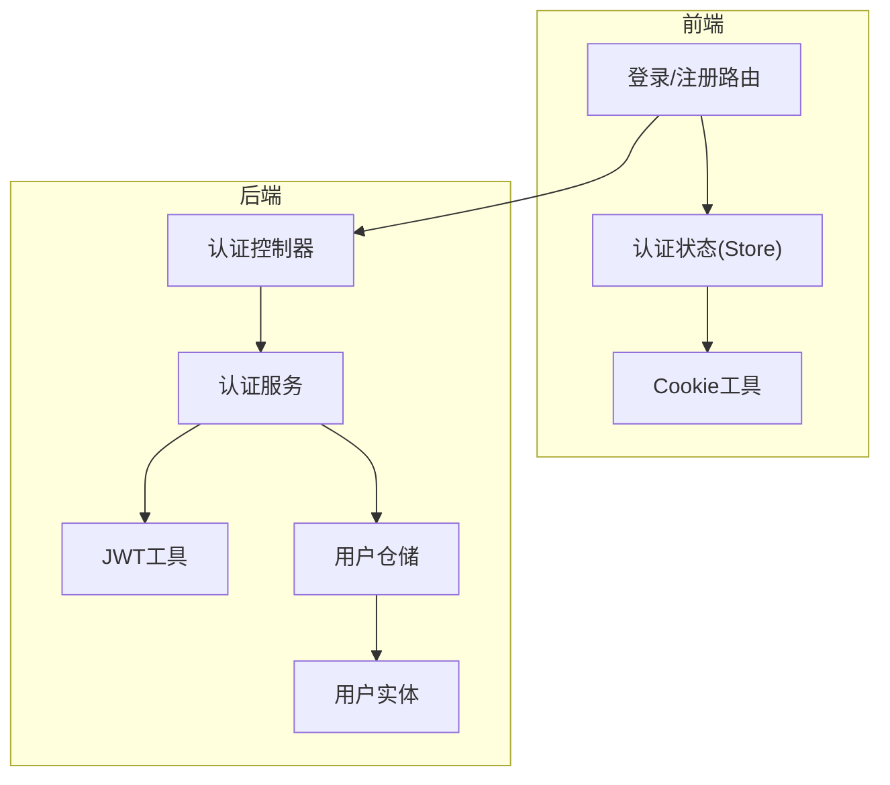
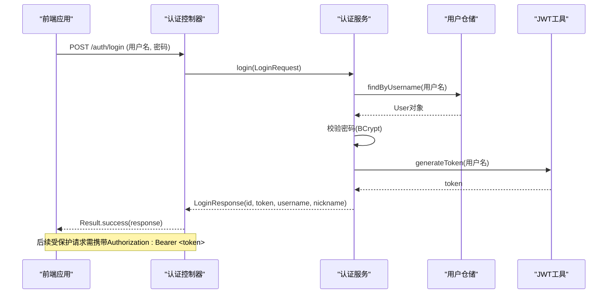
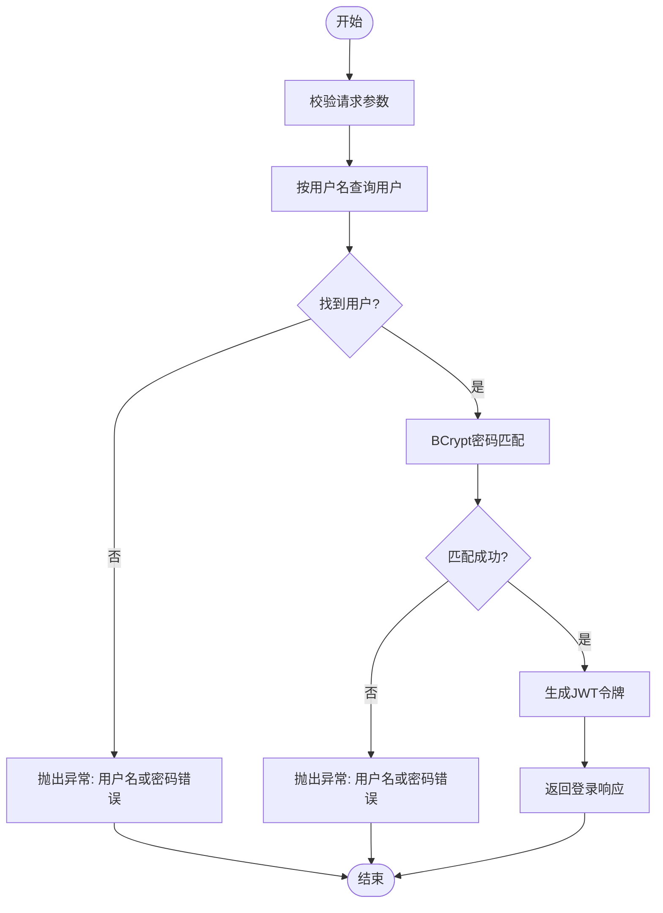
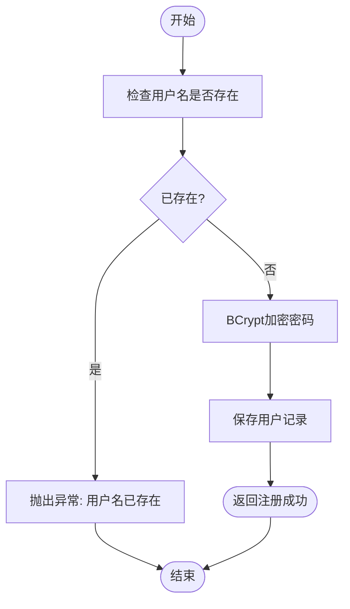
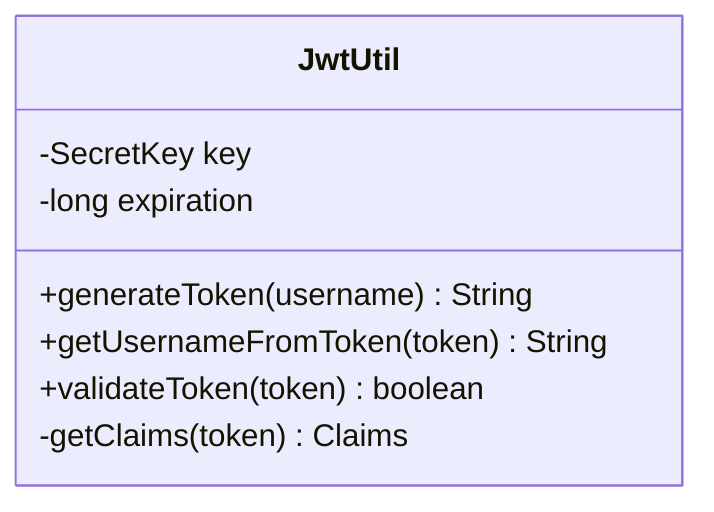
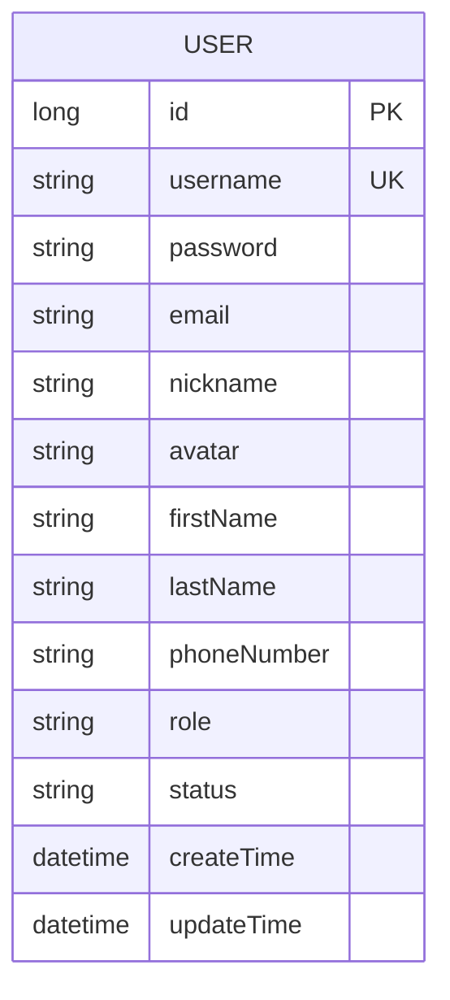
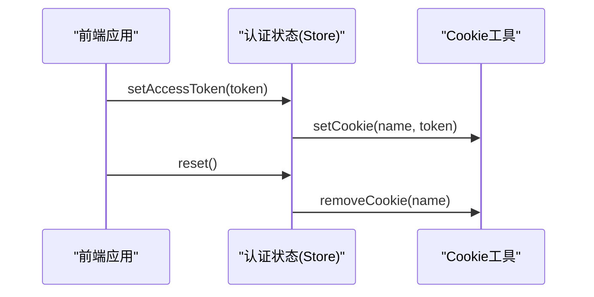
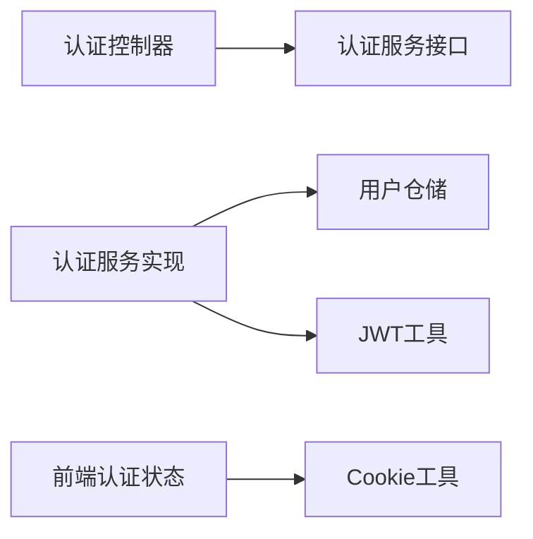

# 用户认证授权系统

<cite>
**本文引用的文件**
- [AuthController.java](file://java_server/po/src/main/java/com/goodzheng/po/controller/AuthController.java)
- [AuthService.java](file://java_server/po/src/main/java/com/ goodzheng/po/service/AuthService.java)
- [AuthServiceImpl.java](file://java_server/po/src/main/java/com/goodzheng/po/service/impl/AuthServiceImpl.java)
- [JwtUtil.java](file://java_server/po/src/main/java/com/goodzheng/po/util/JwtUtil.java)
- [User.java](file://java_server/po/src/main/java/com/goodzheng/po/entity/User.java)
- [LoginRequest.java](file://java_server/po/src/main/java/com/goodzheng/po/dto/LoginRequest.java)
- [LoginResponse.java](file://java_server/po/src/main/java/com/goodzheng/po/dto/LoginResponse.java)
- [auth-store.ts](file://web_client/shadcn-admin/src/stores/auth-store.ts)
- [cookies.ts](file://web_client/shadcn-admin/src/lib/cookies.ts)
- [sign-in.tsx](file://web_client/shadcn-admin/src/routes/(auth)/sign-in.tsx)
- [sign-up.tsx](file://web_client/shadcn-admin/src/routes/(auth)/sign-up.tsx)
</cite>

## 目录
1. [简介](#简介)
2. [项目结构](#项目结构)
3. [核心组件](#核心组件)
4. [架构总览](#架构总览)
5. [详细组件分析](#详细组件分析)
6. [依赖关系分析](#依赖关系分析)
7. [性能考虑](#性能考虑)
8. [故障排查指南](#故障排查指南)
9. [结论](#结论)
10. [附录：认证API文档与安全实践](#附录认证api文档与安全实践)

## 简介
本技术文档围绕“用户认证授权系统”展开，聚焦JWT令牌认证机制、用户注册登录流程、权限控制模型、前后端集成方案以及安全加固要点。后端基于Spring Boot实现，使用BCrypt对密码进行加密存储，通过JWT签发与校验完成无状态鉴权；前端采用React（TanStack Router）配合Zustand状态管理，将Token持久化到Cookie并在请求中携带，构建安全的用户会话。

## 项目结构
- 后端（Java/Spring Boot）
  - 控制器层：提供认证相关HTTP接口（登录、注册）
  - 服务层：封装业务逻辑（注册校验、密码比对、生成JWT）
  - 工具层：JWT签发与校验
  - 数据层：用户实体与仓库
- 前端（React + TanStack Router + Zustand）
  - 路由：登录/注册页面路由
  - 状态：认证状态（用户信息、访问令牌）
  - 工具：Cookie读写封装

**图表来源**
- [AuthController.java:11-39](file://java_server/po/src/main/java/com/goodzheng/po/controller/AuthController.java#L11-L39)
- [AuthServiceImpl.java:13-46](file://java_server/po/src/main/java/com/goodzheng/po/service/impl/AuthServiceImpl.java#L13-L46)
- [JwtUtil.java:13-55](file://java_server/po/src/main/java/com/goodzheng/po/util/JwtUtil.java#L13-L55)
- [User.java:8-58](file://java_server/po/src/main/java/com/goodzheng/po/entity/User.java#L8-L58)
- [auth-store.ts:25-54](file://web_client/shadcn-admin/src/stores/auth-store.ts#L25-L54)
- [cookies.ts:11-43](file://web_client/shadcn-admin/src/lib/cookies.ts#L11-L43)

**章节来源**
- [AuthController.java:11-39](file://java_server/po/src/main/java/com/goodzheng/po/controller/AuthController.java#L11-L39)
- [AuthServiceImpl.java:13-46](file://java_server/po/src/main/java/com/goodzheng/po/service/impl/AuthServiceImpl.java#L13-L46)
- [JwtUtil.java:13-55](file://java_server/po/src/main/java/com/goodzheng/po/util/JwtUtil.java#L13-L55)
- [User.java:8-58](file://java_server/po/src/main/java/com/goodzheng/po/entity/User.java#L8-L58)
- [auth-store.ts:25-54](file://web_client/shadcn-admin/src/stores/auth-store.ts#L25-L54)
- [cookies.ts:11-43](file://web_client/shadcn-admin/src/lib/cookies.ts#L11-L43)

## 核心组件
- 认证控制器：暴露登录与注册接口，统一返回结果包装
- 认证服务：处理注册唯一性校验、密码加密存储、登录校验与JWT签发
- JWT工具：负责令牌的生成、解析与校验
- 用户实体：定义用户字段、角色、状态等
- 前端认证状态：在Zustand中维护用户信息与访问令牌，并通过Cookie持久化

**章节来源**
- [AuthController.java:11-39](file://java_server/po/src/main/java/com/goodzheng/po/controller/AuthController.java#L11-L39)
- [AuthService.java:6-10](file://java_server/po/src/main/java/com/goodzheng/po/service/AuthService.java#L6-L10)
- [AuthServiceImpl.java:13-46](file://java_server/po/src/main/java/com/goodzheng/po/service/impl/AuthServiceImpl.java#L13-L46)
- [JwtUtil.java:13-55](file://java_server/po/src/main/java/com/goodzheng/po/util/JwtUtil.java#L13-L55)
- [User.java:8-58](file://java_server/po/src/main/java/com/goodzheng/po/entity/User.java#L8-L58)
- [auth-store.ts:25-54](file://web_client/shadcn-admin/src/stores/auth-store.ts#L25-L54)

## 架构总览
下图展示了从前端登录到后端签发JWT的完整调用链，以及后续请求携带Token的流程。

**图表来源**
- [AuthController.java:19-27](file://java_server/po/src/main/java/com/goodzheng/po/controller/AuthController.java#L19-L27)
- [AuthServiceImpl.java:35-46](file://java_server/po/src/main/java/com/goodzheng/po/service/impl/AuthServiceImpl.java#L35-L46)
- [JwtUtil.java:25-33](file://java_server/po/src/main/java/com/goodzheng/po/util/JwtUtil.java#L25-L33)

## 详细组件分析

### 登录流程（含密码校验与JWT签发）
- 输入校验：登录请求体包含用户名与密码，使用验证注解确保必填
- 用户查询：根据用户名查找用户记录
- 密码校验：使用BCrypt对明文密码与密文密码进行匹配
- 签发令牌：成功后调用JWT工具生成访问令牌
- 响应封装：返回用户标识、令牌、用户名与昵称

**图表来源**
- [LoginRequest.java:6-14](file://java_server/po/src/main/java/com/goodzheng/po/dto/LoginRequest.java#L6-L14)
- [AuthServiceImpl.java:35-46](file://java_server/po/src/main/java/com/goodzheng/po/service/impl/AuthServiceImpl.java#L35-L46)
- [JwtUtil.java:25-33](file://java_server/po/src/main/java/com/goodzheng/po/util/JwtUtil.java#L25-L33)

**章节来源**
- [AuthController.java:19-27](file://java_server/po/src/main/java/com/goodzheng/po/controller/AuthController.java#L19-L27)
- [LoginRequest.java:6-14](file://java_server/po/src/main/java/com/goodzheng/po/dto/LoginRequest.java#L6-L14)
- [AuthServiceImpl.java:35-46](file://java_server/po/src/main/java/com/goodzheng/po/service/impl/AuthServiceImpl.java#L35-L46)
- [JwtUtil.java:25-33](file://java_server/po/src/main/java/com/goodzheng/po/util/JwtUtil.java#L25-L33)

### 注册流程（含密码加密存储）
- 唯一性检查：根据用户名判断是否已存在
- 密码加密：使用BCrypt对密码进行哈希存储
- 保存用户：写入数据库并返回成功消息

**图表来源**
- [AuthServiceImpl.java:21-33](file://java_server/po/src/main/java/com/goodzheng/po/service/impl/AuthServiceImpl.java#L21-L33)

**章节来源**
- [AuthController.java:29-39](file://java_server/po/src/main/java/com/goodzheng/po/controller/AuthController.java#L29-L39)
- [AuthServiceImpl.java:21-33](file://java_server/po/src/main/java/com/goodzheng/po/service/impl/AuthServiceImpl.java#L21-L33)

### JWT令牌机制（生成、验证、刷新策略）
- 生成：以用户名为主题，设置签发时间与过期时间，使用HMAC密钥签名
- 验证：解析并验签，捕获异常返回失败
- 刷新策略：当前未实现刷新令牌；建议引入Access Token短期有效、Refresh Token长期有效的双令牌模式，并提供刷新接口

**图表来源**
- [JwtUtil.java:13-55](file://java_server/po/src/main/java/com/goodzheng/po/util/JwtUtil.java#L13-L55)

**章节来源**
- [JwtUtil.java:13-55](file://java_server/po/src/main/java/com/goodzheng/po/util/JwtUtil.java#L13-L55)

### 用户实体与角色字段
- 用户实体包含基础信息、角色、状态、创建与更新时间等
- 角色字段默认值为“admin”，可用于后续RBAC扩展

**图表来源**
- [User.java:8-58](file://java_server/po/src/main/java/com/goodzheng/po/entity/User.java#L8-L58)

**章节来源**
- [User.java:8-58](file://java_server/po/src/main/java/com/goodzheng/po/entity/User.java#L8-L58)

### 前端认证状态与会话管理
- 状态管理：使用Zustand维护用户信息与访问令牌
- 持久化：将访问令牌存入Cookie，支持读取、设置与删除
- 路由：提供登录与注册页面路由入口

**图表来源**
- [auth-store.ts:25-54](file://web_client/shadcn-admin/src/stores/auth-store.ts#L25-L54)
- [cookies.ts:11-43](file://web_client/shadcn-admin/src/lib/cookies.ts#L11-L43)

**章节来源**
- [auth-store.ts:25-54](file://web_client/shadcn-admin/src/stores/auth-store.ts#L25-L54)
- [cookies.ts:11-43](file://web_client/shadcn-admin/src/lib/cookies.ts#L11-L43)
- [sign-in.tsx:9-12](file://web_client/shadcn-admin/src/routes/(auth)/sign-in.tsx#L9-L12)
- [sign-up.tsx:4-6](file://web_client/shadcn-admin/src/routes/(auth)/sign-up.tsx#L4-L6)

## 依赖关系分析
- 控制器依赖服务接口，服务实现依赖仓储与JWT工具
- 前端依赖状态管理与Cookie工具，路由驱动页面渲染

**图表来源**
- [AuthController.java:11-39](file://java_server/po/src/main/java/com/goodzheng/po/controller/AuthController.java#L11-L39)
- [AuthService.java:6-10](file://java_server/po/src/main/java/com/goodzheng/po/service/AuthService.java#L6-L10)
- [AuthServiceImpl.java:13-46](file://java_server/po/src/main/java/com/goodzheng/po/service/impl/AuthServiceImpl.java#L13-L46)
- [JwtUtil.java:13-55](file://java_server/po/src/main/java/com/goodzheng/po/util/JwtUtil.java#L13-L55)
- [auth-store.ts:25-54](file://web_client/shadcn-admin/src/stores/auth-store.ts#L25-L54)
- [cookies.ts:11-43](file://web_client/shadcn-admin/src/lib/cookies.ts#L11-L43)

**章节来源**
- [AuthController.java:11-39](file://java_server/po/src/main/java/com/goodzheng/po/controller/AuthController.java#L11-L39)
- [AuthService.java:6-10](file://java_server/po/src/main/java/com/goodzheng/po/service/AuthService.java#L6-L10)
- [AuthServiceImpl.java:13-46](file://java_server/po/src/main/java/com/goodzheng/po/service/impl/AuthServiceImpl.java#L13-L46)
- [JwtUtil.java:13-55](file://java_server/po/src/main/java/com/goodzheng/po/util/JwtUtil.java#L13-L55)
- [auth-store.ts:25-54](file://web_client/shadcn-admin/src/stores/auth-store.ts#L25-L54)
- [cookies.ts:11-43](file://web_client/shadcn-admin/src/lib/cookies.ts#L11-L43)

## 性能考虑
- 密码哈希：BCrypt计算开销较大，建议在并发场景下合理配置线程池与超时
- JWT校验：无状态校验成本低，但应限制令牌长度与过期时间，避免频繁解析
- 数据库查询：登录时仅按用户名查询一次，注意索引优化
- 前端状态：避免重复设置Cookie，减少不必要的重渲染

[本节为通用性能建议，不直接分析具体文件]

## 故障排查指南
- 登录失败
  - 检查用户名是否存在
  - 检查密码是否正确（BCrypt匹配）
  - 查看控制器返回的错误码与消息
- 注册失败
  - 检查用户名是否已存在
  - 检查请求参数是否完整
- 令牌问题
  - 确认JWT密钥与过期时间配置正确
  - 校验请求头是否携带正确的Authorization头

**章节来源**
- [AuthController.java:19-39](file://java_server/po/src/main/java/com/goodzheng/po/controller/AuthController.java#L19-L39)
- [AuthServiceImpl.java:21-46](file://java_server/po/src/main/java/com/goodzheng/po/service/impl/AuthServiceImpl.java#L21-L46)
- [JwtUtil.java:35-55](file://java_server/po/src/main/java/com/goodzheng/po/util/JwtUtil.java#L35-L55)

## 结论
本系统实现了基于JWT的无状态认证，结合BCrypt密码加密与前端Cookie持久化，形成完整的登录注册流程。当前未实现刷新令牌与细粒度权限控制，建议后续引入双令牌机制与RBAC模型，增强安全性与可扩展性。

[本节为总结性内容，不直接分析具体文件]

## 附录：认证API文档与安全实践

### API概览
- 登录
  - 方法：POST
  - 路径：/auth/login
  - 请求体：包含用户名与密码
  - 响应：统一结果包装，包含用户ID、令牌、用户名与昵称
- 注册
  - 方法：POST
  - 路径：/auth/register
  - 参数：用户名、密码、邮箱（可选）
  - 响应：统一结果包装，包含成功消息

**章节来源**
- [AuthController.java:19-39](file://java_server/po/src/main/java/com/goodzheng/po/controller/AuthController.java#L19-L39)
- [LoginRequest.java:6-14](file://java_server/po/src/main/java/com/goodzheng/po/dto/LoginRequest.java#L6-L14)
- [LoginResponse.java:6-14](file://java_server/po/src/main/java/com/goodzheng/po/dto/LoginResponse.java#L6-L14)

### 安全最佳实践
- 密码安全
  - 使用BCrypt进行哈希存储，避免明文保存
  - 限制密码长度与复杂度，防止弱口令
- 令牌安全
  - 设置合理的过期时间，避免长生命周期令牌
  - 服务端校验令牌签名与有效期
  - 建议引入刷新令牌机制，缩短访问令牌生命周期
- 传输安全
  - 全站HTTPS，防止中间人攻击
  - 跨域配置最小化，限制允许的源与方法
- 前端安全
  - Token存储建议使用HttpOnly Cookie，降低XSS风险
  - 请求拦截器统一附加Authorization头，集中处理401/403
  - 自动刷新：在访问令牌即将过期时触发刷新流程
- CSRF防护
  - 若使用Cookie承载Token，启用CSRF保护或使用SameSite策略
  - 敏感操作增加二次确认与验证码

[本节为通用安全建议，不直接分析具体文件]

### 前后端集成要点
- 前端
  - 登录后将Token写入Cookie，并在后续请求中携带
  - 使用状态管理维护用户信息与令牌，提供重置与登出能力
  - 路由守卫：未登录时重定向至登录页
- 后端
  - 登录成功后返回令牌，由前端负责存储与传递
  - 受保护接口需校验Authorization头中的令牌有效性

**章节来源**
- [auth-store.ts:25-54](file://web_client/shadcn-admin/src/stores/auth-store.ts#L25-L54)
- [cookies.ts:11-43](file://web_client/shadcn-admin/src/lib/cookies.ts#L11-L43)
- [JwtUtil.java:35-55](file://java_server/po/src/main/java/com/goodzheng/po/util/JwtUtil.java#L35-L55)